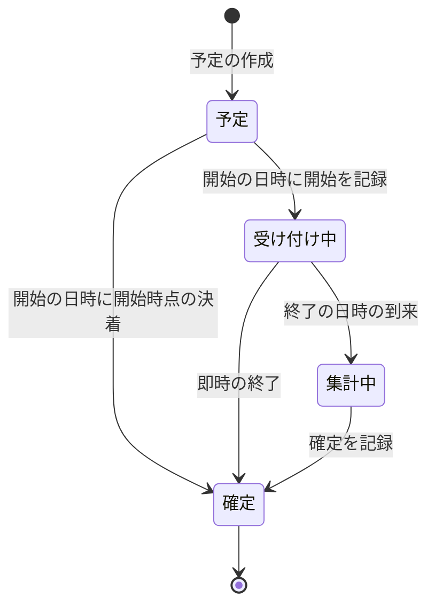

# 期間を限った投票

開始と終了の日時で受け付けの期間を限り、1人が1つの投票に1票を投じ、期間中に別の選択肢への付け替えと取り消しができる投票の規約を定める。状態の導出と受け付けの時刻の境界、票の記録と集計値の一括の書き込み、同時の要求、集計値の確定と同数の決着、開始の日時の判定、利用者と選択肢の状態の変化による票の無効化と即時の終了、日次の処理の再実行と回復、無作為の組み合わせ、投票のイベントの順序と冪等性、投票の履歴の公開、及びテストを扱う。

一括の書き込みと取り消しは「[Cloudflare D1の制約と対処](../db/002-d1-constraints.md)」に、退会・停止の同期の文は「[ユーザーライフサイクルイベント](007-user-lifecycle-events.md)」に、選択肢の元の集約の非公開化・削除は「[集約のライフサイクルイベント](012-aggregate-lifecycle-events.md)」に、日次のジョブと冪等性は「[非同期処理の設計](../infra/003-async-processing.md)」に、投票の操作のbot判定は「[レート制限とbot判定の検証](003-rate-limiting-and-bot-verification.md#bot判定の検証)」に従う。表示し続ける画面の側は「[集計値と残り時間を表示し続ける画面](../frontend/013-live-scoreboard.md)」で扱う。

## 前提と用語

部品の置き場所は、共通ライブラリの配置先と`<APIサーバーのアプリ>`の`src/`からのパスで示す。テーブルと列の名前は例で、`<投票>`などのプレースホルダーとともに機能ごとに置き換える。

| 部品                                                     | 置き場所                                                                 | 役割                                                             |
| -------------------------------------------------------- | ------------------------------------------------------------------------ | ---------------------------------------------------------------- |
| 状態の導出・決着の規則・組み合わせの規則                 | 共通ライブラリの`core/<ドメイン>/`                                       | 実行環境に依存しない純粋な規則。日次の処理と表示が同じ判定を使う |
| 照会・予定の作成・イベントの記録と送信の契約と識別子     | 共通ライブラリの`core/<ドメイン>/ports.ts`・`identifiers.ts`             | 複数のアプリと後から加わる機能が使う契約                         |
| 照会・予定の作成・イベントの記録と送信の実装と共通の束縛 | 共通ライブラリの`workers/<ドメイン>/`                                    | D1とQueueの実装                                                  |
| 受け付け中の条件・投票の条件                             | `infrastructure/<ドメイン>/<投票>-guards.ts`                             | 記録の文に入れる条件の式                                         |
| 集計値の求め直しの文                                     | `infrastructure/<ドメイン>/tally-statements.ts`                          | 票の変更と同じ一括の書き込みに入れる集合の更新                   |
| 即時の終了の文                                           | `infrastructure/<ドメイン>/<投票>-closure-statements.ts`                 | ライフサイクルの同期の処理が返す集合の更新                       |
| 乱数の部品                                               | `core/<ドメイン>/`(棄却法)・`infrastructure/<ドメイン>/`(暗号論的な乱数) | 組み合わせの並べ替えに使う、偏りの無い予測できない整数           |

| 用語           | 意味                                                                                                          |
| -------------- | ------------------------------------------------------------------------------------------------------------- |
| 投票           | 開始の日時と終了の日時の間だけ票を受け付ける単位。例のテーブルは`polls`                                       |
| 選択肢         | 投票の中で票を受ける側。出した利用者(出し手)・集計値・結果を持つ。例のテーブルは`poll_options`                |
| 票             | 利用者が1つの投票の1つの選択肢に投じた記録。1人は1つの投票に有効な票を1つだけ持つ。例のテーブルは`poll_votes` |
| 受け付け中     | 開始の記録があり、確定の記録が無く、終了の日時の前である状態                                                  |
| 付け替え       | 有効な票を、同じ投票の別の選択肢へ移すこと                                                                    |
| 集計値         | 選択肢ごとの有効な票の数・最後の票の日時・最後の票の記録の順                                                  |
| 記録の順       | 投票の中で票を記録した順の番号(`seq`)。同じ日時の票の前後を決める                                             |
| 確定           | 終了の日時の後に、集計値から結果を決めて記録すること                                                          |
| 即時の終了     | 受け付け中に選択肢の出し手や選択肢の元の集約が退場し、終了の日時を待たずに確定すること                        |
| 開始時点の決着 | 開始の日時に参加の条件を満たさない選択肢があり、受け付けを始めずに確定すること                                |
| 投票のイベント | 投票の予定・開始・確定を他の機能へ伝える記録。種類ごとに1つの投票に1件                                        |
| 要求の時刻     | 投票の操作の要求を受けた時点。ユースケースが時計を1回だけ読み、判定と全ての文に同じ値を渡す                   |

本文中の`<1回の書き込みの投票の数>`などのプレースホルダーの本プロジェクトの値は、技術ドキュメントに写さず、プロジェクト固有の値の文書「[本プロジェクト固有の値](../../../onboardings/project-values.md)」に置く。

## 状態の導出

投票の状態は、記録(開始・確定)と時刻から導く。状態の列は持たない。



判定の順は、確定の記録があれば確定、開始の記録が無ければ予定、時刻が終了の日時以降なら集計中、それ以外は受け付け中である。

- 受け付けの終わりは時刻で決め、ジョブを待たない。終了の日時を過ぎた要求は、確定のジョブがまだ動いていなくても拒否する。
- 受け付けの始まりは開始の記録で決める。開始の日時に参加の条件を判定してから受け付けるため、開始のジョブが記録するまでは予定のままにする。
- 集計中は票を受け付けず、結果を示さない。確定のジョブが記録するまでの間で、画面は集計していることを示す。
- 同じ導出の関数を、表示の照会・投票の操作の判定・日次の処理で使う。記録の文の条件は、同じ導出の受け付け中を書き込みの時点の行で確かめる式にする(「[受け付けの時刻の境界](#受け付けの時刻の境界)」)。

## 票の記録

### 受け付けの時刻の境界

投票の操作は、ユースケースが読み取った状態で操作を決め(追加・付け替え・取り消し・変更なし)、記録の文の条件で同じ判定をもう一度行う。読み取りと書き込みの間に終了の日時を過ぎる・確定する・利用者が停止されることがあるため、読み取りの判定だけに頼らない。

```typescript
// 外側の文がpollsを対象にしても列の参照が副問い合わせの側に取られないよう、別名で読む
const acceptingPoll = alias(polls, 'accepting_poll');

export function acceptingCondition(
  pollIdColumn: SQLiteColumn | SQL,
  now: Date,
): SQL {
  return sql`EXISTS (SELECT 1 FROM ${polls} AS ${acceptingPoll} WHERE ${and(
    eq(acceptingPoll.id, pollIdColumn),
    isNotNull(acceptingPoll.startedAt),
    isNull(acceptingPoll.decidedAt),
    gt(acceptingPoll.endsAt, now),
  )})`;
}
```

- `now`は要求の時刻にする。終了の日時ちょうどの要求は受け付けない(`endsAt > now`)。確定のジョブは`endsAt <= 実行時刻`の投票を対象にし、境界の時刻で受け付けと確定が重ならない。
- 副問い合わせの投票のテーブルに別名を付ける。外側の文が同じテーブルを更新するとき(確定の文など)に、別名が無いと`polls.id`が外側の行を指し、条件が常に真になる。

### 1つの一括の書き込み

1回の操作は、次の文を順に並べた1つの`db.batch()`にする。

| 操作     | 文の並び                                                     |
| -------- | ------------------------------------------------------------ |
| 追加     | 条件付きの票の挿入 → 集計値の求め直し                        |
| 付け替え | 元の選択肢の票の削除 → 条件付きの票の挿入 → 集計値の求め直し |
| 取り消し | 受け付け中を条件にした票の削除 → 集計値の求め直し            |

条件付きの票の挿入は、NOT NULLの選択肢の列へ「条件が成り立てば選択肢のID、成り立たなければNULL」を入れる。条件が成り立たないとNOT NULLの違反で一括の書き込み全体が取り消され、付け替えの削除も残らない(「[版の検査で一括の書き込み全体を取り消す](../db/002-d1-constraints.md#版の検査で一括の書き込み全体を取り消す)」)。`UPDATE`や`INSERT … SELECT … WHERE`の条件は、成り立たなくても0行の書き込みで成功し、前の削除だけが確定してしまう。

```typescript
db.insert(pollVotes).values({
  id: voteId,
  pollId,
  optionId: sql`CASE WHEN ${voteAllowedCondition({ pollId, optionId, userId, now })} THEN ${optionId} ELSE NULL END`,
  userId,
  votedAt: now,
  seq: sql`(SELECT COALESCE(MAX(${pollVotes.seq}), 0) + 1 FROM ${pollVotes} WHERE ${eq(pollVotes.pollId, pollId)})`,
  createdAt: now,
  updatedAt: now,
});
```

- 投票の条件は、受け付け中・選択肢がその投票のもの・利用者がその投票のどの選択肢の出し手でもない・利用者が投票できる状態(メールアドレスの確認済み・停止中や退会済みでない)の積にする。利用者の状態は利用者のテーブルの照会口の条件(確認済みの利用者を表す式など)を副問い合わせで使い、ユースケースの判定と同じ式にする。
- NOT NULLの違反は、`cause`をたどって検査に使った`<テーブル>.<列>`の違反だけを拒否(`rejected`)に変換し、他の失敗はそのまま投げ直す。ユースケースは拒否を受けたら状態を読み直して理由を分類する(投票が無い・受け付け中でない・自分の選択肢がある投票・利用者の状態)。読み直しでどの理由にも当たらなければ(書き込みの後に利用者の状態が戻った場合など)、利用者の状態の理由にする。
- 付け替えの削除は、利用者の有効な票を元の選択肢(`option_id = <元の選択肢>`)で絞る。読み取りの後に同じ利用者の別の要求が先に付け替えていれば何も消さず、続く挿入が有効な票の一意索引に当たって全体を取り消す。絞らないと、2回目の同じ付け替えが付け替え先の票を消して作り直し、票の日時と記録の順が後ろへずれる。
- 取り消しの削除は、受け付け中の条件だけを持ち、利用者の状態を条件にしない。削除した件数が0なら、読み直して受け付け中なら有効な票が無い状態として現在の値を返し、受け付け中でなければ受け付け中でない理由にする。ログインと利用者の状態の確認は、取り消しでも操作の入口(リゾルバ)で先に行う。
- 利用者の操作による付け替えと取り消しは物理削除にする。利用者の状態の変化で無効にする票は論理削除で残す(「[票の無効化](#票の無効化)」)。

### 同時の要求

有効な票の一意は、部分一意索引で保つ。

```typescript
uniqueIndex('poll_votes_poll_id_user_id_active_unique')
  .on(table.pollId, table.userId)
  .where(sql`${table.deletedAt} is null`);
```

| 同時に届いた要求                    | 後に書いた要求の結果                                    |
| ----------------------------------- | ------------------------------------------------------- |
| 同じ利用者の同じ選択肢への2つの追加 | 一意索引の違反で全体を取り消し、重複(`duplicate`)       |
| 同じ利用者の別の選択肢への2つの追加 | 同上。先に書いた方の選択肢の票が残る                    |
| 同じ利用者の同じ付け替えの2回目     | 付け替えの削除が0件になり、挿入が一意索引に当たって重複 |

- 重複は、ユースケースが成功として扱い、最新の値を返す。利用者の票は先に書いた要求で既に決まっており、返した値で画面がどちらの選択肢に票があるかを示す。
- 一意索引の違反は、`cause`の文言の`UNIQUE constraint failed: <テーブル>.<列>, <テーブル>.<列>`で判別する(「[ユニーク制約のあるテーブルへの追加](../db/002-d1-constraints.md#ユニーク制約のあるテーブルへの追加)」)。部分一意索引の違反も列の名前で報告される。
- 記録の順(`seq`)は、挿入の文の中の副問い合わせで`MAX(seq) + 1`を採番する。D1は書き込みを1つずつ実行するため、同じ投票の中で番号が重ならない。論理削除した票も数えるため、番号は記録した順のまま増え続ける。

## 集計値

### 求め直し

集計値は選択肢の行に保存し、票を変える全ての一括の書き込みの末尾で、有効な票から求め直す。増減の文(`vote_count = vote_count + 1`)は使わない。

```typescript
// 確定の決着の順(最後の票の日時、同じなら記録の順)と同じ並びの先頭
function latestVote(
  column: typeof pollVotes.votedAt | typeof pollVotes.seq,
): SQL {
  return sql`(SELECT ${column} FROM ${pollVotes} WHERE ${activeVotesOfOption()} ORDER BY ${desc(pollVotes.votedAt)}, ${desc(pollVotes.seq)} LIMIT 1)`;
}

export function tallyRecomputeStatement(
  db: Database,
  target: SQL,
  now: Date,
): BatchItem<'sqlite'> {
  return db
    .update(pollOptions)
    .set({
      voteCount: sql`(SELECT COUNT(*) FROM ${pollVotes} WHERE ${activeVotesOfOption()})`,
      lastVotedAt: latestVote(pollVotes.votedAt),
      lastVoteSeq: latestVote(pollVotes.seq),
      updatedAt: now,
    })
    .where(and(target, acceptingCondition(pollOptions.pollId, now)));
}
```

- 対象(`target`)は、操作では投票の全ての選択肢、利用者の状態の変化ではその利用者の票があった選択肢にする。求め直しは何度実行しても同じ値になるため、対象を広めに取ってもよい。
- 受け付け中の投票だけを対象にする。集計中と確定の後の集計値は変えない。
- 表示と確定は保存した集計値を読み、票を数えない。一覧の照会の重さが票の数によらない。

### 確定と同数の決着

確定のジョブは、終了の日時を過ぎた未確定の投票の結果を、保存した集計値で決める。確定の時に票から数え直さない。退会などで集計中や確定の後に無効にした票は求め直さないため(「[票の無効化](#票の無効化)」)、受け付けの終了の後に起きた変化で結果が変わらない。

| 比べる順 | 前にする選択肢             | 理由                                           |
| -------- | -------------------------- | ---------------------------------------------- |
| 1        | 票の数が多い               | 投票の結果                                     |
| 2        | 最後の票の日時が早い       | 同数に先に達した方を前にする                   |
| 3        | 最後の票の記録の順が小さい | 同じ時刻(ミリ秒)の票を記録した順で必ず区別する |

- 票の無い場合(全ての選択肢が0票)の扱いを、決着の規則に明示する。
- 集計値が食い違う(同数で1票以上なのに最後の票の日時が無い、日時も記録の順も一致するなど)投票は、規則の関数が`RangeError`を投げる。ジョブはその投票をレベル`warning`のログ(投票のIDと例外)で飛ばして未確定のまま残し、終えているはずの時刻を過ぎた未確定の投票の報告で運用者が拾う(「[回復と報告](#回復と報告)」)。

確定の一括の書き込みは、1つの投票につき次の3文を、この順に並べる。3文とも同じ未確定の条件(開始の記録があり、確定の記録が無く、`endsAt <= 実行時刻`)を持つ。

| 順  | 文             | 書き方                                                                                                                 |
| --- | -------------- | ---------------------------------------------------------------------------------------------------------------------- |
| 1   | 選択肢の結果   | `UPDATE poll_options SET result = CASE id WHEN ? THEN ? … END WHERE poll_id = ? AND <未確定の条件>`                    |
| 2   | 確定のイベント | `INSERT INTO poll_events … SELECT … FROM polls WHERE id = ? AND <未確定の条件> ON CONFLICT (poll_id, type) DO NOTHING` |
| 3   | 投票の確定     | `UPDATE polls SET decided_at = ?, decision = ? WHERE id = ? AND <未確定の条件>`                                        |

- 投票の確定を最後に置く。先に置くと、後の2文の条件が確定済みの行を見て成り立たず、イベントと結果が書かれない。後に置けば、即時の終了が先に確定した投票では3文とも何も書かない。
- 書き込んだかどうかは、一括の書き込みの後にイベントのIDを読み、残っていた投票だけを確定した(イベントを送る)ものとして扱う。
- 1回の一括の書き込みは`<1回の書き込みの投票の数>`までにし、超える入力を`RangeError`で拒否する。読み取りは`<1回の読み取りの投票の数>`ずつ行う。
- 同じ時刻に他のジョブと時間の予算を分け合う場合は、読み取りの前ごとに打ち切りの時刻(予定時刻から`<確定の打ち切りの時間>`)を確かめ、過ぎていれば残りを次の起動のジョブの先頭の確定に任せて終える(「[同じ時刻のジョブ群の時間の予算](../infra/003-async-processing.md#同じ時刻のジョブ群の時間の予算)」)。
- 決着できずに飛ばした投票は同じ読み取りで再び返る。処理済みの投票のIDを覚え、新しい投票が1件も無い読み取りで止める。

### 開始と開始時点の決着

開始のジョブは、開始の日時を過ぎた予定の投票ごとに選択肢の参加の条件を判定し、全ての選択肢が条件を満たせば開始を、満たさない選択肢があれば開始時点の決着を書く。

- 一括の書き込みの順は確定と同じく[選択肢→イベント→投票]にする。条件は、開始の記録も確定の記録も無く`startsAt <= 実行時刻`であることに加え、判定で条件を満たさないとした選択肢以外に、退場の記録(`forfeited_at`)が無いことにする。判定の後に即時の終了の文が記録した退場を見落として開始しない。
- 条件で書き込まれなかった投票は、読み直して1回だけ判定し直す。2回とも書けない投票と決着できない投票は、確定と同じく処理済みとして覚えて止める。
- 開始時点の決着でも開始の記録(`started_at`)を書く。開始のジョブが扱った投票を、未開始の条件で再び拾わない。

## 利用者と選択肢の状態の変化

### 票の無効化

利用者の退会・停止は、ユーザーライフサイクルの同期の処理で、利用者のIDを条件にした集合の更新の文を状態の遷移と同じ一括の書き込みに入れる(「[文の規約](007-user-lifecycle-events.md#文の規約)」)。

| 順  | 文               | 書き方                                                                                                                           |
| --- | ---------------- | -------------------------------------------------------------------------------------------------------------------------------- |
| 1   | 票の論理削除     | `UPDATE poll_votes SET deleted_at = <事象の時刻> WHERE user_id = ? AND deleted_at IS NULL`(無効にする範囲を状態ごとの条件で絞る) |
| 2   | 集計値の求め直し | 対象を`poll_options.id IN (SELECT option_id FROM poll_votes WHERE user_id = ? AND deleted_at = <事象の時刻>)`にした求め直しの文  |

- 無効にする範囲は状態ごとに決める。退会は全ての票、停止は受け付け中の投票の票だけ、のように1の条件で絞る。受け付けの終了の後の票は集計値に入れたまま確定に使う。
- 求め直しの対象は、論理削除の日時が事象の時刻と同じ票で特定する。同じ一括の書き込みで消した票の選択肢になる。前に同じ時刻で消した票を余分に拾っても、求め直しは冪等で受け付け中の投票に限るため結果は変わらない。
- 無効にした票は論理削除で残す。有効な票の一意索引は`deleted_at IS NULL`の行だけに掛かるため、停止の解除の後に同じ投票へ投じ直せる。

### 即時の終了

受け付け中に選択肢の出し手が退会・停止された、または選択肢の元の集約が非公開化・削除された場合は、退場した側を負けとして投票を確定する。同期の処理の文で、出し手のIDか元の集約のIDを条件にした集合の更新にする(利用者の退会・停止なら票の無効化の文の後に並べる)。

| 順  | 文                     | 書き方                                                                                                                                   |
| --- | ---------------------- | ---------------------------------------------------------------------------------------------------------------------------------------- |
| 1   | 選択肢の結果           | 退場した側を含む受け付け中の投票の選択肢を、退場した側は負け、他は相手の退場による勝ちにする(`CASE WHEN <退場した側> THEN … ELSE … END`) |
| 2   | 投票の確定             | 同じ投票を、確定の日時・即時の終了の日時と、相手の退場による勝ちの側が残ればその決着、残らなければ両方の負けの決着で確定する             |
| 3   | 予定の投票の退場の記録 | 開始の記録も確定の記録も無い投票の退場した側に、退場の日時(`forfeited_at`)を記録する。開始時点の決着で負けにする                         |

- 2を1の後に置き、1と同じ受け付け中の条件で同じ投票だけを確定する。2の決着は1の書いた結果から求める。
- 確定のジョブと同時に起きても、どちらも確定の記録が無いことを条件に書くため、先に書いた方だけが有効になる。
- 集計中(終了の日時以降)の投票は即時の終了にせず、確定のジョブに任せる。結果は受け付けの終了の時点の集計値で決まる。
- 即時の終了で確定した投票のイベントは、同期の文では作らない(イベントのIDと件数が事象ごとに変わり、集合の更新で書けない)。同じ事象の非同期の処理が「確定済みで確定のイベントが無い投票」にイベントを作って送る。処理は事象の種類で絞らず、確定の日時が直近(`<即時の終了の掃き出しの遡る期間>`)の全体を掃き出すため、何度動いても結果が変わらない。1回に作る件数の上限ちょうどで止めた場合は続き(`continue`)を返す(「[保有者単位で上限件数ずつ処理する操作の対応付け](007-user-lifecycle-events.md#保有者単位で上限件数ずつ処理する操作の対応付け)」)。

## 日次の処理

### 時刻の扱い

確定・組み合わせ・開始のジョブは、次の2つの時刻を使い分ける。

| 時刻               | 使い道                                                                 | 読み方                                        |
| ------------------ | ---------------------------------------------------------------------- | --------------------------------------------- |
| 予定時刻の業務日付 | 対象の業務日付(組み合わせる翌日・開始を回復する当日)と、打ち切りの時刻 | `ScheduledJobContext.business.date`と予定時刻 |
| 実行時刻           | 開始・終了の日時との比較と、記録する開始・確定の日時                   | `Clock.now()`。起動の遅れの後に読み直す       |

- 起動が遅れて日付をまたいでも、対象の業務日付は変わらない。予定時刻より前に手動で起こしても、開始の日時の前の投票を開始しない。

### 再実行と回復

日次のジョブは、同じ業務日付に何度実行しても結果が変わらないようにする(「[重複配信と冪等性](../infra/003-async-processing.md#重複配信と冪等性)」)。

- 確定と開始は、未確定・未開始の条件で読み、同じ条件で書くため、再実行は残った投票だけを扱う。
- 組み合わせは、業務日付ごとの記録の行を`onConflictDoNothing()`で作り、既にその日の投票に入っている対象を除いて組む。予定の作成は`INSERT … SELECT … WHERE NOT EXISTS (<同じ対象を含む同じ種類の投票>)`と、選択肢の`(poll_id, slot)`の一意索引の`ON CONFLICT`で、選択肢の欠けた投票を作らない。同じ対象を2つの投票に入れない規則は選択肢の部分一意索引で保ち、1つの投票の両方の選択肢に同じ対象を渡す誤りは違反で全体を取り消す。
- 同時に動いた別の実行が先に投票へ入れた対象を含む投票は作られず、その相手の対象がどの投票にも入らずに残る。作られなかった投票が1件以上あれば、完了を記録する前に、まだ投票に入っていない対象を読み直して組み直す。組み直しの回数に上限を設け、上限まで組み直しても作られない投票が残れば完了を記録せず、後のジョブの回復に委ねる。ログには作られなかった投票の件数だけを出す。
- 組む対象が0件でも、その日の組み合わせの完了を記録する。後のジョブの回復の判定が完了の有無だけを見るためである。完了の日時は最初の完了の値を保つ(`COALESCE`)。
- 後のジョブ(開始)は、先頭でその日の組み合わせが完了していなければ先に組み合わせ、遅れを報告してから開始する。時刻の差で前のジョブの完了を仮定しない。
- 前のジョブが打ち切った確定は、次の起動のジョブが先頭で行い(打ち切らない)、確定した投票があれば遅れを報告する。

### 回復と報告

- 各ジョブの先頭で、確定の日時が直近(`<ジョブの掃き出しの遡る期間>`)で確定のイベントが無い投票のイベントを作って送る。
- 送れなかったイベントは送信待ち(`pending`)のまま残り、日次の送り直しのジョブが、最後の送信から一定の時間が過ぎたものを上限件数まで送り直す。送信の部品は失敗をレベル`warning`のログに残し、ジョブを止めない。
- 終えているはずの時刻を一定の時間過ぎても未確定の投票が残れば、件数をエラートラッキングへ報告する。開始の遅れ・確定の遅れ・組み合わせの遅れも、種類ごとの指紋で報告する(「[送信する例外と送信しない例外](../infra/004-logging-and-error-tracking.md#送信する例外と送信しない例外)」)。
- 完了してから保持期間を過ぎたイベントと処理の記録を、日次のジョブで上限件数ずつ削除する。

### 無作為の組み合わせ

選択肢の組み合わせを無作為に決める場合は、出し手が予測も操作もできない乱数を使う。

```typescript
// 2^32がexclusiveMaxで割り切れないと剰余の小さい値が出やすくなるため、端数の範囲の値を捨てて引き直す
export function createUniformRandomSource(
  nextUint32: () => number,
): RandomSource {
  return {
    nextInt(exclusiveMax) {
      const acceptedLimit = 2 ** 32 - (2 ** 32 % exclusiveMax);
      for (;;) {
        const drawn = nextUint32();
        if (drawn < acceptedLimit) {
          return drawn % exclusiveMax;
        }
      }
    },
  };
}

const cryptoRandom = createUniformRandomSource(
  () => crypto.getRandomValues(new Uint32Array(1)).at(0) ?? Number.NaN,
);
```

- `Math.random()`を使わない。暗号論的な乱数(`crypto.getRandomValues`)の32ビットの値を棄却法で0〜n−1に写し、剰余だけで写したときの偏りを除く。
- 並べ替えはFisher–Yatesで行い、先頭から2つずつ組む。余りの扱い(別の群の余りと組む・相手なしで勝ちにするなど)は規則として固定し、余りに選ばれる対象も並べ替えの結果で無作為に決まるようにする。群の処理の順はIDの昇順など乱数によらない順にする。
- 規則の関数は乱数の部品(`RandomSource`)を引数で受け取り、単体テストは決まった並びを返す偽物で結果を固定する。暗号論的な乱数の実装はinfrastructure層に置く。

## 投票のイベント

投票の予定・開始・確定は、投票のイベントとして記録し、Queueで実行器へ送る。他の機能(結果の反映・通知など)は、イベントの種類と投票の種類を指定して処理を登録する。登録の検証(名前・`order`・重複)はライフサイクルイベントと同じ規則にする(「[登録の検証の共有](012-aggregate-lifecycle-events.md#登録の検証の共有)」)。

- イベントは`(poll_id, type)`の一意索引で1つの投票に種類ごとに1件にし、記録の文は`ON CONFLICT DO NOTHING`で再実行に耐える。予定・開始のイベントは予定の作成と開始と同じ一括の書き込みで、確定のイベントは確定と同じ一括の書き込みで作る(即時の終了を除く)。
- 発生日時は、予定・開始は記録の時刻、確定は確定の日時にする。実行器は同じ投票のより前の未完了のイベントがあれば後のイベントを遅延で待たせ、開始の処理より前に確定の処理を動かさない(「[同じ集約の発生順](012-aggregate-lifecycle-events.md#同じ集約の発生順)」)。
- 実行器は処理ごとの完了を記録し、再試行と送り直しで完了した処理を繰り返さない。処理の続き(`continue`)は後の処理を始めずに遅延で再開する。
- 処理は冪等にする。結果の記録は投票のIDと結果を業務上のキーにし、同じイベントを2回処理しても1回と同じにする。
- 処理が投票を読んで未確定だった場合は、レベル`warning`のログを残して完了にする。確定とイベントは同じ一括の書き込みで作るため、再試行で直らない。

## 投票の履歴の公開

利用者が投じた票の一覧(投票の履歴)を他の利用者へ公開する場合は、票の時刻を表示にも応答にも含めない。票の時刻を並べると、その利用者の生活時間帯を推測できる。

- 一覧は投票の業務日付の降順に並べ、日付の小見出しと件数だけを示す。日付の中の並びには票の日時と票のIDを使うが、どちらも応答に出さない。項目のIDは投票のIDにし、時刻を含むID(ULID)の票のIDを公開しない。
- 続きの位置(カーソル)は`<業務日付>:<投票のID>`だけで持つ。ストアは、位置の業務日付と投票のその利用者の有効な票の`(voted_at, id)`を同じ文の副問い合わせで引き、行の値の比較で続きを読む。
- 続きの位置は、利用者へ中身を示さない符号化した値(UTF-8のbase64url、パディングなし)で渡す。受け取った値は、復号して形式(業務日付と投票のIDの形)を確かめ、再び符号化して受け取った値と一致するものだけを受け付け、それ以外は不正な位置の誤りにする。復号は空白・パディング・末尾の余りのビットを許すため、同じ位置を表す別の表記を受け付けないよう、正規の表記との一致で確かめる。

```typescript
const anchorRow = sql`(SELECT ${anchor.votedAt}, ${anchor.id} FROM ${pollVotes} AS ${anchor} WHERE ${and(
  eq(anchor.userId, userId),
  eq(anchor.pollId, before.pollId),
  eq(anchor.pollDate, before.pollDate),
  isNull(anchor.deletedAt),
)})`;
const after = or(
  lt(pollVotes.pollDate, before.pollDate),
  and(
    eq(pollVotes.pollDate, before.pollDate),
    sql`(${pollVotes.votedAt}, ${pollVotes.id}) < ${anchorRow}`,
  ),
);
```

- 読み込みの間に位置の票が取り消されると副問い合わせが行を返さず、比較がNULLになって同じ日付の残りが落ちる。この場合は位置の日付より前の日付から続ける(同じ日付の残りは一覧の読み直しで示される)。
- 読み込みの間に本人が位置の投票の票を付け替えると、新しい日時で比べるため、続きのページに既出の項目が含まれ得る。画面は続きのページを足すときに投票のIDで重複を除く。
- 非公開化・削除された選択肢の元の集約の票と、無効にした票は一覧と件数から除く。

## テスト

- 状態の導出と決着の規則は単体テストで、開始・終了の日時の1ミリ秒前・ちょうど、同数で最後の票の日時が異なる場合・同じ場合(記録の順で決まる)、全て0票、食い違う集計値の`RangeError`を確かめる。
- 票の記録はWorkers統合テストで、読み取りの後に終了の日時を過ぎた・確定された・利用者が停止された・自分の選択肢がある投票の各場合に拒否になり、付け替えの削除を含めて何も変わらないことを確かめる。拒否の理由の分類は、拒否の後の状態ごとに確かめる。
- 同時の要求は、2つの追加を並行して送り、1つが重複になり有効な票が1件だけ残ること、同じ付け替えを2回送り票の日時と記録の順が変わらないことを確かめる。
- 集計値は、追加・付け替え・取り消し・無効化の後に、有効な票から数えた値と一致すること、集計中と確定の後の投票の値が変わらないことを確かめる。
- 確定と即時の終了は、どちらの順に書いても先に書いた方の結果だけが残り、イベントが1件であることを確かめる。開始は、判定の後に退場を記録すると書き込まれず、読み直して開始時点の決着になることを確かめる。
- 日次の処理は、同じ業務日付に2回実行して結果が変わらないこと、組み合わせの対象が0件の日にも完了を記録すること、開始のジョブが未完了の組み合わせを先に行って遅れを報告することを確かめる。
- 無作為の組み合わせは、偽の乱数で結果を固定して確かめ、棄却法は端数の範囲の値を捨てて引き直すことを確かめる。
- 投票の履歴は、応答と続きの位置に時刻と票のIDが含まれないこと、位置の票の取り消しと付け替えの後の続きの読み込みを確かめる。
