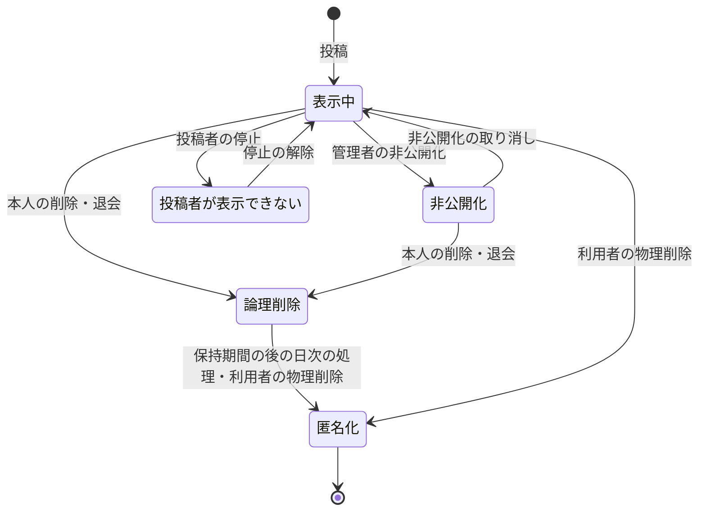
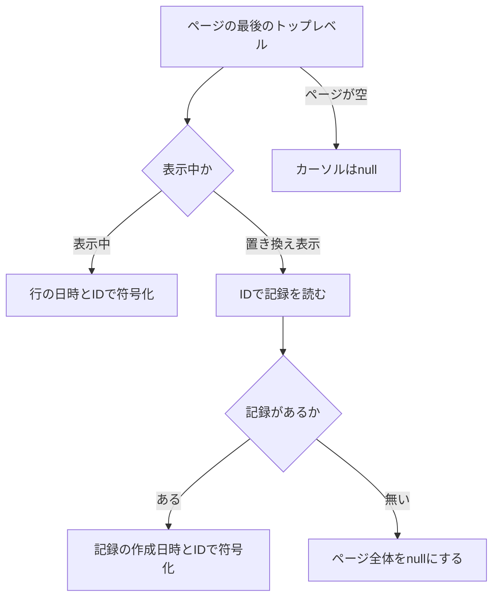
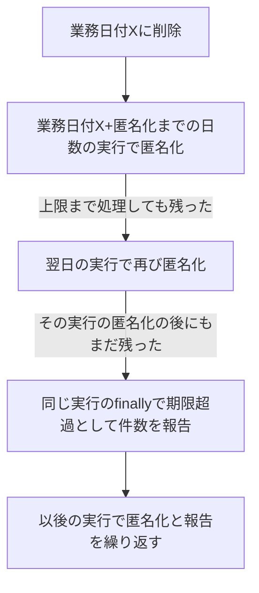

# 削除しても返信を残すコメントのスレッド

利用者が対象(記事・作品など)へ書くコメントと、それへの返信を階層を限った木として保存し、コメントを削除・非公開化しても付いた返信を残すスレッドの規約を定める。論理削除と置き換え表示の印、表示の状態を読み取りの時点の結合で求めること、置き換え表示の行の返し方、階層の上限とルートの識別の列、ルートのカーソル方式のページと返信のまとめ読み、条件付きの書き込み、管理の操作口、保持期間の後の匿名化、退会と物理削除、及びテストを扱う。

一括の書き込みと取り消しは「[Cloudflare D1の制約と対処](../db/002-d1-constraints.md)」に、退会の同期の文と物理削除の時期の処理は「[ユーザーライフサイクルイベント](007-user-lifecycle-events.md)」に、対象の物理削除は「[集約のライフサイクルイベント](012-aggregate-lifecycle-events.md)」に、日次のジョブと冪等性は「[非同期処理の設計](../infra/003-async-processing.md)」に、投稿・編集・削除のbot判定は「[レート制限とbot判定の検証](003-rate-limiting-and-bot-verification.md#bot判定の検証)」に、管理操作の記録は「[監査ログの記録](008-audit-logging.md)」に従う。画面の側は「[星の評価の入力と入れ子の投稿欄](../frontend/015-star-rating-and-threaded-composer.md)」で扱う。

## 前提と用語

部品の置き場所は、共通ライブラリの配置先と`<APIサーバーのアプリ>`・`<メッセージを受信するアプリ>`の`src/`からのパスで示す。テーブルと列の名前は例で、`<ドメイン>`などのプレースホルダーとともに機能ごとに置き換える。

| 部品                                     | 置き場所                                                                                                         | 役割                                                                |
| ---------------------------------------- | ---------------------------------------------------------------------------------------------------------------- | ------------------------------------------------------------------- |
| テーブルと表示できるコメントの条件       | DBスキーマの`schema/<ドメイン>/`                                                                                 | 列・索引・階層のCHECK制約と、読み取りと書き込みが共有する条件の式   |
| 照会・ストア・文の部品の契約と識別子     | 共通ライブラリの`core/<ドメイン>/ports.ts`・`identifiers.ts`                                                     | 複数のアプリと後から加わる機能(管理画面・通報など)が使う契約        |
| 照会・ストア・文の部品の実装と共通の束縛 | 共通ライブラリの`workers/<ドメイン>/`                                                                            | D1の実装。条件付きの書き込みの文と違反の判定を含む                  |
| 書き込みの単位                           | `<APIサーバーのアプリ>`の`infrastructure/<ドメイン>/`                                                            | 文の部品を1つの一括の書き込みに並べ、違反を拒否(`rejected`)に変える |
| 閲覧の可否・スレッドの組み立ての規則     | `<APIサーバーのアプリ>`の`domain/<ドメイン>/`                                                                    | 行から応答の形(表示中・置き換え表示)を作る純粋な規則                |
| 読み取り・投稿・編集・削除のユースケース | `<APIサーバーのアプリ>`の`application/<ドメイン>/`                                                               | 判定・書き込み・拒否の読み直しによる理由の分類・カーソルの符号化    |
| 匿名化のジョブ                           | `<APIサーバーのアプリ>`の`application/<ドメイン>/`                                                               | 保持期間を過ぎた削除済みのコメントの匿名化と期限超過の報告          |
| 退会の同期の処理・物理削除の時期の処理   | `<APIサーバーのアプリ>`の`infrastructure/<ドメイン>/`・`<メッセージを受信するアプリ>`の`application/<ドメイン>/` | ライフサイクルの登録口に登録する処理                                |

| 用語               | 意味                                                                                                                       |
| ------------------ | -------------------------------------------------------------------------------------------------------------------------- |
| 対象               | コメントを受ける単位。例のテーブルは`targets`で、対象を持つ集約(所有者を持つ)を`<集約>`と呼ぶ                              |
| コメント           | 利用者が対象へ書いた本文。トップレベルのコメントと返信がある。例のテーブルは`comments`                                     |
| 階層               | トップレベルを1とし、返信は親の階層に1を足した値。`<階層の上限>`までに限る                                                 |
| ルート             | 返信の木の先頭のトップレベルのコメント                                                                                     |
| スレッド           | 1つのルートとその全ての返信                                                                                                |
| 印                 | 状態を表す日時の列。論理削除(`deleted_at`)・非公開化(`hidden_at`)・匿名化(`anonymized_at`)・編集(`edited_at`)              |
| 表示できるコメント | 論理削除・非公開化・匿名化の印が無く、投稿者との紐付けがあり、投稿者が表示できる状態(停止中・退会済みでない)のコメント     |
| 置き換え表示       | 表示できないコメントを、本文・投稿者・日時を伏せて「削除されたコメント」の文言で示すこと。付いた返信はそれぞれの状態で示す |
| 匿名化             | 本文を空にし、投稿者との紐付けを外すこと。行は物理削除しない                                                               |
| 書き込みの単位     | 投稿・編集などの1回の操作の文を、1つの`db.batch()`に並べて確定する部品                                                     |

本文中の`<階層の上限>`などのプレースホルダーの本プロジェクトの値は、技術ドキュメントに写さず、プロジェクト固有の値の文書「[本プロジェクト固有の値](../../../onboardings/project-values.md)」に置く。

## テーブルと印

コメントの行は、状態の列を持たず印だけを持つ。表示の状態は読み取りの時点で印と投稿者の状態から求める(「[表示の状態の判定](#表示の状態の判定)」)。

| 列               | 内容                                                                                                                                                              |
| ---------------- | ----------------------------------------------------------------------------------------------------------------------------------------------------------------- |
| `id`             | ULIDの主キー                                                                                                                                                      |
| `target_id`      | 対象のID(外部キー)                                                                                                                                                |
| `aggregate_id`   | 対象を持つ集約のID(外部キー、NOT NULL)。件数の集計と集約の物理削除に使い、条件付きの書き込みの違反を表す列を兼ねる(「[条件付きの書き込み](#条件付きの書き込み)」) |
| `parent_id`      | 親のコメントのID(自己参照の外部キー)。トップレベルはNULL                                                                                                          |
| `root_id`        | ルートのID。トップレベルは自身のID、返信は親の`root_id`。外部キーにしない                                                                                         |
| `depth`          | 階層。CHECK制約で1〜`<階層の上限>`に限る                                                                                                                          |
| `author_user_id` | 投稿者(利用者のテーブルへの外部キー)。匿名化でNULLにする                                                                                                          |
| `body`           | マークダウンの原文。描画の結果は保存しない                                                                                                                        |
| 印の列           | `edited_at`・`hidden_at`・`anonymized_at`と、共通カラムの`deleted_at`(「[共通カラム](../db/003-schema-conventions.md#共通カラム)」)                               |

- `root_id`を外部キーにしない。トップレベルは挿入の時点で自身のIDを持ち、同じ文の中で自身を参照できない。
- `depth = 1`と`parent_id IS NULL`の一致はCHECK制約に入れず、挿入の文で保つ(挿入の文が親の行から階層とルートを決める)。
- 階層のCHECK制約は値を埋め込んで書く。Drizzleの`between(...)`をバインド変数のままにすると、生成するマイグレーションのCHECK制約に`?`が残るため`.inlineParams()`を付ける。階層の上限の値を共用部品にも持つ場合は、DBスキーマが共用部品を読み込めない構成なら写しを置き、照合のテストで一致を確かめる。

| 索引                                 | 使い道                                                       |
| ------------------------------------ | ------------------------------------------------------------ |
| `(target_id, depth, created_at, id)` | 対象のトップレベルのページ                                   |
| `(root_id, created_at, id)`          | ページのルートの返信のまとめ読み。トップレベル自身も含まれる |
| `author_user_id`                     | 退会の同期の処理と利用者の物理削除                           |
| `deleted_at`                         | 匿名化の対象の選び出し                                       |
| `aggregate_id`                       | 件数の集計と集約の物理削除                                   |

## 表示の状態の判定

### 読み取りの時点の結合

表示できるかどうかは、行の印と、投稿者の行を外部結合した利用者の状態で、読み取りの時点に求める。停止の解除や非公開化の取り消しで、行を書き換えずに再び表示される。



置き換え表示は、表示中以外の全ての状態で同じ形にする。表示中以外の状態を区別して返すと、停止など利用者に知らせない事情を推測させる。

```typescript
// 匿名化で投稿者が外れた行も置き換え表示として返すため、問い合わせがusersをauthor_user_idで外部結合している前提で使う
export function displayableComment(): SQL {
  return sql`(${isNull(comments.deletedAt)} and ${isNull(comments.hiddenAt)} and ${isNull(comments.anonymizedAt)} and ${isNotNull(comments.authorUserId)} and ${visibleUsers()})`;
}
```

- 条件の式はDBスキーマに1つだけ置き、スレッドの照会・件数の集計・返信の親の判定(挿入の文)で同じ式を使う。
- 投稿者の利用者のテーブルは外部結合(`LEFT JOIN`)にする。内部結合にすると、匿名化した行(投稿者がNULL)が結果から消え、返信の木が切れる。
- 置き換え表示の行も行として返し、返信の親とルートの位置を保つ。

### 置き換え表示の行の返し方

置き換え表示の行は、本文・投稿者・投稿日時・編集の印をデータベースから読み出さない。照会の列を表示できる条件の`CASE`で包み、条件が偽ならNULLにする。

```typescript
const shown = displayableComment();
const whenShown = <T>(value: SQLWrapper) =>
  sql<T | null>`case when ${shown} then ${value} end`;

const threadColumns = {
  commentId: comments.id,
  parentId: comments.parentId,
  rootId: comments.rootId,
  depth: comments.depth,
  authorUserId: whenShown<string>(comments.authorUserId),
  bodyMarkdown: whenShown<string>(comments.body),
  createdAt: whenShown<number>(comments.createdAt),
  edited: whenShown<number>(sql`${comments.editedAt} is not null`),
};
```

- 照会の結果の型は、表示中(`shown`)と置き換え表示(`removed`)の判別可能な合併にし、置き換え表示はIDと親と階層だけを持つ。応答の型も同じにし、置き換え表示にバッジ(投稿者が対象の所有者か・閲覧者自身か)の項目を持たせない。GraphQLのように型の上で項目が常にある場合は、置き換え表示の値をNULLか偽に固定する。
- 置き換え表示の文言は画面が持ち、応答には状態(例: `REMOVED`)だけを返す。
- 応答に日時を返さないため、置き換え表示の行を位置にしたカーソルの扱いを別に決める(「[カーソルの終端](#カーソルの終端)」)。
- 件数(対象ごと・集約ごと)は表示できるコメントだけを数え、置き換え表示を含めない。件数の照会は件数0のキーを返さず、0の補いは呼び出し側が行う。

## ページと返信のまとめ読み

### 1つの一括の読み取り

1ページはトップレベルの`<1ページのスレッドの数>`件と、その全ての返信を、2文を並べた1回の`db.batch()`で読む。

| 順  | 文                   | 書き方                                                                                                                                  |
| --- | -------------------- | --------------------------------------------------------------------------------------------------------------------------------------- |
| 1   | トップレベル         | 対象と`depth = 1`とカーソルの位置で絞り、`(created_at, id)`の降順に`<1ページのスレッドの数>` + 1件。1件多く読んだかで続きの有無を決める |
| 2   | ページのルートの返信 | `root_id IN (<1と同じ条件と順のトップレベルのIDを<1ページのスレッドの数>件>)`かつ`depth > 1`で、`(created_at, id)`の昇順                |

- 2の副問い合わせは1と同じ条件・順・件数でトップレベルを選び直す。同じテーブルを外側と副問い合わせで使うため、副問い合わせ側に別名(`alias(comments, 'page_roots')`)を付ける。
- トップレベルも`root_id`に自身のIDを持つため、2は`depth > 1`で返信だけに絞る。絞らないとトップレベルが返信として重ねて返る。
- 返信は平たい一覧(親のIDと階層付き)で返し、木はクライアントで組む。応答の入れ子の深さが階層の数で変わらず、GraphQLのクエリの深さの上限に収まる。
- 返信は古い順、トップレベルは新しい順にする。返信の数に上限を置かない場合は、1スレッドの返信の数が読み取りの重さを決めるため、階層の上限と合わせて想定の件数を確かめる。
- 閲覧の可否・対象の所属・取り消された対象の除外は照会でせず、ユースケースが対象の解決で判定する。照会と対象の解決は並行して読んでよい。

### カーソルの終端

続きの位置(カーソル)は、ページの最後のトップレベルの`(created_at, id)`で持ち、`<日時(ミリ秒)>`と`<ID>`のJSONを中身を示さない符号化(UTF-8のbase64url、パディングなし)で渡す。受け取った値は、復号して形式を確かめ、再び符号化して一致するものだけを受け付け、それ以外は不正な位置の誤りにする(「[投票の履歴の公開](014-time-boxed-voting.md#投票の履歴の公開)」の続きの位置と同じ確かめ方)。



- 置き換え表示の行は照会が日時を返さないため、最後の行が置き換え表示のときだけ、IDで記録を読んで作成日時を取る。追加の読み取りは1ページに最大1回である。
- 記録が無い(読み取りの間に集約の物理削除で消えた)場合は、対象が無いものとしてページ全体を返さない(`null`)。
- カーソルを復号すると置き換え表示のコメントの作成日時が分かる。IDが時刻を含む形式(ULID)なら、IDから同じ時刻が分かるため新しい情報は増えない。時刻を含まないIDを使う場合は、置き換え表示の行をカーソルの位置にしない(直前の表示中の行を位置にし、重複を画面が除く)などの対処が要る。
- カーソルの解析はユースケースの側(application層)に置き、presentation層は受け取った符号化済みの値をそのまま返す。

## 書き込み

### 条件付きの書き込み

投稿・編集・非公開化は、ユースケースの判定に加えて、書き込みの文の条件で同じ判定を書き込みの時点の行でもう一度行う。条件が成り立たなければ、NOT NULLの集約の列(例の`aggregate_id`)へNULLを入れ、違反で一括の書き込み全体を取り消す(「[版の検査で一括の書き込み全体を取り消す](../db/002-d1-constraints.md#版の検査で一括の書き込み全体を取り消す)」)。

```typescript
// 条件が成り立たないとNULLを入れ、NOT NULLの違反で一括の書き込み全体を取り消す
export function guardedAggregateId(
  condition: SQL,
  aggregateId: SQLWrapper | string,
): SQL {
  return sql`CASE WHEN ${condition} THEN ${aggregateId} ELSE NULL END`;
}

// D1は`D1_ERROR: NOT NULL constraint failed: <テーブル>.<列>: SQLITE_CONSTRAINT (...)`を投げ、causeにSQLiteのエラーを持つ
const GUARD_VIOLATION_PATTERN =
  /NOT NULL constraint failed: (?:comments|ratings)\.aggregate_id(?::|$)/u;

export function isGuardViolation(error: unknown): boolean {
  for (let current = error; current instanceof Error; current = current.cause) {
    if (GUARD_VIOLATION_PATTERN.test(current.message)) {
      return true;
    }
  }
  return false;
}
```

| 操作     | 文                                                                                            | 条件                                                                                                                                   |
| -------- | --------------------------------------------------------------------------------------------- | -------------------------------------------------------------------------------------------------------------------------------------- |
| 投稿     | `INSERT`の`aggregate_id`を`guardedAggregateId`にする                                          | 対象が閲覧できる・投稿者が書き込める状態・返信なら親が表示できるコメントで、渡したルートと階層が親の行と一致し、親の階層が上限より浅い |
| 編集     | `UPDATE … SET aggregate_id = guardedAggregateId(…, aggregate_id), body, edited_at`            | 自身のコメントで印が無い・対象が閲覧できる・投稿者が書き込める状態                                                                     |
| 削除     | `UPDATE … SET deleted_at WHERE id = ? AND <自身のコメントで印が無い>`                         | 違反にせず、変更0行を対象が無いものとして扱う                                                                                          |
| 非公開化 | `UPDATE … SET aggregate_id = guardedAggregateId(<読んだ状態のまま>, aggregate_id), hidden_at` | 読んだ後に別の操作が同じ状態へ変えていない(「[管理の操作口](#管理の操作口)」)                                                          |

- 違反を表す列は、条件付きの文を書く全てのテーブル(コメントと、同じ一括の書き込みで保存する評価など)が共通に持つ、集約のNOT NULLの列にする。どのテーブルの違反も`NOT NULL constraint failed: <テーブル>.<集約の列>`の同じ形の文言になるため、テーブルの名前の選択肢を並べた1つの判定で全てのテーブルの違反を覆える。
- 編集は本文の列ではなく、集約の列へ`CASE`を入れる。投稿と同じ違反になり、書き込みの単位は1つの判定で投稿・編集の違反を拒否にできる。
- 違反の判定は`cause`をたどり、検査に使った`<テーブル>.<列>`の違反だけを拒否に変える。他の失敗はそのまま投げ直す。
- 同じ一括の書き込みに別のテーブルの条件付きの文(コメントと同時に保存する評価など)を並べる場合は、両方の違反を同じ判定の関数で拒否にする。判定の正規表現と`CASE`の関数を共通ライブラリの1つのファイルに置き、書き込みの単位ごとに写しを作らない。
- `INSERT … ON CONFLICT DO UPDATE`の文でも、NOT NULLの検査は一意の衝突の判定より先に行われるため、既存の行があっても条件の違反で取り消される。
- 存在しない行への`UPDATE`は失敗せず変更0行になり、同じ一括の書き込みの他の文は確定する。編集の文に他の文を並べる場合は、先に対象を照会で確かめるか、編集の文の`meta.changes`が0なら対象が無いもの(`not-found`)として扱う。
- 削除の文に閲覧の可否や投稿者の停止を条件にしない。本人の削除は対象が閲覧できない間も受け付けてよく、可否はユースケースが判定する。
- 拒否を受けたユースケースは、対象・親・利用者の状態を読み直して理由を分類する。読み直しで変化が見えなければ、利用者の状態の理由(トップレベル)か、親に返信できない理由(返信)にする。

### 投稿の入力の決め方

- 階層とルートは、ユースケースが読んだ親の行から決め(`depth = 親の階層 + 1`、`root_id = 親のroot_id`)、挿入の文の条件で親の行と一致することを確かめる。読み取りの後に親が削除・非公開化されれば違反になる。
- 階層の上限の親への返信は、ユースケースが拒否し、挿入の文の条件(`親の階層 < <階層の上限>`)とCHECK制約でも防ぐ。
- 親が別の対象のコメントである返信を、挿入の文の条件(親の対象の列が同じ)で拒否する。

## 管理の操作口

管理者による非公開化とその取り消しは、他の機能(管理画面・通報の処理)が呼ぶ操作口として、共通ライブラリの文の部品に置く。操作口は監査ログの記録などの文を受け取り、状態を変えたときだけ同じ一括の書き込みで確定する。

```typescript
export interface HiddenChange {
  readonly commentId: string;
  readonly hidden: boolean;
  readonly at: Date;
  readonly statements?: readonly BatchItem<'sqlite'>[];
}

export type HiddenChangeResult = 'changed' | 'unchanged' | 'not-found';
```

1. 先に行を読む。無ければ`not-found`、既に求める状態なら`unchanged`を返し、渡された文を流さない。
2. 状態を変える文の条件を「読んだ状態のまま」にし、渡された文と1つの一括の書き込みで確定する。読んだ後に別の操作が同じ状態へ変えていれば違反で全体を取り消す。
3. 違反なら読み直し、無ければ`not-found`、求める状態なら`unchanged`を返す。どちらでもなければ例外を投げ直す。

- 監査ログは状態を変えたときだけ記録する(「[記録の規約](008-audit-logging.md#記録の規約)」)。`unchanged`・`not-found`で記録の文を流さないことで、同じ操作の繰り返しが記録を増やさない。
- 既知の限界: 読んだ後に行が物理削除されると、状態を変える文は変更0行で違反にならず、渡された文だけが確定して`changed`を返す。行が物理削除されるのは集約の物理削除(や、物理削除する別の操作)だけの場合はこれを許容する。利用者の操作で物理削除される行(評価の取消など)に同じ形を使う場合は、起こりやすさを確かめて、条件に行の存在を加える文(`EXISTS`を条件にした記録の挿入)を検討する。
- 論理削除された行を存在しないもの(`not-found`)として扱う場合は、読み取りと状態を変える文の条件の両方に`deleted_at IS NULL`を入れる。

## 保持期間の後の匿名化

### 閾値と期限

本人が削除したコメント(退会による論理削除を含む)は、削除の日時から`<匿名化の期限の日数>`日以内に匿名化する。日次のジョブは、業務日付Xに削除した行を、業務日付X+`<匿名化までの日数>`(削除の業務日付から`<匿名化までの日数>`日目)の実行で匿名化し、期限の前に終える。

- `<匿名化までの日数>`を`<匿名化の期限の日数>`より1日以上短くし、匿名化の日の実行の時刻が、削除の時刻によらず期限より前になるようにする。
- その日の実行で上限の件数と回数に達して残った行は、翌日の実行で再び匿名化の対象になる。`<匿名化までの日数>`を期限の1日前にした場合、翌日の実行が期限に間に合うのは、削除の時刻(業務時刻)がジョブの時刻より後の行だけである。ジョブの時刻より前に削除した行は、翌日の実行の時点で期限を過ぎている。
- 期限超過として報告するのは、匿名化の日が前日以前で、その日の実行の匿名化の後にもまだ匿名化されていない行である。ジョブは先に匿名化し、`finally`で期限超過の行を数える。

| 閾値           | 値                                                             | 使い道                                                                                                 |
| -------------- | -------------------------------------------------------------- | ------------------------------------------------------------------------------------------------------ |
| 匿名化の閾値   | 当日の業務日付の(`<匿名化までの日数>` − 1)日前の0:00(業務時刻) | `deleted_at <`閾値で、匿名化していない行を匿名化する                                                   |
| 期限超過の閾値 | 当日の業務日付の`<匿名化までの日数>`日前の0:00(業務時刻)       | 当日の匿名化の後に、`deleted_at <`閾値(匿名化の日が前日以前)で匿名化していない行が残れば件数を報告する |



- 閾値は予定時刻の業務日付(`ScheduledJobContext.business.date`)から求め、実行時刻からは求めない。起動が遅れて日付をまたいでも対象の日が変わらない。
- 業務時刻が固定の時差で夏時間が無い場合は、当日の0:00から日数分のミリ秒を引いた時点の業務日付を日数前の日とし、その日の0:00を閾値にする。夏時間のある地域の時刻を使う場合は、暦の日付で数え直す。
- 比較は閾値ちょうどを含めない(`deleted_at < 閾値`)。閾値の日の0:00に削除した行は翌日の対象になる。
- 匿名化は本文を空文字にし、投稿者の紐付けをNULLにし、匿名化の印と更新の日時を入れる。行と`root_id`・`parent_id`・`depth`は残し、付いた返信の木を保つ。
- 非公開化だけのコメント(論理削除の印が無い)は匿名化しない。

### 日次の処理の冪等と打ち切り

```typescript
let anonymized = 0;
let batches = 0;
let lastCount: number;
do {
  lastCount = await store.anonymizeDeletedBefore({ threshold, at, limit });
  anonymized += lastCount;
  batches += 1;
} while (lastCount === limit && batches < MAX_BATCHES);
```

- 1回の文で`<1回の匿名化の件数>`件を、削除の日時の古い順(同じ日時はIDの順)に選んで匿名化する。対象の選び出しを`UPDATE … WHERE id IN (SELECT … ORDER BY deleted_at, id LIMIT ?)`の1文にする。
- 1回の起動では`<1回の起動の匿名化の回数>`回までにし、件数が上限未満の回で止める。上限の回数まで続けても残った行は翌日の実行に任せる。同じ時刻のジョブ群と時間の予算を分け合う場合は、上限の件数と回数を予算に収まる値にする(「[同じ時刻のジョブ群の時間の予算](../infra/003-async-processing.md#同じ時刻のジョブ群の時間の予算)」)。
- 対象の条件に「匿名化の印が無い」を入れ、匿名化した行を再び選ばない。同じ業務日付に何度実行しても結果が変わらない(「[重複配信と冪等性](../infra/003-async-processing.md#重複配信と冪等性)」)。
- 期限超過の閾値より前に削除され匿名化していない行の件数を数え、1件以上なら件数だけをエラートラッキングへ報告する(「[送信する例外と送信しない例外](../infra/004-logging-and-error-tracking.md#送信する例外と送信しない例外)」)。報告はジョブの機能の報告の部品(種類と件数を受ける)で行い、ログとエラートラッキングの両方へ送る。コメントのIDや本文を報告に含めない。
- 期限超過の検知は匿名化が失敗した場合の安全網のため、`try`/`finally`で匿名化の成否によらず行う。
- ジョブの終わりに、匿名化した件数・回数・上限に達したか・期限超過の件数を`info`のログに出す。

## 退会と物理削除

### 退会の同期の処理

利用者の退会は、ユーザーライフサイクルの同期の処理で、その利用者のコメント(と評価など同じ機能の行)へ論理削除の印を入れる集合の更新の文を、退会の確定と同じ一括の書き込みに入れる(「[文の規約](007-user-lifecycle-events.md#文の規約)」)。

```typescript
db.update(comments)
  .set({ deletedAt: event.occurredAt, updatedAt: event.occurredAt })
  .where(
    and(eq(comments.authorUserId, event.userId), isNull(comments.deletedAt)),
  );
```

- `deleted_at IS NULL`の行だけを更新する。本人が先に削除したコメントの削除の日時は匿名化の閾値の起点になるため、退会の日時で上書きすると匿名化が遅れ、期限を過ぎる。
- 停止は印を入れない。表示の状態の判定が投稿者の状態を読み取りの時点で見るため、停止の間は置き換え表示になり、停止の解除で戻る。
- 退会の論理削除の後のコメントは、本人の削除と同じく保持期間の後の匿名化の対象になる。

### 利用者の物理削除での紐付けの解除

コメントの投稿者の列が利用者のテーブルを外部キーで参照するため、利用者の物理削除の時期の処理で、利用者の行を消す前にその利用者の全てのコメントを匿名化して紐付けを外す。行は物理削除しない。同じ機能が利用者を参照する他の行(評価など)は消す。

- 1回の呼び出しで、コメントの匿名化と他の行の削除をそれぞれ`<1回の物理削除の件数>`件までにし、同じ一括の書き込みの末尾に、書き込みの後に残った行の有無を`LIMIT 1`で読む文を並べる。残りがあれば続き(`continue`)、無ければ完了(`done`)を返す。件数が上限に達したかで残りを決めないため、上限ちょうどの回を余分な呼び出しにしない。これは「[残りの有無を続きへ対応付ける](007-user-lifecycle-events.md#残りの有無を続きへ対応付ける)」の表の「件数で切る削除」(削除した件数が上限に達したら続ける)とは違う方式で、同じ一括の書き込みの中で書き込みの後の残りを読み直す。どちらの方式でも、残りが無くなるまで続きを返す結果は同じになる。
- 匿名化した行は投稿者を持たないため、呼び出しのたびに残りを選び直す。再試行・送り直し・続きの再開で同じイベントを何度処理しても結果が変わらない。
- 処理の`order`は、利用者の行を消すアカウント機能の処理より前にする。

### 集約の物理削除と深い順の削除

対象を持つ集約の物理削除では、コメントの行を物理削除する。`parent_id`が自己参照の外部キーのため、件数で区切って消すと、消す親に子が残って外部キーの検査に失敗し得る。

```typescript
db.delete(comments).where(
  inArray(
    comments.id,
    db
      .select({ id: comments.id })
      .from(comments)
      .where(eq(comments.aggregateId, input.aggregateId))
      // 深い順に選ぶと、件数で区切っても消す親に子が残らない
      .orderBy(desc(comments.depth), asc(comments.id))
      .limit(input.limit),
  ),
);
```

- 階層の深い順に選ぶ。深い階層の行が全て消えるまで浅い階層の行を選ばないため、1回の文の中でも呼び出しをまたいでも、親より先に子が消える。
- 残りの有無と続き・完了の返し方は利用者の物理削除と同じにする。
- 処理の`order`は、集約の行を消す機能の処理より前にする(「[集約を参照する行の消し方](012-aggregate-lifecycle-events.md#集約を参照する行の消し方)」)。

## テスト

- 階層の上限は、上限の階層のコメントへの返信がユースケースで拒否され、挿入の文の条件でも書き込まれないこと、CHECK制約が上限を超える階層の行を拒むことをWorkers統合テストで確かめる。
- 置き換え表示は、論理削除・非公開化・匿名化・投稿者の停止・投稿者の退会のそれぞれで、照会が本文・投稿者・日時・編集の印を返さず同じ形であること、付いた返信がそれぞれの状態で残ること、停止の解除と非公開化の取り消しで再び表示されること、件数に含まれないことを確かめる。
- ページは、続きの有無の境界(`<1ページのスレッドの数>`件と1件多い場合)、カーソルの次のページに重複と欠けが無いこと、返信が古い順でトップレベルを含まないこと、最後の行が置き換え表示のカーソル、不正なカーソル(別の表記・余分なキー・形式違反)の拒否を確かめる。1ページの読み取りの文の数を記録する偽のデータベースで、一括の読み取りが2文であることを確かめる。
- 条件付きの書き込みは、読み取りの後に対象が閲覧できなくなった・親が削除された・利用者が停止されたそれぞれの場合に拒否になり、同じ一括の書き込みの他の文も確定しないことを確かめる。
- 管理の操作口は、`unchanged`・`not-found`で渡した文が流れないこと、読み取りの後に同じ状態へ変えられた場合に`unchanged`を返し渡した文が確定しないことを確かめる。
- 匿名化は、閾値の日の前後(削除の業務日付から`<匿名化までの日数>`日後とその前日)、業務日付の切り替わりの前後の閾値、上限の件数ちょうどで続け未満で止まること、上限の回数で止まること、期限超過の件数の報告、同じ日の再実行で結果が変わらないこと、非公開化だけのコメントを匿名化しないことを確かめる。
- 退会の同期の処理は、退会の確定の失敗で印が取り消されること、他の利用者の行が変わらないこと、先に削除した行の削除の日時が変わらないことを確かめる。
- 物理削除の時期の処理は、上限を超える件数で続きを返すこと、同じイベントで2回動いても結果が同じこと、利用者と集約の行を消す処理がその後に成功すること(外部キーの検査を通ること)を、深い階層の行を含むデータで確かめる。
