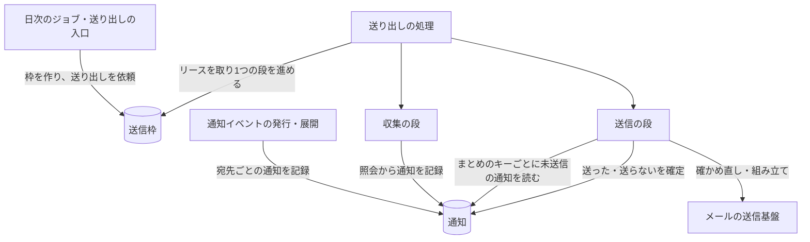
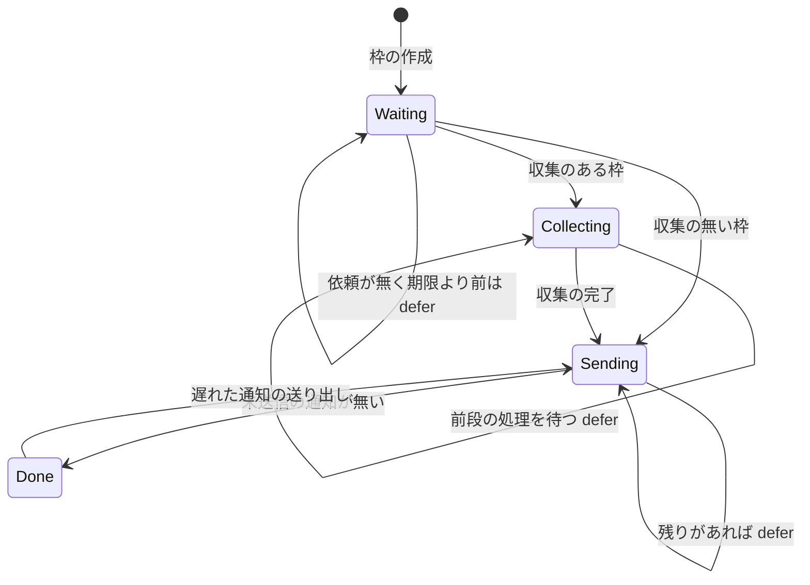
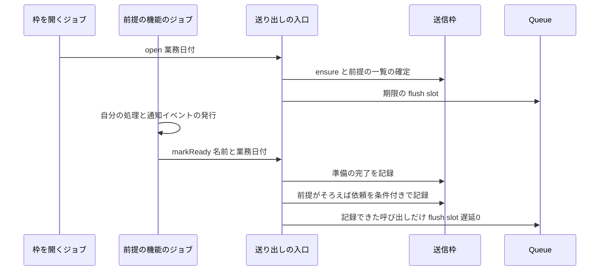
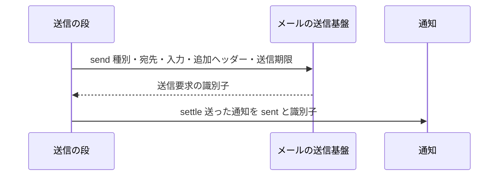

# まとめて送る通知メール

利用者が種類ごとに選んだ受信設定に従って送る通知メールを、宛先ごとの通知の記録として残し、送る時刻の区切り(送信枠)とまとめのキーで1通ずつにまとめて送り出す仕組みを定める。通知の記録と重複のキー・まとめのキー、送信枠の段とリースと遅延再送による継続、同じ時刻の後続の処理が準備の完了を伝えて送り出しを始める入口、遅れた通知の扱い、前段の処理の完了を待つ収集、送る直前の確かめ直し、受信設定の初期値、送信の期限、送ったことの確定と少なくとも1回の送信の限界、結果の追記の登録口、通知イベントの発行と展開、日次の回復と削除、異常の通知、及びテストを扱う。

メールの送信要求・送信期限・抑止は「[メール送信サービス](../external/001-email-sending.md)」に、Queueのメッセージと遅延再送・日次のジョブは「[非同期処理の設計](../infra/003-async-processing.md)」に、一括の書き込みとバインド変数の上限は「[Cloudflare D1の制約と対処](../db/002-d1-constraints.md)」に、退会と物理削除の波及処理は「[ユーザーライフサイクルイベント](007-user-lifecycle-events.md)」に、メールの配信停止のトークンと経路は「[メールのワンクリックの配信停止](../security/010-one-click-unsubscribe.md)」に従う。

## 前提と用語

送信枠の送り出しはメッセージを受信するアプリが行い、送信枠を開く日次のジョブと送り出しの入口はAPIサーバーが持つ。部品の置き場所は、共通ライブラリの配置先、`<APIサーバーのアプリ>`・`<メッセージを受信するアプリ>`の`src/`からのパスで示す。

| 部品                                                                                                                                           | 置き場所                                                                  | 役割                                                                                    |
| ---------------------------------------------------------------------------------------------------------------------------------------------- | ------------------------------------------------------------------------- | --------------------------------------------------------------------------------------- |
| 送信枠の規則(キー・期日・送り出しの期限・キーの解析)                                                                                           | 共通ライブラリの`core/<ドメイン>/notification-slots.ts`                   | 実行環境に依存しない枠の規則。記録・入口・送り出し・保守が同じ規則を使う                |
| 通知の下書き・重複のキー・まとめのキー・メールの計画                                                                                           | 共通ライブラリの`core/<ドメイン>/notice-plan.ts`                          | 記録する通知と、まとめごとに送るメールの種別と載せる通知を決める純粋な規則              |
| メールの組み立て・送った扱いの決定                                                                                                             | 共通ライブラリの`core/<ドメイン>/notice-email.ts`・`notice-settlement.ts` | 送る直前の状態からメールの入力・追加ヘッダー・送信期限を作り、送った扱いの通知を返す    |
| 送り出しの入口と前提の登録の契約・通知イベントの契約・結果の追記の契約                                                                         | 共通ライブラリの`core/<ドメイン>/`                                        | 後から加わる機能が使う公開の契約                                                        |
| `publishExcludingViolations`                                                                                                                   | 共通ライブラリの`core/<ドメイン>/violation-tolerant-publish.ts`           | 発行の口が拒否した違反の通知イベントを1件ずつ除いて発行し直す、発行する機能の共用の部品 |
| `NotificationSlotStore`・`NotificationNoticeStore`・`NotificationPreferenceStore`・`NotificationWorkRequester`・`NotificationIncidentReporter` | 共通ライブラリの`core/<ドメイン>/ports.ts`(実装は`workers/<ドメイン>/`)   | 枠・通知・受信設定の記録、送り出しの依頼のメッセージ、異常の通知                        |
| 送り出しの前提の登録口(初版は空)                                                                                                               | `<APIサーバーのアプリ>`の`composition/`                                   | 送り出しの前に準備を終える機能が自分の名前を追記する場所                                |
| 送信枠を開くジョブ・日次の保守のジョブ                                                                                                         | `<APIサーバーのアプリ>`の`application/<ドメイン>/`                        | 枠の作成と送り出しの依頼、遅れの回復、期限切れ、削除                                    |
| 送り出しの処理・展開の処理                                                                                                                     | `<メッセージを受信するアプリ>`の`application/<ドメイン>/`                 | 送信枠の段を1つずつ進めるメッセージの処理と、通知イベントを宛先へ広げる処理             |
| 収集・送信・結果の追記の取得                                                                                                                   | `<メッセージを受信するアプリ>`の`infrastructure/<ドメイン>/`              | 枠の種類ごとの収集、まとめごとの確かめ直しと送信、登録した提供元の呼び出し              |
| 結果の追記の登録口(初版は空)                                                                                                                   | `<メッセージを受信するアプリ>`の`composition/`                            | 結果の通知メールに追記を加える機能が提供元を追記する場所                                |
| `AlertThrottle`                                                                                                                                | 共通ライブラリの`core/email/ports.ts`                                     | 同じ報告を一定の時間に1回へ間引く                                                       |

| 用語           | 意味                                                                                                                                                      |
| -------------- | --------------------------------------------------------------------------------------------------------------------------------------------------------- |
| 通知           | 1人の宛先へ1つの出来事を知らせる記録。宛先・種別・出どころ(催し・通知イベント)・送信枠・まとめのキーを持ち、`pending`から`sent`か`skipped`へ1回だけ変わる |
| 種別           | 受信設定の単位になる通知の種類。利用者は種別ごとに受信するかを選ぶ                                                                                        |
| 催し           | 開始と終了の日時を持ち、開始の予告や結果の通知の元になる業務上の単位                                                                                      |
| 送信枠         | 同じ時刻の区切りに送る通知の集まり。枠のキー・期日・送り出しの期限・段・リース・収集の進み具合(カーソル)を持つ                                            |
| 段             | 送信枠の進み具合。待機(`waiting`)・収集(`collecting`)・送信(`sending`)・完了(`done`)                                                                      |
| 送り出し       | 送信枠を待機から完了まで進めること。メッセージの処理が1回に1つの段を進める                                                                                |
| 送り出しの依頼 | 待機の段を抜けてよいことの記録(`dispatch_requested_at`)と、送り出しのメッセージの送信                                                                     |
| 送り出しの期限 | 依頼が無くてもこの時刻から送り出しを始める時刻(`settle_until`)                                                                                            |
| 送り出しの前提 | 送り出しの前に、同じ時刻の自分の処理(通知イベントの発行など)を終えて準備の完了を伝える機能の名前の一覧                                                    |
| まとめのキー   | 1通のメールにまとめる通知の単位。同じ送信枠の同じ宛先(と、枠によっては同じ対象)の通知が同じキーを持つ                                                     |
| 重複のキー     | 同じ出来事を同じ宛先へ二重に記録しないための一意のキー(`dedupe_key`)                                                                                      |
| 遅れた通知     | 送り出しが始まった(送信・完了の段の)枠へ後から記録された通知                                                                                              |
| 通知イベント   | 他の機能が発行する、通知の元になる出来事の記録。宛先が多い出来事は展開の処理が宛先ごとの通知へ広げる                                                      |
| 送らない扱い   | 送らないと決めた通知を`skipped`と理由で確定すること。例外にせず、送り直さない                                                                             |
| 結果の追記     | 他の機能が、結果の通知メールの本文に加える見出し・行・行動の区画                                                                                          |
| 送信の対象者   | メールアドレスを確認済みで、停止中・退会済みでない利用者                                                                                                  |

本文中の`<ドメイン>`・`<リースの時間>`などのプレースホルダーの本プロジェクトの値は、技術ドキュメントに写さず、プロジェクト固有の値の文書「[本プロジェクト固有の値](../../../onboardings/project-values.md)」に置く。

| プレースホルダー                                         | 意味                                                                   |
| -------------------------------------------------------- | ---------------------------------------------------------------------- |
| `<前提を待つ枠の時刻>`・`<上流の処理を待つ枠の時刻>`     | 時刻の枠の期日の業務時刻                                               |
| `<送り出しの期限までの時間>`                             | 前提を待つ枠の期日から送り出しの期限までの時間                         |
| `<リースの時間>`・`<リースを待つ時間>`・`<続きの遅延>`   | 送信枠のリースの長さ、リースを取れないときの遅延、段の続きの遅延       |
| `<1段の送信のまとめの数>`・`<1段の収集の件数>`           | 送信の段が1回に処理するまとめの数、収集の段が1回に読む宛先の数         |
| `<上流の処理を待つ間隔>`                                 | 前段の処理の完了を待つ収集が確かめ直す間隔                             |
| `<まとめに載せる件数の上限>`・`<結果の追記の件数の上限>` | 1通に載せる通知の項目の数と、結果の追記の数                            |
| `<1回の記録の件数>`・`<1回の展開の件数>`                 | 1回の記録に渡す下書きの数と、展開の処理が1回に数える宛先の数           |
| `<対象の表示不可の理由>`                                 | 出どころの対象が表示できなくなった通知の送らない理由                   |
| `<送り出しの遅れの閾値>`・`<展開の遅れの閾値>`           | 日次の保守が遅れとして拾う、送り出しの期限・発行からの経過時間         |
| `<通知の期限切れの経過>`・`<通知の保持期間>`             | 未送信の通知を送らない扱いにするまでの期日からの経過と、記録を消す期間 |
| `<送信者情報の未設定の報告の間隔>`                       | 送信者情報が未設定で送らなかったことを報告する間隔                     |

## 全体の流れ



- 通知は、出どころが同期の照会で分かるもの(日次の処理が作る催しの予告・結果)は収集の段が、他の機能の出来事(通知イベント)は発行と展開が記録する。どちらも同じ重複のキーとまとめのキーを使うため、同じ枠の同じまとめに入れば1通のメールになる。
- 送り出しは送信枠ごとのメッセージ(`<ドメイン>.flush-slot`、本文は枠のキーだけ)で行う。メッセージの本文に宛先・名称を入れない。

## 通知の記録

### 重複のキーとまとめのキー

| キー         | 形                                                                                      | 目的                                                                   |
| ------------ | --------------------------------------------------------------------------------------- | ---------------------------------------------------------------------- |
| 枠のキー     | 時刻の枠は`<枠の種類>:<業務日付>`、事象の枠は`<枠の種類>:<通知イベントのID>`            | 送り出しの単位。キーから枠の種類と期日(事象の枠は通知イベント)を求める |
| 重複のキー   | `<種別>:<出どころのID>:<対象のID>:<宛先>`                                               | 収集・発行・展開・再実行のどこから記録しても同じ通知を1件にする        |
| まとめのキー | `<枠のキー>:<宛先>`。同じ宛先の別の対象を別のメールにする枠は`<枠のキー>:<宛先>:<対象>` | 同じメールにまとめる通知の範囲                                         |

- 出どころのIDは、催しから作る通知は催しのID、通知イベントから作る通知は通知イベントのIDにする。同じ催しの通知を収集と発行の両方が作り得る場合は、どちらからも催しのIDを使い、同じ重複のキーにする。
- まとめのキーを枠のキーで始めるため、同じ宛先でも枠が違えば別のメールになる。同じまとめのキーに入る種別の組み合わせ(結果と次の催しの予告など)が、統合したメールになる。
- キーの各部分(ID・業務日付)は、記録の前に形式を確かめる。IDの形式の判定(大文字だけのULIDなど)を、キーを作る規則と解析する規則で揃える。大文字だけのULIDの判定は、共通ライブラリの`core/ids/uppercase-ulid.ts`の`isUppercaseUlid`(`zod`の規則に渡すときは`UPPERCASE_ULID_PATTERN`)を使い、正規表現を機能ごとに書かない。

### 送信枠と通知の記録の文

`NotificationNoticeStore.record(drafts, at)`は、次の順に書く。

1. 下書きの全ての送信枠を`onConflictDoNothing()`で作る(`ensure`)。
2. 通知を重複のキーの一意索引の`onConflictDoNothing()`で挿入する。1文の行の数は、列の数から求めたバインド変数の上限(100)に収まる数にし、全ての文を1つの`db.batch()`にまとめる(「[バインド変数の上限](../db/002-d1-constraints.md#バインド変数の上限)」)。
3. 挿入の後に枠の段を読み、送信・完了の段の枠のキーを`lateSlotKeys`として返す。重複だけで1件も挿入しなかった枠も含める。

- 段を挿入の後に読むため、送り出しの始まりと挿入が前後しても遅れた通知を取りこぼさない。挿入の前に読むと、読んだ後に送信の段が始まって読み終えた場合に、挿入した通知がどの段にも送られない。この順序は、読み取りに複製(読み取り専用のレプリカ)を使わない前提で成り立つ。
- 呼び出し側は、1回の`record`に渡す下書きを`<1回の記録の件数>`件ずつに分ける。`db.batch()`は文の数によらず1回の問い合わせに数えるが、大きな一括の書き込みは実行時間が延びる。
- 宛先は利用者のテーブルへの外部キーを持つ。存在しない利用者の通知は挿入が失敗するため、収集と展開は照会で得た利用者だけを渡す。

## 送信枠の段

### 段の遷移



| 枠の種類           | キーの形                        | 期日                         | 送り出しの期限                         | 送り出しの依頼                               | 収集                         |
| ------------------ | ------------------------------- | ---------------------------- | -------------------------------------- | -------------------------------------------- | ---------------------------- |
| 前提を待つ枠       | `<枠の種類>:<業務日付>`         | `<前提を待つ枠の時刻>`       | 期日から`<送り出しの期限までの時間>`後 | 前提の全ての準備の完了、または送り出しの期限 | 照会から作る                 |
| 上流の処理を待つ枠 | `<枠の種類>:<業務日付>`         | `<上流の処理を待つ枠の時刻>` | 期日                                   | 作成の時点で依頼済み                         | 前段の処理の完了を待って作る |
| 事象の枠           | `<枠の種類>:<通知イベントのID>` | 展開の完了の時点             | 期日                                   | 作成の時点で依頼済み                         | 無い(展開が記録する)         |

- 待機の段は、依頼があれば次の段へ進む。依頼が無く送り出しの期限より前なら、期限までの秒数(端数は切り上げ、Queueの遅延の上限の43,200秒で切る)の`defer`で待つ。期限を過ぎたら依頼の時刻を記録して進む(「[期限による送り出し](#期限による送り出し)」)。
- 収集を終えたらカーソルをNULLに戻す。収集の進み具合は大きくなり得るため、送信の段で使わない値を枠に残さない。
- 送信の段は、未送信の通知が無くなれば完了にする。完了の枠に遅れた通知があれば、同じ送信の段で送り、残りがあれば段を送信へ戻す。

### リースと遅延再送による継続

1回の`<ドメイン>.flush-slot`の処理は、次の順で1つの段だけを進める。

1. 枠を読む。枠が無ければ完了にする(通知が0件の事象の枠は作られない)。リースを取る前に確かめ、取れないリースを待ち続けない。
2. リースを取る(`acquireLease(key, <封筒のID>, now, <リースの時間>)`)。取れなければ`<リースを待つ時間>`の`defer`。
3. 取った後に枠を読み直し、その段を進める。別の封筒が先に段を進めていれば、古い段をやり直さない。
4. 続きがあれば`<続きの遅延>`の`defer`で同じ封筒を再び受け取る。

- リースの保持者は封筒のID(`meta.id`)にする。遅延再送と再試行では同じ封筒のIDが届くため、同じ処理の続きはリースを取り直せる。リースは`lease_until`以上の時刻(期限ちょうどを含む)なら別の保持者が取れる。
- 段の更新(`advance`)は保持者だけが行える。保持者でない呼び出しは段を変えずに例外を投げ、再試行で取り直させる。
- リースは、続きの`defer`の間は持ち続け、期限までの待機・前段の処理の待ち・完了で放す。例外では放さず、リースの期限が過ぎれば他の封筒が取れる。
- 例外は捕まえずに投げる。再試行は保存した段・カーソルと未送信の通知から再開する。
- 送信の段は排他の仕組みをリースだけに頼る。リースの時間は、送信の段が`<1段の送信のまとめの数>`通を送る最悪の所要時間より十分長くする。1つの段がリースの時間を超えた場合と、同じ封筒の重複配信が同時に処理された場合だけ、同じまとめを二重に送り得る。

## 送り出しの開始

### 前提を待つ枠と送り出しの入口

同じ時刻に動く他の機能の処理が、通知イベントの発行を終えてから送り出しを始めるために、送り出しの入口を置く。前提の機能は自分の名前を`<APIサーバーのアプリ>`の前提の登録口に追記し、同じ時刻の自分のジョブの最後で入口の`markReady({ participant, date, at })`を1回呼ぶ。



- `markReady`は、(1)名前が登録口に無ければ例外(`unknown-participant`、業務日付の形式違反は`invalid-date`)、(2)枠を`ensure`し、前提の一覧が未確定(NULL)のときだけ登録口の写しを書き込み、書き込んだ呼び出しだけが期限の送り出し(`flushSlot(key, <送り出しの期限までの秒数>)`)を依頼する、(3)準備の完了を`(slot_key, participant)`の一意索引の`onConflictDoNothing()`で記録する、(4)次の条件付きの更新で依頼を記録し、記録できた呼び出しだけが遅延0の送り出しを送る、の順にする。

```sql
UPDATE <送信枠> SET dispatch_requested_at = ?
WHERE slot_key = ?
  AND dispatch_requested_at IS NULL
  AND phase = 'waiting'
  AND required_participants IS NOT NULL
  AND NOT EXISTS (
    SELECT 1 FROM json_each(required_participants) AS required
    WHERE NOT EXISTS (
      SELECT 1 FROM <準備の完了> WHERE slot_key = <送信枠>.slot_key AND participant = required.value
    )
  )
RETURNING slot_key
```

- 戻り値は、この呼び出しで依頼した`dispatch-requested`、依頼の後か待機の段を抜けた後の`already-requested`、それ以外の`waiting`(未完了の名前)にする。依頼の前に同じ名前で繰り返し呼んでも`waiting`を返す。同時の呼び出しは、依頼を記録した1つだけが`dispatch-requested`になる。
- 呼ぶ側は、準備が無い日(組み合わせや発行の無い日)も呼ぶ。自分の処理が失敗したときは呼ばずに例外を投げ、期限の送り出しに任せる。戻り値で処理を変えない(ログにだけ使う)。
- 枠を開くジョブ(`open(date, at)`)は、`markReady`の(2)の後に(4)と同じ条件付きの更新を試みる。前提の一覧が空なら直ちに依頼が記録される。一覧が空でなくても試みるため、`markReady`が準備の完了の記録と依頼の間で失敗した日も、ジョブの再実行で依頼を回復できる。
- 前提の一覧は、その日の`open`か最初の`markReady`のどちらか先に動いた方が確定させた写しで、その後の登録の変更に影響されない。通知の記録が数日前に作った枠(前日より前の予告など)も一覧は未確定(NULL)で作られ、その日に確定する。一覧が未確定の枠は条件付きの更新で依頼されず、期限の送り出しも依頼されないため、日次の保守が回復する。
- 送り出しの前提の登録口は、モジュールの作成の時点で名前の形式と重複を検証し(「[登録の検証の共有](012-aggregate-lifecycle-events.md#登録の検証の共有)」)、凍結した写しを入口へ渡す。入口と枠を開くジョブは、定期実行を持つAPIサーバーだけが束縛する。
- 期限の送り出しの遅延は、入力の時刻から送り出しの期限までの秒数の端数を切り上げ、Queueの遅延の上限で切る。上限で切っても、送り出しの処理が期限の前に届いたメッセージを`defer`し直すため、期限より前には送り出さない。
- 残る失敗の窓: 前提の一覧を確定させた後に期限の送り出しのメッセージの送信が失敗すると、日次の保守まで送り出しが始まらない。遅延0の送り出しの送信が失敗すると、送り出しの期限まで遅れる。

### 期限による送り出し

依頼の無い枠は、送り出しの処理が送り出しの期限を過ぎた時点で次の順に進める。

1. 前提を待つ枠なら、前提のうち準備の完了が無い名前を読む(一覧が未確定ならNULL)。
2. 依頼の時刻を記録する(`markDispatchRequested`、既にあれば変えない)。
3. 1で準備の完了が無い名前があるか一覧が未確定なら、送り出しの前提の未完了を報告する(「[異常の通知](#異常の通知)」)。

- 報告に要る読み取りを依頼の記録より先に行う。読み取りが一時的に失敗しても、再試行で依頼の前から読み直してちょうど1回報告する。報告の後に失敗した再試行は、依頼済みとして待機の段を抜け、同じ報告を繰り返さない。
- 前提がそろった後に依頼の記録だけが欠けた枠(未完了の名前が空)は報告しない。

### 遅れた通知

送り出しが始まった枠へ後から記録された通知は、統合を待たずにその場で送る。

- 記録の`lateSlotKeys`の枠へ、記録した処理がその場で遅延0の送り出しを依頼する。依頼の送信に失敗したときの扱いは、記録した処理によって違う。

| 記録した処理           | 依頼の送信の失敗                                | 回復                                                                                                                                                                                                                                       |
| ---------------------- | ----------------------------------------------- | ------------------------------------------------------------------------------------------------------------------------------------------------------------------------------------------------------------------------------------------ |
| 通知イベントの発行     | 捕まえて`warning`のログを残し、発行を成功させる | 送信の段の枠は走行中の送り出しが送る。完了の枠は、日次の保守の「完了の枠に残る未送信の通知」の拾い上げで送る                                                                                                                               |
| 展開のメッセージの処理 | 捕まえずに投げ、メッセージの再試行に任せる      | 事象の通知イベントの再試行は、展開済みでも事象の枠のキーを返すため、送り出しを依頼し直す。催しの通知イベントの再試行は、展開済みなら依頼する枠を返さないため、走行中の送り出しか日次の保守の「完了の枠に残る未送信の通知」の拾い上げで送る |

- 発行は他の機能の処理の中で呼ばれるため、送り出しの依頼の失敗で呼び出し元の処理を止めない。展開の処理は自分のメッセージの再試行を持つため、失敗をそのまま投げる。
- 送り出しの処理は、完了の枠でも送信の段を行い、残りがあれば段を送信へ戻す。遅れた通知は既に送ったメールと統合されず、それだけのメールになる。

## 収集

### 前段の処理の完了を待つ収集

上流の処理を待つ枠は、同じ時刻に先に動く別の機能の処理(催しの開始など)の結果から通知を作る。前段の処理が失敗して対象が開始されないまま残ると、その時点の照会で収集すると通知が欠けるため、収集の最初の段で前段の処理の完了を確かめる。

- 開始の日時を過ぎても開始の記録が無く、終了の日時の前の当日の催しが残る間は、収集の段が`{ kind: 'wait', delaySeconds: <上流の処理を待つ間隔>, pendingKickoffs }`を返す。送り出しの処理は段とカーソルを変えずにリースを放し、その秒数の`defer`で確かめ直す。`defer`は試行の回数に数えない(「[遅延再送](../infra/003-async-processing.md#遅延再送)」)。
- 運用者が前段のジョブを起こし直して対象が開始した後の段で収集する。終了の日時を過ぎた対象は数えないため、開始されないまま終われば待ちが解け、開始した対象だけで収集する。
- 待つ間は`warning`のログ(枠のキーと件数だけ)を出し、日次の保守の送り出しの遅れで検知する。
- 前段の処理の失敗が直らない日は、待ちが解けた時点で対象が残らず、通知が0件になり得る。前段の処理の不変条件が崩れたデータ(開始できない対象)が残ると、その対象の終了の日時まで待つ。

### 段の区切りとカーソル

- 1回目の段で対象の一覧(宛先を読む元の利用者とその項目)を作り、IDの昇順でカーソル(JSON)に保存する。以後の段は一覧の位置と宛先の一覧の続きの位置をカーソルに持って進める。
- 1回の段は`<1段の収集の件数>`の宛先と、読み取りの回数の上限の両方で区切る。宛先の少ない元の利用者が多い日に、1回の段の問い合わせの数が増え続けない。
- 収集は宛先の受信設定で絞り込んでから通知を記録する(「[受信設定の初期値](#受信設定の初期値)」)。再実行しても重複のキーで同じ通知になる。
- カーソルは1行の大きさの上限(2MB)の内に収める。一覧を丸ごと持つ形は、元の利用者の数が数千件の日に上限へ近づく。
- 収集のある枠は、1回の段で終わる収集(同期の照会だけの収集)も、収集の完了の後に`<続きの遅延>`の`defer`を挟んで送信の段へ進める。

## 送信

### 送る直前の確かめ直し

送信の段は`dispatchNext(slotKey, now, <1段の送信のまとめの数>)`で、まとめのキーの昇順に未送信の通知を持つまとめを読み、次の順に確かめる。照会は段ごとに1回ずつまとめて行い、連絡先だけを宛先ごとに読む。

| 順  | 確かめること                                                         | 送らないときの理由                            |
| --- | -------------------------------------------------------------------- | --------------------------------------------- |
| 1   | 宛先の今の受信設定と、送信の対象者であること                         | `topic_disabled`・`recipient_unavailable`     |
| 2   | 送信者情報が設定されていること                                       | `sender_info_missing`                         |
| 3   | 宛先の連絡先があり、メールアドレスを確認済みであること               | `recipient_unavailable`・`email_not_verified` |
| 4   | 宛先のメールアドレスが抑止されていないこと(照合のキーで比べる)       | `suppressed`                                  |
| 5   | 出どころの今の状態(開始済みの予告・表示できない対象など)と表記の規則 | `stale`・`<対象の表示不可の理由>`             |
| 6   | 送信の要求を送信基盤が受け付けること                                 | `send_rejected`                               |

- 1のメールの計画で送らないと決めた通知は、その理由を残す。2〜4のまとめ全体の理由は、計画で送るはずだった通知にだけ付ける。
- 5の表記の規則(項目の名前の組み立てなど)が例外を投げる通知は、その通知だけを送らない扱いにして、まとめ全体を失敗させない。
- 送信者情報は毎回記録から読み、isolateの中で値を持ち越さない。保存の直後のメールから新しい値を使う。未設定で送らなかったことは`AlertThrottle`で`<送信者情報の未設定の報告の間隔>`に1回だけ報告する。間引きの記録が失敗したときは`error`のログを残し、間引けなかったものとして異常の通知も送る。どちらの場合も送らない扱いの確定を止めない。
- 配信停止のトークンは、3と4を通った宛先の、メールに載せる種別の分だけを1回の呼び出しで用意する(「[メールのワンクリックの配信停止](../security/010-one-click-unsubscribe.md#種の作成と照合用のハッシュの保存)」)。
- 送らない扱いは1回の`settle`でまとめて確定し、空の`settle`は呼ばない。`settle`は`pending`の行だけを変えるため、確定済みの通知は変わらない。

### まとめと上限

- まとめのキーごとに、計画の規則で送るメールの種別と載せる通知を決める。同じまとめに統合できる種別の組み合わせがあれば1通の統合したメールにし、片方だけが受信の設定なら、その種別だけのメールにする。統合できない組み合わせ(後の通知が成り立たない結果など)は、成り立たない方を送らない扱いにする。
- 1通に載せる項目は作成の順(IDのULIDの順)の先頭`<まとめに載せる件数の上限>`件にし、残りは件数だけをメールに添える。件数だけを載せた通知も送った扱いにする。載せた通知だけを送った扱いにすると、残りが遅れた通知として再び送られる。
- 送った扱いは、まとめの未送信の通知から、計画と組み立てが送らないとした通知を引いた残りにする(`noticeGroupOutcome().sent`)。

### 受信設定の初期値

- 受信設定は利用者と種別の組ごとに0か1行で、行が無い組は受信しない(オプトイン)。新しい種別を足しても、既存の利用者は受信しない設定から始まる。
- 受信の可否の照会は、送信の対象者を起点に受信する設定の行を外部結合し、受信する種別が1つも無い送信の対象者も空の集合でキーに残す。計画が「受信しない設定」(`topic_disabled`)と「送信の対象者でない」(`recipient_unavailable`)を区別できる。
- 収集と展開は受信する設定の宛先だけを記録し、送信の段が送る直前の設定で確かめ直す。記録の後に受信しない設定へ変えた種別は送らない。

### 送信の期限

内容が時刻とともに意味を失うメールは、送信要求に送信期限(`deadline`)を付ける(「[送信期限](../external/001-email-sending.md#送信期限)」)。

| メール                                       | 送信期限                                 |
| -------------------------------------------- | ---------------------------------------- |
| 単独の開始の予告                             | 催しの開始の日時                         |
| 開催中の催しの一覧                           | 載せた項目の催しのうち最も早い終了の日時 |
| 結果(予告と統合したメールを含む)・事象の結果 | 無し                                     |

- 期限を過ぎた送信は、メールの送信基盤が期限切れ(`expired`)として送らずに完了する。通知は依頼の時点で`sent`として確定済みのため、そのまま残す。
- 送り出しの段の再試行・待機・送信上限で遅れても、期限の判定は送信基盤が届くたびに行う。

### 送ったことの確定と重複



- 確定はメールごとに送信の要求の直後に行う。段のまとめを全て送ってからまとめて確定すると、途中の失敗の再試行で送り終えたまとめを全て送り直す。
- 送信の要求の後に確定が失敗して段が再試行されると、そのまとめだけを同じ内容でもう1通依頼し得る。送信基盤は呼び出し側の重複のキーを受け付けないため、少なくとも1回の送信とし、この重複は依頼の後の記録の失敗に限って許容する(「[重複の防止](../external/001-email-sending.md#重複の防止)」は送信基盤の内側の重複だけを防ぐ)。
- 送信基盤が送信の要求を受け付けない(`EmailSendError`)のは送り直しても直らないため、`send_rejected`で送らない扱いにして報告する。他の例外はそのまま投げて段の再試行に任せる。

### 結果の追記の登録口

結果の通知メールに他の機能が区画を加える場合は、`<メッセージを受信するアプリ>`の`composition/`の登録口に`{ name, kinds, order, provider }`を追記し、提供元の識別子を自分のモジュールで処理単位のコンテナに束縛する。

- 登録口は、モジュールの作成の時点で名前の形式・`order`の整数と重複を検証する(「[登録の検証の共有](012-aggregate-lifecycle-events.md#登録の検証の共有)」)。
- 送信の段は、結果の通知ごとに催しの種類に合う提供元を`order`の昇順に1つずつ呼び、`<結果の追記の件数の上限>`件そろったら後の提供元を呼ばない。欠けてはならない追記(期限の案内など)は若い`order`で登録する。
- 提供元が`undefined`を返せば追記なしとし、警告しない。形式に合わない値(NULLを含む)は捨てて、レベル`warning`のログに提供元の名前だけを残す。形式に合う値は検証の後の値(契約外の項目を落とした値)を使う。
- 提供元の例外は捕まえずに投げ、送り出しの段の再試行にする。

「[判定の供給元と保存の処理の登録口](013-pluggable-decision-sources.md#呼び出しと失敗の扱い)」の表示の供給元は、一覧単位で1回呼び、並行して待って失敗を除いて縮退する。結果の追記は、次の理由でこれと違う振る舞いにする。

- 送ったメールは後から直せない。追記の欠けたメールを送るより、段の再試行で送り直す方が害が小さい。表示は次の読み込みで直る。
- 上限の件数でそろった後の提供元を呼ばないため、順に呼ぶ。上限を超えて載らない提供元の失敗で送り出しを止めない。

## 通知イベントの発行と展開

他の機能は、通知の元になる出来事を通知イベントとして発行する(`NotificationEventPublisher.publish`)。

- 1回の発行の件数に上限を設け、記録する前に新しい通知イベントの全件を検証する。1件でも違反(未確定の結果・開始済みの予告・存在しない出どころなど)があれば何も記録しない。
- 発行の口は、違反があれば違反の位置(何件目か)と理由を例外で返す。発行する機能は、違反の1件を除いて残りを発行し直す処理を写さず、共用の部品`publishExcludingViolations({ publisher, name, events, at, logger })`を呼ぶ。部品は全件を1回の発行の件数の上限ずつに分けて発行し、予告できない(開始済みの)違反はレベル`info`、それ以外の位置のある違反はレベル`error`のログを呼び出し元のロガーに残し、位置の無い拒否と範囲外の位置は例外のまま投げる。
- 通知イベントは種類と出どころ(催しのID、または出来事を識別する値の組)から作る重複のキーの一意索引で1件にし、発行元の名前をキーに含めない。記録済みの通知イベントの再発行は拒否せずに重複として数え、再試行される呼び出し元の処理を止めない。記録済みでも未展開のものは、発行の中で展開し直す(挿入の後に展開が失敗した再試行で通知が失われないため)。
- 宛先の少ない通知イベント(催しの各側の利用者だけ)は発行の中で展開を終える。宛先の多い通知イベント(フォロワーへの通知など)は展開のメッセージ(`<ドメイン>.expand-event`)を送り、展開の処理が行う。メッセージの送信に失敗しても発行を成功させ、`warning`のログを残し、日次の保守が送り直す。
- 展開の処理は、1回に`<1回の展開の件数>`件までの宛先を数え(受信設定で絞る前の数)、読み取りの位置を通知イベントの行に`pending`を条件に保存し、続きがあれば`<続きの遅延>`の`defer`を返す。上限は部品の定数ではなく呼び出し側の引数にする。
- 展開の途中で出どころが表示できなくなれば、それまでの通知だけで展開済みにする。
- 展開の完了は、`lateSlotKeys`と事象の枠のキーの重複を除いて遅延0の送り出しを依頼する。事象の通知イベントは、通知が0件の場合と展開済みの再試行の場合も事象の枠のキーを返す。催しの通知イベントは、展開済みなら何も返さない(記録した時の`lateSlotKeys`を持たないため、「[遅れた通知](#遅れた通知)」の回復に任せる)。通知が0件の事象の枠は作られないため、送り出しの処理は枠が無いことを確かめて完了する。
- 展開の処理は、送り出しの依頼の失敗を含めて例外を捕まえずに投げ、メッセージの再試行に任せる。

## 日次の回復と削除

### 回復

日次の保守のジョブは、次の順に行う。依頼は1つずつ送り、1つが失敗すれば例外を投げて、その日の後の手順を行わない。

| 順  | 手順                                                                                                                                                                | 報告                               |
| --- | ------------------------------------------------------------------------------------------------------------------------------------------------------------------- | ---------------------------------- |
| 1   | 前日の業務日付の前提を待つ枠と、当日の業務日付の上流の処理を待つ枠の2つを`ensure`し、それぞれ完了でなければ送り出しを依頼する(枠を開くジョブが動かなかった日の回復) | 無し                               |
| 2   | 送り出しの期限から`<送り出しの遅れの閾値>`を過ぎて完了でない枠と、完了の枠で同じ閾値より前に作られた未送信の通知を持つ枠を、上限件数まで読んで依頼する              | 送り出しの遅れ                     |
| 3   | 作成から`<通知の保持期間>`を過ぎて未展開の通知イベントを、展開せずに古い順に上限件数ずつ削除する                                                                    | 無し(消した件数を警告のログに出す) |
| 4   | 発行から`<展開の遅れの閾値>`を過ぎて未展開の通知イベントを上限件数まで読んで展開を依頼し、依頼の回数を進める                                                        | 3回目以降の依頼は展開の停滞        |
| 5   | 期日から`<通知の期限切れの経過>`を過ぎた枠の未送信の通知を`expired`で送らない扱いにする                                                                             | 無し                               |
| 6   | `<通知の保持期間>`を過ぎた確定済みの通知・完了した枠と準備の完了・展開済みの通知イベントを古い順に上限件数ずつ削除する                                              | 無し                               |

- 1と2で重なる枠は1回だけ依頼し、送り出しの遅れは報告する。
- 3は4より前に行う。4で展開を依頼した後に消すと、依頼のメッセージが削除より先に展開して、意味を失った古い通知を送り得る。消す通知イベントは、それまでの起動の4で展開の停滞として報告されているため、新しい報告は加えない。
- 4は、依頼の回数を進める前に依頼する。依頼の途中で失敗しても、翌日の起動が同じ通知イベントを拾う。依頼の回数は発行の時点で1と数えるため、これまでの回数が2以上なら今回は3回目以降である。
- 5の基準は通知が属する枠の期日にする。1文の集合の更新で行い、冪等にする。
- 3と6は1回の削除を`id IN (SELECT … ORDER BY <基準の列>, id LIMIT ?)`の1文にし、上限件数に満たなければ打ち切る。6の枠は未送信の通知が無いものだけを消し、同じ一括の書き込みで先にその枠の準備の完了の記録を消す。6の削除の順は通知→枠→通知イベントにする。
- 展開されないままの通知イベントは、作成から`<通知の保持期間>`までは毎日送り直されて報告され、それを過ぎると通知を送らずに消える。消した通知イベントから展開の途中までに記録した通知は残り、通知の期限切れと削除の対象になる。
- 送信枠の行のキーと通知の出どころのIDは外部キーを持たない。上流の物理削除と保持期間の削除の順を縛らない。

### 退会と物理削除

- 退会の同期の波及処理は、配信停止のトークンの種・受信設定の削除と、未送信の通知の`recipient_withdrawn`での送らない扱いを、退会と同じ一括の書き込みの文として返す(「[文の規約](007-user-lifecycle-events.md#文の規約)」)。
- 物理削除の開始の非同期の波及処理は、宛先の通知を状態に関わらず上限件数ずつ削除して続き(`continue`)を返し、上限に満たなければトークンの種と受信設定の残りを消して完了する(「[保有者単位で上限件数ずつ処理する操作の対応付け](007-user-lifecycle-events.md#保有者単位で上限件数ずつ処理する操作の対応付け)」)。送る直前の確かめ直しの後に退会が確定すると種が作り直され得るため、残りの削除を冪等に残す。
- 宛先は利用者のテーブルへの外部キーを持つため、この処理を利用者の行の物理削除より前に登録する。

## 異常の通知

異常は`NotificationIncidentReporter.report`で、ログとエラートラッキングの両方へ送る(「[送信する例外と送信しない例外](../infra/004-logging-and-error-tracking.md#送信する例外と送信しない例外)」)。報告は`captureEvent`で、文言を`logentry`に、指紋を`['<ドメイン>', <種類>]`にする(「[同じ文言を繰り返し送る通知](../infra/004-logging-and-error-tracking.md#同じ文言を繰り返し送る通知)」)。

| 種類                             | 報告する処理   | 起きたこと                                                           | レベル    | タグ・コンテキスト                                                        |
| -------------------------------- | -------------- | -------------------------------------------------------------------- | --------- | ------------------------------------------------------------------------- |
| `slot-overdue`                   | 日次の保守     | 送り出しの遅れ(期限を過ぎて完了でない枠・完了の枠に残る未送信の通知) | `error`   | タグ`notification_slot`(枠のキー)                                         |
| `<枠の種類>-dispatch-incomplete` | 送り出しの処理 | 送り出しの前提が期限までにそろわなかった                             | `warning` | タグ`notification_slot`、コンテキスト`missing_participants`(未確定はNULL) |
| `sender-info-missing`            | 送り出しの処理 | 送信者情報が未設定で送らなかった(間引いて報告)                       | `warning` | コンテキスト`skipped`(件数)                                               |
| `send-rejected`                  | 送り出しの処理 | 送信基盤が送信の要求を受け付けなかった                               | `error`   | タグ`email_kind`・`send_rejected_reason`                                  |
| `event-stalled`                  | 日次の保守     | 通知イベントが展開されないまま、3回目以降の送り直しになった          | `error`   | タグ`notification_event_id`                                               |

- タグは`<ドメイン>_incident`(値は種類)と上の表のもの、コンテキストの名前は`<ドメイン>_incident`にする。タグ・コンテキスト・指紋は除去処理の対象外のため、値を形式(枠のキーの解析・ULID・`<spec名>.<名詞句>`の名前・小文字とハイフンか下線の理由)で確かめ、合わなければ`unknown`に置き換える。送信の拒否の理由は送信基盤の分類の値だけを渡す。
- ログの属性名は伏せ字の規則に当たらない名前(`slot`・`mailKind`・`missingParticipants`など)にする(「[属性名による伏せ字](../infra/004-logging-and-error-tracking.md#属性名による伏せ字)」)。`slotKey`のように`key`を含む名前は伏せられる。
- ログとエラートラッキングとメッセージの本文に、メールアドレス・ニックネーム・名称・トークン・送信者情報の値を入れない。枠・通知・通知イベント・利用者のIDと件数・理由だけを残す。
- メッセージの処理の再試行の上限(デッドレター)は、メッセージの基盤の通知に任せる。

## テスト

- 送信枠の規則は単体テストで、期日と送り出しの期限(業務時刻とUTCの対応)、前日の枠、キーの往復と形式違反を確かめる。
- メールの計画は単体テストで、統合・片方だけ受信・受信しない種別・送信の対象者でない・上限を超えた件数・送った扱いに件数だけを載せた通知が入ることを確かめる。
- 記録はWorkers統合テストで、重複のキーで増えないこと、送信・完了の段の枠が重複だけでも`lateSlotKeys`に入ること、1文のバインド変数が上限以内であること(`toSQL().params.length`)を確かめる。
- 送り出しの入口はWorkers統合テストで、前提が2つの1つ目が`waiting`と残りの名前・2つ目が`dispatch-requested`で送り出しが1通だけ・繰り返しと期限の後の`already-requested`・登録の無い名前の例外・枠を開くジョブより先に呼ばれた場合の一覧と期限の送り出し・数日前に作られた枠への一覧の確定・前提が空の即時の依頼・同時の2つの呼び出しで依頼が1回であることを確かめる。
- 送り出しの処理は単体テストで、依頼済みの即時の収集・送り出しの期限の1秒前の`defer`とちょうどの収集と未完了の報告・リースを取れないときの`defer`・前段の処理の待ちで段とカーソルを変えない`defer`・例外の再送出・完了の枠の遅れた通知を確かめる。
- 送信の段はWorkers統合テストで、メールの送信基盤の偽物へ統合・集約・抑止・未設定・古い予告・送信期限が渡り、メールごとの確定と上限を超えた件数を含む全ての通知の確定が行われることを確かめる。確定をまとめる・載せた通知だけで確定する・まとめ全体の理由を計画に載った通知に絞る、の変異でそれぞれ失敗するテストにする。
- 前段の処理の待ちはWorkers統合テストで、開始の日時を過ぎた未開始の対象が残る間は`wait`、開始された後と終了の日時を過ぎた後は収集することを確かめる。
- Queueの経路を通すWorkers統合テストは、処理が時計(`now`)を読む判定を持つ場合、`vi.useFakeTimers({ toFake: ['Date'] })`と`vi.setSystemTime`で時刻を固定する。固定しないと、テストのデータの日時を実時間が追い越した日から失敗する。
- 日次の保守は単体テストで、依頼と報告の境界(3回目以降)・依頼と回数の更新の順・各手順の上限を、Workers統合テストで期限切れと削除の対象を確かめる。
