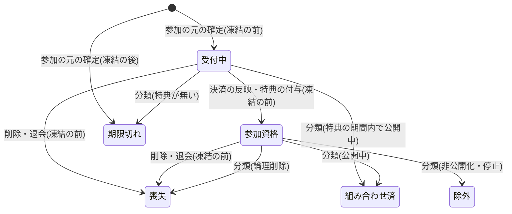

# 単一敗退のブラケット

参加者に抽選番号を付けて並べ、1日1ラウンドの対戦で勝者だけが次のラウンドへ進む単一敗退(シングルエリミネーション)のトーナメントの規約を定める。ブラケットの形とシード、抽選番号、ラウンドごとの組み方、空の側と不戦勝の伝播、終了の判定、参加者の紐付けの解除、表示用の配置、記録と冪等な進行、ラウンドの実施日と遅れ、参加の枠の凍結と分類、決済の反映との競合、通知の発行の順と冪等性、返金の後処理、及びテストを扱う。

ラウンドの1つ1つの対戦(予定・開始・確定)は「[期間を限った投票](014-time-boxed-voting.md)」の投票として行う。一意索引と条件付きの書き込みは「[Cloudflare D1の制約と対処](../db/002-d1-constraints.md)」に、日次のジョブと冪等性は「[非同期処理の設計](../infra/003-async-processing.md)」に、参加費の決済の反映と返金の依頼は「[外部の通知の冪等な反映](009-idempotent-event-reflection.md)」に、通知イベントの発行と夜の送り出しの準備の完了は「[まとめて送る通知メール](016-batched-notification-delivery.md)」に、参加中に別の申し込みを受け付けない制限などの判定の供給元は「[判定の供給元と保存の処理の登録口](013-pluggable-decision-sources.md)」に、参加の対象の集約の物理削除は「[集約のライフサイクルイベント](012-aggregate-lifecycle-events.md)」に従う。ブラケットの画面は「[トーナメントのブラケットの表示](../frontend/016-tournament-bracket-view.md)」で扱う。

## 前提と用語

部品の置き場所は、共通ライブラリ・共用部品の配置先と`<APIサーバーのアプリ>`の`src/`からのパスで示す。`<ドメイン>`は種類によらないブラケットの部品のディレクトリの名前で、エラートラッキングの指紋の先頭にも使う。`<種類>`はトーナメントの種類(開催の周期ごとの機能)ごとに置き換える。参加の対象は、参加者が持ち込む集約(作品・チームなど)を指す。テーブルと列の名前は例である。

| 部品                                           | 置き場所                                                                                                                                                                           | 役割                                                                                                                               |
| ---------------------------------------------- | ---------------------------------------------------------------------------------------------------------------------------------------------------------------------------------- | ---------------------------------------------------------------------------------------------------------------------------------- |
| 形・抽選・進行・配置・実施日の規則と進行の計画 | 共通ライブラリの`core/<ドメイン>/`(`bracket-shape.ts`・`bracket-draw-rules.ts`・`bracket-progress-rules.ts`・`bracket-progress-plan.ts`・`bracket-layout.ts`・`round-schedule.ts`) | 実行環境に依存しない純粋な規則。種類によらない。進行の計画(`bracket-progress-plan.ts`)は、記録の読み直しから次の一手と終了を決める |
| ブラケットの記録・抽選・進行の契約と識別子     | 共通ライブラリの`core/<ドメイン>/ports.ts`・`identifiers.ts`                                                                                                                       | 種類ごとのトーナメントが使う契約                                                                                                   |
| ブラケットの記録・抽選・進行の実装と共通の束縛 | 共通ライブラリの`workers/<ドメイン>/`                                                                                                                                              | D1の実装。進行は記録を読み直して進行の計画に渡し、計画のとおりに書き込む                                                           |
| ラウンド名・段階の規則                         | 共用部品の`<ドメイン>/round-name.ts`                                                                                                                                               | 画面とサーバーが同じラウンド名を使う                                                                                               |
| 種類ごとの期限・並びの比較・参加の枠の規則     | 共通ライブラリの`core/<種類>/`                                                                                                                                                     | 受付・決済・組み合わせ決定の期限、シードの比較、返金の依頼の規則                                                                   |
| 種類ごとの参加の枠・凍結・分類・通知の実装     | 共通ライブラリの`workers/<種類>/`                                                                                                                                                  | 参加の枠のストア、組み合わせ決定、進行の後処理、通知の発行、返金の後処理                                                           |
| 表示の組み立て                                 | `<APIサーバーのアプリ>`の`application/<ドメイン>/bracket-view-builder.ts`                                                                                                          | 種類によらない表示の形([トーナメントのブラケットの表示](../frontend/016-tournament-bracket-view.md))                               |

| 用語             | 意味                                                                                                               |
| ---------------- | ------------------------------------------------------------------------------------------------------------------ |
| ブラケット       | 1つのトーナメントの組み合わせの記録。種類とトーナメントのIDごとに1つ。例のテーブルは`tournament_brackets`          |
| 参加者           | ブラケットに入った参加の枠。抽選番号を持つ。例のテーブルは`bracket_participants`                                   |
| 参加の枠         | トーナメントへの参加の申し込みの記録。前段の勝利などの参加の元から作り、参加費の決済や特典で参加資格を得る         |
| 抽選番号         | 参加者に1から付ける番号。シードは1〜S、非シードはS+1〜N                                                            |
| 参加数N          | ブラケットに入った参加者の数                                                                                       |
| 2回戦の枠の数    | 1回戦の勝者とシードが入る2回戦の枠の数。N以上の最小の2の冪の半分                                                   |
| シード数S        | 1回戦を戦わずに2回戦から入る参加者の数                                                                             |
| 位置             | ラウンドの中の対戦の場所。ラウンドと位置の番号の組で1つに決まる。例のテーブルは`bracket_matches`(主キーは対戦のID) |
| 側               | 1つの位置の対戦に入る参加者。2つあれば対戦、1つなら不戦勝の対戦                                                    |
| 空の側           | 前の位置に勝者がいない(両者敗北・両者の不戦敗)・参加者の紐付けを解除したため、誰も入らない側                       |
| 固定のブラケット | 結果によって組み直さず、位置と勝ち上がりの道筋を形だけで決めるブラケット                                           |
| 凍結             | 組み合わせ決定を始めた記録。凍結の後は参加資格を変える書き込みが何もしなくなる                                     |
| 分類             | 凍結の後に、参加の枠を組み合わせに入る枠と入らない枠(期限切れ・喪失・除外)に分けること                             |

本文中の`<1回の書き込みの位置の数>`などのプレースホルダーの本プロジェクトの値は、技術ドキュメントに写さず、プロジェクト固有の値の文書「[本プロジェクト固有の値](../../../onboardings/project-values.md)」に置く。

## ブラケットの形

参加数Nから、2回戦の枠の数・シード数S・1回戦の対戦の数・ラウンドの数を決める(`bracketShape`)。

| 値              | 求め方                                | N = 13の例 | N = 8の例 |
| --------------- | ------------------------------------- | ---------- | --------- |
| 2回戦の枠の数   | 2倍がN以上になる最小の2の冪           | 8          | 4         |
| シード数S       | 2回戦の枠の数×2−N                     | 3          | 0         |
| 1回戦の対戦の数 | (N−S)÷2                               | 5          | 4         |
| ラウンドの数    | 2回戦の枠の数が2の何乗かに1を足した数 | 4          | 3         |

- Nが0・1のときは、全ての値を0にし、対戦を作らない。1なら唯一の参加者を優勝、0なら受賞なしで終える。
- 参加数は`Number.isSafeInteger`の0以上で検査し、範囲外は`RangeError`にする。
- ラウンドrの枠の数は、1回戦がN、2回戦以降が2回戦の枠の数÷2^(r−2)である。段階(準々決勝・準決勝・決勝)は枠の数から決め(8・4・2)、ラウンド名は段階があれば段階、無ければ「<r>回戦」とする。画面とサーバーは共用部品のラウンド名の規則を使い、段階の判定を写さない。
- 2の冪でない参加数でも、シードを置いて2回戦の枠を2の冪にそろえ、2回戦以降は空の側が無い限り全ての位置が対戦になる。

## 抽選番号

抽選の規則(`drawBracket`)は、比較の関数を2つ(シードの比較・非シードの比較)受け取り、候補に抽選番号を付ける。比較の中身は種類ごとに決める。

1. 全ての候補をシードの比較で並べ、上位S件にシード1〜Sを付ける。
2. 残りを非シードの比較で並べ直し、S+1〜Nを付ける。
3. どちらの並べ替えも、比較が同じなら同順の決め手(`tieBreaker`)、さらに同じなら候補の参照(`ref`)の昇順にする。

- 文字列は符号単位で比べ(`a < b`)、`localeCompare`を使わない。実行環境の照合順序で抽選番号が変わらない。
- 候補の参照の重複は`RangeError`にする。参照は参加の枠のIDのように一意な値にする。
- 同順の決め手には、参加の元のIDなど抽選の対象と別の値を使う。参加の元への紐付けを解除した枠は、その枠のIDで代える。
- 規則は乱数を使わない。同じ候補から何度求めても同じ抽選番号になり、中断の後に作り直しても記録と食い違わない。

## ラウンドの組み方

| ラウンド  | 位置kの側                                                                                              |
| --------- | ------------------------------------------------------------------------------------------------------ |
| 1回戦     | 抽選番号S+2k−1とS+2k                                                                                   |
| 2回戦     | 2回戦の枠の並び(下記)を先頭から2つずつ取った枠。枠iは、i ≤ Sならシードi、i > Sなら1回戦の位置i−Sの勝者 |
| 3回戦以降 | 前のラウンドの位置2k−1と2kの勝者                                                                       |

2回戦の枠の並び(`seedPlacementOrder`)は、`[1]`から始めて、長さを倍にするたびに各番号の直後へ「新しい長さ+1−その番号」を挿入して作る(4枠は`[1, 4, 2, 3]`、8枠は`[1, 8, 4, 5, 2, 7, 3, 6]`)。シードの上位どうしが決勝まで当たらず、シードの無いブラケット(N = 8など)も同じ並びで2回戦を組む(N = 8の2回戦は1回戦の位置1×4・2×3)。

- ブラケットは固定にする。結果に応じて組み直さないため、まだ対戦の無い位置にも、どの位置の勝者が入るかを表示できる。
- 位置の側は、抽選番号の昇順で記録する(`participant1_no < participant2_no`)。対戦の側の番号の順が記録の参加者の順に当たり、確定した対戦の勝者を側の番号から参加者に写せる。

### 空の側と不戦勝の伝播

前の位置に勝者がいない場合、その枠は空の側になる(`decideNext`)。

| 位置の2つの枠        | 作る位置                                                              |
| -------------------- | --------------------------------------------------------------------- |
| どちらも参加者がいる | 対戦                                                                  |
| 片方だけ参加者がいる | 側が1つの位置。対戦の仕組みが不戦勝として確定し、その参加者が次へ進む |
| どちらも空           | 位置を作らない。次のラウンドの対応する枠も空になる                    |

- 次のラウンドの枠に残る参加者が1以下になったら、そのラウンドを作らずに終える。1ならその参加者を優勝、0なら受賞なしにする。
- 決勝の位置の勝者が優勝である。決勝が両者敗北なら受賞なしで終える。
- 規則の関数は、記録のうち最大のラウンドだけを現在のラウンドとして見る。そのラウンドに未確定の位置があれば待ち、全て確定していれば次を決める。確定した勝者がその位置の側でなければ`RangeError`にする(記録の不整合)。

### 参加者の紐付けの解除

組み合わせの後に参加の対象が物理削除されると、参加者の参加の対象・参加の元・保有者の紐付けを外す(`unlinkProduct`)。抽選番号と敗退の記録は残す。保有者の列が利用者のテーブルへの外部キーで`ON DELETE`を持たない場合、保有者の列も同じ文で外さないと、後の利用者の物理削除が外部キーの違反で失敗する。

進行の計画(`planNext`)は、紐付けを解除した参加者を空の側として扱う。

- 次のラウンドの位置から紐付けを解除した参加者を除き、その参加者はそのラウンドで敗退したものとして記録する。
- 除いた結果、位置が1つも残らないラウンドは作らず、全ての位置を両者敗北とみなして次のラウンドを決め直す。
- 1回戦でシードが2回戦で待つ場合を除き、残る参加者が1以下になったら終える。
- 決勝の対戦で勝った参加者は、その後に紐付けを解除しても優勝のままにする(受賞の照会が紐付けの無い優勝を除く)。決勝を待たずに勝ち残りが1になって終えるとき、その参加者の紐付けが解除されていれば受賞なしにし、次に戦うはずだったラウンドで敗退させる。

### 表示用の配置

表示用の配置(`bracketLayout`)は、形だけから全てのラウンドの全ての位置の2つの枠の出どころ(抽選番号の参加者か、前のラウンドの位置の勝者か)を返す。進行の規則と同じ組み方を表示用に別に書き、テスト(進行の規則で求めた位置と配置の一致)で2つが食い違わないことを保証する。どちらかを変えたら、このテストを通す。

- 配置は、両側が空と確定した位置や、終了の後のラウンドも含む。表示の組み立てが記録と照らして除く([トーナメントのブラケットの表示](../frontend/016-tournament-bracket-view.md#表示の組み立て))。
- 抽選番号の枠のうち、S以下はシードの枠、Sを超える枠は1回戦の予定を作った後は対戦の表示で上書きされる。

## 記録と冪等な進行

### テーブルと一意索引

| テーブル   | 一意索引                                                  | 主な列                                                                                                     |
| ---------- | --------------------------------------------------------- | ---------------------------------------------------------------------------------------------------------- |
| ブラケット | `(kind, tournament_id)`                                   | 形(参加数・シード数・2回戦の枠の数・ラウンドの数)・1回戦の日・状態(`active`・`finished`)・結果・優勝の番号 |
| 参加者     | `(bracket_id, participant_no)`・`(bracket_id, entry_ref)` | 参加の枠の参照・参加の元・参加の対象・保有者(紐付けの解除でnull)・敗退したラウンド                         |
| 位置       | `(bracket_id, round, position)`(主キーは対戦のID)         | 実施日・側の抽選番号・状態(`planned`・`scheduled`・`decided`)・勝者の番号・確定の日時                      |

- 位置の主キーを対戦の仕組みのマッチのIDにし、位置を挿入する時点で採番する。対戦の仕組みの予定の作成はIDで冪等なため、同じ位置に2つの対戦が作られない。
- 対戦のテーブルへの外部キーは張らない。位置は対戦の予定より先に挿入する。
- 記録の読み取りは、ブラケット・参加者・位置を1回の`db.batch()`で読み、同じ時点の状態にそろえる。形は保存した参加数から求め直す。

### 抽選と記録の作成

組み合わせの作成(`BracketDraw.create`)は次の順に行い、最後に進行に任せる。

1. 抽選の規則で抽選番号を求める。
2. ブラケットを一意索引で重複を無視して挿入し(`onConflictDoNothing()`)、IDを読み直す。
3. 参加者を1行1文で、`<1回の書き込みの位置の数>`文ずつの一括の書き込みで重複を無視して挿入する。既にブラケットがあっても毎回挿入し、中断で欠けた参加者を補う。
4. 進行(`advance`)を呼び、1回戦の予定を作る。参加1以下は1回戦の日を記録せずに終える。

- 候補が前回と違っても照合しない。同じ候補で呼び直す前提で、候補を決めるまでの参加の枠の変化は[凍結](#参加の枠の凍結と分類)で止める。進行の計画は参加者の行の欠落を紐付けの解除と区別できないため、候補を変えて呼ぶと欠けた参加者が空の側として扱われる。

### 進行の手順

進行(`advance`)は、何度呼んでも同じ結果になるよう、毎回記録を読み直して次の一手を決める。

| 順  | 手順         | 書き方                                                                                                                                                                              |
| --- | ------------ | ----------------------------------------------------------------------------------------------------------------------------------------------------------------------------------- |
| 1   | 終了の確かめ | 終了したブラケットは記録の結果を返す(新しく終えたとしない)                                                                                                                          |
| 2   | 結果の写し   | `scheduled`の位置の対戦を照会し、確定したものの勝者と確定の日時を`status = 'scheduled'`を条件に写し、負けた側に`eliminated_round IS NULL`を条件に敗退を記録する(同じ一括の書き込み) |
| 3   | 計画         | 記録を読み直し、空の側と紐付けの解除を扱った計画(待つ・次のラウンドを作る・終える)を求める                                                                                          |
| 4a  | 次のラウンド | 除いた参加者の敗退を記録し、位置を`planned`で重複を無視して挿入し、予定を作り、`scheduled`にする([位置の挿入と予定の作成](#位置の挿入と予定の作成))                                 |
| 4b  | 終了         | 除いた参加者の敗退を記録し、残った`planned`の位置を片付け、`status = 'active'`を条件に終了を書く                                                                                    |

- 終了の書き込みは、更新した行を返す(`returning`)。行が返った呼び出しだけが「新しく終えた」結果を返し、同時に終えた他の呼び出しは記録を読み直して既に終えた結果を返す。受賞の後処理を1回にするため、呼び出し元は新しく終えたかどうかを使える。
- 予定を作ったラウンドにまだ確定が1件も無い間は、予定の直後と同じ結果(同じ予告の対戦のID)を何度でも返す。一部が確定したら、確定した対戦のIDだけを返して待つ。呼び出し元は、同じ予告と結果を何度受け取っても冪等に扱う([通知の発行](#通知の発行))。

### 位置の挿入と予定の作成

位置は、同時に進めた別の呼び出しや中断の前の実行が先に挿入していても、先に挿入した位置の対戦のIDにそろえる。

1. 計画の位置を`(bracket_id, round, position)`の一意索引で重複を無視して挿入する。
2. `planned`の位置を全て読み、対戦の仕組みに対戦があるかを照会して、位置ごとに次のどれかにする。
   - 対戦が既にある(予定の作成の後で中断した): その対戦の実施日のまま`scheduled`にする。
   - 今回の計画に無い位置: 消す。
   - 今回の計画の位置: 実施日と側を計画にそろえ、予定を作る位置にする。
3. 予定を作る位置を`<1回の書き込みの位置の数>`件ずつ対戦の仕組みの予定の作成へ渡す。別の呼び出しが先に作って作成を飛ばした対戦は、その対戦の実施日を読み戻して位置にそろえる。
4. 予定を作った位置を`status = 'planned'`を条件に`scheduled`にする。

- 位置を挿入した後で予定を作る前に中断したラウンドは、計画が前のラウンドの結果から作り直す。規則の関数は記録の最大のラウンドだけを見るため、`planned`の位置の最小のラウンドより前の記録だけを状態として渡す。
- 紐付けを解除した参加者は計画が側から除くため、予定の側に紐付けの無い参加者が来たら記録の不整合として`RangeError`にする。

### ラウンドの実施日と遅れ

ラウンドの実施日は、日程の方針(`RoundSchedulePolicy`)で決める。1日1ラウンドの方針(`dailyRoundPolicy(予定の1回戦の日, 現在時刻)`)は次の日を返す。

| ラウンド  | 実施日                                                |
| --------- | ----------------------------------------------------- |
| 1回戦     | max(予定の1回戦の日, 現在の業務日付の翌日)            |
| 2回戦以降 | max(前のラウンドの実施日の翌日, 現在の業務日付の翌日) |

- 対戦を実施日の始まり(業務時刻の0:00)に開始する場合、当日の対戦は既に開始しているため、現在の業務日付の翌日より早めない。方針は現在時刻から下限を決めるため、呼び出しのたびに作り直し、使い回さない。
- 翌日の業務日付(`nextBusinessDate`)は、業務日付の0:00に24時間を足した時点の業務日付で求める。業務時刻が固定の時差で夏時間を持たない前提である。
- 前のラウンドは、`planned`の位置と、位置が1つも残らず飛ばしたラウンドを除いて数える。1回戦を飛ばした場合、2回戦は方針の1回戦の日に行う。
- 遅れは、作った位置の実施日が遅れの無い日(前のラウンドの実施日の翌日、前のラウンドが無ければ記録した1回戦の日)より後であることで判定する。新しく作った対戦だけを数え、レベル`warning`のログ(ブラケットのIDと対戦のID)とエラートラッキングのイベント(指紋`['<ドメイン>', 'round-late']`)で知らせる。他の呼び出しが先に作った対戦は数えず、呼び直しで重ねて知らせない。
- エラートラッキングのタグは除去処理の対象外のため、IDの形(大文字のULID)の値だけを送り、それ以外は固定の値に置き換える(「[除去処理の対象外の項目](../infra/004-logging-and-error-tracking.md#除去処理の対象外の項目)」)。タグの名前はsnake_caseにする。

### 進行の呼び出し

進行は、対戦の確定のイベントと日次のジョブの2つの経路から呼ぶ。どちらも冪等なため、先に動いた経路が進め、後の経路は同じ結果を受け取る。

- 確定のイベントの処理は、ブラケットのマッチの照会(`findByMatchIds`)で種類を確かめ、トーナメントを読んで`advance`と後処理を行う。確定していない・トーナメントが無い場合はレベル`warning`のログを残して完了にする(再試行で直らない)。
- 日次のジョブは、進行中のトーナメントを上限件数まで順に進め、1件の失敗で他を止めない。失敗したトーナメントのIDを集め、ジョブの最後に失敗として扱う。

## 参加の枠の凍結と分類

参加費や特典で参加資格を得る枠を、組み合わせ決定の時刻に締め切る。締め切りの後に資格が変わると、抽選の候補が変わり、記録と食い違う。

### 参加の枠の状態

- 資格を与える書き込みの対象は受付中の枠だけにする(`GRANTABLE_STATUSES`)。一度得た参加資格は、特典の終了や解約で戻さない。

### 凍結を書き込みの文に入れる

凍結は、トーナメントの行に組み合わせ決定の開始の日時を`draw_started_at IS NULL`を条件に書く1文にする(`freeze`)。参加資格を変える全ての書き込みは、凍結の前であることを読み取りでなく同じ文の条件に含める。

| 書き込み                   | 条件の入れ方                                                                                                                      |
| -------------------------- | --------------------------------------------------------------------------------------------------------------------------------- |
| 枠の作成(受付中・参加資格) | `INSERT … SELECT … FROM <トーナメント> WHERE id = ? AND draw_started_at IS NULL`。0行なら読み直して、凍結済みなら`'frozen'`を返す |
| 特典による付与             | `UPDATE … WHERE … AND tournament_id IN (SELECT id FROM <トーナメント> WHERE draw_started_at IS NULL AND <期間の条件>)`            |
| 削除・退会による喪失       | 同じ副問い合わせを条件にする。凍結の後は何もしない                                                                                |
| 決済の反映による付与       | 状態の値を`CASE WHEN <受付中> AND <凍結の前> THEN '参加資格' ELSE NULL END`にする([決済の反映との競合](#決済の反映との競合))      |

- 枠の作成が`'frozen'`を返したら、同じIDで期限切れ(理由は組み合わせ決定に間に合わなかったこと)として挿入し直し、レベル`warning`のログとエラートラッキングのイベント(指紋`['<ドメイン>', 'late-entry']`)で知らせる。同じ参加の元の2回目以降の知らせは、一意索引で何もせず知らせもしない。
- 凍結の前の読み取り(「凍結されていなければ作る」)と書き込みを分けると、その間に凍結した枠が分類から漏れ、組み合わせにも期限切れにも入らない。
- 期限の境界(特典の期間の終わりが決済期限ちょうどなど)を含むかどうかは、規則の関数と文の条件で同じにし、テストで境界の値を確かめる。
- 特典の期間(参加の元の確定から決済期限まで。決済の開始や表示のように決済期限の前に判定するときは、付与の処理が追いつく前の加入も含めるため現在と決済期限の早い方まで)は、1つの純粋な規則の関数で求め、枠の作成・分類・決済の開始・表示の全てで使う。始まりが終わりより後になる期間は空として返し、特典の照会を呼ばない。

### 組み合わせ決定の手順

組み合わせ決定のジョブは、組み合わせ決定の時刻を過ぎて未完了のトーナメントを上限件数まで読み、トーナメントごとに次の順に行う。1件の失敗はログとエラートラッキング(`draw-failed`)に残し、他のトーナメントを止めない。

1. 補完(凍結の前だけ): 参加の元(期間中に確定した前段の勝利など)のうち枠の無いものに枠を作る。確定のイベントの処理の遅れで作られていない枠を拾う。
2. 凍結: `freeze`を書く。既に凍結済みの(前回の実行が中断した)トーナメントは1・2を飛ばし、3から続ける。
3. 分類: 受付中と参加資格の枠を読み、状態だけを条件に分類を書く(凍結の条件は付けない)。受付中の枠は、特典の期間内なら参加資格の枠として扱って続けて判定し、そうでなければ期限切れにする。参加資格の枠は、参加の対象が論理削除なら喪失、非公開化・停止なら除外、公開中なら組み合わせ済にする。
4. 抽選と記録: 組み合わせ済の枠(紐付けを解除した枠を含む)を候補に[抽選と記録の作成](#抽選と記録の作成)を行う。
5. トーナメントへの記録: ブラケットのIDと、抽選と記録の作成で終えていれば(参加1以下や、紐付けの解除で残る参加者が1以下)その結果を、組み合わせ決定中であることを条件に書く。
6. 後処理: [通知の発行](#通知の発行)と、喪失・除外の枠の[返金の後処理](#返金の後処理)を行う。

- 分類の値の組(状態と理由と資格の出どころ)はテーブルのCHECK制約と同じ組にする。1件でも違反すると一括の書き込み全体が失敗する。
- 返金の状態は、決済した枠の喪失・除外だけを返金待ちにし、決済の無い枠は返金不要にする。組み合わせ済と期限切れは返金の対象にしない。
- 分類と喪失は対象のトーナメントの受付中・参加資格の枠の行だけに書き、参加の元(前段の勝利の記録)と終了したトーナメントの受賞を変えない。参加の元を条件にする他の機能の判定(一覧への掲載など)は、参加の枠の状態によらない。
- 5の後の後処理の失敗は、そのトーナメントを失敗として報告するが、組み合わせ決定をやり直さない。予告は同じ夜の進行のジョブ、受賞は[夜の発行](#夜の発行と送り出しの準備)、返金は日次の後処理が回復する。

### 決済の反映との競合

参加費の決済の反映は、準備の段で枠を読み(受付中・本人の枠・凍結の前・論理削除でない)、付与の文を返す。決済の機能は付与の文を購入の記録と同じ一括の書き込みで実行する。

- 付与の文の状態の値を、受付中で凍結の前なら参加資格、そうでなければNULLにする。準備から確定までの間に凍結されるか資格が変わると、NOT NULLの違反で一括の書き込み全体が取り消され、決済の機能が準備を呼び直して拒否し、自動の返金に回す(「[版の検査で一括の書き込み全体を取り消す](../db/002-d1-constraints.md#版の検査で一括の書き込み全体を取り消す)」)。
- 反映の時刻は決済の機能が渡す支払いの時刻とし、決済期限の後に反映した決済は、決済期限で解ける制限(参加中に別の申し込みを受け付けない制限など)が解けた後に申し込まれた新しい参加の元があれば拒否する。トーナメントへの参加と別の申し込みが並行しない。
- 非公開化・停止は準備の段で拒否せず、分類で除外して返金する。

## 通知の発行

対戦の結果・翌ラウンドの予告・受賞は、通知の機能の発行の口へ通知イベントとして発行する。発行の重複は通知の機能が通知イベントの重複のキー(対戦のID、期間と受賞した参加の対象)で除く。

### 発行を記録より先にする

進行の結果の後処理(`applyResult`)は、次の順に行う。

1. その回に確定した対戦の結果と、新しく作った対戦の予告を発行する。
2. 終えた場合は、優勝の枠を読み直して紐付けがあれば受賞を発行する。
3. トーナメントの終了を`status <> 'finished'`を条件に記録する。

- 終了の記録を最後に置く。発行に失敗しても、トーナメントは進行中のまま残り、イベントの再試行や日次のジョブが発行と記録をやり直せる。記録を先に置くと、記録の後の発行の失敗が取り返せない。
- 記録の1回性は終了の文の条件で、発行の1回性は重複のキーで保つ。2つの経路が同時に終えても、受賞の通知は1つになる。
- 参加1で組み合わせ決定の時点で終えた場合も、トーナメントに結果を記録した後に同じ後処理を呼び、受賞を発行する。

### 違反を除いた発行

発行の口は、1件でも発行できない通知イベント(開始済みの対戦の予告など)があると全件を拒否し、違反の位置だけを返す。後処理は違反の1件を除いて残りを発行し直し、違反が無くなるまで繰り返す。

- 予告できない対戦(開始済み)の違反はレベル`info`、それ以外の位置のある違反はレベル`error`のログに残す。位置の無い拒否と範囲外の位置は例外のまま投げる。
- 違反はまれなため、発行の前に対戦の状態を照会しない。

### 夜の発行と送り出しの準備

対戦の確定と進行のジョブの最後に、その夜の通知を一覧にして発行し直す。確定のイベントの処理で発行した通知も含めて重複のキーで除かれるため、取りこぼしだけが補われる。

- 一覧は、当日の確定した対戦の結果、翌日の側が2つの予定の対戦の予告、当日の0:00から発行の時刻までに受賞を記録したトーナメントの受賞にする。受賞の範囲の終わりは、組み合わせ決定と進行の後に時計を読み直した時刻にする。
- 全ての手順が成功したら、最後に通知の機能の送り出しの入口へ準備の完了を1回だけ伝える(「[前提を待つ枠と送り出しの入口](016-batched-notification-delivery.md#前提を待つ枠と送り出しの入口)」)。1つでも失敗した夜は伝えず、エラートラッキングへ知らせて例外を投げ、送り出しを期限に任せる。準備の完了を伝えた後に発行した通知は、その夜の送り出しに載らない。

## 返金の後処理

喪失・除外で返金待ちになった枠は、組み合わせ決定の後処理と、日次の後処理のジョブで返金を依頼し、知らせのメールを送る。

- 返金の依頼キーは`<返金の依頼キーの接頭辞>:<購入のID>:<理由>`にする。同じ枠を何度処理しても決済の機能の依頼は1つになる(「[返金の依頼の口](009-idempotent-event-reflection.md#返金の依頼の口)」)。
- 依頼の拒否は、コードごとに枠の返金の状態を決める。

| 拒否のコード                     | 返金の状態 | 運用者への知らせ | 理由                                   |
| -------------------------------- | ---------- | ---------------- | -------------------------------------- |
| 未払い・購入が無い               | 返金不要   | しない           | 返金するものが無い                     |
| 返金できる残額を超える           | 返金済み   | する             | 管理者の返金などと自動の依頼が食い違う |
| 金額の誤り・依頼キーの形式の誤り | 拒否       | する             | 再処理しても直らない                   |

- 返金不要・返金済み・拒否には知らせのメールを送らない。知らせの入力を作れない(宛先が無い・紐付けを解除した・退会した)枠は知らせを飛ばした状態にし、送信の失敗は例外にして知らせ待ちのまま残す。
- 1件の失敗で止めず全件を試し、最後に失敗を投げる(1件なら元の例外、複数なら`AggregateError`)。日次のジョブは最後の更新から`<再処理の待ち時間>`以上経った枠だけを読み、依頼の直後の枠を二重に処理しない。
- 続きの位置(カーソル)を持たない読み取りで繰り返す場合は、試した枠のIDを覚えて、失敗して待ちのまま残る枠で無限に回らないようにする。

## テスト

- 形・抽選・組み方・配置の規則は単体テストで、N = 0・1・2・3・8・13と2の冪の前後を確かめる。抽選は比較が同じ候補の同順の決め手と参照の順、参照の重複の`RangeError`を、組み方はN = 13の1回戦の組(抽選番号4×5・6×7・…)と2回戦の配置を、進行の規則と配置の一致を確かめる。
- 空の側は、両者敗北・両者の不戦敗の位置を含む記録から、側が1つの位置・位置を作らないこと・残り1以下での終了を確かめる。紐付けの解除は、進行の計画の単体テストで記録の型の値から、側から除いた参加者の敗退の記録、全ての位置が消えるラウンドの決め直し、シードが2回戦で待つ1回戦で残り1でも終えないこと、決勝の勝者の紐付けの解除で優勝が保たれること、決勝の前に終えるときの受賞なしと次のラウンドでの敗退を確かめる。Workers統合テストでは、同じ場合が書き込みの結果(敗退のラウンド・終了の結果)に表れることを確かめる。
- 進行はWorkers統合テストで、同じ記録に2回呼んで同じ結果になること、位置の挿入の後・予定の作成の後で中断した記録からの回復、別の呼び出しが先に作った対戦への実施日のそろえ、終了を同時に書いて新しく終えた結果が1つになること、遅れの判定と知らせが新しく作った対戦だけであることを確かめる。
- 実施日の方針は、0:00の前後の現在時刻で1回戦と次のラウンドの日を確かめる。
- 凍結は、凍結の前後の枠の作成・付与・喪失の結果、凍結の後の作成が期限切れになること、分類の各分岐と返金の状態、凍結済みのトーナメントの再実行が分類から続くこと、枠が期限切れ・喪失になっても参加の元の記録・それを条件にする一覧・同じ参加の対象が前のトーナメントで既に受けた賞が変わらないことを確かめる。決済の反映は、準備の後に凍結を割り込ませて一括の書き込みが取り消され拒否になることを確かめる。
- 通知は、同じ結果を2回後処理して発行が重複のキーで1つになること、発行の失敗で終了が記録されないこと、違反を含む一覧で残りが発行されること、夜の発行が準備の完了の前に全ての通知を発行することを確かめる。
- 返金の後処理は、拒否のコードごとの状態と知らせの有無、1件の失敗で残りが処理されること、依頼キーの形を確かめる。
