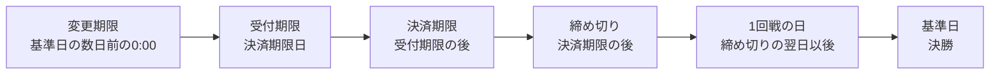

# 基準日から逆算する日程

管理者が期間ごとに設定する基準日(決勝の日など、日程の起点にする日付)から、受付・決済・締め切り・変更期限の期限と、ラウンドの日程を逆算する規約を定める。既定の基準日、純粋な規則で導く日程、導いた期限の保存と書き直し、選べる基準日と検証の規則(曜日・事前の日数・前後の期間との間隔・変更期限)、変更期限と版と凍結を1つの一括の書き込みの条件で確かめる保存、期間の所属を保存せず日付と期間の状態で判定する規則、凍結した期間に遅れて届いた記録、遅れた期間の回復、参加数の上限による選択、業務時刻での日数の加算と曜日の計算、及びテストを扱う。

締め切りでの参加の枠の凍結と分類・抽選・進行は「[単一敗退のブラケット](017-single-elimination-brackets.md)」に、保存と同じ一括の書き込みに含める監査ログの条件付きの記録は「[監査ログの記録](008-audit-logging.md)」に、一意索引と一括の書き込みの取り消しは「[Cloudflare D1の制約と対処](../db/002-d1-constraints.md)」に、業務時刻と業務日付・日次のジョブは「[非同期処理の設計](../infra/003-async-processing.md)」に、エラーコードとステータスは「[共通エラーと共通のエラー形式](002-layered-architecture-on-workers.md#共通エラーと共通のエラー形式)」に従う。基準日を候補から選ばせる画面は「[業務日付のカレンダー](../frontend/012-business-date-calendar.md#サーバーが返す候補から選ばせる日付)」で扱う。

## 前提と用語

部品の置き場所は、共通ライブラリの配置先と`<APIサーバーのアプリ>`の`src/`からのパスで示す。`<種類>`は基準日を持つ機能(開催の周期ごとのトーナメントなど)のディレクトリの名前、`<期間>`・`<基準日>`はその機能の期間と基準日を表すファイル名の接頭辞に置き換える。テーブルと列の名前は例である。

| 部品                     | 置き場所                                                                                         | 役割                                                                                 |
| ------------------------ | ------------------------------------------------------------------------------------------------ | ------------------------------------------------------------------------------------ |
| 日程の規則               | 共通ライブラリの`core/<種類>/<期間>-schedule.ts`                                                 | 既定の基準日と、基準日から期限と1回戦の日を導く純粋な関数。日数と上限の定数を持つ    |
| 選べる基準日と検証の規則 | 共通ライブラリの`core/<種類>/<基準日>-choice.ts`                                                 | 編集できる期間、変更できるかの判定、違反の理由、候補の一覧、次の期間との間隔の警告   |
| 期間の所属の判定の規則   | 共通ライブラリの`core/<種類>/<期間>-target-rules.ts`                                             | 参加の元の日付と期間の状態から、参加する期間を決める                                 |
| 上限による選択の規則     | 共通ライブラリの`core/<種類>/<期間>-capacity.ts`                                                 | 参加数の上限を超えた枠を、決まった順で残す枠と超えた枠に分ける                       |
| 基準日の表記             | 共通ライブラリの`core/<種類>/<基準日>-label.ts`                                                  | メール・決済の内容・通知の追記が共有する、年と曜日を付けた表記                       |
| 業務日付の加算と曜日     | 共通ライブラリの`core/time/business-time.ts`(`addBusinessDays`・`businessWeekdayOf`)             | 業務日付の日数の加算(負は過去)とISOの曜日(月1〜日7)                                  |
| 期間の照会               | 共通ライブラリの`workers/<種類>/`                                                                | 期間の行の有無と凍結から期間の状態を導き、判定の規則に渡す。開催予定の期間の行を作る |
| 基準日の照会と保存       | `<APIサーバーのアプリ>`の`application/<種類>/`(ユースケース)・`infrastructure/<種類>/`(書き込み) | 候補と検証の結果を返し、監査ログと同じ一括の書き込みで条件付きに書き直す             |

| 用語           | 意味                                                                                                  |
| -------------- | ----------------------------------------------------------------------------------------------------- |
| 基準日         | 日程の起点にする業務日付(`YYYY-MM-DD`)。期間ごとに1つ持つ                                             |
| 期間           | 基準日を1つ持つ開催の単位(年など)。期間ごとに行を1つ持つ。例のテーブルは`periods`                     |
| 既定の基準日   | 基準日を設定していない期間に、規則で求める基準日                                                      |
| 出どころ       | 基準日が管理者の設定(`explicit`)か既定(`default`)か                                                   |
| 日程           | 基準日から導く期限と日付の組(決済期限日・受付期限・決済期限・締め切り・変更期限)                      |
| 締め切り       | 参加の枠を凍結して組み合わせを決める時刻                                                              |
| 変更期限       | 基準日を変更できる最後の時点。この時点以後と凍結の後は変更できない                                    |
| 版             | 基準日の保存ごとに1増える値。既定のままの期間は0。保存の競合を見つける                                |
| 参加の元       | 参加の枠を作る元の記録(前段の勝利など)。発生の日付で期間の所属が決まる                                |
| 期間の状態     | 期間の照会が返す状態。開催予定(`planned`)・受付中(`open`)・凍結済み(`frozen`)・開催しない(`not_held`) |
| 遅れた参加の元 | 凍結の後に届いた、凍結した期間に属する参加の元                                                        |

本文中の`<決済期限日までの日数>`などのプレースホルダーの本プロジェクトの値は、技術ドキュメントに写さず、プロジェクト固有の値の文書「[本プロジェクト固有の値](../../../onboardings/project-values.md)」に置く。

## 日程を基準日から導く

日程の規則は、期間と基準日だけから全ての期限を求め、凍結した値で返す。



| 値         | 求め方                                                                                      |
| ---------- | ------------------------------------------------------------------------------------------- |
| 決済期限日 | 基準日の`<決済期限日までの日数>`日前                                                        |
| 受付期限   | 決済期限日の`<受付期限の時刻>`。決済の開始を受け付ける最後の時点                            |
| 決済期限   | 決済期限日の`<決済期限の時刻>`。この時点までに支払った決済を参加資格にする                  |
| 締め切り   | 決済期限日の`<締め切りの時刻>`。凍結と組み合わせ決定のジョブが動く                          |
| 変更期限   | 基準日の`<変更期限までの日数>`日前の0:00                                                    |
| 1回戦の日  | 基準日の(参加数のラウンドの数−1)日前。参加1以下はnull。1日1ラウンドで基準日に決勝を行うため |

- 関数は`<基準日の曜日>`でない基準日と、期間の外の基準日を`RangeError`にする。利用者の入力の検査は[選べる基準日](#選べる基準日)の規則が先に行い、日程の規則の例外はプログラムの誤りだけに残す。
- 1回戦の日は参加数が決まる締め切りの後に求め、`<参加数の上限>`を超える参加数は`RangeError`にする。上限の参加数のラウンドの数でも1回戦の日が締め切りの日より後になるよう、`<決済期限日までの日数>`を上限のラウンドの数以上にする。上限か日数を変えるときは、上限の参加数の1回戦の日を確かめる単体テストを通す。
- 締め切りの処理が遅れて1回戦の日を過ぎた場合のラウンドの日程は、呼び出し元が日程の方針で繰り下げる(「[ラウンドの実施日と遅れ](017-single-elimination-brackets.md#ラウンドの実施日と遅れ)」)。基準日は予定の日のままにし、照会は遅れを見込んだ日を別に返す。
- 期限の時刻は業務時刻の時・分の定数で持ち、時点は`fromBusinessDateTime(業務日付, 時刻)`で求める。

### 既定の基準日

既定の基準日は、暦の規則(`<既定の基準日の規則>`)で期間から求める。月の最後の曜日は、月末の日から曜日の差の分だけ戻して求める。

```typescript
const DAYS_PER_WEEK = 7;

export function lastWeekdayOf(
  lastDayOfMonth: BusinessDate,
  weekday: IsoWeekday,
): BusinessDate {
  const daysBack =
    (businessWeekdayOf(lastDayOfMonth) - weekday + DAYS_PER_WEEK) %
    DAYS_PER_WEEK;
  return addBusinessDays(lastDayOfMonth, -daysBack);
}
```

- 月末が求める曜日なら0日戻す。日数が年で変わる月(2月)は、翌月1日の前日(`addBusinessDays(翌月1日, -1)`)を月末にする。
- 既定の基準日は行に保存しない期間でも同じ値になるよう、設定や現在時刻を読まない。

### 業務時刻での日数と曜日

- 業務日付の日数の加算は、共通ライブラリの`addBusinessDays(業務日付, 日数)`の1つを使い、機能ごとに写さない。業務日付の0:00の時点に日数×24時間を足した時点の業務日付で求めるため、業務時刻が夏時間を持たない固定の時差である前提に依る。
- 曜日は`businessWeekdayOf(業務日付)`(ISOの月1〜日7)で求める。`Date#getDay`はローカルの時差で日がずれ、日曜日を0とするため使わない。
- 業務日付は`YYYY-MM-DD`の固定長のため、前後の比較は文字列の比較で行う。「n日後以降」は`later >= addBusinessDays(earlier, n)`で判定し、ミリ秒の差を日数に割らない。

## 導いた期限を保存して正とする

期間の行に、基準日・出どころ・版と、導いた全ての期限の列(決済期限日・受付期限・決済期限・締め切り・変更期限)を持つ。決済の受付・締め切りのジョブ・表示は保存した列を正とし、規則で求め直さない。

- 行の無い期間だけ、既定の基準日から規則で求めた日程を使う。規則を後から変えても、保存した期間の期限(利用者に案内した期限)は変わらない。
- 行は既定の日程で、期間の一意索引で重複を無視して挿入し(`onConflictDoNothing`)、既にあれば保存済みの値を返す。挿入は開催予定の期間(締め切りを過ぎていない期間)にだけ行う。締め切りの時刻を過ぎた期間に行を作ると、その期間の締め切りのジョブが[遅れた期間の回復](#遅れた期間の回復)として動く。
- 基準日の変更は、導いた全ての列を同じ`UPDATE`で書き直す。一部の列だけを書き直さない。
- 出どころと版の組はCHECK制約で結ぶ(既定は版0、設定は版1以上)。テストやE2Eの補助で基準日の列を書き換えるときは、出どころと版も合わせる。
- 締め切りのジョブは、保存した締め切りの日時を過ぎて凍結していない期間を上限件数まで読み、古い期間から処理する。

## 選べる基準日

管理者が変更できるのは、編集できる期間(`<編集できる期間>`)の基準日だけにする。選んだ日は次の順に確かめ、最初の違反の理由のコード(`<違反の理由のコード>`)を返す。

| 順  | 理由             | 違反の条件                                                                                                       |
| --- | ---------------- | ---------------------------------------------------------------------------------------------------------------- |
| 1   | 編集できない期間 | 対象の期間が編集できる期間でない                                                                                 |
| 2   | 変更できない     | 変更前の日程の変更期限を過ぎている、または凍結済み                                                               |
| 3   | 曜日の違い       | `<基準日の曜日>`でない                                                                                           |
| 4   | 期間の外         | 対象の期間の外の日付                                                                                             |
| 5   | 近すぎる日       | 基準日の0:00が、現在から`<事前の日数>`日後より前                                                                 |
| 6   | 前の期間との間隔 | 前の期間を開催するとき、前の期間の実効の基準日から`<基準日の間隔の上限>`日後以降                                 |
| 7   | 次の期間との間隔 | 次の期間の基準日を設定済み(`explicit`)のとき、選んだ日から`<基準日の間隔の上限>`日後以降に次の期間の基準日がある |

- 候補の一覧は、対象の期間の全ての`<基準日の曜日>`を同じ検証の関数に通して作る。変更できなければ空にする。候補と保存の検証を1つの関数に置き、画面に出した候補が保存で拒否されることも、拒否されない日が候補から漏れることもないようにする。画面は候補を受け取って選ばせ、規則を写さない。
- 文脈は、対象の期間・現在時刻・変更前の実効の日程・凍結の有無・前の期間の実効の基準日(開催しない期間ならnull)・次の期間の設定済みの基準日(既定ならnull)にする。ユースケースは前後の期間を1回の照会で読み、関数は読み取りを行わない。
- `<事前の日数>`は`<変更期限までの日数>`より大きくする。選んだ直後の基準日が変更期限を過ぎておらず、導いた受付期限が現在より後になる。
- 間隔の上限は、連続する基準日の間に1つの期間へ集まる参加の元の数を限る。前の期間を開催しない(初回の期間を含む)ときは前との間隔を確かめない。
- 次の期間が既定のままで、その既定の基準日が選んだ日から上限以降になるときは、保存を拒否せずに警告の日付(次の期間の既定の基準日)を返す。次の期間を設定するときに、前の期間との間隔で確かめる。
- 違反の理由はコードで返し、文言はコードごとの定数で作る。APIは、変更できないことを状態による拒否として業務の規則の違反(HTTP 422)のエラーコードで、他の理由を検証の失敗(HTTP 400)の詳細の項目(`field`は期間か基準日)ごとのコードで返す。

## 保存の条件付きの書き込み

検証の規則は書き込みの前に最新の行と前後の期間で確かめる。検証と書き込みの間の変化(凍結・変更期限の到来・他の管理者の保存)は、書き込みの条件で塞ぐ。保存は次の3文を1つの一括の書き込みにする。

1. 行の用意: 既定の日程の行を、期間の一意索引で重複を無視して挿入する。
2. 監査ログの記録: 条件付きの記録(`{ kind: 'condition' }`)で、条件を「対象の期間の行が、読み取った版のまま、凍結しておらず(`draw_started_at IS NULL`)、変更期限が現在より後」の`EXISTS`にする(「[監査ログの記録](008-audit-logging.md)」)。
3. 行の更新: 2と同じ条件を`WHERE`に置き、導いた全ての期限の列・出どころ`explicit`・版+1・変更者と変更の日時を書く。

```typescript
const stillChangeable = (input: AnchorDateSave): SQL =>
  sql.join(
    [
      eq(periods.period, input.schedule.period),
      eq(periods.anchorDateVersion, input.expectedVersion),
      isNull(periods.drawStartedAt),
      gt(periods.changeLockAt, input.now),
    ],
    sql` AND `,
  );
```

- 監査ログの条件が行を読むため、行の用意を監査ログの文より前に置く(監査ログの文を先頭に置く規約の例外)。条件が偽なら、行の用意を含めて一括の書き込み全体が取り消され、記録も残らない。
- 拒否を受けたら行を読み直し、凍結済みか変更期限以後なら変更できない、それ以外は版の競合を返す。版も変わっていても、変更できない理由を先に示す(読み直しても変更できないため)。
- 監査ログの詳細は、期間・変更前と変更後の基準日・変更前の出どころにする。理由は任意とする。
- 前後の期間の行は条件に含めない。隣の期間を同時に保存すると間隔の検証を通り抜け得るが、間隔は上限の目安であり、上限を超えた参加は[参加数の上限](#参加数の上限)で扱う。
- 変更できるか(変更期限・凍結)の判定にはロールを含めず、保存の操作の認可(最上位の管理者など)はリゾルバが行う。照会は閲覧だけのロールにも返す。

## 期間の所属の判定

参加の枠には期間を保存せず、参加の元の日付と期間の状態から判定する。締め切りの分類で初めて、分類した期間を枠に記録する。基準日の変更で決済期限日が動くと所属も動くため、保存すると変更のたびに枠の付け替えが要り、変更と枠の作成の競合を塞ぐ必要が生じる。

判定の規則は、参加の元の日付と期間の照会の関数を受け取り、参加の元の日付の期間から`<調べる期間の数>`期間を順に調べる。

1. 開催しない期間と、参加の元の日付が決済期限日以後の期間を飛ばす。
2. 最初に残った期間が凍結済みなら遅れ、それ以外ならその期間を返す。
3. どの期間も残らなければ`RangeError`にする(通常のデータでは起きない)。

| 期間の状態 | 条件                                                   |
| ---------- | ------------------------------------------------------ |
| 開催予定   | 行が無く、既定の日程の締め切りの時刻より前             |
| 受付中     | 行があり、凍結していない(締め切りの時刻を過ぎていても) |
| 凍結済み   | 行があり、凍結した                                     |
| 開催しない | 行が無く、既定の日程の締め切りの時刻を過ぎた           |

- 決済期限日より前の参加の元をその期間に、決済期限日以後を次の期間に入れる。決済期限日の当日の参加の元は、決済の時間が残らないためである。境界は決済期限日の前日と当日のテストで確かめる。
- 判定の関数は同期の関数で、期間の照会は呼び出し元が判定の前に1回で読む。複数の参加の元を判定するときは、全ての日付の期間の和集合を1回で読んでから関数を当て、参加の元ごとに照会しない。
- 枠の作成の文は、同じ判定を文の中で行う(凍結済みで決済期限日が参加の元の日付より後の最小の期間を副問い合わせで求め、その結果で初期の状態を決める)。凍結を読み取りで確かめてから書くと、その間の凍結で枠が分類から漏れる(「[凍結を書き込みの文に入れる](017-single-elimination-brackets.md#凍結を書き込みの文に入れる)」)。

## 凍結した期間に遅れて届いた記録

凍結の後に、凍結した期間に属する参加の元が届いた(確定のイベントの処理の遅れなど)場合は、次の期間へ回さず、その期間の期限切れの枠(理由は締め切りに間に合わなかったこと)として記録する。

- 次の期間へ回すと、参加の元の日付で決まる所属と食い違い、利用者に案内した期間と変わる。
- 遅れた枠は、特典などで参加資格になるはずの枠でも資格の出どころと日時を空にし、終了の日時を記録の時刻にする。返金の状態は返金不要にする。
- レベル`warning`のログとエラートラッキングのイベント(指紋`['<指紋の接頭辞>', 'late-entry']`)で知らせる。同じ参加の元の2回目以降は一意索引で何もせず、知らせない。
- 決済の反映は、反映の時刻(支払いの時刻)で所属を判定し直し、遅れなら拒否する。決済期限ちょうどの支払いは受け付け、決済期限の後は拒否する。

## 遅れた期間の回復

締め切りのジョブが動かなかった日の後は、締め切りを過ぎて凍結していない複数の期間が同時に到来し得る。

- 期間を古い順に処理し、1つの期間の失敗で他の期間を止めない。失敗はエラートラッキングへ知らせ、ジョブの最後に失敗として扱う。
- 後の期間の候補の参加の元は、前の期間の決済期限日以後の日付に限る(前の期間の行があるときだけ下限を付ける)。前の期間の分類が途中で失敗しても、後の期間が前の期間の枠を分類しない。
- 締め切りの時刻を過ぎて凍結していない行は受付中のまま扱い、次の実行で分類する。行の無い期間は開催しないとし、行を作らない。

## 参加数の上限

凍結の後の分類で参加資格の枠が`<参加数の上限>`を超えたら、決まった順に上限の件数だけ残し、残りを上限による除外として返金する(`selectWithinCapacity(枠, 上限)`)。

- 残す順は種類ごとに決め(参加の元の日時の新しい順など)、同じ値は同順の決め手、さらに枠の参照の昇順にする。文字列は符号単位で比べる(「[抽選番号](017-single-elimination-brackets.md#抽選番号)」)。
- 同順の決め手には、紐付けの解除でnullにならない一意な値(参加の元のIDなど)を使う。
- 上限は`Number.isSafeInteger`の0以上で検査し、範囲外は`RangeError`にする。
- 上限による除外は返金の理由を他の除外(非公開化・停止)と分ける。利用者への知らせの文言が違うためである。

## 基準日の表記

基準日は年と曜日を付けて表記する。メール・決済の内容・保存した購入に載り、閲覧の年に依らず読めるためである。表記の関数はサーバーの1つにし、メール・決済の内容・通知の追記が共有する。画面のアプリがサーバーの共通ライブラリを読めない場合の写しは、写しと元の一致をテストで確かめる(「[アプリ間で写した値の照合](../testing/001-test-strategy.md#アプリ間で写した値の照合)」)。

## テスト

- 日程の規則は単体テストで、既定の基準日(月末が求める曜日の年を含む、年をまたぐ複数の期間)、基準日からの全ての期限と変更期限、参加数ごとの1回戦の日(2・3・4・5と2の冪の前後、上限と上限+1の`RangeError`)を確かめる。期待値の日時は業務時刻の部品(`fromBusinessDateTime`)で作る。業務時刻の時差を実行環境のタイムゾーンや別の地域の時刻で書かない。
- 選べる基準日は単体テストで、事前の日数の前後、前後の期間との間隔の上限の前後、曜日と期間の外、変更期限の前後、凍結、前の期間を開催しない場合、候補の一覧と検証の一致を確かめる。
- 期間の所属は単体テストで、決済期限日の前日と当日、開催しない期間の飛ばし、凍結済みの遅れ、初回の期間を確かめる。上限による選択は、上限ちょうどと上限+1、同じ日時の同順の決め手と参照の順(決め手と参照の大小を逆向きにした組で、比べる値の取り違えを見つける)を確かめる。
- Workers統合テストで、受付期限・決済期限・締め切りの時刻の1分前とちょうど、変更期限の前日の23:59と当日の0:00、保存の版の競合・凍結・変更期限の拒否で行と監査ログが変わらないこと、遅れた参加の元の期限切れ、遅れた期間の回復で後の期間が前の期間の枠を分類しないことを確かめる。
