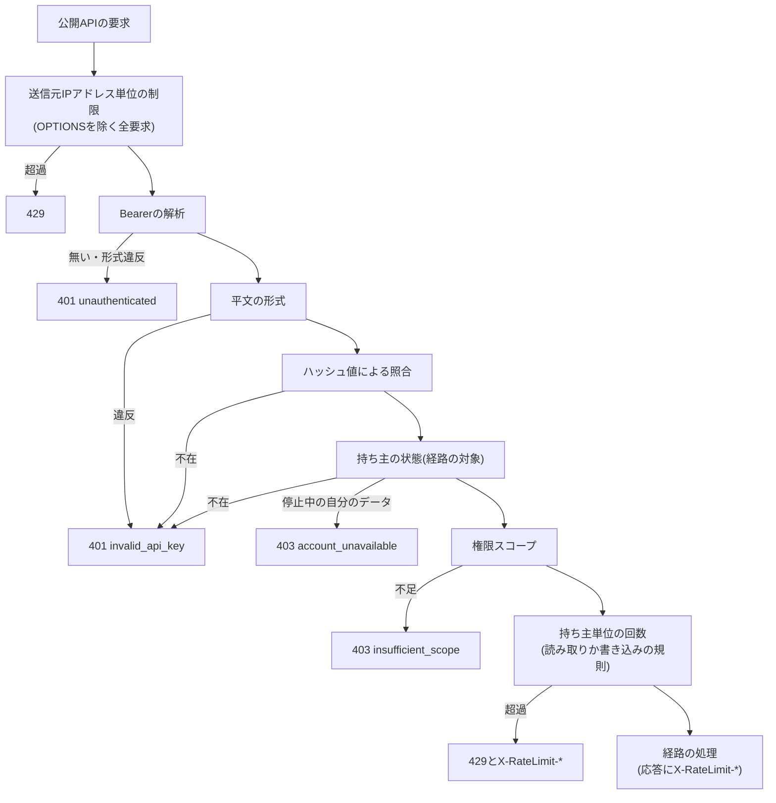

# APIキーによる認証と回数の制限

利用者が発行するAPIキーで公開REST APIを認証する規約を定める。キーの形式と発行・再発行、ハッシュによる保存と照合、平文を1度だけ示すこと、Bearerの解析と`WWW-Authenticate`、機能と操作による権限スコープ、経路の対象による停止中の持ち主の扱い、認証と回数の制限の順序、キーの持ち主単位の厳密な制限と送信元IPアドレス単位のバインディングの制限、`X-RateLimit-*`のヘッダーとCORS、退会での削除、ログ、及びテストを扱う。

公開REST APIの骨格(基準パス・経路の登録・共通のエラー形式・仕様書の配信・CORS)は「[公開REST APIの骨格](005-public-rest-api.md)」に、2つの回数の制限の方式と用途の異なる名前空間は「[レート制限とbot判定の検証](003-rate-limiting-and-bot-verification.md)」に、ハッシュ化と照合は「[秘密情報のハッシュ化](../security/002-keyed-hashing.md)」に、利用者の状態の判定は「[認証と認可の設計](../security/006-authentication.md#利用者の状態)」に、退会の波及処理は「[ユーザーライフサイクルイベント](007-user-lifecycle-events.md#同期の波及処理)」に、ログの伏せ字は「[ログ管理とエラートラッキング](../infra/004-logging-and-error-tracking.md#伏せ字の規則)」に従う。

## 前提と用語

層構成と依存の向きは「[Cloudflare Workersでの層構成と依存性の組み立て](002-layered-architecture-on-workers.md)」に従う。部品の置き場所は、APIサーバーのアプリの`src/`からのパスで示す。`<ドメイン>`は公開APIの機能のディレクトリの名前に置き換える。

| 部品                                                                                                                      | 置き場所                                           | 役割                                                                         |
| ------------------------------------------------------------------------------------------------------------------------- | -------------------------------------------------- | ---------------------------------------------------------------------------- |
| 機能の一覧・権限の値・表示名・名前の規則                                                                                  | `<共用部品の配置先>/<ドメイン>/api-key-rules.ts`   | 画面とAPIサーバーが共有する、キーの名前と権限スコープの規則                  |
| `API_KEY_TOKEN_PREFIX`・`API_KEY_TOKEN_PATTERN`・`API_KEY_HASH_PURPOSE`・`parseBearerAuthorization`・`isWellFormedApiKey` | `domain/<ドメイン>/api-key-token.ts`               | 平文の形式、ハッシュ化の用途、`Authorization`ヘッダーの解析                  |
| `allowsAccess`・`ApiAccess`・`ApiTarget`                                                                                  | `domain/<ドメイン>/api-key-scopes.ts`              | 権限スコープの判定、操作と経路の対象の型                                     |
| `ApiKeyManagement`                                                                                                        | `application/<ドメイン>/api-key-management.ts`     | 自分のキーの一覧・発行・編集・再発行・削除                                   |
| `ApiKeyAuthorizer`                                                                                                        | `application/<ドメイン>/api-key-authorizer.ts`     | 平文のキーから要求を処理してよいかを決め、呼び出し元を返す                   |
| 回数の規則と`ruleForAccess`                                                                                               | `application/<ドメイン>/rate-limit-rules.ts`       | 発行・読み取り・書き込みの厳密カウンタの規則と、IP単位の制限の値の写し       |
| `PublicApiRateLimits`・`PublicApiRateLimitError`                                                                          | `application/<ドメイン>/`                          | 回数の制限のポートと、回数の値を持つ超過の共通エラー                         |
| `ANONYMOUS_SESSION_VIEW`・`apiKeySessionView`                                                                             | `application/<ドメイン>/session-views.ts`          | 未ログインの閲覧者の主体と、キーの持ち主の主体                               |
| `CounterPublicApiRateLimits`                                                                                              | `infrastructure/<ドメイン>/`                       | 厳密カウンタで回数の制限のポートを実装する                                   |
| `CryptoApiKeySecretGenerator`                                                                                             | `infrastructure/<ドメイン>/`                       | 乱数の平文とハッシュ値の生成                                                 |
| キーのストア・退会の同期の波及処理                                                                                        | `infrastructure/<ドメイン>/`                       | キーの行の読み書きと、退会の確定でのキーの削除                               |
| `definePublicApiRoute`                                                                                                    | `presentation/rest/<ドメイン>/route-definition.ts` | 経路の機能・操作・対象の宣言から、認証方式・中間処理・エラー応答を付けた定義 |
| `apiKeyAuth`                                                                                                              | `presentation/rest/<ドメイン>/api-key-auth.ts`     | 認証・権限・回数の制限の中間処理                                             |
| `publicApiIpRateLimitRoutes`                                                                                              | `presentation/rest/<ドメイン>/ip-rate-limit.ts`    | 公開APIの全要求に掛ける送信元IPアドレス単位の制限                            |
| 公開APIの経路の集約                                                                                                       | `presentation/rest/<ドメイン>/index.ts`            | 先頭にIP単位の制限を置いた経路の登録の一覧                                   |

| 用語                                  | 意味                                                                                                                     |
| ------------------------------------- | ------------------------------------------------------------------------------------------------------------------------ |
| 平文                                  | 利用者が要求に付けるAPIキーの文字列そのもの                                                                              |
| キーの持ち主                          | キーを発行した利用者。キーの要求の権限と回数は持ち主に結び付く                                                           |
| 機能                                  | 権限スコープの単位(記事の読み取り、自分のプロフィールの更新など)。読み取りだけの機能と、書き込みの操作も持つ機能がある   |
| 操作                                  | 経路が求める`read`(読み取り)か`write`(書き込み)                                                                          |
| 権限の値                              | キーが機能ごとに持つ`none`(無効)・`read`(読み取り)・`read_write`(読み書き)。読み取りだけの機能は`none`・`read`だけを持つ |
| 経路の対象                            | 経路が返すデータの種類。公開データ(`public`)か、キーの持ち主の自分のデータ(`own`)                                        |
| `<APIキーの接頭辞>`                   | 平文の先頭に付ける固定の文字列                                                                                           |
| `<APIキーのハッシュの用途>`           | 平文をハッシュ化する用途の名前(「[用途の分離](../security/002-keyed-hashing.md#用途の分離)」)                            |
| `<Bearerの領域名>`                    | 401の応答の`WWW-Authenticate`の`realm`の値                                                                               |
| `<発行の回数の規則>`                  | キーの発行と再発行を持ち主ごとに数える厳密カウンタの規則(名前・上限回数・期間)                                           |
| `<読み取りの回数の規則>`              | 読み取りの経路の要求を持ち主ごとに数える厳密カウンタの規則                                                               |
| `<書き込みの回数の規則>`              | 書き込みの経路の要求を持ち主ごとに数える厳密カウンタの規則                                                               |
| `<公開APIのIP制限のバインディング名>` | 公開APIの送信元IPアドレス単位の制限に使うRate Limitingバインディングの名前                                               |
| `<公開APIのIP制限の名前空間>`         | `<公開APIのIP制限のバインディング名>`の`namespace_id`。Worker単位のIP制限の名前空間とは別の値にする                      |
| `<公開APIのIP制限の上限>`             | `<公開APIのIP制限のバインディング名>`の`simple`の上限回数と期間                                                          |
| `<公開APIのIP制限のキーの接頭辞>`     | 公開APIのIP単位の制限のキーで、送信元IPアドレスの前に付ける用途の接頭辞                                                  |
| `<公開APIのログのカテゴリ>`           | 公開APIの要求の拒否を記録するログのカテゴリ                                                                              |
| `<APIキーの退会の波及処理の名前>`     | 退会の確定でキーを消す同期の波及処理の名前                                                                               |
| `<APIキーの管理の画面>`               | 利用者がキーを発行・編集・再発行・削除する画面のパス                                                                     |
| `<共用部品の配置先>`                  | 「[共有ディレクトリの配置方式](../coding/003-shared-directories.md)」と同じ                                              |
| `<可視の条件>`                        | 利用者が停止中でも退会済みでもないことを表すSQLの条件                                                                    |
| `<ペッパーのシークレットのキー>`      | 「[秘密情報のハッシュ化](../security/002-keyed-hashing.md#前提と用語)」と同じ                                            |

本文中のプレースホルダーの本プロジェクトの値は、技術ドキュメントに写さず、プロジェクト固有の値の文書「[本プロジェクト固有の値](../../../onboardings/project-values.md)」に置く。

## キーの形式と発行

平文は`<APIキーの接頭辞>`に、暗号論的な乱数(`crypto.getRandomValues`)の32バイトをパディングなしのbase64url(43文字)にした文字列を続けたものである。

```typescript
const body = crypto
  .getRandomValues(new Uint8Array(32))
  .toBase64({ alphabet: 'base64url', omitPadding: true });
const plain = `${API_KEY_TOKEN_PREFIX}${body}`;
const hash = await hasher.hash(API_KEY_HASH_PURPOSE, plain);
```

- 乱数は256ビットで、総当たりで推測できない。人が選ぶ値ではないため、1回のHMACによるハッシュ化の対象にできる(「[ハッシュ化の対象](../security/002-keyed-hashing.md#ハッシュ化の対象)」)。
- 接頭辞は、ログ・例外の伏せ字のパターンがキーの形の文字列を見つけられ、漏えいした文字列を人がキーと見分けられるようにするために付ける。伏せ字のパターンには`<APIキーの接頭辞>`と43文字のbase64urlの形を加える。ただし伏せ字に頼らず、平文をログ・例外の文言・エラーの`details`に入れない。
- 形式の判定(`isWellFormedApiKey`)は`API_KEY_TOKEN_PATTERN`(接頭辞と43文字のbase64url)の完全一致で行う。
- キーは名前と、機能ごとの権限の値を持つ。名前と権限の値の規則は共用部品に置き、画面のフォームとAPIサーバーの検証が同じものを使う(「[規則の置き場所](../coding/005-input-validation.md#規則の置き場所)」)。
- キーの管理(一覧・発行・編集・再発行・削除)は、ログインした画面(`<APIキーの管理の画面>`)の操作だけで受け付け、APIキーで認証する公開APIには置かない。漏えいしたキーでキーを増やしたり権限を広げたりできないようにするためである。

### 発行の手順

キーの管理の失敗は、次のエラーコードで返す。状態コードとエラーの形は、キーの管理を受け付ける画面のAPIのエラーの分類に従う(GraphQLで受け付ける場合は「[エラーの分類と状態コード](004-graphql-server.md#エラーの分類と状態コード)」。引数の検証の失敗も状態コード200のエラーとして返る)。

1. 名前と権限の値を検証する。違反はエラーコード`validation_error`と項目ごとの`details`(`name`・`scopes.<機能>`)にする。
2. `<発行の回数の規則>`で持ち主ごとに数える。超過はエラーコード`rate_limit_exceeded`にする。
3. 平文とハッシュ値を作る。
4. 持ち主が可視(停止中でも退会済みでもない)ときだけ行を挿入する。

挿入は、持ち主の列に「可視の利用者が存在すればそのID、それ以外はNULL」を返す`CASE`式を入れ、NOT NULL制約の違反を「保存しなかった」として扱う。読み取りと挿入の間に持ち主が停止・退会しても、停止中・退会済みの利用者のキーは作られない。

```sql
INSERT INTO api_keys (id, user_id, name, key_hash, ...)
VALUES (
  ?,
  CASE WHEN EXISTS (SELECT 1 FROM users WHERE users.id = ? AND <可視の条件>)
    THEN ? ELSE NULL END,
  ?, ?, ...
);
```

- 違反は、例外の文言(原因の連鎖を含む)が持ち主の列のNOT NULLの違反であることで見分け、エラーコード`account_unavailable`にする。他の違反は想定外の例外のまま500にする。
- 画面の操作の境界でも、発行・編集・再発行は「停止中でない未退会の利用者」、一覧・削除は「未退会の利用者」を求める(「[利用者の状態](../security/006-authentication.md#利用者の状態)」)。停止中の利用者は自分のキーを削除できる。

### 再発行

再発行は、元のキーの名前と権限の値を写した新しいキーを追加で発行し、元のキーを変えずに残す。

- 最初に元のキーを持ち主の条件付きで読み、無ければ回数を数えずに、キーが見つからない旨のエラーコードにする。その後は発行の手順の2〜4と同じ処理で新しいキーを加える。
- 元のキーを残すのは、利用者が新しいキーへ切り替えてから元のキーを削除できるようにするためである。同時に有効なキーの数に上限を設けない場合は、再発行の回数も`<発行の回数の規則>`で数えて、キーを増やす速さを抑える。
- 元のキーを読んだ後に削除されても、写した値で発行を続ける。元のキーの有無は新しいキーの有効性に関わらない。
- 編集と削除は回数に数えない。編集は持ち主とIDの条件付きの更新で、変更が0行なら見つからない旨にする。

## ハッシュによる保存と照合

- 平文は保存せず、`KeyedHasher.hash(<APIキーのハッシュの用途>, <平文>)`のハッシュ値だけを一意索引のある列に保存する。照合は、要求の平文を同じ用途でハッシュ化した値で行を検索し、検索の一致を照合の結果とする(「[照合の方法](../security/002-keyed-hashing.md#照合の方法)」)。ハッシュ値は攻撃者が制御できないため、索引の比較の時間から平文を推測されない。
- 形式に合わない平文は、ハッシュ化と照会の前に拒否する。形式の違反・行の不在・削除済みのキーは区別せず、同じ401にする。
- `<APIキーのハッシュの用途>`は、保存を始めた後に変えない。変えると保存済みのハッシュ値と一致しなくなる。
- 要求のたびにキーの行を読み、キャッシュしない。権限の編集と削除は次の要求から効く。
- 権限の値は機能ごとの列に持ち、列ごとにCHECK制約で許す値を限る。読み取りだけの機能の列は`read_write`を許さない。データベースのスキーマが共用部品を読み込めない構成では、値の一覧をスキーマに写し、写しと共用部品の一致を単体テストで確かめる。
- 権限の値の判定(`allowsAccess`)は機能の種類を見ず型に頼るため、行を権限スコープの型へ変換する処理で、読み取りだけの機能に`read_write`が入らないことを保つ。

## 平文の1度だけの表示

平文は発行と再発行の応答でだけ返す。一覧・編集の応答、ログ、例外の文言、データのエクスポートには含めない。画面は次のとおり扱う。

- 平文は、それを示すダイアログの部品の状態にだけ持ち、閉じたら捨てる。ダイアログは外側の押下で閉じず、閉じる操作を明示させる。
- 変更の結果(`useMutation`の結果)に平文が残らないよう、発行と再発行の変更は保持の時間(`gcTime`)を0にし、平文を受け取った直後に`reset()`する。データ取得の既定の設定を上書きする例外であり、理由を変更の設定の近くに書く(「[データ取得](../frontend/006-data-fetching.md)」)。
- 問い合わせのキャッシュ(一覧など)に平文を入れない。

## Bearerの解析とWWW-Authenticate

公開APIはキーを`Authorization: Bearer <平文>`で受け取り、Cookieによる認証を受け付けない。`parseBearerAuthorization`は、RFC 6750の形に倣い、方式名`Bearer`(大文字小文字を区別しない)・1つ以上の空白・空白以外の文字の並びだけを受け付ける。

| 状況                                                                                              | 状態コード | エラーコード          | `WWW-Authenticate`                                       |
| ------------------------------------------------------------------------------------------------- | ---------- | --------------------- | -------------------------------------------------------- |
| `Authorization`ヘッダーが無い                                                                     | 401        | `unauthenticated`     | `Bearer realm="<Bearerの領域名>"`                        |
| 方式が`Bearer`でない、トークンが空                                                                | 401        | `unauthenticated`     | `Bearer realm="<Bearerの領域名>"`                        |
| 平文の形式の違反、行の不在・削除済みのキー、持ち主の不在(退会の直後など)                          | 401        | `invalid_api_key`     | `Bearer realm="<Bearerの領域名>", error="invalid_token"` |
| 自分のデータの経路で持ち主が停止中(「[経路の対象と停止中の持ち主](#経路の対象と停止中の持ち主)」) | 403        | `account_unavailable` | なし                                                     |
| キーの権限の値が経路の機能と操作に足りない                                                        | 403        | `insufficient_scope`  | なし                                                     |
| キーの持ち主単位の回数の超過                                                                      | 429        | `rate_limit_exceeded` | なし(`Retry-After`と`X-RateLimit-*`を付ける)             |

- `error="invalid_token"`は、提示されたキーが無効な場合だけ添える(RFC 6750の3.1)。ヘッダーが無い・方式が違う要求には付けない。
- 401はキーが無効な理由を区別しない。キーの存在や持ち主の状態を推測させないためである。
- 共通のエラー処理(`toErrorResponse`と`onError`)は`WWW-Authenticate`と`X-RateLimit-*`を付けないため、401と持ち主単位の429は中間処理が`toErrorResponse`の状態・本文・ヘッダーにこれらを加えた応答を直接返し、例外を投げ直さない。403などその他の拒否は`AppError`を投げ、共通のエラー処理に任せる。

## 機能と操作による権限スコープ

- 経路は、求める機能と操作を1つずつ宣言する。`read`は権限の値が`read`か`read_write`のとき、`write`は`read_write`のときだけ許す。
- 経路は`definePublicApiRoute`で定義する。宣言から、仕様書の認証方式(`security`)、中間処理(`apiKeyAuth`)、401・403・429のエラー応答、経路の説明の末尾の「必要な権限: <機能の表示名>の<読み取り|読み書き>」を付けた`createRoute`の結果を返す。宣言の項目(`feature`・`access`・`target`)は経路の定義から取り除き、仕様書に出さない。認証方式の宣言と認証の処理を1か所で付けるため、仕様書と実装が食い違わない。

```typescript
const getArticleRoute = definePublicApiRoute({
  method: 'get',
  path: '/articles/{id}',
  feature: 'articles',
  access: 'read',
  target: 'public',
  summary: '記事の詳細',
  request: { params: ArticleParamsSchema },
  responses: {
    200: {
      description: '記事',
      content: { 'application/json': { schema: dataEnvelope(ArticleSchema) } },
    },
    ...errorResponses([400, 404]),
  },
});

export const registerArticleRoutes: PublicRestRoutes<Env> = (api) => {
  api.openapi(getArticleRoute, async (c) => {
    const caller = c.get('publicApiCaller');
    // ...
  });
};
```

- 経路の処理は、中間処理が文脈変数`publicApiCaller`(キーのID・持ち主・権限スコープ)に置いた認証の結果を読む。
- 機能を加えるときは、共用部品の機能の一覧と表示名、キーのテーブルの列とCHECK制約、画面の権限の選択肢、仕様書の説明の権限スコープの一覧を合わせて変える。既存のキーの新しい機能の値は`none`で始める。

## 経路の対象と停止中の持ち主

経路は対象として公開データ(`public`)か自分のデータ(`own`)を宣言し、停止中の持ち主のキーの扱いを決める。

| 対象     | 持ち主の状態の判定                                        | 停止中の持ち主のキー       | 上流のユースケースへ渡す閲覧者               |
| -------- | --------------------------------------------------------- | -------------------------- | -------------------------------------------- |
| `public` | 未退会の利用者を求める(`requireUser`)                     | 処理する                   | 未ログインの閲覧者(`ANONYMOUS_SESSION_VIEW`) |
| `own`    | 停止中でない未退会の利用者を求める(`requireWritableUser`) | 403の`account_unavailable` | キーの持ち主                                 |

- 公開データの経路は、キーの持ち主を閲覧者とせず、画面の未ログインの閲覧者と同じ公開範囲で上流を呼ぶ。キーの持ち主の権限で非公開のデータを返さず、停止中の持ち主自身のデータは公開範囲のとおり結果に含まれない。`publicApiCaller`に持ち主が入っていても上流へ渡さない。
- 自分のデータの経路は、読み取りも書き込みも停止中の持ち主を拒否する。停止の解除の後は通る。
- 持ち主が見つからない(`unauthenticated`)は、`invalid_api_key`に変えて401にする。
- 利用者の状態の判定は、ログインのセッションの主体を受け取る。APIキーの要求には保存済みのセッションが無いため、`apiKeySessionView`で、利用者のIDとキーのIDを入れたセッションIDの疑似の主体を渡す。利用者の状態の判定がセッションの記録を照合する実装に変わったら、この渡し方を見直す。

## 認証と回数の制限の順序



- 送信元IPアドレス単位の制限は認証の前に掛け、仕様書の配信を含む基準パスの全要求(プリフライトを除く)を数える。キーの総当たりと、認証の失敗の大量の要求を抑える。
- 持ち主単位の回数は最後に数える。形式・照合・持ち主の状態・権限の失敗は持ち主の回数を消費しない。他人が持ち主のキーを推測する要求で、持ち主の枠を減らされないためである。
- Worker単位のIP制限は、さらに外側で全HTTPリクエストに掛かる(「[Worker単位のIP制限](003-rate-limiting-and-bot-verification.md#worker単位のip制限)」)。

## キーの持ち主単位の制限

キーの持ち主ごとの回数は、厳密カウンタ(「[厳密カウンタ](003-rate-limiting-and-bot-verification.md#厳密カウンタ)」)で数える。

- キーは持ち主の利用者IDを`hashRateLimitKey`でハッシュ化した値で、持ち主の全てのキーの要求を合算する。キーを増やしても枠は増えない。
- 読み取りの経路と書き込みの経路で別の規則(`<読み取りの回数の規則>`・`<書き込みの回数の規則>`)を使い、`ruleForAccess(access)`で選ぶ。
- 厳密カウンタのクライアントが共通ライブラリの`workers`にあるため、application層にポート`PublicApiRateLimits`を置き、実装`CounterPublicApiRateLimits`をinfrastructure層に置く。規則の定数はapplication層に置き、実装と仕様書の説明の両方が同じ定数を読む。仕様書の説明に上限を書き写さず、定数から組み立てる。
- 判定(`CounterDecision`)は上限を持たないため、許可のときは規則の上限・判定の残り回数・リセットの時刻を返す。超過のときは同じ値を持つ`PublicApiRateLimitError`(`AppError`の派生、429・`rate_limit_exceeded`)を投げる。`Retry-After`の秒数は、厳密カウンタの`assertWithinLimit`と同じく、リセットの時刻までの残りを秒に切り上げた値(0以上)にする。
- 発行の回数(`<発行の回数の規則>`)も持ち主ごとの厳密カウンタで数え、超過は`assertWithinLimit`の共通エラーにする。発行は画面の操作のため、`X-RateLimit-*`は付けない。
- 厳密カウンタの呼び出しが一時的な障害で失敗したら、例外のまま500にし、回数の制限を黙って外さない。

## 送信元IPアドレス単位の制限

公開APIの送信元IPアドレス単位の制限は、Worker単位のIP制限と別のRate Limitingバインディングで数える(「[用途の異なる2つ目の名前空間](003-rate-limiting-and-bot-verification.md#用途の異なる2つ目の名前空間)」)。

| 項目           | 値                                                                                                                                |
| -------------- | --------------------------------------------------------------------------------------------------------------------------------- |
| バインディング | `<公開APIのIP制限のバインディング名>`(`namespace_id`は`<公開APIのIP制限の名前空間>`、`simple`は`<公開APIのIP制限の上限>`)         |
| キー           | `<公開APIのIP制限のキーの接頭辞><送信元IPアドレス>`(不明なら`unknown`)を、`hashRateLimitKey`でハッシュ化した値                    |
| 対象           | 基準パスの全要求(仕様書の配信を含む)。プリフライト(`OPTIONS`)は除外規則で数えない                                                 |
| 掛ける位置     | 公開APIの経路の集約の先頭の登録の関数で`api.use('*', bindingRateLimit(...))`(「[経路の登録](005-public-rest-api.md#経路の登録)」) |
| 超過時の応答   | 429・`Retry-After: <期間の秒数>`・`Cache-Control: no-store`・`rate_limit_exceeded`。認証の前のため`X-RateLimit-*`は付けない       |

```typescript
export const publicApiIpRateLimitRoutes: PublicRestRoutes<Env> = (api) => {
  const hasherFor = reuseHasherWhilePepperUnchanged();
  api.use(
    '*',
    bindingRateLimit<Env>({
      binding: (env) => env.<公開APIのIP制限のバインディング名>,
      key: (_, clientIp, env) =>
        hashRateLimitKey(
          hasherFor(env.<ペッパーのシークレットのキー>),
          `${PUBLIC_API_IP_RATE_LIMIT_KEY_PREFIX}${clientIp ?? UNKNOWN_CLIENT_IP}`,
        ),
      periodSeconds: PUBLIC_API_IP_RATE_LIMIT.periodSeconds,
      exclusions: [(request) => request.method === 'OPTIONS'],
    }),
  );
};
```

- 全ての要求に掛かるため、最後に使ったペッパーと`KeyedHasher`の組を要求をまたいで使い回し、鍵の読み込みを要求ごとに繰り返さない(「[ハッシュ化の部品の取得](../security/002-keyed-hashing.md#ハッシュ化の部品の取得)」)。
- 上限と期間はWrangler設定が決める。コードの`PUBLIC_API_IP_RATE_LIMIT`は`Retry-After`と仕様書の説明に使う写しで、Wrangler設定の値との一致を設定の単体テストで確かめる。

## X-RateLimit-*のヘッダー

| ヘッダー                | 値                                                     |
| ----------------------- | ------------------------------------------------------ |
| `X-RateLimit-Limit`     | 経路の操作の規則の上限回数                             |
| `X-RateLimit-Remaining` | 期間の残りの回数                                       |
| `X-RateLimit-Reset`     | 期間が終わる時刻のエポック秒(ミリ秒を秒に切り上げた値) |

- 持ち主単位の回数を数えた要求の応答に全て付ける。成功に加え、経路の処理の失敗(400・404・409など)と持ち主単位の429にも付ける。回数を数える前に終わった応答(401・403・送信元IPアドレス単位の429)には付けない。
- 中間処理は`await next()`の後に`c.header`で付ける。Honoは経路の処理の例外を`next()`の中で共通のエラー処理に渡して応答にするため、経路の処理の成功と失敗のどちらの応答にも付く。持ち主単位の429は経路へ進まないため、中間処理が`PublicApiRateLimitError`の値から付けて直接返す(「[Bearerの解析とWWW-Authenticate](#bearerの解析とwww-authenticate)」)。
- 公開APIのCORSは`Access-Control-Expose-Headers`を付けない(「[CORS](005-public-rest-api.md#cors)」)。他のオリジンのブラウザのスクリプトは`X-RateLimit-*`・`Retry-After`・`WWW-Authenticate`を読めず、状態コードで判断する。サーバー間の利用は読める。仕様書の説明にその旨を書く。

## 退会での削除

- 退会の同期の波及処理`<APIキーの退会の波及処理の名前>`を、退会のイベントにだけ登録する。読み取りをせず、持ち主の全てのキーを消す1文(`DELETE FROM api_keys WHERE user_id = ?`)を返し、退会の確定と同じ一括の書き込みで消す(「[文の規約](007-user-lifecycle-events.md#文の規約)」)。
- 停止と停止の解除には登録しない。停止中も公開データの経路でキーを使え、解除の後はそのまま全ての経路で使えるようにするためである。
- 退会の確定で行が消え、発行の`CASE`式が退会済みの利用者の行を作らないため、物理削除の非同期の波及処理と日次の掃除は持たない。キーのテーブルは利用者を外部キーで参照するため、キーが残っていると利用者を物理削除できない。

## ログ

- 公開APIの拒否(401・403・429)を、`<公開APIのログのカテゴリ>`の`info`で、拒否の理由のコード・キーのID・持ち主のID・経路のパターン・状態コードだけ記録する。`Authorization`ヘッダー・平文・要求の本文を記録しない。
- 照合の後の拒否(持ち主の状態・権限・回数)は例外で返るため、`ApiKeyAuthorizer`は照合の直後にキーのIDと持ち主のIDを呼び出し元のコールバック(`onIdentified`)で知らせ、中間処理が拒否の記録に使う。`ApiKeyAuthorizer`自身はログを出さない。
- 発行・再発行・削除は、キーのIDと持ち主のIDだけを記録する。
- キーのIDの属性名に`key`を含めない(`recordId`、再発行の元は`sourceRecordId`など)。名前に`key`を含む属性は伏せ字の規則で丸ごと伏せられる(「[ログを書くときの規約](../infra/004-logging-and-error-tracking.md#ログを書くときの規約)」)。

## テスト

- 単体テスト: Bearerの解析(大文字小文字・空・別の方式・複数の空白)、平文の形式(接頭辞・長さ・文字種)、全ての機能と権限の値と操作の`allowsAccess`の表、`ApiKeyAuthorizer`の判定の順序と、回数より前の失敗が回数を消費しないこと、停止中の持ち主が`public`で通り`own`で403になること、持ち主の不在の`invalid_api_key`への変換、再発行が元の名前と権限を写して元のキーを残し発行の回数に数えられること、編集・削除が回数に数えないこと。回数の制限は偽のポートで確かめる。
- Workers統合テスト: キーのストアの発行の`CASE`式(停止中・退会済みで保存しない)と他人のキーの不在、回数の制限の実装(偽の厳密カウンタで、規則の選択・許可の値・超過の例外の値・キーが利用者IDのハッシュであること)、退会の確定でキーが消え停止では消えないこと。
- APIサーバーのWorkerの組み立てを通す統合テスト: ヘッダーの欠落・形式違反・不在・削除済みのキーの401と`WWW-Authenticate`、全ての経路の権限不足の403、停止中の持ち主のキーで公開データの経路が200・自分のデータの経路が403で解除の後は全て200、読み取りと書き込みの上限ちょうどと超過の429と`Retry-After`・`X-RateLimit-*`(429にも付くこと)、送信元IPアドレス単位の上限ちょうどと超過(仕様書の配信を含み、`OPTIONS`を数えない)、CORSに`Access-Control-Expose-Headers`が無いこと。
- 厳密カウンタとRate Limitingバインディングの回数は同じテストファイルの中のテストをまたいで残るため、ファイルごとに持ち主の利用者IDと送信元IPアドレスの範囲を分ける。
