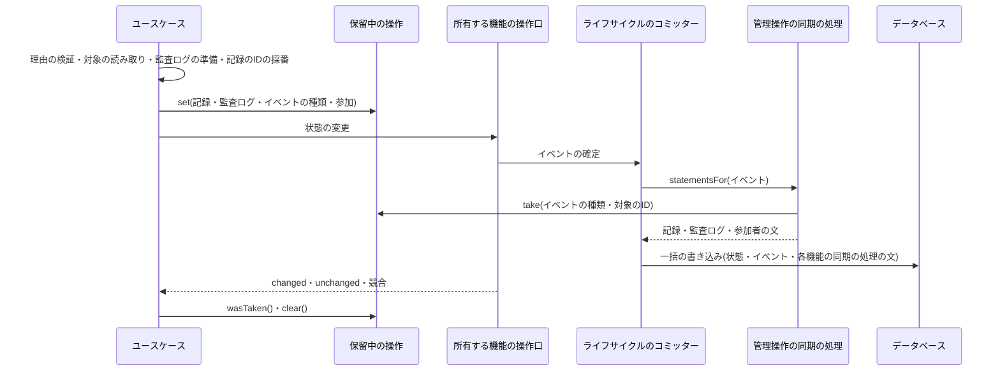

# 集約をまたぐ管理操作の記録

管理者が他の機能の集約(利用者・投稿・コメント・ファイルなど)の状態を変える操作(停止・非公開化・無効化・隔離など)を、管理操作の機能が自分のテーブルに記録し、監査ログとともに状態の変更と同じ一括の書き込みで確定する規約を定める。所有する機能の操作口の形ごとの記録の載せ方(文を受け取らない操作口・呼び出し側の文を受け取る操作口・状態を確定してから外部へ依頼する操作口)、文の並びと取り消し、後から加わる機能が自分の記録を同じ一括の書き込みに加える参加者の登録口、結果と再実行、確定の後の通知の依頼と送り直し、記録の保持と物理削除、及びテストを扱う。

監査ログの記録の文と準備は「[監査ログの記録](008-audit-logging.md)」に、利用者と集約の状態の変化を伝える同期の処理は「[ユーザーライフサイクルイベント](007-user-lifecycle-events.md)」と「[集約のライフサイクルイベント](012-aggregate-lifecycle-events.md)」に、後から加わる機能が文を加える登録口の一般の規約は「[判定の供給元と保存の処理の登録口](013-pluggable-decision-sources.md)」に、層と依存方向は「[Cloudflare Workersでの層構成と依存性の組み立て](002-layered-architecture-on-workers.md)」に、一括の書き込みと取り消しは「[Cloudflare D1の制約と対処](../db/002-d1-constraints.md)」に従う。

## 前提と用語

ORMにDrizzle、データベースにCloudflare D1、DIコンテナにInversifyを使い、要求ごとに処理単位のコンテナを作る構成(「[処理単位のコンテナ](002-layered-architecture-on-workers.md#処理単位のコンテナ)」)を前提とする。部品の置き場所は、共通ライブラリの配置先と`<APIサーバーのアプリ>`の`src/`からのパスで示す。部品の名前は例であり、`<ドメイン>`は管理操作の機能のディレクトリの名前に置き換える。

| 部品                                                                                                                | 置き場所                                                              | 役割                                                                                       |
| ------------------------------------------------------------------------------------------------------------------- | --------------------------------------------------------------------- | ------------------------------------------------------------------------------------------ |
| `NewAdminActionRecord`・`AdminActionRecordStore`                                                                    | 共通ライブラリの`core/<ドメイン>/ports.ts`                            | 記録の型と、文を返さない読み書き(最新の記録・依頼待ちの一覧・通知の状態の更新・削除)の契約 |
| `AdminActionRecordStatements`                                                                                       | 共通ライブラリの`workers/<ドメイン>/`                                 | 記録の挿入の文を返す契約(infrastructure層だけが使う)                                       |
| `PendingAdminAction`                                                                                                | `application/<ドメイン>/pending-admin-action.ts`                      | 文を受け取らない操作口の確定まで、操作の記録と準備済みの監査ログを要求の間だけ預かる       |
| `<集約>ActionWriter`                                                                                                | `application/<ドメイン>/ports.ts`(実装は`infrastructure/<ドメイン>/`) | 文を受け取る操作口へ記録と監査ログの文を渡す書き込みの単位のポート                         |
| `AdminActionStatements`                                                                                             | `infrastructure/<ドメイン>/admin-action-statements.ts`                | 記録の挿入と監査ログの文の組み立て(infrastructure層の内部の部品)                           |
| `<集約>ActionRecordSyncHandler`                                                                                     | `infrastructure/<ドメイン>/`                                          | ライフサイクルの同期の処理として、保留中の操作から記録と監査ログの文を返す                 |
| `AdminActionWriteParticipation`                                                                                     | `application/<ドメイン>/ports.ts`                                     | 後から加わる機能が操作の入力に付ける、種類と値だけの参加                                   |
| `AdminActionWriteParticipant`・`AdminActionWriteParticipantRegistration`・`AdminActionWriteParticipants`・`create…` | `infrastructure/<ドメイン>/admin-action-write-participant.ts`         | 参加者の契約・登録の型・種類からの解決                                                     |
| `ADMIN_ACTION_WRITE_PARTICIPANTS`(初版は空)                                                                         | `composition/admin-action-write-participants.ts`                      | 後から加わる機能が参加者を追記する登録口                                                   |
| `AdminActionIncidentReporter`                                                                                       | `application/<ドメイン>/ports.ts`(実装は`infrastructure/<ドメイン>/`) | 記録の欠け・通知の送り直しの失敗をエラートラッキングへ送る報告のポート                     |

| 用語                   | 意味                                                                                                                             |
| ---------------------- | -------------------------------------------------------------------------------------------------------------------------------- |
| 管理操作の機能         | 管理者の操作を受け付け、他の機能の集約の状態を変えて、操作の記録を所有する機能                                                   |
| 所有する機能           | 状態を変える集約のテーブルと、状態を変える操作口を所有する機能                                                                   |
| 操作の記録             | 操作の種類・対象・操作者・理由・日時・通知の状態を持つ、管理操作の機能のテーブルの行。監査ログとは別に持つ                       |
| 操作口                 | 所有する機能が他の機能に提供する、集約の状態を変える口                                                                           |
| 呼び出し側の文         | 操作口が状態の変更と同じ一括の書き込みに並べる、呼び出し側が組み立てた文                                                         |
| 保留中の操作           | 文を受け取らない操作口を呼ぶ前に置き、同期の処理が取り出す操作の記録と準備済みの監査ログ                                         |
| 加える機能             | 管理操作の機能の操作を自分の画面から呼び、自分の記録(通報の処理の結果など)を操作と同じ一括の書き込みで確定する、後から加わる機能 |
| 参加・参加者           | 加える機能が操作の入力に付ける種類と値(参加)と、その値から文を返す加える機能の部品(参加者)                                       |
| 依頼待ちの通知         | 操作の記録の通知の状態が`pending`のもの。確定の後に送信を依頼し、失敗しても日次のジョブが送り直す                                |
| `<記録の保持期間>`     | 操作の記録を残す期間。過ぎた記録は日次のジョブが削除する                                                                         |
| `<送り直しの待ち時間>` | 依頼待ちの通知を日次のジョブが送り直すまでの、記録の日時からの経過。確定の直後の依頼と重ならない長さにする                       |
| `<保守のジョブ>`       | 通知の送り直しと保持期間の削除を行う日次のジョブの名前と起動時刻・`order`                                                        |

本文中の`<ドメイン>`・`<記録の保持期間>`などのプレースホルダーの本プロジェクトの値と部品の実際の名前は、技術ドキュメントに写さず、プロジェクト固有の値の文書「[本プロジェクト固有の値](../../../onboardings/project-values.md)」に置く。

## 使う場面

監査ログは「誰がいつ何をしたか」を残すが、利用者の対象を仮名化IDで持ち、理由の検索や対象ごとの通知の状態を持たない(「[個人情報を含めない規則](008-audit-logging.md#個人情報を含めない規則)」)。次のどれかが要る管理操作は、監査ログに加えて操作の記録を管理操作の機能のテーブルに持つ。

- 管理画面に対象ごとの最新の操作の理由と日時を示す(停止中の利用者の停止の理由など)。
- 操作の確定の後に対象の持ち主へ通知を送り、失敗しても送り直す。
- 後から加わる機能が、自分の記録から操作の記録を参照する(同じ一括の書き込みで記録のIDを残す)。

状態を変えない操作(閲覧・検索)は操作の記録を持たず、監査ログを`AuditLogRecorder.record`で単独に書く(「[操作と同じ一括の書き込みに含める](008-audit-logging.md#操作と同じ一括の書き込みに含める)」)。

## 記録のテーブル

例のテーブル名は`admin_actions`とする。

| 列                                     | 内容                                                                                                                         |
| -------------------------------------- | ---------------------------------------------------------------------------------------------------------------------------- |
| `id`                                   | ULIDの主キー。ユースケースが操作口を呼ぶ前に採番し、結果と参加者の文脈に同じ値を渡す                                         |
| `action`・`target_kind`                | 操作の種類と対象の種類(CHECK制約)。対象の種類は操作の種類の定義から決める                                                    |
| `target_id`                            | 対象の集約のID(利用者・投稿・コメント・ファイルなど)                                                                         |
| `subject_user_id`                      | 対象に関わる利用者のID(停止の対象・投稿の所有者・コメントの投稿者)。匿名化済みや利用者の持たない対象はNULL                   |
| `product_id`などの集約の列             | 集約の物理削除で記録を消すための、親の集約のID                                                                               |
| `operator_admin_id`・`reason`          | 操作者と理由(理由を任意とする操作は空の理由をNULLで残す)                                                                     |
| `lifecycle_event_id`                   | ライフサイクルの同期の処理で載せた記録の、状態の変化のイベントのID。他の形ではNULL                                           |
| `occurred_at`                          | 操作の日時。ライフサイクルの経路はイベントの日時                                                                             |
| `notice_status`・`notice_requested_at` | 通知の状態(`none`・`pending`・`requested`・`skipped`のCHECK)と依頼の日時。既定値を持たず、書き込む側が操作の種類ごとに決める |

- 他の機能のIDに外部キーを張らない。記録が利用者や集約の物理削除を止めないよう、記録は管理操作の機能の削除の処理が消す(「[記録の保持と物理削除](#記録の保持と物理削除)」)。
- 索引は、対象ごとの最新の記録(`target_kind`・`target_id`・`occurred_at`)、依頼待ちの通知(`notice_status`・`occurred_at`)、物理削除の対象(`subject_user_id`・親の集約の列)、保持期間の削除(`occurred_at`)に張る。
- 対象ごとの最新の記録は、操作の種類を絞って複数の対象を1回の一括の読み取りで引き、同じ日時ならIDの大きい方を最新とする。バインド変数の上限に合わせて対象を分ける(「[バインド変数の上限](../db/002-d1-constraints.md#バインド変数の上限)」)。

## 操作口の形と記録の載せ方

記録と監査ログは、所有する機能の状態の変更と同じ一括の書き込みで確定する。片方だけが残ると、記録の無い状態の変化か、行われなかった操作の記録になる。所有する機能の操作口の形によって、載せ方を次のように分ける。

| 操作口の形                                         | 例                                                                     | 記録と監査ログの載せ方                                                                             |
| -------------------------------------------------- | ---------------------------------------------------------------------- | -------------------------------------------------------------------------------------------------- |
| 文を受け取らず、ライフサイクルのイベントを確定する | 利用者の停止・停止の解除・代理の退会、投稿の非公開化・復元             | 保留中の操作を置いて操作口を呼び、所有する機能のコミッターが呼ぶ同期の処理が文を返す               |
| 呼び出し側の文を受け取る                           | コメントの非公開化・評価の無効化                                       | 書き込みの単位の実装が、記録と監査ログの文を操作口へ渡す                                           |
| 状態を確定してから外部へ依頼する                   | ファイルの隔離理由の追加と保存先の移動の依頼、削除待ちの印と即時の削除 | 所有する機能に、状態の変更と呼び出し側の文を同じ一括の書き込みで確定する口を足し、その口へ文を渡す |

application層は文・接続・一括の書き込みを扱わないため、ユースケースは書き込みの単位のポートか、保留中の操作と文を受け取らない操作口だけを使う。呼び出し側の文を受け取る操作口はinfrastructure層に置かれ、ユースケースは直接呼ばない(「[依存方向と静的解析](002-layered-architecture-on-workers.md#依存方向と静的解析)」)。

### 文を受け取らない操作口

所有する機能の操作口がライフサイクルのイベントを確定し、登録した同期の処理の文を同じ一括の書き込みに並べる場合は、管理操作の機能が同期の処理を登録して記録を載せる(「[同期の波及処理](007-user-lifecycle-events.md#同期の波及処理)」)。同期の処理はイベントしか受け取らないため、ユースケースが操作の記録を保留中の操作に預けてから操作口を呼ぶ。



```typescript
export interface PendingAction {
  // イベントのIDと日時は同期の処理が埋める
  readonly record: Omit<
    NewAdminActionRecord,
    'lifecycleEventId' | 'occurredAt'
  >;
  readonly lifecycleEvent: string;
  readonly audit: PreparedAuditEntry;
  readonly participation: AdminActionWriteParticipation | undefined;
}

export interface PendingAdminAction {
  // 1つの要求に1件。置き済みなら通常のError
  set(pending: PendingAction): void;
  // イベントの種類と対象が一致したときだけ取り出し、以後は空
  take(event: {
    readonly type: string;
    readonly targetId: string;
  }): PendingAction | undefined;
  wasTaken(): boolean;
  clear(): void;
}
```

- 保留中の操作は、処理単位のコンテナの中で1つにする。コンテナの既定のスコープが`Transient`なら、`inSingletonScope()`で束縛する(処理単位のコンテナは要求ごとに作られるため、要求をまたがない)。同期の処理は同じコンテナから解決されるため、ユースケースが置いた操作を読める。
- 同期の処理は、種類と対象が一致しなければ`[]`を返す。本人の退会など、管理操作でないイベントには記録を載せない。一致すれば、イベントのIDと日時で記録を完成させ、記録の挿入・監査ログ・参加者の文をこの順に返す。
- 操作口が`unchanged`(既に同じ状態)を返したときはイベントも同期の処理も無いため、保留中の操作を`clear()`し、記録を残さずに変化なしを返す。操作口の例外(版の競合・対象の不在)でも`clear()`してから投げる。全ての失敗の経路で保留中の操作を残さない。
- 操作口が`changed`を返したのに`wasTaken()`が偽なら、同期の処理の登録か束縛の誤りである。状態は確定済みのため結果は成功とし、記録が無いため記録のIDは返さない。報告のポートで運用者へ知らせる(「[定型の通知](#定型の通知)」)。
- 操作口の競合のエラー(利用者本人の操作向けの文言を持つもの)と、照会の後に対象が消えたときの不在のエラーは、管理操作の機能のエラーコードと管理画面の文言へ変えて返す。

### 呼び出し側の文を受け取る操作口

所有する機能の操作口が呼び出し側の文を受け取る場合(「[管理の操作口](015-tombstoned-comment-threads.md#管理の操作口)」)は、書き込みの単位の実装が記録と監査ログ(と参加者)の文を組み立てて操作口へ渡す。

- 操作口は既に目的の状態なら`unchanged`を返し、渡された文を流さない。同じ操作の繰り返しは記録も監査ログも増やさない。
- 書き込みの単位は操作口の結果をそのまま返す。対象の不在は所有する機能のエラーをそのまま返す(文言は所有する機能のものと同じにする)。
- 記録と状態が1つの書き込みで確定するため、保留中の操作と記録の欠けの通知は要らない。

### 状態を確定してから外部へ依頼する操作口

所有する機能の操作口が、状態をデータベースに確定してから外部(Queueのメッセージ・ストレージの削除など)へ依頼し、依頼の失敗で例外を投げる場合に、操作口の後で記録を別に書くと、再実行で記録が欠ける。1回目は状態が確定してから依頼に失敗して例外になり、記録が書かれない。2回目は状態が既に目的どおりのため、操作口は変化なしを返すか、前提を満たさない(外す理由が既に無い・削除待ち)として拒否し、記録は永久に残らない。操作口の前に記録を書くと、反映されなかった操作の記録が残る。

この形の操作口には、所有する機能の側に、状態の変更と呼び出し側の文を同じ一括の書き込みで確定し、その後に外部へ依頼する口を足す。既存の操作口の形と振る舞いは変えない。

```typescript
export type ControlResult = 'changed' | 'unchanged' | 'not-found';

export interface ControlInput {
  readonly targetId: string;
  // 状態を変えるときだけ、状態の変更の後に同じ一括の書き込みへ並べる
  readonly statements: readonly BatchItem<'sqlite'>[];
}

export interface FileAdminControl {
  addReason(
    input: ControlInput & { readonly reason: Reason },
  ): Promise<ControlResult>;
  removeReason(
    input: ControlInput & { readonly reason: Reason },
  ): Promise<ControlResult>;
  requestErase(input: ControlInput): Promise<ControlResult>;
}
```

1. 対象を読み、無ければ`not-found`、既に目的の状態なら`unchanged`を返し、呼び出し側の文を流さない。
2. 状態を変える文の前に、読んだ状態のままであることを条件にする検査の文を置き、状態の変更と呼び出し側の文と1つの一括の書き込みで確定して`changed`を返す。検査の文は、条件が偽のときだけNOT NULLの列にNULLを入れる行を挿入する`INSERT … SELECT … WHERE NOT (<条件>)`で、更新の件数に頼らず、読んだ後に行が物理削除された場合も取り消せる(「[版の検査で一括の書き込み全体を取り消す](../db/002-d1-constraints.md#版の検査で一括の書き込み全体を取り消す)」)。
3. 検査の違反なら読み直して`unchanged`か`not-found`を返す。読み直しても状態を変えられる(別の失敗)なら例外を投げ直す。
4. 確定の後に外部へ依頼する。失敗は利用できない失敗(`unavailable`)で投げるが、状態と呼び出し側の文は確定済みのまま残る。日次の照合(保存先の食い違いをそろえるジョブ・削除待ちを消すジョブ)が後でそろえる。

- 再実行は記録を重ねない。目的の状態に既にあれば`unchanged`で文を流さない。保存先がまだ食い違っていれば、`unchanged`でも外部への依頼をやり直す。
- 管理操作の機能のユースケースは、前提(外す理由を持っていること、削除は隔離中だけなど)を操作口の前に確かめ、満たさなければ適用できない失敗を返す。削除待ちの対象への削除の再実行は、記録が確定済みのため変化なしにする。
- この口は呼び出し側の文を受け取るため、所有する機能の共通ライブラリの`workers/<ドメイン>`に置き、管理操作の機能のinfrastructure層の書き込みの単位だけが使う。

## 文の並びと取り消し

1つの一括の書き込みの文は、所有する機能の状態の変更(とイベント・他の同期の処理)→操作の記録の挿入→監査ログ→参加者の文の順に並べる。SQLiteは文を順に実行して最初の違反で止まり、一括の書き込みの全体を取り消す。

- 参加者の文の違反(NOT NULL制約など)は、状態の変更・記録・監査ログごと取り消す。参加者は自分の条件を違反で表して操作全体を止められる。
- 記録の挿入と監査ログの文は`AdminActionStatements`だけが組み立て、同期の処理と書き込みの単位の実装が共有する。監査ログの文は`buildAuditLogStatements(db, audit)`で、準備はユースケースが操作口を呼ぶ前に行う(「[準備の検証](008-audit-logging.md#準備の検証)」)。

## 参加者の登録口

加える機能が、管理操作の機能の操作を自分の画面から呼び、自分の記録(処理の結果・操作の記録のIDなど)を操作と同じ一括の書き込みで確定するための登録口である。application層は文を扱えないため、加える機能は操作の入力に種類と値だけの参加を付け、文は登録した参加者がinfrastructure層で返す。

```typescript
// application/<ドメイン>/ports.ts
export interface AdminActionWriteParticipation<TPayload = unknown> {
  // ADMIN_ACTION_WRITE_PARTICIPANTSに登録した種類('<spec名>.<名詞句>')
  readonly kind: string;
  // 参加者だけが解釈する値。文・接続・関数を含めない
  readonly payload: TPayload;
}

// infrastructure/<ドメイン>/admin-action-write-participant.ts
export interface AdminActionWriteContext {
  // 操作の記録のID。参加者は自分の記録にこの値を残せる
  readonly actionId: string;
  readonly action: AdminAction;
  readonly targetId: string;
  readonly occurredAt: Date;
}

export interface AdminActionWriteParticipant {
  // 読み取りはしてよいが、書き込みは返す文だけで行う。payloadの形が違えば通常のError
  statementsFor(
    participation: AdminActionWriteParticipation,
    context: AdminActionWriteContext,
  ): Promise<readonly BatchItem<'sqlite'>[]>;
}

export interface AdminActionWriteParticipantRegistration {
  readonly kind: string;
  readonly participant: ServiceIdentifier<AdminActionWriteParticipant>;
}
```

```typescript
// composition/admin-action-write-participants.ts。加える機能が追記する
export const ADMIN_ACTION_WRITE_PARTICIPANTS: readonly AdminActionWriteParticipantRegistration[] =
  [];

bind<AdminActionWriteParticipants>(
  ADMIN_ACTION_TYPES.WriteParticipants,
).toDynamicValue((context) =>
  createAdminActionWriteParticipants(
    ADMIN_ACTION_WRITE_PARTICIPANTS,
    (identifier) => context.get(identifier),
  ),
);
```

- 操作の入力の`participation`は、ユースケースが中身を読まずに、保留中の操作か書き込みの単位へそのまま渡す。文を受け取らない操作口の経路では同期の処理が、呼び出し側の文を受け取る操作口の経路では書き込みの単位の実装が、種類で参加者を解決して文を記録と監査ログの文の後に並べる。
- `context.actionId`は、ユースケースが操作口を呼ぶ前に採番した記録のIDで、結果の記録のIDと同じ値である。状態が変わらなければ文は流れないため、参加者の記録も残らない。
- 種類は`<spec名>.<名詞句>`の形にする。`create…`は組み立ての時に形式と重複を`assertLifecycleHandlerName`・`LifecycleRegistrationError`で検証する(「[登録の検証の共有](012-aggregate-lifecycle-events.md#登録の検証の共有)」)。
- 参加者は参加の都度、処理単位のコンテナから解決し、要求をまたいで持ち越さない。
- 参加が無ければ`[]`。登録の無い種類は束縛か呼び出し側の誤りのため、`AppError`ではなく通常の`Error`を投げる。同期の処理の中で投げるため、状態の変更を含めて何も書かれない。
- 状態を確定してから外部へ依頼する操作口の経路は参加者の文を持たない。参加が付いていれば、ユースケースが操作口を呼ぶ前に通常の`Error`を投げる。参加の値の検査は理由の検証より前に行う。
- 参加者の契約は文を返すため、文を扱うinfrastructure層に置く。共通ライブラリの`workers`に置かないのは、加える機能の参加者も同じアプリのinfrastructure層に置かれるためである。

## 結果と再実行

```typescript
export interface AdminActionOutcome {
  // 偽は既に同じ状態だった
  readonly changed: boolean;
  // 変化が無ければnull。状態は変わったが記録が確定されなかったときもnull
  readonly actionId: string | null;
}
```

- 変化が無ければ記録も監査ログも参加者の文も残さない。管理者の再実行は記録を重ねない。
- 理由の要否と上限は操作の種類の定義に従い、ユースケースが操作口を呼ぶ前に検証する。理由は前後の空白を除いて正規化し、上限は監査ログの理由の上限と同じ値にする(「[理由](008-audit-logging.md#理由)」)。
- 権限の確認は呼び出し側(リゾルバ)が行い、ユースケースは操作者のIDを受け取る。

## 通知の依頼と送り直し

操作の確定の後に対象の持ち主へ通知を送る操作は、記録の通知の状態を`pending`にして状態の変更と同じ一括の書き込みで確定し、確定の後に送信を依頼する(「[外部の副作用の依頼](009-idempotent-event-reflection.md#外部の副作用の依頼)」)。通知の無い操作は`none`にする。

1. ユースケースは、結果が`changed`で記録のIDがあるときだけ、通知の部品に記録のIDを渡す。
2. 通知の部品は記録を読み直し、`pending`でなければ何もしない。宛先が無い(退会済み・対象の論理削除・匿名化など、入力を作れず送り直しても成功しない)なら`pending`→`skipped`にする。送信を依頼したら`pending`→`requested`にする。状態の更新は前の状態を条件にした1文にする。
3. 送信の依頼の失敗は、ユースケースがログに残して操作の結果を成功のまま返す。記録は`pending`のまま残る。
4. `<保守のジョブ>`が、`<送り直しの待ち時間>`より前の`pending`の記録を件数の上限まで送り直す。1件の失敗はログに残して数え、残りを続ける。失敗が1件以上ならジョブは成功で終え、件数を報告のポートで知らせる(例外で終えると、ディスパッチャの例外の通知と重なる)。

- 送信の依頼には記録のIDを冪等のキーとして渡す(「[送信要求](../external/001-email-sending.md#送信要求)」)。依頼の後の`requested`への更新だけが失敗したときは例外をそのまま投げ、記録は`pending`のまま残る。送り直しは同じキーで依頼するため、メール送信の仕組みが2通目を送らずに完了する。
- 通知の本文に入れる理由は、正規化した値を渡す。

## 記録の保持と物理削除

- 対象の利用者・親の集約の物理削除では、ライフサイクルの非同期の処理(物理削除の時期の到来のイベント)が、`subject_user_id`・親の集約の列が一致する記録を上限件数ずつ削除し、残りがあれば続きを返す(「[残りの有無を続きへ対応付ける](007-user-lifecycle-events.md#残りの有無を続きへ対応付ける)」)。残りの有無は、削除と同じ一括の書き込みの中で、削除の文の後に置いた`LIMIT 1`の読み取りで決める。
- 記録は外部キーを持たないため、物理削除の処理の順序(`order`)はどこに置いても所有する機能の物理削除を妨げない。
- `<保守のジョブ>`が、`<記録の保持期間>`を過ぎた記録を上限件数ずつ、1回の起動の回数の上限まで削除する。保持期間を暦の年で数える場合は、同じ日が無い2月29日を月末へ寄せ、期間に満たない記録を消さない。通知の送り直しが例外で終わっても、保持期間の削除は行う。
- 日時の条件で消すため、ジョブを2回実行しても結果は変わらない。

## 定型の通知

application層はエラートラッキングのSDKを読み込めないため、報告のポート`AdminActionIncidentReporter`をapplication層に置き、infrastructure層の実装が`captureEvent`で送る(「[同じ文言を繰り返し送る通知](../infra/004-logging-and-error-tracking.md#同じ文言を繰り返し送る通知)」)。

| 種類                 | 送る場合                                                                     | 処理の続き                                   |
| -------------------- | ---------------------------------------------------------------------------- | -------------------------------------------- |
| 記録の欠け           | 文を受け取らない操作口で状態が変わったのに、保留中の操作が取り出されなかった | 状態は確定済みのため、操作の結果は成功で返す |
| 通知の送り直しの失敗 | `<保守のジョブ>`の送り直しで1件以上が失敗した(件数を添える)                  | ジョブは成功で終え、翌日の起動が再び拾う     |

- 指紋は`['<ドメイン>', <種類>]`、タグは`<ドメイン>_incident`と、ジョブの通知では`job`にし、件数はコンテキスト`<ドメイン>_incident`に置く。

## ログ

- ユースケースは操作の終わりを`info`で、操作の種類・対象のID・操作者のID・記録のID・結果(`changed`・`unchanged`)だけを添えて出す。
- 理由・名前・ハンドル・メールアドレス・本文の抜粋はログとエラートラッキングに出さない(「[伏せ字の規則](../infra/004-logging-and-error-tracking.md#伏せ字の規則)」)。日次のジョブは件数だけを出す。

## テスト

- ユースケース(単体テスト。操作口・保留中の操作・書き込みの単位・通知・報告のポートは偽物): 理由の要否と上限(空・上限ちょうど・上限を1つ超える)、既に同じ状態で記録を置かず変化なしを返すこと、`changed`で記録のIDを返し通知を依頼すること、`unchanged`・競合・不在・その他の例外の全ての経路で保留中の操作を破棄すること、競合と不在のエラーの変換、取り出されなかったときの定型の通知と記録のIDの無い成功、通知の依頼の失敗で成功を返すこと、参加の値をそのまま渡すこと、外部へ依頼する操作口の経路で参加を拒否すること、ログに識別子と件数だけが出ること。
- 保留中の操作(単体テスト): 二重の設定の拒否、種類か対象が違うと取り出さないこと、取り出しの後は空になること、`clear()`。
- 参加者の解決(単体テスト): 種類の形式違反と重複の拒否、参加が無ければ空、登録の無い種類の`Error`、登録した参加者の文を返すこと。
- 一体の確定(Workers統合テスト。実物のD1と処理単位のコンテナ): 3つの形の全ての操作で、状態の変更・記録・監査ログ・参加者の文が1回の一括の書き込みで確定すること、既に同じ状態と競合で何も残らないこと、参加者の文の違反で全体が取り消されること、登録の無い種類で何も書かれないこと、保留中の操作が要求をまたがないこと。
- 外部へ依頼する操作口(Workers統合テスト): 検査の文で同時の操作が取り消され読み直しで`unchanged`・`not-found`になること、依頼の失敗で状態と呼び出し側の文が残り`unavailable`を返すこと、その後の再実行が記録を重ねないこと。
- 通知と保守のジョブ: 依頼待ちだけを送ること、宛先が無ければ`skipped`、待ち時間の境界、1件の失敗で残りを続けて件数を知らせること、送り直しの失敗でも保持期間の削除を行うこと、保持期間の境界(2月29日を含む)と1回の起動の上限。
- テストの種別と命名は「[テストの種別と命名](../testing/001-test-strategy.md#テストの種別と命名)」に従う。
