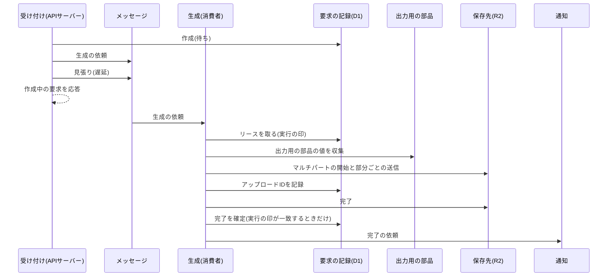
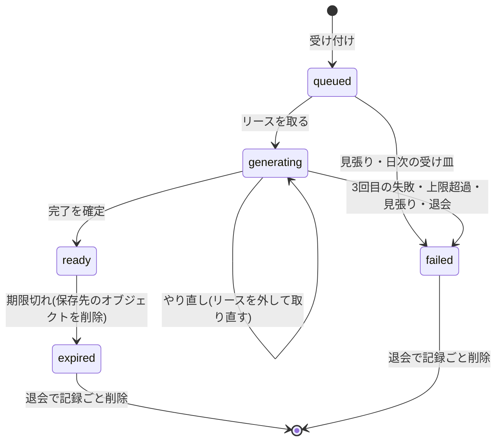

# 利用者のデータのアーカイブの非同期の生成

利用者のデータを複数の機能の出力用の部品から集め、同期のストリーミングでZIPに書き出し、均一な大きさの部分に区切ってオブジェクトストレージへマルチパートアップロードし、本人だけが期限付きで取り出せるようにする規約を定める。要求の受け付けと即時の応答、出力用の部品の値の写し、JSONとファイルの組み立て、ZIPの書き出し、マルチパートの保存、要求の状態の遷移、リース・再試行・見張りのメッセージ・日次の受け皿、通知、期限切れと退会時の削除、ログと定型の通知、テスト、CPU時間とメモリの実測の手順を扱う。

ダウンロードの認可・応答のヘッダー・回数の制限は[本人だけの生成物の同一オリジン配信](../security/012-owner-scoped-generated-downloads.md)に、メッセージの配送・定期実行・再試行の基盤は[非同期処理の設計](../infra/003-async-processing.md)に、ログとエラートラッキングの規約は[ログ管理とエラートラッキング](../infra/004-logging-and-error-tracking.md)に定める。

## 前提と用語

ORMにDrizzle、データベースにCloudflare D1、オブジェクトストレージにCloudflare R2、DIコンテナにInversifyを使い、要求ごとに処理単位のコンテナを作る構成(「[処理単位のコンテナ](002-layered-architecture-on-workers.md#処理単位のコンテナ)」)を前提とする。生成は消費者のアプリ(`<メッセージを受信するアプリ>`)で行い、受け付けと定期実行は`<定期実行を受け持つアプリ>`で行う。部品の置き場所は、共用部品・共通ライブラリの配置先と各アプリの`src/`からのパスで示す。部品の名前は例であり、`<ドメイン>`は利用者のデータを書き出す機能のディレクトリの名前に置き換える。

| 部品                                                              | 置き場所                                                                | 役割                                                                         |
| ----------------------------------------------------------------- | ----------------------------------------------------------------------- | ---------------------------------------------------------------------------- |
| `ArchiveRules`(状態・失敗の種類・上限・期間の定数)                | 共用部品の`<ドメイン>/`(画面とAPIサーバーが共有する値)                  | 状態の表示名、回数の上限、保持期間の日数、ダウンロードの経路の組み立て       |
| `ArchiveMessages`・`ArchiveLimits`・`ArchiveNames`                | 共通ライブラリの`core/<ドメイン>/`                                      | メッセージ種別と時間の定数、ZIPの上限と部分の大きさ、ZIP内のファイル名の規則 |
| `ArchiveRequestStore`                                             | 共通ライブラリの`core/<ドメイン>/ports.ts`(実装は`workers/<ドメイン>/`) | 要求の記録の作成・照会・リース・状態の遷移・一覧の読み取り                   |
| `ArchiveStorage`・`MultipartArchiveUpload`                        | 同上(実装はR2のバインディング)                                          | 保存先の操作と、部分ごとに送るマルチパートアップロードの口                   |
| `ArchiveNotifier`・`ArchiveTerminator`・`ArchiveIncidentReporter` | 同上                                                                    | 通知の依頼、失敗の確定と後始末、エラートラッキングへの定型の通知             |
| `ExportSnapshotCollector`・読み取りの部品                         | `<メッセージを受信するアプリ>`の`src/application/<ドメイン>/`           | 出力用の部品の値を本機能のスナップショットへ写す                             |
| `ArchiveDocumentBuilder`・`ExportPlanner`                         | 共通ライブラリの`core/<ドメイン>/`(純粋な関数)                          | スナップショットからJSON・マニフェスト・ZIP内のパスを組み立てる              |
| `ZipArchiveWriter`・`PartChunker`                                 | 同上                                                                    | fflateを包む同期の書き出しと、均一な大きさの部分への区切り                   |
| `ArchiveGenerationService`                                        | `<メッセージを受信するアプリ>`の`src/application/<ドメイン>/`           | リース・収集・書き出し・保存・完了・やり直し                                 |
| `GenerateArchiveHandler`・`GenerationWatchdogHandler`             | 同上                                                                    | 生成と見張りのメッセージの処理                                               |
| `ArchiveRequestService`・`ArchiveDownloadService`                 | `<APIサーバーのアプリ>`の`src/application/<ドメイン>/`                  | 要求の受け付けと一覧、ダウンロードの認可                                     |
| `ArchiveExpiryJob`・`GenerationRecoveryJob`                       | `<APIサーバーのアプリ>`の`src/application/<ドメイン>/jobs/`             | 期限切れの削除と生成の受け皿                                                 |
| `ArchiveErasureHandler`                                           | `<メッセージを受信するアプリ>`の`src/application/<ドメイン>/`           | 利用者の退会・物理削除の時期の削除                                           |

| 用語             | 意味                                                                                                                                        |
| ---------------- | ------------------------------------------------------------------------------------------------------------------------------------------- |
| アーカイブ       | 利用者のデータの文書とファイルを1つにまとめたZIP。生成の完了の後、期限を過ぎるまで本人だけが取り出せる                                      |
| 要求の記録       | 1回の要求の状態・リース・アップロード中のID・保存先のキー・完了と期限と失敗の日時・通知の状態を持つ行。アーカイブが無くなっても退会まで残る |
| 出力用の部品     | 各機能が本人のデータを返す読み取りの部品。アーカイブの生成はこの部品だけを読み、機能のテーブルを直接読まない                                |
| スナップショット | 出力用の部品の値を、本機能の型(日時は`Date`、無い値は`null`)へ写した1回の生成の入力                                                         |
| 部分             | マルチパートアップロードの1回の送信の単位。最後以外は同じ大きさ                                                                             |
| 実行の印         | 1回の生成の実行を表す値。リースを取った実行だけが完了と失敗の確定を行える                                                                   |
| リース           | 生成を行っている実行が占有する期限付きの印。期限を過ぎたリースは次の実行が取り直せる                                                        |
| 作成中           | 要求の記録が待ち・生成中の状態。画面では1つの表示にまとめる                                                                                 |
| 依頼待ち         | 完了か失敗が確定したが、通知の依頼がまだ済んでいない状態                                                                                    |
| 見張り           | 要求の受け付けの時に遅らせて送るメッセージ。消費者が落ちて作成中のまま残った要求を失敗にする                                                |
| 受け皿           | 日次の定期実行。見張りのメッセージを失った要求と、依頼待ちのまま残った通知を拾う                                                            |
| 退会の中止       | 生成の途中で利用者が退会していたとき、ZIPを残さず通知もせずに終える扱い                                                                     |

## 使う場面

利用者のデータを一括で持ち出す機能を作るとき、または既存の出力用の部品を組み合わせて1つのファイルにするときに使う。生成の時間が要求の応答に収まらない、データの量が多くメモリに全体を持てない、要求が重なっても1回の生成だけを行いたい、という場合に、この規約の非同期の生成と分割の保存を用いる。

## 全体の流れ

## 受け付けと即時の応答

受け付けは、本人と確認の判定、回数の制限、要求の記録の作成、生成の依頼、見張りの依頼の順に行う。本人かどうかと確認の判定は回数を数える前に行い、未ログインや未確認の拒否を回数に含めない。回数の制限の後の失敗は回数を戻さない。期間の全体を消すリセットは、同じ期間の他の要求の回数まで消すため使えない。

生成の依頼の送信に失敗したら、作った要求の記録を削除して利用できない旨の応答を返す。記録を残すと、利用者は受け付けられたと誤解して、その記録が無いまま作成中で止まるためである。見張りの依頼の送信の失敗は警告のログに留める。見張りが無い要求は、後述の日次の受け皿が拾う。

## 出力用の部品の写しとスナップショット

出力用の部品の型は機能ごとに異なる。日時が文字列か`Date`か、項目名、並びの決め方がまちまちなため、読み取りの部品が値を本機能のスナップショットの型へ写す。スナップショットの型は`Date`と`null`で統一し、上流の型に依存しない。JSONの組み立ては、スナップショットと計画の入力だけを受け取る純粋な関数にする。こうすると、上流の形が変わったときに直すのは読み取りの部品の写しだけになり、JSONの組み立ては文書の例と突き合わせる単体テストで確かめられる。

部品の呼び出しは、利用者ごとに順に1つずつ行う。並行に呼ぶと読み取りの負荷が重なり、途中の失敗の扱いも複雑になる。一覧の件数に比例する問い合わせは、ひとまとまりの件数(D1の1回の問い合わせのバインド変数の上限(「[D1の制約と対処](../db/002-d1-constraints.md#d1の制約と対処)」)に収まる大きさ)ごとに読む。

退会などで利用者が無くなっていた場合、収集は`undefined`を返す。呼び出し側は、以後の書き出しを行わず、通知をせずに失敗として確定する。

## JSONとファイルの組み立て

純粋な関数は次の規則を守る。

- JSONは改行をLFにし、末尾に改行を1つ付け、BOMを付けない。UTF-8で書く。
- 日時はミリ秒付きのUTCのISO 8601で書く。基準時刻の日付だけを使う項目(ファイル名など)は、業務時刻の日付(`<業務時刻のUTCとの差>`の時差)に直して`YYYY-MM-DD`で書く。
- 求められない値は省かず`null`で書く。並びのある配列は、空でも空配列として出す。
- 秘密情報(パスワードの照合値・トークン・内部の識別子)と、本人に示す必要の無い内部の識別子(仮名化した識別子など)は、スナップショットの型に入れない。型に無いものは出力に現れない。
- ZIP内のファイル名は、禁止文字を`-`へ置き換え、拡張子を除いた末尾の`.`と空白を除き、Windowsの予約名には`_`を付ける。空になる名前は代わりの名前にする。同じディレクトリ内で大文字小文字を区別しない衝突は、拡張子の前へ`-2`・`-3`の連番を付け、付けた後の名前も既存の名前と比べる。
- ZIPの名前は、公開のハンドルと基準時刻の日付を含む固定の形にする。表示名などの個人情報は含めない。

## ZIPの書き出し

ZIPはfflateの同期のAPIだけで書く。非同期のAPIは内部でWeb Workerや`worker_threads`を使うため、Workerの実行環境では動かない。使うのは`Zip`(全体の書き出し)、`ZipPassThrough`(格納)、`ZipDeflate`(圧縮)の3つである。

- テキストは圧縮し、既に圧縮されている画像などのバイナリは格納する。格納は圧縮の計算を省いてCPU時間を抑えるためである。
- 大きさの分からない項目はデータ記述子(フラグのビット3)で書かれるため、ストリーミングで書ける。CRC32はfflateが計算する。
- 非ASCIIのファイル名では、ローカルの項目のヘッダーのUTF-8のフラグ(ビット11)が立つことを単体テストで確かめる。立たない場合は、ファイル名を正しく扱えないため、その版を採用しない。
- ZIPの更新日時は、実行環境のローカルのタイムゾーンで書かれる。Workerの実行環境はUTCだが、テストや別の環境では違うため、UTCの`Date`を明示して渡す。
- ZIP64は書かない。ZIP64を書かない場合、大きさとオフセットは4バイトの整数に収まる必要があるため、合計は4GiB未満に限られ、項目数は2バイトの整数に収まる65,535件に限られる。運用上の上限(`<ZIPの大きさの上限>`・`<ZIPの件数の上限>`)はこの範囲に収め、超えた場合は例外で止める。
- fflateは出力の断片を同期の関数の呼び出しで渡す。断片を溜め、部分の区切りが満ちるたびに非同期の書き込み先へ待って送り、送り終えてから次の入力を読む。こうするとメモリは1つの部分の大きさと読み出しの断片に収まる。
- 書き込み先が失敗したら、以後の書き出しを拒否する。呼び出し側はアップロードを破棄する。

上限を超えた場合は、例外の種類(合計の大きさか件数か)だけを持つ専用の例外にする。例外のメッセージに利用者の内容やファイル名を含めない。エラートラッキングやログへ例外が渡っても内容が漏れないようにするためである。

## 均一な部分のマルチパートアップロード

R2のマルチパートアップロードは、最後以外の部分を同じ大きさにし、その大きさを5MiB以上にする必要がある。1部分は最大5GiB、部分は最大10,000個、オブジェクトは最大5TiBである。部分の大きさを`<部分の大きさ>`に固定すると、出力の断片を1つのバッファに溜めて満ちたら送るだけで済み、メモリは1つの部分に収まる。オブジェクトの大きさの上限より先に、ZIPの上限が効く。

- 書き込み先は、開始・部分の送信・完了・破棄の4つの操作を持つ。部分の送信の途中で失敗したら、そのアップロードを破棄し、以後の書き込みを拒否する。
- 開始したアップロードのIDは、要求の記録に書いてから次の部分を送る。異常終了して記録に残ったアップロードは、次の実行が破棄してから作り直す。記録より前に異常終了したアップロードは、保存先の既定の寿命の規則が破棄する(R2は未完了のマルチパートアップロードを開始から7日で破棄する)。
- 保存先の寿命の規則をIaCで設定するときは、未完了のマルチパートアップロードを破棄する規則を含める。含めないと、既定の規則が効かなくなる。
- 保存のメタデータは、内容の型(ZIPなら`application/zip`)、添付の`Content-Disposition`(非ASCIIのファイル名を含む)、キャッシュの指定(`private, no-store`)を持つ。ダウンロードの応答はこのメタデータを写す。
- 完了の後、ファイル名と大きさ(と完了と期限の日時)を要求の記録へ書く。

## 画像と添付を先に、JSONを最後に書く

ZIP内の項目の順は展開の結果に影響しない。そのため、画像などのファイルを先に書き、JSONとマニフェスト、マークダウンの本文、READMEを最後に書く。ファイルは書き出しの直前に読み出すため、読めなかったり隔離されたりしたファイルがあり得る。ファイルを先に書いて実際に格納できたファイルの集合を作れば、JSONに書くパスと実体を一致させられる。格納できなかったファイルは、JSONのパスを`null`にする。

## 要求の状態と遷移

- どの遷移も、現在の状態と実行の印を条件に入れた1回の条件付きの更新で行う。同じ遷移が2回起きても、2回目は更新0行になる。
- 完了から期限切れへの遷移だけが、完了の後に起きる遷移である。期限切れと失敗は最終の状態で、記録は退会まで残す。
- 完了・失敗の確定と同じ更新で、通知の状態を依頼待ちにする。これにより、1つの要求につき完了か失敗のどちらか1つだけが確定し、通知も1回だけ依頼される。
- 状態の列の値と、完了・失敗の列が揃っている制約(CHECK制約)を、テーブルの定義で持つ。完了のときは保存先のキーとファイル名と大きさと期限が揃い、アップロードのIDが残らない。期限切れのときは、キーとアップロードのIDが無く、ファイル名と大きさと完了と期限の日時が残る。失敗のときは、失敗の日時と種類がある。

## リース・再試行・見張り・受け皿

### リース

生成の開始では、作成中か期限切れのリースの要求だけを、実行の印と期限付きのリースに取り直す条件付きの更新で取る。結果は次の4つになる。

| 結果                               | 生成の処理の扱い                                                       |
| ---------------------------------- | ---------------------------------------------------------------------- |
| 取れた                             | 生成を続ける                                                           |
| 他の実行のリースが有効(`busy`)     | 処理を`<使用中の待ち>`秒の遅延で返す。遅延の再送は試行の回数に数えない |
| 完了・期限切れ・失敗で終わっている | 何もせず終える                                                         |
| 記録が無い                         | 何もせず終える                                                         |

リースの期限は`<リースの秒数>`である。長い生成が期限を過ぎても、次の実行が取り直して二重に完了させないよう、完了の確定とアップロードの記録は実行の印が一致するときだけ更新する。印が一致しなければ、作ったオブジェクトを削除して終える。

### 再試行

一時的な失敗(データベース・保存先・出力用の部品・ファイルの読み出しの失敗)は例外として投げ、メッセージの配送の再試行に任せる。再試行の回数は`<再試行の回数>`、待ち時間は`<再試行の起点>`秒から倍にし、`<再試行の上限>`秒で止める。

- 途中のアップロードは、例外の前に破棄し、リースを解放する。次の試行は新しいアップロードから始める。
- 試行の回数が上限に達した実行は、失敗を確定し、通知を依頼して、例外を投げずに終える。
- 上限の超過は再試行しない。同じ入力で同じ超過になるため、大きすぎる旨の失敗として確定する。
- 退会済みの利用者の生成は、通知をせずに失敗として確定する。

### 見張り

要求の受け付けの時に、`<見張りの遅延>`秒後の見張りのメッセージを送る。見張りの処理は、要求がまだ作成中なら失敗として確定し、エラートラッキングへ定型の通知を送る。消費者が例外なく終わらない場合(実行時間の上限への到達など)、再試行の仕組みは働かず、見張りだけが失敗を確定できる。見張りの遅延は、生成の実時間の上限と再試行の合計より長くする。そうしないと、正常に続いている生成を見張りが失敗にしてしまう。

### 日次の受け皿

見張りのメッセージが送られなかった要求や、失われた要求を、日次の定期実行が拾う。

- 作成中のまま`<受け皿の閾値>`秒を過ぎた要求を、失敗として確定する。閾値は見張りの遅延より長くし、見張りが先に働くようにする。
- 完了か失敗の確定から`<送り直しの待ち時間>`秒を過ぎても依頼待ちのままの通知を、通知の依頼で送り直す。確定の直後の依頼と重ならないよう、送り直しの待ち時間は確定の直後の依頼の時間より長くする。
- どちらも件数の上限(`<1回の件数>`件)ずつ読み、続きがあれば最大`<繰り返しの回数>`回まで繰り返す。
- 1件の失敗は、件数とともにエラートラッキングへ送って次へ進む。次の日に同じ処理をやり直すため、2回目の実行で結果が変わらない。

## 通知

通知は1つの要求につき1回だけ依頼する。通知の状態は、なし・依頼待ち・依頼済み・送らないの4つを持つ。

- 依頼は、要求の記録を読み直し、依頼待ちのときだけ行う。期限切れ・列の欠けた記録・退会済みの宛先は、送らずに送らない状態へ進める。
- 依頼の冪等のキーは要求のIDだけでよい。完了と失敗は同じ要求で両方は確定しないため、キーに種類を入れなくても重複しない。
- 依頼が成功した後に状態の前進が失敗しても、次の送り直しで同じキーの依頼を送る。メールの送信側がキーで重複を捨てるため、利用者には2通目が届かない(「[外部の副作用の依頼](009-idempotent-event-reflection.md#外部の副作用の依頼)」)。
- 依頼に失敗したら依頼待ちのまま例外を投げ、受け皿の送り直しに任せる。
- メールの本文に載せるリンクは、クライアントのオリジンと決まった経路から組み立てる。宛先の利用者の情報(メールアドレス・表示名)を、ログに出さない。

## 期限切れと削除

### 期限切れ

日次の定期実行は、期限を過ぎた完了の要求を読み、次の順に行う。

1. 保存先のオブジェクトを削除する。オブジェクトが無ければ成功とみなす。
2. 要求の記録を期限切れに変え、キーとアップロードのIDを外す。記録は残す。
3. 途中のアップロードが残る失敗の要求を読み、アップロードを破棄してIDを外す。

各段階は件数の上限ずつ読み、続きがあれば繰り返す。1件の失敗は記録を残して次へ進み、件数とともにエラートラッキングへ送る。

### 退会と物理削除

利用者の退会・物理削除の時期の処理は、その利用者の要求の記録を読み、件数の上限ずつ次の順に行う。途中のアップロードの破棄、オブジェクトの削除、記録の削除。件数が上限に達したら続きを返し、残りが無くなるまで同じ処理を繰り返す。物理削除の時期の処理は、退会の時点で消し残した記録と、その後に作られた記録を消す受け皿である。削除の失敗は例外として再試行に回し、エラートラッキングへ届くようにする。

記録が利用者を外部キーで参照する場合、利用者の行は、この処理を含む退会の処理の全てが終わった後に削除する(「[ユーザーライフサイクルイベント](007-user-lifecycle-events.md#前提と用語)」)。

## ログと定型の通知

### ログ

ログのカテゴリは`[<アプリ名>, <層>, <ドメイン>]`とし、受け付け・生成・見張り・受け皿・通知・削除の各部品が、それぞれのアプリの名前に固定する。共用部品の束縛はアプリ名を引数で受け取り、ログのカテゴリの先頭にする(「[ログの出力](../infra/004-logging-and-error-tracking.md#ログの出力)」)。

属性は、要求のID・件数・バイト数・所要時間・試行の回数・結果に限る。メールアドレス・ハンドル・表示名・ファイル名・JSONの内容・保存先のキーを属性に入れない。完了と失敗のログには、所要時間・バイト数・項目数・試行の回数を入れ、性能の確認に使う。

### 定型の通知

同じ文言を繰り返し送る出来事は、エラートラッキングへ定型の通知として送る(「[同じ文言を繰り返し送る通知](../infra/004-logging-and-error-tracking.md#同じ文言を繰り返し送る通知)」)。

| 出来事の種類                                                     | レベル    | 送る場所             |
| ---------------------------------------------------------------- | --------- | -------------------- |
| `generation-failed`(再試行の上限まで失敗した)                    | `error`   | 生成の処理           |
| `generation-abandoned`(見張り・受け皿が作成中の要求を失敗にした) | `warning` | 見張りと日次の受け皿 |
| `archive-deletion-failed`(期限切れの削除に失敗した)              | `error`   | 日次の期限切れの処理 |
| `notice-redispatch-failed`(依頼待ちの通知の送り直しに失敗した)   | `error`   | 日次の受け皿         |
| `archive-missing`(実体の無い完了の記録へダウンロードが来た)      | `warning` | ダウンロードの処理   |

- `captureEvent`で送る場合の指紋は`[<ドメイン>, <出来事の種類>]`とし、タグは`<ドメイン>_incident`(値は出来事の種類)とする。
- 元の例外が`AppError`以外の場合は、元の例外を`captureException`で送る。この経路は指紋を指定しない。`AppError`の場合は、文言を`logentry`に置いた`captureEvent`で送り、指紋を上の形で指定する。`captureMessage`の文言だけのイベントは、直前と同じ文言と指紋なら重複として捨てられ、続けて起きた同じ出来事を通知できないためである。
- タグやコンテキストに入れる識別子は、要求のIDならULIDの形を確かめ、形が違えば`unknown`にする。ファイル名やキーを入れない。

## テスト

テストの種別と命名は[テスト方針](../testing/001-test-strategy.md#テストの種別と命名)に従う。

- 単体テスト(Bun): 純粋な関数(ファイル名の変換・衝突の連番・計画・JSONの組み立て・部分の区切り・ZIPの書き出し)を、文書の例と同じ入力で突き合わせる。ZIPはメモリ上の書き込み先へ書き、fflateの`unzipSync`で展開して、項目の名前・内容・圧縮の方式・UTF-8のフラグを確かめる。上限は小さい値を注入して、上限ちょうどは成功し1を超えると例外になることを確かめる。部分の区切りは、ちょうどの大きさ・1バイト超え・複数の部分をまたぐ断片の3つで、最後以外の大きさが同じになることを確かめる。
- 偽の部品を使う単体テスト: 状態の遷移の結果ごとの扱い(取得・使用中・終了済み・中止・上限超過・置き換え済み)、やり直しと上限の回数、通知の依頼の回数、退会時の中止を、偽の要求の記録・偽の保存先・偽の通知で確かめる。
- Workers統合テスト: ローカルのD1とR2を使い、リースの競合(2つの実行で1つだけ取れる)、条件付きの更新の結果、期限切れのリースの取り直し、部分の大きさ、保存のメタデータ、破棄の後にオブジェクトが無いこと、無いアップロードの破棄が成功することを確かめる。
- 生成の統合テスト: 出力用の部品の実装とローカルのD1・R2に、画像・添付・同名のファイル・非ASCIIのファイル名・削除済みの対象への参照・隔離されたファイルを用意して生成し、ZIPを展開して、パスの一覧・JSONの項目と値・`null`の規則・マニフェストの件数・保存のメタデータを期待と突き合わせる。

## CPU時間とメモリの実測の手順

CPU時間の上限(消費者の1件の処理)とメモリの上限を、データの量が多い利用者で確かめる手順を次に示す。ローカルの開発サーバーでは、CPU時間の上限は再現されないため、ローカルでは件数・バイト数・所要時間の確認に限る。

1. ローカルの状態を永続化して起動し、画像と添付を多く持つ利用者のデータを用意する。永続化の場所は`<ローカル状態の保存先>`で、起動の手順は[Wranglerを動かす実行環境](../infra/001-wrangler-conventions.md#wranglerを動かす実行環境)に従う。
2. 生成の依頼を1回送り、完了か失敗のログを待つ。ログの所要時間・バイト数・項目数・試行の回数を読み、上限を超えていないことと、同じ要求が1回だけ完了したことを確かめる。
3. 同じ量のデータを検証環境(stagingなど)に用意し、デプロイした消費者の呼び出しログから、対象の生成の呼び出しのCPU時間と所要時間を読む。Workersの呼び出しの情報には呼び出しごとのCPU時間と所要時間があるため、アプリのログの所要時間と突き合わせる。メモリは同じ呼び出しのメモリの使用量を読む。
4. 測定の結果は、データの量(合計のバイト数・項目数)とCPU時間・メモリ・実時間の組で運用の記録に残す。実行環境の上限(消費者の1件の処理のCPU時間・メモリ・実時間の上限)と比べ、余裕が少なければ、実行の時間の上限の引き上げか、生成専用の経路への分離を検討する。

## 関連

- [本人だけの生成物の同一オリジン配信](../security/012-owner-scoped-generated-downloads.md)
- [非同期処理の設計](../infra/003-async-processing.md)
- [ログ管理とエラートラッキング](../infra/004-logging-and-error-tracking.md)
- [まとめて送る通知メール](016-batched-notification-delivery.md)
- [集約のライフサイクルイベント](012-aggregate-lifecycle-events.md)
