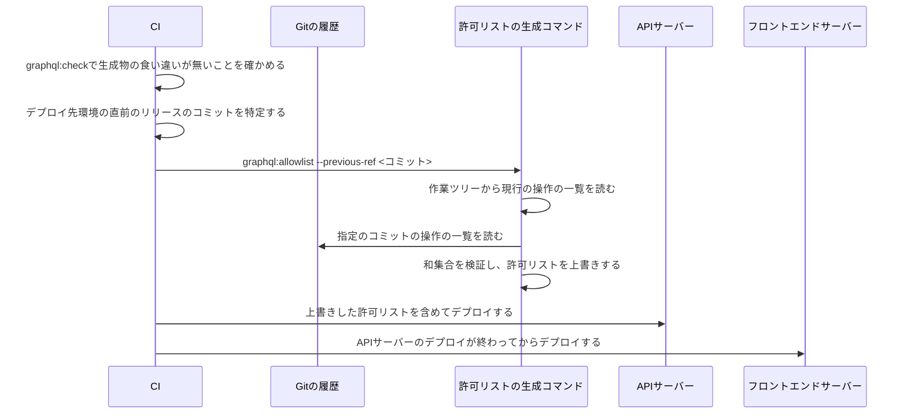

# GraphQL通信

フロントエンドサーバーとAPIサーバーの間のGraphQL通信の契約を定める。サーバー側の節は、要求の形式、中継ヘッダーと指示ヘッダー、応答の形とエラーコード・状態コード、スキーマファイル、操作の一覧、許可リストの生成とデプロイの順序、直前のリリースの渡し方を扱う。クライアント側の節は、フロントエンドのコード生成の設定と生成物、操作の置き場所と名前、操作を変えたときの生成の手順、操作の識別子による要求の送り方、応答の解釈とエラーコードの扱いを扱う。画面でのデータの取得とキャッシュの規約は「[データ取得](../frontend/006-data-fetching.md)」に従う。

## 前提と用語

APIサーバーのGraphQLの基盤は「[GraphQLサーバーの基盤](../backend/004-graphql-server.md)」に、内部経路の認証・中継ヘッダーの形式とAPIサーバーの側の扱いは「[内部経路とセキュリティヘッダー](../backend/006-internal-gateway.md)」に従う。両文書と重なる事項は、次の分担でどちらか一方を正とする。

| 事項                                                       | 正とする文書                                                                              |
| ---------------------------------------------------------- | ----------------------------------------------------------------------------------------- |
| エラーコードの一覧と、状態コードの全表                     | 「[エラーの分類と状態コード](../backend/004-graphql-server.md#エラーの分類と状態コード)」 |
| ヘッダーの値の形式と、APIサーバーが値を検証・使用する方法  | 「[要求と応答の項目](../backend/006-internal-gateway.md#要求と応答の項目)」               |
| 許可リストの照会と、生成時の検証の規則                     | 「[許可リスト](../backend/004-graphql-server.md#許可リスト)」                             |
| 生成と検査のコマンドの振る舞い                             | 「[生成と検査のコマンド](../backend/004-graphql-server.md#生成と検査のコマンド)」         |
| 誰がどのヘッダーを付け、受け取った側がどう処理するか       | 本文書                                                                                    |
| 生成物と操作の一覧の場所・形式、許可リストのデプロイの手順 | 本文書                                                                                    |

| 用語                                 | 意味                                                                                                                    |
| ------------------------------------ | ----------------------------------------------------------------------------------------------------------------------- |
| フロントエンドサーバー               | 利用者側・管理者側の画面を配信し、GraphQLの要求をService Bindingsで中継するWorker                                       |
| 内部経路・外部経路・呼び出し元       | 「[GraphQLサーバーの基盤](../backend/004-graphql-server.md#前提と用語)」と同じ                                          |
| 操作の識別子・操作の一覧・許可リスト | 「[GraphQLサーバーの基盤](../backend/004-graphql-server.md#前提と用語)」と同じ                                          |
| 中継ヘッダー・指示ヘッダー           | 「[内部経路とセキュリティヘッダー](../backend/006-internal-gateway.md#前提と用語)」と同じ                               |
| 現行のリリース                       | デプロイしようとしている作業ツリーのフロントエンド                                                                      |
| 直前のリリース                       | デプロイ先環境で、デプロイの時点に動いているフロントエンド。デプロイの間は、このリリースの画面からも要求が届く          |
| `<GraphQLの経路>`                    | 「[GraphQLサーバーの基盤](../backend/004-graphql-server.md#前提と用語)」と同じ                                          |
| `<GraphQLの本文の上限>`              | 「[GraphQLサーバーの基盤](../backend/004-graphql-server.md#前提と用語)」と同じ                                          |
| ヘッダーのプレースホルダー           | `<呼び出し元のヘッダー>`などは「[内部経路とセキュリティヘッダー](../backend/006-internal-gateway.md#前提と用語)」と同じ |
| `<APIサーバーのアプリ>`              | GraphQLのサーバーを持つアプリの、リポジトリのルートからのディレクトリ                                                   |
| `<利用者側のフロントエンドのアプリ>` | 利用者側の呼び出し元にあたるフロントエンドサーバーのアプリの、リポジトリのルートからのディレクトリ                      |
| `<管理者側のフロントエンドのアプリ>` | 管理者側の呼び出し元にあたるフロントエンドサーバーのアプリの、リポジトリのルートからのディレクトリ                      |

## サーバー側

### 要求の形式

フロントエンドサーバーは、呼び出し元の名前付きエントリポイントを指定したService Bindingsで、次の要求を送る。

| 項目           | 内容                                                                                                                                         |
| -------------- | -------------------------------------------------------------------------------------------------------------------------------------------- |
| メソッド・経路 | `POST <GraphQLの経路>`。Service BindingsではURLのホスト名を使わないため、ホスト名は任意である                                                |
| 要求ヘッダー   | `Content-Type: application/json`、`Accept: application/graphql-response+json`、「[中継ヘッダー](#中継ヘッダー)」                             |
| 要求本文       | `{ "documentId": "sha256:<64桁の小文字の16進>", "operationName"?: string, "variables"?: object }`。大きさは`<GraphQLの本文の上限>`以下にする |

- 操作の本文(`query`)は送らない。内部経路では、許可リストにある操作の識別子を指定した要求だけを実行し、本文だけの要求は`persisted_operation_required`で拒否する。
- `operationName`は、1つの文書に複数の操作がある場合に実行する操作を選ぶ。操作が1つなら省略できる。
- 1件の要求で送る操作は1つにする。配列の本文(バッチ)は`graphql_request_invalid`で拒否する。
- フロントエンドサーバーは`Content-Type: application/json`で送る。GraphQL Yogaが解釈しない`Content-Type`(`text/plain`や`multipart/form-data`など)の本文は、本文の無い415で拒否される。

### 中継ヘッダー

フロントエンドサーバーは、ブラウザから受け取った要求のうち、次の値だけをヘッダーに入れてAPIサーバーへ渡す。値の形式は「[要求と応答の項目](../backend/006-internal-gateway.md#要求と応答の項目)」に従う。

| ヘッダー                         | 定数(`GATEWAY_HEADERS`) | 付ける側                              | 付ける値                                                   | 付けないとき                                                                                          |
| -------------------------------- | ----------------------- | ------------------------------------- | ---------------------------------------------------------- | ----------------------------------------------------------------------------------------------------- |
| `<元のクライアントIPのヘッダー>` | `clientIp`              | フロントエンドサーバー                | フロントエンドサーバーが受け取った要求の接続元のIPアドレス | 送信元が不明として扱われ、APIサーバーが警告のログを出す。IP制限では、不明の要求どうしが上限を共有する |
| `<セッション識別子のヘッダー>`   | `sessionToken`          | フロントエンドサーバー                | 呼び出し元の種類のセッションのCookieの値                   | Cookieが無いときは付けない。未ログインとして扱われる                                                  |
| `<bot判定のトークンのヘッダー>`  | `botToken`              | フロントエンドサーバー                | ブラウザから受け取ったbot判定のトークン                    | bot判定を求める操作は`bot_verification_failed`で失敗する                                              |
| `<呼び出し元のヘッダー>`         | `caller`                | APIサーバーの名前付きエントリポイント | エントリポイントの呼び出し元の種類(`CALLER_KINDS`の値)     | フロントエンドサーバーは付けない。付けても上書きされる                                                |

- `<元のクライアントIPのヘッダー>`は、ブラウザが名乗った同名のヘッダーを転送せず、必ず自身が受け取った接続元のIPアドレスで上書きする。転送すると、APIサーバーが内部経路の値として信頼し、送信元ごとのIP制限を回避される。
- `<デバッグ用の呼び出し元のヘッダー>`は、ローカル環境のGraphiQLの要求でだけ読まれ、内部経路では使われない。フロントエンドサーバーは付けない。
- 呼び出し元は、どの名前付きエントリポイントへ送ったかだけで決まる。利用者側のフロントエンドサーバーは利用者側の、管理者側のフロントエンドサーバーは管理者側のエントリポイントだけを、Service Bindingsで指定する(「[名前付きエントリポイントによる内部認証](../backend/006-internal-gateway.md#名前付きエントリポイントによる内部認証)」)。

### 指示ヘッダー

APIサーバーは、セッションのCookieの発行と削除を、応答の指示ヘッダーでフロントエンドサーバーへ伝える。新しいセッション識別子は応答本文に含めない。

| ヘッダー                           | 定数(`SESSION_RESPONSE_HEADERS`) | 値                                           | フロントエンドサーバーの処理                                                                                                                                                                  |
| ---------------------------------- | -------------------------------- | -------------------------------------------- | --------------------------------------------------------------------------------------------------------------------------------------------------------------------------------------------- |
| `<セッションの発行のヘッダー>`     | `issue`                          | 新しいセッション識別子                       | この値でセッションのCookieを設定する                                                                                                                                                          |
| `<セッションの有効期間のヘッダー>` | `maxAge`                         | 1以上34560000以下(400日)の整数の10進表記(秒) | 設定するCookieの`Max-Age`に使う。発行のヘッダーと必ず組で付く。フロントエンドサーバーは上限を超える値の発行を捨てる(「[指示の解釈](../frontend/003-frontend-server-security.md#指示の解釈)」) |
| `<セッションの削除のヘッダー>`     | `clear`                          | `1`                                          | セッションのCookieを削除する                                                                                                                                                                  |

- 発行と削除のヘッダーは、同じ応答に同時に付かない。どちらも付かなければ、Cookieを変えない。
- 有効期間の上限34560000秒(400日)は、ブラウザがCookieの`Max-Age`を400日で切り詰めるためである。APIサーバーは上限を超える発行を応答に付けずに拒否する(「[応答ヘッダーへの反映](../backend/006-internal-gateway.md#応答ヘッダーへの反映)」)。
- フロントエンドサーバーは、指示ヘッダーをブラウザへ返す応答から必ず取り除く。指示が無い応答でも、同名のヘッダーが残っていれば取り除く。
- 指示ヘッダーは、エラーを含む応答や、状態コードが200以外の応答にも付き得る。状態コードに関わらず処理する。

### 応答の形とエラーコード

応答本文は、GraphQLの結果か、共通のエラー形式のどちらかである。最上位に`error`があれば共通のエラー形式、`data`か`errors`があればGraphQLの結果として読む。ただし、GraphQL Yogaが解釈しない`Content-Type`の要求への415は本文を持たない。

| 本文の形                                                                                                     | エラーコードの場所          | 返る場面                                                                                                                                                                                                                                |
| ------------------------------------------------------------------------------------------------------------ | --------------------------- | --------------------------------------------------------------------------------------------------------------------------------------------------------------------------------------------------------------------------------------- |
| GraphQLの結果(`data`・`errors`)                                                                              | 各エラーの`extensions.code` | GraphQL Yogaが処理した要求                                                                                                                                                                                                              |
| 共通のエラー形式(「[共通のエラー形式](../backend/002-layered-architecture-on-workers.md#共通のエラー形式)」) | `error.code`                | GraphQL Yogaの外で返す応答。本文の上限の超過(413 `payload_too_large`)、Worker単位のIP制限(429 `rate_limit_exceeded`)、環境の検証の失敗(500 `internal_error`)、GraphQL Yogaの外の想定外の例外(Honoの`onError`による500 `internal_error`) |

- 入力の検証の失敗(`validation_error`)は、`extensions.details`に項目ごとの詳細(`field`・`code`・`message`)の配列を持つ。
- 想定外の例外は、内部の詳細を伏せた定型の文言と`internal_error`で返る。
- エラーコードの全ての一覧と、場面ごとの状態コードは「[エラーの分類と状態コード](../backend/004-graphql-server.md#エラーの分類と状態コード)」を正とする。実行前の拒否のコードは`GATEWAY_ERROR_CODES`、リゾルバの想定内の失敗のコードは各機能の`AppError`のコードである。

状態コードは次のように読む。画面の表示の分岐は、状態コードではなくエラーコードで行う。

| 状態コード | 意味                                                                                                                |
| ---------- | ------------------------------------------------------------------------------------------------------------------- |
| 200        | 操作を実行した。リゾルバの想定内の失敗・入力の検証の失敗と、データのある応答の想定外の例外は、`errors`で返る        |
| 400        | 操作を実行する前に拒否した(許可リスト・構文・スキーマとの不一致・上限・要求の不正)。リゾルバは1つも実行されていない |
| 413        | 本文が`<GraphQLの本文の上限>`を超えた                                                                               |
| 415        | GraphQL Yogaが解釈しない`Content-Type`の本文。本文もエラーコードも無い                                              |
| 429        | 回数の超過。共通エラーに`retryAfterSeconds`があれば、`Retry-After`に再試行までの秒数が付く                          |
| 500        | データが無く想定外の例外だけのGraphQLの結果、環境の検証の失敗、またはGraphQL Yogaの外の想定外の例外                 |
| 503        | 依存先の一時的な障害。共通エラーに`retryAfterSeconds`があれば、`Retry-After`に再試行までの秒数が付く                |

- 本文書の状態コードは、GraphQL Yogaの外で返す応答を含む、フロントエンドサーバーが受け取る応答の全体を対象にする。「[エラーの分類と状態コード](../backend/004-graphql-server.md#エラーの分類と状態コード)」の429・503の条件は、GraphQLの結果のエラーの分類の範囲に限る。
- 応答の全体では、状態コードが429・503になるのは、リゾルバが回数の超過・依存先の一時的な障害の種類の共通エラーを投げたときと、Worker単位のIP制限で拒否したとき(429。`Retry-After`は常に付く)だけである。リゾルバの回数の超過と一時的な障害が1つの応答に混ざると503になる。
- 全ての応答に`Cache-Control: no-store`とセキュリティヘッダーが付く。

### スキーマファイル

APIサーバーは、全てのスキーマモジュールを合成したスキーマを1つのスキーマファイルに印字してコミットする。フロントエンドのコード生成は、このファイルをスキーマの入力にする。

| 項目 | 内容                                                                                                                                |
| ---- | ----------------------------------------------------------------------------------------------------------------------------------- |
| 場所 | `<APIサーバーのアプリ>/src/presentation/graphql/generated/schema.graphql`                                                           |
| 形式 | GraphQLのSDL。`lexicographicSortSchema`で型と項目を名前順に並べて`printSchema`で印字し、末尾に改行を1つ付ける(`printGatewaySchema`) |
| 生成 | `<APIサーバーのアプリ>`で`bun run graphql:generate`。リゾルバの型(`generated/resolvers-types.ts`)も同時に生成する                   |
| 検査 | `<APIサーバーのアプリ>`で`bun run graphql:check`。スキーマモジュールの定義と食い違えば失敗し、再実行すべき生成コマンドを表示する    |

- 同じ定義から生成し直しても内容は変わらない。差分は定義の変更だけを表す。
- 型の順序は正規化されるため、フロントエンドのコード生成の結果は、スキーマモジュールの登録の順序に左右されない。

### 操作の一覧

フロントエンドのコード生成は、画面が使う操作の識別子と本文の組を、呼び出し元ごとに1つのJSONファイルへ出力してコミットする。APIサーバーの許可リストの生成コマンドは、このファイルを読む。

| 呼び出し元 | 場所                                                                                |
| ---------- | ----------------------------------------------------------------------------------- |
| 利用者側   | `<利用者側のフロントエンドのアプリ>/src/graphql/generated/persisted-documents.json` |
| 管理者側   | `<管理者側のフロントエンドのアプリ>/src/graphql/generated/persisted-documents.json` |

```json
{
  "sha256:<64桁の小文字の16進>": "<操作の本文>"
}
```

- 形式は、GraphQL Code Generatorのclient-presetの`persistedDocuments`(ハッシュの既定の`sha256`)が出力するものと同じである。値が文字列でないなど形が違えば、生成コマンドは失敗する。
- 識別子は、本文の文字列をUTF-8で符号化したバイト列のSHA-256を小文字の16進にし、`sha256:`を付けた値である(GraphQL over HTTPの永続化された文書の`sha256`の識別子)。APIサーバーは本文を正規化し直さず、一覧の本文をそのまま照合と実行に使う。
- 識別子の形式が違う、識別子が本文のSHA-256と一致しない、のいずれかがあれば、許可リストの生成は失敗する。
- ファイルが無い呼び出し元は、操作が0件として扱う。
- 場所は、許可リストの生成コマンドの`ALLOWLIST_SOURCES`(`<APIサーバーのアプリ>/scripts/graphql/allowlist-sources.ts`)に、リポジトリのルートからのパスで定義する。場所を変えるときは、フロントエンドのコード生成の出力先と同時に変える。

### 許可リストの生成とデプロイの順序

許可リストは、操作の一覧から生成するAPIサーバーの生成物である。

| 項目 | 内容                                                                             |
| ---- | -------------------------------------------------------------------------------- |
| 場所 | `<APIサーバーのアプリ>/src/presentation/graphql/generated/allowlist.json`        |
| 生成 | `<APIサーバーのアプリ>`で`bun run graphql:allowlist [--previous-ref <コミット>]` |

```json
{
  "version": 1,
  "operations": {
    "<呼び出し元の種類>": {
      "sha256:<64桁の小文字の16進>": "<操作の本文>"
    }
  }
}
```

- 最上位は`version`(値は`1`)、`operations`の順に並べる。`operations`は呼び出し元の種類(`CALLER_KINDS`の値)ごとに1つの対応を持ち、呼び出し元と識別子を辞書順に並べる。末尾に改行を1つ付ける。生成し直したときの差分を内容の変化だけにするためである。
- APIサーバーは許可リストをバンドルに含め、呼び出し元ごとに照会する(「[許可リスト](../backend/004-graphql-server.md#許可リスト)」)。

開発では、操作を変えたら次の順に生成してコミットする。

1. スキーマモジュールも変えたなら、先に`<APIサーバーのアプリ>`で`bun run graphql:generate`を実行し、スキーマファイルを出力する。フロントエンドのコード生成がスキーマファイルを入力にするためである。
2. 利用者側・管理者側のフロントエンドのアプリでそれぞれ`bun run graphql:generate`を実行し、操作の一覧を出力する(「[コード生成の設定と生成物](#コード生成の設定と生成物)」)。
3. `<APIサーバーのアプリ>`で`bun run graphql:allowlist`を引数なしで実行し、現行の操作だけから許可リストを生成する。許可リストの生成は、スキーマファイルを読まずに登録箇所のスキーマモジュールを自ら合成して操作を検証する。
4. 生成し直したスキーマファイル・リゾルバの型と、操作の一覧・許可リストを同じコミットに含める。

- コミットする許可リストは、現行の操作だけから生成したものにする。`graphql:check`は、作業ツリーの操作の一覧だけから生成した結果とコミットした許可リストを比べ、食い違えば失敗する。
- 現行の操作が、合成したスキーマに対する解析・検証、上限の検査、スキーマにルートの型が無い操作の検査のいずれかに通らなければ、生成は失敗する。スキーマの変更で画面の操作が壊れたことを、生成の時点で見つける。

デプロイでは、CIがデプロイ先環境ごとに次の順で行う。



- 許可リストは、現行のリリースと直前のリリースの操作の和集合にする。APIサーバーのデプロイの後、フロントエンドサーバーのデプロイが終わるまでの間も、直前のリリースの画面が送る操作を受け付けるためである。それより古いリリースにだけあった操作は含まれない。
- APIサーバーを先に、フロントエンドサーバーを後にデプロイする。逆の順では、新しい画面が送る操作が、まだ古い許可リストに無く拒否される。
- デプロイで上書きした許可リストはコミットしない。上書きの後に`graphql:check`を実行すると、直前のリリースの操作の分だけ食い違って失敗するため、検査は上書きの前に行う。
- 直前のリリースの操作のうち、現行のスキーマに対する検証・上限の検査・ルートの型の検査に通らないものは、許可リストから除外し、呼び出し元・識別子・理由のエラーコードを警告として表示する。生成は失敗しない。除外された操作を送る直前のリリースの画面は、デプロイの間`persisted_operation_not_found`を受け取る。
- 現行と直前のリリースで、同じ識別子に異なる本文があれば、生成は失敗する。

### 直前のリリースの渡し方

直前のリリースの操作の一覧は、Gitの履歴から読む。直前のリリースの一覧を保存しておく新しいリソース(ストレージやキーバリューストア)は使わない。

- `--previous-ref`には、デプロイ先環境で動いているフロントエンドのリリースのコミットを渡す。ブランチ名やタグも渡せるが、コミットに解決できない値は失敗する。どのコミットかの特定はCIが行い、その方法はCIの文書に従う。
- 指定のコミットに操作の一覧のファイルが無い呼び出し元は、直前のリリースの操作が0件として扱う。
- 指定しなければ、現行の操作だけから生成し、直前のリリースを指定していない旨を表示する。初回のデプロイ、直前のリリースを特定できないとき、ローカル環境ではこの形で実行する。
- 指定のコミットが作業ツリーのリポジトリに無ければ失敗する。CIのチェックアウトを浅いクローンにするときは、直前のリリースのコミットを取得してから実行する。
- 値は`-`で始まってはならない。空の値・`-`で始まる値・未知のオプション・位置引数は、使い方を表示して失敗する。値はシェルを介さずにGitへ渡し、オプションとして解釈させない。
- Gitの`ls-tree`の`--format`を使うため、Git 2.36以上が必要である。
- Gitは起動した側の環境変数を引き継ぐ。`GIT_DIR`・`GIT_WORK_TREE`・`GIT_INDEX_FILE`などが設定された状態(Gitのフックの中など)で実行すると、別のリポジトリや索引を読む。CIやフックから実行するときは、これらを設定しない。

## クライアント側

フロントエンドのアプリは、APIサーバーのスキーマファイルからGraphQL Code Generatorのclient-presetで型付きの文書と操作の一覧を生成し、操作の本文を送らずに操作の識別子と変数だけを送る。要求の実行と応答の解釈は、両アプリが使う共通部品(「[共有ディレクトリの配置方式](003-shared-directories.md)」)にまとめる。

| 部品                                                                         | 置き場所(共通部品内)                      | 役割                                                      |
| ---------------------------------------------------------------------------- | ----------------------------------------- | --------------------------------------------------------- |
| `PersistedDocument`・`documentIdOf`・`graphqlQueryKey`                       | `utilities/graphql/persisted-document.ts` | 生成した文書の型と、操作の識別子の取り出し                |
| `GraphQLClientError`・`GraphQLResult`・`parseGraphQLResponse`・`requireData` | `utilities/graphql/graphql-result.ts`     | 応答の解釈とエラーの型                                    |
| `buildGraphQLRequest`・`executeGraphQLInBrowser`                             | `start/graphql/browser-transport.ts`      | 要求の組み立てと、ブラウザからの送信                      |
| `executeGraphQLOnServer`                                                     | `start/graphql/execute-graphql.server.ts` | ページの描画中の送信                                      |
| `executeGraphQL`                                                             | `start/graphql/execute-graphql.ts`        | サーバーとブラウザで同じ呼び方にする同型の関数            |
| `GRAPHQL_RELAY_PATH`・`GRAPHQL_UPSTREAM_PATH`                                | `server/relay/relay-contract.ts`          | ブラウザが送る中継の経路と、その中継先の`<GraphQLの経路>` |

| 用語                                                       | 意味                                                                                                     |
| ---------------------------------------------------------- | -------------------------------------------------------------------------------------------------------- |
| 共通部品                                                   | 利用者側・管理者側のフロントエンドのアプリが使う、画面の共有ディレクトリ                                 |
| `<中継の接頭辞>`                                           | 「[フロントエンドサーバーのセキュリティ](../frontend/003-frontend-server-security.md#前提と用語)」と同じ |
| `<利用者側の操作名の接頭辞>`・`<管理者側の操作名の接頭辞>` | 呼び出し元ごとに操作名の先頭に付ける語。大文字で始める                                                   |

### コード生成の設定と生成物

各フロントエンドのアプリは、ルートに`codegen.config.ts`を置き、次の設定でコード生成する。

| 項目                              | 値                                                                                                     | 理由                                                                                  |
| --------------------------------- | ------------------------------------------------------------------------------------------------------ | ------------------------------------------------------------------------------------- |
| `schema`                          | アプリから`<APIサーバーのアプリ>/src/presentation/graphql/generated/schema.graphql`への相対パス        | APIサーバーがコミットした「[スキーマファイル](#スキーマファイル)」を入力にする        |
| `documents`                       | `['src/**/*.graphql']`                                                                                 | 操作を`.graphql`ファイルだけに書く(「[操作の置き場所と名前](#操作の置き場所と名前)」) |
| 出力先・`preset`                  | `src/graphql/generated/`・`client`                                                                     | 操作の一覧の場所を、許可リストの生成コマンドの`ALLOWLIST_SOURCES`と一致させる         |
| `presetConfig.persistedDocuments` | `{ mode: 'replaceDocumentWithHash' }`                                                                  | 生成する文書から操作の本文と構文木を除き、識別子(`__meta__.hash`)だけを残す           |
| `presetConfig.fragmentMasking`    | `false`                                                                                                | フラグメントの項目も操作の結果の型にそのまま含める                                    |
| `config`                          | `useTypeImports: true`・`enumsAsTypes: true`・`strictScalars: true`・`scalars: { DateTime: 'string' }` | 型だけのimportにし、列挙を文字列の共用体にし、未定義のスカラーを生成の失敗にする      |

| 生成物                                           | 内容                                                                                                      | 画面からの読み込み |
| ------------------------------------------------ | --------------------------------------------------------------------------------------------------------- | ------------------ |
| `src/graphql/generated/graphql.ts`               | 結果と変数の型(`<操作名>Query`・`<操作名>QueryVariables`など)と、識別子だけを持つ文書(`<操作名>Document`) | 読み込む           |
| `src/graphql/generated/gql.ts`・`index.ts`       | `graphql()`の関数と、操作の本文をキーに持つ対応表                                                         | 読み込まない       |
| `src/graphql/generated/persisted-documents.json` | 「[操作の一覧](#操作の一覧)」。APIサーバーの許可リストの生成コマンドが読む                                | 読み込まない       |

```ts
export const ProductDetailDocument = {
  __meta__: { hash: 'sha256:<64桁の小文字の16進>' },
} as unknown as DocumentNode<ProductDetailQuery, ProductDetailQueryVariables>;
```

- 生成物はすべてコミットする。カバレッジの分母と静的解析の対象からは、`generated/`の下として外れる。
- `<利用者側のフロントエンドのアプリ>`・`<管理者側のフロントエンドのアプリ>`で`bun run graphql:generate`(`graphql-codegen --config codegen.config.ts`)を実行して生成する。
- `bun run graphql:check`は、画面の共有ディレクトリの`config/codegen-check.ts`を通して`graphql-codegen --config codegen.config.ts --check`を実行し、操作とスキーマから生成し直した結果がコミットした生成物と食い違えば、再実行すべき`bun run graphql:generate`を表示して失敗する。ルートの一括検査(`bun run check`)は、このスクリプトを持つすべてのアプリで実行する。操作がスキーマに合わなければ、生成も検査も失敗し、検査は検証の失敗の内容に続けて同じ案内を表示する。
- 操作の一覧の本文は、空白と項目の並びを正規化して出力される。識別子はその本文から計算されるため、`.graphql`ファイルの整形だけを変えても識別子は変わらない。

### 操作の置き場所と名前

- 操作は、アプリの`src/graphql/operations/`に、1ファイル1操作の`.graphql`ファイルで書く。共通部品には操作を置かない。
- TypeScriptの中で`graphql()`を呼んで操作を書かない。`graphql()`の引数と、client-presetが出力する`gql.ts`の対応表のキーに操作の本文が残り、ブラウザへ配信するスクリプトに本文が入るためである(本文を除く変換はViteのビルドに組み込まない)。
- 画面は、操作の文書を`generated/graphql.ts`から読み込み、`gql.ts`・`index.ts`(`generated`のディレクトリそのものの読み込みを含む)を読み込まない。各アプリの`test/config/codegen.unit.test.ts`が、画面のコードに`gql.ts`・`index.ts`の読み込みが無いことと、`graphql.ts`に操作の一覧のどの操作の本文も含まれないことを確かめる。文書が識別子だけを持つ形は、代表として疎通確認の操作の文書1つで確かめる。テストはimportの文を正規表現で調べるため、拡張子`.js`での指定と動的`import()`は検出しない。
- 操作名は、利用者側は`<利用者側の操作名の接頭辞>`、管理者側は`<管理者側の操作名の接頭辞>`で始める。許可リストは呼び出し元ごとに分かれ、一方の画面にだけある操作を他方の操作の一覧に含めないためである。各アプリの`test/config/codegen.unit.test.ts`が、操作の一覧のすべての操作名の接頭辞を確かめる。
- 1つのアプリの中で、同じ操作名を2つの操作に付けない。

### 操作を変えたときの手順

操作を追加・変更・削除したら、「[許可リストの生成とデプロイの順序](#許可リストの生成とデプロイの順序)」の開発の手順に従い、次の順に実行して同じコミットに含める。

1. スキーマモジュールも変えたなら、`<APIサーバーのアプリ>`で`bun run graphql:generate`を実行する。
2. 操作を変えたフロントエンドのアプリで`bun run graphql:generate`を実行する。
3. `<APIサーバーのアプリ>`で`bun run graphql:allowlist`を引数なしで実行する。
4. ルートで`bun run check`を実行し、APIサーバーとフロントエンドのアプリの`graphql:check`が成功することを確かめる。

- 3を忘れると、APIサーバーの`graphql:check`が許可リストの食い違いで失敗する。
- 操作を削除しても、デプロイの間は直前のリリースの操作として許可リストに残る。

### 要求の送り方

| 項目     | ブラウザからの取得                                                                                                                        | ページの描画中の取得                                           |
| -------- | ----------------------------------------------------------------------------------------------------------------------------------------- | -------------------------------------------------------------- |
| 送り先   | `POST <中継の接頭辞>graphql`(`GRAPHQL_RELAY_PATH`)。`credentials: 'same-origin'`                                                          | 同じ要求を中継の処理(`relayToApi`)へ直接渡す。HTTPの往復は無い |
| 要求本文 | `{ "documentId": "sha256:…", "variables": … }`                                                                                            | 同じ                                                           |
| 要求項目 | `content-type: application/json`・`accept: application/graphql-response+json`と、bot判定のトークンがあれば`<bot判定のトークンのヘッダー>` | 同じ                                                           |
| 中継     | フロントエンドサーバーが「[中継ヘッダー](#中継ヘッダー)」を付け、Service Bindingsで`<GraphQLの経路>`へ送る                                | 同じ                                                           |

- 識別子は、生成した文書の`__meta__.hash`から`documentIdOf`で取り出す。`sha256:`と64桁の小文字の16進の形でなければ、コード生成のやり直しを促す`TypeError`を投げる。
- 操作の本文と`operationName`は送らない。生成した文書は1つの操作だけを持つためである。
- 2つの送り方は同じ`buildGraphQLRequest`で要求を組み立て、同じ中継の処理を通るため、項目の引き継ぎ・待ち時間・失敗の応答・セッションの指示の解釈がそろう(「[APIサーバーへの中継](../frontend/003-frontend-server-security.md#apiサーバーへの中継)」)。
- 通信そのものが失敗したブラウザからの取得は、状態コード0の`network_error`にする。呼び出し元が`signal`で中断した取得は、`network_error`にせず中断の理由で失敗させる。
- フロントエンドの側では、操作の深さ・コストなどの上限を検査しない。上限はAPIサーバーが実行の前に検査する。

### 応答の解釈

`parseGraphQLResponse`は、状態コード・応答の項目・本文から`GraphQLResult`(成功なら`{ ok: true, data }`、失敗なら`{ ok: false, error }`)を作る。本文は次の順に読む。

| 順  | 本文の形                             | 結果                                                                                                   |
| --- | ------------------------------------ | ------------------------------------------------------------------------------------------------------ |
| 1   | 共通のエラー形式(最上位に`error`)    | `error.code`・`error.message`・`error.details`の失敗                                                   |
| 2   | `errors`が1件以上ある                | 最初の要素の`extensions.code`・`message`・`extensions.details`の失敗。`data`も同時にあっても失敗にする |
| 3   | `data`がオブジェクト                 | 成功。結果の形は生成した型を正とし、項目ごとには検証しない                                             |
| 4   | それ以外(JSONでない・空の本文を含む) | `invalid_response`の失敗                                                                               |

- `errors`の最初の要素に`extensions.code`が無ければ、`invalid_response`にする。
- `details`は、要素がすべて`field`・`code`・`message`の文字列を持つ配列のときだけ取り出し、それ以外は捨てる。`field`は引数からのパスを`.`でつないだ値(`input`を引数に取る変更なら`input.title`)で、画面の欄の名前に対応させるときに引数の名前を外す。
- `Retry-After`は、整数の秒数のときだけ`retryAfterSeconds`にする。日付の形式は読まない。
- 画面の表示の分岐は、状態コードではなくエラーコードで行う。`GraphQLClientError`の`status`は記録と調査のために持つ。

### エラーコードの扱い

クライアントが受け取るエラーコードは、APIサーバーのエラーコード(「[エラーの分類と状態コード](../backend/004-graphql-server.md#エラーの分類と状態コード)」)に、フロントエンドサーバーの中継とクライアント自身が付けるコードを加えたものである。

| エラーコード                                                                                        | 付ける側                               | `expected` |
| --------------------------------------------------------------------------------------------------- | -------------------------------------- | ---------- |
| 実行前の拒否と内部エラー(APIサーバーの`GATEWAY_ERROR_CODES`)                                        | APIサーバー                            | 偽         |
| `upstream_unavailable`・`upstream_timeout`                                                          | フロントエンドサーバーの中継           | 偽         |
| `network_error`(状態0)・`invalid_response`                                                          | クライアント                           | 偽         |
| `csrf_rejected`・`not_found`・`method_not_allowed`・`unsupported_media_type`・`rate_limit_exceeded` | フロントエンドサーバーのエントリと中継 | 真         |
| それ以外(`payload_too_large`、Worker単位のIP制限の`rate_limit_exceeded`、各機能の想定内の失敗)      | APIサーバー                            | 真         |

- `expected`が偽の失敗は、画面の誤り・デプロイの食い違い・障害を表すため、エラートラッキングへ送る。真の失敗は、利用者の操作や入力で起き得るため送らない。
- 偽とするコードの一覧は、共通部品の`utilities/graphql/graphql-result.ts`で、APIサーバーの`GATEWAY_ERROR_CODES`の写し(公開しない同名の配列)と、フロントエンドだけのコード(`upstream_unavailable`・`upstream_timeout`・`network_error`・`invalid_response`)から作る。APIサーバーの実行前の拒否のコードを変えたら写しも合わせる。写しとAPIサーバーの一覧の一致はルートの単体テストが照合する(「[アプリ間で写した値の照合](../testing/001-test-strategy.md#アプリ間で写した値の照合)」)。
- `network_error`の`message`は通信の失敗を、`invalid_response`の`message`は利用できないことを伝える固定の文言である。どちらも内部の詳細を含まない。
