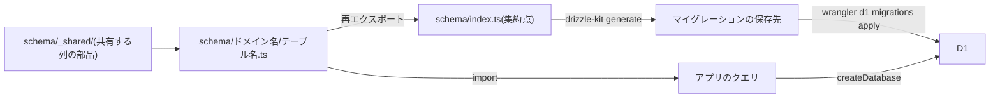

# データベースのスキーマ規約

Cloudflare D1のテーブルをDrizzleで定義するときの、テーブル定義の配置、主キー、共通カラム(作成日時・更新日時・論理削除)、日時の保持、列名の変換、マイグレーションの流れ、接続と一括実行の規約を定める。

## 前提と用語

ORMにDrizzle(`drizzle-orm`)、マイグレーションの生成に`drizzle-kit`、データベースにCloudflare D1を使う構成を前提とする。マイグレーションの生成と適用・大文字小文字を区別しないカラム・命名規則は「[DrizzleとCloudflare D1のマイグレーションと命名規則](001-drizzle-migrations-on-d1.md)」に、トランザクション・バインド変数・全文検索の索引の同期は「[Cloudflare D1の制約と対処](002-d1-constraints.md#d1の制約と対処)」に従う。

| 用語                         | 意味                                                                                                                                                                    |
| ---------------------------- | ----------------------------------------------------------------------------------------------------------------------------------------------------------------------- |
| `<DBディレクトリ>`           | スキーマ定義・接続・マイグレーションの生成設定を置く共有ディレクトリ。D1を使う各アプリへ配置する(「[共有ディレクトリの配置方式](../coding/003-shared-directories.md)」) |
| 共通カラム                   | 全文検索用のテーブル以外の全テーブル、または論理削除を採るテーブルが同じ定義で持つカラム(ID・作成日時・更新日時・削除日時)                                              |
| ULID                         | 先頭48ビットが採番時刻のミリ秒、残りが乱数の識別子。Crockford Base32の26文字で表し、文字列の順に並べると採番時刻の順になる(同じミリ秒の中の順は保証しない)              |
| 論理削除                     | 行を削除せず削除日時を記録し、読み出しで除外する削除の方法                                                                                                              |
| 全文検索用のテーブル         | FTS5の仮想テーブルが`content`に指定する、索引の対象の本文を持つ通常のテーブル(external content)                                                                         |
| 業務時刻                     | サービスが日付の区切りや定期実行の時刻に使う、夏時間の無い固定のUTCオフセットでの時刻。業務時刻での日付を業務日付と呼ぶ                                                 |
| `<マイグレーションの保存先>` | 「[DrizzleとCloudflare D1のマイグレーションと命名規則](001-drizzle-migrations-on-d1.md#前提と用語)」と同じ。`<DBディレクトリ>/migrations`に置く                         |

## テーブル定義の配置

テーブル定義は`<DBディレクトリ>/schema/`に、ドメインごとのディレクトリを作り、1テーブル1ファイルで置く。

```text
<DBディレクトリ>/
├── client.ts              # 接続(createDatabase・Database型)
├── drizzle.config.ts      # マイグレーションの生成設定
├── migrations/            # <マイグレーションの保存先>
└── schema/
    ├── _shared/
    │   ├── columns.ts      # ulidPrimaryKey・timestamps・softDelete・notDeleted
    │   └── text-no-case.ts # textNoCase
    ├── <ドメイン>/
    │   └── <テーブル>.ts   # テーブルごとの定義
    └── index.ts            # 全テーブル定義の集約点
```

- `schema/_shared/`には複数のテーブルが共有する列の部品を置き、`drizzle-orm`と`ulid`以外を読み込まない。
- テーブルを追加するときは`schema/<ドメイン>/<テーブル>.ts`に定義し、`schema/index.ts`から再エクスポートする。
- `drizzle.config.ts`の`schema`には集約点の`./schema/index.ts`を指定する。`drizzle-kit generate`は集約点から辿れるテーブルだけを読むため、再エクスポートし忘れたテーブルはマイグレーションに含まれない。

```typescript
import { defineConfig } from 'drizzle-kit';

export default defineConfig({
  dialect: 'sqlite',
  schema: './schema/index.ts',
  out: './migrations',
});
```

```typescript
export * from './blog/articles.ts';
```



### 利用例

全文検索用のテーブル以外は、次の形で定義する。

```typescript
import { integer, snakeCase, text } from 'drizzle-orm/sqlite-core';

import { softDelete, timestamps, ulidPrimaryKey } from '../_shared/columns.ts';
import { textNoCase } from '../_shared/text-no-case.ts';

export const articles = snakeCase.table('articles', {
  id: ulidPrimaryKey(),
  slug: textNoCase().notNull().unique(),
  title: text().notNull(),
  publishedAt: integer({ mode: 'timestamp_ms' }),
  ...timestamps(),
  ...softDelete(),
});
```

`drizzle-kit generate`は、この定義から次のSQLを生成する。

```sql
CREATE TABLE `articles` (
	`id` text PRIMARY KEY,
	`slug` text collate nocase NOT NULL UNIQUE,
	`title` text NOT NULL,
	`published_at` integer,
	`created_at` integer NOT NULL,
	`updated_at` integer NOT NULL,
	`deleted_at` integer
);
```

## 主キー

| テーブル                       | 主キー                              | 定義                     |
| ------------------------------ | ----------------------------------- | ------------------------ |
| 全文検索用のテーブル以外の全て | ULIDの文字列(`id TEXT PRIMARY KEY`) | `ulidPrimaryKey()`       |
| 全文検索用のテーブル           | 連番(`id INTEGER PRIMARY KEY`)      | `integer().primaryKey()` |

### ULID

- 主キーは`id: ulidPrimaryKey()`で定義する。追加時に`id`を渡さなければ、ULIDを採番して設定する。
- ULIDはデータベースを介さずに採番できる。追加の前にIDが要る場合(親の行と、そのIDを参照する子の行を同じ一括実行で追加するなど)は、呼び出し側でULIDを採番して`id`に渡す。
- 外部キーなど他のテーブルのIDを持つ列は、`text()`で定義する。

### 全文検索用のテーブルの連番

全文検索用のテーブルは、ULIDではなく連番を主キーにする。共通の部品は無く、`integer().primaryKey()`で定義する。

- 全文検索用のテーブルでは、`ulidPrimaryKey()`・`timestamps()`・`softDelete()`を使わない。
- FTS5の索引は、整数の`rowid`で全文検索用のテーブルの行と対応する。`INTEGER PRIMARY KEY`の列は`rowid`の別名になり、追加時に値を渡さなければSQLiteが連番を採番する。
- FTS5の仮想テーブルの`content_rowid`には、この主キーの列を指定する。`INTEGER PRIMARY KEY`を持たないテーブルの`rowid`は`VACUUM`で変わり得るため、索引と行の対応が崩れる(「[全文検索の仮想テーブルの同期](002-d1-constraints.md#全文検索の仮想テーブルの同期)」)。
- 業務のテーブルの主キーはULIDのままにし、全文検索用のテーブルを別に定義して、元の行のULIDを一意の列で持つ。

```typescript
import { integer, snakeCase, text } from 'drizzle-orm/sqlite-core';

export const articleSearchDocuments = snakeCase.table(
  'article_search_documents',
  {
    id: integer().primaryKey(),
    articleId: text().notNull().unique(),
    title: text().notNull(),
    body: text().notNull(),
  },
);
```

```sql
CREATE VIRTUAL TABLE article_search_documents_fts USING fts5(title, body, content='article_search_documents', content_rowid='id');
```

- 仮想テーブルと、索引を同期するトリガーは、カスタムマイグレーションで記述する(「[マイグレーション](#マイグレーション)」)。

## 共通カラム

| 部品                    | カラム                                                       | 振る舞い                                                                                                                                               |
| ----------------------- | ------------------------------------------------------------ | ------------------------------------------------------------------------------------------------------------------------------------------------------ |
| `ulidPrimaryKey()`      | `id TEXT PRIMARY KEY`                                        | 追加時に値が無ければULIDを採番する                                                                                                                     |
| `timestamps()`          | `created_at INTEGER NOT NULL`・`updated_at INTEGER NOT NULL` | 追加時は両方に現在時刻を、Drizzleの更新クエリでは`updated_at`に現在時刻を設定する                                                                      |
| `softDelete()`          | `deleted_at INTEGER`                                         | NULLは未削除。値は論理削除した日時                                                                                                                     |
| `notDeleted(deletedAt)` | (条件)                                                       | `deleted_at IS NULL`の条件を返す                                                                                                                       |
| `textNoCase()`          | `TEXT COLLATE NOCASE`                                        | 英字の大文字小文字を区別せずに照合・一意判定する(「[大文字小文字を区別しないカラム](001-drizzle-migrations-on-d1.md#大文字小文字を区別しないカラム)」) |

- `timestamps()`・`softDelete()`は列のオブジェクトを返すため、テーブル定義の中でスプレッド構文(`...timestamps()`)で展開する。
- 全文検索用のテーブル以外の全テーブルが`ulidPrimaryKey()`と`timestamps()`を持つ。`softDelete()`は論理削除を採るテーブルだけが持つ。

### 作成日時と更新日時

- 追加時は、呼び出し側が渡さなければ`created_at`と`updated_at`に現在時刻を設定する。2つの値は別々に現在時刻を取るため、1ミリ秒程度ずれることがある。作成から更新されていないことを、2つの値の一致で判定しない。
- Drizzleの更新クエリ(`db.update().set()`・`onConflictDoUpdate()`)は、`set`に`updated_at`が無ければ現在時刻を加える。`set`に`updatedAt`を渡すと、その値を使う。
- 自動設定はDrizzleのクエリビルダでだけ働く。生のSQL(`db.run()`に渡す`sql`のテンプレート・`wrangler d1 execute`・トリガー)で更新する場合は、そのSQLで`updated_at`を設定する。

### 日時の保持

- 日時はUTCのUnixエポックミリ秒の整数で保持する。共通カラム以外の日時の列も、`integer({ mode: 'timestamp_ms' })`で定義する。TypeScriptでは`Date`として読み書きする。
- タイムゾーン付きの文字列や、特定のタイムゾーンでの日時の文字列を日時の列に保存しない。比較と範囲検索は整数のまま行う。
- 業務時刻は、日時の判定・集計・表示に使い、日時の保存には使わない。業務日付の範囲で絞り込む場合は、業務日付の0:00をUTCの時点へ変換して比べる。業務時刻は夏時間の無い固定のオフセットのため、業務日付の1日は常に24時間である。

```typescript
import { and, gte, lt } from 'drizzle-orm';

const DAY_MS = 24 * 60 * 60 * 1000;

const dayStart = fromBusinessDateTime(businessDate, { hour: 0, minute: 0 });
const nextDayStart = new Date(dayStart.getTime() + DAY_MS);

const created = await db
  .select()
  .from(articles)
  .where(
    and(
      gte(articles.createdAt, dayStart),
      lt(articles.createdAt, nextDayStart),
      notDeleted(articles.deletedAt),
    ),
  );
```

- `fromBusinessDateTime`(業務日付と時・分からUTCの時点を求める)と`toBusinessDateTime`(UTCの時点から業務日付と時・分を求める)は、業務時刻の計算部品が提供する。
- 時点ではなく業務日付そのものが値である列(日ごとの集計の単位となる日付など)は、`YYYY-MM-DD`の文字列で保持する。

### 論理削除

- 論理削除は、`deleted_at`に削除した日時を設定する更新で行う(Drizzleの更新クエリのため、`updated_at`も更新される)。
- 論理削除を採るテーブルを読み出すクエリには、必ず`notDeleted(<テーブル>.deletedAt)`を条件に加える。他の条件とは`and()`で組み合わせる。

```typescript
import { and, eq } from 'drizzle-orm';

await db
  .update(articles)
  .set({ deletedAt: new Date() })
  .where(and(eq(articles.id, articleId), notDeleted(articles.deletedAt)));

const visible = await db
  .select()
  .from(articles)
  .where(notDeleted(articles.deletedAt));
```

- 一意制約は論理削除した行にも働く。論理削除した行と同じ値を新しい行に使えるようにする必要があるかを、一意制約を付けるときに決める。

## 列名の変換

- テーブルは`drizzle-orm/sqlite-core`の`snakeCase.table`で定義する。TypeScriptのキーはキャメルケースで書き、データベースの列名はスネークケースになる(`createdAt`→`created_at`)。
- `sqliteTable`・`sqliteTableCreator`は使わない。列名の明示が必要なキー(`totpSecretV2`など)を含め、規則は「[命名規則](001-drizzle-migrations-on-d1.md#命名規則)」に従う。

## マイグレーション

テーブル定義を変えたら、次の順でマイグレーションを生成して適用する。各コマンドの詳細は「[マイグレーションの生成と適用](001-drizzle-migrations-on-d1.md#マイグレーションの生成と適用)」に従う。

1. `<DBディレクトリ>`で`drizzle-kit generate`(スクリプト`db:generate`)を実行し、`<マイグレーションの保存先>/<日時>_<名前>/migration.sql`を生成する。テーブル定義に変更が無ければ、新しいマイグレーションは生成されない。
2. テーブル定義で表現できない内容(全文検索の仮想テーブル・トリガーなど)は、`drizzle-kit generate --custom --name=<マイグレーションの名前>`で空のマイグレーションを作り、生のSQLを書き足す。
3. 同じD1を使うアプリのうち1つで、`wrangler d1 migrations apply <データベース名> --local --persist-to <ローカル状態の保存先>`(スクリプト`db:migrate:local`)を実行する。ローカル状態の保存先とリソースIDを共有していれば、1回の適用で全アプリから同じデータベースを参照できる(「[ローカル状態の永続化と共有](../infra/001-wrangler-conventions.md#ローカル状態の永続化と共有)」)。
4. 生成したマイグレーションがWranglerに検出されることを、スクリプト`db:migrations:check`で確かめる。CIからも同じスクリプトを呼ぶ。

- `db:migrations:check`は、空の一時ディレクトリを`--persist-to`に指定して`wrangler d1 migrations list <データベース名> --local`を実行し、未適用として一覧された名前を`<マイグレーションの保存先>`のディレクトリ名と突き合わせる。共有のローカル状態を変えずに、検出の設定(「[マイグレーションの検出設定](001-drizzle-migrations-on-d1.md#マイグレーションの検出設定)」)の誤りを見つけるためである。食い違えば、検出されなかったマイグレーションの名前を表示して終了コード1で終わる。

## 接続と一括実行

### 接続

- 接続は、`<DBディレクトリ>/client.ts`の`createDatabase(env.<バインディング名>)`で作る。戻り値の型`Database`は`DrizzleD1Database`である。
- リクエストや定期実行・メッセージ処理の処理単位ごとに接続を作り、依存性の注入では`Database`の識別子で受け取る(「[コンストラクタ引数の注入](../backend/001-dependency-injection-on-workers.md#コンストラクタ引数の注入)」)。

```typescript
import { drizzle, type DrizzleD1Database } from 'drizzle-orm/d1';

export type Database = DrizzleD1Database;

export function createDatabase(d1: D1Database): Database {
  return drizzle(d1);
}
```

- テーブル定義は接続に渡さず、クエリはクエリビルダ(`db.select()`・`db.insert()`など)と`sql`で書く。リレーショナルクエリ(`db.query`)は使わない。
  - リレーショナルクエリが必要になった場合は、`defineRelations`で定義したリレーションを`drizzle(d1, { relations })`で渡し、`Database`を`DrizzleD1Database<typeof relations>`にする。その場合、`where`の項目に`undefined`を渡すと例外になるため、条件を省く項目には`drizzle-orm/relations`の`EmptyFilter`を渡す。
- クエリに渡した値は、SQL文に埋め込まれずバインド変数として送られる。`sql`のテンプレートに差し込んだ値も同じである。利用者の入力を`sql.raw()`に渡さない。

### 一括実行

- 複数の書き込みは`db.batch([...])`にまとめる。途中の文が失敗すると、先行する文の書き込みも取り消される。
- `db.transaction()`は使わない。一括実行の中で前の文の結果を使えない点と、代わりの書き方は「[トランザクション](002-d1-constraints.md#トランザクション)」に従う。

```typescript
import { ulid } from 'ulid';

const articleId = ulid();

await db.batch([
  db.insert(articles).values({ id: articleId, slug, title }),
  db.insert(articleSearchDocuments).values({ articleId, title, body }),
]);
```
