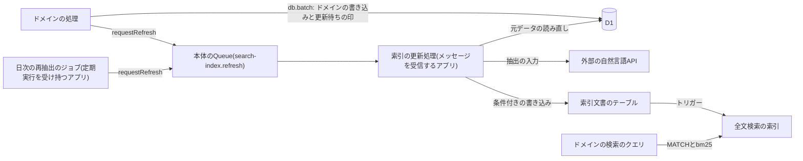
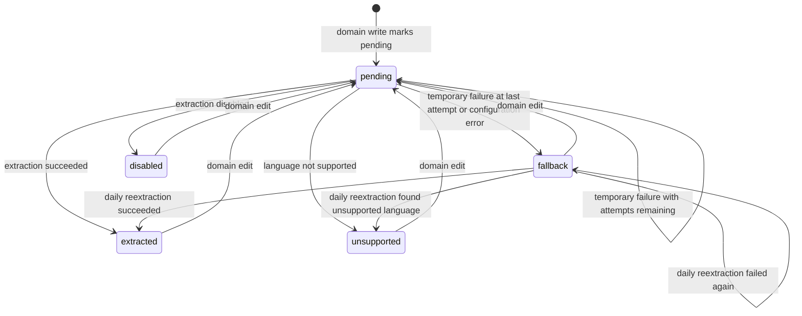
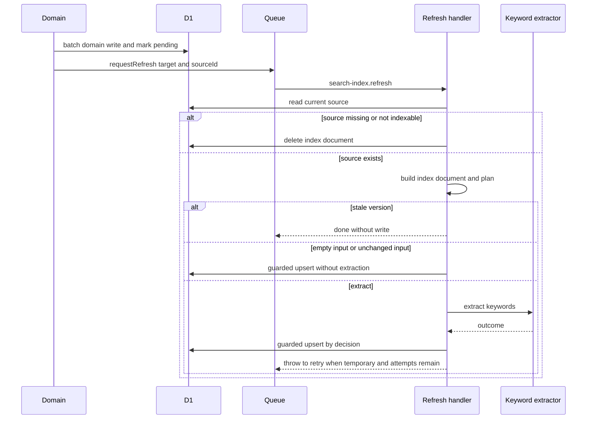

# 全文検索の索引(SQLite FTS5)

Cloudflare D1のSQLite FTS5で全文検索の索引を作り、元データの変更に追随させる仕組みを定める。索引文書のテーブルと全文検索の索引の構成、ひな形(索引の定義と検索対象の定義)と集約点とSQLの出力の使い方、検索式と関連度のクエリへの組み込み、条件付きの書き込み、更新待ちの印と削除のドメインの一括の書き込みへの組み込み、日次の再抽出、列を変えた後のトリガーの作り直しと再構築、Time Travelでのバックアップ、マークダウンの原文を保存してHTMLを保存しない規約、テストの書き方を扱う。キーワードの抽出は「[外部の自然言語APIによるキーワード抽出](../external/002-natural-language-keyword-extraction.md)」に従う。

## 前提と用語

ORMにDrizzle、データベースにCloudflare D1を使う構成を前提とする。テーブル定義の配置・主キー・マイグレーションの流れは「[データベースのスキーマ規約](003-schema-conventions.md)」に、トランザクションの代わりの書き方とバインド変数の上限は「[Cloudflare D1の制約と対処](002-d1-constraints.md#d1の制約と対処)」に従う。

| 用語               | 意味                                                                                                               |
| ------------------ | ------------------------------------------------------------------------------------------------------------------ |
| 元データ           | 検索で見つけたい業務のテーブルの行(商品・記事など)。主キーはULID                                                   |
| 検索対象           | 全文検索の対象となる元データの種類。英小文字で始まる英小文字・数字・`-`の40文字以内の名前を持つ                    |
| 索引文書           | 元データ1件に対して高々1行の、索引の対象のテキストと索引の更新の状態を持つ行。元データの識別子で一意である         |
| 索引文書のテーブル | 索引文書を持つ通常のテーブル。名前は`<ドメイン>_search_documents`。全文検索の索引がexternal contentとして参照する  |
| 全文検索の索引     | FTS5の仮想テーブル`<索引文書のテーブル>_fts`。索引だけを持ち、本文は索引文書のテーブルから読む                     |
| 元テキストの列     | 索引文書のテーブルの、正規化した元データのテキスト(名称・タグラインなど)を持つ列。どの列を作るかはドメインが決める |
| キーワードの列     | 外部APIで抽出したキーワード、または縮退時の正規化テキストを持つ列`keywords`                                        |
| 縮退索引           | キーワードの代わりに抽出の入力をキーワードの列に入れた索引文書                                                     |
| 更新待ちの印       | ドメインの書き込みと同じ一括の書き込みで、索引文書の状態を`pending`にすること                                      |
| `<DBディレクトリ>` | 「[データベースのスキーマ規約](003-schema-conventions.md#前提と用語)」と同じ                                       |

| 部品                                                                                                              | 置き場所                                                           | 役割                                                       |
| ----------------------------------------------------------------------------------------------------------------- | ------------------------------------------------------------------ | ---------------------------------------------------------- |
| `searchDocumentColumns`・`searchTextColumn`・`searchDocumentStatusIndex`・`KEYWORD_STATUSES`                      | `<DBディレクトリ>/schema/_shared/search-documents.ts`              | 索引文書のテーブルの共通の列・元テキストの列・状態の索引   |
| `defineSearchIndex`・`SearchIndexDefinition`・`SearchIndexDefinitionError`                                        | `<DBディレクトリ>/search/search-index-definition.ts`               | 索引の定義の作成と検証                                     |
| `renderSearchIndexSql`・`renderSearchIndexTriggersSql`・`renderSearchIndexDropSql`・`renderSearchIndexRebuildSql` | `<DBディレクトリ>/search/search-index-sql.ts`                      | 全文検索の索引・トリガー・削除・再構築のSQLのひな形        |
| `SEARCH_INDEXES`                                                                                                  | `<DBディレクトリ>/search/search-indexes.ts`                        | 索引の定義の集約点                                         |
| `ftsRankedSources`・`bm25Rank`                                                                                    | `<DBディレクトリ>/search/fts-query.ts`                             | 検索のクエリに組み込むSQL断片                              |
| `findMissingSearchIndexSql`                                                                                       | `<DBディレクトリ>/search/migration-coverage.ts`                    | マイグレーションとの突き合わせ                             |
| スクリプト`db:search-index-sql`                                                                                   | `<DBディレクトリ>/scripts/print-search-index-sql.ts`               | 索引の定義からSQLを標準出力へ出す                          |
| `normalizeSearchTerms`・`buildFtsMatchExpression`                                                                 | 共用部品の`search/search-terms.ts`                                 | 検索語の分割と検索式の組み立て                             |
| `normalizeIndexText`                                                                                              | 共用部品の`search/index-text.ts`                                   | 索引するテキストの正規化                                   |
| `separateEmoji`                                                                                                   | 共用部品の`search/emoji-separator.ts`                              | 絵文字の並びを構成する文字の、区切りの空白への置き換え     |
| `findHighlightRanges`                                                                                             | 共用部品の`search/highlight-ranges.ts`                             | 検索語に一致した範囲(強調表示)                             |
| `SEARCH_INDEX_REFRESH_MESSAGE`・`SEARCH_INDEX_REFRESH_RETRY`                                                      | 共通ライブラリの`core/messaging/contracts/search-index-refresh.ts` | 索引の更新のメッセージ`search-index.refresh`と再試行の規則 |
| `buildIndexDocument`・`planRefresh`・`decideAfterExtraction`                                                      | 共通ライブラリの`core/search/`                                     | 索引文書の組み立てと、書き込む内容の決定                   |
| `SEARCH_TYPES`                                                                                                    | 共通ライブラリの`core/search/identifiers.ts`                       | 検索の部品のDI識別子                                       |
| `defineSearchTarget`・`createSearchTargetRegistry`・`SearchTargetRegistryError`                                   | 共通ライブラリの`workers/search/search-target-definition.ts`       | 検索対象の定義と検証                                       |
| `SEARCH_TARGETS`                                                                                                  | 共通ライブラリの`workers/search/targets/index.ts`                  | 検索対象の集約点                                           |
| `D1SearchIndexRepository`                                                                                         | 共通ライブラリの`workers/search/search-index-repository.ts`        | 索引文書の条件付きの書き込み・削除・再抽出の候補の検索     |
| `createSearchIndexStatements`                                                                                     | 共通ライブラリの`workers/search/search-index-statements.ts`        | ドメインの一括の書き込みに含める更新待ちの印と削除の文     |
| `QueueSearchIndexRefreshRequester`                                                                                | 共通ライブラリの`workers/search/search-index-refresh-requester.ts` | 索引の更新の要求の送信                                     |
| `createSearchPlatformModule`                                                                                      | 共通ライブラリの`workers/search/search-platform-module.ts`         | 両アプリ共通の束縛                                         |



## 索引文書のテーブルと全文検索の索引の構成

### 索引文書のテーブル

索引文書のテーブルは、`searchDocumentColumns()`をスプレッド構文で展開し、元テキストの列を`searchTextColumn(<列名>)`で加え、状態の索引を`searchDocumentStatusIndex(<テーブル名>, table)`で定義する。定義の例(本文書の例と同じ`article_search_documents`)と`drizzle-kit generate`が生成するSQL、主キーを連番にする理由は「[全文検索用のテーブルの連番](003-schema-conventions.md#全文検索用のテーブルの連番)」に従う。

| 列                      | 型                          | 制約・既定値            | 用途                                                   |
| ----------------------- | --------------------------- | ----------------------- | ------------------------------------------------------ |
| `id`                    | INTEGER                     | PRIMARY KEY             | 連番。全文検索の索引の`content_rowid`                  |
| `source_id`             | TEXT                        | NOT NULL・UNIQUE        | 元データのULID(1〜64文字)                              |
| `source_version`        | INTEGER                     | NOT NULL・既定0         | 元データの版。古い版の上書きを防ぐ                     |
| `<元テキストの列>`      | TEXT                        | NOT NULL・既定`''`      | 正規化した元データのテキスト                           |
| `keywords`              | TEXT                        | NOT NULL・既定`''`      | キーワード、または縮退時の正規化テキスト               |
| `keyword_status`        | TEXT                        | NOT NULL・既定`pending` | キーワードの状態                                       |
| `extraction_input_hash` | TEXT                        | NULL可                  | 抽出の入力のハッシュ。同じ入力の再抽出を省く判定に使う |
| `status_changed_at`     | INTEGER(UNIXエポックミリ秒) | NOT NULL                | 状態を変えた日時。日次の再抽出の判定に使う             |

- 索引`<テーブル>_status_idx(keyword_status, status_changed_at)`は、日次の再抽出の候補の検索に使う。
- 共通の列と元テキストの列は、SQLのひな形が列名を直接参照するため、`snakeCase.table`の変換に頼らず列名を明示する。元テキストの列の名前は、検索対象の定義の項目名と同じにする(「[検索対象の定義](#検索対象の定義)」)。複数の語からなる列は`short_description`のようにスネークケースで、項目名も同じ`short_description`にする。
- 索引文書のテーブルには`timestamps()`・`softDelete()`を使わない。元データの論理削除は索引文書の削除で表す。

`keyword_status`の値は`KEYWORD_STATUSES`のいずれかである。共通ライブラリの`core`の状態の型(`KeywordStatus`)と過不足無く同じであることを、`workers/search/search-target-definition.ts`の`SEARCH_KEYWORD_STATUSES`の型検査で保証する。

| 状態          | 意味                                                         | 日次の再抽出        |
| ------------- | ------------------------------------------------------------ | ------------------- |
| `pending`     | ドメインが更新待ちの印を付けた、または一時的な失敗で再試行中 | 1時間以上続けば対象 |
| `extracted`   | キーワードを抽出した(抽出の入力が空の場合を含む)             | 対象外              |
| `fallback`    | 一時的な失敗の上限か外部APIの設定の誤りで縮退した            | 対象                |
| `unsupported` | 外部APIが非対応の言語と判定して縮退した                      | 対象外              |
| `disabled`    | 抽出を無効にした環境で縮退した                               | 対象外              |



- 日次の再抽出は、1時間以上`pending`のままの索引文書も選び直し、通常の索引の更新と同じ遷移(`pending`から各状態へ)をたどる。元データの削除・索引の対象外では、どの状態からも索引文書が削除される(図では省く)。

### 全文検索の索引

索引の定義から出力したSQL(「[SQLの出力](#sqlの出力)」)は、次の形になる。文の間の`--> statement-breakpoint`は、マイグレーションを1文ずつ実行する処理のための区切りである(「[マイグレーションの生成と適用](001-drizzle-migrations-on-d1.md#マイグレーションの生成と適用)」)。

```sql
CREATE VIRTUAL TABLE article_search_documents_fts USING fts5(
  title, summary, keywords,
  content='article_search_documents', content_rowid='id',
  tokenize='unicode61 remove_diacritics 2', prefix='2 3'
);
--> statement-breakpoint
CREATE TRIGGER article_search_documents_fts_ai AFTER INSERT ON article_search_documents BEGIN
  INSERT INTO article_search_documents_fts(rowid, title, summary, keywords) VALUES (new.id, new.title, new.summary, new.keywords);
END;
--> statement-breakpoint
CREATE TRIGGER article_search_documents_fts_ad AFTER DELETE ON article_search_documents BEGIN
  INSERT INTO article_search_documents_fts(article_search_documents_fts, rowid, title, summary, keywords) VALUES ('delete', old.id, old.title, old.summary, old.keywords);
END;
--> statement-breakpoint
CREATE TRIGGER article_search_documents_fts_au AFTER UPDATE OF title, summary, keywords ON article_search_documents BEGIN
  INSERT INTO article_search_documents_fts(article_search_documents_fts, rowid, title, summary, keywords) VALUES ('delete', old.id, old.title, old.summary, old.keywords);
  INSERT INTO article_search_documents_fts(rowid, title, summary, keywords) VALUES (new.id, new.title, new.summary, new.keywords);
END;
```

- 列の順は、定義の元テキストの列の順の後にキーワードの列である。関連度の重みもこの順に並ぶ(「[検索のSQL断片](#検索のsql断片)」)。
- `tokenize='unicode61 remove_diacritics 2'`は、大文字小文字と、ラテン文字の発音区別符号(`é`と`e`など)の違いを無視して照合させる。濁点・半濁点と、ギリシャ文字・キリル文字の合成済みの符号は区別する。
- `prefix`は、指定した文字数の前方一致の索引を加え、前方一致の検索語(`"ab"*`)を速くする。既定は`'2 3'`で、索引の定義の`prefixLengths`で変えられる。前方一致の索引の長さを超える前方一致の検索語も一致する。
- external contentの構成のため、全文検索の索引は索引文書のテーブルへの書き込みに自動では追随しない。追加(`_fts_ai`)・削除(`_fts_ad`)・更新(`_fts_au`)の3つのトリガーで同期する。
- 更新のトリガーは`AFTER UPDATE OF <索引する列>`にし、索引する列を`SET`に含む更新でだけ動かす。状態の列だけの更新(更新待ちの印など)で索引を書き換えないためである。
- 索引文書のテーブルへの書き込みに、`REPLACE`(`INSERT OR REPLACE`・`REPLACE INTO`・`ON CONFLICT REPLACE`の制約)と`id`の更新を使わない。`REPLACE`が消す行では削除のトリガーが動かず、`id`の更新では更新のトリガーが動かないため、索引が索引文書のテーブルと食い違う。一意の列での追加か更新は`INSERT … ON CONFLICT(source_id) DO UPDATE`で行う(「[条件付きの書き込み](#条件付きの書き込み)」)。
- D1(Workers統合テストのローカルのD1を含む)は、`prefix`の指定・`bm25()`の列ごとの重み・external contentとトリガーによる同期・`integrity-check`を、SQLiteと同じに扱う。
- 前方一致の`prefix`で索引は大きくなる。件数が多い検索対象では、D1のデータベースの容量の上限に対する見積もりを確かめる。
- 参照: SQLiteの「[FTS5](https://sqlite.org/fts5.html)」の「External Content Tables」・「Prefix Indexes」・「Unicode61 Tokenizer」

### 索引の定義

索引の定義は`defineSearchIndex`で作る。名前・列・重み・前方一致の長さの検証を通さずに組み立てた値は、索引の定義の型(`SearchIndexDefinition`)として受け取れない(ブランド型)。SQLのひな形が名前を引用符無しで埋め込むためである。

```typescript
import { defineSearchIndex } from '../../search/search-index-definition.ts';
import { articleSearchDocuments } from './article-search-documents.ts';

export const articleSearchIndex = defineSearchIndex({
  documents: articleSearchDocuments,
  textColumns: [
    { column: articleSearchDocuments.title, weight: 10 },
    { column: articleSearchDocuments.summary, weight: 5 },
  ],
  keywordsWeight: 1,
});
```

`defineSearchIndex`は次を確かめ、違反を`SearchIndexDefinitionError`にする。

| 検証                 | 規則                                                                                                                                   |
| -------------------- | -------------------------------------------------------------------------------------------------------------------------------------- |
| 索引文書のテーブル名 | `/^[a-z][a-z0-9_]*_search_documents$/`に合う                                                                                           |
| 共通の列             | `searchDocumentColumns()`の7つの列があり、`id`が整数の主キーである                                                                     |
| 元テキストの列       | 1つ以上で重複しない。同じテーブルの列で、共通の列でない                                                                                |
| 列名                 | `/^[a-z][a-z0-9_]*$/`に合い、SQLiteの予約語(`<DBディレクトリ>/search/sqlite-keywords.ts`)・`rank`・`rowid`・全文検索の索引の名前でない |
| 重み                 | 元テキストの列とキーワードの列のどれも、0より大きい有限の数                                                                            |
| 前方一致の長さ       | 1〜4の整数を重複無しの昇順で1つ以上(省略時は`[2, 3]`)                                                                                  |

## ひな形と集約点

### 集約点

| 集約点           | 置くもの             | 追加の手順                                                                                                     |
| ---------------- | -------------------- | -------------------------------------------------------------------------------------------------------------- |
| `SEARCH_INDEXES` | 全ての索引の定義     | 索引の定義を作り、`<DBディレクトリ>/search/search-indexes.ts`の配列に加える。SQLの出力と突き合わせの対象になる |
| `SEARCH_TARGETS` | 全ての検索対象の定義 | 検索対象の定義を作り、共通ライブラリの`workers/search/targets/index.ts`の配列に加える                          |

- 両アプリの合成ルートは`createSearchPlatformModule(SEARCH_TARGETS, <アプリ名>)`を登録する。登録の検証(`createSearchTargetRegistry`)はモジュールを作るisolateの起動時に行い、誤りを最初の処理単位ではなく起動時に検出する。`<アプリ名>`はログのカテゴリの先頭になる(「[カテゴリ](../infra/004-logging-and-error-tracking.md#カテゴリ)」)。
- `createSearchPlatformModule`は、検索対象の一覧(`SEARCH_TYPES.TargetCatalog`)・索引文書の書き込み(`IndexStore`)・元データの読み出し(`SourceProvider`)・更新の要求(`RefreshRequester`)・更新待ちの印と削除の文(`IndexStatements`)を、処理単位のコンテナへ束縛する。
- 単体テスト`workers/search/targets/index.unit.test.ts`(共通ライブラリの検査担当のアプリの単体テストで実行する。検査担当は「[JavaScript・TypeScriptの記法と設定ファイルの規約](../coding/001-javascript-typescript-conventions.md#前提と用語)」の用語)が、`SEARCH_TARGETS`の登録が成功すること、全ての検索対象の`index`が`SEARCH_INDEXES`にあること(参照が同じであること)を確かめる。

### 検索対象の定義

検索対象は`defineSearchTarget`で定義する。項目ごとに書式と、元テキストの列に保存するか、キーワード抽出に使うかを指定する。

```typescript
import { and, eq, isNull, sql, type SQL } from 'drizzle-orm';

import { articles } from '../../../db/schema/blog/articles.ts';
import { articleSearchDocuments } from '../../../db/schema/blog/article-search-documents.ts';
import { articleSearchIndex } from '../../../db/schema/blog/article-search-index.ts';
import { defineSearchTarget } from '../search-target-definition.ts';

const indexableArticle = (sourceId: string): SQL | undefined =>
  and(eq(articles.id, sourceId), isNull(articles.deletedAt));

export const articleSearchTarget = defineSearchTarget({
  name: 'article',
  fields: {
    title: { format: 'plain', textColumn: true, extract: true },
    summary: { format: 'plain', textColumn: true, extract: true },
    body: { format: 'markdown', textColumn: false, extract: true },
  },
  index: articleSearchIndex,
  documents: articleSearchDocuments,
  async read(db, sourceId) {
    const [row] = await db
      .select()
      .from(articles)
      .where(indexableArticle(sourceId))
      .limit(1);
    return (
      row && {
        version: row.updatedAt.getTime(),
        fields: { title: row.title, summary: row.summary, body: row.body },
      }
    );
  },
  isIndexable: (sourceId) =>
    sql`SELECT 1 FROM ${articles} WHERE ${indexableArticle(sourceId)}`,
});
```

| 指定                 | 意味                                                                                                       |
| -------------------- | ---------------------------------------------------------------------------------------------------------- |
| `format`             | `plain`はそのままの文字列、`markdown`は共用部品の`extractSearchText`でプレーンテキストにしてから正規化する |
| `textColumn`         | `true`なら、正規化したテキストを同名の元テキストの列に保存する                                             |
| `extract`            | `true`なら、キーワード抽出の入力に含める(外部APIへ送る)                                                    |
| `read(db, sourceId)` | 元データの版と各項目の文字列を返す。削除済み・索引の対象外なら`undefined`                                  |
| `isIndexable(id)`    | 元データが存在し索引の対象であることの条件(`EXISTS`の中身のSQL)                                            |

`createSearchTargetRegistry`は次を確かめ、違反を`SearchTargetRegistryError`にする。

- 名前の形式(英小文字で始まる英小文字・数字・`-`の40文字以内)と重複。
- `documents`のテーブル名が`index`の索引文書のテーブル名と同じで、他の検索対象と同じ索引文書のテーブルを使わないこと。
- `textColumn: true`の項目名と、`index`の元テキストの列名が過不足無く一致すること。
- `extract: true`の項目が1つ以上あること。

- 何を索引の対象にするか(論理削除・非公開の扱い)は、`read`と`isIndexable`の中身としてドメインが決め、2つの条件を一致させる。
- 版は元データごとに単調に増える整数(更新日時のミリ秒など)にする。古い版の書き込みを無視する条件に使う。
- `read`が返す項目の文字列が欠けていると`TypeError`になり、再試行の上限の後にデッドレターへ移る。
- 抽出の対象の項目は、外部APIへ送る情報の範囲である(「[送る情報の範囲](../external/002-natural-language-keyword-extraction.md#送る情報の範囲)」)。

### SQLの出力

`<DBディレクトリ>`で、索引文書のテーブル名を引数にしてスクリプト`db:search-index-sql`を実行すると、`SEARCH_INDEXES`に登録した定義のSQLを標準出力へ出す。出力を`drizzle-kit generate --custom --name=<マイグレーションの名前>`で作った空のマイグレーションに貼る。SQLは手で書かない。

```sh
cd <DBディレクトリ>
bunx drizzle-kit generate --custom --name=<マイグレーションの名前>
bun run --silent db:search-index-sql <索引文書のテーブル名> --recreate
```

| 引数                                          | 出力                                                                            | 使う場面                                                                                  |
| --------------------------------------------- | ------------------------------------------------------------------------------- | ----------------------------------------------------------------------------------------- |
| `<索引文書のテーブル名>`                      | 全文検索の仮想テーブルと3つのトリガーの作成文                                   | 索引を新しく作るとき。既にある索引に貼ると`table <仮想テーブル> already exists`で失敗する |
| `<索引文書のテーブル名> --drop`               | 仮想テーブルの`DROP TABLE IF EXISTS`と、3つのトリガーの`DROP TRIGGER IF EXISTS` | 索引する列を消すときに、列を消すマイグレーションより前に置く                              |
| `<索引文書のテーブル名> --recreate`           | `--drop`の出力の後に、文の区切りを挟んで作成文と`rebuild`の1文を続けたもの      | 索引する列や前方一致の長さを変えたとき                                                    |
| `<索引文書のテーブル名> --triggers`           | 3つのトリガーの`DROP TRIGGER IF EXISTS`と作成文                                 | 索引しない列を変えて、`drizzle-kit generate`が索引文書のテーブルを作り直したとき          |
| `<索引文書のテーブル名> --rebuild`            | 全文検索の索引を索引文書のテーブルから全件作り直す`rebuild`の1文                | 索引の内容が索引文書のテーブルと食い違ったとき                                            |
| `<索引文書のテーブル名> --triggers --rebuild` | トリガーの作り直しの後に、文の区切りを挟んで`rebuild`の1文を続けたもの          | テーブルの作り直しの後に、トリガーと索引をまとめて作り直すとき                            |

- `--drop`と`--recreate`は他のオプションと組み合わせない。登録されていない名前や未知のオプションを渡すと、登録済みの名前か使い方を表示して終了コード1で終わる。
- 出力の文の間には`--> statement-breakpoint`の区切りが入る。`--rebuild`だけの出力は区切りの無い1文のため、別のSQLの後に貼り足すときは間に区切りを挟む。
- 変更の種類ごとのマイグレーションの順は「[列の変更とトリガーの作り直し](#列の変更とトリガーの作り直し)」に従う。

### マイグレーションとの突き合わせ

単体テスト`<DBディレクトリ>/search/search-index-migrations.unit.test.ts`が、`<マイグレーションの保存先>/*/migration.sql`を名前の昇順(Wranglerの適用順)に読み、`SEARCH_INDEXES`の全ての定義について、仮想テーブルと3つのトリガーの作成文(空白の違いは無視する)が全マイグレーションの適用後に残っていることを`findMissingSearchIndexSql`で確かめる。

- 作成文がどのマイグレーションにも無い場合のほか、作成文より後に`DROP TRIGGER`・仮想テーブルの`DROP TABLE`・索引文書のテーブルの`DROP TABLE`(テーブルの作り直しでトリガーも消える)がある場合も欠けとし、欠けた作成文を表示して失敗する。
- 重みだけの変更は作成文を変えないため、マイグレーションを要しない。重みは検索のSQL断片が定義から読む。

## 検索式と関連度の組み込み

### 検索式

利用者が入力した検索語は、共用部品の`normalizeSearchTerms`で分割し、`buildFtsMatchExpression`でFTS5の検索式にする。

```typescript
const terms = normalizeSearchTerms(query);
const matchExpression = buildFtsMatchExpression(terms);
if (matchExpression === undefined) {
  return [];
}
```

- `normalizeSearchTerms`は、入力をNFKCで正規化し、絵文字の並びを構成する文字を空白に置き換え(「[絵文字の区切り](#絵文字の区切り)」)、Unicodeの空白(`\p{White_Space}`、全角空白を含む)の連続で区切って、空の語を除く。絵文字だけの検索語は語が無くなる。
- `buildFtsMatchExpression`は、各語を二重引用符で囲んで前方一致(`"<語>"*`)にし、半角スペースで並べる(全ての語を含む文書に一致する)。語の中の`"`は`""`にエスケープする。引用符の中の`AND`・`OR`・`NOT`・`NEAR`・`*`・`:`(列の指定)などは演算子でなく文字列として扱われ、構文の誤りにならない。語が無ければ`undefined`を返す。
- 1つの語が記号で区切られた複数の語(`foo-bar`など)を含む場合、FTS5は語の並びとして照合し、最後の語だけを前方一致にする。
- 検索式は必ずバインド変数で渡し、SQLに埋め込まない。

### 検索のSQL断片

`<DBディレクトリ>/search/fts-query.ts`は、ドメインの検索のクエリに組み込むSQL断片を提供する。

- `ftsRankedSources(<索引の定義>, <検索式>)`は、`SELECT d.source_id AS source_id, bm25(<仮想テーブル>, <重み>…) AS rank FROM <仮想テーブル> JOIN <索引文書のテーブル> AS d ON d.id = <仮想テーブル>.rowid WHERE <仮想テーブル> MATCH ?`を返す。検索式はバインド変数で渡る。
- `bm25Rank(<索引の定義>)`は、定義の列の順(元テキストの列、キーワードの列)に重みを並べた`bm25(…)`の式を返す。値が小さいほど関連度が高い。
- ドメインは`ftsRankedSources`を副問い合わせとして元データのテーブルと`source_id`で結合し、可視性の条件とページングを外側のクエリに加えて、`rank`の昇順で並べる。索引文書は更新の遅れで元データより古いことがあるため、可視性(論理削除・非公開)の判定は必ず元データの側で行う。

```typescript
const ranked = ftsRankedSources(articleSearchIndex, matchExpression);
const rows = await db.all(
  sql`SELECT a.id FROM articles AS a JOIN (${ranked}) AS r ON r.source_id = a.id WHERE a.deleted_at IS NULL ORDER BY r.rank, a.id LIMIT ${limit}`,
);
```

- 照合はD1の中で完結し、外部APIに依存しない。索引の更新が遅れても(状態が`pending`のままでも)、保存済みの索引文書で検索は動く。

### 強調表示との一致

検索結果の強調表示は、共用部品の`findHighlightRanges`で求める(画面の部品は「[検索語の強調](../frontend/008-markdown-editor-and-content.md#検索語の強調)」)。FTS5のunicode61(`remove_diacritics 2`)と同じ照合になるよう、次のように折りたたむ。

- 書記素ごとにNFKC→小文字化→NFD→ラテン文字の後のU+0300〜U+036Fの除去→NFC→残りのU+0300〜U+036Fの除去を行う。
- 折りたたんだ後の`\p{L}`・`\p{N}`・`\p{Co}`の連続を語とし、それ以外の文字で区切る。語の先頭からの一致だけを強調し、記号を含む検索語は語の並びとして最後の語だけを前方一致にする。

### 絵文字の区切り

unicode61はUnicode 6.1の文字の表を使うため、6.1より後に加わった絵文字(🦄・🤣など)や肌色の修飾を語の文字として扱う。そのままでは「🦄Unicorn」が検索語`unicorn`で一致しない。そこで、索引するテキストの正規化(`normalizeIndexText`)と検索語の正規化(`normalizeSearchTerms`)は、NFKCの後に絵文字の並びを構成する文字を1文字ずつ半角スペースに置き換えてから空白を畳む。強調表示(`findHighlightRanges`)は語の文字を`\p{L}`・`\p{N}`・`\p{Co}`に限るため、絵文字はもともと語の区切りになり、索引と同じ位置で語が分かれる。置き換えは共用部品の`search/emoji-separator.ts`の`separateEmoji`に1つだけ置く。

| 区切りにする文字   | 範囲                                                  |
| ------------------ | ----------------------------------------------------- |
| 絵文字             | `\p{Extended_Pictographic}`(未割り当ての予約分を含む) |
| 肌色の修飾         | U+1F3FB〜U+1F3FF                                      |
| 地域指示記号(国旗) | U+1F1E6〜U+1F1FF                                      |
| ゼロ幅接合子       | U+200D                                                |
| キーキャップ       | U+20E3                                                |
| 異体字セレクタ     | U+FE0E・U+FE0F                                        |
| タグ文字(地域の旗) | U+E0020〜U+E007F                                      |

- キーキャップの土台の数字・`#`・`*`は通常の文字として残す。「1️⃣2️⃣」は語`1`と`2`になる。
- 置き換えをNFKCの後に行うのは、互換分解で文字になる絵文字(™→TM、ℹ→i、Ⓜ→M、㊗→祝、🈂→サなど)を文字として残すためである。NFKCの後も絵文字のまま残る文字に、`\p{L}`・`\p{N}`の文字は無い。
- 日本語の記号のうち`\p{Extended_Pictographic}`に含まれるのは〰・〽(もともと区切りの約物)と㊗・㊙(NFKCで漢字になる)だけで、〇・〒・〆・々は含まれない。
- ゼロ幅接合子と異体字セレクタは、絵文字以外の文脈(デーヴァナーガリーの結合など)でも空白になる。unicode61はもともとこれらを区切りとして扱うため、照合の結果は変わらない。
- 置き換えは文字の集合の正規表現による1回の走査で、入力の長さに比例する時間で終わる。
- 既知の制限: Unicode 6.1より後に加わった絵文字でない記号(⮕ U+2B95・₿ U+20BFなど)は、unicode61が語の文字として扱う一方、強調表示は語の文字にしない。このため「₿coin」は検索語`coin`で全文検索には一致しないが、強調表示の照合では`coin`が一致する。
- 正規化の規則を変えたら、保存済みの元テキストの列とキーワードの列を作り直すため、索引文書の更新を要求する(「[列の変更とトリガーの作り直し](#列の変更とトリガーの作り直し)」)。抽出の入力も変わるため、絵文字を含む文書は次の更新でキーワードを抽出し直す。

## 索引の更新

### 更新の流れ



- メッセージ`search-index.refresh`の本文は`{ target, sourceId }`(検索対象の名前と元データの識別子)だけで、元データの内容を含めない。少なくとも1回の配信で順序は保証されないため、処理は処理時点の元データを読み直し、版と存在の条件付きの書き込みで冪等にする(「[重複配信と冪等性](../infra/003-async-processing.md#重複配信と冪等性)」)。
- 再試行の規則と、外部APIの結果ごとの書き込みは「[再試行と縮退](../external/002-natural-language-keyword-extraction.md#再試行と縮退)」に従う。
- 未登録の検索対象のメッセージは、再試行しても直らないため処理せずに完了し、`error`ログとエラートラッキングで運用者へ知らせる。

### 更新の計画

`buildIndexDocument`は元データの各項目を正規化し(`markdown`の項目は`extractSearchText`の後に`normalizeIndexText`)、元テキストの列の値と抽出の入力とそのハッシュを作る(「[送る情報の範囲](../external/002-natural-language-keyword-extraction.md#送る情報の範囲)」)。`planRefresh`は、保存済みの索引文書の状態と比べて次のように決める。

| 計画             | 条件                                                                                | 書き込み                                                                                     | ログの`result` |
| ---------------- | ----------------------------------------------------------------------------------- | -------------------------------------------------------------------------------------------- | -------------- |
| `skip-stale`     | 保存済みの版が元データの版より新しい                                                | 書かない                                                                                     | `stale`        |
| `store-empty`    | 抽出の入力が空                                                                      | キーワード`''`・状態`extracted`・抽出の入力のハッシュ・現在時刻                              | `extracted`    |
| `reuse-keywords` | 抽出の入力のハッシュが保存済みと同じで、状態が`extracted`・`pending`・`unsupported` | キーワードは前回のまま・状態は`unsupported`ならそのまま、他は`extracted`・ハッシュ・現在時刻 | `reused`       |
| `extract`        | 上のどれでもない                                                                    | 外部APIの結果による                                                                          | 結果による     |

- 抽出を無効にした環境でも、抽出の入力が空なら`store-empty`で`extracted`になる。
- 既知の制限: 更新待ちの印は状態だけを`pending`にしてハッシュを残すため、印の前の状態は残らない。抽出の入力が変わらない編集では、非対応言語の文書も状態が`extracted`に付け替わる。キーワードの列と、外部APIを呼ばないことは変わらない。
- 元データが無い・索引の対象外(`read`が`undefined`)なら、索引文書を削除して完了する(ログの`result`は`removed`)。

### 条件付きの書き込み

`D1SearchIndexRepository.upsert`は、版の比較と元データの存在の確認を1文にした追加か更新で索引文書を書く。確認と書き込みの間に起きた新しい版の書き込みや元データの削除を上書きしないためである。SQLの形と注意は「[版と元データの存在を条件にした追加か更新](002-d1-constraints.md#版と元データの存在を条件にした追加か更新)」に従う。

```sql
INSERT INTO <索引文書のテーブル> (source_id, source_version, keyword_status, extraction_input_hash, status_changed_at, keywords, <元テキストの列>…)
SELECT ?, ?, ?, ?, ?, ?, ?… WHERE EXISTS (<isIndexableの条件>)
ON CONFLICT(source_id) DO UPDATE SET source_version = excluded.source_version, …
WHERE excluded.source_version >= <索引文書のテーブル>.source_version;
```

- キーワードの列を前回のまま(`keep`)にする書き込みでは、更新の`SET`にキーワードの列を含めない(新しい行では`''`になる)。
- 変更行数(`meta.changes`)が0なら`skipped`を返す。元データの削除・索引の対象外・新しい版のいずれかで、再試行しても書く対象が無いため完了する(ログの`result`は`skipped`)。
- 削除は`source_id`での`DELETE`で、トリガーが全文検索の索引からも消す。

### 結果のログ

索引の更新処理は1件ごとに、カテゴリ`[<アプリ名>, 'search', 'index']`・メッセージ「索引の更新を終えました」のログを出す。属性は`result`・`target`・`sourceId`・`attempts`と、抽出した場合の`sentCharacters`・`languageCode`・`failureReason`・`status`である。本文とキーワードは出さない。

| `result`      | 条件                                                                                        | レベル                            |
| ------------- | ------------------------------------------------------------------------------------------- | --------------------------------- |
| `extracted`   | キーワードを抽出した、または抽出の入力が空だった                                            | `info`                            |
| `reused`      | 抽出の入力が前回と同じで、前回のキーワードを使った                                          | `info`                            |
| `unsupported` | 非対応言語で縮退した                                                                        | `info`                            |
| `disabled`    | 抽出を無効にした環境で縮退した                                                              | `info`                            |
| `removed`     | 元データが無い・索引の対象外のため索引文書を削除した                                        | `info`                            |
| `stale`       | 保存済みの版が新しいため書かなかった                                                        | `info`                            |
| `skipped`     | 条件付きの書き込みで書かれなかった、または未登録の検索対象(`reason: 'unregistered-target'`) | `info`(未登録の検索対象は`error`) |
| `retrying`    | 一時的な失敗で再試行する                                                                    | `warning`                         |
| `fallback`    | 一時的な失敗の上限で縮退した(設定の誤りは`error`)                                           | `warning`                         |

## ドメインの一括の書き込み

ドメインは、自身の書き込みと索引文書の書き込みを同じ`db.batch()`に入れ、索引の更新の要求を一括の書き込みの成功の後に送る。依存性の注入で`SEARCH_TYPES.IndexStatements`(`SearchIndexStatements`)と`SEARCH_TYPES.RefreshRequester`(`SearchIndexRefreshRequester`)を受け取る。

### 作成と編集

```typescript
await db.batch([
  db.update(articles).set({ title, summary, body }).where(eq(articles.id, id)),
  statements.markPending('article', id, clock.now()),
]);
await requester.requestRefresh('article', id);
```

- `markPending(<検索対象>, <元データの識別子>, <現在時刻>)`は、索引文書が無ければ`source_version = 0`・状態`pending`の空の行を追加し、あれば状態`pending`と`status_changed_at`だけを更新する。抽出の入力のハッシュと元テキストの列とキーワードの列は変えないため、全文検索の索引は書き換わらず、抽出の対象のテキストが変わらない編集では外部APIを呼ばずに前回のキーワードを使える。
- `markPending`は元データの存在を確かめない。対象外の元データに付けた印は、索引の更新処理が索引文書を削除して消す。
- `requestRefresh`は、送信の失敗をログ(カテゴリ`[<アプリ名>, 'search', 'refresh']`)とエラートラッキング(`captureException`、タグ`search_target`)に送って例外にしない。ドメインの書き込みを索引の更新の失敗で止めないためで、送れなかった元データは更新待ちの印が残り、日次の再抽出が要求し直す。
- 未登録の検索対象(`SearchTargetRegistryError`)と、契約に合わない本文(`MessagePublishError`)は呼び出し側の誤りのため、`requestRefresh`が例外で伝える。
- 一括の書き込みの成功の前に要求を送らない。一括の書き込みが失敗した場合に、存在しない変更の更新を要求しないためである(要求は元データを読み直すため、送っても索引は壊れない)。

### 削除

```typescript
await db.batch([
  db.delete(articles).where(inArray(articles.id, ids)),
  ...statements.deleteSources('article', ids),
]);
```

- `deleteSources(<検索対象>, <元データの識別子の配列>)`は、`source_id IN (…)`を90件ずつ(`MAX_SOURCE_IDS_PER_DELETE_STATEMENT`)に分けた削除の文を返す。D1の1文あたりのバインド変数の上限100に余裕を残して収めるためである(「[バインド変数の上限](002-d1-constraints.md#バインド変数の上限)」)。
- 論理削除や非公開化で索引の対象外にする場合も、同じ一括の書き込みで`deleteSources`を入れる。削除の後に索引の更新を要求する必要は無い。
- `markPending`と`deleteSources`は、空の識別子と64文字を超える識別子を`RangeError`にする。索引の更新の要求の契約が受け付けない識別子の行が、更新されないまま再抽出の候補に残り続けないよう、一括の書き込みを確定する前に拒否する。

## 日次の再抽出

`<定期実行を受け持つアプリ>`の再抽出のジョブ(`SearchKeywordReextractionJob`)は、全ての登録済みの検索対象について、次の索引文書の更新を要求し直す。

- 状態が`fallback`の索引文書と、状態が`pending`のまま`status_changed_at`から1時間(`REEXTRACTION_PENDING_TIMEOUT_MS`、3,600,000ミリ秒)以上経った索引文書を、`status_changed_at`・`id`の昇順で検索対象ごとに200件(`REEXTRACTION_LIMIT_PER_TARGET`)まで選ぶ。1時間前の基準は時計の部品(`Clock`)の現在時刻で決める。
- 200件は、外部APIの毎分の要求の上限に対し、日次の再抽出が通常の索引の更新を押し出さない件数である。200件を超える分は翌日以降に回る。
- 状態が`unsupported`・`disabled`の索引文書は対象にしない。
- 要求の失敗と候補の取得の失敗は1件ごとに捕まえ、残りの要求を止めない。全件を処理して要約のログ(カテゴリ`[<アプリ名>, 'search', 'reextraction']`、検索対象ごとの`status`(`completed`・`lookup-failed`)・`found`・`requested`・`failed`)を出した後、失敗があれば`SearchKeywordReextractionError`を1件投げ、定期実行の基盤からエラートラッキングへ送る。
- 要約の`failed`は、ジョブまで届いた例外(未登録の検索対象・契約に合わない本文)だけを数える。要求の部品が握るQueueの送信の失敗は、`[<アプリ名>, 'search', 'refresh']`のログに出る。
- ジョブの名前・起動時刻・同じ時刻のジョブ群での順序は、定期実行の登録箇所で決める(「[ジョブの登録](../infra/003-async-processing.md#ジョブの登録)」)。本プロジェクトの値は「[本プロジェクト固有の値](../../../onboardings/project-values.md#定期実行と非同期メッセージ)」に置く。論理削除の後始末など、索引文書を消し得るジョブより後に動かす。

## 列の変更とトリガーの作り直し

索引文書のテーブルの列を変えて`drizzle-kit generate`がテーブルを作り直すと(新しいテーブルへの写しと元のテーブルの削除)、トリガーも一緒に消える。仮想テーブルの列と`prefix`は作り直さないと変わらない。変更の種類ごとに、次の順でマイグレーションを作る(各SQLは「[SQLの出力](#sqlの出力)」で出力する)。

| 変更                                                               | マイグレーションの順                                                                                                                                                                                     |
| ------------------------------------------------------------------ | -------------------------------------------------------------------------------------------------------------------------------------------------------------------------------------------------------- |
| 索引を新しく作る                                                   | 索引文書のテーブルを作る`drizzle-kit generate`の後に、カスタムマイグレーションへ引数なしの出力を貼る                                                                                                     |
| 索引する列を加える・前方一致の長さを変える                         | テーブル定義と索引の定義を変えて`drizzle-kit generate`を実行した後に、カスタムマイグレーションへ`--recreate`の出力を貼る                                                                                 |
| 索引する列を消す                                                   | テーブル定義を変える前に、カスタムマイグレーションへ`--drop`の出力を貼る。次にテーブル定義と索引の定義を変えて`drizzle-kit generate`を実行し、その後のカスタムマイグレーションへ`--recreate`の出力を貼る |
| 索引しない列を変えて、`drizzle-kit generate`がテーブルを作り直した | その後のカスタムマイグレーションへ`--triggers --rebuild`の出力を貼る                                                                                                                                     |
| 重みだけを変える                                                   | マイグレーションを要しない                                                                                                                                                                               |

- 索引する列を消す場合に`--drop`を先に置くのは、トリガーが消す列を参照したままだと、`drizzle-kit generate`が出力する`ALTER TABLE … DROP COLUMN`が`error in trigger <索引文書のテーブル>_fts_ai after drop column: no such column: new.<列>`で失敗するためである。`--recreate`の`DROP`は対象が無いため何もしない。
- `rebuild`(`INSERT INTO <仮想テーブル>(<仮想テーブル>) VALUES('rebuild');`)は、全文検索の索引を索引文書のテーブルから全件作り直す。索引文書のテーブルの内容(元テキストの列・キーワードの列)は変えないため、外部APIは呼ばない。
- 元テキストの正規化やマークダウンのプレーンテキスト化の規則を変えて、保存済みの元テキストの列の値を作り直したい場合は、索引文書の更新(元データの更新待ちの印と更新の要求)が要る。`rebuild`では作り直されない。
- 作り直しを忘れてトリガーが消えたままのマイグレーションは、マイグレーションとの突き合わせの単体テストが欠けとして検出する。

## バックアップと復旧

全文検索の索引は仮想テーブルのため、索引を持つデータベースは`wrangler d1 export`でエクスポートできない。バックアップと復旧はTime Travelで行う(「[エクスポートとバックアップ](002-d1-constraints.md#エクスポートとバックアップ)」、復元の手順は「[データベースの復元](../operations/002-rollback-and-recovery.md#データベースの復元)」)。

- Time Travelはデータベース全体を同じ時点へ戻すため、元データ・索引文書・全文検索の索引は互いに整合したまま戻る。復元の後に`rebuild`は要らない。
- 復元の時点より後に送られた索引の更新のメッセージは、処理時点の元データを読み直すため、復元後のデータに合わせて索引を更新するか、元データが無ければ索引文書を削除する。
- 索引の内容と索引文書のテーブルの食い違いを疑うときは、`INSERT INTO <仮想テーブル>(<仮想テーブル>) VALUES('integrity-check');`で確かめ、食い違っていれば`--rebuild`の出力で作り直す。

## マークダウンの原文の保存

マークダウンで入力する項目は、元データのテーブルにマークダウンの原文を保存し、描画結果のHTMLを保存しない。

- 表示は、保存した原文を描画とサニタイズの部品で毎回HTMLにする。サニタイズの許可リストや描画の規則を変えたときに、保存済みのHTMLを作り直したり、古い規則で作ったHTMLを表示したりせずに済む。
- 入力欄が編集し、文字数の上限で数え、検証規則で確かめるのは原文である。
- 全文検索の索引には原文もHTMLも入れない。索引の更新処理が原文を`extractSearchText`でプレーンテキストにし、正規化した値を元テキストの列とキーワードの抽出の入力に使う。マークダウンの項目を元テキストの列に保存しない(`textColumn: false`)場合も、キーワードの列(抽出したキーワードか縮退時の正規化テキスト)で検索に掛かる。
- 入れ子が深すぎる、または解析で処理が重くなる入力は、描画の部品が原文を1つの段落の文字列として扱うため、プレーンテキストも原文の文字列になる。

## テスト

| 対象                                                                     | 種別              | 方法                                                                                                                                                                |
| ------------------------------------------------------------------------ | ----------------- | ------------------------------------------------------------------------------------------------------------------------------------------------------------------- |
| SQLのひな形・索引の定義の検証・SQLの出力・マイグレーションとの突き合わせ | 単体テスト(Bun)   | `bun:sqlite`に出力したSQLを実行し、追加・更新・削除での同期と`integrity-check`、状態の列だけの更新で索引を書き換えないこと、前方一致・列の重み・`rebuild`を確かめる |
| 検索式・強調表示                                                         | 単体テスト(Bun)   | `bun:sqlite`のFTS5で、検索式の照合と`findHighlightRanges`の範囲が一致することを確かめる                                                                             |
| 条件付きの書き込み・更新待ちの印と削除・検索のSQL断片                    | Workers統合テスト | テスト専用の検索対象(`workers/search/testing/fixture-search-target.ts`)のテーブルと索引をD1に作り、実際のD1で確かめる                                               |
| 索引の更新処理・再抽出のジョブ                                           | 単体テスト(Bun)   | 偽のポートで全ての分岐を確かめる                                                                                                                                    |
| Queueからの結合・定期実行からの結合                                      | Workers統合テスト | 本番の`SEARCH_TARGETS`にテスト専用の検索対象を入れず、テストの中だけテスト専用の検索対象へ差し替える(下記)                                                          |

- 本番の検索対象の集約点にテスト専用の検索対象を入れない。`<メッセージを受信するアプリ>`の結合のテストは、テストファイルの中で`vi.mock('<共通ライブラリの配置先>/workers/search/targets/index.ts', …)`により集約点だけをテスト専用の検索対象へ差し替え、本物のWorkerの入口を通す。
- Workerの入口がテストより先に読み込まれて`vi.mock`が効かないアプリ(入口がDurable Objectのクラスを公開するアプリなど)では、本物の定期実行の一覧と、モジュールの一覧のうち検索の共通の束縛だけを`createSearchPlatformModule([<テスト専用の検索対象>], <アプリ名>)`に置き換えた一覧から、テストの中でWorkerのハンドラーを組み立てる。
- テスト専用の検索対象の`CREATE TABLE`は手で書き、全文検索の索引とトリガーだけを`renderSearchIndexSql`で作る。
- 外部APIへの通信は、`fetch`の代わりの注入か`vi.spyOn(globalThis, 'fetch')`で止める(「[抽出を無効にした環境](../external/002-natural-language-keyword-extraction.md#抽出を無効にした環境)」)。
- 共通ライブラリのうち単体テストだけで覆うファイルのカバレッジの扱いは「[テスト戦略](../testing/001-test-strategy.md)」に従う。
