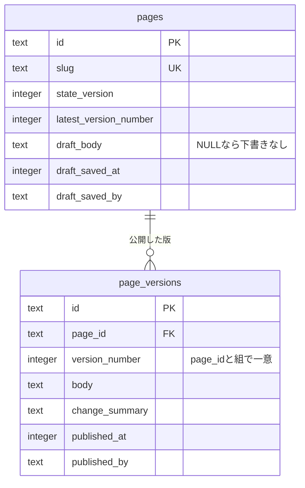
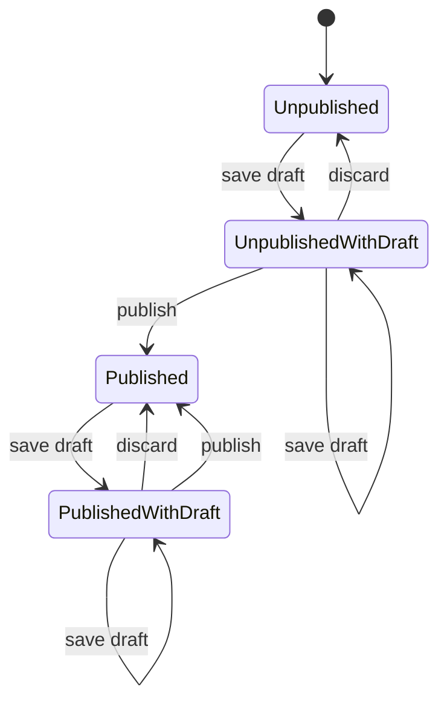
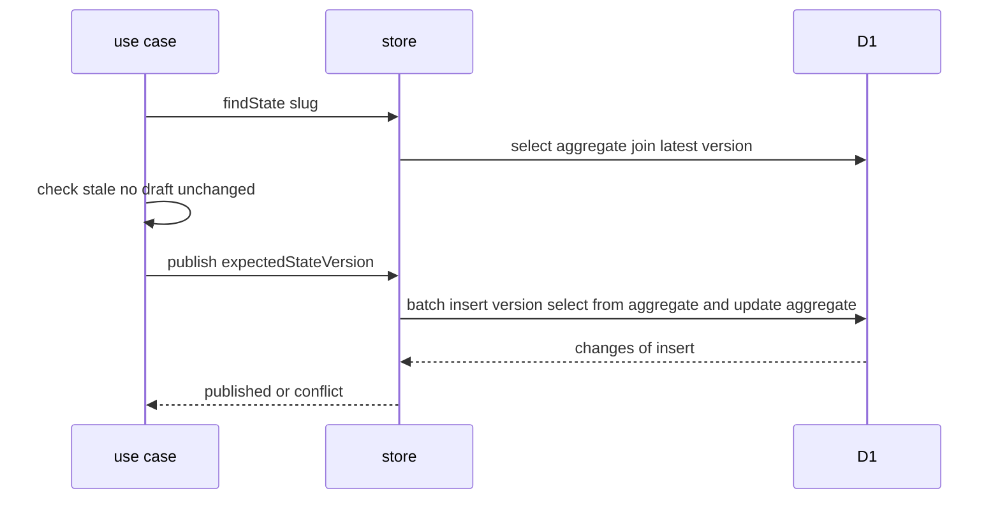

# 下書きと公開した版の管理

Cloudflare D1で、編集中の下書きと公開した版を分けて持つデータの、テーブルの形、状態の版による条件付きの書き込みと競合の扱い、一括の書き込みでの版番号の採番、公開日時の決め方、日時による版の特定、版の不変性と保持を定める。

## 前提と用語

ORMにDrizzle(`drizzle-orm`)、データベースにCloudflare D1を使う構成を前提とする。主キー・共通カラム・日時の保持は「[データベースのスキーマ規約](003-schema-conventions.md)」に、トランザクションの代わりの書き方は「[Cloudflare D1の制約と対処](002-d1-constraints.md#トランザクション)」に従う。

| 用語     | 意味                                                                                                                   |
| -------- | ---------------------------------------------------------------------------------------------------------------------- |
| 集約の行 | 版を持つデータ1件ごとに1行ある、状態を表す行。下書き・状態の版・最新の版番号を列で持つ                                 |
| 下書き   | 公開前の編集中の内容。集約の行の列に1件だけ持ち、公開か破棄で消える                                                    |
| 版       | 公開した時点の内容の写し。版のテーブルに1行ずつ挿入し、更新・削除しない                                                |
| 版番号   | 集約ごとに1から1ずつ増える版の連番                                                                                     |
| 状態の版 | 集約の行の書き込みのたびに1増える整数。読み込んだ時点の値を書き込みの条件にして、同時の操作を検出する                  |
| 競合     | 書き込みの条件にした状態の版が、データベースの値と一致しなかったこと。読み込んだ後に他の操作が先に書き込んだことを表す |
| 公開日時 | 版を公開した日時。同じ集約の中で版番号の順に厳密に増える                                                               |

## テーブルの形

下書きは集約の行の列に、公開した版は版のテーブルの行に分けて持つ。



- 集約の行は、版の有無に関わらず集約ごとに1行置く。集約の種類が決まっていて利用者の操作で増えない場合は、初期データとして入れる(「[初期データ](003-schema-conventions.md#初期データ)」)。
- 集約の行の`state_version`と`latest_version_number`は`integer().notNull().default(0)`で定義する。`latest_version_number`が0なら未公開である。
- 下書きは集約の行の列(本文・保存日時・保存者)に持つ。下書きの列は全てNULLを許し、全てNULLで「下書きなし」を表す。下書きは集約ごとに1件で、履歴を持たない。
- 版のテーブルは`(<集約のID>, version_number)`の一意索引を持つ。日時による版の特定(「[日時による版の特定](#日時による版の特定)」)のため、`(<集約のID>, published_at)`の索引も持つ。
- 版のテーブルは論理削除の列(`softDelete()`)を持たない(「[版の不変性と保持](#版の不変性と保持)」)。
- 下書きの保存者と版の公開者のIDは外部キーにしない。操作した人の行が物理削除された後も、誰が保存・公開したかを残すためである。
- 公開ページなど公開の照会の結果には、下書きの列の値と操作した人のIDを含めない。照会では集約の行と版のテーブルを結合して読むため、結果の型からこれらの項目を除いて、公開の経路へ渡らないようにする。

```typescript
export const pages = snakeCase.table('pages', {
  id: ulidPrimaryKey(),
  slug: text().notNull().unique(),
  stateVersion: integer().notNull().default(0),
  latestVersionNumber: integer().notNull().default(0),
  draftBody: text(),
  draftSavedAt: integer({ mode: 'timestamp_ms' }),
  draftSavedBy: text(),
  ...timestamps(),
});

export const pageVersions = snakeCase.table(
  'page_versions',
  {
    id: ulidPrimaryKey(),
    pageId: text()
      .notNull()
      .references(() => pages.id),
    versionNumber: integer().notNull(),
    body: text().notNull(),
    changeSummary: text().notNull(),
    publishedAt: integer({ mode: 'timestamp_ms' }).notNull(),
    publishedBy: text().notNull(),
    ...timestamps(),
  },
  (table) => [
    uniqueIndex('page_versions_page_id_version_number_unique').on(
      table.pageId,
      table.versionNumber,
    ),
    index('page_versions_page_id_published_at_idx').on(
      table.pageId,
      table.publishedAt,
    ),
  ],
);
```

### 状態の遷移



- 全ての遷移で`state_version`を1増やす。
- 公開は下書きを版のテーブルへ写し、下書きの列を全てNULLにする。破棄は下書きの列を全てNULLにするだけで、版のテーブルを変えない。
- 下書きが無い集約は、公開済みか未公開かに関わらず公開も破棄もできない。公開済みの集約で下書きを破棄すると、最新版だけが残る。

## 状態の版による条件付きの書き込み

保存・破棄・公開の要求は、編集する人が画面を読み込んだ時点の`state_version`(期待する状態の版)を伴う。書き込みはその値を条件にした文で行い、一致しなければ何も変えずに競合を返す。

1. 集約の行と最新版を読み、期待する状態の版と比べて、操作の可否を純粋な関数で判定する(状態の版の不一致・下書きなし・最新版と同じ内容の公開など)。拒否の理由ごとに異なるエラーを返すためである。
2. 状態の版を条件にした文で書き込む。1.の読み込みから書き込みまでの間に他の操作が書き込んでいれば、条件が一致せず変更が0行になる。変更が0行なら競合を返す。

- 1.の判定に使った値(最新版の内容・版番号・公開日時)は、2.の書き込みが成功した時点でも変わっていない。状態の版が一致したことが、読み込みの後に集約の行が書き換えられていないことを保証するためである。
- 判定と書き込みのどちらで拒否しても、競合は同じエラーで返す。画面は競合のエラーを受けたら最新の状態を読み込み直す操作を示し、入力中の内容を勝手に上書きしない。
- 書き込みの条件は「[絞り込みと更新を1回のSQLにする](002-d1-constraints.md#絞り込みと更新を1回のsqlにする)」と同じく、`SELECT`で確かめてから`UPDATE`する2回のSQLに分けない。
- 変更の有無は`db.run()`・`db.update()`の戻り値の`meta.changes`で判定する。

```typescript
const writable = (slug: string, expectedStateVersion: number) =>
  and(eq(pages.slug, slug), eq(pages.stateVersion, expectedStateVersion));

const saved = await db
  .update(pages)
  .set({
    draftBody: body,
    draftSavedAt: savedAt,
    draftSavedBy: actorId,
    stateVersion: sql`${pages.stateVersion} + 1`,
    updatedAt: savedAt,
  })
  .where(writable(slug, expectedStateVersion));
if (saved.meta.changes === 0) {
  return 'conflict';
}

const discarded = await db
  .update(pages)
  .set({
    draftBody: null,
    draftSavedAt: null,
    draftSavedBy: null,
    stateVersion: sql`${pages.stateVersion} + 1`,
    updatedAt: now,
  })
  .where(and(writable(slug, expectedStateVersion), isNotNull(pages.draftBody)));
```

- 破棄は、下書きがあることも条件に加える。

## 一括の書き込みでの版番号の採番

公開は、版の挿入と集約の行の更新の2文を`db.batch()`で書き込む。D1の一括の書き込みは直列に原子的に実行されるため、2文は両方が適用されるか、どちらも適用されない。



```typescript
const publishable = and(
  eq(pages.slug, slug),
  eq(pages.stateVersion, expectedStateVersion),
  isNotNull(pages.draftBody),
);
const publishedAtMs = publishedAt.getTime();

const [inserted] = await db.batch([
  db.insert(pageVersions).select(
    db
      .select({
        id: sql<string>`${versionId}`.as('id'),
        pageId: pages.id,
        versionNumber: sql<number>`${pages.latestVersionNumber} + 1`.as(
          'version_number',
        ),
        body: sql<string>`${pages.draftBody}`.as('body'),
        changeSummary: sql<string>`${changeSummary}`.as('change_summary'),
        publishedAt: sql<number>`${publishedAtMs}`.as('published_at'),
        publishedBy: sql<string>`${actorId}`.as('published_by'),
        createdAt: sql<number>`${publishedAtMs}`.as('created_at'),
        updatedAt: sql<number>`${publishedAtMs}`.as('updated_at'),
      })
      .from(pages)
      .where(publishable),
  ),
  db
    .update(pages)
    .set({
      latestVersionNumber: sql`${pages.latestVersionNumber} + 1`,
      draftBody: null,
      draftSavedAt: null,
      draftSavedBy: null,
      stateVersion: sql`${pages.stateVersion} + 1`,
      updatedAt: publishedAt,
    })
    .where(publishable),
]);
return inserted.meta.changes > 0 ? 'published' : 'conflict';
```

- 版の挿入は`INSERT … SELECT … FROM <集約のテーブル> WHERE <条件>`で書き、版番号を`latest_version_number + 1`から、本文を下書きの列からSQLの中で取る。アプリで読み込んだ値を渡さないため、条件が一致した時点の下書きがそのまま版になる。
- 2文に同じ条件を付け、版の挿入を先に置く。版の挿入は集約の行を変えないため、2文目も1文目と同じ状態の集約の行で条件を判定する。条件が一致しなければ、2文とも0行の変更で成功し、何も変わらない。
  - 条件に使う列(状態の版・下書き)を書き換える文は、一括の書き込みの最後に置く。先に置くと、後の文の条件が書き換えた後の値で判定され、一致しなくなる。
  - 全ての文が同じ条件で、条件の列を書き換えるのが最後の文だけの場合に限り、この形で済む。条件の判定の後に別の条件の文を続ける場合は、「[版の検査で一括の書き込み全体を取り消す](002-d1-constraints.md#版の検査で一括の書き込み全体を取り消す)」の形にする。
- 公開したかどうかは、版の挿入の`meta.changes`で判定する。
- 版の`(<集約のID>, version_number)`の一意索引の違反(一括の書き込みの例外)も競合として返す。違反は同じ版番号の版が先に挿入されたことを表し、最新の状態を読み込み直せば回復できるため、想定外のエラーにしない。違反した列の判別は「[ユニーク制約のあるテーブルへの追加](002-d1-constraints.md#ユニーク制約のあるテーブルへの追加)」に従い、他の失敗はそのまま投げ直す。
- 版のIDはアプリでULIDを採番して渡す。

## 公開日時の単調な増加

公開日時は、現在時刻と「最新版の公開日時+1ミリ秒」の大きい方にする。

```typescript
const MIN_PUBLISHED_AT_STEP_MS = 1;

export const nextPublishedAt = (
  now: Date,
  latestPublishedAt: Date | null,
): Date =>
  new Date(
    latestPublishedAt === null
      ? now.getTime()
      : Math.max(
          now.getTime(),
          latestPublishedAt.getTime() + MIN_PUBLISHED_AT_STEP_MS,
        ),
  );
```

- Workersの実行環境ごとの時計のずれや、同じミリ秒の中の続けての公開で、後の版の公開日時が前の版と同じか前になることを防ぐ。公開日時が版番号の順に厳密に増えるため、日時から版が1つに決まる。
- 最新版の公開日時は、条件付きの書き込みの前に読み込んだ値を使う。状態の版が一致して書き込めた場合、その値は書き込みの時点でも最新版のものである(「[状態の版による条件付きの書き込み](#状態の版による条件付きの書き込み)」)。
- 現在時刻は時計のポートから取り、単体テストで時計が戻った場合を確かめる。

## 日時による版の特定

同意や閲覧の記録が日時だけを持つ場合、その日時に有効だった版は「公開日時がその日時以前の版のうち最も新しいもの」で特定する。

```typescript
const [located] = await db
  .select({
    versionNumber: pageVersions.versionNumber,
    publishedAt: pageVersions.publishedAt,
  })
  .from(pageVersions)
  .innerJoin(pages, eq(pageVersions.pageId, pages.id))
  .where(and(eq(pages.slug, slug), lte(pageVersions.publishedAt, at)))
  .orderBy(desc(pageVersions.publishedAt), desc(pageVersions.versionNumber))
  .limit(1);
```

- 境界は以前(`<=`)とし、公開日時と同じミリ秒の日時はその版に含める。
- 最初の版より前の日時には版が無い。呼び出し側は「該当なし」を扱う。
- 並びの第2キーに版番号を加え、公開日時が単調に増えていない既存のデータでも結果を1つに決める。
- 日時の比較はUTCのミリ秒の整数のまま行う(「[日時の保持](003-schema-conventions.md#日時の保持)」)。

## 版の不変性と保持

- 版の行は挿入だけで、版のテーブルを更新・削除する文をストアに持たない。誤りの訂正も、訂正した内容を新しい版として公開して行う。
- 版の`created_at`・`updated_at`は公開日時と同じ値にする。
- ストアは版と集約の行を削除する文を持たず、版のテーブルは論理削除の列も持たない。版を保持する期間は、サービスのデータ保持の方針で定める。
- 下書きは公開・破棄で消え、履歴を残さない。下書きの変更の履歴が要る場合は、別のテーブルに分けて設計する。
- 最新版と改訂履歴を別の照会で読む場合は、先に集約の行を読み、改訂履歴を集約の行の`latest_version_number`以下の版に絞る。版は追記だけで変わらないため、2回の照会の間に公開されても同じ時点の結果に揃う。
- 改訂履歴の一覧は本文を含めずに読む。本文は、最新版なら集約の行と最新版を結合した照会で、過去の版なら集約と版番号を指定した照会で読む。

## テスト

Workers統合テストで、実際のD1に対して次を確かめる。

- 保存・破棄・公開のたびに`state_version`が1増えること。
- 古い状態の版での保存・破棄・公開が競合を返し、データベースの内容を変えないこと。
- 公開で版番号が1から連番になり、本文が下書きから写され、下書きの列が全てNULLになること。
- 同じ状態の版で2回続けて公開すると、1回だけ成功すること。
- 日時による版の特定の境界(公開日時と同じミリ秒を含むこと・最初の版より前は該当なし)。

判定の関数(状態の版の不一致・下書きなし・同じ内容の公開・次の版番号・公開日時)は、データベースと時計に依存しない純粋な関数として単体テストで確かめる。
