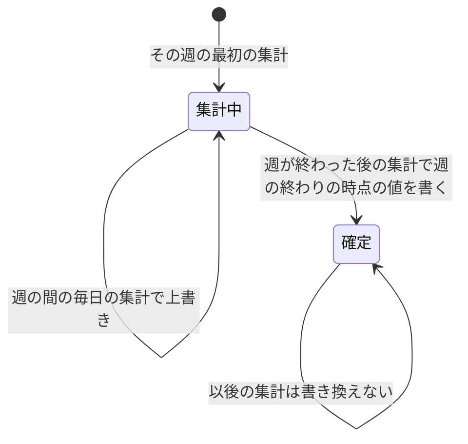
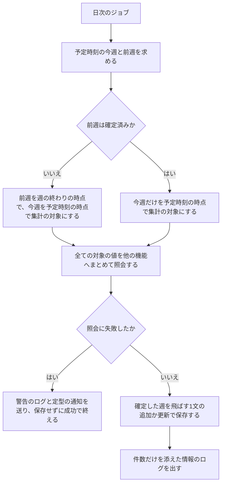

# 週ごとの集計のスナップショット

他の機能のデータから求める指標(収益・登録数・件数など)を、日次のジョブで週ごとの行に保存し、終わった週を確定して以後書き換えない、集計のスナップショットの規約を定める。テーブルの形、週の範囲の規則、集計のジョブの流れと値の時点、他の機能への照会の回数、確定した週を書き換えない1文の追加か更新、失敗の扱い、欠けた週と追い越された週、表示のための読み取り、及びテストを扱う。

## 前提と用語

ORMにDrizzle、データベースにCloudflare D1、DIコンテナにInversifyを使い、日次のジョブを「[非同期処理の設計](../infra/003-async-processing.md#定期実行)」の定期実行で動かす構成を前提とする。テーブル定義は「[データベースのスキーマ規約](003-schema-conventions.md)」に、追加か更新の書き方は「[Cloudflare D1の制約と対処](002-d1-constraints.md#ユニーク制約のあるテーブルへの追加)」に、業務時刻と業務日付は共通ライブラリの`core/time/business-time.ts`の部品に従う。

| 用語                       | 意味                                                                                                                                                                                  |
| -------------------------- | ------------------------------------------------------------------------------------------------------------------------------------------------------------------------------------- |
| 指標                       | 週ごとに求めて保存する値(純収益・会員の総数・注文数など)                                                                                                                              |
| 週                         | 業務時刻の月曜日0:00から翌週の月曜日0:00の直前までの範囲。年をまたぐ週もISO週と同じく月曜日に始める                                                                                   |
| 週の開始日                 | 週の月曜日の業務日付(`YYYY-MM-DD`)。週の行を一意に決めるキーにする                                                                                                                    |
| 週の行                     | 1つの週の全ての指標の値と、確定の印・集計の日時を持つ1行。集計のスナップショット                                                                                                      |
| 確定                       | 週が終わった後に、週の終わりの時点の値で集計し、以後書き換えない状態                                                                                                                  |
| 集計中の週                 | 確定していない週の行。今週の行は毎日の集計で上書きされる                                                                                                                              |
| 時点の値                   | ある時点での総数(その時点より前に登録し、その時点で削除されていない行の数など)。確定する週は週の終わり、集計中の週は集計の時点で求める                                                |
| 期間の値                   | 週の始まりから値を求める時点までに起きた出来事の合計(収益・件数など)                                                                                                                  |
| 欠けた週                   | ジョブが止まっていた間に終わり、週の行が作られなかった週                                                                                                                              |
| 追い越された週             | 確定できないまま、後の週の行が作られた週の行。ジョブが1週間以上止まると残る                                                                                                           |
| `<表示の週数>`             | 画面に示す確定した週の数。集計中の今週はこれに加えて示す                                                                                                                              |
| `<集計のジョブ>`           | 週の行を集計する日次のジョブの名前(`<spec名>.<名詞句>`の形。「[非同期処理の設計](../infra/003-async-processing.md#前提と用語)」)                                                      |
| `<集計の起動時刻>`         | `<集計のジョブ>`を動かす業務時刻の時・分と、同じ起動時刻の中の`order`                                                                                                                 |
| `<集計の失敗の通知>`       | 他の機能の照会に失敗したときにエラートラッキングへ送る定型の通知の種類と指紋(「[同じ文言を繰り返し送る通知](../infra/004-logging-and-error-tracking.md#同じ文言を繰り返し送る通知)」) |
| `<ドメイン>`               | 集計を持つ機能の部品を置くディレクトリの名前                                                                                                                                          |
| `<共通ライブラリの配置先>` | 共通ライブラリを利用側のアプリへ配置したディレクトリ(「[共有ディレクトリの配置方式](../coding/003-shared-directories.md)」)                                                           |

以下の例のテーブル名は`weekly_metrics`、指標は純収益`net_revenue`(期間の値)・会員の総数`members_total`(時点の値)・注文数`orders`(日ごとの集計の合計)とする。本プロジェクトのテーブル名・指標・表示の週数・ジョブの名前と起動時刻は、技術ドキュメントに写さず、プロジェクト固有の値の文書「[本プロジェクト固有の値](../../../onboardings/project-values.md)」に置く。

## 使う場面

次の全てに当てはまる指標は、表示のたびに集計せず、週の行に保存する。

- 指標を求めるのに、複数の機能の照会(時点の総数・期間の合計・日ごとの集計)を呼ぶ必要があり、画面の表示のたびに呼ぶと読み取りが重い。
- 元データが物理削除や匿名化で消えるため、後から求め直すと過去の週の値が変わる。
- 画面に示す期間が固定の週数で、利用者が期間を自由に選ばない。

利用者が期間を自由に選ぶ集計や、表示中に刻々と変わる値は、週の行に保存せず、読み取りのたびに求める。

## テーブルの形

```typescript
import { sql } from 'drizzle-orm';
import {
  check,
  integer,
  snakeCase,
  text,
  uniqueIndex,
} from 'drizzle-orm/sqlite-core';

import { timestamps, ulidPrimaryKey } from '../_shared/columns.ts';

// 集計値だけを持ち、他の機能の行を指さないため外部キーを張らない。収益は返金で負になり得るため符号を限らない
export const weeklyMetrics = snakeCase.table(
  'weekly_metrics',
  {
    id: ulidPrimaryKey(),
    weekStart: text().notNull(),
    netRevenue: integer().notNull(),
    membersTotal: integer().notNull(),
    orders: integer().notNull(),
    finalized: integer({ mode: 'boolean' }).notNull(),
    computedAt: integer({ mode: 'timestamp_ms' }).notNull(),
    ...timestamps(),
  },
  (table) => [
    uniqueIndex('weekly_metrics_week_start_unique').on(table.weekStart),
    check('weekly_metrics_finalized_check', sql`${table.finalized} in (0, 1)`),
    check(
      'weekly_metrics_members_total_check',
      sql`${table.membersTotal} >= 0`,
    ),
    check('weekly_metrics_orders_check', sql`${table.orders} >= 0`),
  ],
);
```

- 主キーは他のテーブルと同じULIDにし(「[主キー](003-schema-conventions.md#主キー)」)、週の開始日に一意索引を張る。一意索引は、追加か更新の`ON CONFLICT`の対象と、同じ週の行を2つ作らない保証を兼ねる。
- 週の開始日は時点ではなく業務日付そのものが値のため、`YYYY-MM-DD`の文字列で持つ(「[日時の保持](003-schema-conventions.md#日時の保持)」)。文字列の順が日付の順と一致するため、並べ替えと範囲の比較をそのまま行える。
- 確定の印と件数の列は既定値を持たず、書き込む側が毎回全ての値を渡す。確定の印は0・1のCHECK、件数は0以上のCHECKを付ける。金額は返金やチャージバックで負になり得るため、符号のCHECKを付けない。
- 集計の日時`computed_at`は、値を求めた時点(ジョブの予定時刻)である。行を書き換えた日時の`updated_at`と分け、画面の「最後の集計日時」には`computed_at`を使う。
- 他の機能のIDを持たず、外部キーを張らない。利用者を識別する値を持たないため、利用者の退会や物理削除の波及処理の対象にならない。保持期間はプロジェクトのデータ保持の方針に従う。

### 週の行の状態



## 週の範囲

週の範囲は純粋な関数の規則にまとめ、`<共通ライブラリの配置先>/core/<ドメイン>/`に置く。D1を読み込まず、自前の暦の計算を持たない。

```typescript
export interface StatisticsWeekRange {
  readonly weekStart: BusinessDate; // 月曜日
  readonly from: Date; // 月曜日0:00(業務時刻)。含む
  readonly to: Date; // 翌週の月曜日0:00(業務時刻)。含まない
}

export declare function weekOf(at: Date): StatisticsWeekRange;
export declare function previousWeek(
  week: StatisticsWeekRange,
): StatisticsWeekRange;
export declare function weeksToCompute(now: Date): {
  readonly current: StatisticsWeekRange;
  readonly previous: StatisticsWeekRange;
};
export declare function isWeekFinished(
  week: StatisticsWeekRange,
  now: Date,
): boolean; // to <= now
export declare function lastDayOf(week: StatisticsWeekRange): BusinessDate; // 日曜日
```

- 時点の業務日付は`toBusinessDateTime`で、その日を含む週の月曜日と日曜日は`businessWeekOf`で、7日前・7日後の業務日付は`addBusinessDays`で、業務日付の0:00の時点は`fromBusinessDateTime`で求める。UTCの曜日で週を決めない。UTCで月曜日になっていても業務時刻で日曜日なら前の週に入る。
- 週は`from`を含み`to`を含まない半開区間にする。翌週の月曜日0:00ちょうどに週が終わる(`isWeekFinished`は`to <= now`)。
- 戻り値は`Object.freeze`で凍結し、呼び出し側が書き換えられないようにする。

## 集計のジョブ

### 流れ

`<集計のジョブ>`は`<集計の起動時刻>`に毎日動き、前週と今週を集計する。



- 週は予定時刻(`ScheduledJobContext.scheduledTime`)から求める。起動が遅れても集計する週はずれない(「[ジョブの登録](../infra/003-async-processing.md#ジョブの登録)」)。
- 前週が確定済みかを先に読み、確定済みなら今週だけを集計する。確定済みの週を照会し直さないためである。
- 同じ日に何度実行しても、確定した週は書き換えず、集計中の週は同じ週の行を上書きするため、行は増えない(「[重複配信と冪等性](../infra/003-async-processing.md#重複配信と冪等性)」)。

### 値の時点

| 集計する週         | 値を求める時点     | 確定の印                                             |
| ------------------ | ------------------ | ---------------------------------------------------- |
| 前週(未確定のとき) | 前週の終わり(`to`) | 予定時刻に前週が終わっていれば確定(`isWeekFinished`) |
| 今週               | ジョブの予定時刻   | 未確定                                               |

指標の種類ごとに、値を求める時点を次のように渡す。

| 指標の種類         | 照会に渡す値                                                                   |
| ------------------ | ------------------------------------------------------------------------------ |
| 時点の値           | 値を求める時点                                                                 |
| 期間の値           | 週の始まり(`from`)から値を求める時点までの期間(始まりを含み、終わりを含まない) |
| 日ごとの集計の合計 | 週の月曜日から日曜日まで(今週は予定時刻の業務日付まで)の業務日付の範囲         |

- 前週を週の終わりの時点で求めるため、月曜日の集計が失敗して翌日以降に集計し直しても、前週の値は週の終わりのものになる。
- 時点の値は登録の日時と削除の日時から求めるため、週の終わりより後に論理削除された行も週の終わりの値に数えられる。ただし確定の前に物理削除された行は数えられず、値が小さくなる。前週は週が終わった直後の集計で確定するため、論理削除から物理削除までの猶予を集計の間隔(1日)より長くしておく。
- 集計の日時`computed_at`には予定時刻を入れる。

### 他の機能への照会

集計を持つ機能は、他の機能のテーブルを直接読まず、各機能が提供する照会(時点の総数・期間ごとの合計・日ごとの集計)を使う(「[層構成と合成ルート](../backend/002-layered-architecture-on-workers.md#層構成と合成ルート)」)。照会の回数は週の数に比例させない。

```typescript
const [netRevenues, membersTotals, days] = await Promise.all([
  this.revenue.netRevenue(
    targets.map(({ week, asOf }) => ({ from: week.from, to: asOf })),
  ),
  Promise.all(targets.map(({ asOf }) => this.members.countRegisteredAt(asOf))),
  this.orders.summarizeDaily({
    from: earliestWeekStart(targets),
    to: toBusinessDateTime(scheduledTime).date,
  }),
]);
```

- 期間の値は、期間の配列を受け取り入力の順に値を返す照会で、全ての週を1回で求める。
- 日ごとの集計は、最も古い週の月曜日から予定時刻の業務日付までを1回で読み、週ごとに業務日付の文字列の範囲(`weekStart`以上、翌週の月曜日未満)で分けて合計する。
- 時点の値は週ごとに1回呼ぶ。集計する週は前週と今週の高々2つのため、回数は一定である。
- 照会は互いに依存しないため`Promise.all`で並べる。同じ起動時刻のジョブ群は時間の予算を共有する(「[同じ時刻のジョブ群の時間の予算](../infra/003-async-processing.md#同じ時刻のジョブ群の時間の予算)」)。

### 確定した週を書き換えない追加か更新

週の行は、週の開始日の一意索引を対象にした1文の追加か更新で書く。更新の`WHERE`で未確定の行だけを書き換える。

```sql
INSERT INTO weekly_metrics (id, week_start, net_revenue, members_total, orders, finalized, computed_at, created_at, updated_at)
VALUES (?, ?, ?, ?, ?, ?, ?, ?, ?), (?, ?, ?, ?, ?, ?, ?, ?, ?)
ON CONFLICT(week_start) DO UPDATE SET
  net_revenue = excluded.net_revenue,
  members_total = excluded.members_total,
  orders = excluded.orders,
  finalized = excluded.finalized,
  computed_at = excluded.computed_at,
  updated_at = ?
WHERE weekly_metrics.finalized = 0;
```

Drizzleでは`onConflictDoUpdate`の`setWhere`に未確定の条件を渡す。

```typescript
function excluded(column: SQLiteColumn): SQL {
  return sql.raw(`excluded."${column.name}"`);
}

if (rows.length === 0) {
  return;
}
const now = new Date();
await db
  .insert(weeklyMetrics)
  .values(rows.map((row) => ({ ...row, createdAt: now, updatedAt: now })))
  .onConflictDoUpdate({
    target: weeklyMetrics.weekStart,
    set: {
      netRevenue: excluded(weeklyMetrics.netRevenue),
      membersTotal: excluded(weeklyMetrics.membersTotal),
      orders: excluded(weeklyMetrics.orders),
      finalized: excluded(weeklyMetrics.finalized),
      computedAt: excluded(weeklyMetrics.computedAt),
      updatedAt: now,
    },
    setWhere: eq(weeklyMetrics.finalized, false),
  });
```

- 確定した週への書き込みは、更新の`WHERE`に当てはまらず何も変えない。失敗にならないため、確定の有無を書き込みの前に読み直さなくてよい。同時に2つの実行が書いても、確定した週は書き換わらない。
- 新しい週の行は主キーをULIDで採番し、既存の行の更新では主キーと`created_at`を変えない。
- `excluded`の列は`sql.raw`で列の名前だけを書く。`sql`のテンプレートに列を埋め込むと、テーブル名で修飾された列(`"weekly_metrics"."net_revenue"`)になり、`excluded`の後に置けない。
- 1回の呼び出しに同じ週の行を2つ渡さない。1文の中で同じ週の行が衝突し、値が行の順に依存する。
- 空の配列では文を作らずに終える。
- 前週と今週を1文で書くため、片方だけが保存されることは無い。

### 失敗の扱い

| 失敗                                 | 扱い                                                                                                                                                                   |
| ------------------------------------ | ---------------------------------------------------------------------------------------------------------------------------------------------------------------------- |
| 前週の確定の有無を読めない           | 何も照会せずに例外を投げる。定期実行のディスパッチャが`error`ログとエラートラッキングへ送る(「[起動時の振る舞い](../infra/003-async-processing.md#起動時の振る舞い)」) |
| 他の機能の照会の失敗・結果の値の欠け | 何も保存しない。`warning`ログと`<集計の失敗の通知>`を送り、ジョブは成功で終える。前週は未確定のまま残り、次の実行が週の終わりの時点で集計し直して確定する              |
| 週の行を保存できない                 | 定型の通知を送らずに例外を投げる。ディスパッチャが送る                                                                                                                 |

- 照会の失敗で例外を投げ直さないのは、ディスパッチャの`captureException`と定型の通知が同じ失敗を二重に知らせるためである。定型の通知は`captureEvent`の指紋で種類ごとにまとめる(「[同じ文言を繰り返し送る通知](../infra/004-logging-and-error-tracking.md#同じ文言を繰り返し送る通知)」)。
- application層はエラートラッキングのSDKを読み込めないため、定型の通知は報告のポートで渡し、infrastructure層の実装が`captureEvent`で送る(「[依存方向と静的解析](../backend/002-layered-architecture-on-workers.md#依存方向と静的解析)」)。
- 照会の結果の配列に週の分の値が無いときは、値を0で補わずに照会の失敗と同じに扱う。
- 成功の`info`ログには、集計した週の数と確定した週の数だけを添える。指標の値はログに出さない。

## 欠けた週と追い越された週

- ジョブが1週間以上止まると、その間に終わった週の行は作られず、欠けた週になる。欠けた週は遡って作らない。元データの物理削除の後は過去の時点の値を正しく求められず、推測した値を確定させないためである。欠けの原因になる集計の失敗は`<集計の失敗の通知>`とディスパッチャの通知で検知する。ジョブ自体が起動しない停止は通知されないため、定期実行の要約のログ(「[起動時の振る舞い](../infra/003-async-processing.md#起動時の振る舞い)」)に`<集計のジョブ>`の結果があるかで確かめる。
- ジョブが止まる前に作られた集計中の週の行は、再開した後のジョブが前週と今週しか扱わないため、確定しないまま残る(追い越された週)。値が週の途中のものであるため、読み取りで除き、表示の週数にも数えない。
- 月曜日の集計が失敗すると、前週の未確定の行が最も新しい行になり、集計中の週として示される。値は確定していないため誤りではなく、次に成功した集計が確定させ、今週の行を作る。

## 表示のための読み取り

読み取りは週の行を読むだけで、集計し直さない。確定した週と最も新しい週だけを、新しい週から件数まで読み、週の古い順に並べ直して返す。

```typescript
const shownWeek = or(
  eq(weeklyMetrics.finalized, true),
  sql`${weeklyMetrics.weekStart} = (select max(${weeklyMetrics.weekStart}) from ${weeklyMetrics})`,
);

const rows = await db
  .select(WEEKLY_METRICS_COLUMNS)
  .from(weeklyMetrics)
  .where(shownWeek)
  .orderBy(desc(weeklyMetrics.weekStart))
  .limit(limit);
return rows.toReversed();
```

- 読み取りの照会は`<表示の週数>`より1つ多い行を読む。最も新しい行が未確定なら、確定した`<表示の週数>`の週と集計中の週をそのまま返す。最も新しい行が確定済みなら、確定した週だけが読まれるため、新しい`<表示の週数>`の週に切る。
- 週の数は行で数え、暦の週で数えない。欠けた週がある場合は、`<表示の週数>`より前の週まで遡る。
- 最後の集計日時は、返す週の`computed_at`のうち最も新しいものとし、行が無ければ値なしにする。
- 画面で前週からの増減を示すときは、7日前の週の開始日を持つ行で前週の値を探し、配列の隣の行を前週とみなさない。欠けた週の後の週は前週の値が無いものとして示す。
- 権限の確認は、読み取りの部品ではなく呼び出し側(GraphQLのリゾルバなど)で行う。

## テスト

- 週の範囲(単体テスト): 月曜日0:00の直前と直後、日曜日23:59、UTCと業務時刻で曜日が異なる時点、年をまたぐ週、前週、年の初めの週の前週、翌週の月曜日0:00の直前とちょうどでの週の終わりの判定、週の最後の日、戻り値の凍結。
- 集計のジョブ(単体テスト。照会とストアは偽物): 前週が未確定なら前週を週の終わりの時点で確定し今週を予定時刻の時点で集計すること、前週が確定済みなら今週だけを集計すること、月曜日の実行の日付の範囲、年をまたぐ週、照会に渡す時点・期間・業務日付の範囲と週ごとの合計、照会の失敗で何も保存せず定型の通知を送りジョブが成功で終わること、その次の実行で前週を集計し直して確定すること、確定の有無を読めないときと保存できないときに通知を送らず例外を投げること、ログに件数だけが出ること、ジョブの定義(名前・起動時刻・`order`)。
- ストア(Workers統合テスト。実物のD1): 新しい週の行をULIDの主キーで作ること、未確定の週の上書きと2回の実行で行が1つのまま主キーを保つこと、確定した週を書き換えずに同じ呼び出しの今週だけを書き換えること、空の配列で何も書かないこと、確定の有無の照会、読み取りの週の古い順と件数の上限、年をまたぐ週の並び、追い越された週を返さず件数に数えないこと。
- 読み取り(単体テスト): `<表示の週数>`より1つ多い行を読むこと、集計中の週の有無による切り方、行が少ないとき、最後の集計日時、行が無いとき。
- テーブル定義(単体テストとWorkers統合テスト): 確定の印と件数のCHECK、週の開始日の一意索引の重複の拒否、外部キーが無いこと。マイグレーションとの照合は「[マイグレーション](003-schema-conventions.md#マイグレーション)」に従う。
- テストの種別と命名は「[テストの種別と命名](../testing/001-test-strategy.md#テストの種別と命名)」に従う。
