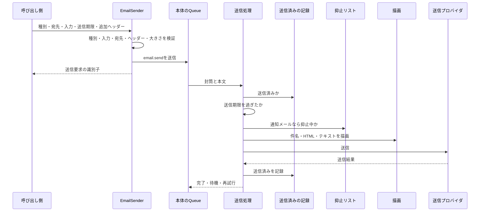

# メール送信サービス(Cloudflare Email Sending)

Cloudflare Workersのアプリから、Cloudflare Email ServiceのEmail Sending(public beta)でメールを送る仕組みを定める。メール種別とテンプレートの定義、送信要求の出し方、送信APIの上限と料金、失敗コードの分類、送信上限による待機と一時的な障害の再試行、配信不能イベントの受け取りと抑止、ローカルの受信箱(Mailpit)、管理画面の設定、疎通確認の手順を扱う。非同期メッセージの仕組みそのものは「[非同期処理の設計](../infra/003-async-processing.md)」に従う。

## 前提と用語

全てのメールは「送信要求の検証 → 本体のQueue → `<メッセージを受信するアプリ>`の送信処理で描画と送信」の1つの経路で送る。呼び出し側はメール種別・宛先・テンプレート入力を渡すだけで、送信プロバイダの違いと障害を意識しない。送信プロバイダは、staging・prodがEmail Sendingの`send_email`バインディング、ローカルがMailpitのHTTP APIである。

| 部品                                                                                                                                 | 置き場所                                   | 役割                                                           |
| ------------------------------------------------------------------------------------------------------------------------------------ | ------------------------------------------ | -------------------------------------------------------------- |
| `EmailKind`・`defineEmailKind`・`createEmailKindRegistry`                                                                            | `core/email/email-kind.ts`                 | メール種別(名前・分類・テンプレート入力の検証規則)の定義と検査 |
| `EMAIL_KINDS`                                                                                                                        | `core/email/kinds/index.ts`                | 全てのメール種別の集約点                                       |
| `EMAIL_TYPES`                                                                                                                        | `core/email/identifiers.ts`                | 送信の受付・抑止リストなどのDI識別子                           |
| `EmailSender`・`EmailSendError`・`SuppressionList`・`SuppressionMaintenance`・`UserAddressDirectory`・`SenderInfoProvider`           | `core/email/ports.ts`                      | 呼び出し側と差し替え口が使う型                                 |
| `EMAIL_SEND_MESSAGE`・`MAX_EMAIL_SEND_BODY_BYTES`                                                                                    | `core/email/send-message.ts`               | メッセージ`email.send`の契約と本文の大きさの上限               |
| `ALLOWED_EXTRA_HEADERS`・`validateExtraHeaders`                                                                                      | `core/email/email-headers.ts`              | 追加ヘッダーの許可リストと値の検証                             |
| `classifyCloudflareSendError`                                                                                                        | `core/email/provider-outcome.ts`           | Email Sendingの失敗コードの分類                                |
| `EMAIL_SEND_RETRY_POLICY`・`RATE_LIMIT_DEFER_SECONDS`・`DAILY_LIMIT_DEFER_SECONDS`・`decideBeforeSend`・`decideAfterOutcome`         | `core/email/delivery-decision.ts`          | 送信期限の判定、送信結果からの待機・再試行・送信不能の判定     |
| `parseDeliveryEvent`                                                                                                                 | `core/email/delivery-event.ts`             | 配信不能イベントの検証と正規化                                 |
| `decideSuppressionEffect`・`mergeSuppression`・`REJECTION_SUPPRESSION_DAYS`・`UNLINKED_RETENTION_DAYS`・`SEND_RECORD_RETENTION_DAYS` | `core/email/suppression-policy.ts`         | 抑止の方針と合成、保持の日数                                   |
| `formatUtcDateTime`・`formatUtcDate`                                                                                                 | `core/email/format-utc-date-time.ts`       | 本文の日時のUTC表記(例:「9月15日07:40(UTC)」)                  |
| `EMAIL_PLATFORM_MODULE`                                                                                                              | `workers/email/email-platform-module.ts`   | 両アプリ共通の束縛(受付・抑止リスト・送信済みの記録・間引き)   |
| `createSuppressionMaintenance`                                                                                                       | `workers/email/suppression-maintenance.ts` | 退会時の削除と日次の後始末                                     |

`<メッセージを受信するアプリ>`には、描画(React Email)・送信プロバイダ・送信処理・配信不能イベントの処理・疎通確認の経路を置く。Reactと`@react-email/*`を読み込むのは、このアプリの`src/infrastructure/email/rendering/`と`src/infrastructure/email/templates/`だけで、他の場所からの読み込みは静的解析で拒否する。

| 用語                   | 意味                                                                                                       |
| ---------------------- | ---------------------------------------------------------------------------------------------------------- |
| メール種別             | テンプレートと分類を決める`<ドメイン>.<名詞句>`の形の名前(例:`account.password-reset`)                     |
| トランザクションメール | 分類`transactional`。抑止リストに載った宛先にも送信を試みる                                                |
| 通知メール             | 分類`notification`。配信停止の対象で、抑止中の宛先には送らない                                             |
| 送信要求               | メール種別・宛先1件・テンプレート入力・任意の送信期限・任意の追加ヘッダーからなる、送信を依頼する1件の単位 |
| 送信要求の識別子       | 送信要求を載せた封筒のID。重複の防止とログ・エラートラッキングの突き合わせに使う                           |
| 送信期限               | これ以降は送らない日時。有効期限付きのリンクを含むメールでは、その有効期限を指定する                       |
| 待機                   | 送信上限に達したメールを、試行回数に数えずに遅らせて送り直すこと                                           |
| 送信不能               | 再試行しても送れない、または再試行しても結果が変わらない失敗で、メールを送らずに終えること                 |
| 配信不能イベント       | Email Sendingが送信の前後に通知する、バウンス・苦情・拒否・配送失敗などの出来事                            |
| 抑止記録               | 通知メールを送らない宛先の記録(照合キー・最後の契機の種類と日時・期限)                                     |
| 照合キー               | 前後の空白を除いて小文字にしたメールアドレス(`toMatchingKey`)                                              |

| プレースホルダー                                             | 意味                                                                                                                                  |
| ------------------------------------------------------------ | ------------------------------------------------------------------------------------------------------------------------------------- |
| `<共通ライブラリの配置先>`                                   | 「[非同期処理の設計](../infra/003-async-processing.md#前提と用語)」と同じ。上の部品の表の置き場所は、このディレクトリからのパスである |
| `<定期実行を受け持つアプリ>`・`<メッセージを受信するアプリ>` | 「[非同期処理の設計](../infra/003-async-processing.md#前提と用語)」と同じ                                                             |
| `<デッドレターQueueの名前>`                                  | 「[非同期処理の設計](../infra/003-async-processing.md#前提と用語)」と同じ                                                             |
| `<送信ドメイン>`                                             | Email Sendingに登録した、環境ごとの送信ドメイン                                                                                       |
| `<送信元アドレス>`                                           | 環境ごとの送信専用のアドレス(デプロイ先では`noreply@<送信ドメイン>`)                                                                  |
| `<送信元の表示名>`                                           | 全てのメールの`From`の表示名                                                                                                          |
| `<送信バインディング>`                                       | `send_email`バインディングの名前                                                                                                      |
| `<送信プロバイダの変数>`                                     | 送信プロバイダ(`mailpit`・`cloudflare`)を選ぶ変数のキー                                                                               |
| `<送信元アドレスの変数>`                                     | `<送信元アドレス>`を持つ変数のキー                                                                                                    |
| `<宛先の制限の変数>`                                         | 宛先の制限(`any`・`allowlist`)を選ぶ変数のキー                                                                                        |
| `<許可する宛先のシークレット>`                               | 宛先を制限する環境で送ってよい宛先をカンマ区切りで持つシークレットのキー                                                              |
| `<MailpitのURLの変数>`・`<MailpitのURL>`                     | ローカルのMailpitのHTTP APIのURLを持つ変数のキーと、その値                                                                            |
| `<メールイベント用Queueの名前>`                              | 配信不能イベントを受け取るQueueの名前                                                                                                 |
| `<メールイベント用Queueの名前の変数>`                        | 受信したバッチがメールイベント用Queueのものかを判定するための、その名前を持つ変数のキー                                               |
| `<封筒を持たないQueueの登録箇所>`                            | `<メッセージを受信するアプリ>`で、封筒を持たないQueueの登録の一覧を定義するファイル                                                   |
| `<テンプレートの集約点>`                                     | `<メッセージを受信するアプリ>`で、全てのテンプレートの一覧を定義するファイル                                                          |
| `<送信者情報の提供元の登録箇所>`                             | `<メッセージを受信するアプリ>`で、送信者情報の提供元を登録するファイル                                                                |
| `<利用者のアドレスの照会口の登録箇所>`                       | `<定期実行を受け持つアプリ>`で、利用者のメールアドレスの照会口を登録するファイル                                                      |
| `<後始末の起動時刻>`                                         | 抑止記録と送信済みの記録の日次の後始末を登録した業務時刻                                                                              |
| `<疎通確認の経路>`                                           | 疎通確認メールを送る`<メッセージを受信するアプリ>`の経路                                                                              |
| `<疎通確認のトークンのシークレット>`                         | 疎通確認の経路の認証に使うトークンを持つシークレットのキー                                                                            |
| `<疎通確認の宛先のシークレット>`                             | 疎通確認メールの宛先を持つシークレットのキー                                                                                          |
| `<メッセージを受信するアプリのオリジン>`                     | 疎通確認の経路を呼ぶ`<メッセージを受信するアプリ>`のオリジン                                                                          |

## 送信の流れ



- 受付(`EmailSender`)は送信プロバイダを呼ばない。検証に失敗した要求は送らずに`EmailSendError`で返す。
- 送信処理は、送信済み・送信期限切れ・抑止中(通知メールだけ)のいずれかなら送らずに完了する。
- 描画と送信は`<メッセージを受信するアプリ>`だけが行うため、`<定期実行を受け持つアプリ>`を含むどのアプリからでも、同じ方法で送信を依頼できる。

## メールを送る

### メール種別の定義

メール種別は`defineEmailKind`で定義し、共通ライブラリの`core/email/kinds/<ドメイン>-<名詞句>.ts`に置いて`kinds/index.ts`の`EMAIL_KINDS`へ加える。受付と送信処理の両方が同じ定義を読むため、種別は共通ライブラリに置く。

```typescript
import { z } from 'zod';

import { defineEmailKind } from '../email-kind.ts';

const passwordResetInput = z.object({
  nickname: z.string().min(1),
  resetUrl: z.url({ protocol: /^https$/u }),
  expiresAt: z.iso.datetime(),
});

export type PasswordResetInput = z.infer<typeof passwordResetInput>;

export const ACCOUNT_PASSWORD_RESET_KIND = defineEmailKind({
  name: 'account.password-reset',
  category: 'transactional',
  inputSchema: passwordResetInput,
});
```

- 名前は`<ドメイン>.<名詞句>`の形で、それぞれ小文字の英字で始まり、小文字の英数字の並びをハイフン1つでつなぐ。
- 分類は`transactional`か`notification`である。配信停止の対象になるメールだけを`notification`にする。
- `inputSchema`はテンプレートが使う値の検証規則である。メッセージの契約と同じく、検証の結果をもう一度検証しても同じ値になる規則に限り、日時はISO 8601の文字列で渡す(「[契約](../infra/003-async-processing.md#契約)」)。
- `createEmailKindRegistry`は、名前の形式の誤り・名前の重複・分類の誤り・検証規則の欠落を`EmailKindRegistryError`で拒否する。
- 疎通確認用の種別`email-delivery.smoke`(トランザクションメール)は共通ライブラリが持つ。

### テンプレートの定義

テンプレートは`defineEmailTemplate`で定義し、`<メッセージを受信するアプリ>`の`src/infrastructure/email/templates/<ドメイン>/`に置いて`<テンプレートの集約点>`へ加える。本文の部品(`*.tsx`)は1ファイルに1つのコンポーネントとする。

```typescript
import { ACCOUNT_PASSWORD_RESET_KIND } from '<共通ライブラリの配置先>/core/email/kinds/account-password-reset.ts';

import { defineEmailTemplate } from '../../rendering/email-template.ts';
import { PasswordResetEmailBody } from './password-reset-email-body.tsx';

export const PASSWORD_RESET_TEMPLATE = defineEmailTemplate({
  kind: ACCOUNT_PASSWORD_RESET_KIND,
  subject: () => 'パスワードの再設定',
  preview: () => 'パスワードを再設定するためのリンクをお送りします。',
  greeting: (input) => input.nickname,
  action: (input) => ({ label: 'パスワードを再設定する', url: input.resetUrl }),
  Body: PasswordResetEmailBody,
});
```

- 描画は共通レイアウトの中に、宛名(`greeting`)・本文(`Body`)・主要な行動へのボタン(`action`)・配信停止リンクの区画(`unsubscribeLinks`)・送信者情報の区画の順に置く。`greeting`が`undefined`なら宛名の行を省く。配信停止の区画は通知メールの種別だけに置き、トランザクションメールではリンクを返しても置かない。`unsubscribeLinks`が空か未定義なら区画を省く。送信者情報の区画は、`<送信者情報の提供元の登録箇所>`に登録した提供元が値を返したときだけ置く。
- `unsubscribeLinks`は`{ url, label? }`の配列を返す。リンクが1つでラベルが無ければ共通の文言「この通知を配信停止」で表示する。複数の通知をまとめたメールのようにリンクが複数あるときは、どの通知の配信停止かを見分けられるよう、すべてのリンクにテンプレートがラベルを付ける。ラベルの無いリンクを複数返すと型の検査で拒否され、型を経ずに渡された場合も描画の失敗にする。HTMLパートとテキストパートには、各リンクの文言とURLを返した順に置く。
- `subject`の戻り値は接頭辞を付けずにそのまま件名になる。`preview`は受信一覧に出る冒頭の文である。
- HTMLパートとテキストパートは、同じ要素から`@react-email/render`で生成する(テキストは`plainText`)。テキストパートの無いメールは迷惑メールと判定されやすいため、必ず両パートを送る。
- 本文で日時を表示するときは、`formatUtcDateTime`・`formatUtcDate`の表記を`<time dateTime>`で包む(「[日時の表示](../frontend/001-markup-conventions.md#日時の表示)」)。
- JSXで`{変数}文字列`のように分けて書くと、HTMLに`<!-- -->`が入る。文言はテンプレートリテラルで1つのテキストにする。
- `createEmailTemplateRegistry(<テンプレートの一覧>, EMAIL_KINDS)`は起動時に、種別の集約点に無い種別のテンプレート、集約点と別の定義を指すテンプレート、テンプレートの重複、テンプレートの無い種別を`EmailTemplateRegistryError`で拒否する。種別を加えたら、同じ変更でテンプレートも加える。

### 送信要求

送信は、処理単位のDIコンテナに`EMAIL_TYPES.EmailSender`で登録されている`EmailSender`に依頼する。HTTPの処理・定期実行のジョブ・メッセージの処理のどれからでも使える。

```typescript
import { inject, injectable } from 'inversify';

import { EMAIL_TYPES } from '<共通ライブラリの配置先>/core/email/identifiers.ts';
import { ACCOUNT_PASSWORD_RESET_KIND } from '<共通ライブラリの配置先>/core/email/kinds/account-password-reset.ts';
import type { EmailSender } from '<共通ライブラリの配置先>/core/email/ports.ts';

@injectable()
export class RequestPasswordResetEmail {
  constructor(
    @inject(EMAIL_TYPES.EmailSender) private readonly emails: EmailSender,
  ) {}

  async execute(
    address: string,
    nickname: string,
    resetUrl: string,
    expiresAt: Date,
  ): Promise<string> {
    return this.emails.send({
      kind: ACCOUNT_PASSWORD_RESET_KIND,
      to: address,
      input: { nickname, resetUrl, expiresAt: expiresAt.toISOString() },
      deadline: expiresAt,
    });
  }
}
```

- `send`は送信要求の識別子を返す。送信が済んだことは表さない。
- `to`は1件だけで、254文字以内のWHATWGのメールアドレスの形式とする。宛先は正規化せずにそのまま送る。
- `deadline`を指定すると、その日時以降に送信処理へ届いたメールは送らずに期限切れとして記録する。有効期限付きのリンクを含むメールでは必ず指定する。指定しなければ、待機の長さに関わらず送信上限が解けた後に送る。
- `headers`は次の許可リストのヘッダーだけを受け付ける。名前は大文字小文字を区別せずに照合し、大文字小文字だけ違う重複も拒否する。値の改行と空の値は拒否する。

| ヘッダー                | 値の規則                                                                               |
| ----------------------- | -------------------------------------------------------------------------------------- |
| `List-Unsubscribe`      | `<URI>`をカンマで区切った並び。HTTPSのURIを1つ以上含み、HTTPSと`mailto:`以外を含まない |
| `List-Unsubscribe-Post` | `List-Unsubscribe=One-Click`だけ。`List-Unsubscribe`と一緒に指定する                   |
| `List-Id`               | 任意                                                                                   |
| `Auto-Submitted`        | 任意                                                                                   |
| `Precedence`            | 任意                                                                                   |

- 値は1つあたり2,048バイト以下、名前と値を合わせた合計は16KiB以下とする。`List-Unsubscribe`はカンマで単純に分割するため、カンマを含むURIは拒否される。
- 次の場合は送信せずに`EmailSendError`を投げる。例外のメッセージは理由ごとの固定文で、宛先や入力の値を含まない。`EmailSendError`は呼び出し側の不具合を表し、想定内の失敗として利用者へ返さない。Queueへの送信の失敗は`EmailSendError`に包まずにそのまま投げる。

| `reason`           | 条件                                                                     |
| ------------------ | ------------------------------------------------------------------------ |
| `unknown-kind`     | 種別が`EMAIL_KINDS`に登録されていない                                    |
| `invalid-input`    | テンプレート入力が種別の検証規則に合わない                               |
| `invalid-address`  | 宛先の形式が不正                                                         |
| `invalid-headers`  | 追加ヘッダーが許可リストに無い、または値が不正                           |
| `invalid-deadline` | 送信期限が有効な日時でない、または4桁の年のISO 8601で表せない            |
| `too-large`        | JSONにした本文のUTF-8が`MAX_EMAIL_SEND_BODY_BYTES`(65,536バイト)を超える |

- 宛先・件名・本文・テンプレート入力・リンクのURLを、ログの属性・メッセージ・エラートラッキングに含めない。属性名に`email`・`address`を含めると値が伏せられる(「[伏せ字の規則](../infra/004-logging-and-error-tracking.md#伏せ字の規則)」)。
- 送信要求の識別子は封筒のIDのため、同じ業務上の出来事を送信側が2回処理すると、別の識別子で2通送られる。送信側の処理は業務上のキーで冪等にする(「[重複配信と冪等性](../infra/003-async-processing.md#重複配信と冪等性)」)。

### 送信プロバイダへの送信

Email Sendingへは、`send_email`バインディングの構造化された`send()`で送る。次の`binding`は`env`の`<送信バインディング>`である。

```typescript
const { messageId } = await binding.send({
  from: { email: '<送信元アドレス>', name: '<送信元の表示名>' },
  to: '<宛先>',
  subject: '<件名>',
  html: '<HTMLパート>',
  text: '<テキストパート>',
  headers: { 'List-Unsubscribe': '<https://app.example/unsubscribe>' },
});
```

- 成功すると`{ messageId }`を返し、失敗すると`code`と`message`を持つ例外を投げる。送信プロバイダの実装は例外を投げずに、失敗コードを分類した結果(「[失敗コードの分類](#失敗コードの分類)」)を返す。
- 返信を受け付けないため`replyTo`を渡さない。`Reply-To`はヘッダーではなく専用の項目で指定するもので、ヘッダーに入れると`E_HEADER_USE_API_FIELD`になる。
- `send()`が30秒(送信プロバイダの実装の`PROVIDER_TIMEOUT_MILLISECONDS`)以内に応答しなければ、コード`timeout`の一時的な障害として扱う。時間切れの後に`send()`が遅れて成功していた場合は再試行で同じメールが2通届き得る(少なくとも1回の配信の範囲として許容する)。
- 表示名は`<送信元の表示名>`、アドレスは`<送信元アドレスの変数>`の値で、`<メッセージを受信するアプリ>`のメールのモジュールが全てのメールに付ける。呼び出し側は送信元を指定できない。

## 上限と料金

| 項目               | 値                                                                                       |
| ------------------ | ---------------------------------------------------------------------------------------- |
| 宛先の数           | `to`・`cc`・`bcc`の合計50件まで(本仕組みは常に1件)                                       |
| 件名               | 998文字まで                                                                              |
| メッセージの大きさ | 添付を含めて5MiBまで(検証済みの宛先への送信は25MiBまで)                                  |
| 独自ヘッダー       | 合計16KBまで                                                                             |
| 日次の送信上限     | 新しいアカウントほど低く、送信実績と到達率に応じて自動で上がる。値とリセット時刻は非公開 |
| 料金               | Workers Paidで月3,000通を含み、超過は1,000通あたり0.35ドル                               |

- 送信にはWorkers Paidが要る。Email Routingの検証済みの宛先(Destination Addresses)への送信は、どのプランでも無料で、月の枠と日次の送信上限に数えない。
- API(バインディング)で拒否された送信は月の枠に数えない。抑止による拒否も数えない。受け付けた後の恒久バウンスは数える。
- 日次の送信上限が足りない場合は、Cloudflareの文書「[Limits](https://developers.cloudflare.com/email-service/platform/limits/)」の案内に従って引き上げを申請する。上限に達するとエラートラッキングに警告が届く(「[待機](#待機)」)。
- 値はbetaの間に変わり得る。版を確かめるときはCloudflareの文書「[Limits](https://developers.cloudflare.com/email-service/platform/limits/)」「[Pricing](https://developers.cloudflare.com/email-service/platform/pricing/)」を見る。

## 失敗コードの分類

`classifyCloudflareSendError`は、`send()`の例外の`code`を次のように分類する。再試行の可否はEmail Sendingの文書に明記されていないため、再試行しても結果が変わらないと分かっているコードだけを恒久の失敗とし、それ以外は再試行して試行回数の上限で検知する。

| 分類               | コード                                                                                                                                                                                                                                                                                                                                                                                                            | 送信処理の扱い                               |
| ------------------ | ----------------------------------------------------------------------------------------------------------------------------------------------------------------------------------------------------------------------------------------------------------------------------------------------------------------------------------------------------------------------------------------------------------------- | -------------------------------------------- |
| 送信レートの上限   | `E_RATE_LIMIT_EXCEEDED`                                                                                                                                                                                                                                                                                                                                                                                           | 60秒の待機                                   |
| 日次の送信上限     | `E_DAILY_LIMIT_EXCEEDED`                                                                                                                                                                                                                                                                                                                                                                                          | 3,600秒の待機と警告                          |
| 宛先の抑止         | `E_RECIPIENT_SUPPRESSED`                                                                                                                                                                                                                                                                                                                                                                                          | 再試行せず、ログだけに記録して完了           |
| 恒久(再試行しない) | `E_VALIDATION_ERROR`・`E_FIELD_MISSING`・`E_TOO_MANY_`で始まるコード(`E_TOO_MANY_RECIPIENTS`など)・`E_CONTENT_TOO_LARGE`・`E_HEADER_NOT_ALLOWED`・`E_HEADER_USE_API_FIELD`・`E_HEADER_VALUE_INVALID`・`E_HEADER_VALUE_TOO_LONG`・`E_HEADER_NAME_INVALID`・`E_HEADERS_TOO_LARGE`・`E_HEADERS_TOO_MANY`・`E_SENDER_NOT_VERIFIED`・`E_SENDER_DOMAIN_NOT_AVAILABLE`・`E_RECIPIENT_NOT_ALLOWED`・`E_ACCOUNT_SUSPENDED` | 送信不能としてログとエラートラッキングへ送る |
| 一時的な障害       | `E_INTERNAL_SERVER_ERROR`・`E_DELIVERY_FAILED`・上の表に無いコード(未知のコード)・コード無し(`unknown`)・時間切れ(`timeout`)                                                                                                                                                                                                                                                                                      | 再試行し、上限で送信不能として送る           |

- `E_ACCOUNT_SUSPENDED`は、送信の評判の悪化などでアカウントの送信が停止された状態を表す。短い間隔の再試行では解けないため、設定の誤りと同じく恒久の失敗とし、すぐに送信不能として知らせる。
- `E_RECIPIENT_NOT_ALLOWED`は、`send_email`バインディングの宛先の制限(`destination_address`・`allowed_destination_addresses`)に合わないことを表す設定の誤りであり、環境の宛先の制限(「[送信元の固定と宛先の制限](#送信元の固定と宛先の制限)」)とは別に扱う。
- Mailpitの失敗は、400(内容の検証による拒否)をコード`mailpit-rejected`の恒久の失敗とし、接続の失敗(`mailpit-unreachable`)・それ以外の状態コード(`mailpit-status-<状態コード>`)・成功の応答にIDが無いもの(`mailpit-invalid-response`)を一時的な障害とする。
- 新しいコードが文書に加わったら、再試行しても結果が変わらないものだけを`provider-outcome.ts`の表に加え、単体テストで分類を確かめる。

## 待機と再試行

### 送信期限

送信処理は最初に送信期限を判定し、現在時刻が送信期限以降(ちょうどを含む)なら送らずに完了する。待機や再試行で遅れたメールも、送信処理に届くたびに判定する。

### 待機

送信上限による失敗は、メッセージの処理が`{ kind: 'defer', delaySeconds }`を返して遅らせる(「[遅延再送](../infra/003-async-processing.md#遅延再送)」)。待機は試行回数に数えず、待機だけを理由に送信不能にしない。

| 原因             | 間隔                                 | 理由                                                                   |
| ---------------- | ------------------------------------ | ---------------------------------------------------------------------- |
| 送信レートの上限 | 60秒(`RATE_LIMIT_DEFER_SECONDS`)     | 短い間隔で上限が解ける                                                 |
| 日次の送信上限   | 3,600秒(`DAILY_LIMIT_DEFER_SECONDS`) | リセット時刻が公開されていないため、時刻を計算せず一定の間隔で試し直す |

- 日次の送信上限では、警告の間引きで1時間に1回だけエラートラッキングへ警告を送り、指紋`['email', 'daily-limit']`で1つの問題にまとめる。待機中のメールが多くても、警告の数はエラートラッキングの枠を使い切らない。間引きの記録に失敗した場合は`error`ログを出したうえで警告を送り、待機を続ける。警告の指紋は1つに固定されているため、間引けずに重ねて送っても1つの問題にまとまる。間引きの失敗は例外にしない(例外にすると、試行回数に数えない待機が再試行として数えられる)。
- 上限がリセットされても、送信を再開するのは最大1時間後になる。
- 送信期限の無いメールは、上限が解けるまで待機し続ける。

### 一時的な障害の再試行

一時的な障害は、送信処理が例外(`EmailTransientFailure`)を投げ、受信部が`EMAIL_SEND_RETRY_POLICY`で再試行する(「[再試行](../infra/003-async-processing.md#再試行)」)。`email.send`の処理の登録には`retry: EMAIL_SEND_RETRY_POLICY`を渡す。渡さないと既定の規則で30秒から再試行される。

| 項目               | 値                         |
| ------------------ | -------------------------- |
| `maxAttempts`      | 5回                        |
| `baseDelaySeconds` | 120秒                      |
| `maxDelaySeconds`  | 3,600秒                    |
| 再試行の間隔       | 120秒・240秒・480秒・960秒 |
| 送信不能となる試行 | 5回目の試行の失敗          |

- 最初の失敗から送信不能になるまでは、間隔の合計で1,800秒(約30分)である。各試行の送信の待ち(時間切れの30秒まで)を加えると、最長で1,950秒(32分30秒)になる。
- 5回目の試行で失敗すると、送信処理自身が送信不能をログとエラートラッキングへ送って完了する。デッドレターへは移さない。`maxAttempts`は本体のQueueの`max_retries`より小さくし、Queuesによるデッドレターへの自動の移送より先に送信不能を判断する。値の関係は設定の整合の単体テストで確かめる。
- 待機で送り直したメッセージは試行回数が1から数え直される。一時的な障害と待機が交互に起きると、再試行の合計は5回を超え得る。
- 送信プロバイダの呼び出し以外で起きた例外(抑止リストや送信者情報の取得の失敗など)も、同じ規則で再試行され、上限でデッドレターへ移る。

### 重複の防止

送信に成功すると、送信要求の識別子・種別・送信日時を送信済みの記録に残す。送信処理は最初に記録を確かめ、送信済みなら送らずに完了する。

- 記録に失敗しても例外にせず`error`ログにとどめる。例外にすると再試行で同じメールを2通送るためである。送信の成功と記録の間で処理が落ちた場合は重複し得る。
- 記録は宛先・件名・本文・入力を持たない。送信日時から14日(`SEND_RECORD_RETENTION_DAYS`、Queuesのメッセージの保持期間の上限)を過ぎた記録を日次の後始末で消す。

### 送信処理の結果

送信処理は1件ごとに、メッセージ「メールの送信処理を終えました」のログを出す。属性は`result`・`kind`(種別)・`kindCategory`(分類)・`requestId`(送信要求の識別子)・`attempts`・`durationMs`と、結果に応じた`providerMessageId`・`code`・`deferCause`・`delaySeconds`である。

| `result`                | 条件                                                                     | レベル    | エラートラッキング |
| ----------------------- | ------------------------------------------------------------------------ | --------- | ------------------ |
| `sent`                  | 送信に成功した                                                           | `info`    | なし               |
| `deferred`              | 送信上限で待機した                                                       | `info`    | 日次上限だけ警告   |
| `expired`               | 送信期限を過ぎていた                                                     | `info`    | なし               |
| `suppressed`            | 通知メールの宛先が抑止中だった                                           | `info`    | なし               |
| `duplicate`             | 送信済みだった                                                           | `info`    | なし               |
| `retrying`              | 一時的な障害で再試行する                                                 | `warning` | なし               |
| `undeliverable`         | 送信不能(恒久の失敗・再試行の上限・未登録の種別・入力の不正・描画の失敗) | `error`   | `error`            |
| `recipient-suppressed`  | トランザクションメールの宛先をEmail Sendingが抑止で拒否した              | `info`    | なし               |
| `recipient-not-allowed` | 宛先を制限する環境で、許可されていない宛先だった                         | `info`    | なし               |

- 送信前に判定する送信不能の`code`は、`unknown-kind`(種別が登録されていない)・`invalid-input`(入力が検証規則に合わない)・`render-failed`(描画に失敗した)である。
- エラートラッキングへは`captureEvent`で送る(「[同じ文言を繰り返し送る通知](../infra/004-logging-and-error-tracking.md#同じ文言を繰り返し送る通知)」)。

| 通知                   | レベル    | 文言                                   | 指紋                                          | タグ                                                                                               |
| ---------------------- | --------- | -------------------------------------- | --------------------------------------------- | -------------------------------------------------------------------------------------------------- |
| 送信不能               | `error`   | メールを送信できませんでした           | `['email', 'undeliverable', <コード>]`        | `email_incident`・`email_kind`・`email_category`(種別が分かる場合)・`email_code`・`correlation_id` |
| 日次の送信上限         | `warning` | メールの日次の送信上限に達しました     | `['email', 'daily-limit']`                    | `email_incident`                                                                                   |
| 送信側の理由による拒否 | `error`   | 送信側の理由でメールが拒否されました   | `['email', 'sender-side-rejection', <理由>]`  | `email_incident`・`email_code`                                                                     |
| 受け付け後の配送の失敗 | `error`   | 受け付け後のメールの配送に失敗しました | `['email', 'delivery-failed', <理由>]`        | `email_incident`・`email_code`                                                                     |
| 不正な配信不能イベント | `error`   | 不正な配信不能イベントを受け取りました | `['email', 'invalid-delivery-event', <種類>]` | `email_incident`・`email_code`                                                                     |

- タグと指紋の値は`[A-Za-z0-9_.:-]`だけからなるときに64文字に切り詰めて使い、それ以外は`unknown`、不正なイベントで種類が無ければ`missing`にする。宛先・URL・文章を紛れ込ませないためである。

## 配信不能イベント

### イベントの種類と扱い

Email Sendingは、送信ドメインごとの購読(Event Subscriptions)で、送信後の出来事をQueueへ届ける。`type`は`cf.email.sending.message.<種類>`で、`payload`は`eventId`・`messageId`・`sender`・`recipient`・`subject`・`terminal`・`delivery`を持ち、`metadata.eventSchemaVersion`は1である。

| 種類         | 発生する場合                                                                          | 扱い                                                                                                   |
| ------------ | ------------------------------------------------------------------------------------- | ------------------------------------------------------------------------------------------------------ |
| `delivered`  | 受信側のサーバーが受け付けた                                                          | 抑止を変えない(購読しない)                                                                             |
| `deferred`   | 一時的な配送の失敗で、配送の再試行が残っている                                        | 抑止を変えない(購読しない)                                                                             |
| `bounced`    | 配送できなかった。`bounce.type`が`hard`(恒久)か`soft`(再試行を使い切った)             | `hard`は期限なしの抑止。`soft`はログだけ                                                               |
| `complained` | 受信者が迷惑メールとして報告した                                                      | 期限なしの抑止                                                                                         |
| `rejected`   | 抑止・検証・スパム判定による送信前の拒否。`rejection.reason`・`party`・`detail`を持つ | `party`が`recipient`なら発生から7日間の抑止。それ以外と不明の`party`は送信側の理由として送信不能を通知 |
| `failed`     | 内部の障害などSMTP以外の理由で配送できなかった。`failure.reason`を持つ                | 送信不能を通知                                                                                         |

- 購読するのは`bounced`・`complained`・`rejected`・`failed`の4つである。`delivered`・`deferred`が届いても抑止を変えない。
- イベントの時刻は`metadata.eventTimestamp`を使い、無ければQueueに入った時刻(再試行で変わらない)で補う。
- 拒否と配送失敗の理由は`^[A-Za-z0-9_.:-]{1,64}$`に合うときだけ使い、それ以外と欠けた値は`unknown`にする。件名・配送サーバーの応答(`smtpResponse`・`detail`)は保存せず、ログにも出さない。
- 形式が不正なイベント(スキーマの版が1でない、必須の項目が無い、宛先の形式が不正など)と未知の種類は、抑止を変えずに`warning`ログとエラートラッキング(`error`)へ送り、メッセージを完了する。再試行しても形式は変わらないためである。
- 重複・順序・遅延の保証は文書に無い。抑止の合成を冪等かつ可換にして、同じイベントが重複しても、順序が入れ替わっても結果を同じにする(「[抑止の方針](#抑止の方針)」)。

処理の結果は、メッセージ「配信不能イベントを処理しました」のログに、`result`(`suppressed`・`reported`・`logged`・`ignored`・`invalid`)・`eventKind`・`eventId`と、結果に応じた`suppressionReason`・`suppressedUntil`・`reportKind`・`reason`を付けて出す。抑止の記録に失敗した場合は例外にして受信部の再試行に任せる。

### 購読とQueueの作成

イベントは封筒を持たないため、本体のQueueとは別のメールイベント用Queueで受け取り、封筒を持たないQueueの登録口で処理する(「[封筒を持たないQueue](../infra/003-async-processing.md#封筒を持たないqueue)」)。デプロイ先の環境ごとに、次の手順でQueueと購読を作る。

1. Cloudflareの管理画面の**Queues**で、`<メールイベント用Queueの名前>`のQueueを作る。
2. 作ったQueueを選び、**Subscriptions** > **Subscribe to events**を選ぶ。
3. 購読の名前を入力し、ソースに**Email Sending**を選ぶ。
4. 送信ドメインに`<送信ドメイン>`を選び、イベントに`message.bounced`・`message.complained`・`message.rejected`・`message.failed`を選ぶ。
5. **Subscribe**を選ぶ。

`<メッセージを受信するアプリ>`のWrangler設定には、メールイベント用Queueのconsumerと、その名前を持つ変数を置く。デッドレターには本体のデッドレターQueueを使う。

```jsonc
{
  "queues": {
    "consumers": [
      {
        "queue": "<メールイベント用Queueの名前>",
        "max_batch_size": 10,
        "max_batch_timeout": 5,
        "max_retries": 6,
        "dead_letter_queue": "<デッドレターQueueの名前>",
        "retry_delay": 30,
      },
    ],
  },
  "vars": {
    "<メールイベント用Queueの名前の変数>": "<メールイベント用Queueの名前>",
  },
}
```

- イベントの処理は`<封筒を持たないQueueの登録箇所>`に名前`email-delivery-events`で登録し、受信部の既定の再試行の規則(5回・30秒から)で再試行する。上限に達すると、種別`raw:email-delivery-events`の本文を含まないデッドレターの通知を送る。
- ローカルの`wrangler dev`には配信不能イベントが届かない。イベントの処理はWorkers統合テストで、Cloudflareの文書の例に基づく標本(`core/email/delivery-event.fixtures.ts`)を使って確かめる。

## 抑止の方針

### 抑止の契機と期限

| 契機                                                     | 期限                                      | 記録する理由  |
| -------------------------------------------------------- | ----------------------------------------- | ------------- |
| 恒久バウンス(`bounced`の`hard`)                          | なし                                      | `hard_bounce` |
| 苦情(`complained`)                                       | なし                                      | `complaint`   |
| 受信者側の理由による拒否(`rejected`の`party: recipient`) | 発生から7日(`REJECTION_SUPPRESSION_DAYS`) | `rejected`    |

- 既に記録がある宛先に新しい契機が届いた場合は、期限なしを期限付きに戻さず、期限付き同士は遅い方の期限にし、最後の契機の種類と日時は日時の遅い方(同じ日時なら苦情・恒久バウンス・拒否の順で強い方)にする。合成は1つのSQL文の`INSERT ... ON CONFLICT DO UPDATE`で行い、同時の記録でも取りこぼさない。
- 期限付きの抑止は、現在時刻が期限より前の間だけ有効である(期限ちょうどで抑止中でなくなる)。
- 抑止記録は照合キー・最後の契機の種類と日時・期限だけを持つ。照合キーは`textNoCase`の列に保存し、英字の大文字小文字を区別せずに照合する。

### 抑止の適用

- 送信処理は、通知メールの種別のときだけ抑止リストを照会し、抑止中の宛先には送らずに`suppressed`として完了する。
- トランザクションメールは抑止リストを照会せずに送信を試みる。Email Sending自身の抑止で拒否された場合(`E_RECIPIENT_SUPPRESSED`)は、再試行せずログだけに記録する。
- 通知の対象者を決める処理は、`EMAIL_TYPES.SuppressionList`の`getStatus(address)`(1件。抑止中なら最後の契機の種類・日時と期限を返す)か`findSuppressed(addresses)`(複数件。抑止中の照合キーの集合を返す)で先に除外する。送信処理の照会は、除外し忘れたときの安全策である。

Email Sending自身も、ソフトバウンスを24時間、一部の恒久バウンスを7日、存在しない宛先と苦情を期限なしで、送信ドメイン単位に自動で抑止する。メール種別による例外は無い。

### 保持と削除

| 対象                                                   | 削除の契機                                                               |
| ------------------------------------------------------ | ------------------------------------------------------------------------ |
| 退会した利用者のメールアドレスの抑止記録               | 退会の処理が`SuppressionMaintenance.deleteByAddress(address)`を呼ぶ      |
| 期限の過ぎた期限付きの抑止記録                         | 日次の後始末(期限が現在時刻以前の記録)                                   |
| どの利用者にも登録されていないメールアドレスの抑止記録 | 日次の後始末(最後の契機から365日(`UNLINKED_RETENTION_DAYS`)より前の記録) |
| 送信済みの記録                                         | 日次の後始末(送信日時から14日より前の記録。ちょうど14日前の記録は残す)   |

- `deleteByAddress`は対象が無くても成功し、繰り返しても結果を変えない。
- 日次の後始末は、`<定期実行を受け持つアプリ>`のジョブ`email-delivery.cleanup`として`<後始末の起動時刻>`に動く。
- 利用者に登録済みかは、`<利用者のアドレスの照会口の登録箇所>`に登録した`UserAddressDirectory`の`findRegistered(addresses)`(1回90件まで)で確かめる。照会口が使えない(`unavailable`を返す)日は、利用者に紐づかない記録を削除せずに`warning`ログを出し、期限切れの記録と送信済みの記録の削除は続ける。
- 利用者に紐づかない記録の確認は、照合キーの昇順に1回90件・1日20回(1,800件)までで、残りは翌日に回す。実行をまたいで続きの位置を持ち越さないため、1年を過ぎた登録済みの記録が先頭の1,800件を占めると、それより後ろの記録は削除されない。
- 後始末の結果は、メッセージ「抑止記録と送信済みの記録の日次の後始末を終えました」のログに、`expiredSuppressionsDeleted`・`unlinkedSuppressionsDeleted`・`sendRecordsDeleted`・`unlinkedCheck`(`done`・`skipped-directory-unavailable`)を付けて出す。

## 環境ごとの送信先

| 環境     | `<送信プロバイダの変数>` | `<宛先の制限の変数>` | 送信先                                      |
| -------- | ------------------------ | -------------------- | ------------------------------------------- |
| ローカル | `mailpit`                | `any`                | `<MailpitのURL>`のMailpit(外部へは送らない) |
| staging  | `cloudflare`             | `allowlist`          | `<許可する宛先のシークレット>`の宛先だけ    |
| prod     | `cloudflare`             | `any`                | 任意の宛先                                  |

- `<送信プロバイダの変数>`が`mailpit`なら`<MailpitのURLの変数>`を、`cloudflare`なら`<送信バインディング>`を、`<宛先の制限の変数>`が`allowlist`なら`<許可する宛先のシークレット>`を必須とし、環境の検証で欠けていればキー名だけを示して失敗させる。
- ローカルのWrangler設定(ルート)には`send_email`を置かない。`wrangler dev`の`send_email`の模擬は内容をファイルとログへ出すだけで受信箱として確かめにくく、`remote: true`にすると実際に送信されるためである。

### 送信元の固定と宛先の制限

```jsonc
{
  "env": {
    "staging": {
      "send_email": [
        {
          "name": "<送信バインディング>",
          "allowed_sender_addresses": ["<送信元アドレス>"],
        },
      ],
      "vars": {
        "<送信プロバイダの変数>": "cloudflare",
        "<送信元アドレスの変数>": "<送信元アドレス>",
        "<宛先の制限の変数>": "allowlist",
      },
      "secrets": {
        "required": ["<許可する宛先のシークレット>"],
      },
    },
  },
}
```

- `allowed_sender_addresses`に`<送信元アドレス>`だけを書き、設定の誤りや不具合で別のアドレスから送ることを防ぐ。送信元アドレスは、Email Serviceに登録した送信ドメインのものでなければならない。
- stagingの宛先の制限は、`send_email`の`allowed_destination_addresses`ではなく、送信プロバイダを包む許可リスト(`<宛先の制限の変数>`が`allowlist`)で行う。宛先の個人のアドレスを設定ファイルに書かずにシークレットで渡すためである。許可リストは照合キーで比べ、許可されていない宛先は`recipient-not-allowed`としてログだけに記録する。
- stagingで送る宛先は、Email Routingの**Destination Addresses**で検証しておく。検証済みの宛先への送信は無料で、日次の送信上限に数えない。

## ローカルの受信箱(Mailpit)

ローカルの送信プロバイダは、MailpitのHTTP送信API(`POST <MailpitのURL>/api/v1/send`)を`fetch`で呼ぶ。SMTPは使わない。

```json
{
  "From": { "Email": "<送信元アドレス>", "Name": "<送信元の表示名>" },
  "To": [{ "Email": "user@example.example" }],
  "Subject": "<件名>",
  "Text": "<テキストパート>",
  "HTML": "<HTMLパート>",
  "Headers": { "List-Unsubscribe": "<https://app.example/unsubscribe>" }
}
```

- 成功すると200と`{ "ID": "<メッセージのID>" }`を返す。IDは送信プロバイダが付けた識別子としてログに残る。
- 届いたメールは`<MailpitのURL>`のWeb画面で、件名・HTMLとテキストの両パート・ヘッダーを確かめる。
- E2Eテストや手作業でメールを読むときは、次のAPIを使う。

| 要求                                        | 内容                                                                                    |
| ------------------------------------------- | --------------------------------------------------------------------------------------- |
| `GET /api/v1/search?query=<検索式>`         | 検索式(例:`to:user@example.example subject:"パスワードの再設定"`)に合うメッセージの一覧 |
| `GET /api/v1/message/<ID>`                  | メッセージの要約(件名・送信元・宛先・HTMLとテキストの本文)                              |
| `GET /api/v1/message/<ID>/headers`          | メッセージのヘッダー                                                                    |
| `GET /view/<ID>.html`・`GET /view/<ID>.txt` | HTMLパート・テキストパートの表示                                                        |
| `DELETE /api/v1/search?query=<検索式>`      | 検索式に合うメッセージの削除                                                            |
| `DELETE /api/v1/messages`                   | 全てのメッセージの削除                                                                  |

- 他のテストが送ったメールと混ざらないよう、検索式には宛先などテストごとに一意な値を入れる。
- APIの一覧は`<MailpitのURL>/api/v1/swagger.json`と文書「[Mailpit API v1](https://mailpit.axllent.org/docs/api-v1/)」で確かめる。

## 管理画面の設定

### 送信ドメインの登録

1. Cloudflareの管理画面の**Compute** > **Email Service** > **Email Sending**で**Onboard Domain**を選び、`<送信ドメイン>`を登録する。
2. 表示されたSPF・DKIMなどのDNSレコードを登録する。Cloudflare DNSのドメインなら通常5〜15分、長いと24時間で反映される。
3. 続けて、下の「送信内容のプレビューを無効にする」と「宛先の抑止の扱い」を確かめる。

### 送信内容のプレビューを無効にする

Email Sendingには、送信したメールの内容(HTML・テキスト・ヘッダー・添付・元のソース)をActivity logで約7日間見られる**Email preview**の設定がある。2026-07-02以降に登録した送信ドメインでは既定で有効になる。本文には有効期限付きのトークンを含むリンクが入るため、送信ドメインごとに無効にする。

1. **Compute** > **Email Service** > **Email Sending**を開く。
2. 送信ドメインを選び、**Settings**を開く。
3. **Enable email preview**を無効にする。

- 無効にする前に送ったメールのプレビューは、保持期間(約7日)が過ぎるまで残る。
- 送信ドメインを登録し直したときと、新しい環境の送信ドメインを登録したときは、毎回確かめる。

### 宛先の抑止の扱い

送信ドメインの**Settings**の**Drop suppressed recipients**は無効(既定)のままにする。無効なら、抑止された宛先への`send()`は`E_RECIPIENT_SUPPRESSED`で失敗し、送信処理がそれを記録できる。有効にすると抑止された宛先が黙って除かれ、送信が成功したように見える。

## 疎通確認

`<メッセージを受信するアプリ>`の`POST <疎通確認の経路>`は、`<疎通確認の宛先のシークレット>`の宛先へ疎通確認メール(種別`email-delivery.smoke`)の送信を依頼する。本番と同じ経路(Queue → 送信処理 → 描画 → 送信プロバイダ)を通る。

```sh
curl -i -X POST \
  -H "Authorization: Bearer <疎通確認のトークン>" \
  "<メッセージを受信するアプリのオリジン><疎通確認の経路>"
```

| 応答 | 条件                                                                                                             |
| ---- | ---------------------------------------------------------------------------------------------------------------- |
| 202  | 送信を依頼した。本文は`{ "requestId": "<送信要求の識別子>" }`                                                    |
| 401  | `Authorization`のトークンが一致しない                                                                            |
| 404  | `<疎通確認のトークンのシークレット>`と`<疎通確認の宛先のシークレット>`のどちらかが未設定。未登録の経路と同じ応答 |

- `<疎通確認のトークン>`は`<疎通確認のトークンのシークレット>`に登録した値である。
- 宛先は要求から受け取らず、シークレットの値に固定する。トークンはSHA-256のハッシュ値どうしを時間一定で比べる。IP単位の制限の対象である。
- prodでは2つのシークレットを設定せず、経路を無効にする。
- `requestId`で送信処理のログ(「[送信処理の結果](#送信処理の結果)」)を引き、`result`が`sent`になったことを確かめる。

### ローカルでの確認

1. シークレット管理に`<疎通確認のトークンのシークレット>`と`<疎通確認の宛先のシークレット>`を登録する。`secrets`を定義したWrangler設定では、`wrangler dev`が`secrets.required`のキーだけを`env`へ渡すため、2つのキーをルートの`secrets.required`に加えておく(staging・prodには加えない)。未登録なら`wrangler dev`は警告を出して起動し、経路は404になる。
2. シークレットを注入して(「[シークレットの注入](../security/001-secret-management.md#シークレットの注入)」)`<メッセージを受信するアプリ>`を起動する。
3. 疎通確認の経路を呼び、202を確かめる。
4. Mailpitで、日本語の件名・本文が文字化けせず、HTMLとテキストの両パートを持ち、表示名と送信元が`<送信元の表示名>`・`<送信元アドレス>`であることを確かめる。

### stagingでの確認

1. 宛先をEmail Routingの**Destination Addresses**で検証する。
2. 検証した宛先を`<許可する宛先のシークレット>`と`<疎通確認の宛先のシークレット>`に、トークンを`<疎通確認のトークンのシークレット>`に、シークレット管理のstagingの環境で登録し(「[シークレットの注入](../security/001-secret-management.md#シークレットの注入)」)、デプロイ先のWorkerへ反映する。CIのデプロイでシークレットを反映する構成ではそのデプロイで反映し、無い構成では`wrangler secret put <キー> --env staging`で設定する。`<許可する宛先のシークレット>`は`secrets.required`にあるため、そのキーを加える変更をデプロイする前に登録する。疎通確認の2つのキーは`secrets.required`に入れないため、未登録でもデプロイは失敗しない。
3. デプロイ後に疎通確認の経路を呼び、検証した宛先の受信箱で日本語の件名・本文と両パートを確かめる。
4. Email SendingのActivity logに送信が載り、送信内容のプレビューが見られないことを確かめる。

## 参考資料

- [Email Service: Workers API](https://developers.cloudflare.com/email-service/api/send-emails/workers-api/) — `send()`の項目と失敗コード
- [Email Service: Send bindings](https://developers.cloudflare.com/email-service/configuration/send-bindings/) — `allowed_sender_addresses`・`allowed_destination_addresses`
- [Email Service: Limits](https://developers.cloudflare.com/email-service/platform/limits/)・[Pricing](https://developers.cloudflare.com/email-service/platform/pricing/) — 上限と料金
- [Email Service: Email headers](https://developers.cloudflare.com/email-service/reference/headers/) — 独自ヘッダーの許可リスト
- [Email Service: Event subscriptions](https://developers.cloudflare.com/email-service/reference/event-subscriptions/) — 配信不能イベントの種類と本文
- [Email Service: Suppressions](https://developers.cloudflare.com/email-service/concepts/suppressions/) — 自動の抑止と期限
- [Email Service: Domains](https://developers.cloudflare.com/email-service/configuration/domains/) — Email preview・Drop suppressed recipientsの設定
- [Mailpit API v1](https://mailpit.axllent.org/docs/api-v1/) — 送信APIと検索API
