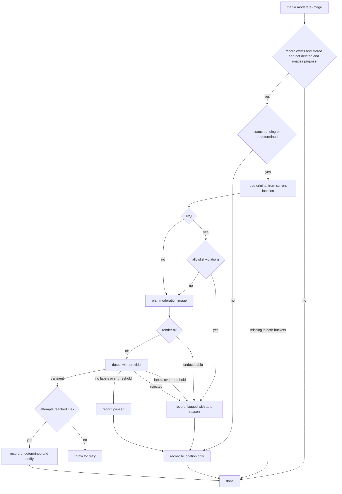

# 画像判定サービス(Amazon Rekognition)

アップロードされた画像を、Amazon RekognitionのDetectModerationLabelsで自動判定し、不適切な画像を公開から外す仕組みを定める。判定の流れ、判定用画像の作り方とSVGの描画、要求と応答、カテゴリと閾値、上限と料金、失敗の分類と再試行・未判定・日次の再依頼、運用者への通知、送る情報の範囲、IAMユーザーとポリシーの作成、AIサービスのオプトアウト、資格情報の漏えい時の手順、代替の判定を扱う。受付の検証とSVGの許可リストは「[アップロードの安全対策](../security/005-file-upload-security.md)」に、隔離した画像の配信の停止とパージは「[画像の変換配信とエッジキャッシュ](../infra/008-image-delivery.md)」に、非同期メッセージの仕組みは「[非同期処理の設計](../infra/003-async-processing.md)」に従う。

## 前提と用語

判定は、アップロードの受付処理が送るメッセージ`media.moderate-image`の処理の中だけで行う。アップロードの応答は判定を待たず、画像は判定の前から配信される。判定サービスの障害はアップロードと配信を止めず、判定は再試行と日次のジョブで回復する。

| 部品                                                                         | 置き場所                                                         | 役割                                                                             |
| ---------------------------------------------------------------------------- | ---------------------------------------------------------------- | -------------------------------------------------------------------------------- |
| `ModerationProvider`・`ModerationImageRenderer`・`MediaIncidentReporter`など | `<メッセージを受信するアプリ>`の`src/application/media/ports.ts` | 判定サービス・判定用画像の描画・通知などの差し替え口                             |
| `ModerateImageHandler`・`MODERATION_RETRY_POLICY`                            | `<メッセージを受信するアプリ>`の`src/application/media/`         | 判定のメッセージの処理と再試行の規則(`moderate-image-handler.ts`)                |
| `MODERATION_CATEGORIES`・`parseModerationConfig`                             | `<メッセージを受信するアプリ>`の`src/application/media/`         | カテゴリと閾値の設定の解析(`moderation-config.ts`)                               |
| `judgeLabels`                                                                | `<メッセージを受信するアプリ>`の`src/application/media/`         | ラベルの判定(`moderation-verdict.ts`)                                            |
| `planModerationImage`・`MODERATION_IMAGE_LIMITS`                             | `<メッセージを受信するアプリ>`の`src/application/media/`         | 判定用画像の作り方の決定(`moderation-image-plan.ts`)                             |
| `padRgba`・`encodePng`                                                       | `<メッセージを受信するアプリ>`の`src/application/media/`         | 余白付きの判定用画像のPNGの符号化(`png-encoder.ts`)                              |
| `prepareSvgForRendering`                                                     | `<メッセージを受信するアプリ>`の`src/application/media/`         | SVGのルートの寸法の書き直し(`svg-render-size.ts`)                                |
| `inspectSvg`                                                                 | `<メッセージを受信するアプリ>`の`src/application/media/`         | SVGの許可リストの検査(`svg-allowlist.ts`)                                        |
| `decideStubModeration`                                                       | `<メッセージを受信するアプリ>`の`src/application/media/`         | 代替の判定の規則(`stub-moderation-rules.ts`)                                     |
| `WasmModerationImageRenderer`                                                | `<メッセージを受信するアプリ>`の`src/infrastructure/media/`      | 判定用画像の描画(ラスター画像は`wasm-image-optimization`、SVGは`@cf-wasm/resvg`) |
| `RekognitionModerationProvider`                                              | `<メッセージを受信するアプリ>`の`src/infrastructure/media/`      | DetectModerationLabelsの呼び出し(署名・打ち切り・失敗の分類を含む)               |
| `StubModerationProvider`                                                     | `<メッセージを受信するアプリ>`の`src/infrastructure/media/`      | 外部へ送らない代替の判定                                                         |
| `createModerationProvider`                                                   | `<メッセージを受信するアプリ>`の`src/infrastructure/media/`      | 環境の変数で実装を選ぶ                                                           |
| `SentryMediaIncidentReporter`                                                | `<メッセージを受信するアプリ>`の`src/infrastructure/media/`      | 未判定・判定サービスが受け付けない画像・設定の誤りをエラートラッキングへ送る     |

| 用語                                     | 意味                                                                                                                                     |
| ---------------------------------------- | ---------------------------------------------------------------------------------------------------------------------------------------- |
| 判定用画像                               | 判定サービスへ送るために原本から作る、JPEGまたはPNGの画像。原本は書き換えない                                                            |
| 判定の状態                               | ファイルの記録の状態。判定待ち(`pending`)・問題なし(`passed`)・不適切(`flagged`)・未判定(`undetermined`)と、判定の対象外(`not_required`) |
| 自動判定の隔離理由                       | 不適切と判定した画像に付ける隔離理由`auto`。隔離理由が1つでもある画像は隔離バケットへ移り、配信が止まる                                  |
| 一時的な失敗                             | 時間を置けば解ける失敗。再試行し、上限の試行で未判定にする                                                                               |
| 恒久的な失敗                             | 同じ画像では解けない失敗(復号できない・判定サービスが受け付けない)。不適切として隔離する                                                 |
| `<判定の実装の変数>`                     | `<メッセージを受信するアプリ>`の変数で、`rekognition`(判定サービスを呼ぶ)か`stub`(代替の判定)を指定する                                  |
| `<判定のリージョンの変数>`               | 判定サービスのリージョン(`<判定のリージョン>`)を持つ変数                                                                                 |
| `<判定の閾値の変数>`                     | ラベルの信頼度の閾値(0〜100)を持つ変数                                                                                                   |
| `<判定のカテゴリの変数>`                 | 不適切とする最上位のカテゴリを、カンマ区切りで持つ変数                                                                                   |
| `<判定サービスの資格情報のシークレット>` | 判定サービスのIAMユーザーのアクセスキーIDとシークレットアクセスキーを持つ、2つのシークレット                                             |

- 変数・シークレットの本プロジェクトでのキーの名前と各環境の値は、技術ドキュメントに写さず、プロジェクト固有の値の文書の「[バインディング・変数・シークレット](../../../onboardings/project-values.md#バインディング変数シークレット)」と「[Workerのシークレットのキーの一覧](../../../onboardings/project-values.md#workerのシークレットのキーの一覧)」に置く。

## 判定の流れ



1. 記録が無い・保存未完了・論理削除済み・削除待ち・画像用の用途でない場合は、何もせずに完了する。
2. 判定の状態が判定待ち・未判定でなければ判定し直さず、保存先を隔離理由に合わせてそろえるだけにする。重複の配送と、管理者が自動判定の隔離理由を外した後の依頼で、画像を再び隔離しないためである。
3. 現在の保存先から原本を読む。見つからなければ他方のバケットから読み、両方に無ければ完了する。
4. SVGは許可リストを検査し、違反があれば検出内容を付けて不適切とする(「[SVGの構文と許可リスト](../security/005-file-upload-security.md#svgの構文と許可リスト)」)。
5. 判定用画像を作り(「[判定用画像](#判定用画像)」)、判定サービスで判定する。
6. 判定の記録は、状態が判定待ち・未判定の場合だけ書く条件付きの更新とし、不適切の場合は自動判定の隔離理由の追加と同じ一括実行(`db.batch()`)にまとめる。同じ依頼が2回処理されても結果は1回分だけ記録される。
7. 判定の結果によらず、最後に保存先を隔離理由に合わせてそろえる(不適切なら隔離バケットへ移し、エッジキャッシュをパージする)。

## 判定用画像

`planModerationImage`は、原本の形式・寸法・バイト数から次の3つの作り方を選ぶ。寸法はEXIFの向き5〜8で幅と高さを入れ替えた後の表示上の寸法である。寸法を読めないSVGは640×640として扱う。

| 作り方   | 条件                                                                    | 判定用画像                                                    |
| -------- | ----------------------------------------------------------------------- | ------------------------------------------------------------- |
| `as-is`  | JPEG・PNGで、長辺640px以下・短辺80px以上・5,242,880バイト以下           | 原本をそのまま送る                                            |
| `resize` | 長辺を640px以下に縮小した後(縮小が要らなければそのまま)、短辺が80px以上 | 縮小した画像。JPEG原本はJPEG、他はPNG                         |
| `pad`    | 縮小した後に短辺が80px未満                                              | 縮小した画素を、各辺80px以上の白いキャンバスの中央に置いたPNG |

- 上限は`MODERATION_IMAGE_LIMITS`(`maxLongSide` 640・`minSide` 80・`maxBytes` 5,242,880)である。`maxBytes`は判定サービスの`Image.Bytes`の最大長、`minSide`は判定サービスが受け付ける各辺の下限である。
- 縮小後の各辺は1px以上に保ち、極端な縦横比でも0pxにしない。小さいSVGは拡大せず、80×80の余白の中央に置く。
- GIF・WebPのアニメーションは最初のフレームだけを使う。
- ラスター画像(JPEG・PNG・GIF・WebP)は`wasm-image-optimization`の`optimizeImage`で縮小する。`resize`はJPEGかPNG、`pad`はRGBAの画素(`raw`)で受け取り、`padRgba`・`encodePng`(`CompressionStream('deflate')`)でPNGにする。読み込めない画像は恒久的な失敗(`undecodable`)として隔離する。
- 読み込み以外の描画の例外(符号化の失敗・wasmの実行時の失敗)は、型で読み込みの失敗と区別できないため隔離にせず投げ、メッセージの再試行の後にデッドレターへ移る(既知の制限)。

### SVGの判定用画像の描画

ブラウザの``と判定用画像の描画の差を小さくするため、SVGは`@cf-wasm/resvg`(resvgのwasm版)で描く。

- 描く前に、`prepareSvgForRendering`がルートの開始タグだけを書き直す。
  - `width`・`height`・`viewBox`は、受付の寸法の読み取りと同じブラウザの解釈(「[寸法と画素数](../security/005-file-upload-security.md#寸法と画素数)」)で、resvgが同じに読む書き方(画素数・`em`・`ex`・4つの数値)にする。ブラウザが無効とする値・百分率・換算しない単位・`ch`は取り除き、resvgの方が寛容な値でブラウザより狭い範囲を描かせない。
  - ブラウザの``がルートに適用しない`display`と、resvgと別の座標で適用される`transform`は、属性とstyleの宣言から取り除く。文書内のスタイルシートの指定も打ち消すよう、style属性の末尾に`display:inline;transform:none`を足す(ブラウザより多くの内容を描く側にそろえる)。
- resvgには文字の既定の大きさとしてブラウザと同じ16pxを渡し、`em`・`ex`を同じ大きさで解釈させる。
- resvg自身が解釈した寸法の縦横比のまま、作り方の幅・高さの箱に収まるよう`fitTo`(幅、収まらなければ高さ)で描く。描く画素は箱の大きさまでで、宣言の寸法が大きくても確保しない。乗算済みの画素を戻し、`resize`は作り方の寸法、`pad`はキャンバスの中央に置いて白で埋め、PNGにする。
- 幅・高さ・`viewBox`の無いSVGも、resvgは原点から内容の右下の端までを描く(ブラウザの既定の箱より広い)ため隔離しない。
- ルートを読めないSVGと、resvgが読み込めない文書(XMLの構文・表示領域の大きさ・要素の数の上限(`<use>`の展開を含む)・UTF-8・gzip)は、恒久的な失敗(`undecodable`)として隔離する。
- wasm版のresvgは書体を持たないため、ラテン文字の再配布可能な書体(Liberation Sans 2.1.5のRegular、SIL Open Font License 1.1)を同梱し、`fontBuffers`で渡して`<text>`を描く。Wrangler設定の`rules`で`.ttf`をDataのモジュールとして読む。この規則には`"fallthrough": true`を付け、Wranglerの既定のDataの規則(`**/*.bin`)が無視されないようにする(付けないと起動とビルドのたびに既定の規則を無視する旨の警告が出る)。書体を1つだけ渡すため、`font-family`の指定に関わらずこの書体で描かれる。
- `<image>`のdata URIは、resvgが描くPNG・JPEG・GIFだけを許可リストで許す。
- 受付と許可リストの検査が許した標準の文書型宣言(「[SVGの文書型宣言](../security/005-file-upload-security.md#svgの文書型宣言)」)は取り除かず、宣言を含む本文をresvgへ渡す。resvgは外部のDTDを読まない。未宣言の実体参照を含む文書はresvgが読み込めず、恒久的な失敗として隔離する。

### 描画の既知の制限

判定用画像とブラウザの描画で見え方が分かれる書き方のうち、差分の比較で分かった既知のものは許可リストの違反にして隔離する。網羅は保証せず、次の書き方は判定をすり抜ける既知の制限である(独立のレビューの標本73件のうち28件)。一覧は「[許可リストの既知の制限](../security/005-file-upload-security.md#許可リストの既知の制限)」に置く。

- 書体に無い文字(日本語など)は代替の四角形で描かれ、文字の形は判定されない。
- 描画器が適用しブラウザが適用しないもの(`media="print"`の`style`要素、存在しない要素を指す`filter`、`clipPath`以外の要素を指す`clip-path`、`font:`の一括指定)。
- 描画器が対応しないCSSのセレクター(`~`・`:last-child`・`:root`・`:empty`・`:only-of-type`・無効なセレクターを含む一覧・CSSのエスケープ・属性セレクターの`i`・CDATAの中のCDO・CDC)。
- 値の大文字小文字の扱い(`display="None"`など)と、`href`と`xlink:href`を併用した場合の優先順位。
- data URIの申告の形式と中身の不一致(`data:image/png`と申告したWebPなど)。
- 描画器が対応しないプロパティ(`transform-origin`・`transform-box`・`vector-effect`)。
- 表示する箱の縦横比が画像と違う表示(`object-fit`の無い固定の大きさの``)では、`viewBox`の外の帯がブラウザにだけ見える。画面は縦横比を保って画像を表示する。

影響は不適切な画像の判定のすり抜けに限り、SVGの配信のCSPによりスクリプトの実行や外部の読み込みには及ばない。

## DetectModerationLabelsの要求と応答

### 要求

`RekognitionModerationProvider`は、`POST https://rekognition.<判定のリージョン>.amazonaws.com/`へ次の本文を送る。

```json
{
  "Image": { "Bytes": "<判定用画像のbase64>" },
  "MinConfidence": <閾値>
}
```

- ヘッダーは`content-type: application/x-amz-json-1.1`と`x-amz-target: RekognitionService.DetectModerationLabels`で、`aws4fetch`の`AwsClient.sign`(サービス`rekognition`・`<判定のリージョンの変数>`のリージョン)でSigV4の署名を付ける。署名の対象のヘッダーは`host;x-amz-date;x-amz-target`になる。
- `AwsClient.fetch`は大域の`fetch`で最大10回まで自前で再試行するため使わず(`retries: 0`)、署名だけに使う。再試行はメッセージの再試行の規則に任せる(「[再試行と未判定](#再試行と未判定)」)。
- `AbortSignal.timeout`で10秒(既定の`timeoutMs`、10,000ミリ秒)で打ち切る。打ち切りは応答の本文の読み取り中にも働く。
- `fetch`は`createModerationProvider(env, fetcher)`の引数で受け取り、合成ルートが大域の`fetch`を渡す。workerdの`fetch`は別のオブジェクトのメソッドとして呼ぶと不正な呼び出しになるため、受け取った関数を変数に取り出して呼ぶ。
- リージョンは宛先のホスト名に埋め込むため、AWSのリージョン名の形(`^[a-z]{2}(?:-[a-z]+)+-\d+$`)だけを受け付け、別のホストへ送らない。

### 応答の読み方

200の応答はZodで検証し、`ModerationLabels`の各要素の次の項目だけを読む。

| 項目            | 使い方                                              |
| --------------- | --------------------------------------------------- |
| `Name`          | ラベルの名前(空でない文字列)                        |
| `ParentName`    | 親のラベルの名前。最上位のラベルでは空か無い        |
| `Confidence`    | 信頼度(0〜100)                                      |
| `TaxonomyLevel` | 階層(1が最上位のカテゴリ)。正の整数で、無ければ不正 |

- 判定サービスは検出が無い時も空の`ModerationLabels`を返す。`ModerationLabels`の無い応答と、形の合わない応答(`TaxonomyLevel`の無いラベルを含む)は、検出なし(公開のまま)に倒さず、一時的な失敗(`service-error`)にする。
- 本文がJSONでなくても状態コードとヘッダーで分類できるよう、本文の解析の失敗は本文なしとして扱う。

## カテゴリと閾値

`judgeLabels`は、各ラベルの`ParentName`をたどって最上位のカテゴリを求め、カテゴリが`<判定のカテゴリの変数>`に含まれ、信頼度が`<判定の閾値の変数>`以上のラベルを検出内容にする。検出内容が1つでもあれば不適切、無ければ問題なしとする。

- 閾値ちょうどの信頼度は不適切に含める。判定サービスにも`MinConfidence`として同じ閾値を渡し、閾値未満のラベルを返させない。
- 判定サービスは下位のラベルとともに祖先も返すが、親が応答に無い場合への防御として、その親の名前を最上位とみなす。第3階層だけが返り第2階層が欠けた場合は最上位を求められず、そのラベルは`<判定のカテゴリの変数>`の何れにも当たらないため、問題なしと判定され得る。判定サービスの文書は祖先も返すと定めるため、既知の制限として対応表を持たない(対応表は判定モデルの版ごとに保守が要る)。
- 検出内容は、カテゴリ・ラベル・信頼度を記録に残す(管理者の確認に使う)。

最上位のカテゴリは次の10種(`MODERATION_CATEGORIES`)である。

| カテゴリ                                            |
| --------------------------------------------------- |
| `Explicit`                                          |
| `Non-Explicit Nudity of Intimate parts and Kissing` |
| `Swimwear or Underwear`                             |
| `Violence`                                          |
| `Visually Disturbing`                               |
| `Drugs & Tobacco`                                   |
| `Alcohol`                                           |
| `Rude Gestures`                                     |
| `Gambling`                                          |
| `Hate Symbols`                                      |

- 初期値は、全10カテゴリと閾値60である。サービスの方針に合わせて、カテゴリを減らすか閾値を上げる。
- `<判定の閾値の変数>`は0〜100の数値の文字列(`^\d+(?:\.\d+)?$`)、`<判定のカテゴリの変数>`はカンマ区切りで、各項目の前後の空白を除いた値が10種のいずれかと大文字小文字まで一致し、空の項目と重複が無いものだけを受け付ける。空の集合で判定が黙って無効になるのを防ぐためである。
- 環境の検証が判定の処理と同じ解析関数で値を確かめ、誤りは処理の始まる前に失敗させる(「[環境の検証](../backend/002-layered-architecture-on-workers.md#環境の検証)」)。
- カテゴリと閾値を変えても、判定済みの画像は判定し直されない。変更は次のアップロードから効く。

## 上限と料金

| 項目           | 値                                                                                 |
| -------------- | ---------------------------------------------------------------------------------- |
| 入力の形式     | JPEG・PNGだけ                                                                      |
| 入力のバイト数 | 5,242,880バイトまで(`Image.Bytes`をbase64で送る場合の復号後の長さ)                 |
| 入力の寸法     | 各辺80px以上                                                                       |
| 要求の数       | アカウント・リージョンごとの毎秒の要求数の割り当て(既定値はリージョンにより異なる) |
| 料金           | 判定した画像1枚ごと。DetectModerationLabelsは画像の判定のAPIの料金の区分に入る     |

- 1件の判定は判定サービスの1要求である。一時的な失敗の再試行も1要求ずつ数える。Queueのconsumerは1回の起動で最大10件の束を受け、1件ずつ処理する。
- 料金の目安は、判定のログ(カテゴリ`[<アプリ名>, 'media', 'moderation']`)のうち、判定サービスを呼んだ結果(`passed`・`flagged`のうち判定サービスの結果によるもの、`retrying`・`undetermined`)の件数で見積もる。原本の形式・寸法によらず1枚あたりの料金は同じである。
- 値は変わり得る。確かめるときはAWSの文書「[Guidelines and quotas](https://docs.aws.amazon.com/rekognition/latest/dg/limits.html)」「[Amazon Rekognition pricing](https://aws.amazon.com/rekognition/pricing/)」と、Service Quotasのコンソールを見る。

## 失敗の分類

`RekognitionModerationProvider`は、判定サービスの結果を`ModerationOutcome`の次の種類に分類する。エラーの種類の名前は、ヘッダー`x-amzn-errortype`、無ければ本文の`__type`か`code`から取り、`名前空間#名前`・`名前:URI`の形の名前の部分だけを使う。種類の名前による分類を、状態コードによる分類より優先する。

| エラーの種類・状態コード・事象                                                            | 結果の種類                      | 扱い         |
| ----------------------------------------------------------------------------------------- | ------------------------------- | ------------ |
| 200で応答の形が合う                                                                       | `labels`(ラベルの一覧)          | 判定する     |
| `ThrottlingException`・`ProvisionedThroughputExceededException`・`LimitExceededException` | `transient`(`throttled`)        | 一時的な失敗 |
| 種類の名前が無いか未知で、状態コード429                                                   | `transient`(`throttled`)        | 一時的な失敗 |
| `InternalServerError`                                                                     | `transient`(`service-error`)    | 一時的な失敗 |
| 種類の名前が無いか未知で、状態コード500以上                                               | `transient`(`service-error`)    | 一時的な失敗 |
| 200で応答の形が合わない(`ModerationLabels`が無い・`TaxonomyLevel`の無いラベルを含むなど)  | `transient`(`service-error`)    | 一時的な失敗 |
| 打ち切り(10秒)                                                                            | `transient`(`timeout`)          | 一時的な失敗 |
| 通信の例外                                                                                | `transient`(`network`)          | 一時的な失敗 |
| `AccessDeniedException`・`UnrecognizedClientException`・`InvalidSignatureException`       | `transient`(`misconfigured`)    | 設定の誤り   |
| 種類の名前が無いか未知で、上の表に無い状態コード(400・403などの4xx、3xx)                  | `transient`(`misconfigured`)    | 設定の誤り   |
| `ImageTooLargeException`                                                                  | `rejected`(`too-large`)         | 恒久的な失敗 |
| `InvalidImageFormatException`                                                             | `rejected`(`invalid-image`)     | 恒久的な失敗 |
| `InvalidParameterException`                                                               | `rejected`(`invalid-parameter`) | 恒久的な失敗 |

- 設定の誤り(資格情報・権限・署名の誤り)は、資格情報を直せば解けるため一時的な失敗と同じく再試行し、加えてエラートラッキングへエラーとして送る。
- 恒久的な失敗は、判定サービスが画像として受け付けない画像で、同じ画像を送り直しても変わらないため隔離する。判定用画像の作り方が上限を守るため、通常は起きない。
- 通信の例外の内容は署名した要求の情報を含み得るため、結果には失敗の種類(`timeout`・`network`)だけを残す。
- 配信のための画像の変換の失敗(変換基盤のエラーコード)は判定サービスと別の分類で、「[変換の失敗の分類](../infra/008-image-delivery.md#変換の失敗の分類)」に従う。

## 再試行と未判定

判定の処理は、結果ごとに次のように記録・再試行・通知する。

| 結果                                   | 判定の状態     | 隔離理由     | 再試行 | 運用者への通知                           |
| -------------------------------------- | -------------- | ------------ | ------ | ---------------------------------------- |
| 検出内容なし                           | `passed`       | なし         | しない | しない                                   |
| 閾値以上の検出内容あり                 | `flagged`      | `auto`を追加 | しない | しない                                   |
| SVGの許可リストの違反                  | `flagged`      | `auto`を追加 | しない | しない                                   |
| 復号できない(`undecodable`)            | `flagged`      | `auto`を追加 | しない | しない(`warning`のログだけ)              |
| 判定サービスが受け付けない(`rejected`) | `flagged`      | `auto`を追加 | しない | `rejectedByService`(`warning`)           |
| 一時的な失敗(試行回数が上限未満)       | 判定待ちのまま | 変えない     | する   | しない(`warning`のログだけ)              |
| 一時的な失敗(上限の試行)               | `undetermined` | 変えない     | しない | `undetermined`(`warning`)                |
| 設定の誤り(上限の試行)                 | `undetermined` | 変えない     | しない | `undetermined`と`misconfigured`(`error`) |

- 一時的な失敗の間は、画像を公開したまま保存先を動かさない。
- 再試行は、例外(`ImageModerationRetryError`、画像の情報を含まない)を投げて非同期メッセージの再試行の規則に委ねる(「[再試行](../infra/003-async-processing.md#再試行)」)。メッセージの処理の登録には`retry: MODERATION_RETRY_POLICY`を渡す。

| 項目                 | 値                                   |
| -------------------- | ------------------------------------ |
| `maxAttempts`        | 5回                                  |
| `baseDelaySeconds`   | 60秒                                 |
| `maxDelaySeconds`    | 1,800秒                              |
| 再試行の間隔         | 60秒・120秒・240秒・480秒(合計900秒) |
| 未判定を記録する試行 | 5回目の試行の一時的な失敗            |

- 既定の規則(30秒起点)より長い間隔にするのは、判定サービスの一時的な障害や処理量の上限が解けるまで待つためである。5回目の試行では例外にせず未判定を記録して完了し、デッドレターへ移さない。デッドレターでは本文が捨てられ、判定の依頼が失われるためである。
- 未判定と通知は、判定の記録を書けた場合(状態が判定待ち・未判定だった場合)だけ送る。設定の誤りの通知は最後の試行でだけ送るため、最初の失敗から最大900秒遅れる。
- D1・R2の失敗など判定サービス以外の想定外の例外は、同じ規則で再試行され、上限でデッドレターへ移る。

### 未判定と日次の再依頼

`<定期実行を受け持つアプリ>`の日次のジョブ`media-pipeline.moderation-requeue`が、次の画像の判定を`media.moderate-image`で依頼し直す。

- 判定の状態が未判定の画像と、作成から1時間を超えて(予定時刻から1時間より前に作成。ちょうどは含めない)判定待ちのままの画像。論理削除済み・削除待ちは除く。
- 1回の起動で最大1,000件まで依頼し、超えた分は翌日に回す。ログに件数と続きの有無を出す。
- 1件の送信に失敗しても残りを続け、最後に例外で失敗を知らせる。
- 未判定の画像は、判定されるまで公開のままである。判定サービスの長い障害や設定の誤りの間は、日次の再依頼で回復を待つ。

### 運用者への通知

| 事象                           | ログのレベル | エラートラッキング                                                                                                             |
| ------------------------------ | ------------ | ------------------------------------------------------------------------------------------------------------------------------ |
| 一時的な失敗(再試行)           | `warning`    | 送らない(障害時の通知の洪水を避ける)                                                                                           |
| 未判定                         | `warning`    | `captureEvent`(`warning`)。文言「画像を判定できず、未判定として記録しました」、指紋`['media-moderation-undetermined', <理由>]` |
| 判定サービスが受け付けない画像 | `warning`    | `captureEvent`(`warning`)。文言「判定サービスが画像を受け付けず、隔離しました」、指紋`['media-moderation-rejected', <理由>]`   |
| 設定の誤り                     | `error`      | `captureEvent`(`error`)。文言「判定サービスの設定に誤りがあります」、指紋`['media-moderation-misconfigured', <理由>]`          |
| 復号できない画像               | `warning`    | 送らない                                                                                                                       |

- タグは、未判定と判定サービスが受け付けない画像では`media_file_id`(ファイルの識別子)と`moderation_reason`(理由)、設定の誤りでは`moderation_reason`だけである。
- 同じ理由の失敗は判定サービスの障害や設定に共通するため、指紋をファイルごとに分けず、理由で1つの問題にまとめる。
- エラートラッキングへは`captureMessage`ではなく`captureEvent`で送り、文言を`logentry`に置く(「[同じ文言を繰り返し送る通知](../infra/004-logging-and-error-tracking.md#同じ文言を繰り返し送る通知)」)。
- タグと指紋は除去処理の対象外のため、ファイルの識別子はULIDの形の値、理由は既知の分類の値(`throttled`・`service-error`・`timeout`・`network`・`misconfigured`・`invalid-image`・`too-large`・`invalid-parameter`)だけを送り、それ以外は`unknown`にする。
- 設定の誤りの多くは、アクセスキーの誤り・無効化(`UnrecognizedClientException`)、シークレットアクセスキーの誤り(`InvalidSignatureException`)、ポリシーの不足やリージョンの条件の不一致(`AccessDeniedException`)である。資格情報とポリシーを直した後、未判定の画像は日次の再依頼で判定し直される。

## 送る情報の範囲

判定サービスへ送るのは、判定用画像のバイト列と閾値だけである。元のファイル名・ファイルの識別子・オブジェクトキー・アップロードした主体の情報・原本(判定用画像と同じ場合を除く)は送らない。

- メッセージ`media.moderate-image`の本文はファイルの識別子だけで、処理が記録を読み直す。
- ログには、ファイルの識別子・結果・試行回数・所要時間・判定用画像の作り方・ラベルと検出内容の件数・失敗の種類だけを出し、ファイル名・オブジェクトキー・画像の内容・資格情報を出さない(「[カテゴリ](../infra/004-logging-and-error-tracking.md#カテゴリ)」)。
- 判定サービスは`<判定のリージョン>`で処理する。送る情報と処理する国は、プライバシーポリシーなどに記載した委託先への提供の範囲・国外移転の記載と一致させる。
- 判定サービスが送られた画像を保存・サービスの改善に使わないよう、AIサービスのオプトアウトを有効にする(「[AIサービスのオプトアウト](#aiサービスのオプトアウト)」)。

## 資格情報の渡し方とIAM

- 資格情報は`<判定サービスの資格情報のシークレット>`として`<メッセージを受信するアプリ>`だけに置き、シークレット管理で管理する(「[シークレットの注入](../security/001-secret-management.md#シークレットの注入)」)。判定サービスを呼ぶstaging・prodでは、Wrangler設定の`env.<環境種別>.secrets.required`にキーを挙げる。代替の判定を使うローカル環境では、ルートの`secrets.required`に挙げず、シークレット管理のローカル用の環境にも登録しない。
- `secrets.required`に挙げたキーは、デプロイ先のWorkerに設定済みでないとデプロイが失敗する。キーを`secrets.required`に加える変更は、シークレット管理のその環境へキーを登録してからマージする(「[シークレットの登録の規則](../operations/001-deployment.md#シークレットの登録の規則)」)。
- `<判定の実装の変数>`が`rekognition`の環境では、環境の検証が2つのシークレット(空でない文字列)を必須にし、実装の選択(`createModerationProvider`)も欠けたキーの名前だけを示す例外で失敗する。
- 資格情報はログ・例外・エラートラッキング・Wrangler設定に含めない。

### IAMユーザーとポリシーを作る

判定の呼び出しだけを許す専用のIAMユーザーを、環境(staging・prod)ごとに手作業で作る。資格情報の作成とシークレット管理への登録は開発者が行い、AIエージェントは行わない。

1. AWSのコンソールのIAMで、次のポリシー(`<判定のIAMポリシー名>`)を作る。DetectModerationLabelsはリソース単位の権限を持たないため`Resource`は`*`とし、`aws:RequestedRegion`で`<判定のリージョン>`に限る。

   ```json
   {
     "Version": "2012-10-17",
     "Statement": [
       {
         "Effect": "Allow",
         "Action": "rekognition:DetectModerationLabels",
         "Resource": "*",
         "Condition": {
           "StringEquals": { "aws:RequestedRegion": "<判定のリージョン>" }
         }
       }
     ]
   }
   ```

2. コンソールへのアクセスを持たないIAMユーザー(`<判定のIAMユーザー名>`)を作り、1のポリシーだけを付ける。グループや他のポリシーを付けない。
3. ユーザーの**Security credentials**で、用途に「Application running outside AWS」を選んでアクセスキーを作る。シークレットアクセスキーは作成時にだけ表示されるため、その場でシークレット管理の該当する環境へ`<判定サービスの資格情報のシークレット>`として登録し、手元に残さない。
4. 次のデプロイでWorkerのシークレットへ反映する(「[デプロイ時のWorkerのシークレット](../security/001-secret-management.md#デプロイ時のworkerのシークレット)」)。
5. 反映の後、動作確認の経路で通常の画像をアップロードし、判定の状態が`passed`になることを確かめる(「[判定サービスとの疎通](#判定サービスとの疎通)」)。

- アクセスキーの有効期限は無いため、定期的に作り直す。作り直しは「[資格情報の漏えい時の手順](#資格情報の漏えい時の手順)」の2〜6と同じである。
- stagingとprodで同じIAMユーザーを使わない。漏えい時に片方の環境だけを止められるようにするためである。

### AIサービスのオプトアウト

Rekognitionは、送られた画像をサービスの開発・改善のために保存・利用し得る。AWS OrganizationsのAIサービスのオプトアウトポリシーで、これを止める。設定は開発者が手作業で行う。

1. 判定サービスを呼ぶAWSアカウントをAWS Organizationsの組織に含める(単独のアカウントでは、組織を作ってそのアカウントを管理アカウントにする)。
2. 管理アカウントの**AWS Organizations** → **Policies**で、**AI services opt-out policies**を有効にする。
3. 次のポリシーを作り、組織のルート(または判定サービスを呼ぶアカウント)に付ける。

   ```json
   {
     "services": {
       "default": {
         "opt_out_policy": { "@@assign": "optOut" }
       }
     }
   }
   ```

4. 判定サービスを呼ぶアカウントで、有効なポリシーを確かめる。

   ```sh
   aws organizations describe-effective-policy \
     --policy-type AISERVICES_OPT_OUT_POLICY \
     --target-id <AWSのアカウントID>
   ```

- `default`は全てのAIサービスに効く。Rekognitionだけに限る場合は`default`の代わりに`rekognition`を書く。
- オプトアウトの前に送った画像の扱いは、AWSの文書に従う。オプトアウトを確かめてから判定サービスを有効にした変更をマージする。

### 資格情報の漏えい時の手順

アクセスキーが漏れた(ログ・リポジトリ・チャットに貼った、端末を失くしたなど)と分かったら、次の順で対処する。

1. IAMで、漏れたアクセスキーを**Inactive**にする(`aws iam update-access-key --user-name <判定のIAMユーザー名> --access-key-id <漏れたアクセスキーID> --status Inactive`)。この時点から判定は設定の誤り(`UnrecognizedClientException`)になり、画像は未判定のまま公開される。
2. 同じユーザーに新しいアクセスキーを作る(1つのユーザーが持てるアクセスキーは2つまで)。
3. 新しいキーを、シークレット管理の該当する環境の`<判定サービスの資格情報のシークレット>`へ登録する。
4. デプロイしてWorkerのシークレットへ反映する。CIのデプロイでシークレットを反映する構成ではmainへのマージかリリースのデプロイで、急ぐ場合は`wrangler secret put <キー> --env <環境種別>`で設定する。
5. 動作確認の経路で判定が`passed`になることを確かめ、漏れたアクセスキーを削除する。
6. CloudTrailで、漏れたアクセスキーの利用を確かめる(`aws cloudtrail lookup-events --lookup-attributes AttributeKey=AccessKeyId,AttributeValue=<漏れたアクセスキーID>`)。ポリシーが判定の呼び出しだけに限るため、漏れた資格情報でできることは料金の発生と、判定の呼び出しを通じた情報の取得に限られる。想定外の利用があれば、請求とService Quotasの使用量も確かめる。
7. 1〜5の間に未判定になった画像は、日次の再依頼で判定し直される。急ぐ場合は、未判定の画像を動作確認の経路などで確かめる。

## 代替の判定

`<判定の実装の変数>`を`stub`にした環境(ローカル環境と、ローカル環境に対して動くE2Eテスト・Workers統合テスト)では、`StubModerationProvider`が外部へ送らず、判定用画像の寸法だけで結果を決める。資格情報を持たない開発者もアプリを起動でき、各経路を再現できる。

| 判定用画像の寸法 | 結果                                                           |
| ---------------- | -------------------------------------------------------------- |
| 99×99            | 最上位のラベル`Explicit`・信頼度99の検出(初期値の設定で不適切) |
| 98×98            | 一時的な失敗(`throttled`)                                      |
| 97×97            | 判定サービスが受け付けない(`invalid-image`)                    |
| 寸法を読めない   | 判定サービスが受け付けない(`invalid-image`)                    |
| その他           | 検出なし(問題なし)                                             |

- 寸法は判定用画像のもので、原本の寸法ではない。99×99のJPEG・PNGは`as-is`でそのまま送られるため99×99になる。80px未満の画像は余白で80px以上になり、640pxを超える画像は縮小されるため、寸法の指定はJPEG・PNGの80〜640pxの正方形で行う。
- 98×98の画像は全ての試行で一時的な失敗になり、5回目の試行で未判定になる(再試行の間隔の合計は900秒)。
- 判定用画像の描画(wasm)は代替の判定でも実物を使うため、描画の経路はローカルでも確かめられる。
- `secrets`を定義したWrangler設定では、`wrangler dev`が`secrets.required`のキーだけを`env`へ渡す。ローカル環境で`<判定の実装の変数>`を`rekognition`に変えても、資格情報はルートの`secrets.required`に無いため届かず、環境の検証で失敗する。実際の判定サービスはstagingで確かめる。
- Workers統合テストで判定サービスの呼び出しを確かめるときは、`RekognitionModerationProvider`に偽の`fetch`を注入し、資格情報をテスト用の固定値にする。

## 判定サービスとの疎通

stagingで、トークン付きの動作確認の経路(`<画像の動作確認の経路>`)から判定サービスとの疎通を確かめる。経路の使い方と配信の確認は「[stagingでの確認](../infra/008-image-delivery.md#stagingでの確認)」に従う。

1. 通常の画像(人物を含まない風景の写真など)をアップロードし、状態の取得で`moderationStatus`が`passed`、`findings`が空になることを確かめる。
2. 設定のカテゴリに当たるが無害な画像(酒類の瓶の写真など、初期値の設定で`Alcohol`に当たるもの)をアップロードし、`moderationStatus`が`flagged`、`location`が隔離バケット、`findings`にカテゴリ・ラベル・信頼度が入ることを確かめる。
3. 判定のログ(カテゴリ`[<アプリ名>, 'media', 'moderation']`)で、`result`・`durationMs`・`planKind`を確かめる。
4. 状態が判定待ちのまま進まない場合は、判定のログの`reason`とエラートラッキングの指紋で原因を切り分ける。

| 表示                                      | 主な原因                                                                             |
| ----------------------------------------- | ------------------------------------------------------------------------------------ |
| 理由`misconfigured`(`error`の通知)        | アクセスキーの誤り・無効化、シークレットの未反映、ポリシーやリージョンの条件の不一致 |
| 理由`throttled`                           | 毎秒の要求数の割り当ての不足                                                         |
| 理由`service-error`・`timeout`・`network` | 判定サービスの障害や通信の一時的な失敗。時間を置いて再実行する                       |

## 参考資料

- AWSの「[DetectModerationLabels](https://docs.aws.amazon.com/rekognition/latest/APIReference/API_DetectModerationLabels.html)」「[Image](https://docs.aws.amazon.com/rekognition/latest/APIReference/API_Image.html)」「[Moderating content](https://docs.aws.amazon.com/rekognition/latest/dg/moderation.html)」
- AWSの「[Guidelines and quotas](https://docs.aws.amazon.com/rekognition/latest/dg/limits.html)」「[Amazon Rekognition pricing](https://aws.amazon.com/rekognition/pricing/)」
- AWSの「[AI services opt-out policies](https://docs.aws.amazon.com/organizations/latest/userguide/orgs_manage_policies_ai-opt-out.html)」「[Actions, resources, and condition keys for Amazon Rekognition](https://docs.aws.amazon.com/service-authorization/latest/reference/list_amazonrekognition.html)」「[Managing access keys for IAM users](https://docs.aws.amazon.com/IAM/latest/UserGuide/id_credentials_access-keys.html)」
- `aws4fetch`の「[README](https://github.com/mhart/aws4fetch)」、resvgの「[resvg](https://github.com/linebender/resvg)」
