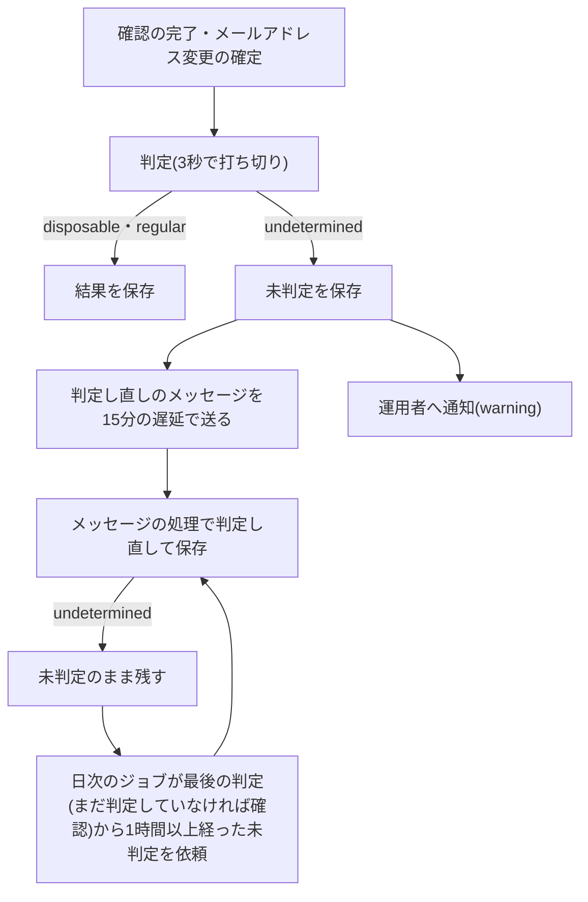

# 使い捨てメールアドレスの判定サービス(DISIFY)

利用者のメールアドレスが使い捨てメールアドレスのサービスのものかを、DISIFYのメールアドレスの判定APIで判定する仕組みを定める。要求と応答の分類、送る情報の範囲、APIキーの渡し方、上限と料金、障害時の「未判定」と判定し直し、テストでの差し替えを扱う。非同期メッセージと定期実行の仕組みは「[非同期処理の設計](../infra/003-async-processing.md)」に従う。

## 前提と用語

判定は、メールアドレスの確認が済んだ時点(登録の確認の完了と、メールアドレス変更の確定)で行い、結果を利用者の行に保存する。判定の結果で登録や確認を拒否せず、運営者が利用者を調べるときの材料にする。判定サービスの障害は、利用者の操作を失敗させない。

| 部品                                                             | 置き場所                                                                      | 役割                                                                    |
| ---------------------------------------------------------------- | ----------------------------------------------------------------------------- | ----------------------------------------------------------------------- |
| `DisposableEmailChecker`・`DisposableEmailStatus`                | 共通ライブラリの`core/identity/disposable-email.ts`                           | 判定の差し替え口と、判定の結果(`disposable`・`regular`・`undetermined`) |
| `toDisposableCheckAddress`・`DISPOSABLE_CHECK_LOCAL_PART`        | 共通ライブラリの`core/identity/disposable-email.ts`                           | ローカル部をダミーの文字列に置き換えたアドレスを作る                    |
| `classifyDisifyOutcome`                                          | 共通ライブラリの`core/identity/disposable-email.ts`                           | 応答・通信の失敗・時間切れを判定の結果に分類する                        |
| `createDisifyClient`・`DISIFY_EMAIL_URL`                         | 共通ライブラリの`workers/identity/disify-client.ts`                           | 判定APIの呼び出しと、判定できなかったことのログ                         |
| `SavingDisposableEmailCheck`・`DISPOSABLE_RECHECK_DELAY_SECONDS` | `<APIサーバーのアプリ>`の`src/application/identity/disposable-email-check.ts` | 確認の時点の判定と保存、「未判定」の判定し直しの依頼                    |
| `DisposableEmailRecheckHandler`                                  | `<メッセージを受信するアプリ>`の`src/application/identity/`                   | 判定し直しのメッセージの処理                                            |
| `DisposableRecheckSweepJob`・`DISPOSABLE_RECHECK_LIMIT`          | `<APIサーバーのアプリ>`の`src/application/identity/jobs/`                     | 「未判定」のまま残った利用者の判定し直しを依頼する日次のジョブ          |

| 用語                                          | 意味                                                                                        |
| --------------------------------------------- | ------------------------------------------------------------------------------------------- |
| 未判定                                        | 判定サービスでまだ判定していないか、使い捨てか通常かを決められなかった結果(`undetermined`)  |
| `<使い捨て判定のAPIキーのシークレットのキー>` | 判定サービスのAPIキーを持つシークレット。デプロイ先環境では必須、ローカル環境では省略できる |
| `<外部サービスへ名乗るUser-Agent>`            | 「[漏洩パスワードの照合サービス](004-pwned-passwords.md#前提と用語)」と同じ                 |

- `<使い捨て判定のAPIキーのシークレットのキー>`の本プロジェクトでのキーの名前と登録の状況は、技術ドキュメントに写さず、プロジェクト固有の値の文書の「[Workerのシークレットのキーの一覧](../../../onboardings/project-values.md#workerのシークレットのキーの一覧)」に置く。

## 要求と応答

### 要求

`createDisifyClient`が返す`DisposableEmailChecker.check(email)`は、`POST https://disify.com/api/email`(`DISIFY_EMAIL_URL`)へ、フォーム形式(`application/x-www-form-urlencoded`)の本文`email=<ローカル部を置き換えたアドレス>`を送る。

| ヘッダー     | 値                                                                                                                             |
| ------------ | ------------------------------------------------------------------------------------------------------------------------------ |
| `X-Api-Key`  | `<使い捨て判定のAPIキーのシークレットのキー>`の値。値が無ければ要求そのものを送らない(「[APIキーの渡し方](#apiキーの渡し方)」) |
| `User-Agent` | `<外部サービスへ名乗るUser-Agent>`                                                                                             |

- メールアドレスをURLのパスに入れる`GET /api/email/<アドレス>`は使わない。アクセスログやプロキシにアドレスが残らないよう、本文で送る。
- `AbortSignal.timeout`で3秒(既定の`timeoutMs`、3,000ミリ秒)で打ち切る。
- `fetch`は`createDisifyClient`のオプションで受け取り、合成ルートが呼び出し時に大域の`fetch`を引く関数を渡す。workerdの`fetch`は別のオブジェクトのメソッドとして呼ぶと不正な呼び出しになるため、受け取った関数を変数に取り出して呼ぶ。
- ログのカテゴリの先頭に使うアプリ名(`appName`)をオプションで受け取る(「[カテゴリ](../infra/004-logging-and-error-tracking.md#カテゴリ)」)。

### 応答の分類

判定サービスは、判定が完了すれば使い捨てでも状態コード200を返す。失敗の応答はJSONとは限らず(HTMLや別の形のJSONもある)、状態コードを先に確かめるよう案内されている。`classifyDisifyOutcome`は次のように分類する。

| 応答                                                                                    | 判定の結果     |
| --------------------------------------------------------------------------------------- | -------------- |
| 200で、本文がJSONのオブジェクト・`format`が`true`・`disposable`が`true`                 | `disposable`   |
| 200で、本文がJSONのオブジェクト・`format`が`true`・`disposable`が`false`                | `regular`      |
| 200でも上の形でない本文(JSONでない・`format`が`true`でない・`disposable`が真偽値でない) | `undetermined` |
| 200以外の状態コード(200以外の2xxを含む)                                                 | `undetermined` |
| 通信の失敗・時間切れ                                                                    | `undetermined` |

- 主な失敗の状態コードは、401(APIキーの誤り)・403(拒否・アカウントの停止)・422(処理できない入力)・429(上限の超過)・503(一時的な障害)である。いずれも`undetermined`にする。
- 判定できなかったときは、レベル`warning`のログに理由(`network-error`・`timeout`・`unexpected-status`・`unexpected-body`)と、応答があれば状態コードを残す。例外の内容は要求の情報を含み得るため残さない。
- `dns`・`confidence`などの他の項目は使わない。

## 送る情報の範囲

- ローカル部を固定のダミー(`DISPOSABLE_CHECK_LOCAL_PART`の`dummy`)に置き換え、`dummy@<ドメイン>`だけを送る。使い捨てかどうかはドメインで決まるため、ローカル部は判定に要らない。`@`を含まない値は、ドメインを空にした`dummy@`を送る。
- 利用者の識別子・元のローカル部を送らない。
- 判定の結果とアドレスをログに出さない。

## APIキーの渡し方

- 判定サービスはキー無しの匿名の利用も受け付けるが、上限が送信元IPアドレスごとに数えられる。Workersの送信元IPアドレスは他の利用者と共有され得るため、匿名の利用はしない。
- キーが未設定か空文字なら、`DisposableEmailChecker.check`は判定サービスを呼ばずに`regular`(通常)を返す。メールアドレスを外部へ送らず、「未判定」の保存・判定し直しの依頼・運用者への通知も起こらない。キーが無いのはローカル環境とテストだけである。
- デプロイ先環境(デプロイ先検証環境と本番環境)ではキーを必須にする。キーの登録を忘れると判定せずに通常として扱い続けるため、APIサーバーとメッセージを受信するアプリの環境の検証は、環境の種別がデプロイ先環境のときにキーの欠けと空文字を不備として起動時に止める。Wrangler設定では`env.staging`・`env.prod`の`secrets.required`にだけキーを加え、ルート(ローカル環境)には加えない。
- キーは無料のアカウントで発行できる。シークレットとして管理し、「[シークレットの注入](../security/001-secret-management.md#シークレットの注入)」に従ってWorkerへ渡す。
- キーは`X-Api-Key`ヘッダーで渡す(判定サービスは`Authorization: Bearer`も受け付ける)。URLのクエリに載せない。

## 上限と料金

| 種類                  | 毎分                       | 毎日                          | 毎月     |
| --------------------- | -------------------------- | ----------------------------- | -------- |
| 匿名(キー無し)        | 送信元IPアドレスごとに30回 | 送信元IPアドレスごとに1,000件 | 記載なし |
| 無料のアカウント      | アカウントごとに60回       | アカウントごとに10,000件      | 30,000件 |
| 有料のプラン(Starter) | アカウントごとに120回      | 記載なし                      | 上限なし |
| 有料のプラン(Pro)     | アカウントごとに500回      | 記載なし                      | 上限なし |

- 新しく作った無料のアカウントは、最初の24時間は毎分10回・毎日1,000件に制限される。
- 同じアカウントの全てのキーが、毎分の上限を共有する。
- 上限を超えると状態コード429になり、`undetermined`として扱う。
- 有料のプランの料金は判定サービスの料金のページで確かめる。
- 匿名(キー無し)の上限は比較のために載せる。この仕組みは匿名で呼ばない。
- 値は変わり得る。確かめるときはDISIFYの文書「[Rate limits](https://docs.disify.com/guide/rate-limits.md)」「[Authentication](https://docs.disify.com/guide/authentication.md)」を見る。

## 未判定と判定し直し

- 確認の時点で判定できなければ、「未判定」を保存して確認を完了させ、判定し直しのメッセージを15分(`DISPOSABLE_RECHECK_DELAY_SECONDS`、900秒)の遅延で送り、運用者へ通知する(「[運用者への通知](../security/006-authentication.md#運用者への通知)」)。メッセージの送信の失敗はログに残し、利用者の操作を失敗させない。
- メッセージの処理は、利用者が退会済み・未確認・判定済みなら何もせずに終える。判定し直した結果は、同じメールアドレス・未退会・確認済み・判定が確定していないことを条件にした更新で保存し、判定の間にメールアドレスが変わった利用者の結果を上書きしない。
- メッセージの処理で再び「未判定」になっても例外にせず、メッセージの再試行を使わない。判定サービスの障害が続く間に再試行とデッドレターの通知が増えるのを避け、日次のジョブで拾う。
- 利用者の作成時とメールアドレスの変更の確定では、判定を「未判定」、判定の日時を空にする。判定の値を「未判定」と別の空の状態に分けないため、確認の完了やメールアドレスの変更の確定の後に判定の保存そのものがデータベースの障害で失敗しても、利用者は「未判定」のまま日次のジョブの対象に残る。判定の日時を空にするのは、列の意味を「判定サービスへ問い合わせた日時」に保ち、まだ判定していない利用者と判定できなかった利用者を区別するためである。
- 日次のジョブは、判定が「未判定」で、最後の判定から1時間以上経った確認済みの未退会の利用者を、最後の判定の古い順(まだ判定していない利用者が先)に1回50件(`DISPOSABLE_RECHECK_LIMIT`)まで選び、判定し直しのメッセージを送る。まだ判定していない利用者は判定の日時を持たないため、確認の日時(メールアドレスの変更の確定でも更新される)から1時間以上経ったかで選ぶ。残りは翌日に続ける。

## テストでの差し替え

- アプリケーション層の単体テストは、`DisposableEmailChecker`の偽物を渡し、各判定の結果と「未判定」の後の依頼・通知を確かめる。
- `classifyDisifyOutcome`と`toDisposableCheckAddress`は単体テストで確かめる。
- `createDisifyClient`のWorkers統合テストは、オプションの`fetch`を差し替え、本文のアドレス・ヘッダー・各応答の分類・時間切れと、キーが無ければ判定サービスを呼ばずに`regular`を返すことを確かめる。
- 経路やメッセージの処理を通すWorkers統合テストは、テスト用のキーを環境に持たせ、`vi.spyOn(globalThis, 'fetch')`で`DISIFY_EMAIL_URL`への要求に判定の応答を返し、外部へ通信しない。

## 参考資料

- DISIFYの「[Email Validation API](https://docs.disify.com/api/email.md)」 — 要求の形式と応答の項目
- DISIFYの「[Errors](https://docs.disify.com/api/errors.md)」 — 状態コードと、状態コードを先に確かめる案内
- DISIFYの「[Rate limits](https://docs.disify.com/guide/rate-limits.md)」「[Authentication](https://docs.disify.com/guide/authentication.md)」 — 上限とAPIキー
