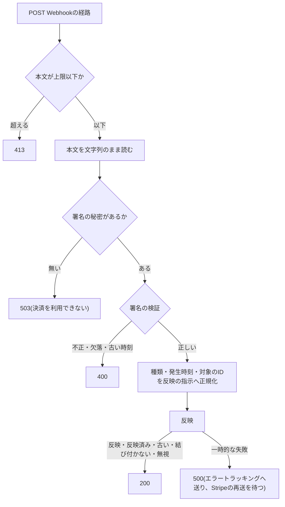

# 決済サービス(Stripe)

Stripeの決済セッション(Checkout Sessions)と決済画面の部品(Payment Element)で1回限りの決済と定期課金を受け付けるアプリの、サーバーからStripeへの通信の規約を定める。API版とSDKの固定、クライアントの作り方とキーが無い環境の縮退、決済セッションの作成の項目、決済画面の部品の使い方、決済手段の絞り込み、税と現地通貨、価格の照会、冪等キー、上限と料金、失敗の分類、送る情報の範囲、Webhookの受信と署名の検証、テストでの差し替えを扱う。

受け取った通知・決済後の戻り・突合を1回だけ反映する規約は「[外部の通知の冪等な反映](../backend/009-idempotent-event-reflection.md)」に、環境ごとのダッシュボードの設定・鍵の登録・運用の手順は「[決済の環境とデータの運用](../operations/004-payment-data-operations.md)」に、層構成は「[Cloudflare Workersでの層構成と依存性の組み立て](../backend/002-layered-architecture-on-workers.md)」に従う。

## 前提と用語

決済の開始・決済画面の表示・決済後の戻りの反映・突合・価格の照会は`<APIサーバーのアプリ>`が、Webhookの受信と反映・返金の実行・Customerの削除は`<メッセージを受信するアプリ>`が行う。Stripeとの通信と反映の部品は共通ライブラリに置き、両アプリが同じ束縛で使う。部品の置き場所は、共通ライブラリの配置先、各アプリの`src/`からのパスで示す。

| 部品                                                                                           | 置き場所                                                                                          | 役割                                                                             |
| ---------------------------------------------------------------------------------------------- | ------------------------------------------------------------------------------------------------- | -------------------------------------------------------------------------------- |
| `STRIPE_API_VERSION`・`CHECKOUT_INTEGRATION_IDENTIFIER`                                        | 共通ライブラリの`core/payments/stripe-api-version.ts`                                             | 固定したAPI版と、決済の導線の名前                                                |
| `StripeGateway`・`StripeWebhookVerifier`                                                       | 共通ライブラリの`core/payments/ports.ts`                                                          | Stripeの操作と署名の検証の契約(Stripeの型を外へ出さない読み取り専用の結果を返す) |
| `StripeUnavailableError`・`StripeNotFoundError`・`StripeRejectedError`・`StripeSignatureError` | 共通ライブラリの`core/payments/ports.ts`                                                          | 失敗の分類                                                                       |
| `mapStripeEvent`・`HANDLED_STRIPE_EVENT_TYPES`                                                 | 共通ライブラリの`core/payments/stripe-event-mapping.ts`                                           | 受け付ける通知の種類と、通知から反映の指示への正規化                             |
| `createStripeClient`・`STRIPE_TIMEOUT_MS`・`STRIPE_MAX_NETWORK_RETRIES`                        | 共通ライブラリの`workers/payments/stripe-client.ts`                                               | クライアントの生成                                                               |
| `StripeApiGateway`                                                                             | 共通ライブラリの`workers/payments/stripe-gateway.ts`(Stripeの型からの変換は`stripe-snapshots.ts`) | `StripeGateway`の実装                                                            |
| `StripeWebhookSignatureVerifier`                                                               | 共通ライブラリの`workers/payments/stripe-webhook-verifier.ts`                                     | Webhookの署名の検証                                                              |
| `StripePriceCatalog`                                                                           | 共通ライブラリの`workers/payments/price-catalog.ts`                                               | 価格の照会と一時保持                                                             |
| `createFakeStripe`・`createFakeStripeGateway`                                                  | 共通ライブラリの`workers/payments/testing/`                                                       | テストの偽物                                                                     |
| `registerStripeWebhookRoute`・`STRIPE_WEBHOOK_MAX_BODY_BYTES`                                  | `<メッセージを受信するアプリ>`の`presentation/payments/stripe-webhook-route.ts`                   | Webhookの経路                                                                    |
| `SignedStripeWebhookReceiver`                                                                  | `<メッセージを受信するアプリ>`の`application/payments/stripe-webhook-receiver.ts`                 | 署名の検証・正規化・反映の順の呼び出し                                           |

| 用語                                                                                                                                        | 意味                                                                                                                                        |
| ------------------------------------------------------------------------------------------------------------------------------------------- | ------------------------------------------------------------------------------------------------------------------------------------------- |
| 決済セッション                                                                                                                              | StripeのCheckout Session。1回の購入ごとに1つ作り、決済画面はその`client_secret`でPayment Elementを表示する                                  |
| 購入                                                                                                                                        | アプリが決済セッションごとに持つ行。状態(未完了・処理中・完了・拒否・失効など)と、購入の識別子(購入ID)を持つ                                |
| 制限付きキー                                                                                                                                | 「[決済の環境とデータの運用の前提と用語](../operations/004-payment-data-operations.md#前提と用語)」と同じ                                   |
| `<固定したAPI版>`・`<Stripeのキーのシークレットのキー>`・`<Webhookの署名の秘密のシークレットのキー>`・`<公開キーの変数>`・`<Webhookの経路>` | 「[決済の環境とデータの運用の前提と用語](../operations/004-payment-data-operations.md#前提と用語)」と同じ                                   |
| `<決済の導線の名前>`                                                                                                                        | 決済セッションの`integration_identifier`に渡す名前。ダッシュボードで決済の導線を見分けるため、Stripeの推奨に従い末尾に8文字の英字を付ける   |
| `<決済後の戻りのURL>`                                                                                                                       | 決済画面での支払いの後(3Dセキュアなどのリダイレクトの後を含む)に利用者を戻す、利用者側のページのURL。利用者側のオリジンの変数から組み立てる |

- 上のプレースホルダーの本プロジェクトの値は、技術ドキュメントに写さず、プロジェクト固有の値の文書の「[決済](../../../onboardings/project-values.md#決済)」と「[技術ドキュメントの表記と本プロジェクトの値](../../../onboardings/project-values.md#技術ドキュメントの表記と本プロジェクトの値)」に置く。

## API版とSDKの固定

- サーバーのSDK(`stripe`)は、版ごとに固定のAPI版を持ち、型定義はそのAPI版の応答の形に合わせてある。SDKの`apiVersion`の型は固定のAPI版のリテラルだけを受け付けるため、`createStripeClient`は`STRIPE_API_VERSION`(`<固定したAPI版>`)を明示して渡し、アカウントの既定のAPI版に左右されないようにする。
- Webhook endpointのAPI版も`<固定したAPI版>`にする(「[Webhook endpoint](../operations/004-payment-data-operations.md#webhook-endpoint)」)。
- サーバーのSDK・Stripe.js・React Stripe.jsの3つのパッケージは完全に固定する。版と更新時の確認事項は「[依存パッケージの版管理](../coding/002-dependency-versions.md#主要パッケージの一覧)」を正とする。
- SDKの版を上げてAPI版が変わるときは、SDKの版・`STRIPE_API_VERSION`・テストの模擬応答・Webhook endpointのAPI版を同じ変更で合わせる。手順は「[Webhook endpointのAPI版の更新](../operations/004-payment-data-operations.md#webhook-endpointのapi版の更新)」に従う。
- StripeのAPI版は、同じメジャーリリース(年2回)の中の月次の版では破壊的な変更が無い。メジャーリリースをまたぐ更新は、変更履歴で使っている項目の変化を確かめてから行う。

## クライアントの生成

`createStripeClient({ appName, apiKey, fetch })`がSDKのクライアントを作る。

| 設定                | 値                                                                | 理由                                                                                   |
| ------------------- | ----------------------------------------------------------------- | -------------------------------------------------------------------------------------- |
| `httpClient`        | `Stripe.createFetchHttpClient(fetch)`                             | workerdにはNode.jsのHTTPクライアントが無いため、`fetch`で通信する                      |
| `apiVersion`        | `STRIPE_API_VERSION`                                              | 「[API版とSDKの固定](#api版とsdkの固定)」                                              |
| `timeout`           | 10秒(`STRIPE_TIMEOUT_MS`)                                         | 利用者を待たせる要求とWorkerの実時間に収める                                           |
| `maxNetworkRetries` | `<APIサーバーのアプリ>`は1回、`<メッセージを受信するアプリ>`は2回 | 利用者が待つ決済の開始は早く失敗を返し、利用者を待たせない通知の反映は多めに再試行する |

- `fetch`は省略するとworkerdの`fetch`を使う。テストは通信を止める代わりを渡す(「[テストでの差し替え](#テストでの差し替え)」)。
- `<Stripeのキーのシークレットのキー>`が未設定か空文字なら、クライアントを作らずに`undefined`を返す。`StripeApiGateway`の各操作はStripeを呼ばずに一時的な失敗(`StripeUnavailableError`)を投げ、決済の機能だけが「決済を利用できない」に縮退し、他の機能は動く。キーが無いのはローカル環境とCIだけである。
- デプロイ先環境ではキーを必須にする。Wrangler設定では`env.staging`・`env.prod`の`secrets.required`にだけキーを加え、ルート(ローカル環境)には加えない。環境の検証は、キーを任意にした上で、値があれば制限付きキーの形(`rk_test_`・`rk_live_`で始まる)を、署名の秘密は`whsec_`で始まる形を確かめる。
- 秘密鍵(`sk_`で始まる全ての権限を持つ鍵)は使わず、Workerごとに必要な権限だけの制限付きキーを使う。権限の表と登録の手順は「[制限付きキーの権限](../operations/004-payment-data-operations.md#制限付きキーの権限)」に従い、Stripeの操作を加えるときは同じ変更で表を直す。

## 決済セッションの作成

`StripeGateway.createCheckoutSession`は、次の項目で決済セッションを作る。

| 項目                                                                       | 値                                                                                      | 理由                                                                                                                        |
| -------------------------------------------------------------------------- | --------------------------------------------------------------------------------------- | --------------------------------------------------------------------------------------------------------------------------- |
| `ui_mode`                                                                  | `'elements'`                                                                            | 自前の決済画面にPayment Elementを埋め込む。`'custom'`は改名前の旧名で使わない                                               |
| `mode`                                                                     | `payment`(1回限りの決済)・`subscription`(定期課金)                                      | 購入の種類による                                                                                                            |
| `customer`                                                                 | 利用者のCustomerのID                                                                    | 最初の決済の開始時に作る(「[送る情報の範囲](#送る情報の範囲)」)                                                             |
| `line_items`                                                               | 価格のIDと数量                                                                          | 価格は`lookup_key`で解決し直したもの(「[価格の照会](#価格の照会)」)                                                         |
| `automatic_tax.enabled`                                                    | `true`                                                                                  | 請求先住所で税を計算する(「[税と現地通貨](#税と現地通貨)」)                                                                 |
| `billing_address_collection`                                               | `'auto'`                                                                                | 税の計算に要る最小の住所の項目を集める                                                                                      |
| `customer_update.address`                                                  | `'auto'`                                                                                | 既存のCustomerで自動の税計算を使うには、入力された住所をCustomerへ保存させる必要がある                                      |
| `adaptive_pricing.enabled`                                                 | `false`                                                                                 | 現地通貨へ換算せず、価格の通貨だけで請求する                                                                                |
| `allowed_payment_method_types`                                             | `['card', 'link']`                                                                      | 「[決済手段の絞り込み](#決済手段の絞り込み)」。`payment_method_types`は送らない                                             |
| `return_url`                                                               | `<決済後の戻りのURL>?session_id={CHECKOUT_SESSION_ID}`                                  | `{CHECKOUT_SESSION_ID}`はStripeが決済セッションのIDに置き換える。戻りのページはこのIDで反映を確かめる                       |
| `expires_at`                                                               | 購入の有効期限(秒)                                                                      | 下の規則で決める                                                                                                            |
| `client_reference_id`                                                      | 購入ID                                                                                  | ダッシュボードから購入を辿る                                                                                                |
| `metadata`と、`payment_intent_data.metadata`か`subscription_data.metadata` | 購入ID(`purchase_id`)・購入の種類(`purchase_kind`)・利用者の仮名化ID(`pseudonymous_id`) | 決済セッションのIDを保存する前に届いた通知、返金・チャージバック・定期課金の請求の持ち主を、PaymentIntentや定期課金から辿る |
| `integration_identifier`                                                   | `<決済の導線の名前>`                                                                    | ダッシュボードで決済の導線を見分ける                                                                                        |
| 冪等キー                                                                   | `checkout:<購入ID>`                                                                     | 「[冪等キー](#冪等キー)」                                                                                                   |

- 有効期限は`computeSessionExpiry`(共通ライブラリの`core/payments/purchase-rules.ts`)で決める。決済期限の無い購入は作成から1時間、決済期限のある購入は24時間と決済期限の早い方にし、Stripeの下限の30分を下回らないようにする。開いたままの決済セッションで価格や購入の内容が古くならないよう、既定の24時間より短くする。
- `ui_mode: 'elements'`では`branding_settings`・`custom_text`・`after_expiration`・`optional_items`などを使えない。表示の調整は決済画面の側で行う。
- 決済セッションの取得は、支払いのPaymentIntentとその最新の請求(Linkの資金源のグループを持つ)、定期課金の初回の請求の支払いを1回で得るため、`expand: ['payment_intent.latest_charge', 'invoice.payments']`を付ける。定期課金の決済セッションはPaymentIntentを直接持たないため、初回の請求の支払いから辿る。
- 決済セッションの失効(`expire`)は、完了・失効済みの決済セッションでは拒否される。拒否されたら決済セッションを取得し直し、`open`でなければ「失効させる対象が無い」(`not_open`)として扱う。

## 決済画面

決済画面は、決済セッションの`client_secret`を受け取り、Stripe.jsとReact Stripe.jsでPayment Elementと請求先住所の入力欄を表示する。

- Stripe.jsは、決済画面と決済後の戻りのページだけで読み込む。既定の入口(`@stripe/stripe-js`)は読み込んだ時点でスクリプトを挿入するため、`loadStripe`を呼ぶまで挿入しない`@stripe/stripe-js/pure`の入口を使う。`loadStripe`は呼ぶたびにインスタンスを作るため、公開キーごとに最初の読み込みの結果を使い回し、失敗した読み込みは次の呼び出しでやり直せるよう残さない。
- `<公開キーの変数>`は公開の値で、Wrangler設定の`vars`に書き、公開設定で画面へ渡す。決済画面を持たないアプリには渡さない。値が無い環境では、Stripe.jsを読み込まずに「決済を利用できない」を表示し、エラートラッキングへは送らない。
- 決済セッションの文脈は`CheckoutElementsProvider`で作り、`clientSecret`・外観(`elementsOptions.appearance`)・`adaptivePricing: { allowed: false }`(現地通貨の表示を許さない)を渡す。入力欄はStripeの埋め込み枠の中に描かれ、文字の色を外観で決めるため、配色を切り替えたら外観を組み立て直す。
- 文脈の中の状態は`useCheckoutElements()`で読む。React Stripe.jsの7.x系では`useCheckout()`が非推奨になっており、非推奨の記法を禁じる静的解析に反する。
- `PaymentElement`と`BillingAddressElement`を置く。支払うボタンは、利用者の同意と`canConfirm`がそろうまで無効にし、押したら同意を記録してから`confirm()`を呼ぶ。同意の記録が失敗したら`confirm()`を呼ばない。
- Stripe.jsの読み込みの失敗と`confirm()`の想定外の失敗は、ブラウザのエラートラッキングへ送り(「[送信の入口](../frontend/007-frontend-observability.md#送信の入口)」)、入力欄の代わりに縮退の案内を出す。カードの拒否など`confirm()`が返す想定内の失敗は、理由を画面に表示し、送らない。
- 読み込み中の表示(`pendingComponent`)はページの主のバンドルに入るため、Stripe.jsを読み込む部品を置かない。
- 決済後の戻りのページは、戻りのURLの`session_id`で反映を確かめる変更を、ページの表示の後に呼び、処理中の間は間隔を置いて呼び直す(「[マウントの後に呼ぶ確定](../frontend/006-data-fetching.md#マウントの後に呼ぶ確定)」)。

## 決済手段の絞り込み

- 決済手段の種類は`allowed_payment_method_types: ['card', 'link']`で絞る。Apple Pay・Google Payは決済手段の種類としてはカード(ウォレット)のため、この指定で残る。ダッシュボードの決済手段の設定は、この指定の中からさらに表示する手段を選ぶ2段目の制限になる(「[決済手段の設定](../operations/004-payment-data-operations.md#決済手段の設定)」)。
- `payment_method_types`は送らない。Stripeは決済手段を固定で列挙するこの項目を推奨せず、動的に決まる候補を絞る`allowed_payment_method_types`を案内している。
- Linkを有効にすると、Linkの資金源(カードのほか、即時に確定する銀行決済など)も有効になり、資金源ごとには切れない。決済セッションの`payment_method_options.link`にも資金源を絞る項目は無い。完了の通知で支払いが未完了(`payment_status`が`unpaid`)の決済は権利を付与せず、支払いの確定(`checkout.session.async_payment_succeeded`)で反映する。
- 資金源は、請求(Charge)の`payment_method_details.link.funding_source_group`か、カードのウォレットとしての`payment_method_details.card.wallet.link.funding_source_group`で確かめられる。決済の記録の内部の列に残し、想定外の資金源を後から調べられるようにする。
- 決済画面のCSPの許可先(Stripe.jsの`script-src`・`frame-src`・`connect-src`と、Linkの許可先)は「[許可先の登録](../frontend/003-frontend-server-security.md#許可先の登録)」の規則で登録する。Linkはサブドメインのワイルドカード(`https://*.link.com`)の許可を求めるため、ワイルドカードを許さない規則では一部を登録できない。登録できない許可先は、決済画面の検証でCSPの違反が出ないことを確かめて扱いを決める。

## 税と現地通貨

- 自動の税計算は、Stripeの税の登録(Registrations)がある地域だけで税を計算する。登録はsandboxごとに分かれ、ライブモードへ引き継がれない(「[税](../operations/004-payment-data-operations.md#税)」)。
- `ui_mode: 'elements'`で税を計算するには、決済画面に請求先住所の入力欄(Address Element)を置いて請求先住所を集める。
- 価格の税の扱いは税込(Inclusive)にする。指定しないと税抜として扱われる(「[価格](../operations/004-payment-data-operations.md#価格)」)。
- 現地通貨での支払い(Adaptive Pricing)は、ダッシュボードの設定とセッションの`adaptive_pricing.enabled: false`の両方で無効にする(「[現地通貨での支払いの無効化](../operations/004-payment-data-operations.md#現地通貨での支払いの無効化)」)。

## 価格の照会

- コードは価格のIDでなく`lookup_key`で価格を解決する。価格の金額を変えるときにダッシュボードで新しい価格へ`lookup_key`を移すだけで済み、設定の変更が要らない。
- `StripeGateway.resolvePrices`は、`prices.list`を`lookup_keys`(1回の要求で10件まで)・`active: true`で呼ぶ。通貨がUSDでない価格、金額が最小通貨単位の整数でない価格、月ごと(`interval: 'month'`・`interval_count: 1`)でない繰り返しの価格は、決済に使えない形として除き、`warning`のログに価格の`lookup_key`(属性名`priceLookup`)・価格のID・理由を残す。属性名に`key`を含めると伏せ字になるため、`lookup_key`は別の名前で添える(「[属性名による伏せ字](../infra/004-logging-and-error-tracking.md#属性名による伏せ字)」)。
- 税の扱い(`tax_behavior`)が税込(`inclusive`)でない価格(税抜の`exclusive`・未指定の`unspecified`)も、決済に使えない形として同じく除く(理由`tax_behavior`)。税込でない価格では、表示した価格に決済の時点で税額が上乗せされるためである。
- `StripePriceCatalog`は、取得した価格をデータベースに保持し、取得から10分以内の価格はStripeに問い合わせずに返す。Stripeに到達できない(`StripeUnavailableError`)ときは保持している価格を古い値として返し、保持も無ければ「決済を利用できない」にする。表示用の照会だけに使い、決済の開始では常にStripeから価格を解決し直す。

## 冪等キー

| 操作                 | 冪等キー                  | 重複を防ぐ範囲                                                  |
| -------------------- | ------------------------- | --------------------------------------------------------------- |
| 決済セッションの作成 | `checkout:<購入ID>`       | 同じ購入の作成の再試行で、決済セッションを2つ作らない           |
| 返金の作成           | `refund:<返金の依頼キー>` | 同じ返金の依頼のメッセージの再配信・再送信で、返金を2回作らない |

- Stripeは冪等キーを少なくとも24時間保持し、その後は削除し得る。返金はそれより長く再試行し得るため、冪等キーに加えて、返金の依頼の状態(提出済み・成功の依頼はStripeを呼び直さない)でも重複を防ぐ(「[外部の副作用の依頼](../backend/009-idempotent-event-reflection.md#外部の副作用の依頼)」)。
- 冪等キーは同じ引数の再試行のためのもので、引数を変えて同じキーで送るとStripeが拒否する。キーを作る値(購入ID・依頼キー)は、引数を決めた行の識別子にする。

## 上限と料金

### APIの上限

| 種類                                           | ライブモード   | sandbox        |
| ---------------------------------------------- | -------------- | -------------- |
| アカウント全体の要求の数                       | 毎秒100件      | 毎秒25件       |
| 1つのAPIの経路の要求の数(個別の定めが無い経路) | 毎秒25件       | 毎秒25件       |
| 1つのPaymentIntentの更新                       | 1時間に1,000件 | 1時間に1,000件 |
| 同時に処理中の要求の数                         | 50件           | 記載なし       |

- 上限はStripeのアカウントごとに数え、同じアカウントを使う全てのWorkerと鍵が共有する。sandboxはライブモードより上限が低いため、負荷の試験をsandboxで行わない。
- 上限を超えると状態コード429になり、理由を示す`Stripe-Rate-Limited-Reason`ヘッダー(`global-rate`・`endpoint-rate`・`global-concurrency`・`endpoint-concurrency`・`resource-specific`)が付く。このヘッダーの無い429は上限ではなく、同じオブジェクトへの同時の要求によるロックの時間切れなどである。
- 429はどちらも一時的な失敗(`StripeUnavailableError`)に分類し(「[失敗の分類](#失敗の分類)」)、SDKの自動の再試行(間隔を広げる)と、メッセージの再試行・Webhookの再送・次の回のジョブに任せる。アプリの側で待って同じ要求を繰り返さない。
- 一覧の取得と`expand`の付いた要求は重く、同時に処理中の要求の上限に掛かりやすい。突合と日次の確認は対象を1件ずつ順に取得し、1回の起動の件数に上限を置く(「[突合と日次の確認](../backend/009-idempotent-event-reflection.md#突合と日次の確認)」)。
- 値は変わり得る。確かめるときはStripeの文書「[Rate limits](https://docs.stripe.com/rate-limits)」を見る。

### 料金

料金の額は、事業者の所在国・契約・料金プランで変わるため、技術ドキュメントには書かない。確かめるときはStripeの料金のページ(「[Pricing](https://stripe.com/pricing)」「[Stripe Tax pricing](https://stripe.com/tax/pricing)」)を、所在国を選んで見る。

| 種類                             | かかる時点                                                                                                                                    | 返金・勝訴での扱い                                                   |
| -------------------------------- | --------------------------------------------------------------------------------------------------------------------------------------------- | -------------------------------------------------------------------- |
| 決済の手数料                     | 成功した決済ごと(決済額に対する割合。海外のカードや通貨の換算には追加の手数料がかかる国がある)                                                | 返金しても元の決済の手数料は戻らない                                 |
| 自動の税計算(Stripe Tax)の手数料 | 税を徴収する地域の登録がある取引ごと(連携の方式で、取引額の割合か取引ごとの定額)                                                              | 返金しても戻らない扱いを前提にする                                   |
| 不審請求の申し立ての受領の手数料 | 申し立てを受け、残高から申し立ての額を引き落とすとき                                                                                          | 原則として戻らない(勝訴しても戻らない。契約や所在国による例外がある) |
| 申し立てへの反証の手数料         | 反証資料を提出して申し立てに反論するとき(国による)                                                                                            | 勝訴すると戻る                                                       |
| 不服申し立ての手数料             | 不服申し立てを送るたび(「[不審請求の申し立ての不服申し立て](../operations/004-payment-data-operations.md#不審請求の申し立ての不服申し立て)」) | 戻らない                                                             |

- 決済の記録と純収益の集計は、決済額・返金額・申し立てで引き落とされた額だけで作り、Stripeの手数料を含めない。手数料はダッシュボードの残高の取引(Balance transactions)で確かめる。
- 現地通貨での支払い(Adaptive Pricing)を無効にするため、購入者の通貨への換算の手数料は生じない。
- 返金しても決済の手数料は戻らないため、自動の返金(反映の期限の後の支払い・二重の決済など)は、その手数料の分だけ事業者の負担になる。決済を始める前に購入の可否と受付期限を確かめ、自動の返金を起こしにくくする。
- 申し立てが少額の場合は、反証せずに返金するか申し立てを受け入れる方が負担が小さいことがある。判断は管理者が行う(「[チャージバックへの対応](../operations/004-payment-data-operations.md#チャージバックへの対応)」)。

## 失敗の分類

`StripeApiGateway`は、SDKの例外を次の3つに分けて投げ直す。

| SDKの例外                                                                                     | 分類         | 投げ直す例外                                                 | 呼び出し側の扱い                                                                        |
| --------------------------------------------------------------------------------------------- | ------------ | ------------------------------------------------------------ | --------------------------------------------------------------------------------------- |
| 接続の失敗(`StripeConnectionError`)・上限(`StripeRateLimitError`・429)・`StripeAPIError`・5xx | 一時的な失敗 | `StripeUnavailableError`                                     | 再試行に任せる(メッセージの再試行・Webhookの再送・次の回のジョブ)。利用者には縮退の案内 |
| `resource_missing`                                                                            | 存在しない   | `StripeNotFoundError`                                        | 反映では「結び付かない」として扱う                                                      |
| 上記以外の4xx                                                                                 | 恒久的な失敗 | `StripeRejectedError`(Stripeのエラーコード`stripeErrorCode`) | 再試行で解消しないため、返金なら失敗として記録して運用者へ知らせる                      |

- Stripeの例外の文言は送った値(メールアドレスなど)を含み得るため、投げ直す例外に文言も元の例外も引き継がない。一時的な失敗と恒久的な失敗は、`warning`のログに操作の名前・分類・状態コード・Stripeのエラーコード・Stripeの要求のIDだけを残す。
- 対象が既に無い・既に終わっていることを確かめられる操作は、失敗にせずに結果で返す。

| 操作                 | 扱い                                                                                                         |
| -------------------- | ------------------------------------------------------------------------------------------------------------ |
| Customerの削除       | 存在しなければ`already_deleted`(削除済み)                                                                    |
| Customerの用意(更新) | ダッシュボードなどでStripe側だけ削除されたCustomerは作り直す                                                 |
| 決済セッションの失効 | 拒否されたら取得し直し、`open`でなければ`not_open`                                                           |
| 定期課金の解約       | 拒否されたか存在しなければ取得し直し、終了していれば`already_canceled`。終了の拒否の形はStripeが定めていない |

- 請求・返金・定期課金の想定外の状態の値は例外にする。チャージバックの状態だけは、Stripeが値を加えることがある(不服申し立ての状態など)ため、未知の値でもそのまま返し、反映は記録する段階だけを見る。

## 送る情報の範囲

- Customerには、メールアドレスと、メタデータの利用者の仮名化ID(`pseudonymous_id`)だけを渡す。氏名・住所はアプリから送らない。請求先住所は、利用者が決済画面のStripeの入力欄に直接入力し、Stripeが保持する。
- Customerは最初の決済の開始時に作り、決済しない利用者のデータをStripeへ渡さない。決済の開始のたびにメールアドレスを更新する。利用者の物理削除では、Customerを削除する(「[物理削除](../backend/007-user-lifecycle-events.md#物理削除)」)。
- 決済セッション・PaymentIntent・定期課金のメタデータは、購入ID・購入の種類・仮名化IDだけにし、利用者の主キーを入れない。返金のメタデータは、返金の依頼のIDと購入IDだけにする。
- カード番号などの決済情報はアプリに届かず、保存しない。
- ログとエラートラッキングには、Stripeのオブジェクトの種類とID・購入ID・状態だけを残し、メールアドレス・通知の本文を残さない(「[伏せ字の規則](../infra/004-logging-and-error-tracking.md#伏せ字の規則)」)。

## Webhookの受信

- 経路は`<メッセージを受信するアプリ>`の`POST <Webhookの経路>`にする。送り手は署名の検証で確かめるため、IPアドレス単位の回数制限から外す(「[除外規則](../backend/003-rate-limiting-and-bot-verification.md#除外規則)」)。Stripeの送信元IPアドレスの許可リストは使わない。
- 本文の上限は1MiB(`STRIPE_WEBHOOK_MAX_BODY_BYTES`)とし、超えたら413にする。
- 署名は受け取ったままの本文で計算されるため、検証の前に本文を解釈しない。`c.req.text()`で文字列のまま読み、`Stripe-Signature`ヘッダーとともに検証へ渡す。
- 検証は`Stripe.webhooks.constructEventAsync(本文, 署名, 秘密, 300, Stripe.createSubtleCryptoProvider())`で行う。workerdでは同期のNode.jsの暗号の関数を使えないため、非同期の関数とWeb Cryptoのプロバイダを使う。時刻の許容は300秒(`STRIPE_SIGNATURE_TOLERANCE_SECONDS`)にし、古い通知の再利用を拒否する。
- 署名の秘密を更新する間(「[鍵と署名の秘密の更新](../operations/004-payment-data-operations.md#鍵と署名の秘密の更新)」)、Stripeは有効な秘密ごとに署名を付ける。SDKはどれか1つが一致すれば受け入れるため、Workerは1つの秘密を持てばよい。
- 検証できた通知は、ID・種類・発生時刻(秒)・対象のIDだけを持つ形にする。署名が正しくても、この形を満たさない本文は署名の不正と同じく拒否する。拒否の理由(`missing_header`・`unverified`・`malformed_event`)だけをログに残し、SDKの例外は署名と本文を持つため引き継がない。
- 反映は対象の最新の状態をStripeから取得し直すため、通知の本文のうち種類・発生時刻・対象のIDだけを使う(「[通知の本文を信用しない](../backend/009-idempotent-event-reflection.md#通知の本文を信用しない)」)。Webhook endpointのAPI版と`<固定したAPI版>`が違っても、この3つの項目の形は変わらない。
- 受け付ける通知の種類は`HANDLED_STRIPE_EVENT_TYPES`(15種)で、Webhook endpointの購読の一覧と一致させる(「[Webhook endpoint](../operations/004-payment-data-operations.md#webhook-endpoint)」)。一覧に無い種類は「無視」として200を返す。種類を足す・減らすときは、コードの一覧・運用の文書の表・全てのWebhook endpointを同じ変更で合わせる。
- 反映の一時的な失敗は500で返し、エラートラッキングへ通知の種類とIDだけを付けて送る。Stripeは2xx以外の応答に対して、ライブモードでは最長3日間、sandboxでは数時間のうちに送り直す。署名の不正(400)も送り直され、Stripeは送り直すたびにその時点の時刻と有効な秘密で署名し直す。署名の秘密の登録の誤りを直せば、送り直しの通知は反映される。
- 署名の秘密が未設定の環境では、検証せずに503を返す。ローカル環境はStripe CLIの`stripe listen`で通知を転送する(「[ローカルの転送](../operations/004-payment-data-operations.md#ローカルの転送)」)。

## テストでの差し替え

- `StripeApiGateway`のWorkers統合テストは、`createStripeClient`の`fetch`を偽物(`createFakeStripe`)に差し替え、送った要求のパス・本文・冪等キーを確かめ、Stripeの形の応答と失敗(`stripeError`)を返す。外部へ通信しない。
- 署名の検証のテストは、SDKのテスト用の署名の生成(`Stripe.webhooks.generateTestHeaderStringAsync`)で署名を作り、正しい署名・本文の改ざん・署名の欠落・別の秘密・許容を超えた時刻を確かめる。
- 反映・ジョブ・アプリケーション層の単体テストは、`StripeGateway`の偽物(`createFakeStripeGateway`)を渡し、取得の結果と失敗の例外を差し替える。
- Workers統合テストの環境には、テスト用の制限付きキーと署名の秘密を`miniflare.bindings`で持たせる。テストの鍵の文字列は、シークレットの検出の誤検知を避けるため、`['rk', 'test', '<名前>'].join('_')`のように連結して作る。
- キーと署名の秘密が無い環境で`StripeUnavailableError`(経路は503)になることも確かめる。

## 参考資料

- Stripeの「[Create a Checkout Session](https://docs.stripe.com/api/checkout/sessions/create)」 — `ui_mode`・`allowed_payment_method_types`・`adaptive_pricing`・`customer_update`・`integration_identifier`
- Stripeの「[Link payment methods](https://docs.stripe.com/payments/link/link-payment-methods)」 — Linkの資金源のグループと無効化の範囲
- Stripeの「[Receive Stripe events in your webhook endpoint](https://docs.stripe.com/webhooks)」 — 署名の検証・再送・順序・署名の秘密の更新
- Stripeの「[Handle webhook versioning](https://docs.stripe.com/webhooks/versioning)」 — Webhook endpointのAPI版の更新
- Stripeの「[Idempotent requests](https://docs.stripe.com/api/idempotent_requests)」 — 冪等キーの保持期間
- Stripeの「[API keys](https://docs.stripe.com/keys)」 — 制限付きキーと鍵の更新
- Stripeの「[Rate limits](https://docs.stripe.com/rate-limits)」 — アカウント・経路・同時処理の上限と429の理由のヘッダー
- Stripeの「[Refund and cancel payments](https://docs.stripe.com/refunds)」 — 返金で決済の手数料が戻らないこと
- Stripeの「[How disputes work](https://docs.stripe.com/disputes/how-disputes-work)」 — 申し立ての受領と反証の手数料の扱い
- Stripeの「[Pricing](https://stripe.com/pricing)」「[Stripe Tax pricing](https://stripe.com/tax/pricing)」 — 所在国ごとの決済と自動の税計算の料金
- Stripeの「[Integration security guide](https://docs.stripe.com/security/guide)」 — Stripe.jsとLinkのCSP
