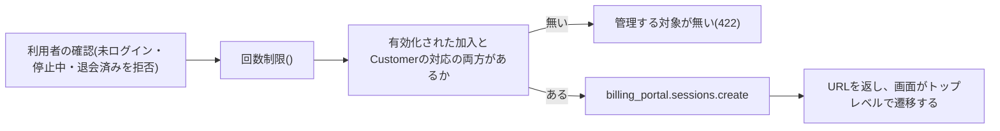

# 定期課金とCustomer Portal(Stripe Billing)

Stripe Billingの定期課金(月ごとの価格)を売るアプリの、定期課金の状態の受け取りと解約、Customer Portal(Stripeがホストする、支払い方法の更新・解約・解約の取り消しの画面)のセッションの作成の規約を定める。定期課金の状態、柔軟な請求モードと解約、受け付ける通知、Customer Portalの機能の前提とセッション、支払いの失敗と再試行の後の扱い、顧客向けメールの停止、価格の照会、上限と料金、失敗の分類、送る情報の範囲、test clockによる検証、テストでの差し替えを扱う。

決済セッション・API版・クライアント・Webhookの署名の検証・冪等キーは「[決済サービス(Stripe)](007-stripe-payments.md)」に、通知の反映は「[外部の通知の冪等な反映](../backend/009-idempotent-event-reflection.md)」に、定期課金の状態から特典の継続期間を導く規約は「[定期課金の加入状態と特典の判定](../backend/010-subscription-entitlements.md)」に、ダッシュボードの設定と運用の手順は「[決済の環境とデータの運用](../operations/004-payment-data-operations.md)」に従う。

## 前提と用語

定期課金の作成は決済セッション(`mode: 'subscription'`)が行い、状態の変化はWebhookで`<メッセージを受信するアプリ>`が受け取る。Customer Portalのセッションの作成は`<APIサーバーのアプリ>`が、退会・停止に伴う解約は`<メッセージを受信するアプリ>`が行う。部品の置き場所は、共通ライブラリの配置先、各アプリの`src/`からのパスで示す。

| 部品                                                              | 置き場所                                                                                       | 役割                                                                                                       |
| ----------------------------------------------------------------- | ---------------------------------------------------------------------------------------------- | ---------------------------------------------------------------------------------------------------------- |
| `StripeGateway.cancelSubscription`・`createPortalSession`         | 共通ライブラリの`core/payments/ports.ts`(実装は`workers/payments/stripe-gateway.ts`)           | 定期課金の解約と、Customer Portalのセッションの作成                                                        |
| `StripeSubscriptionStatus`・`SubscriptionChange`                  | 共通ライブラリの`core/payments/purchase-kind-contract.ts`                                      | 定期課金の状態の型と、受け取り口へ渡す変化(`cancelAt`を含む)                                               |
| `HANDLED_STRIPE_EVENT_TYPES`・`mapStripeEvent`                    | 共通ライブラリの`core/payments/stripe-event-mapping.ts`                                        | 受け付ける通知の種類と、反映の指示への正規化                                                               |
| 定期課金の受け取り口の実装(`plan-state-sink.ts`)                  | 共通ライブラリの`workers/<ドメイン>/`                                                          | 変化を加入状態へ取り込む(「[到着順への対応](../backend/010-subscription-entitlements.md#到着順への対応)」) |
| Customer Portalのセッションの開始のユースケースと回数制限のポート | `<APIサーバーのアプリ>`の`application/<ドメイン>/portal-session-starter.ts`・`portal-ports.ts` | 利用者の確認→回数制限→対象の確認→セッションの作成                                                          |
| 回数制限の実装                                                    | `<APIサーバーのアプリ>`の`infrastructure/<ドメイン>/counter-portal-session-limits.ts`          | 厳密カウンタによる利用者ごとの制限(`<Portalの回数制限の規則>`)                                             |
| 解約の波及処理                                                    | `<メッセージを受信するアプリ>`の`application/<ドメイン>/subscription-cancellation-handler.ts`  | 退会・停止に伴う解約                                                                                       |

| 用語                           | 意味                                                                                                                                                                                   |
| ------------------------------ | -------------------------------------------------------------------------------------------------------------------------------------------------------------------------------------- |
| 定期課金                       | StripeのSubscription。利用者のCustomerに月ごとの価格を結び付けた、繰り返しの請求                                                                                                       |
| 柔軟な請求モード               | `billing_mode: flexible`。API版`2025-09-30.clover`以降で作る定期課金の既定。課金期間の情報を定期課金の項目(`items.data[].current_period_end`)が持ち、期間の末の解約を`cancel_at`で表す |
| 課金期間                       | 請求から次の請求までの期間`[current_period_start, current_period_end)`。終了時刻を含まない                                                                                             |
| 解約の予約                     | 課金期間の末に定期課金を終える予約。予約の間は利用者が取り消せる                                                                                                                       |
| Customer Portal                | Stripeがホストする、顧客が自分の支払い方法と定期課金を管理する画面。セッションのURLで開く                                                                                              |
| 既定の構成                     | ダッシュボードで保存したCustomer Portalの設定。構成を指定しないセッションに使われる                                                                                                    |
| test clock                     | sandboxで時刻を進め、更新・再試行・終了をWebhookまで含めて再現する機能                                                                                                                 |
| `<定期課金の価格のlookup_key>` | 月ごとの定期課金の価格の`lookup_key`(「[決済の環境とデータの運用の前提と用語](../operations/004-payment-data-operations.md#前提と用語)」と同じ)                                        |
| `<Portalから戻るURL>`          | Customer Portalの「戻る」で利用者を戻す、利用者側のページのURL。利用者側のオリジンの変数から組み立てる                                                                                 |
| `<Portalの回数制限の規則>`     | Customer Portalのセッションの作成に掛ける厳密な回数制限の規則(名前・回数・期間)                                                                                                        |
| `<ドメイン>`                   | 「[定期課金の加入状態と特典の判定の前提と用語](../backend/010-subscription-entitlements.md#前提と用語)」と同じ                                                                         |

- 上のプレースホルダーの本プロジェクトの値は、技術ドキュメントに写さず、プロジェクト固有の値の文書の「[技術ドキュメントの表記と本プロジェクトの値](../../../onboardings/project-values.md#技術ドキュメントの表記と本プロジェクトの値)」と「[定期課金の加入](../../../onboardings/project-values.md#定期課金の加入)」に置く。

## 定期課金の状態

| 状態                 | 意味                                       | 本構成での扱い                                                                                        |
| -------------------- | ------------------------------------------ | ----------------------------------------------------------------------------------------------------- |
| `incomplete`         | 初回の支払いが未完了(作成から23時間以内)   | 未有効。加入は初回の支払いの確定(決済セッションの完了の反映)で有効になる                              |
| `incomplete_expired` | 初回の支払いが23時間以内に完了せず失効した | 終了の状態。有効化されていない加入に特典は無い                                                        |
| `trialing`           | 試用期間中                                 | 試用期間を設けない構成では届かない。届いても終了していない状態として扱う                              |
| `active`             | 有効                                       | 加入が有効。解約の予定時刻(`cancel_at`)があれば解約の予約                                             |
| `past_due`           | 請求の支払いに失敗し、再試行中             | 特典を続ける。支払いの失敗のメールを1回だけ依頼する                                                   |
| `canceled`           | 解約されて終了した                         | 終了の状態。再開はできず、新しい定期課金が要る                                                        |
| `unpaid`             | 再試行を使い切り、未払いのまま残した       | 「再試行の後に解約する」設定では届かない。終了の状態として扱い、設定の誤りとして知らせる              |
| `paused`             | 一時停止                                   | Customer Portalの一時停止を無効にする構成では届かない。終了の状態として扱い、設定の誤りとして知らせる |

- 終了の状態は`canceled`・`unpaid`・`incomplete_expired`・`paused`で、共通ライブラリの`core/<ドメイン>/subscription-transition.ts`の`ENDED_STRIPE_STATUSES`が正である。終了していない加入の検索はこの集合を除く。
- 受け取り口へ渡す変化(`SubscriptionChange`)は、定期課金のID・利用者のID(結び付かなければ`null`)・購入ID・状態・`cancelAtPeriodEnd`・`cancelAt`・`currentPeriodEnd`・`endedAt`・発生時刻`occurredAt`で、Stripeの型を外へ出さない。
- 状態から加入状態と特典の継続期間を導く規則は「[加入状態の導出](../backend/010-subscription-entitlements.md#加入状態の導出)」に従う。

## 柔軟な請求モードと解約

- `<固定したAPI版>`で作る新しい定期課金は柔軟な請求モードになる。決済セッションでは`billing_mode`を指定しない。
- 解約の予約の有無は`cancel_at_period_end`が真か、`cancel_at`があるかで判定する。柔軟な請求モードでは期間の末の解約が`cancel_at`(課金期間の終了時刻)で届き、`cancel_at_period_end`は偽のままになる。従来のモードの定期課金は`cancel_at_period_end`で届くため、両方を見る。
- 予定の終了時刻は`cancel_at`、無ければ`current_period_end`にする。`current_period_end`は柔軟な請求モードでは定期課金の項目にあり、`SubscriptionChange.currentPeriodEnd`が抽象化する。
- 予約は課金期間の終了までCustomer PortalかAPIで取り消せ、`customer.subscription.updated`で`cancel_at`が`null`に戻る。予約どおりに終了すると`customer.subscription.deleted`(状態`canceled`、終了の時刻`ended_at`)が届く。
- アプリからの解約(`StripeGateway.cancelSubscription(定期課金のID, { atPeriodEnd })`)は、期間の末なら`subscriptions.update`に`cancel_at_period_end: true`を、即時なら`subscriptions.cancel`を使う。`cancel_at_period_end`は非推奨だが同じ動作をし、結果は`cancel_at`で届く。日割りの返金と未請求分の請求は行わない(既定)。
- 解約・更新を拒否された、または対象が無いときは定期課金を取得し直し、終了していれば`already_canceled`を返す(「[失敗の分類](#失敗の分類)」)。

## 受け付ける通知

| 通知                                     | 届く場面                                                                     | 反映                                                                                    |
| ---------------------------------------- | ---------------------------------------------------------------------------- | --------------------------------------------------------------------------------------- |
| `customer.subscription.created`          | 決済セッションの完了で定期課金が作られた(`incomplete`または`active`)         | 定期課金の変化として受け取り口へ渡す                                                    |
| `customer.subscription.updated`          | 状態・予約・課金期間の更新(更新日の請求・支払いの失敗と回復・予約と取り消し) | 同上                                                                                    |
| `customer.subscription.deleted`          | 終了(`canceled`、`ended_at`)                                                 | 同上                                                                                    |
| `invoice.paid`・`invoice.payment_failed` | 請求の支払いの成功と失敗                                                     | 決済の記録(請求)の反映。定期課金の状態の変化は`customer.subscription.updated`で別に届く |

- 反映は通知の本文を信用せず、定期課金を取得し直して最新の状態を書く(「[通知の本文を信用しない](../backend/009-idempotent-event-reflection.md#通知の本文を信用しない)」)。古い通知は決済の機能が対象ごとの最終の発生時刻で捨てる。
- 1回の更新で複数の通知(`invoice.paid`と`customer.subscription.updated`など)が届き、順序は保証されない。受け取り口はどの順で届いても同じ結果になるようにする(「[到着順への対応](../backend/010-subscription-entitlements.md#到着順への対応)」)。
- 加入の有効化は決済セッションの完了の反映(権利の付与の口)で行い、`customer.subscription.created`では有効化しない。有効化の前に届いた変化は受け取り口が保存し、有効化の時に使う。
- 通知の種類は決済の機能の受け付ける一覧(15種)に含まれ、Webhook endpointの購読と一致させる(「[Webhookの受信](007-stripe-payments.md#webhookの受信)」)。

## Customer Portal

### 機能の前提

Customer Portalは既定の構成で使い、支払い方法の更新・期間の末の解約・解約の取り消しだけを有効にする。プランと数量の変更・一時停止・割引・請求の履歴・顧客の情報の更新は無効にする。設定の表と手順は「[Customer Portal](../operations/004-payment-data-operations.md#customer-portal)」に従う。

- 提供しない機能を無効にし、受け取り口が扱わない変化(プランの変更・`paused`)を起こさせない。一時停止を有効にすると`paused`が届き、設定の誤りとして知らされる。
- 解約の確認の画面と文言はCustomer Portalが持つ。アプリに自前の解約・取り消しのボタンを置かず、Customer Portalに一本化する。
- 既定の構成はsandboxとライブモードのそれぞれでダッシュボードの保存によって作られる。保存するまで、その環境のセッションの作成は拒否される。

### セッションの作成

| 項目            | 値                    | 理由                                                                          |
| --------------- | --------------------- | ----------------------------------------------------------------------------- |
| `customer`      | 利用者のCustomerのID  | 本人のCustomerにだけ作る。利用者のIDはセッションから取り、引数で受け取らない  |
| `return_url`    | `<Portalから戻るURL>` | 戻った直後の画面が、Webhookの反映を待つ表示を出す                             |
| `configuration` | 指定しない            | その環境の既定の構成を使う                                                    |
| `flow_data`     | 使わない              | 特定の操作へ直行する深いリンクは使わず、操作はCustomer Portalの画面で選ばせる |

- 回数制限は利用者のIDごとの厳密な回数制限(`<Portalの回数制限の規則>`)で、キーは利用者のIDを鍵付きハッシュにした値(`hashRateLimitKey`)にする(「[制限の方式の選び方](../backend/003-rate-limiting-and-bot-verification.md#制限の方式の選び方)」「[ハッシュ化の対象](../security/002-keyed-hashing.md#ハッシュ化の対象)」)。超過は`rate_limit_exceeded`で、利用者の確認の後、加入の有無の確認の前に数える。厳密カウンタのクライアントは共通ライブラリの`workers`にあるため、ポートをapplication層に、実装をinfrastructure層に置く。
- 有効化された加入とCustomerの対応の両方を求める。他の購入でCustomerだけを持つ利用者には、Customer Portalで管理する対象が無い。
- セッションのURLは短い時間で失効するため、利用者が開くたびに作る。Customer Portalは埋め込みの枠の中には表示できず、APIが返したURLへのトップレベルの遷移で開く。遷移先はアプリのページではないため、CSPの許可先の変更は要らない。
- Customer Portalでの操作は、Webhookの通知としてだけアプリに反映される。戻った直後の画面は、回数を限った一時的な再取得で反映を待つ(「[表示中の画面の定期再取得](../frontend/010-live-refresh-queries.md)」)。
- セッションを作るWorker(`<APIサーバーのアプリ>`)の制限付きキーには、Customer Portal(Billing)の書き込みの権限が要る(「[制限付きキーの権限](../operations/004-payment-data-operations.md#制限付きキーの権限)」)。

## 支払いの失敗と再試行の後の扱い

- 支払いの失敗の再試行(Smart Retries)は有効にし、再試行の間、定期課金は`past_due`のまま、アプリは特典を続ける。
- 再試行を使い切った後の定期課金の状態は「解約する(Cancel subscription)」にする。定期課金は`canceled`になり`customer.subscription.deleted`が届くため、アプリは終了の時刻で特典を終える(解約の予約が無いため、課金期間の末日までの猶予は無い)。設定の手順は「[再試行の後の解約の設定](../operations/004-payment-data-operations.md#再試行の後の解約の設定)」に従う。
- 「未払いにする」「`past_due`のまま残す」は選ばない。`unpaid`と`paused`はこの構成では届かないため、届いたら終了の状態として扱い、エラートラッキングへ知らせる(「[異常の通知](../backend/010-subscription-entitlements.md#異常の通知)」)。
- 支払いの失敗のメールは、`past_due`への変化でアプリが1回だけ依頼する。再試行ごとには送らず、再試行の間の`customer.subscription.updated`では依頼を増やさない。

## 顧客向けメールの停止

- アプリが支払いの失敗(`<支払いの失敗のメール種別>`)と解約の受付(`<解約の受付のメール種別>`)のメールを自分で送るため、Stripeの顧客向けのメール(支払いの失敗・カードの期限切れ・更新前の通知と、領収書・返金のメール)は無効にする。設定の表は「[顧客向けメールの停止](../operations/004-payment-data-operations.md#顧客向けメールの停止)」に従う。
- sandboxではStripeは顧客向けメールを送らないため、設定は設定の画面で確かめ、ライブモードにも同じ設定を行う。
- 解約の受付のメールには、受け付けた日時・特典の終了日時・取り消しの方法(Customer Portal)を載せる。継続的な契約の解約の受付を、保存できる形で直ちに確認するよう求める地域の規制に備えるためである。退会・停止による解約では送らない。

## 価格の照会

- 定期課金の価格は`<定期課金の価格のlookup_key>`で解決し、価格のIDをコードに書かない(「[価格の照会](007-stripe-payments.md#価格の照会)」)。月ごと・USD・税込・有効が決済に使える条件で、本番環境を含む全ての環境に同じ`lookup_key`で作る(「[価格](../operations/004-payment-data-operations.md#価格)」)。
- 表示用の照会(料金の区画・プラン管理の画面)は、価格の一時保持を通して価格を取る。Stripeに到達できず保持した値も無いとき(`payments_unavailable`)と、照会の結果に`lookup_key`の価格が無いとき(`warn`のログ。属性名は`priceLookup`)は、価格を無し(`null`)として返し、他の例外は投げ直す。画面は価格が無くても特典と自動更新・解約の条件の案内を出す。
- 購入の可否の口は、価格を取れなければ「決済を利用できない」(`payments_unavailable`)として決済を始めない。

## 上限と料金

### APIの上限

APIの上限と429の扱いは「[APIの上限](007-stripe-payments.md#apiの上限)」と同じである。Customer Portalのセッションの作成は利用者の操作ごとに1回で、アプリ側の回数制限で利用者ごとの回数を抑える。

### test clockの制約

| 項目                      | 値                                                                                             |
| ------------------------- | ---------------------------------------------------------------------------------------------- |
| 使える環境                | sandboxだけ。ライブモードには無い                                                              |
| 1つのtest clockのCustomer | 3件まで                                                                                        |
| 1回に進められる幅         | 最短の繰り返しの価格の間隔の2周期まで。進めている間(`status`が`advancing`)は次の操作ができない |
| 時刻の向き                | 進めるだけで、戻せない                                                                         |

- 値は変わり得る。確かめるときはStripeの文書「[Test clocks](https://docs.stripe.com/billing/testing/test-clocks)」を見る。

### 料金

料金の額は事業者の所在国と契約で変わるため、技術ドキュメントには書かない。確かめるときはStripeの料金のページ(「[Billing pricing](https://stripe.com/billing/pricing)」)を、所在国を選んで見る。

| 種類                           | かかる時点                                                         | 備考               |
| ------------------------------ | ------------------------------------------------------------------ | ------------------ |
| Stripe Billingの手数料         | 定期課金の請求の決済ごとに、決済の手数料に加えて請求額に対する割合 | 返金しても戻らない |
| Customer Portal・Smart Retries | Billingの機能で、別の料金は無い                                    | —                  |
| test clock                     | 無料。sandboxの決済に料金はかからない                              | —                  |

## 失敗の分類

SDKの例外の分類は「[失敗の分類](007-stripe-payments.md#失敗の分類)」と同じで、定期課金とCustomer Portalの操作は次の扱いを加える。

| 操作                              | 扱い                                                                                                                                                                                       |
| --------------------------------- | ------------------------------------------------------------------------------------------------------------------------------------------------------------------------------------------ |
| 定期課金の解約                    | 拒否・対象なしなら取得し直し、終了していれば`already_canceled`を返す。終了していなければ元の分類の例外にする                                                                               |
| Customer Portalのセッションの作成 | 一時的な失敗(`StripeUnavailableError`)は「決済を利用できない」(`payments_unavailable`)の縮退にする。拒否(既定の構成が無い・Customerが無い)は想定外の例外として扱い、環境の準備か運用で直す |
| 定期課金の取得(反映)              | 対象なしは「結び付かない」として扱い、反映しない                                                                                                                                           |

- 退会・停止の波及処理の解約は、いずれの失敗も例外のまま投げて再試行に任せ、上限でデッドレターになったら運用者がダッシュボードで解約する(「[退会・停止に伴う解約の失敗の対処](../operations/004-payment-data-operations.md#退会停止に伴う解約の失敗の対処)」)。
- Customer Portalの拒否で「Customerが無い」のは、アプリの対応にあるCustomerがダッシュボードで削除された場合である。決済の開始でCustomerを作り直す仕組みに任せ、Customer Portalの側では作らない。

## 送る情報の範囲

- Customer Portalのセッションには、CustomerのIDと戻りのURLだけを渡す。利用者の個人情報を送らない。Customer Portalで入力される支払い方法・請求先住所はStripeが保持し、アプリには届かない。
- 定期課金のメタデータ(購入ID・購入の種類・仮名化ID)は決済の機能が決済セッションの作成で付ける(「[送る情報の範囲](007-stripe-payments.md#送る情報の範囲)」)。加入の機能は新しいメタデータを付けない。
- ログとエラートラッキングには、定期課金のID・購入ID・状態・拒否の理由だけを残す。Customer PortalのセッションのURLはセッションの秘密を含むため、ログに残さない。

## test clockによる検証

test clockで時刻を進め、加入・支払いの失敗・再試行の後の終了・解約の予約と取り消し・課金期間の末の終了・退会と停止に伴う解約を確かめる。手順(test clockとCustomerの作成、対応の書き込み、時刻の進め方、後始末)は「[test clockによる検証の手順](../operations/004-payment-data-operations.md#test-clockによる検証の手順)」に従い、確かめる値は次のとおりである。

| シナリオ                    | 届く通知                                                                      | 記録の期待                                                                                                                                  |
| --------------------------- | ----------------------------------------------------------------------------- | ------------------------------------------------------------------------------------------------------------------------------------------- |
| 加入                        | `checkout.session.completed`・`customer.subscription.created`・`invoice.paid` | 開始時刻が支払いの確定の時刻、外部の状態`active`、特典の終了時刻なし、加入が有効になった知らせの行が1つ(送り出し済み)                       |
| 支払いの失敗                | `invoice.payment_failed`・`customer.subscription.updated`(`past_due`)         | 外部の状態`past_due`、支払いの失敗の時刻、支払いの失敗のメールの依頼が1件(再試行の間に増えない)                                             |
| 再試行の後の終了            | `customer.subscription.deleted`(`canceled`、`ended_at`)                       | 特典の終了時刻が`ended_at`と同じ値、確定済み、予約なし                                                                                      |
| 解約の予約(Customer Portal) | `customer.subscription.updated`(`cancel_at`)                                  | 予約あり、特典の終了時刻が`cancel_at`の1ミリ秒前を含む業務日付の日の終わり、解約の操作の時刻と出どころ`user`、解約の受付のメールの依頼が1件 |
| 取り消し(Customer Portal)   | `customer.subscription.updated`(`cancel_at`が`null`)                          | 予約なし、特典の終了時刻なし、解約の操作の記録なし                                                                                          |
| 課金期間の末の終了          | `customer.subscription.deleted`(`ended_at`が`cancel_at`以後)                  | 特典の終了時刻は予約の時に決めた値のまま、確定済み                                                                                          |
| 退会・停止に伴う解約        | `customer.subscription.updated`・`deleted`                                    | 解約の操作の出どころ`withdrawal`・`suspension`、解約の受付のメールの依頼なし                                                                |

- test clockの時刻はアプリの実時刻より先に進む。Stripeから届く`ended_at`と課金期間の終了は実時刻より未来になり、アプリは実時刻で加入状態を導くため、終了の後も画面は終了前の状態に見える。終了は画面ではなく、記録の特典の終了時刻・外部の状態・確定済みの印で確かめる。
- 支払いの失敗は、成功するカードで加入した後にCustomer Portalで支払い方法をテストカード`4000 0000 0000 0341`(Customerへの紐付けは成功し、請求で失敗する)に差し替え、test clockを次の更新日の後へ進めて再現する。
- 同じ利用者で2つ目の加入は拒否されるため、シナリオごとに利用者とtest clock付きのCustomerを分ける。
- 検証を終えたらtest clockを削除する。Customer・定期課金・請求も削除されるが、アプリの対応と記録は残るため、検証に使った利用者は使い回さない。

## テストでの差し替え

- ユースケース(セッションの開始・退会と停止の解約)と口の実装の単体テストは、`StripeGateway`の偽物(`createFakeStripeGateway`)で`createPortalSession`の結果と、`cancelSubscription`の結果(`canceled`・`already_canceled`)と例外(`StripeUnavailableError`・`StripeRejectedError`・`StripeNotFoundError`)を差し替える。
- 受け取り口のWorkers統合テストは、`SubscriptionChange`を直接組み立てて渡し、Stripeへ通信しない。
- 回数制限のWorkers統合テストは、上限の次の回が`rate_limit_exceeded`になることを確かめる。
- E2Eテストは、APIが返したCustomer PortalのURLへ移ることまでを確かめ、StripeがホストするCustomer Portalの画面は操作しない。Stripeのキーが無い環境では加入の開始が`payments_unavailable`を返すため、その場合だけ対象外の理由を示して飛ばす。
- test clockによる検証は手動だけで行い、自動のテストに組み込まない。

## 参考資料

- Stripeの「[How subscriptions work](https://docs.stripe.com/billing/subscriptions/overview)」 — 定期課金の状態と状態の遷移
- Stripeの「[Billing mode](https://docs.stripe.com/billing/subscriptions/billing-mode)」 — 柔軟な請求モードと課金期間の項目
- Stripeの「[Billing mode changelog](https://docs.stripe.com/changelog/basil/2025-06-30/billing-mode)」 — `billing_mode`を導入したAPI版(柔軟な請求モードが既定になるのは`2025-09-30.clover`)
- Stripeの「[Cancel subscriptions](https://docs.stripe.com/billing/subscriptions/cancel)」 — `cancel_at`・`cancel_at_period_end`・即時の解約と取り消し
- Stripeの「[Subscription webhooks](https://docs.stripe.com/billing/subscriptions/webhooks)」 — 定期課金に関する通知の種類と届く順
- Stripeの「[Integrate the customer portal](https://docs.stripe.com/customer-management/integrate-customer-portal)」 — セッションの作成・`return_url`・柔軟な請求モードでの解約の表れ方
- Stripeの「[Configure the customer portal](https://docs.stripe.com/customer-management/configure-portal)」 — 機能の有効・無効と既定の構成
- Stripeの「[Create a portal session](https://docs.stripe.com/api/customer_portal/sessions/create)」 — `customer`・`return_url`・`configuration`・`flow_data`
- Stripeの「[Smart Retries](https://docs.stripe.com/billing/revenue-recovery/smart-retries)」 — 再試行と再試行の後の定期課金の状態の設定
- Stripeの「[Customer emails](https://docs.stripe.com/billing/revenue-recovery/customer-emails)」 — 顧客向けメールの設定
- Stripeの「[Test clocks](https://docs.stripe.com/billing/testing/test-clocks)」 — test clockの使い方と制約
- Stripeの「[Testing](https://docs.stripe.com/testing)」 — 請求で失敗するテストカード
- Stripeの「[Billing pricing](https://stripe.com/billing/pricing)」 — 定期課金の手数料
