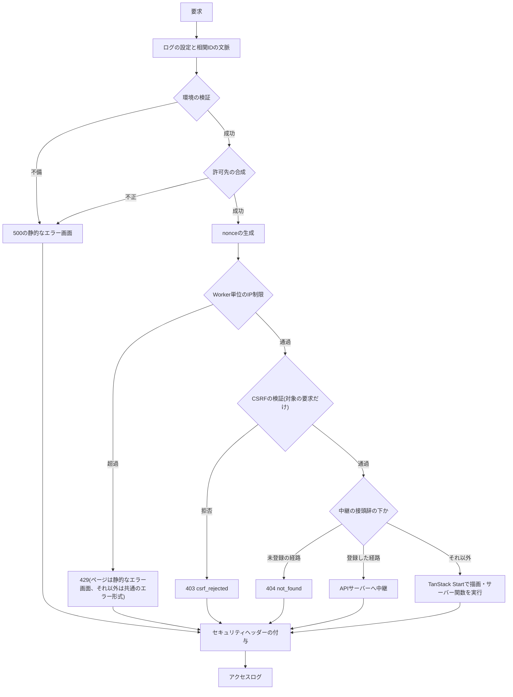

# フロントエンドサーバーのセキュリティ

Cloudflare Workersで動かすTanStack Startのフロントエンドサーバーが、すべての要求に掛ける処理の順序と、APIサーバーへの中継、セッションのCookie、CSRFの検証、nonce付きCSPとセキュリティヘッダー、検索除外、Worker単位のIP制限、生のHTMLの禁止を定める。後続の機能が中継の経路やCSPの許可先を加えるときの規約も記す。

## 前提と用語

起動の構成は「[Cloudflare Workers上のTanStack Startの起動](002-tanstack-start-on-workers.md)」、APIサーバー側の内部経路とセッションの指示は「[内部経路とセキュリティヘッダー](../backend/006-internal-gateway.md)」と「[GraphQL通信](../coding/004-graphql-communication.md)」に従う。フロントエンドサーバーは利用者側と管理者側の2つで、同じ共通部品を使い、違いを登録箇所(アプリの`src/composition/`)の値に限る。部品の置き場所は、共通部品の配置先からのパスで示す。

| 部品                                                                                                              | 置き場所(共通部品内)                           | 役割                                                         |
| ----------------------------------------------------------------------------------------------------------------- | ---------------------------------------------- | ------------------------------------------------------------ |
| `createFrontendServerEntry`                                                                                       | `server/entry/create-frontend-server-entry.ts` | 処理の順序を合成したWorkerの入口                             |
| `FrontendAppProfile`                                                                                              | `server/entry/app-profile.ts`                  | 呼び出し元の種類・Cookieの名前・検索除外・アクセス解析の有無 |
| `validateFrontendEnv`                                                                                             | `server/env/frontend-env.ts`                   | 環境の検証                                                   |
| `checkIpRateLimit`・`IP_RATE_LIMIT`                                                                               | `server/http/ip-rate-limit.ts`                 | Worker単位のIP制限                                           |
| `resolveClientIp`                                                                                                 | `server/http/client-ip.ts`                     | 接続元のIPアドレスの解決                                     |
| `requiresCsrfCheck`・`verifyCsrf`                                                                                 | `server/http/csrf.ts`                          | CSRFの検証の対象と判定                                       |
| `isPageRequest`・`isServerFunctionCall`                                                                           | `server/http/page-request.ts`                  | ページの要求とサーバー関数の呼び出しの判定                   |
| `generateNonce`                                                                                                   | `server/http/nonce.ts`                         | 要求ごとのnonce                                              |
| `SecurityPolicySources`・`mergeSecurityPolicySources`・`buildPageContentSecurityPolicy`・`buildPermissionsPolicy` | `server/http/security-policy.ts`               | 許可先の合成とCSP・Permissions-Policyの組み立て              |
| `applySecurityHeaders`・`BASE_SECURITY_HEADERS`                                                                   | `server/http/security-headers.ts`              | セキュリティヘッダー・`no-store`・検索除外の付与             |
| `errorEnvelopeResponse`・`renderStaticErrorPage`                                                                  | `server/http/error-responses.ts`               | 共通のエラー形式の応答と静的なエラー画面                     |
| `defineRelayRoute`・`findRelayRoute`・`relayToApi`・`GRAPHQL_RELAY_ROUTE`                                         | `server/relay/relay-route.ts`                  | 中継の経路の定義と実行                                       |
| `buildRelayHeaders`                                                                                               | `server/relay/relay-headers.ts`                | 中継する要求の項目の組み立て                                 |
| `toBrowserResponse`・`buildSessionSetCookie`                                                                      | `server/relay/session-cookie.ts`               | セッションの指示のCookieへの変換                             |
| `relay-contract.ts`の定数                                                                                         | `server/relay/relay-contract.ts`               | APIサーバーとの契約の値の写し                                |
| `createFrontendStartOptions`                                                                                      | `start/start-options.ts`                       | TanStack Startのグローバルのミドルウェア                     |
| `createFrontendLintConfig`                                                                                        | `config/frontend-lint.ts`                      | 画面を持つアプリの静的解析の規則                             |

| 用語                                                                           | 意味                                                                                                                  |
| ------------------------------------------------------------------------------ | --------------------------------------------------------------------------------------------------------------------- |
| 共通部品                                                                       | 両フロントエンドサーバーが使う共有ディレクトリ(「[共有ディレクトリの配置方式](../coding/003-shared-directories.md)」) |
| `<共通部品の配置先>`                                                           | 共通部品を利用側アプリへ配置したディレクトリ                                                                          |
| 登録箇所                                                                       | アプリの`src/composition/`。`app-profile.ts`・`security-policy.ts`・`relay-routes.ts`にアプリ固有の値を置く           |
| ページの要求                                                                   | メソッドが`GET`・`HEAD`で、`Accept`に`text/html`を含む要求(`isPageRequest`)                                           |
| サーバー関数の呼び出し                                                         | TanStack Startのサーバー関数の経路(既定の`/_serverFn/`)への要求(`isServerFunctionCall`)                               |
| 中継の経路                                                                     | ブラウザからの要求をAPIサーバーへ中継する経路。`<中継の接頭辞>`の下に置く                                             |
| `<中継の接頭辞>`                                                               | 中継の経路をまとめる接頭辞(`RELAY_PATH_PREFIX`)                                                                       |
| `<利用者側のセッションのCookieの名前>`・`<管理者側のセッションのCookieの名前>` | 呼び出し元の種類ごとのセッションのCookieの名前。`__Host-`で始める                                                     |
| `<画像配信のオリジンの変数>`                                                   | 画像配信のオリジンを持つ変数の名前。CSPの`img-src`に加える                                                            |

`<バインディング名>`(Service Bindings)・`<IP制限のバインディング名>`・`<エラートラッキングのDSNのシークレットのキー>`・`<元のクライアントIPのヘッダー>`などの表記は、参照先の文書の用語に従う。

## 処理の順序

すべての要求は、`createFrontendServerEntry`が返す`fetch`の1か所で、次の順に処理する。順序をアプリで変えたり、段階をアプリで重ねて実装したりしない。



- 環境の検証をIP制限より前に置くのは、Rate Limitingのバインディングが無い状態でIP制限を呼ばないためである。環境の不備は、不備のあるキーの名前だけをログへ出し、値を出さない。
- 許可先の合成は、環境の検証の直後に要求ごとに1回だけ行う。登録箇所の許可先や環境の値が許可先の形式に合わなければ、すべての要求が500になる(「[許可先の登録](#許可先の登録)」)。
- 処理の途中の想定外の例外は、ログとエラートラッキングへ送ってから500の静的なエラー画面を返す。エラートラッキングへの送信自体が例外を投げても、応答のヘッダーとアクセスログは失わない。
- アクセスログの`outcome`は、IP制限・CSRF・未登録の中継の経路が`rejected`、中継が`relay`、描画が`page`、500の静的なエラー画面が`static_error`である。
- 静的なファイル(ビルドが出力するスクリプト・スタイル・画像)の要求はWorkerを起動せずに配信されるため、この処理を通らない。ヘッダーは「[静的なファイルのヘッダー](#静的なファイルのヘッダー)」で付ける。

### TanStack Startの中の順序

描画とサーバー関数の呼び出しは、エントリの処理を通った後、TanStack Startのグローバルのミドルウェア(`src/start.ts`の`createStart(createFrontendStartOptions())`)を通る。

| 順  | 要求のミドルウェア               | 役割                                                                                                                                                          |
| --- | -------------------------------- | ------------------------------------------------------------------------------------------------------------------------------------------------------------- |
| 1   | エラートラッキングのミドルウェア | 後続の例外を送る。サーバーの分岐だけで読み込む(「[サーバー専用のファイルと同型の関数](002-tanstack-start-on-workers.md#サーバー専用のファイルと同型の関数)」) |
| 2   | `createCsrfMiddleware`           | エントリと同じ条件と判定でCSRFを検証する(「[CSRFの検証](#csrfの検証)」)                                                                                       |
| 3   | `responseCommitMiddleware`       | 後続の処理が戻った時点を、応答を送り始めた後として要求ごとに記録する                                                                                          |

- TanStack Startは、後続の処理が返した応答へ、その時点までに設定した応答の項目を合成して送り始める。合成の後に設定した項目は黙って失われる。描画中のデータ取得がAPIサーバーからセッションの指示を受けても、送り始めた後に届いた指示は反映できないため、警告のログ(`reason: 'response_committed'`)を出して捨てる。
- 関数のミドルウェアはエラートラッキングのミドルウェアだけである。

## APIサーバーへの中継

ブラウザはAPIサーバーへ直接通信しない。ブラウザからの要求は`<中継の接頭辞>`の下の中継の経路で受け、描画中のデータ取得はサーバー側で、どちらも同じ`relayToApi`と`buildRelayHeaders`を通して、Service Bindingsの`<バインディング名>`でAPIサーバーの名前付きエントリポイントへ送る。

- 呼び出し元の種類は、Wrangler設定の`services`の`entrypoint`(`<利用者側のエントリポイント名>`・`<管理者側のエントリポイント名>`)だけで決まる。フロントエンドサーバーは`<呼び出し元のヘッダー>`を付けない(「[名前付きエントリポイントによる内部認証](../backend/006-internal-gateway.md#名前付きエントリポイントによる内部認証)」)。
- Service Bindingsは束縛先のWorkerへ直接届けるため、上流のURLのオリジンはパスを組み立てる基準にだけ使う。

### 中継する項目

中継する要求の項目は、次の順に組み立てる。後の段階が同じ名前の項目を上書きする。列挙した項目以外(ブラウザの`Cookie`、呼び出し元・元のクライアントIPを名乗る項目など)は引き継がない。

| 順  | 項目                                                      | 値の出どころ                                                                                  |
| --- | --------------------------------------------------------- | --------------------------------------------------------------------------------------------- |
| 1   | `content-type`・`accept`・`<bot判定のトークンのヘッダー>` | ブラウザの要求の同名の項目(`FORWARDED_BROWSER_HEADERS`)                                       |
| 2   | 経路の追加の項目                                          | 中継の経路の`extraForwardedHeaders`に列挙した名前の、ブラウザの要求の値                       |
| 3   | `sentry-trace`・`baggage`                                 | 要求を処理しているトレースの値(`RELAY_TRACE_HEADERS`)                                         |
| 4   | `<元のクライアントIPのヘッダー>`                          | `CF-Connecting-IP`をIPv4・IPv6として検証した値。不正・欠落なら付けない                        |
| 5   | `<セッション識別子のヘッダー>`                            | 呼び出し元の種類のセッションのCookieの値。形式(`SESSION_TOKEN_PATTERN`)に合わなければ付けない |

- 同じ名前のCookieが複数あれば、最初の値だけを使う。
- 予約名(`cookie`・`<元のクライアントIPのヘッダー>`・`<セッション識別子のヘッダー>`・`<呼び出し元のヘッダー>`・`<デバッグ用の呼び出し元のヘッダー>`)を追加の項目で渡すと、項目名だけを含む`TypeError`になる。
- APIサーバーとの契約の値(項目名・`SESSION_TOKEN_PATTERN`・指示の値)は、共通部品の`server/relay/relay-contract.ts`にAPIサーバー側の定義の写しとして持つ。片方を変えたらもう片方も見直す。

### 応答の扱い

| 場面                                                                                                        | ブラウザへの応答                                                                                                      |
| ----------------------------------------------------------------------------------------------------------- | --------------------------------------------------------------------------------------------------------------------- |
| APIサーバーが応答した                                                                                       | 状態コード・本文・`Retry-After`などの項目を変えずに返す。上流のすべての`Set-Cookie`とセッションの指示の項目は取り除く |
| 上流に届かない・例外になった                                                                                | 503 `upstream_unavailable`・`Retry-After: 5`                                                                          |
| 経路の待ち時間を過ぎた                                                                                      | 503 `upstream_timeout`・`Retry-After: 5`                                                                              |
| 上流が5xxを返し、`Content-Type`の媒体の種類が`application/json`・`application/*+json`でない(無い場合を含む) | 本文を捨て、503 `upstream_unavailable`・`Retry-After: 5`                                                              |

- APIサーバーは常に共通のエラー形式(JSON)を返すため、JSONでない5xxは実行基盤がAPIサーバーに代わって返した失敗(束縛先の不在・資源の超過など)とみなす。`+json`を含めるのは、GraphQLの応答の媒体の種類(`application/graphql-response+json`)の5xxを通すためである。
- 中継の失敗は、警告のログへ`{ code, route }`(`route`は登録した経路の形)だけを出し、エラートラッキングへ送る。上流の本文と内部の詳細はブラウザへの応答に含めない。
- 待ち時間の合図(`AbortSignal.timeout`)は応答の本文の転送にも掛かるため、待ち時間を過ぎたストリームは途中で切れる。

### 中継の経路の追加規約

GraphQL以外の中継の経路(ファイルの中継など)は、共通の処理を変えずに、登録箇所の`src/composition/relay-routes.ts`の`RELAY_ROUTES`へ、`defineRelayRoute`で定義した経路を加える。

```typescript
import {
  defineRelayRoute,
  GRAPHQL_RELAY_ROUTE,
  type RelayRoute,
} from '<共通部品の配置先>/server/relay/relay-route.ts';

const FILE_UPLOAD_ROUTE = defineRelayRoute({
  path: '<中継の接頭辞>files/*',
  methods: ['POST'],
  upstreamPath: (url) => url.pathname.replace('<中継の接頭辞>', '/internal/'),
  acceptContentTypes: ['multipart/form-data'],
  timeoutMs: 30_000,
});

export const RELAY_ROUTES: readonly RelayRoute[] = Object.freeze([
  GRAPHQL_RELAY_ROUTE,
  FILE_UPLOAD_ROUTE,
]);
```

| 項目                    | 規約                                                                                                                   |
| ----------------------- | ---------------------------------------------------------------------------------------------------------------------- |
| `path`                  | `<中継の接頭辞>`の下の完全一致のパスか、末尾が`/*`の接頭辞。`/*`の経路は接頭辞そのもの(`/*`を除いたパス)には一致しない |
| `methods`               | `GET`・`POST`・`PUT`・`DELETE`から重複なく1つ以上。それ以外のメソッドの要求は405(`Allow`付き)                          |
| `acceptContentTypes`    | 引数の無い小文字の`型/副型`。本文を受け取るのは`POST`・`PUT`だけで、どちらかを持つ経路では必須。一致しない要求は415    |
| `extraForwardedHeaders` | ブラウザの要求から追加で引き継ぐ項目名(小文字)。予約名と、セッションの指示・トレースの項目は指定できない               |
| `upstreamPath`          | 要求のURLから、APIサーバーの絶対パス(`/`で始まる)を返す。それ以外を返すと上流を呼ぶ前に例外になり、500になる           |
| `timeoutMs`             | 正の整数のミリ秒                                                                                                       |

- `defineRelayRoute`は定義の時点で上の項目を検査し、凍結した経路を返す。素のオブジェクトは検査を素通りするため、必ず`defineRelayRoute`で定義する。登録箇所の単体テスト(`test/config/composition.unit.test.ts`)で、一覧と各経路が凍結されていること、経路が`<中継の接頭辞>`の下にあり重複しないことを確かめる。
- 経路は登録順に比べ、最初に一致した経路を使う。末尾が`/*`の経路を先に置くと、その下の完全一致の経路を覆うため、`/*`の経路は完全一致の経路より後に置く。
- `<中継の接頭辞>`の下で、どの経路にも一致しない要求は404 `not_found`になる。
- 中継先(APIサーバーの経路)は、5xxを必ず共通のエラー形式(JSON)で返す。JSONでない5xxは、状態コードと本文を変えずに返さず、503 `upstream_unavailable`に置き換わる。
- 追加した経路の状態変更の要求にも、CSRFの検証とIP制限が自動で掛かる。経路の定義で個別に掛けない。
- セッションのCookieの扱い(指示の解釈と`Set-Cookie`)は、GraphQLの経路と同じになる。

## セッションのCookie

APIサーバーの応答のセッションの指示を、フロントエンドサーバーがCookieの発行・削除に変える(指示の項目は「[指示ヘッダー](../coding/004-graphql-communication.md#指示ヘッダー)」)。

### 属性

```text
<セッションのCookieの名前>=<セッション識別子>; Max-Age=<秒>; Path=/; Secure; HttpOnly; SameSite=Lax
<セッションのCookieの名前>=; Max-Age=0; Path=/; Secure; HttpOnly; SameSite=Lax
```

- 名前は`__Host-`で始め、`Domain`を付けない。`__Host-`はブラウザに`Secure`・`Path=/`・`Domain`無しを強制させ、サブドメインからの上書きを防ぐ。`FrontendAppProfile.sessionCookieName`の型(`` `__Host-${string}` ``)で接頭辞を強制する。
- `HttpOnly`でスクリプトから読ませず、`SameSite=Lax`で他のサイトからの状態変更の要求にCookieを付けさせない(CSRFの検証と二重に守る)。
- 発行の値と有効期間は、`Set-Cookie`へ書く前にもう一度形式を確かめ、合わなければ値を含めない`RangeError`を投げる。属性の注入を防ぐためである。

### 名前の分け方

利用者側と管理者側は、呼び出し元の種類ごとに異なる名前(`<利用者側のセッションのCookieの名前>`・`<管理者側のセッションのCookieの名前>`)を、登録箇所の`src/composition/app-profile.ts`の`FrontendAppProfile`に持つ。

- Cookieはポートで分かれないため、両アプリを同じホスト名の別のポートで動かすローカル環境でも、名前が違えば互いのCookieを読み取り・上書き・削除しない。
- 各アプリは自分の名前のCookieだけを読み、中継で引き継ぎ、発行・削除する。

### 指示の解釈

| 上流の指示                                                       | 扱い                                                                                     |
| ---------------------------------------------------------------- | ---------------------------------------------------------------------------------------- |
| 発行(値が`SESSION_TOKEN_PATTERN`に合い、有効期間が1〜34560000秒) | その値と有効期間で発行する                                                               |
| 発行の値の形式が不正、または有効期間が不正・範囲外               | 無視し、警告(`reason`は`invalid_token`・`invalid_max_age`)を出す                         |
| 削除(値が`1`)                                                    | 削除する                                                                                 |
| 削除の値が`1`以外                                                | 無視し、警告(`reason: 'invalid_clear'`)を出す                                            |
| 発行と削除が同時                                                 | 古いセッションを残さない削除の側に倒し、警告(`reason: 'conflicting_instructions'`)を出す |

- 有効期間の上限34560000秒(400日)は、ブラウザがCookieの`Max-Age`を400日で切り詰めるためである。警告の属性は`reason`だけで、値を含めない。
- 描画中のデータ取得が受けた指示は、応答の`Set-Cookie`に合成する。1回の描画で複数の取得が指示すれば最後の指示が勝つ。応答を送り始めた後の指示は捨てる(「[TanStack Startの中の順序](#tanstack-startの中の順序)」)。
- セッション識別子・bot判定のトークン・IPアドレスの値は、ログ・エラーレポート・ブラウザへの応答本文に含めない。

## CSRFの検証

### 対象

次のどちらかに当たる要求を、ログイン状態や中継先の操作が認証を要するかを問わず検証する(`requiresCsrfCheck`)。

- メソッドが`GET`・`HEAD`・`OPTIONS`以外の要求。経路を問わない(中継の経路、後続の機能が加える経路を含む)
- サーバー関数の呼び出し。メソッドを問わない

サーバー関数の呼び出しの判定は次のとおりである。

- 判定は、TanStack Startと同じ手順で経路のパーセントエンコードを解除し、解除前と解除後のどちらかがサーバー関数の経路で始まれば対象にする。TanStack Startは解除後の経路でサーバー関数を実行するため、エンコードした経路で検証を逃れさせない。TanStack Startの版を上げる時は、経路の正規化の手順が変わっていないことを確かめる。
- サーバー関数の経路は、ルーターの`basepath`とサーバー関数の基準のパスの既定値(`/`と`/_serverFn`)を前提とする。どちらかを変える場合は`page-request.ts`の接頭辞も合わせる。

### 判定

| 要求のヘッダー                         | 判定                                                                      | 拒否の理由         |
| -------------------------------------- | ------------------------------------------------------------------------- | ------------------ |
| `Sec-Fetch-Site`がある                 | 値が`same-origin`なら通す。それ以外は拒否する(`Origin`は見ない)           | `cross_site_fetch` |
| `Sec-Fetch-Site`が無く、`Origin`がある | 要求のURLのオリジンと完全一致なら通す。表記の揺れも正規化せず不一致とする | `origin_mismatch`  |
| どちらも無い                           | 拒否する                                                                  | `missing_headers`  |

- `Referer`による代わりの判定は行わない。`Referer`があっても、両方のヘッダーが無ければ拒否する。
- 拒否は403 `csrf_rejected`(共通のエラー形式)で、要求を処理・中継しない。拒否の理由と経路(クエリを除く)を警告のログへ出す。
- エントリの検証に加え、TanStack Startの`createCsrfMiddleware`を`{ referer: false, filter }`で登録し、`filter`で`requiresCsrfCheck`を呼ぶ。`origin`と`allowRequestsWithoutOriginCheck`を指定しないことで、エントリと同じ判定になる。通常はエントリが先に拒否するため、TanStack Start側の拒否(素の403)は届かない。

### 状態を変えるサーバー関数

状態を変えるサーバー関数は、`createServerFn({ method: 'POST' })`で定義する。TanStack Startのサーバー関数の既定のメソッドは`GET`である。

- `GET`のサーバー関数も検証の対象だが、`GET`は安全なメソッドとして先読み・キャッシュ・再送の対象になり得る。状態の変更は`POST`に限り、`GET`のサーバー関数は読み取りだけに使う。

## CSP

### ページのCSP

HTMLのページの応答には、要求ごとに`generateNonce`(16バイトの乱数のbase64)で作ったnonceを使う、次のCSPを付ける。

| 指令                        | 値                                                                                     |
| --------------------------- | -------------------------------------------------------------------------------------- |
| `default-src`               | `'self'`                                                                               |
| `script-src`                | `'self' 'nonce-<nonce>'`と許可先                                                       |
| `style-src`                 | `'self' 'unsafe-inline'`と許可先                                                       |
| `img-src`                   | `'self' data: blob:`と許可先                                                           |
| `font-src`                  | `'self'`と許可先                                                                       |
| `connect-src`               | `'self'`と許可先                                                                       |
| `frame-src`                 | 許可先。許可先が無ければ`'none'`                                                       |
| `object-src`                | `'none'`                                                                               |
| `base-uri`                  | `'none'`                                                                               |
| `form-action`               | `'self'`と許可先                                                                       |
| `frame-ancestors`           | `'none'`                                                                               |
| `manifest-src`              | `'self'`                                                                               |
| `upgrade-insecure-requests` | ローカル環境以外だけ付ける。ローカル環境の画像配信は`http`のため、格上げすると読めない |

- nonceは、エントリがTanStack Startへ渡す要求の文脈から、ルーターの`ssr.nonce`へ渡す。ルーターは、インラインのスクリプト(`head`の`scripts`を含む)・モジュールのスクリプト・`modulepreload`のすべてに同じnonceを付ける。ブラウザ側のルーターは`csp-nonce`のmeta要素からnonceを読む。
- 最初の描画の前に実行するインラインのスクリプト(配色の初期化など)は、TanStack Routerの`ScriptOnce`で出力する。サーバーでだけnonce付きで出力され、実行後に自身を消す。
- `script-src`に`'unsafe-inline'`・`'unsafe-eval'`を付けない。実行時のコード生成(`eval`・`new Function`)を使うライブラリは、その試行を止める設定で使う(「[実行時のコード生成を試すライブラリ](#実行時のコード生成を試すライブラリ)」)。
- `worker-src`・`media-src`は`default-src 'self'`に従い、許可先の欄を持たない。`blob:`のワーカーや外部のオリジンの動画が要る機能は、`SecurityPolicySources`の型の変更から行う。

### 許可先の登録

CSPとPermissions-Policyの許可先は、次の3つを`mergeSecurityPolicySources`で合成する。後続の機能がサードパーティの機能(決済など)を加える時は、共通の処理を変えずに、登録箇所の`src/composition/security-policy.ts`へ追記する。

| 出どころ                                 | 内容                                                                                                                                                        |
| ---------------------------------------- | ----------------------------------------------------------------------------------------------------------------------------------------------------------- |
| `BASE_SECURITY_POLICY_SOURCES`           | 両アプリ共通。bot判定(Cloudflare Turnstile)の`https://challenges.cloudflare.com`を`script-src`・`frame-src`に加える                                         |
| 登録箇所の`SecurityPolicySources`        | アプリ固有の許可先                                                                                                                                          |
| 環境の値(`runtimeSecurityPolicySources`) | `<画像配信のオリジンの変数>`の値を`img-src`に、`<エラートラッキングのDSNのシークレットのキー>`のURLのオリジンを`connect-src`に加える。DSNが無ければ加えない |

```typescript
import type { SecurityPolicySources } from '<共通部品の配置先>/server/http/security-policy.ts';

export const APP_SECURITY_POLICY: SecurityPolicySources = Object.freeze({
  scriptSrc: Object.freeze(['https://static.cloudflareinsights.com']),
  connectSrc: Object.freeze(['https://cloudflareinsights.com']),
  permissions: Object.freeze({
    payment: Object.freeze(['self', '"https://payment.example"']),
  }),
});
```

| 欄                                                                                   | 受け付ける値                                                                                                                                                 |
| ------------------------------------------------------------------------------------ | ------------------------------------------------------------------------------------------------------------------------------------------------------------ |
| `scriptSrc`・`styleSrc`・`imgSrc`・`fontSrc`・`connectSrc`・`frameSrc`・`formAction` | `'self'`、`https://<小文字のホスト>`(ポート・パス無し)、`http://localhost:<ポート>`のいずれか                                                                |
| `permissions`                                                                        | 機能名ごとの許可先を、ヘッダーの表記(構造化フィールド)で書く。`self`はそのまま、オリジンは二重引用符で囲む(`"https://<ホスト>"`)。機能名は下の16機能のどれか |

- 同じ値は1つにまとめる。形式に合わない値や未知の機能名は例外になり、エントリではすべての要求が500になる。登録箇所の単体テストで、`mergeSecurityPolicySources(BASE_SECURITY_POLICY_SOURCES, <登録箇所の許可先>)`が例外にならないことを確かめる。
- 環境の値が許可先の形式に合わない場合は、不備のある変数の名前だけをログへ出して500にする(値は出さない)。環境の検証は`http`・`https`のオリジンなら通すため、ポート付きの`https`や`localhost`以外の`http`はここで不備になる。
- 例の`static.cloudflareinsights.com`・`cloudflareinsights.com`は、Cloudflare Web Analyticsの計測スクリプトの配信元と計測値の送信先である。アクセス解析を入れるアプリだけが登録する。

### 実行時のコード生成を試すライブラリ

ページのCSPは`'unsafe-eval'`を持たないため、ブラウザで`eval`・`new Function`を試すだけでも、例外を捕捉していてもCSPの違反として報告される。

- Zod 4はスキーマを作る時にJITの可否を`new Function`で試す。共通部品の`utilities/validation/zod.ts`が`z.config({ jitless: true })`を済ませてから`z`を再エクスポートするため、Zodの値は必ずここから読み込む。ESモジュールは依存を先に評価するため、この設定はすべてのスキーマより前に効く。
- 静的解析(`ZOD_VALUE_RESTRICTION`)が、この部品以外での`zod`(サブパスを含む)の値のimportを禁止する。型だけのimportと、`@hookform/resolvers/zod`は許す。
- 新しいライブラリを入れる時は、ビルド後のプレビューのブラウザで`securitypolicyviolation`が0件であることを確かめる。

## セキュリティヘッダー

エントリは、すべての応答(ページ・中継・エラー・IP制限の超過を含む)に、`applySecurityHeaders`で次の項目を付ける。応答が同じ項目を持っていても上書きする。ヘッダーを書き換えられない応答(`fetch`の結果など)は、状態と本文を保った複製に書き込む。

| ヘッダー                    | 値                                                               |
| --------------------------- | ---------------------------------------------------------------- |
| `Strict-Transport-Security` | `max-age=31536000; includeSubDomains`                            |
| `X-Content-Type-Options`    | `nosniff`                                                        |
| `Referrer-Policy`           | `same-origin`                                                    |
| `Permissions-Policy`        | 16機能を、許可先があればその許可先で、無ければ`()`で無効にする   |
| `Content-Security-Policy`   | 下の表による                                                     |
| `Cache-Control`             | `no-store`                                                       |
| `X-Robots-Tag`              | 検索除外の対象なら`noindex, nofollow`(「[検索除外](#検索除外)」) |

- Permissions-Policyの16機能は`accelerometer`・`autoplay`・`camera`・`display-capture`・`encrypted-media`・`fullscreen`・`geolocation`・`gyroscope`・`magnetometer`・`microphone`・`midi`・`payment`・`publickey-credentials-get`・`screen-wake-lock`・`usb`・`xr-spatial-tracking`で、APIサーバーと同じ並びである。
- `Cache-Control: no-store`は、ログイン状態・エラー・404を問わないすべてのページと、中継の応答に付く。上流が付けた`Cache-Control`も置き換わる。
- HSTS・`nosniff`・`Referrer-Policy`の値と16機能、ページ以外のCSPは、APIサーバーの「[セキュリティヘッダー](../backend/006-internal-gateway.md#セキュリティヘッダー)」の値の写しである。片方を変えたらもう片方も見直す。

| 応答                                                                    | CSP                                                                                                | Permissions-Policy |
| ----------------------------------------------------------------------- | -------------------------------------------------------------------------------------------------- | ------------------ |
| 描画の応答で`Content-Type`が`text/html`                                 | ページのCSP                                                                                        | 許可先を合成した値 |
| 描画のそれ以外の応答(サーバー関数の結果など)・中継・403・404・JSONの429 | ページ以外のCSP(`default-src 'none'; base-uri 'none'; form-action 'none'; frame-ancestors 'none'`) | 許可先を合成した値 |
| ページの要求への429の静的なエラー画面                                   | ページのCSP(画面の`<style>`が効く)                                                                 | 許可先を合成した値 |
| 環境の不備・許可先の不正・想定外の例外の500の静的なエラー画面           | ページ以外のCSP(`<style>`は遮断され、`color-scheme`のmetaでOSの配色に従う)                         | すべて拒否         |

- 500の時は許可先を組み立て直さず、最も狭いCSPとPermissions-Policyを付け、環境に関わらず`X-Robots-Tag`も付ける。
- 静的なエラー画面は外部のファイルとスクリプトを使わない。

### 静的なファイルのヘッダー

実行基盤がWorkerを起動せずに配信する静的なファイルには、Workerがヘッダーを付けられない。各アプリの`public/_headers`(ビルドで静的なファイルの出力先へ複製される)に次の2つの規則を書く。

```text
/*
  Strict-Transport-Security: max-age=31536000; includeSubDomains
  X-Content-Type-Options: nosniff
  Referrer-Policy: same-origin
  Permissions-Policy: accelerometer=(), autoplay=(), camera=(), display-capture=(), encrypted-media=(), fullscreen=(), geolocation=(), gyroscope=(), magnetometer=(), microphone=(), midi=(), payment=(), publickey-credentials-get=(), screen-wake-lock=(), usb=(), xr-spatial-tracking=()
  Content-Security-Policy: default-src 'none'; base-uri 'none'; form-action 'none'; frame-ancestors 'none'

/assets/*
  Cache-Control: public, max-age=31536000, immutable
```

- `/*`は、すべての静的なファイルにセキュリティヘッダー・すべて拒否のPermissions-Policy・ページ以外のCSPを付ける。
- `/assets/*`は、ビルドが内容のハッシュを名前に含めて出力するスクリプト・スタイルを、1年間・変更なしとして長期キャッシュさせる。`/*`ではキャッシュを指定せず、名前の変わらないファイル(`favicon.ico`など)は実行基盤の既定(`public, max-age=0, must-revalidate`)に任せる。
- 値が共通部品の定数(`BASE_SECURITY_HEADERS`・`buildPermissionsPolicy({})`・`NON_PAGE_CONTENT_SECURITY_POLICY`)と一致し、経路のパターンがこの2つだけであることを、各アプリの単体テスト(`test/config/static-headers.unit.test.ts`)で確かめる。

## 検索除外

`FrontendAppProfile.indexable(<環境種別>)`が偽を返す環境では、Workerが返すすべての応答に`X-Robots-Tag: noindex, nofollow`を付ける。

| アプリ   | `indexable`                           |
| -------- | ------------------------------------- |
| 利用者側 | prodだけ真。ローカル環境・stagingは偽 |
| 管理者側 | 常に偽                                |

- 検索エンジンへ登録させないページ(開発者向けの画面など)は、環境に関わらず、ページの`head`を組み立てる`buildPageHead`の`noIndex: true`で`<meta name="robots" content="noindex, nofollow">`を付ける。
- 静的なファイルには`X-Robots-Tag`を付けない。

## Worker単位のIP制限の適用

規約(上限・名前空間・キー・超過時の応答)は「[Worker単位のIP制限](../backend/003-rate-limiting-and-bot-verification.md#worker単位のip制限)」に従う。フロントエンドサーバーは、共通ライブラリの`createWorkerApp`を使わず、エントリの`checkIpRateLimit`で同じ値の制限を掛ける。

- Wrangler設定のルートと`env.<環境種別>`のそれぞれに、`<IP制限のバインディング名>`の`ratelimits`(`simple: { limit: 100, period: 10 }`)を書き、`<IP制限の名前空間>`をアプリ・環境ごとに他のWorkerと重ならない値にする。
- 判定はCSRFの検証・中継・描画より前に行い、Workerが受け付けるすべての要求(ページ・サーバー関数・中継)を数える。除外の経路は持たない。静的なファイルは数えない。
- 超過したページの要求には429・`Retry-After: 10`の静的なエラー画面を、それ以外の要求には429・`Retry-After: 10`の共通のエラー形式(`rate_limit_exceeded`)を返し、上流へ中継しない。超過は経路(クエリを除く)を付けた警告のログに出す。

backend/003の規約との違いは次のとおり。

| 項目                           | フロントエンドサーバー                                                                       | backend/003の共通ライブラリ                                |
| ------------------------------ | -------------------------------------------------------------------------------------------- | ---------------------------------------------------------- |
| 送信元IPアドレス               | `CF-Connecting-IP`(前後の空白を除く)をIPv4・IPv6として検証し、不正なら不明として`ip:unknown` | `CF-Connecting-IP`の前後の空白を除いた値(形式を検証しない) |
| バインディングの呼び出しの例外 | 要求を通し、警告のログを出す(実行基盤の一時的な障害でサイト全体を止めないため)               | 例外の変換により500                                        |

- キーは`ip:<送信元IPアドレス>`の生の値で、ハッシュ化しない(backend/003と共通ライブラリと同じ)。「[秘密情報のハッシュ化](../security/002-keyed-hashing.md#ハッシュ化の対象)」はレート制限のキーのIPアドレスをハッシュ化の対象に挙げるが、Worker単位のIP制限はRate Limitingバインディングの規約に合わせている。

## 生のHTMLの禁止と例外

画面を持つアプリと共通部品は、生のHTMLを挿入する処理を書かない。要素はJSXで組み立て、文字列は`textContent`かJSXの子として設定する。`createFrontendLintConfig`の`frontend/no-raw-html`が次を違反として報告する。

| 検出する書き方                                                          | 規則                                             |
| ----------------------------------------------------------------------- | ------------------------------------------------ |
| JSXの`dangerouslySetInnerHTML`                                          | `@eslint-react/dom-no-dangerously-set-innerhtml` |
| `innerHTML`・`outerHTML`への代入(`el['innerHTML'] = …`の形を含む)       | `no-restricted-syntax`                           |
| `insertAdjacentHTML`の呼び出し                                          | `no-restricted-syntax`                           |
| `createElement`の第2引数の属性のオブジェクトの`dangerouslySetInnerHTML` | `no-restricted-syntax`                           |

- 計算したキーでの代入(`el[name] = …`)と`Object.assign`による設定は検出しない。コードレビューで確かめる。
- 例外は、利用者の入力(マークダウンなど)を許可リスト方式でサニタイズしたHTMLを描画する専用の部品1つだけとする。その部品だけで規則を行単位で無効化し、無効化のコメントにサニタイズの方法を書く。他の部品はその部品を使う。
- 最初の描画の前に実行するインラインのスクリプトは、`ScriptOnce`の子に定数の文字列だけを渡して出力する。利用者の入力やサーバーの値を文字列に埋め込まない。
