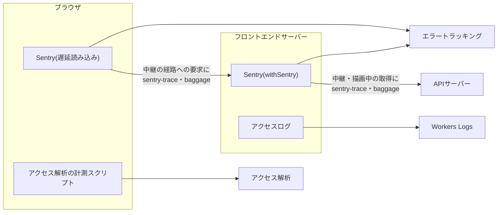

# フロントエンドの観測

Cloudflare Workersで動かすTanStack Startのフロントエンドサーバーと、そのブラウザ側の画面について、エラートラッキング(Sentry)の初期化、送信前の個人情報の除去とスパンの扱い、想定外の失敗の送信の入口、パフォーマンストレースの割合、アクセス解析、アクセスログを定める。

## 前提と用語

ログの形式・伏せ字の規則・呼び出しログの無効化・エラートラッキングの送信規則と2層の除去は「[ログ管理とエラートラッキング](../infra/004-logging-and-error-tracking.md)」に従い、本文書はフロントエンドに固有の構成と、その文書との違いだけを記す。処理の順序とCSPの許可先の登録は「[フロントエンドサーバーのセキュリティ](003-frontend-server-security.md)」、サーバー専用のファイルと同型の関数は「[Cloudflare Workers上のTanStack Startの起動](002-tanstack-start-on-workers.md#サーバー専用のファイルと同型の関数)」、GraphQLの取得と失敗の型は「[データ取得](006-data-fetching.md)」に従う。部品の置き場所は共通部品のディレクトリからのパスで示し、コードの例では`<共通部品の配置先>`までの相対パスを省いて書く。

| 部品                                                                                             | 置き場所(共通部品内)                            | 役割                                                                     |
| ------------------------------------------------------------------------------------------------ | ----------------------------------------------- | ------------------------------------------------------------------------ |
| `SENTRY_DATA_COLLECTION`・`scrubSentryEvent`・`scrubSentrySpan`・`isExpectedFailure`             | `utilities/observability/sentry-scrub.ts`       | サーバーとブラウザで共用する収集の設定と、送信前のイベントとスパンの除去 |
| `REDACTED`・`REDACTION_PATTERNS`・`redactText`・`redactDeep`                                     | `utilities/observability/redaction-patterns.ts` | 値の形式による伏せ字のパターン(ログとエラートラッキングで共用)           |
| `buildServerSentryOptions`                                                                       | `server/observability/server-sentry-options.ts` | サーバーのSentryの初期化オプション                                       |
| `ensureFrontendLoggingConfigured`・`getFrontendLogger`・`withCorrelationId`・`logAccess`         | `server/observability/logging.ts`               | ログの設定・ロガーの取得・相関IDの文脈・アクセスログ                     |
| `createFrontendServerEntry`                                                                      | `server/entry/create-frontend-server-entry.ts`  | 相関IDの採番、想定外の例外の送信、アクセスログの出力                     |
| `sentryGlobalRequestMiddleware`・`sentryGlobalFunctionMiddleware`の再エクスポート                | `start/sentry-middleware.server.ts`             | TanStack Startのグローバルのミドルウェア(サーバーだけで読み込む)         |
| `initBrowserObservability`・`loadBrowserSentryModules`・`RELAY_TRACE_PROPAGATION_TARGETS`        | `start/observability/browser-observability.ts`  | ブラウザのSentryの遅延読み込みと初期化                                   |
| `reportUnexpectedError`・`reportRenderError`・`browserErrorQueue`                                | `start/observability/report-error.ts`           | 想定外の失敗を送る同型の関数と、ルーターの描画の失敗の入口               |
| `reportUnexpectedErrorOnServer`                                                                  | `start/observability/report-error.server.ts`    | サーバーでの送信(errorログと描画の文脈の送信の関数)                      |
| `createBrowserErrorQueue`・`isReportableFailure`・`createFirstReportFilter`・`MAX_QUEUED_ERRORS` | `start/observability/error-queue.ts`            | 送る失敗の判定、同じ例外の2回目の除外、ブラウザの初期化前の送信待ちの列  |
| `installRouteErrorReporting`                                                                     | `start/observability/route-error-reporting.ts`  | `loader`・`beforeLoad`を持つ全ルートの`onError`で失敗を送る仕組み        |
| `webAnalyticsHeadScript`・`WEB_ANALYTICS_BEACON_SRC`                                             | `start/observability/web-analytics.ts`          | アクセス解析の計測スクリプトの`head`の要素                               |

| 用語                             | 意味                                                                                                                                                                            |
| -------------------------------- | ------------------------------------------------------------------------------------------------------------------------------------------------------------------------------- |
| 想定内の失敗                     | `expected`が真の`GraphQLClientError`(「[エラーの型と画面の分岐](006-data-fetching.md#エラーの型と画面の分岐)」)。CSRF・IP制限・未登録の中継の経路の拒否は例外にならず応答で返す |
| 中継が送る失敗                   | APIサーバーへ届かなかった失敗(`upstream_unavailable`・`upstream_timeout`)。中継の処理がサーバーで送るため、画面の側からは送らない                                               |
| 描画の文脈                       | エントリがTanStack Startへ渡す要求ごとの値(`FrontendRequestContext`)。サーバーでの送信の関数`reportUnexpected`を含む                                                            |
| `<呼び出し元の種類>`             | 「[内部経路とセキュリティヘッダー](../backend/006-internal-gateway.md#名前付きエントリポイントによる内部認証)」と同じ。フロントエンドサーバーのログのカテゴリの先頭にも使う     |
| `<共通部品の配置先>`             | 「[フロントエンドサーバーのセキュリティ](003-frontend-server-security.md#前提と用語)」と同じ                                                                                    |
| `<中継の接頭辞>`                 | 「[フロントエンドサーバーのセキュリティ](003-frontend-server-security.md#前提と用語)」と同じ                                                                                    |
| `<アクセス解析のトークンの変数>` | アクセス解析の計測のトークンを持つ変数のキー。アクセス解析を入れるアプリだけが値を持つ                                                                                          |

`<ログレベルの変数>`・`<エラートラッキングのDSNのシークレットのキー>`・`<エラートラッキングの環境名の変数>`・`<トレースの割合の変数>`は「[ログ管理とエラートラッキング](../infra/004-logging-and-error-tracking.md#前提と用語)」、`<元のクライアントIPのヘッダー>`・`<セッション識別子のヘッダー>`は「[内部経路とセキュリティヘッダー](../backend/006-internal-gateway.md#前提と用語)」の用語に従う。



## Sentryの初期化

### サーバー

アプリの`src/server.ts`で、Workerの入口全体を`@sentry/cloudflare`の`withSentry`で包み、TanStack Startのハンドラーを`@sentry/tanstackstart-react`の`wrapFetchWithSentry`で包む。`wrapFetchWithSentry`は渡したオブジェクトの`fetch`を置き換えるため、TanStack Startのハンドラーそのものではなく、それを呼ぶ別のオブジェクトを渡す。

```typescript
import { captureException, getTraceData, withSentry } from '@sentry/cloudflare';
import { wrapFetchWithSentry } from '@sentry/tanstackstart-react';
import handler from '@tanstack/react-start/server-entry';

const instrumentedHandler = wrapFetchWithSentry({
  fetch: (
    request: Request,
    options: { readonly context: FrontendRequestContext },
  ) => handler.fetch(request, options),
});

const startHandler: StartHandler = {
  fetch: async (request, options) =>
    await instrumentedHandler.fetch(request, options),
};

export default withSentry(
  (env) => buildServerSentryOptions(env),
  createFrontendServerEntry({
    profile: APP_PROFILE,
    startHandler,
    relayRoutes: RELAY_ROUTES,
    securityPolicy: APP_SECURITY_POLICY,
    reportUnexpected: captureException,
    traceHeaders: () => ({ ...getTraceData() }),
  }),
);
```

`buildServerSentryOptions(env)`は、要求ごとに環境全体を`validateFrontendEnv`で検証してから次のオプションを返す。

| オプション         | 値                                                                                                  |
| ------------------ | --------------------------------------------------------------------------------------------------- |
| `dsn`・`enabled`   | `env.<エラートラッキングのDSNのシークレットのキー>`。未設定か空文字なら`enabled: false`で送信しない |
| `environment`      | `env.<エラートラッキングの環境名の変数>`                                                            |
| `tracesSampleRate` | `env.<トレースの割合の変数>`を数値にした値                                                          |
| `dataCollection`   | `SENTRY_DATA_COLLECTION`(「[除去の規則](#除去の規則)」)                                             |
| `beforeSend`       | `scrubSentryEvent`                                                                                  |
| `beforeSendSpan`   | `scrubSentrySpan`                                                                                   |

- 環境の検証に失敗すると、DSNがあっても`enabled: false`・`environment: 'unknown'`・`tracesSampleRate: 0`で返す。環境の不備による500はエラートラッキングへ届かず、不備のあるキーの名前だけのログが残る(バックエンドの共通ライブラリは環境を検証せずに送る)。
- Sentry SDK 11.4.0の`@sentry/cloudflare`・`@sentry/tanstackstart-react`には`sendDefaultPii`が無い。個人情報を既定で集めないことは`dataCollection`で指定する(`userInfo: false`で利用者のIPアドレスの自動の収集も止まる)。
- `integrations`・`defaultIntegrations`を指定せず、画面操作の録画(Session Replay)と利用者のフィードバックの統合を加えない。
- `@sentry/cloudflare`は、オプションで指定しなかった項目を環境の変数(`SENTRY_TRACE_LIFECYCLE`・`SENTRY_RELEASE`・`SENTRY_DEBUG`・`SENTRY_TUNNEL`など)から読む。Wrangler設定の`vars`に`SENTRY_TRACE_LIFECYCLE`を定義しない(「[逐次送信のスパンの注意](#逐次送信のスパンの注意)」)。
- TanStack Startのグローバルのミドルウェアの先頭に、Sentryの要求と関数のミドルウェアを置く(「[TanStack Startの中の順序](003-frontend-server-security.md#tanstack-startの中の順序)」)。ブラウザ向けの同じミドルウェアは何もしない空の実装のため、`start/sentry-middleware.server.ts`から再エクスポートし、`createFrontendStartOptions`の同型の関数の`.server`の実装だけで読み込む。
- 送信はSDKが`ctx.waitUntil`で非同期に行い、送信の失敗は応答を変えない。

### ブラウザ

ブラウザのSentryは、最初の描画を妨げないよう、ルートの部品のマウントの後に動的`import()`で読み込む。共通部品の`AppDocument`がマウントの後に次を呼ぶため、アプリは初期化を書かない。

```typescript
useEffect(() => {
  void initBrowserObservability({
    router,
    config: runtime.publicConfig.sentry,
    queue: browserErrorQueue,
  });
}, [router, runtime.publicConfig.sentry]);
```

- `config`は、サーバーが検証済みの環境から作った公開の設定(`dsn`・`environment`・`tracesSampleRate`)である。DSNが無ければSDKを読み込まず、何も送らない。同じ送信待ちの列で2回呼んでも、読み込みと初期化は1回だけ行う。
- エラートラッキングのDSNはシークレットとして管理するが、ブラウザから送るため公開の設定としてHTMLに含まれる。DSNのオリジンは、エントリがCSPの`connect-src`へ加える。
- 読み込みは`loadBrowserSentryModules`(`createClientOnlyFn`の中の動的`import()`)で、SDK(`@sentry/tanstackstart-react`)と除去の関数(`sentry-scrub.ts`)を一緒に読み込む。サーバーのバンドルでは呼ぶと例外を投げる関数に置き換わり、Workersの条件で`@sentry/node`を含むサーバー版に解決されるSDKの`import()`ごと除かれる。
- 読み込み・初期化の失敗は再試行せず、`console`にも出さない。画面の表示と操作に影響させず、初期化の前に積んだ失敗は送らずに列に残る。

初期化のオプションは次のとおりである。

| オプション                | 値                                                                                            |
| ------------------------- | --------------------------------------------------------------------------------------------- |
| `dsn`・`environment`      | 公開の設定の値                                                                                |
| `tracesSampleRate`        | 公開の設定の値(サーバーと同じ`<トレースの割合の変数>`)                                        |
| `integrations`            | `[tanstackRouterBrowserTracingIntegration(router)]`だけ。録画とフィードバックの統合を加えない |
| `tracePropagationTargets` | `RELAY_TRACE_PROPAGATION_TARGETS`(`<中継の接頭辞>`で始まる経路だけ)                           |
| `dataCollection`          | `SENTRY_DATA_COLLECTION`                                                                      |
| `beforeSend`              | `scrubSentryEvent`                                                                            |
| `beforeSendSpan`          | `scrubSentrySpan`                                                                             |

- ブラウザのSDKは、`tracePropagationTargets`を指定しないと、同じオリジンへのすべての要求に`sentry-trace`・`baggage`を付ける。指定すると、要求の完全なURLと、同じオリジンの要求ではそのパスの部分の両方に照合し、どちらかが一致した要求にだけ付ける。`RELAY_TRACE_PROPAGATION_TARGETS`は`^<中継の接頭辞>`のように先頭で固定した正規表現で、完全なURL(`https://`で始まる)には一致しないため、外部のURL(エラートラッキング・bot判定・アクセス解析)にも、中継の経路以外の同じオリジンの要求にも付けない。照合の対象を広げる時も、先頭で固定しない正規表現や文字列(部分一致)を使わない。

### SDKを主バンドルへ入れない

SDKと除去の関数を静的に読み込むと、主バンドルが大きくなり最初の表示が遅れる。

- ブラウザのバンドルに入るファイル(部品・ルート・ルーター・`start/`の同型の関数のファイル)が`@sentry/tanstackstart-react`の実行時の値を1つでも静的にimportすると、動的`import()`が別のチャンクに分かれず、SDK全体が主バンドルに入る。検証では、TanStack Startのグローバルのミドルウェアを静的に読み込んだだけで主バンドルが約958kBになり、サーバーの分岐へ移すと約509kBに減った。
- 伏せ字のパターン(`redaction-patterns.ts`)が使う`@logtape/redaction`は、モジュールの最上位でロガーを取得するため木の揺さぶりで除けず、ブラウザ向けに約20.9KB(gzip約5.8KB)になる。このため、ブラウザの主バンドルに入る送信待ちの列は`sentry-scrub.ts`を読み込まず、想定内の失敗の判定`isExpectedFailure`を`utilities/graphql/graphql-result.ts`から読み込む(`sentry-scrub.ts`は同じ関数を再エクスポートする)。
- 静的解析の`frontend/browser-bundle/start-and-app`(`start/**`・`src/**`)と`frontend/direction/components`(`components/**`)が、`*.server.ts`・`src/server.ts`・テスト以外から`@sentry/tanstackstart-react`の実行時の値を静的にimportすることを禁止する(「[画面を持つアプリの静的解析](../coding/001-javascript-typescript-conventions.md#画面を持つアプリの静的解析)」)。型だけのimportは許し、動的`import()`は検出しない。
- 変換の結果は`vite build`の出力で確かめる。ブラウザ向けの主バンドルにSDKの`SDK_VERSION`が無く、Workerのバンドルに`@sentry/node`のモジュールが無く、Sentryのミドルウェアが残ることを確かめる。ビルド後の対象へのE2Eのスモークテストは、最初に読み込むスクリプトにSDKの印(`__SENTRY__`)が無いことを確かめる(開発サーバーでは飛ばして記録を残す)。

## 想定外の失敗の送信

### 送る失敗と送らない失敗

想定外の失敗だけを送り、次は送らない。

| 送らない失敗                                               | 理由と除き方                                                                                                                                                     |
| ---------------------------------------------------------- | ---------------------------------------------------------------------------------------------------------------------------------------------------------------- |
| 想定内の失敗(`expected`が真の`GraphQLClientError`)         | 利用者の操作や入力で起き得るため。`isReportableFailure`と、除去の関数`scrubSentryEvent`(元の例外で判定)が除く                                                    |
| 中継が送る失敗(`upstream_unavailable`・`upstream_timeout`) | 中継の処理が元の例外をサーバーで送っている。同じ失敗から作った別のオブジェクトを送ると二重になるため、`isReportableFailure`が除く                                |
| ページの404(`notFound()`)                                  | ルートの`onError`を通らない                                                                                                                                      |
| CSRF・IP制限・未登録の中継の経路の拒否                     | エントリが応答で返し、例外にならない                                                                                                                             |
| 同じ例外の2回目                                            | `loader`の失敗・描画の失敗・GraphQLの失敗として同じ例外が複数の入口から届くため、オブジェクトの同一性(`WeakSet`)で除く。同一性を持たない値(文字列など)は毎回送る |

- 想定外の失敗は`Error`(とその派生)で投げる。

### 送信の入口

| 入口                                      | 呼ぶ場所                                                  | 送る失敗                                                                                               |
| ----------------------------------------- | --------------------------------------------------------- | ------------------------------------------------------------------------------------------------------ |
| `reportUnexpectedError(error, 'loader')`  | `installRouteErrorReporting`が全ルートの`onError`に掛ける | `loader`・`beforeLoad`の失敗                                                                           |
| `reportRenderError(router, error)`        | ルーターの`defaultOnCatch`                                | 描画の失敗                                                                                             |
| `reportUnexpectedError(error, 'graphql')` | `executeGraphQL`                                          | GraphQLの想定外の失敗(区画の中で表示し、例外として届かない失敗を含む)                                  |
| エントリが包んだ`reportUnexpected`        | 中継の処理(`relayToApi`)                                  | APIサーバーへ届かなかった失敗と、共通のエラー形式でない5xxの応答(報告には状態コードだけを入れる)       |
| エントリが包んだ`reportUnexpected`        | エントリ(`createFrontendServerEntry`)                     | 処理の途中の想定外の例外。環境の不備も呼ぶが、その時はSentryが無効のため実際には送られない             |
| Sentryの要求と関数のミドルウェア          | TanStack Startのグローバルのミドルウェア                  | 描画やサーバー関数の処理から投げ出された例外。除外は`scrubSentryEvent`の想定内の失敗の判定だけが掛かる |
| ブラウザのSDKの既定の統合                 | 初期化の後の`window`                                      | 処理されなかった例外と`Promise`の拒否。初期化の前に起きたものは送られない                              |

アプリの`src/router.tsx`は、ルーターを作るたびに次の2つを設定する。データ取得に関わるルーターの設定は「[データ取得](006-data-fetching.md#ルーターと要求ごとのストア)」の「ルーターと要求ごとのストア」に従う。

```tsx
const router = createRouter({
  routeTree,
  context,
  defaultOnCatch: (error) => {
    reportRenderError(router, error);
  },
});
installRouteErrorReporting(Object.values(router.routesById), (error) => {
  reportUnexpectedError(error, 'loader');
});
```

- `defaultOnCatch`はブロック本体の関数で書く。式の本体にすると`router`の型の推論が循環する。
- TanStack Routerにはルーター全体の`loader`の失敗のフックが無く、ルートの`onError`は子のルートへ継承されない。`installRouteErrorReporting`は、`loader`か`beforeLoad`を持つすべてのルートの`onError`を、失敗を送ってからルート自身の`onError`を呼ぶ関数に置き換える。ルートが`onError`で失敗を`notFound()`などへ変えても元の例外は送られ、検索パラメータの検証の失敗(`SearchParamError`)も送られる。ルートの定義は要求ごとのルーターで共有するため、同じ定義を2回包まない。
- `reportRenderError`は、`router.state.matches`のどれかの`error`と同じ例外を送らない。TanStack Routerは`loader`の失敗を描画の境界で投げ直すが、ブラウザ内の遷移ではルートの`onError`が、ハイドレーションではサーバーが既に送っている。ハイドレーションで復元した`loader`の失敗はメッセージだけの別の`Error`になり、想定内かどうかも判定できないため、描画の失敗として送らない。
- `executeGraphQL`は想定外の失敗の結果を送ってから返す。取得の補助(`requireData`)が同じ失敗を投げ直して`loader`の失敗として届いても、同じオブジェクトのため2回目として除かれる。画面のコードでGraphQLの失敗を送り直さない。
- フォームの送信の処理(`AppForm`の`onSubmitError`)に届いた、GraphQL以外の想定外の例外を送るかは利用側で決める(「[共通化する部品](005-shared-components.md)」)。

### サーバーとブラウザの違い

`reportUnexpectedError`は同型の関数で、サーバーとブラウザで送り方が違う。

| 実行環境 | 送り方                                                                                                                                                                                                       |
| -------- | ------------------------------------------------------------------------------------------------------------------------------------------------------------------------------------------------------------ |
| サーバー | `reportUnexpectedErrorOnServer`が、カテゴリ`[<呼び出し元の種類>, 'http', 'error']`の`error`ログ(属性`source`と`error`)を出し、描画の文脈の`reportUnexpected`を呼ぶ。同じ例外の2回目の除外はisolateごとに保つ |
| ブラウザ | 1つだけの送信待ちの列`browserErrorQueue`に積む。初期化の前は最大10件(`MAX_QUEUED_ERRORS`)まで積んで超えた分を捨て、初期化の後に積んだ分を送る。初期化の後は直接送る。DSNが無い環境では積んだまま送らない     |

- サーバーの`reportUnexpected`は、アプリが渡した`captureException`をエントリが包んだ関数である。送信が例外を投げても描画と応答のヘッダー・アクセスログを止めず、送り直さずに、送れなかったことを`[<呼び出し元の種類>, 'http', 'error']`の`error`ログ(属性`errorName`)に残す。送信の例外のメッセージは送れなかった元の例外の値を含み得るため、名前だけを残す。
- ブラウザの送信の例外は画面の処理へ伝えず、`console`にも出さない。
- ブラウザの取得は、通信の失敗(`network_error`)を最大2回(`MAX_QUERY_RETRIES`)再試行する。試行ごとに別の失敗のオブジェクトができるため、1つの取得で最大3件が送られ得る。中継先の障害(`upstream_*`)も再試行するが、ブラウザからは送らない。
- エラートラッキングのイベントに相関IDのタグ(`correlation_id`)を付けない。アクセスログとエラーは、時刻と経路で突き合わせる。

## 除去の規則

送信するイベントとスパンからは、「[個人情報と秘密情報の除去](../infra/004-logging-and-error-tracking.md#個人情報と秘密情報の除去)」と同じ2層(SDKの収集設定`dataCollection`と、送信前の除去の関数)で個人情報と秘密情報を除く。サーバーとブラウザは同じ`sentry-scrub.ts`を使う。値の形式による伏せ字のパターン`redaction-patterns.ts`はバックエンドの共通ライブラリの`REDACTION_PATTERNS`の写しで(正規表現に`u`フラグを付けた点だけが違う)、片方を変えたらもう片方も見直し、一致はルートの単体テストが照合する(「[アプリ間で写した値の照合](../testing/001-test-strategy.md#アプリ間で写した値の照合)」)。

バックエンドとの違いは次のとおりである。

| 対象                         | フロントエンドの扱い                                                                                                                                                                                                                          |
| ---------------------------- | --------------------------------------------------------------------------------------------------------------------------------------------------------------------------------------------------------------------------------------------- |
| 収集するヘッダー             | `dataCollection.httpHeaders`は、要求ヘッダーを`accept`・`content-type`・`user-agent`だけ集め、応答ヘッダーを集めない                                                                                                                          |
| 想定内の失敗                 | `scrubSentryEvent`は、元の例外(`hint.originalException`)が想定内の失敗なら`null`を返して捨てる                                                                                                                                                |
| 利用者(`user`)               | 丸ごと削除する                                                                                                                                                                                                                                |
| URL                          | `request.url`、パンくずの`data`の`url`・`from`・`to`、スパンの`url.full`から、クエリとフラグメントを除く。`Referer`はクエリとフラグメントを除いて残す。パンくずとスパンの`url.query`・`url.fragment`・`http.query`・`http.fragment`を削除する |
| 削除するヘッダー             | `cookie`・`authorization`、Sentryが利用者のIPアドレスの取得に使う12種、Cloudflareが付ける`cf-connecting-ipv6`・`cf-pseudo-ipv4`、`<元のクライアントIPのヘッダー>`・`<セッション識別子のヘッダー>`・`cf-turnstile-response`の19種              |
| スパンの要求ヘッダー         | `http.request.header.*`のうち`accept`・`content-type`・`user-agent`以外を削除する                                                                                                                                                             |
| スパンの応答ヘッダー・利用者 | `http.response.header.*`・`user.*`をすべて削除する                                                                                                                                                                                            |
| スパンの接続元・本文         | `client.address`・`network.peer.address`・`http.request.body.data`と、旧来の属性名`http.target`・`http.url`・`http.client_ip`・`net.peer.ip`・`net.sock.peer.addr`を削除する                                                                  |

- 属性名とヘッダー名は大文字小文字を区別せずに比べる。除去の関数は元のイベントとスパンを書き換えず、新しい値を返す。
- 値の形式による伏せ字は、4組の数字のバージョン表記もIPv4アドレスとして伏せる(`user-agent`の`Chrome/130.0.0.0`や、4組の数字のリリース名など)。バックエンドと同じ挙動である。
- 中継で付けるヘッダーの名前を加えたり変えたりしたら、削除するヘッダーを合わせる。

### スパンの除去が必要な理由

収集設定の`dataCollection`だけでは、スパンから個人情報を除き切れない。

- `dataCollection`は、SDKが自身の補助を通して集めた値だけを絞る。統合やアプリが`setAttribute`などで直接付けた属性と、スパンの名前には`dataCollection`が掛からない。
- `urlQueryParams: false`でも、URLのフラグメントは残る。SDK 11.4.0では、URLからクエリを除く処理(`filterUrlQuery`)が`#`以降をそのまま残して`url.full`に入れ、`fetch`のスパンは`dataCollection`を見ずにフラグメントを`url.fragment`に入れる。フラグメントには、認証の応答のトークンなどが入り得る。
- ブラウザのスパンは画面の遷移と中継への要求のURLを、サーバーのスパンは受けた要求のURLとヘッダー(Cookie・接続元のIPアドレスを含む)を持つ。旧来の属性名(`http.url`・`net.peer.ip`など)は、収集設定の対象の属性名と異なる。
- エラーイベントの`beforeSend`はスパンを受け取らず、逐次送信ではトランザクションのイベントが作られない(「[逐次送信のスパンの注意](#逐次送信のスパンの注意)」)。スパンを除去できるのは`beforeSendSpan`だけである。

### 逐次送信のスパンの注意

- SDK 11.4.0の既定のトレースの送り方(`traceLifecycle`)は、サーバー・ブラウザともスパンの逐次送信(`'stream'`)である。ブラウザでは、ルーターのトレースの統合が逐次送信の統合を加える。このままにする。
- 逐次送信では、`beforeSendSpan`は`StreamedSpanJSON`を受け取る。属性の値は値そのものか、単位を伴う`{ value, unit }`の形を取るため、除去の関数は両方の形を扱う。
- `traceLifecycle: 'static'`を指定しない。`@sentry/cloudflare`は`traceLifecycle`を指定しなければ環境の変数`SENTRY_TRACE_LIFECYCLE`を読むため、Wrangler設定の`vars`にも定義しない。`scrubSentrySpan`を`withStaticSpan`で包まない。SDKは`beforeSendSpan`の形と`traceLifecycle`が合わない時に`beforeSendSpan`を無視する。通常のバンドルでは初期化の時に`console`へ警告が1回出るだけで(ビルドで`__SENTRY_DEBUG__`を`false`に置き換えた場合は出ない)、スパンは除去されないまま送られる。
- 逐次送信では`beforeSendTransaction`・`ignoreTransactions`が呼ばれないため使わない。
- `beforeSendSpan`はスパンを捨てられない。`null`を返してもSDKは元のスパンを送る(`console`へ警告が1回出る)ため、除去だけを行う。
- `beforeSendSpan`が例外を投げると、SDKは元のスパンを除去しないまま送る(`beforeSend`が例外を投げた時はイベントを捨てる)。除去の関数は、想定しない形の属性でも例外を投げないように書く。

### 確認の方法

スパンの除去は、次の単体テストで確かめる。共通部品で`bun run test:unit`を実行する。

| テスト                                                                 | 確かめること                                                                                                                                                                                                                                                                                                                                                                                                                            |
| ---------------------------------------------------------------------- | --------------------------------------------------------------------------------------------------------------------------------------------------------------------------------------------------------------------------------------------------------------------------------------------------------------------------------------------------------------------------------------------------------------------------------------- |
| `utilities/observability/sentry-scrub.unit.test.ts`の`scrubSentrySpan` | Cookie・IPv4・IPv6・メールアドレス・クエリ・フラグメント・認証・セッション識別子・bot判定のトークン・本文を入れたスパンを除去し、JSONにした結果にそれらの値が1つも残らないこと。要求ヘッダーの許可した3つ(大文字の属性名でも)、応答ヘッダー・利用者・接続元・本文・クエリ・フラグメント・旧来の属性名の削除、`url.full`(値そのものと`{ value }`の形)、名前と文字列・配列・`{ value, unit }`の属性の伏せ字、元のスパンを書き換えないこと |
| `server/observability/server-sentry-options.unit.test.ts`              | サーバーの`beforeSendSpan`が`scrubSentrySpan`、`dataCollection`が`SENTRY_DATA_COLLECTION`であること                                                                                                                                                                                                                                                                                                                                     |
| `start/observability/browser-observability.unit.test.ts`               | ブラウザの初期化のオプションが表のとおりと完全に一致すること(`traceLifecycle`を指定せず、統合はルーターのトレースだけ)                                                                                                                                                                                                                                                                                                                  |

除去の対象を加えた時は、テストのスパンに新しい属性を足し、残らないことを確かめる。Sentry SDKの版を更新する時は、「[SDKの版を更新するとき](../infra/004-logging-and-error-tracking.md#sdkの版を更新するとき)」の確認に加えて、次を確かめる。

- `@sentry/core`の`Client`が既定で`traceLifecycle`を`'stream'`にし、`beforeSendSpan`が`StreamedSpanJSON`を受け取ること。`@sentry/cloudflare`の`getFinalOptions`が環境から読む変数の名前。
- URLのクエリを除く処理と`fetch`・HTTPのスパンが付ける属性の名前(`@sentry/conventions`)。フラグメントやクエリを持つ新しい属性が加わっていれば、削除する属性に加える。
- stagingで記録されたトレースのスパンの属性に、`http.request.header.cookie`などの削除するヘッダー・`client.address`・`user.*`・クエリとフラグメントが無いこと。

## トレースの割合

- `<トレースの割合の変数>`を、環境ごとにWrangler設定の`vars`で`0`以上`1`以下の10進表記の文字列(`"0"`・`"0.1"`・`"1"`など)で書く。ローカル環境では`"0"`とする。形式が不正なら環境の検証で失敗する。
- ブラウザの割合は、同じ変数の値を公開の設定で受け取る。サーバーとブラウザで別の割合を持たない。
- ブラウザは画面の読み込みと遷移でトレースを始め(`tanstackRouterBrowserTracingIntegration`)、中継の経路への要求に`sentry-trace`・`baggage`を付ける。フロントエンドサーバーの`withSentry`はこの2つを受けてトレースを続け、中継の処理はその時点のトレースの値(`getTraceData()`)を、`sentry-trace`・`baggage`だけ(`RELAY_TRACE_HEADERS`)APIサーバーへ渡す。ブラウザから送った要求の`fetch`のスパンで、フロントエンドサーバーとAPIサーバーのスパンを結び付けて応答時間を追える。
- 描画中の取得も、エントリが要求の初めに読んだトレースの値を中継の処理へ渡す。`getTraceData()`の`baggage`は値が無いことがあるため、エントリは値が文字列の項目だけを残す。

## アクセス解析

- アクセス解析は、Cookieを使わないCloudflare Web Analyticsの計測スクリプトで行い、アプリのプロファイル(`FrontendAppProfile`)の`webAnalytics`が真のアプリにだけ入れる。偽のアプリは、公開の設定のトークンが常に`undefined`になり、計測スクリプトを出さない。
- トークンは`<アクセス解析のトークンの変数>`から読む。空文字は未設定として扱い、計測スクリプトを出さない。
- アプリのルートのルート(`src/routes/__root.tsx`)の`head`で、`webAnalyticsHeadScript`の戻り値を`scripts`に入れる。戻り値は`src`(`WEB_ANALYTICS_BEACON_SRC`)・`defer: true`・`data-cf-beacon`(トークンのJSON)を持ち、nonceはルーターが付ける。文字コード・表示領域・スタイルシートなどと一緒にルートの`head`を組み立てるアプリの補助の関数を経由して呼んでもよい。

```typescript
export const Route = createRootRouteWithContext<RouterContext>()({
  loader: ({ context }) => context.runtime.get(),
  head: ({ loaderData }) => {
    const analytics = webAnalyticsHeadScript(
      loaderData?.publicConfig.webAnalyticsToken,
    );
    return { scripts: analytics === undefined ? [] : [analytics] };
  },
  shellComponent: AppDocument,
});
```

- 計測スクリプトの配信元`https://static.cloudflareinsights.com`をCSPの`script-src`に、計測値の送信先`https://cloudflareinsights.com`を`connect-src`に、アクセス解析を入れるアプリの登録箇所で加える(「[許可先の登録](003-frontend-server-security.md#許可先の登録)」)。
- 計測スクリプトは`defer`で最初の描画を妨げず、読み込みと送信の失敗はスクリプトの中で閉じて、画面の表示と操作へ伝わらない。
- E2Eのスモークテストは、計測スクリプトがある時に`defer`とnonceを確かめる。トークンの無い環境では確認を飛ばして記録を残す。

## アクセスログ

エントリ(`createFrontendServerEntry`)は、Workerが処理したすべての要求の最後に、セキュリティヘッダーを付けた応答からアクセスログを1件出す(`logAccess`)。

| 項目            | 内容                                                                                                                               |
| --------------- | ---------------------------------------------------------------------------------------------------------------------------------- |
| カテゴリ        | `[<呼び出し元の種類>, 'http', 'access']`                                                                                           |
| レベル          | `info`                                                                                                                             |
| メッセージ      | 「HTTPリクエストを処理しました」                                                                                                   |
| `method`        | 要求のメソッド                                                                                                                     |
| `path`          | 経路。クエリとフラグメントを除く(呼び出し側が付けて渡しても除く)                                                                   |
| `status`        | 応答の状態コード                                                                                                                   |
| `durationMs`    | 処理時間。ストリーミングの応答では、ヘッダーを返すまでの時間                                                                       |
| `correlationId` | 要求ごとに採番したUUID                                                                                                             |
| `outcome`       | 処理の結果。中継が`relay`、描画が`page`、IP制限・CSRF・未登録の中継の経路の拒否が`rejected`、500の静的なエラー画面が`static_error` |

```json
{
  "time": "2030-01-15T12:00:00.000Z",
  "level": "info",
  "category": "<呼び出し元の種類>.http.access",
  "message": "HTTPリクエストを処理しました",
  "method": "GET",
  "path": "/items",
  "status": 200,
  "durationMs": 48,
  "correlationId": "5f0c3c0e-2b8e-4a49-9d0b-6f9c2a7f1e3d",
  "outcome": "page"
}
```

- 属性`outcome`は、「[処理単位の終わりのログ](../infra/004-logging-and-error-tracking.md#処理単位の終わりのログ)」のHTTPのリクエストの属性に、フロントエンドサーバーが加えるものである。
- IPアドレス・クエリ・ヘッダー・Cookieを含めない。静的なファイルの要求はWorkerを起動しないため、アクセスログが出ない。
- `<ログレベルの変数>`は`debug`か`info`にする。`warning`以上にするとアクセスログが出なくなり、要求ごとの記録が残らない。ログのレベルは環境の検証より前に生の環境から読み、不正な値は`info`として扱ったうえで、環境の検証で要求を500にする。
- 呼び出しログは無効にし、Wrangler設定のルートに`observability.logs.invocation_logs: false`を書く(「[出力先と保持期間](../infra/004-logging-and-error-tracking.md#出力先と保持期間)」)。

### ログの形式と相関ID

- ログの形式と、属性名・値の形式による伏せ字は「[ログ管理とエラートラッキング](../infra/004-logging-and-error-tracking.md)」と同じである。`REDACTED_FIELD_PATTERNS`とログの組み立ては、バックエンドの共通ライブラリの写しで、片方を変えたらもう片方も見直す。`REDACTED_FIELD_PATTERNS`の一致はルートの単体テストが照合する(「[アプリ間で写した値の照合](../testing/001-test-strategy.md#アプリ間で写した値の照合)」)。値の形式の伏せ字は`redaction-patterns.ts`を使う。
- エントリは、要求ごとに`ensureFrontendLoggingConfigured`を呼んで(isolateの最初の呼び出しと、レベルなどが変わった時だけ設定し直す)から`withCorrelationId`で相関IDの文脈を作る。設定より前に作った文脈は相関IDを保てない。文脈は`node:async_hooks`の`AsyncLocalStorage`で保ち、互換性日付が2026-08-04以降なら`compatibility_flags`無しで使える。
- ログの設定は`<呼び出し元の種類>`で始まるカテゴリにだけ出力先を付ける。設定と`logAccess`には同じ`<呼び出し元の種類>`(アプリのプロファイルの`caller`)を渡す。違う種類のカテゴリのログは捨てられる。
- テストで出力先を差し替える時は`console`を渡す。出力先(LogTapeのSink)を差し替えると、整形と値の形式による伏せ字を通らなくなる。

フロントエンドサーバーの共通部品が使うカテゴリは次のとおりである。

| カテゴリ                                     | レベル    | 出力するログ                                                                                                            |
| -------------------------------------------- | --------- | ----------------------------------------------------------------------------------------------------------------------- |
| `[<呼び出し元の種類>, 'http', 'access']`     | `info`    | アクセスログ                                                                                                            |
| `[<呼び出し元の種類>, 'env']`                | `error`   | 環境の設定の不備(属性`invalidEnvNames`に不備のあるキーの名前だけ)                                                       |
| `[<呼び出し元の種類>, 'http', 'error']`      | `error`   | エントリの想定外の例外、サーバーでの想定外の失敗の送信(属性`source`)、エラートラッキングへの送信の失敗(属性`errorName`) |
| `[<呼び出し元の種類>, 'http', 'csrf']`       | `warning` | CSRFの検証による拒否(属性`reason`・`path`)                                                                              |
| `[<呼び出し元の種類>, 'http', 'rate-limit']` | `warning` | IP制限の超過による拒否(属性`path`)と、判定の失敗による通過                                                              |
| `[<呼び出し元の種類>, 'relay']`              | `warning` | 中継の失敗(属性`code`・`route`。`route`は登録した経路の形)                                                              |
| `[<呼び出し元の種類>, 'relay', 'session']`   | `warning` | セッションの指示の破棄(属性`reason`)                                                                                    |

- 環境の設定の不備のカテゴリは、バックエンドの`[<アプリ名>, 'http', 'env']`と異なり`'http'`を含まない。
- LogTape自身の警告は、カテゴリ`['logtape', 'meta']`で`warning`以上だけを同じ伏せ字付きの出力先へ出す。
