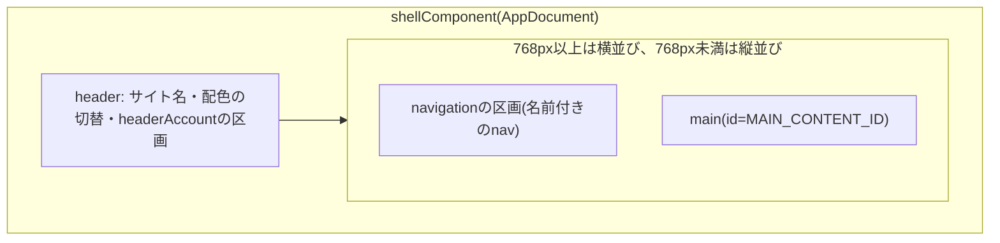
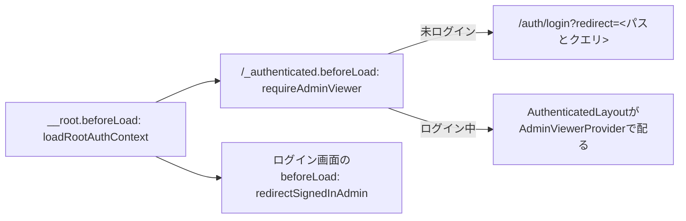

# 管理画面のシェルと区画

管理者側のフロントエンドの画面シェル(ヘッダー・ナビゲーション・本文)の構成と、後から機能を足すための登録箇所を定める。区画の差し替え、メニュー・ダッシュボードのカード・設定のページの区画の登録、ナビゲーションのランドマーク、カードの状態表示とエラーの分離、ログイン必須の領域とログイン中の管理者の参照、管理者の取り直し、ロールによる操作の出し分け、失敗の文言の選び方、及び共通部品の使い方を扱う。

## 前提と用語

TanStack Start・TanStack Router・TanStack Queryを使う構成を前提とする。取得の補助とルートの`beforeLoad`での認証の判定は「[データ取得](006-data-fetching.md)」に、ランドマークとフォーカスは「[アクセシビリティ規則](004-accessibility-rules.md)」に、共通部品は「[共通化する部品](005-shared-components.md)」に、APIサーバーの認可は「[管理者の認可の設計](../security/007-admin-authorization.md)」に従う。部品の置き場所は、`<管理者側のフロントエンドのアプリ>`の`src/`と、共通部品の配置先(`<共通部品の配置先>`)・共用部品の配置先(`<共用部品の配置先>`)からのパスで示す。`test/`で始まるパスだけは、`src/`の外の`<管理者側のフロントエンドのアプリ>`の直下の`test/`(アプリ全体を対象にしたテストと、テストの補助の置き場所)を指す。

| 部品                                                            | 置き場所                                                                                 | 役割                                                                                                                           |
| --------------------------------------------------------------- | ---------------------------------------------------------------------------------------- | ------------------------------------------------------------------------------------------------------------------------------ |
| `AdminLayout`・`AdminHeader`                                    | `components/layout/admin-layout.tsx`・`admin-header.tsx`                                 | 画面シェルの基本レイアウトとヘッダー                                                                                           |
| `ADMIN_LAYOUT_SLOTS`・`AdminLayoutSlots`                        | `composition/layout-slots.ts`                                                            | 区画の登録箇所                                                                                                                 |
| `AdminNavigation`・`AdminAccountMenu`                           | `components/layout/admin-navigation.tsx`・`admin-account-menu.tsx`                       | ナビゲーションの区画と、ヘッダーのアカウントの区画の部品                                                                       |
| `ADMIN_NAV_ITEMS`・`AdminNavItem`                               | `composition/admin-navigation.ts`                                                        | メニューの項目の登録箇所                                                                                                       |
| `orderAdminNavItems`                                            | `components/layout/admin-nav-order.ts`                                                   | メニューの項目の並べ替え                                                                                                       |
| `DASHBOARD_CARDS`・`DashboardCard`                              | `composition/dashboard-cards.ts`                                                         | ダッシュボードのカードの登録箇所                                                                                               |
| `DashboardGrid`                                                 | `components/dashboard/dashboard-grid.tsx`                                                | カードの並びと、カードごとのエラーの境界                                                                                       |
| `DashboardCardFrame`・`DashboardCardState`                      | `components/dashboard/dashboard-card-frame.tsx`                                          | カードの枠・題名・状態の表示                                                                                                   |
| `ADMIN_SETTINGS_SECTIONS`・`AdminSettingsSection`               | `composition/admin-settings-sections.ts`                                                 | 設定のページの区画の登録箇所                                                                                                   |
| `AdminSettingsSectionsView`                                     | `components/settings/admin-settings-sections-view.tsx`                                   | 設定のページの区画の並びと、区画ごとのエラーの境界                                                                             |
| `SectionFallback`                                               | `components/layout/section-fallback.tsx`                                                 | 読み込み中と失敗の間に区画の見出しを補う枠(カテゴリのページの区画と設定のページの区画が共用)                                   |
| `RecoverableSlot`                                               | `<共通部品の配置先>`の`components/state/recoverable-slot.tsx`                            | 登録した部品ごとのエラーの境界・失敗の送信・再試行の後のフォーカス(共通部品。問い合わせの導線の有無は`contactAvailable`で渡す) |
| `loadRootAuthContext`・`adminViewerQueryOptions`・`AdminViewer` | `graphql/admin-viewer.ts`                                                                | ルートの`beforeLoad`でのログイン中の管理者の取得                                                                               |
| `requireAdminViewer`・`redirectSignedInAdmin`                   | `components/auth/require-admin-viewer.ts`・`redirect-signed-in-admin.ts`                 | ログイン必須の領域の判定と、ログイン中のログイン画面からの移動                                                                 |
| `AuthenticatedLayout`・`AdminViewerProvider`                    | `components/auth/authenticated-layout.tsx`・`components/layout/admin-viewer-context.tsx` | ログイン必須の領域の文脈の配布                                                                                                 |
| `useCurrentAdmin`・`useAdminRole`                               | `components/layout/use-current-admin.ts`                                                 | ログイン必須の領域の中でのログイン中の管理者とロールの参照                                                                     |
| `RoleGate`                                                      | `components/layout/role-gate.tsx`                                                        | ロールによる出し分け                                                                                                           |
| `useAdminViewer`                                                | `components/auth/use-admin-viewer.ts`                                                    | 区画の部品がキャッシュからログイン中の管理者を読む                                                                             |
| `useAdminViewerRefresh`・`useSignedInNavigation`                | `components/auth/use-admin-viewer-refresh.ts`・`use-signed-in-navigation.ts`             | セッションが変わった後の管理者の取り直し                                                                                       |
| `ADMIN_PROFILE`                                                 | `composition/app-profile.ts`                                                             | アプリのプロファイル(問い合わせの導線を持たない`contactAvailable: false`を含む)                                                |
| `hasRole`・`ADMIN_ROLE_LABELS`                                  | `<共用部品の配置先>`の`admin/admin-roles.ts`                                             | ロールの比較と表示名(APIサーバーと共有)                                                                                        |

| 用語               | 意味                                                                                                                                                                     |
| ------------------ | ------------------------------------------------------------------------------------------------------------------------------------------------------------------------ |
| 画面シェル         | 全てのページ(認証の画面・404・エラーのページを含む)を包む、ヘッダー・ナビゲーション・本文の枠                                                                            |
| 区画               | 画面シェルの中の、部品を差し替えられる場所(`navigation`・`headerAccount`)                                                                                                |
| 登録箇所           | 各機能が自分の項目(メニューの項目・ダッシュボードのカード・設定のページの区画)を追記する`composition/`の定数。画面シェルの部品は変えずに、登録箇所の追記だけで機能を足す |
| ログイン必須の領域 | 経路の無いレイアウト`/_authenticated`の下のページ。未ログインならログイン画面へ移す                                                                                      |

## 画面シェルの構成



- 基本レイアウトはルートの`shellComponent`に置く。ルートの`errorComponent`・`notFoundComponent`はルートの`component`を置き換えて描かれるため、`component`に置くとエラーと404のページから画面シェルが消える。
- ランドマークは`<header>`・`<nav>`・`<main>`で、画面シェルはフッターを持たない。`navigation`の区画の部品は、ヘッダーと本文の間(768px以上では本文の左の列、768px未満では本文の上)に、包む要素無しで置かれるため、自身で名前付きの`<nav>`(`aria-label`)を描く(「[ランドマークとページの構成](004-accessibility-rules.md#ランドマークとページの構成)」)。
- `headerAccount`の区画の部品は、ヘッダーの右端の配色の切替の後に置かれる。
- 区画が`null`なら入れ物ごと描かない。名前だけの空の`<nav>`を残さない。
- 区画の部品は、認証の画面・404・エラーのページにも描かれるため、未ログインでは何も描かない。管理者側には新規登録が無いため、ヘッダーにログインへの導線も置かない。
- 768px未満では、ナビゲーションの区画が「メニュー」のボタンを置き、項目の一覧をシートで開く。ブラウザ内の画面遷移ではシートが開いたまま残るため、中のリンクを選んだら閉じる。開いたまま幅768px以上になったら、シートを閉じて本文の左の列の一覧の最初の項目へフォーカスを移す(「[重ねて表示する部品](004-accessibility-rules.md#重ねて表示する部品)」)。

## 区画の差し替え

`ADMIN_LAYOUT_SLOTS`の部品を差し替えて区画を変える。基本レイアウト(`AdminLayout`)は変えない。

```typescript
export const ADMIN_LAYOUT_SLOTS: AdminLayoutSlots = Object.freeze({
  navigation: AdminNavigation,
  headerAccount: AdminAccountMenu,
});
```

- 区画の部品はpropsを受け取らない`ComponentType`にする。必要な値は登録箇所とキャッシュから読む。
- 区画の部品はルートの文脈を読めない場面(エラーと404のページ)でも描かれるため、ログイン中の管理者は`useAdminViewer`でキャッシュから読む(「[認証の判定に要る取得](006-data-fetching.md#認証の判定に要る取得)」)。取得の失敗と取得前は未ログインとして扱う。

## メニューの登録

管理画面のページを足す機能は、`ADMIN_NAV_ITEMS`に項目を1件追記する。

```typescript
export const ADMIN_NAV_ITEMS: readonly AdminNavItem[] = Object.freeze([
  { to: '/', label: 'ダッシュボード', order: 10 },
  { to: '/<機能のパス>', label: '<機能の名前>', order: EXAMPLE_NAV_ORDER },
]);
```

| 項目    | 規則                                                                                                    |
| ------- | ------------------------------------------------------------------------------------------------------- |
| `to`    | ページのパス。ログイン必須の領域の経路にする                                                            |
| `label` | メニューに出す名前。ページの見出しと同じ文言にする                                                      |
| `order` | 並び順。10刻みで割り当て、登録箇所のコメントに機能ごとの値を書く。配列の順ではなく`order`の昇順に並べる |

- 項目は他の機能が登録する経路を指し、型付きの`Link`では指定できないため、パスで遷移させる共通部品(`PathLink`)で描く(「[パスへの遷移](005-shared-components.md#パスへの遷移)」)。
- 現在のページは、リンクが`aria-current="page"`を付けて示す。トップページの項目は全てのパスの先頭に一致するため同じパスのときだけ、他の項目はその下のページでも現在のページとし、クエリは見ない。
- 全てのロールが全てのメニューを参照できるため、項目をロールで隠さない(「[ロール](../security/007-admin-authorization.md#ロール)」)。
- 項目を足す機能は、並び順の単体テスト(`src/`の`components/layout/admin-nav-order.unit.test.ts`)、ナビゲーションの区画のブラウザテスト(`src/`の`components/layout/admin-navigation.browser.test.tsx`)、アプリの直下の`test/`の画面シェルのブラウザテスト(`test/admin-shell.browser.test.tsx`)の期待値を更新する。3つとも項目の一覧を完全一致で確かめる。

## ダッシュボードのカードの登録

ダッシュボードに要約を出す機能は、`DASHBOARD_CARDS`にカードを1件追記する。

| 項目        | 規則                                                                                    |
| ----------- | --------------------------------------------------------------------------------------- |
| `id`        | `<機能名>.<名詞句>`。Reactの`key`に使うため重複させない                                 |
| `order`     | 並び順。機能ごとの値を登録箇所のコメントに書く                                          |
| `width`     | `full`(768px以上で2列分)か`half`(1列分)。768px未満では常に1列                           |
| `component` | propsを受け取らない部品。自分でデータを取得し、`DashboardCardFrame`で枠と状態を表示する |

```tsx
export function PendingItemsCard() {
  const query = useQuery(pendingItemsQueryOptions());
  const state: DashboardCardState =
    query.status === 'error'
      ? {
          status: 'error',
          error: query.error,
          retry: () => void query.refetch(),
        }
      : { status: query.status };
  return (
    <DashboardCardFrame
      title="<カードの題名>"
      href="/<詳しい一覧のパス>"
      state={state}
    >
      <p>{query.data?.count}件</p>
    </DashboardCardFrame>
  );
}
```

- `DashboardCardFrame`は、題名を`<h2>`にして`<section>`の名前にし、`href`を渡すと題名を詳しい一覧へのリンクにする。`state`は取得の状態で、TanStack Queryの`status`と同じ名前(`pending`・`error`・`success`)にする。`pending`では`LoadingSkeleton`、`error`では`ErrorState`と再試行、`success`では`children`を描く。再試行のボタンは取得し直すと消えるため、押した時にフォーカスを題名の`<h2>`(`tabIndex={-1}`)へ移す(「[処理の後のフォーカス](004-accessibility-rules.md#処理の後のフォーカス)」)。
- `DashboardGrid`は、カードごとに`RecoverableSlot`でエラーの境界(`CatchBoundary`と`QueryErrorResetBoundary`)と`Suspense`に包む。1つのカードの描画や取得の失敗は、そのカードの位置に`ErrorState`を出して留め、他のカードの表示を続ける。再試行は、取得の失敗の記録とエラーの境界の両方を解除して描き直す。再試行の後のフォーカスは、描き直したカードの題名の`<h2>`へ移し、再び失敗した時は新しい再試行のボタンへ移す(「[取得の遅い区画のストリーミング](006-data-fetching.md#取得の遅い区画のストリーミング)」と同じ規則)。`RecoverableSlot`は共通部品(「[状態表示](005-shared-components.md#状態表示)」)で、登録した部品を並べる他の表示も共通で使う。管理者側は`contactAvailable`に`ADMIN_PROFILE.contactAvailable`(偽)を渡し、`contactHref`を渡さないため、失敗の表示に問い合わせの導線と問い合わせを促す文が出ない。
- 境界が捕まえた失敗はルーターの`defaultOnCatch`へ届かないため、`RecoverableSlot`がエラートラッキングへ送る。GraphQLの失敗(`GraphQLClientError`)は`executeGraphQL`が送っているため送り直さない(「[送信の入口](007-frontend-observability.md#送信の入口)」)。
- カードが1件も無ければ、表示できる項目が無い旨の`EmptyState`を描く。カードを足す機能は、空の状態を確かめるテストを更新する。
- カードはページの最初の描画の呼び出し回数に数える(「[1ページの描画あたりの呼び出し回数の目安](006-data-fetching.md#1ページの描画あたりの呼び出し回数の目安)」)。取得の遅いカードは、ページの`loader`で待たずにカード自身が取得する。

## 設定のページの区画の登録

管理画面の設定のページに区画を足す機能は、`ADMIN_SETTINGS_SECTIONS`に区画を1件追記する。ページ(`components/pages/admin-settings-page.tsx`)と並びの部品(`AdminSettingsSectionsView`)は変えない。

| 項目        | 規則                                                                                                           |
| ----------- | -------------------------------------------------------------------------------------------------------------- |
| `id`        | `<spec名>.<名詞句>`。Reactの`key`に使うため重複させない                                                        |
| `order`     | 並び順。10刻みで割り当て、登録箇所のコメントに機能ごとの値を書く。配列の順ではなく`order`の昇順に並べる        |
| `title`     | 区画の見出し。部品が描く見出しと同じ文言にする。部品が描けない読み込み中と失敗の間は、ページがこの見出しを補う |
| `component` | propsを受け取らない部品。自分でデータを取得し、`title`と同じ文言の見出し(`<h2>`)を名前にした`<section>`を描く  |

- `AdminSettingsSectionsView`は、区画ごとに`RecoverableSlot`(「[状態表示](005-shared-components.md#状態表示)」)で包み、`frame`に`SectionFallback`(`components/layout/section-fallback.tsx`)を渡す。1つの区画の取得や描画の失敗は、その区画の位置に`title`の見出しと再試行を出して留め、他の区画の表示を続ける。読み込み中も同じ枠で見出しとスケルトンを描くため、表示が後になっても配置がずれない。
- `SectionFallback`は、カテゴリのページの区画の並びと設定のページの区画の並びが共用する。見出しの階層と文言は、部品が描く見出しに合わせる。
- 区画の部品の取得は「[登録口に登録された区画の取得](006-data-fetching.md#登録口に登録された区画の取得)」に従う。ロールで操作を出し分ける区画は「[ロールによる操作の出し分け](#ロールによる操作の出し分け)」に従い、権限の無い操作は本当の`disabled`にして理由を`aria-describedby`で結び付ける。
- 区画を足す機能は、区画の`order`順の表示と、1つの区画の失敗が他の区画に及ばないことを確かめるブラウザテストの期待値を更新する。

## ログイン必須の領域



- ルートの`beforeLoad`が、ログイン中の管理者を取得のキャッシュを通して1回だけ取得し、ルートの文脈に入れる。失敗は未ログインとして描画を続ける(「[認証の判定に要る取得](006-data-fetching.md#認証の判定に要る取得)」)。
- 管理画面のページは、経路の無いレイアウト`/_authenticated`の下に置く。`beforeLoad`の`requireAdminViewer`は文脈の値で判定するだけで取得せず、未ログインなら現在のパスとクエリを戻り先にしたログイン画面へ移す。戻り先は共通部品の戻り先の検証(`toSafeReturnPath`)を通してから使う。
- ログイン画面だけが`beforeLoad`の`redirectSignedInAdmin`で、ログイン中ならダッシュボードへ移す。他の認証の画面には付けない。特に招待の完了・メールアドレス変更の確定のように、メールのリンクで開く画面に付けると、完了の後に移動してリカバリコードなどの完了の表示が消える。
- ログインを要さない開発者向けの画面(疎通確認など)は、ログイン必須の領域の外に置く。

## ログイン中の管理者の参照

| 場所                       | 使う部品                          | 理由                                                                              |
| -------------------------- | --------------------------------- | --------------------------------------------------------------------------------- |
| ログイン必須の領域のページ | `useCurrentAdmin`・`useAdminRole` | `AuthenticatedLayout`が判定を通った管理者を文脈で配る。領域の外で読むと例外になる |
| 画面シェルの区画           | `useAdminViewer`                  | 区画はエラーと404のページにも描かれ、文脈を読めない。取得前と失敗は`null`         |

- ログイン中の管理者(`AdminViewer`)は、ID・ニックネーム・肩書き・メールアドレス・ロール・画像・リカバリコードの残数を持つ。ロールはGraphQLの列挙の値から共用部品の`AdminRole`に変換して持つ。
- ロールは要求ごとにAPIサーバーで読み直されるため、他の管理者がロールを変えると、画面の表示は次の取り直しまで古いロールのままになる。操作はAPIサーバーの判定で拒否される。

## 管理者の取り直し

セッションが変わる操作の後は、ログイン中の管理者の取得を無効にして取り直す。

| 操作                                                                                     | 使う部品                | 振る舞い                                                                                                                    |
| ---------------------------------------------------------------------------------------- | ----------------------- | --------------------------------------------------------------------------------------------------------------------------- |
| ログアウト・メールのリンクの確定・パスワード変更・TOTPの再設定などのセッションの入れ替え | `useAdminViewerRefresh` | 取得を無効にし、`router.invalidate()`でルートの`beforeLoad`に取り直させる。ログイン必須のページでは判定でログイン画面へ移る |
| ログイン                                                                                 | `useSignedInNavigation` | 取得を無効にするだけにして、戻り先へ履歴を置き換えて移り、移動先の`beforeLoad`に取り直させる                                |

- ログインの後に`useAdminViewerRefresh`を使わない。今のログイン画面で取り直すと`redirectSignedInAdmin`がダッシュボードへ移し、戻り先へ移れない。
- `useAdminViewerRefresh`は、操作が済んだ後の取り直しの失敗を投げず、操作の成功の表示を続ける。GraphQL以外の例外だけをエラートラッキングへ送る。

## ロールによる操作の出し分け

画面の出し分けは誤操作を減らすためのもので、許可はAPIサーバーが必ず判定する(「[操作の認可](../security/007-admin-authorization.md#操作の認可)」)。

```tsx
<RoleGate minimum="moderator">
  <Button type="button" onClick={openInvite}>
    招待する
  </Button>
</RoleGate>

<RoleGate minimum="super_admin" fallback={<p>ロールの変更は最上位管理者だけが行えます。</p>}>
  <ChangeRoleButton />
</RoleGate>
```

- `RoleGate`は、ログイン中の管理者のロールが`minimum`以上なら`children`を、そうでなければ`fallback`(既定は何も描かない)を描く。ログイン必須の領域の中だけで使う。
- 比較は`hasRole`だけで行い、ロールの値を`===`で比べない。
- 操作者と対象の組み合わせで決まる可否(自分自身の削除・最上位管理者を対象にした操作など)は、APIサーバーのドメインの規則と同じ判定の純粋な関数を画面に置き、許されない操作を描かない。判定の関数は単体テストでAPIサーバーの規則と同じ組み合わせを確かめる。
- 他の管理者の状態で決まる拒否(最後の最上位管理者の保護など)は画面で再現せず、APIサーバーのエラーの文言で示す。
- 権限の無い操作は、描かないか、本当の`disabled`にして権限が無い旨を示す。フォーカス中に使えなくなるボタン(処理中・読み込み中)は`aria-disabled`にする(「[操作できない状態](004-accessibility-rules.md#操作できない状態)」)。

## 失敗の文言の選び方

- 管理者側には問い合わせの画面が無いため、プロファイルの`contactAvailable`を偽にする。失敗の文言は常に`errorMessageOf(error, ADMIN_PROFILE.contactAvailable)`で選び、問い合わせを促す文を出さない。
- `ErrorState`・`UnexpectedErrorView`に`contactHref`を渡さない(「[状態表示](005-shared-components.md#状態表示)」)。
- 共通部品の管理画面の部品は、アプリのプロファイルを読まない。`failureMessageOf`や`error.message`は呼び出す側が上の関数で選んで渡す。

## 共通部品の使い方

- 一覧のページは、`<共通部品の配置先>`の`components/admin/`の`AdminPageHeader`・`AdminFilterBar`・`AdminDataTable`で組み立てる。破壊的な操作の確認は`ConfirmActionDialog`、理由の入力は`ReasonField`と`REASON_SCHEMAS`、管理者の画像は`AdminAvatar`、名前を持つ項目のマスタの編集は`CategoryMasterEditor`を使う。propsと振る舞いは「[管理画面の部品](005-shared-components.md#管理画面の部品)」に従う。
- 理由の必須・任意は、記録する監査ログの操作種別の理由の要否に合わせ、`audited`で監査ログに記録される旨を示す(「[理由](../backend/008-audit-logging.md#理由)」)。
- 管理画面の部品の文言は`<共通部品の配置先>`の`utilities/messages/admin-console-messages.ts`に集め、カタログのストーリーの分類は「管理画面/<部品名>」にする。
- 一覧のページの絞り込みとページのカーソルはURLの検索パラメータに持ち、不正な値は未指定として捨てる。取得の失敗は一覧の中に再試行付きで示す(「[失敗を画面の中で表示する取得](006-data-fetching.md#失敗を画面の中で表示する取得)」)。
- 入力のダイアログや処理中に閉じる要求を拒否するダイアログを足すときは、`ConfirmActionDialog`と同じ扱い(処理中は確定を`aria-disabled`・`aria-busy`、取り消しを`aria-disabled`、外側の押下で`<body>`へ落ちたフォーカスをダイアログへ戻す)にする。
- 確定で開いた元のボタンが消える操作は、成功したときだけ移る先(ページの見出しなど)を`returnFocusRef`で渡す(「[処理の後のフォーカス](004-accessibility-rules.md#処理の後のフォーカス)」)。

## テスト

- ルートとページのブラウザテストは、アプリの直下の`test/`にあるテストのルーター(`test/page-router.tsx`の`renderInRouter(element, { path, cachedViewer })`)で描く。`cachedViewer`にログイン中の管理者を渡すと、ロールごとの出し分けを確かめられる。
- 画面シェルの区画やテストのルーターを読み込むブラウザテストは、`<共通部品の配置先>`の`start/graphql/execute-graphql.ts`を`vi.mock`で差し替え、APIサーバーへ通信しない。
- bot判定の部品を含む経路のブラウザテストは、bot判定の部品をテストの偽物に差し替える(「[bot判定のウィジェット](005-shared-components.md#bot判定のウィジェット)」)。
- ログイン必須の領域の移動・区画の未ログインでの非表示・メニューの順と現在のページ・カードのエラーの分離は、ブラウザテストで確かめる。ロールでログインした実際の画面の出し分けは、E2Eテストでローカルのデータベースのロールを書き換えて確かめる。
