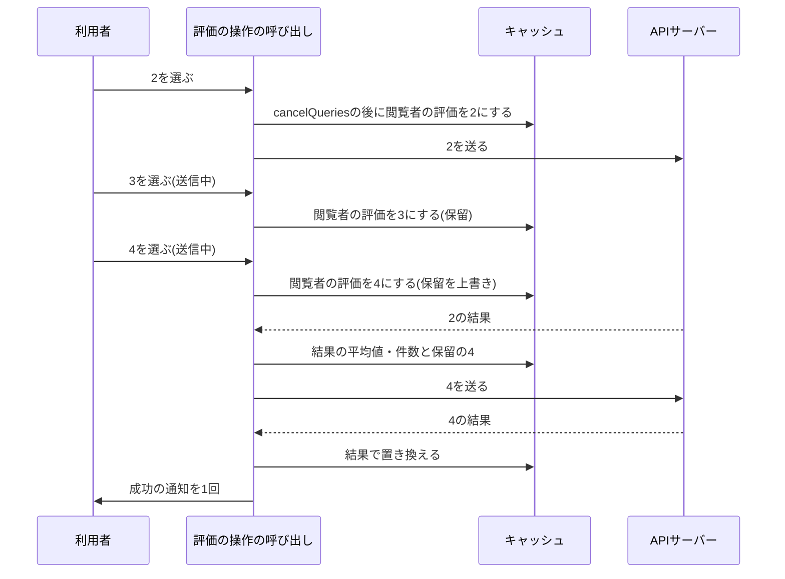

# 星の評価の入力と入れ子の投稿欄

星を選んで段階で評価する入力と、階層を持つコメントのスレッドを読み、その場で投稿・返信・編集・削除する画面の規約を定める。星の入力のラジオグループとキーボード操作・名前・無効の理由、評価の送信の保留、投稿欄の評価の行、操作ごとのbot判定のトークン、平たい返信の一覧から木を組むこと、無限の取得のキャッシュの更新と件数の取り直し、続きの読み込みの失敗、削除の確認のダイアログ、メニューの登録口の項目とダイアログ、押せない状態の使い分け、読み上げの名前、及びテストを扱う。

スレッドの保存と置き換え表示は「[削除しても返信を残すコメントのスレッド](../backend/015-tombstoned-comment-threads.md)」に、無限の取得と変更は「[データ取得](006-data-fetching.md)」に、キーボード操作・押せない状態・処理の後のフォーカスは「[アクセシビリティ規則](004-accessibility-rules.md)」に、本文の入力欄と表示部品は「[マークダウンの入力欄と表示部品](008-markdown-editor-and-content.md)」に、bot判定のウィジェットは「[共通化する部品](005-shared-components.md)」に、区画の登録は「[集計値と残り時間を表示し続ける画面](013-live-scoreboard.md#区画の登録とページの構成)」に従う。

## 前提と用語

部品の置き場所は、共通部品のディレクトリと、画面のアプリの`src/`からのパスで示す。`<ドメイン>`はコメントと評価を持つ機能ごとに置き換える。

| 部品                             | 置き場所                                                                     | 役割                                                                                 |
| -------------------------------- | ---------------------------------------------------------------------------- | ------------------------------------------------------------------------------------ |
| 星の入力                         | 画面のアプリの`components/<ドメイン>/star-rating-input.tsx`                  | 段階の数の星から1つを選ぶラジオグループ                                              |
| 評価の操作の呼び出し             | 画面のアプリの`components/<ドメイン>/use-rating-mutations.ts`                | 評価・取消の送信と保留、評価欄のキャッシュの置き換え                                 |
| 取得の補助とキャッシュの置き換え | 画面のアプリの`graphql/<ドメイン>.ts`                                        | スレッドの無限の取得・件数・評価欄の値のキーと、評価欄の値の置き換え                 |
| 木の組み立てとキャッシュの更新   | 画面のアプリの`components/<ドメイン>/comment-tree.ts`                        | 平たい返信の一覧から木を組む関数と、無限の取得のデータを変える純粋な関数             |
| 投稿欄                           | 画面のアプリの`components/<ドメイン>/comment-composer.tsx`                   | 投稿・返信・編集の共通の投稿欄。評価の行の有無を開いた時に決める                     |
| コメントの操作の呼び出し         | 画面のアプリの`components/<ドメイン>/use-comment-mutations.ts`               | 投稿・返信・編集・削除の送信と、スレッド・件数・評価欄のキャッシュの更新             |
| スレッドの一覧・項目             | 画面のアプリの`components/<ドメイン>/comment-thread.tsx`・`comment-item.tsx` | 投稿欄・一覧・続きの読み込みと、項目の中の返信と編集の投稿欄・メニュー               |
| 他者のコメントの操作の登録口     | 画面のアプリの`composition/comment-actions.ts`                               | 後から加わる機能(通報など)が他者のコメントのメニューへ項目とダイアログを追記する一覧 |

| 用語         | 意味                                                                                                       |
| ------------ | ---------------------------------------------------------------------------------------------------------- |
| 評価欄       | 平均値・件数と、閲覧者自身の評価の入力を示す区画                                                           |
| 評価欄の値   | 評価欄の取得の結果(平均値・件数・閲覧者の評価)。評価欄と投稿欄の評価の行が同じキャッシュを読む             |
| 投稿欄       | 本文の入力欄と送信のボタンを持つフォーム。トップレベルの投稿・返信・編集で同じ部品を使う                   |
| 評価の行     | 投稿欄の中の、コメントと同時に評価を送る星の入力                                                           |
| 置き換え表示 | 表示できないコメントを本文・投稿者・日時を伏せて示す項目。付いた返信は残す                                 |
| 閲覧者の状態 | 未ログイン・メールアドレスの未確認・対象の所有者本人・それ以外、の順に判定する、表示と操作の出し分けの区分 |

本文中の`<本文の文字数の上限>`などのプレースホルダーの本プロジェクトの値は、技術ドキュメントに写さず、プロジェクト固有の値の文書「[本プロジェクト固有の値](../../../onboardings/project-values.md)」に置く。

## 星の入力

### 自作する理由

星の入力は、共通部品のラジオグループ(Radix UIの`RadioGroup`)を使わずに自作する。共通部品の`RadioGroupItem`は円の印を描き、星の形と「選んだ星までを塗る」表示に置き換えられない。これは「[キーボード操作](004-accessibility-rules.md#キーボード操作)」の、ラジオボタンの組の間の移動をRadix UIの部品に任せて同じ操作を独自に作らない規則の例外で、星の入力だけに限る。

### ラジオグループとキーボード操作

```tsx
<div
  role="radiogroup"
  aria-label={label}
  aria-describedby={describedBy}
  aria-disabled={disabled}
>
  {STARS.map((star) => (
    <button
      key={star}
      type="button"
      role="radio"
      aria-checked={value === star}
      aria-label={`${STARS.length}段階中${star}`}
      tabIndex={star === (value ?? 1) ? 0 : -1}
      disabled={disabled}
      onClick={() => select(star)}
      onKeyDown={(event) => handleKeyDown(event, star)}
    >
      <StarIcon aria-hidden="true" />
    </button>
  ))}
</div>
```

| 項目           | 規約                                                                                                       |
| -------------- | ---------------------------------------------------------------------------------------------------------- |
| 役割           | 外側を`role="radiogroup"`、星を`<button role="radio">`にし、`aria-checked`で選んだ星を示す                 |
| グループの名前 | 呼び出す側が渡す(評価欄と投稿欄で異なる名前にする)。部品に固定の名前を持たせない                           |
| 星の名前       | 「`<段階の数>`段階中n」の形。星の図形は`aria-hidden`にする                                                 |
| Tabの停止位置  | 選んだ星、未選択なら最初の星だけを`tabIndex={0}`にし、他は`-1`にする(ロービングタブインデックス)           |
| 矢印キー       | 右・上で次の星、左・下で前の星へ選択とフォーカスを移す。押すたびに選択を確定する                           |
| 両端           | 最初と最後の星で止め、反対の端へ回り込まない                                                               |
| `Home`・`End`  | 割り当てない                                                                                               |
| ホバー         | ポインターを重ねた星までを予告として塗る。無効の間は予告しない                                             |
| 色             | 塗った星はプライマリの色、塗らない星は輪郭だけにし、塗りの有無以外に選んだ星の`aria-checked`で状態を伝える |

- 矢印キーの向き・両端で止まること・`Home`/`End`が無いことは、WAI-ARIAのラジオグループの作り方とRadix UIの既定(端で回り込む・`Home`/`End`で端へ移る)と違う。画面の設計(デザインの案)の指定に合わせた選択で、同じ画面の全ての星の入力を同じ振る舞いにする。新しく作る星の入力でRadix UIの既定に揃える場合は、この表を改める。
- `onChange`は値が変わったときだけ呼ぶ。同じ星を押し直しても呼ばない。同じ値の書き込みと内容の変わらない通知を起こさないためである。
- 矢印キーは押すたびに値を確定するため、2から5へ矢印で移ると`onChange`が3回呼ばれる。受ける側は送信の保留でまとめる(「[評価の送信の保留](#評価の送信の保留)」)。

### 無効と理由

- 無効の手段は`disabled`だけにする。送信中に`disabled`を渡さない。フォーカスのある星を`disabled`にするとフォーカスが`<body>`へ落ちる(「[操作できない状態](004-accessibility-rules.md#操作できない状態)」)。送信中の選択は受ける側で保留する。
- 条件を満たさず評価できない間(メールアドレスの未確認など)は`disabled`にし、理由は呼び出す側が見える文で描き、その要素のIDを`describedBy`で渡す。グループの`aria-describedby`で理由を伝える。
- ログインしていない閲覧者には、星を押せるまま描き、選ぶとログインを求めるダイアログを開く。

## 評価の送信

### 評価欄の値のキャッシュ

- 評価欄の値は、取得の補助のキーの末尾に閲覧者のID(未ログインは固定の値)を加える。閲覧者自身の評価を含む応答のため、同じタブでログイン・ログアウトした後に前の閲覧者の値を使わない。
- 評価・取消・評価を添えたコメントの投稿と編集の結果は、評価欄の値をまるごと置き換える関数(`setQueryData`)で反映し、取り直さない。平均値と件数はサーバーの結果の値を使い、画面で計算しない。

### 評価の送信の保留



- 選んだ値を送る前に評価欄の値の取得を`cancelQueries`で止め、閲覧者の評価だけを選んだ値にしてキャッシュへ入れる。止めた取得は始めた時点の値へ戻るため、入れる前に止める。
- 送信中に選んだ値は送らずに保留し、最後に選んだ値だけを持つ。送信の結果が届いたら、保留が無いか結果と同じ値なら結果で置き換えて終わり、違えば結果の平均値・件数に保留の値を重ねて保留の値を送る。
- 送信中の操作と保留の値は`useRef`で持つ。同じイベントの中の続けての操作は描画の前に届き、状態(`useState`)の更新では読めない。
- 失敗したら保留を捨て、最後にサーバーが返した値へ戻し、理由の文言を示す。
- 成功の通知は一連の送信の最後に1回だけ出す。文言は送り始める前の閲覧者の評価の有無で選ぶ(新しい評価か変更か)。
- 取消は送信中の評価の間は受け付けず、取消の送信中は評価を受け付けない。取消のボタンは、評価か取消の送信中は`aria-disabled`にし、取消の送信中は`aria-busy`も付ける。文言は変えない。

## 投稿欄

### 評価の行

| 投稿欄                               | 評価の行 | スキーマ                           |
| ------------------------------------ | -------- | ---------------------------------- |
| 評価できる閲覧者のトップレベルの投稿 | 描く     | 本文と評価(評価は`number \| null`) |
| 評価できる閲覧者のトップレベルの編集 | 描く     | 本文と評価                         |
| 返信の投稿と編集                     | 描かない | 本文だけ                           |
| 対象の所有者本人の投稿と編集         | 描かない | 本文だけ                           |
| 未確認の閲覧者の編集                 | 描かない | 本文だけ                           |

- 評価の行の有無は投稿欄を開いた時に決め、開いている間は変えない(`useState`の初期値で固定する)。スキーマは条件ごとに分けた定数から選び、描画ごとに作らない。
- 評価の行の初期値は、評価欄と共有するキャッシュの閲覧者の現在の評価にする。利用者が評価の行を変えていない間(`isDirty`が偽)は、評価欄で評価を変えた値に合わせて初期値を置き換える。
- 評価は現在の評価から変えたときだけ送る。選ばずに送っても既存の評価を変えない。評価の行を描かない投稿欄は評価を送らない。
- 評価の行を描かない投稿欄に対してサーバーが評価の誤りを返しても、フォームの値に評価の経路が無いため、欄に対応しない詳細としてフォーム全体の失敗(`onSubmitError`)に示し、送信のボタンを無効のまま残さない。
- 投稿先(対象のID・親のID)と編集するコメントのIDはスキーマの入力に含めず、送信の処理で足す。

### 本文の入力欄とプレビュー

- 本文は`MarkdownEditor`で書き、文字数の上限を`<本文の文字数の上限>`にする(「[フォームとの結合](008-markdown-editor-and-content.md#フォームとの結合)」)。
- 本文の入力欄のラベルは、プレースホルダーと同じ文言を視覚的に隠した要素(`sr-only`)で置き、`labelId`でその要素を名前にする。投稿欄の見た目にラベルを置かず、プレースホルダーで用途を示す画面の設計のためで、「[アクセシビリティの規約](008-markdown-editor-and-content.md#アクセシビリティの規約)」の、編集領域の名前に表示しているラベルの要素を使う規則の例外にする。プレースホルダーは入力すると消えるため、見える場所に用途が残らないことを許容する場合に限る。
- プレビューは本文の表示と同じ描画の指定(別のオリジンへのリンクの`rel`)で描き、本文の識別子(`idScope`)だけを表示中のコメントと分ける。
- 同じページで複数の投稿欄(複数の対象のトップレベルの投稿欄・返信の投稿欄・編集欄)のプレビューを同時に開けるため、プレビューの本文の識別子は欄ごとに異なる値にする(「[描画の指定](008-markdown-editor-and-content.md#描画の指定)」)。欄の種類ごとの接頭辞と、欄が指すID(トップレベルの投稿欄は投稿先、返信の投稿欄は返信先、編集欄は編集するコメントのID)の小文字から作り、サーバーとブラウザで同じ値にする。接頭辞は表示中のコメントの接頭辞や同じページの他の本文の識別子と分ける。
- 表示中のコメントの本文の識別子はコメントのIDから作り(例: 接頭辞とIDの小文字)、他のコメントの見出しのIDと衝突させない。

### その場の返信と編集

- 返信と編集の投稿欄は、項目の中のその場に開く。開いた時に本文の入力欄へフォーカスを移す。開いた元の操作(メニューの項目など)が消えることがあるためである。
- 閉じた時(送信の成功・キャンセル)は、フォーカスを`<body>`へ落とさず、返信なら「返信」のボタン、編集なら項目自身(`tabIndex={-1}`)へ移す。描き直しの後(`useLayoutEffect`)に移す。
- 「キャンセル」のボタンは`onMouseDown`で`preventDefault()`する。押し下げで本文の入力欄からフォーカスが外れると、空の本文の検証の文言が出てボタンの位置がずれ、押し上げが外れてキャンセルにならない。
- 送信に成功したらフォームを空の値へ`reset`する。トップレベルの投稿欄は開いたまま残るため、空にした後に本文の入力欄へフォーカスを移す(空の本文で送信のボタンが無効になりフォーカスを失うため)。`reset`は欄の登録を外して描き直しで登録し直すため、描き直しの後に移す。
- 階層の上限のコメントには「返信」を描かない。

### 操作ごとのbot判定のトークン

- bot判定のウィジェットは投稿欄と削除の確認のダイアログのそれぞれに非表示で置き、判定の枠と場所を設けない。操作名は投稿(トップレベルと返信で共有)・編集・削除で分ける(`<投稿の操作名>`・`<編集の操作名>`・`<削除の操作名>`)。
- トークンが用意できるまで送信のボタンを押せなくする。押せない状態は、フォーカスが無ければ`disabled`、フォーカスがある間は`aria-disabled`にし、その間の送信はトークンを待ってから送る(「[操作できない状態](004-accessibility-rules.md#操作できない状態)」)。
- 送信は`waitForToken()`で取り出したトークンを操作の呼び出しへ渡す。`sendWithTurnstile`(「[共通化する部品](005-shared-components.md)」)を使わない形のため、bot判定の失敗で自動の送り直しをしない。トークンが得られなければフォームにbot判定の失敗の文言を示す。投稿欄の送信の処理が操作の呼び出しにトークンを渡す構成で`sendWithTurnstile`を使える場合は、そちらを優先する。

## スレッドの一覧

### 平たい返信の一覧から木を組む

APIサーバーはスレッドごとにルートと平たい返信の一覧(親のIDと階層付き、古い順)を返す。画面は親のIDで木を組む。

```typescript
export function buildTree(thread: CommentThread): CommentTreeNode {
  const nodeOf = (comment: Comment): CommentTreeNode => ({
    comment,
    replies: thread.replies
      .filter(({ parentId }) => parentId === comment.id)
      .map(nodeOf),
  });
  return nodeOf(thread.comment);
}
```

- 同じ親の子は一覧の順(古い順)のまま並べる。
- 返信の一覧は入れ子の`<ol aria-label="返信">`で、左の罫線とインデントで描く。トップレベルの一覧も`<ol>`にする。
- 置き換え表示の項目は本文・投稿者・日時を描かず、付いた返信の一覧を描く。表示中でも投稿者が取れない項目は置き換え表示として描く。

### 無限の取得とキャッシュの更新

スレッドのページは無限の取得で読み(「[続きを後ろに加える一覧](006-data-fetching.md#続きを後ろに加える一覧)」)、操作の成功の結果で取り直さずにキャッシュを更新する。キーの末尾に閲覧者のIDを加える(閲覧者自身の印を含むため)。

| 操作               | キャッシュの更新                                 | 件数               |
| ------------------ | ------------------------------------------------ | ------------------ |
| トップレベルの投稿 | 最初のページの先頭にスレッドを加える             | 無効にして取り直す |
| 返信               | 親を含むスレッドの平たい返信の一覧の末尾に加える | 無効にして取り直す |
| 編集               | 同じIDのコメントを結果で置き換える               | 変えない           |
| 削除               | 同じIDのコメントを結果(置き換え表示)で置き換える | 無効にして取り直す |

- 更新の関数は元のデータを変えず、変わらないページとスレッドは同じ参照のまま残し、何も変わらなければ同じ参照を返す。既にあるIDは重ねて加えない(同じ結果が2回届いた場合と、取り直しの結果に先に含まれた場合)。
- トップレベルを最初のページの先頭に加えても、続きのページのカーソルは各ページの最後のスレッドで決まるため変わらない。
- 件数は、他の利用者の投稿・削除や非公開化も反映した、置き換え表示を除く数で、手元の操作だけでは数え直せない。キーの前方の部分(閲覧者のIDを除く)で閲覧者を問わず無効にして取り直す。
- 件数の取得は、同じページの複数の区画(対象ごとのブロック)で1つの取得を共有し、区画ごとに`select`で自分の件数を取り出す。件数の取得の失敗では件数を示さずに開閉のボタンを描く。
- 評価を添えた投稿と編集は、結果の評価欄の値で評価欄のキャッシュも置き換える。
- 失敗はキャッシュを変えず、通知を出さずに拒否する。投稿欄やダイアログが理由の文言を示す。
- 既知の限界: 書き込みの前に`cancelQueries`をしないため、書き込みの前に始まった続きの読み込み(`fetchNextPage`)や取り直しの結果が、書き込みの結果の更新を上書きし得る。上書きされた場合も、次の取り直しで正しい表示に戻る。画面の操作の頻度で問題になる場合は、更新の前にスレッドのキーの`cancelQueries`を呼ぶ(止めた続きの読み込みは利用者の操作で読み直す)。

### 続きの読み込みの失敗

続きの読み込みの失敗は、「さらに読み込む」のボタンを、取得の失敗を示す共通部品(`PartialErrorState`)の文言と「再試行」のボタンに置き換えてもよい。一覧の区画と最初の取得の失敗と同じ表示に揃える場合の形で、「[続きを後ろに加える一覧](006-data-fetching.md#続きを後ろに加える一覧)」の「同じボタンで読み込み直させる」と「[処理の後のフォーカス](004-accessibility-rules.md#処理の後のフォーカス)」の「読み込みの失敗ではボタンに残す」の例外にする。

- 読み込んだ記録は残す。
- 続きの読み込みのボタンと再試行のボタンを、`tabIndex={-1}`の枠で包む。再試行を押すとボタンは読み込みを始めると消えるため、押した時に枠へフォーカスを移して待つ。
- 読み込みの後(`useLayoutEffect`)、成功なら加えた最初のトップレベルの項目(`tabIndex={-1}`)へ、再び失敗なら新しい再試行のボタンへフォーカスを移す。待つ間に利用者がフォーカスを枠の外へ移した時は奪い返さない。
- 取得の失敗の`PartialErrorState`の文言は、一覧や評価欄ごとの固定の文言(「…を読み込めませんでした。」の形)にし、`errorMessageOf`で選ばない。区画の取得の失敗を理由によらず同じ文言で示す既存の区画の前例に揃えるためで、「[エラーの型と画面の分岐](006-data-fetching.md#エラーの型と画面の分岐)」の、画面に出す失敗の文言を`errorMessageOf`で選ぶ規則の例外にする。操作の失敗(投稿欄・ダイアログ・トースト)は`errorMessageOf`で選ぶ。
- 最初の取得の失敗は一覧の位置に示し、再試行の後のフォーカス先は一覧の外枠(`tabIndex={-1}`)にする。再び失敗した時は新しい再試行のボタンへ移す。

## 削除の確認のダイアログ

- 削除は確認のダイアログで確定するまで行わない。ダイアログは題名・削除の後の表示(置き換え表示になり返信が残ること)の説明・「キャンセル」・破壊的な見た目の「削除」を持つ。
- 「削除」はダイアログの中のbot判定のトークンが用意できるまで押せなくする(「[操作ごとのbot判定のトークン](#操作ごとのbot判定のトークン)」)。失敗はダイアログを開いたまま文言を示し、成功で閉じる。
- 閉じた後のフォーカスは開いた元の操作へ戻す。開く元をダイアログの引き金(`DialogTrigger`)にしない呼び出し方では、`onCloseAutoFocus`で`preventDefault()`して戻す。
- 削除に成功するとメニューのボタンが外れて戻り先が無くなるため、置き換え表示に変わった項目(`<article tabIndex={-1}>`)へフォーカスを移す。
- 「削除」を選んだ時は、メニューが閉じる時にメニューのボタンへフォーカスを戻す既定の動き(`onCloseAutoFocus`)を`preventDefault()`で止める。ダイアログが自分の中へフォーカスを移すため、両方が動くとフォーカスを奪い合う。

## メニューの登録口の項目とダイアログ

他者のコメントのメニューの操作は、後から加わる機能が登録口へ登録する。メニューの内容(`DropdownMenuContent`)はメニューが閉じると外れるため、項目の中でダイアログを描くと、メニューを閉じてからダイアログを開く操作(通報など)ではダイアログが状態ごと消える。そのため1件の登録を、メニューの中に描く項目と、メニューの外に描くダイアログの2つの部品に分ける。

```typescript
interface MenuActionRegistration<TContext> {
  readonly id: string;
  readonly order: number;
  readonly Item: ComponentType<TContext & { readonly onSelect: () => void }>;
  readonly Dialog: ComponentType<
    TContext & {
      readonly open: boolean;
      readonly onOpenChange: (open: boolean) => void;
      readonly returnFocusRef: RefObject<HTMLButtonElement | null>;
    }
  >;
}
```

- 項目は`DropdownMenuItem`を描き、選ばれると`onSelect`を呼ぶ。対象に該当しなければnullを描く。
- ダイアログは`open`の間だけ開き、閉じると`returnFocusRef`(メニューのボタン)へフォーカスを戻す。開く元を引き金(`DialogTrigger`)にしないため、`onCloseAutoFocus`で`preventDefault()`して戻す。
- メニューの部品は、開いている登録の`id`を状態で持ち、全ての登録のダイアログをメニューの外に描いて`open`をその状態から渡す。`onSelect`では「削除」と同じくメニューが閉じる時のフォーカスの戻しを止めてから、その登録の`id`を状態に入れる。
- 登録が無ければメニューのボタンごと描かない。登録があれば、全ての項目がnullを描く場合もボタンを描き、開いたメニューは空になる。項目が該当するかは項目の部品の中でしか分からないためである。
- 同じ形は、コメントに限らず、ページの「…」メニューに他の機能が操作を登録する登録口に使う。

## 押せない状態の使い分け

理由をツールチップでだけ示す押せない状態に`aria-disabled`を使うのは、「[操作できない状態](004-accessibility-rules.md#操作できない状態)」の表の「条件を満たすまで押せない(未入力など)」を`disabled`にする規則の例外である。範囲は、条件(メールアドレスの未確認など)を満たすまで押せず、その理由を見える文で並べずにツールチップでだけ示すボタンに限る。`disabled`にするとTabの停止位置から外れ、キーボードの利用者がフォーカスでツールチップを開けず理由を知る手段が無くなるため、Tabの停止位置を残す。

| 場面                                                   | 指定                                                      | 理由                                                                                      |
| ------------------------------------------------------ | --------------------------------------------------------- | ----------------------------------------------------------------------------------------- |
| 理由を見える文で並べて示す(未確認の閲覧者の星の入力)   | `disabled`と、理由の要素への`aria-describedby`            | Tabの停止位置から外しても、理由は文として読める                                           |
| 理由をツールチップでだけ示す(未確認の閲覧者の「返信」) | `aria-disabled`と、隠した理由の要素への`aria-describedby` | Tabの停止位置を残し、キーボードの利用者がフォーカスで理由のツールチップを開けるようにする |
| bot判定のトークンを待つ送信のボタン                    | フォーカスが無ければ`disabled`、ある間は`aria-disabled`   | フォーカスのあるボタンを`disabled`にするとフォーカスを失う                                |
| 評価か取消の送信中の取消のボタン                       | `aria-disabled`。取消の送信中は`aria-busy`も              | 処理中の操作(「[操作できない状態](004-accessibility-rules.md#操作できない状態)」)         |
| 続きの読み込み中のボタン                               | `aria-disabled`と`aria-busy`、文言の変更                  | 同上                                                                                      |

- `aria-disabled`のボタンは押下を止めないため、受ける側で無視する。
- `aria-disabled`の`Button`はポインターの事象を受けないため、ツールチップの引き金をボタンの外枠(`<span>`)にする。
- 理由を`aria-describedby`で結ぶ要素は`hidden`で隠し、本文としては読ませない。

## 読み上げの名前

### 数を含む名前

| 形             | 例                                    | 使う場面                                                                                                             |
| -------------- | ------------------------------------- | -------------------------------------------------------------------------------------------------------------------- |
| 見える文の並び | 開閉のボタン「コメント」と「1,234件」 | 見た目にも語と数が分かれて並ぶ。名前は語の間に区切りが入った形(「コメント 1,234件」)になる                           |
| 1つの隠した文  | 一覧の項目のアイコンと数「1,234」     | 見た目は数だけで、語を補う。数を`aria-hidden`にし、`sr-only`の1つの文(「コメント1,234件」)で読ませる                 |
| 隠した前置き   | 一覧の項目の数と単位「1,234票」       | 見た目に数と単位が並び、前の語だけを補う。`sr-only`の前置き(「Upvote数」)を1つ置き、見える数と単位をそのまま読ませる |

- 見た目が数だけの要素に語を補うとき、見える数の前後を別々の`sr-only`の要素に分けない。Chromeは要素の境目で語の間に区切りを入れ、「コメント 1,234 件」のように読む。読み上げの文を1つにまとめ、見える数は支援技術から隠す。
- 数は表示設定の数の書式で整えた文字列を名前にも使い、見た目と読み上げの数を揃える。

### 投稿日時

- 投稿日時は、経過の表現(`<経過で示す期間>`を過ぎた投稿は日付)で示し、ホバーとフォーカスで完全な日時をツールチップに出す。
- ツールチップの引き金は`<button type="button">`にし、その中に`<time dateTime>`を置く。非対話の要素に`tabIndex={0}`を付けない(静的解析の`no-noninteractive-tabindex`)。
- 完全な日時は、ツールチップが閉じている間も隠した要素を`aria-describedby`で結んで伝え、開いている間は結ばない。開いている間はツールチップ自身が説明になり、二重に読ませない。
- 経過の表現はハイドレーションの後に出し、それまでは日付で示す(サーバーの描画と時刻がずれるため)。

## テスト

- 星の入力はブラウザテストで、矢印キーの向きと両端で止まること、`Home`・`End`で動かないこと、Tabの停止位置が選んだ星だけであること、同じ星で`onChange`を呼ばないこと、各星の名前、無効の理由が`aria-describedby`で伝わること、塗りの色を確かめる。
- 評価の送信は、送信中に続けて選んだ値のうち最後の値だけが送られ通知が1回であること、失敗で最後に確定した値へ戻ること、送信中の取消が無視されることを、応答を待たせる模擬の通信で確かめる。
- 投稿欄は、評価の行の有無(表の各場合)、現在の評価から変えないと評価を送らないこと、評価の行を描かない投稿欄がサーバーの評価の誤りをフォーム全体の失敗で示し送信のボタンが無効のまま残らないこと、トークンが用意できるまで送れないこと、失敗で入力が保たれ成功で空になることを確かめる。
- 木の組み立てとキャッシュの更新は単体テストで、返信の順、元のデータを変えないこと、変わらなければ同じ参照を返すこと、既にあるIDを重ねないことを確かめる。
- 操作の呼び出しは、成功でスレッド・件数・評価欄のキャッシュが更新され、失敗で変わらないことを確かめる。
- 一覧は、続きがあるときだけの「さらに読み込む」、続きの失敗の再試行とフォーカスの移動、最初の失敗が一覧の中に留まることを確かめる。
- 削除の確認のダイアログは、確定するまで削除しないこと、トークンが用意できるまで「削除」を押せないこと、削除の後のフォーカスの移動先を確かめる。
- メニューの登録口は、項目とダイアログを持つテスト用の登録を渡し、項目を選ぶとメニューが閉じてダイアログが開いたまま残ること、他の登録のダイアログは開かないこと、閉じるとメニューのボタンへフォーカスが戻ることを確かめる。
- 自動検査(`axe-core`)の違反が0件であることを各部品で確かめる。
