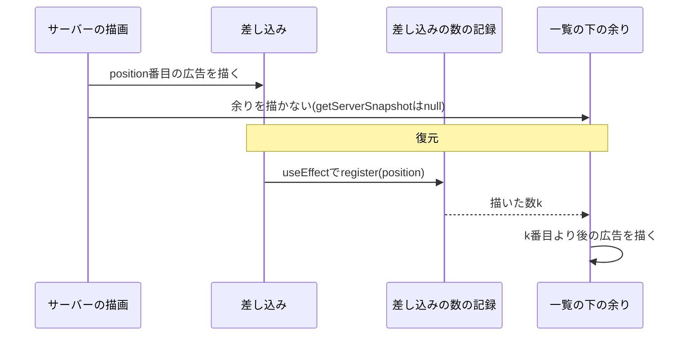

# サーバーで描画する広告の枠

有料で掲載する広告を、ページの登録口の区画と一覧の差し込みとしてサーバーで描画する規約を定める。1ページで1回の共有の照会、サーバーの無作為の並びとブラウザの復元の一致、広告のリンクとラベルと読み上げの名前、一覧への差し込みと余りの数の共有と復元の後の描画、件数0のときの表示、計測をしない方針、部品の側のエラーの境界、及びテストを扱う。

権利の期間と表示の時点の判定は「[日付の範囲で有効になる購入済みの権利](../backend/018-date-range-entitlements.md#表示の時点の判定)」に、区画の登録口・描画済みの目印・画面幅で表示を切り替える区画の畳み方は「[集計値と残り時間を表示し続ける画面](013-live-scoreboard.md#区画の登録とページの構成)」に、取得の補助とキーと取得の遅い区画のストリーミングは「[データ取得](006-data-fetching.md)」に、画像の部品と遅延の読み込みは「[画像の変換配信とエッジキャッシュ](../infra/008-image-delivery.md)」に、想定外の失敗の送信は「[フロントエンドの観測](007-frontend-observability.md#送信の入口)」に従う。

## 前提と用語

部品の置き場所は、画面のアプリの`src/`からのパスで示す。`<ドメイン>`は広告を持つ機能のディレクトリの名前に置き換える。

| 部品                               | 置き場所                                              | 役割                                                                       |
| ---------------------------------- | ----------------------------------------------------- | -------------------------------------------------------------------------- |
| 広告の照会の設定と読み取りのフック | `components/<ドメイン>/use-<広告>-placements.ts`      | 全ての枠が共有する照会の設定と、`useSuspenseQuery`で読むフック             |
| 差し込みの数の記録                 | `components/<ドメイン>/<種類>-insert-tracker.ts`      | 一覧の差し込みが描いた数を、一覧の下の余りへ伝える外部のストア             |
| 部品の側の境界                     | `components/<ドメイン>/<広告>-placement-boundary.tsx` | 読み込み中も失敗も何も描かないエラーの境界と`Suspense`                     |
| 広告のカード・ラベル・申込の導線   | `components/<ドメイン>/`                              | 1件の広告の表示、広告であることのラベル、ログイン中だけの申込の導線        |
| 枠と差し込みの部品                 | `components/<ドメイン>/`                              | 登録口に登録する区画(ページ上部の行・横の列・一覧の差し込み・ページの下部) |
| 画面幅の印                         | `components/<ドメイン>/viewport-only.ts`              | 画面幅で表示を切り替える要素の印(`data-wide-only`・`data-narrow-only`)     |
| 区画の登録口                       | `composition/<ページ>-sections.ts`                    | ページごとの区画と一覧の差し込みの登録口                                   |

| 用語       | 意味                                                                    |
| ---------- | ----------------------------------------------------------------------- |
| 枠         | 広告を並べる区画。種類(ティア)ごとに置き場所と見た目が決まる            |
| 差し込み   | 一覧の何件ごとかに挟む、1件の広告の区画                                 |
| 余り       | 差し込みが描いた件数より後の広告。狭い画面で一覧の下に並べる            |
| 共有の照会 | 1ページの全ての枠と差し込みが読む、同じキーの1回の取得                  |
| 復元       | サーバーで描いたHTMLにブラウザでReactを結び付けること(ハイドレーション) |

本文中の`<広告の照会の鮮度>`の本プロジェクトの値は、技術ドキュメントに写さず、プロジェクト固有の値の文書「[本プロジェクト固有の値](../../../onboardings/project-values.md)」に置く。

## 1ページで1回の共有の照会

全ての種類の広告を1つの照会で返し、1ページの全ての枠と差し込みが同じ照会の設定を読む。

```typescript
export const placementsQueryOptions = () => ({
  ...graphqlQueryOptions(PlacementsDocument, {}),
  staleTime: PLACEMENTS_STALE_TIME_MS,
});

export function usePlacements(): PlacementsQuery['placements'] {
  return useSuspenseQuery(placementsQueryOptions()).data.placements;
}
```

- キーは取得の補助のキーの規約(操作のIDと変数)に従い、閲覧者のIDを入れない。広告は閲覧者によらず同じで、ログインの前後で取り直さない。
- `staleTime`は`<広告の照会の鮮度>`にする。同じページの中の描画と、復元の直後に取り直さないためである。
- ページの`loader`で取得を始めない。枠は登録口の区画で、ページは区画の取得を知らない(「[登録口に登録された区画の取得](006-data-fetching.md#登録口に登録された区画の取得)」)。各枠が自分の`Suspense`の中で読み、サーバーのストリーミングの描画で最初の応答のHTMLに含める(「[取得の遅い区画のストリーミング](006-data-fetching.md#取得の遅い区画のストリーミング)」)。主要な内容を待たせず、取得の結果は同じ応答の中で後から送られ、ブラウザは取得し直さない。
- 1回の取得で全ての枠を返すため、広告の件数や枠の数に比例して照会を増やさない。

## 無作為の並びと復元の一致

- 並びはサーバーが照会のたびに種類ごとに無作為に並べ替えて返す(暗号論的な乱数と棄却法による偏りの無い並べ替え)。画面は並べ替えない。
- サーバーの描画とブラウザの復元は、同じ応答で送られた同じ取得の結果を読むため、並びが一致する。ブラウザで取得し直したり並べ替えたりすると、復元の不一致になり、一覧の差し込みと余りの順も食い違う。
- 同じページの中で別の照会の設定(変数やキーの違うもの)を使わない。枠ごとに別の取得になり、枠ごとに違う並びになる。

## 広告のリンクとラベル

- リンクは、表示の時点に外部URLの検査を通った値だけにし、`target="_blank"`と`rel="sponsored noopener"`で開く。描画でも同じ検査を当て、危険なスキームのリンクを作らない。URLが無いか検査に通らなければリンクにせず、名称を文字列で示す。
- カード全体を押せるようにするときは、名称の`<a>`の擬似要素(`after:absolute after:inset-0`)をカードに広げる。カードの中に別のリンクやボタンを置かない。
- リンクの読み上げの名前は、名称と「別タブで開く」ことと広告であることを含める(例: 「{名称}のサイトを別タブで開く(広告)」)。
- 全てのカードに、広告であることを示すラベルを文字で示す。色やデザインのトークンで種類を分けても、ラベルの文字は種類によらず同じにする。
- 枠は`<section aria-label="<種類>の広告">`にし、見出しを持たない。カードの並びは`<ul>`・`<li>`にする。ロゴは装飾として`alt=""`にする(名称が隣にあるため)。
- 名称と説明はReactのテキストとして描き、HTMLとして解釈しない。
- 演出のアニメーション(光沢の動きなど)で目立たせない。種類の目立ち度は、大きさ・枠の太さ・色・影で分ける。
- ページの上部など最初の表示の範囲に入る枠のロゴは遅延させず、それ以外は`loading="lazy"`にする。

## 一覧への差し込みと余り

狭い画面では、横の列に並べる種類の広告を一覧の項目の間へ差し込み、差し込みが描いた件数より後の広告を一覧の下に余りとして並べる。



- 差し込みの部品は、登録口が渡す位置(1から)の広告を1件描き、描いたときだけ`useEffect`の中で数の記録に登録し、クリーンアップで登録を外す。該当する広告が無ければ何も描かず登録もしない。
- 数の記録は`subscribe`・`getSnapshot`・`getServerSnapshot`を持つ外部のストアにし、余りの部品が`useSyncExternalStore`で読む。メソッドは`this`に依らないクロージャで作り、個別に渡せるようにする。同じ位置の2回の登録は1つと数え、解除の関数は2回目の呼び出しで何もしない。
- `getServerSnapshot`は`null`を返し、余りの部品は`null`の間は何も描かない。差し込みの数は描画の後に決まるため、余りだけはサーバーで描かず復元の後に描く。余りは一覧の下にあるため、後から描いても上の内容の位置を動かさない。
- 登録を`useEffect`の中だけで行う。サーバーの描画では効果が動かないため、モジュールの1つのストアでもリクエストをまたいで数が残らない。
- 広い画面の横の列の全件と差し込みは、サーバーで描く。画面幅をJavaScriptで判定して描き分けない。サーバーは画面幅を知らず、復元の不一致になるためである。幅による表示の切り替えはCSSのクラスと画面幅の印で行う(「[画面幅で表示を切り替える区画](013-live-scoreboard.md#画面幅で表示を切り替える区画)」)。
- 一覧の差し込みはページが置く`<li>`の中に描かれるため、差し込みの部品は`<li>`を描かない。

## 件数0の表示

- 件数が0の枠は何も描かない(`null`)。ページの描画済みの目印と`:has()`の規則で、空の枠・列・一覧の項目を畳む(「[区画の登録とページの構成](013-live-scoreboard.md#区画の登録とページの構成)」)。部品は目印を描かない。
- 申込の導線を置く枠は、ログイン中は件数0でも導線だけを描き、未ログインで件数0なら何も描かない。導線を持たない枠は件数0で何も描かない。
- 件数の上限を設けない枠は、折り返しや縦の並びで全件を並べ、件数で高さが変わってもページの主要な内容の位置を動かさない置き場所(横の列・ページの下部)に置く。

## 計測をしない

- 広告の表示・クリックの計測(ビーコン・計測用のURLの書き換え・リダイレクト)をしない。リンクは広告主のURLへ直接開く。
- 閲覧者の識別子を広告の照会に渡さず、照会のキーにも入れない。

## 部品の側の境界

広告はページの本来の内容ではないため、読み込み中も取得の失敗も枠や再試行の操作を出さずに何も描かない。各枠と差し込みの部品は、自分の中にエラーの境界と`Suspense`を持つ。

```tsx
export function PlacementBoundary({ children }: { children: ReactNode }) {
  return (
    <CatchBoundary
      getResetKey={() => 0}
      onCatch={reportPlacementFailure}
      errorComponent={renderNothing}
    >
      <Suspense fallback={null}>{children}</Suspense>
    </CatchBoundary>
  );
}
```

- ページの区画の境界(`RecoverableSlot`)まで失敗を伝えると、失敗の表示と再試行のボタンが出る。部品の側の境界で閉じ込め、ページの他の区画の表示を止めない。
- 境界は`onCatch`で、取得の失敗(`GraphQLClientError`)以外の例外だけを想定外の失敗としてブラウザのエラートラッキングへ送る。GraphQLの想定外の失敗は取得の実行が送っているため、送り直さない。
- `Suspense`の代わりの表示は`null`にする。枠の大きさのスケルトンを出すと、広告が0件のときに空の枠が一瞬現れて消える。

## テスト

- ブラウザテストで、種類ごとのカードの表示内容と`rel`と読み上げの名前、URLが無いときにリンクにしないこと、ラベル、件数0とログインの有無の組み合わせの表示、取得の失敗で何も描かず再試行の操作を出さないこと、アクセシビリティの自動検査の違反が無いことを確かめる。
- 差し込みと余りは、サーバーの描画(`renderToString`など)で余りを描かず差し込みを描くこと、ブラウザで差し込みの数だけ余りが減ること、全件を差し込みが描いたときに余りを描かないこと、広い画面と狭い画面で表示されない要素の枠と列と一覧の項目が畳まれることを確かめる。
- 数の記録は単体テストで、同じ位置の2回の登録、解除の関数の2回の呼び出し、購読と通知、`getServerSnapshot`が`null`であることを確かめる。
- E2Eテストで、最初の応答の本文を流れのまま読み、ページの主要な内容が広告の枠の内容より前に届き、広告の枠の内容が`Suspense`の境界の後から同じ応答の中に届くことと、復元の後に広告の照会を取得し直さないことを確かめる。
