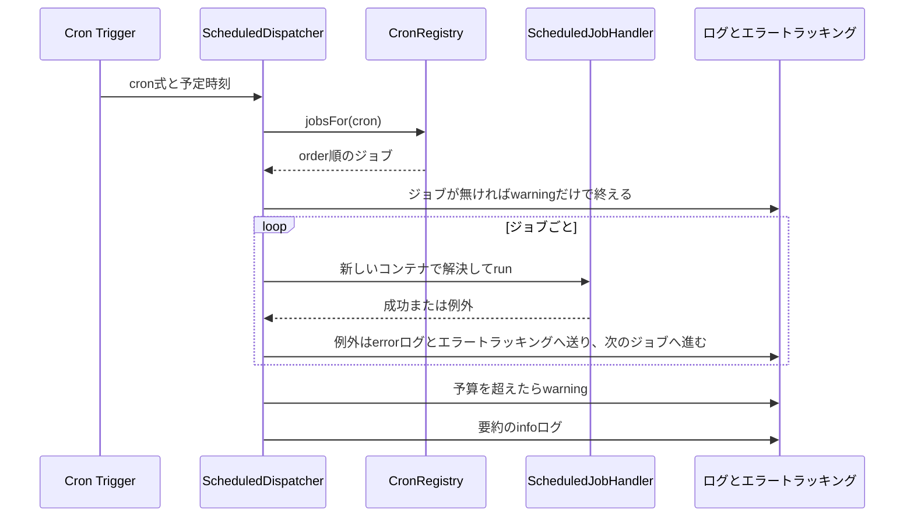
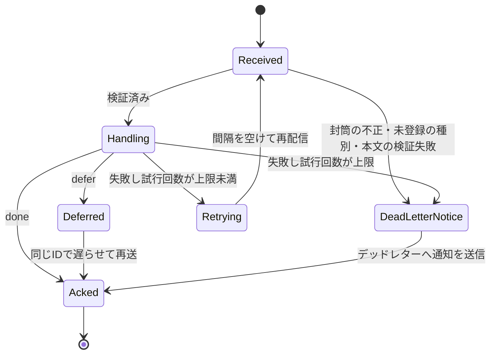

# 非同期処理の設計

Cloudflare Workersのアプリで、決まった時刻に処理を起こす定期実行と、処理を別の呼び出しへ委ねる非同期メッセージの仕組みを定める。ジョブとメッセージ処理の登録方法、再試行とデッドレターの扱い、同じ時刻のジョブ群の時間の予算、重複して実行され得る処理を冪等にする規約、及び両者の使い分けを扱う。

## 前提と用語

実行環境にCloudflare Workers(Cron Triggers・Queues)、DIコンテナにInversify、入力値の検証にZodを使い、バックエンドの共通ライブラリにある次の部品で定期実行とメッセージを振り分ける構成を前提とする。定期実行は1つのアプリ(`<定期実行を受け持つアプリ>`)だけが持つ。メッセージは全てのアプリが送信でき、1つのアプリ(`<メッセージを受信するアプリ>`)だけが受信する。

| 部品                                                                                                             | 置き場所(共通ライブラリ内)                     | 役割                                                            |
| ---------------------------------------------------------------------------------------------------------------- | ---------------------------------------------- | --------------------------------------------------------------- |
| `toUtcCronExpression`・`toBusinessDateTime`・`fromBusinessDateTime`                                              | `core/time/business-time.ts`                   | 業務時刻とUTCの時点・cron式の変換                               |
| `createCronRegistry`・`ScheduledJobDefinition`・`ScheduledJobHandler`・`CronRegistryError`                       | `core/scheduling/cron-registry.ts`             | ジョブの定義の検査と、起動時刻ごとの実行順                      |
| `createRunBudgetTable`・`ScheduledRunBudget`・`exceedsRunBudget`                                                 | `core/scheduling/run-budget.ts`                | 起動時刻ごとの時間の予算と、超過の判定                          |
| `createScheduledDispatcher`                                                                                      | `workers/scheduling/scheduled-dispatcher.ts`   | 定期実行の起動で、その時刻のジョブを順に実行する                |
| `defineMessageContract`・`MessageHandler`・`MessageHandlerRegistration`                                          | `core/messaging/message-contract.ts`           | メッセージの契約(種別と検証規則)と、処理の登録の型              |
| `MESSAGE_CONTRACTS`                                                                                              | `core/messaging/contracts/index.ts`            | 全ての契約の集約点                                              |
| `QueueEnvelope`・`DeadLetterNotice`・`parseEnvelope`・`isDeadLetterNotice`                                       | `core/messaging/envelope.ts`                   | 封筒とデッドレターの通知の形と解析                              |
| `DEFAULT_RETRY_POLICY`・`decideOnFailure`                                                                        | `core/messaging/retry-policy.ts`               | 再試行の間隔と、デッドレターへ移す判定                          |
| `MessagePublisher`・`MessagePublishError`・`MAX_DELAY_SECONDS`                                                   | `workers/messaging/queue-publisher.ts`         | 契約で本文を検証し、封筒を付けて送る                            |
| `createQueueDispatcher`                                                                                          | `workers/messaging/queue-consumer.ts`          | 本体Queueとデッドレターのconsumer                               |
| `triggerScheduled`・`buildScheduledTriggerURL`・`businessDateOf`・`addBusinessDays`・`isNearBusinessDayBoundary` | リポジトリの`e2e/support/scheduled-trigger.ts` | ローカルの定期実行を、業務日付と業務時刻を指定してE2Eから起こす |

| 用語                                             | 意味                                                                                                                                                                              |
| ------------------------------------------------ | --------------------------------------------------------------------------------------------------------------------------------------------------------------------------------- |
| 業務時刻                                         | 夏時間を持たない固定のUTCとの差(`core/time/business-time.ts`の`BUSINESS_UTC_OFFSET_MINUTES`)で表した時刻。業務時刻の0時が日付の境界になる                                         |
| 業務日付                                         | 業務時刻での日付(`YYYY-MM-DD`)                                                                                                                                                    |
| ジョブ                                           | 定期実行で起こす1つの処理                                                                                                                                                         |
| 起動時刻                                         | ジョブを登録した業務時刻の時・分。1つの起動時刻に1つのcron式が対応し、同じ起動時刻のジョブは1回の起動の中で直列に実行される                                                       |
| メッセージの種別                                 | メッセージの内容を表す`<ドメイン>.<動詞句>`の形の名前(例:`media.purge-image-cache`)。各部分は小文字の英字で始まり、小文字の英数字の並びをハイフン1つでつなぐ                      |
| 封筒                                             | 送信する本文に、種別・一意なID・送信日時を付けたQueueのメッセージ                                                                                                                 |
| デッドレター                                     | 処理できなかったメッセージを移す、本体のQueueとは別のQueue                                                                                                                        |
| `<共通ライブラリの配置先>`                       | 共通ライブラリを利用側のアプリへ配置したディレクトリ(「[共有ディレクトリの配置方式](../coding/003-shared-directories.md)」)。上の表の置き場所は、このディレクトリからのパスである |
| `<定期実行の登録箇所>`                           | `<定期実行を受け持つアプリ>`で、ジョブの一覧と時間の予算の一覧を定義するファイル                                                                                                  |
| `<メッセージ処理の登録箇所>`                     | `<メッセージを受信するアプリ>`で、メッセージの処理の登録の一覧を定義するファイル                                                                                                  |
| `<予算を適用する起動時刻>`                       | 同じ時刻のジョブ群の時間の予算(「[同じ時刻のジョブ群の時間の予算](#同じ時刻のジョブ群の時間の予算)」)を適用する業務時刻の時・分                                                   |
| `<本体Queueの名前>`・`<デッドレターQueueの名前>` | 本体とデッドレターのQueueの名前                                                                                                                                                   |
| `<本体Queueのバインディング>`                    | メッセージを送る本体のQueueのバインディング名                                                                                                                                     |
| `<デッドレターQueueのバインディング>`            | デッドレターへ通知を送るQueueのバインディング名                                                                                                                                   |
| `<本体Queueの名前の変数>`                        | 受信したバッチが本体のQueueのものかを判定するための、本体のQueueの名前を持つ変数のキー                                                                                            |
| `<デッドレターQueueの名前の変数>`                | 受信したバッチがデッドレターのものかを判定するための、デッドレターのQueueの名前を持つ変数のキー                                                                                   |

## 定期実行

### ジョブの登録

ジョブは業務時刻の時・分で登録する。cron式とUTCの起動時刻への変換は部品が行い、各ジョブで変換しない。

```typescript
import type { ScheduledJobDefinition } from '<共通ライブラリの配置先>/core/scheduling/cron-registry.ts';

import { REPORT_TYPES } from '../report/types.ts';

export const SCHEDULED_JOBS: readonly ScheduledJobDefinition[] = [
  {
    name: 'close-daily-report',
    at: { hour: 3, minute: 0 },
    order: 1,
    handler: REPORT_TYPES.CloseDailyReportJob,
  },
];
```

- ジョブの一覧は`<定期実行の登録箇所>`に置き、`createCronRegistry`で検査してから`createScheduledDispatcher`へ渡す。登録箇所はBunの単体テストから読み込めるよう、`cloudflare:*`を読み込まない。
- `name`はログの属性`job`とエラートラッキングのタグ`job`に使う一意な名前である。
- `order`は同じ起動時刻の中での実行順(昇順)である。
- `handler`は`ScheduledJobHandler`(`run(context)`を持つクラス)の識別子である。各ジョブは、それぞれ新しいDIコンテナから解決されるため、モジュールの束縛に登録し、依存は「[コンストラクタ引数の注入](../backend/001-dependency-injection-on-workers.md#コンストラクタ引数の注入)」に従って`@inject`で受け取る。
- `createCronRegistry`は、名前の重複、範囲外の時・分(0〜23時・0〜59分の整数でない値)、整数でない`order`、同じ起動時刻での`order`の重複を`CronRegistryError`で拒否する。

ジョブは`run`の引数で、予定時刻(`scheduledTime`)、起動したcron式(`cron`)、予定時刻の業務日付・曜日(ISOの1〜7)・時・分(`business`)を受け取る。実際に動いた時刻ではなく予定時刻の業務日付を使うため、起動が遅れても処理の対象の日付はずれない。

```typescript
import { inject, injectable } from 'inversify';

import type {
  ScheduledJobContext,
  ScheduledJobHandler,
} from '<共通ライブラリの配置先>/core/scheduling/cron-registry.ts';

import type { DailyReportRepository } from './daily-report-repository.ts';
import { REPORT_TYPES } from './types.ts';

@injectable()
export class CloseDailyReportJob implements ScheduledJobHandler {
  constructor(
    @inject(REPORT_TYPES.DailyReportRepository)
    private readonly reports: DailyReportRepository,
  ) {}

  async run({ business }: ScheduledJobContext): Promise<void> {
    await this.reports.closeUntil(business.date);
  }
}
```

### 起動時の振る舞い



- 起動したcron式のジョブを`order`の順に1つずつ実行する。前のジョブが終わるまで次のジョブを始めない。
- ジョブが例外を投げると、`error`ログ(属性`kind`・`cron`・`job`・`durationMs`・`error`)とエラートラッキング(`captureException`、タグ`job`)へ送り、同じ時刻の後続のジョブを実行し続ける。失敗したジョブは自動では再試行しない。
- ジョブが登録されていないcron式で起動した場合は、`warning`ログ(属性`kind`・`cron`)だけを出して終える。要約のログもエラートラッキングへの送信も無い。ジョブが1つも登録されていなくても失敗しない。
- 最後に、`info`の要約のログ(属性`kind`・`cron`・`result`・`jobs`・`totalDurationMs`)を出す。`result`は全てのジョブが成功すれば`succeeded`、1つでも失敗すれば`failed`で、`jobs`はジョブごとの`name`・`result`・`durationMs`の配列である。
- ジョブの失敗はディスパッチャの中で記録して握りつぶすため、起動自体は失敗しない。ジョブの失敗を知るにはログとエラートラッキングを見る。起動自体が失敗するのは、ジョブを始める前の環境の検証に失敗した場合などに限られる。
- 想定内の失敗を表す共通エラー型(`AppError`)はエラートラッキングへ送られない(「[ログ管理とエラートラッキング](004-logging-and-error-tracking.md#送信する例外と送信しない例外)」)。ジョブの想定外の失敗は、`AppError`以外の例外で投げる。
- ジョブからメッセージを送ることで、時間のかかる処理をメッセージ処理へ委ねられる(「[ジョブとメッセージの使い分け](#ジョブとメッセージの使い分け)」)。

### cron式との一致の検査

Wrangler設定の`triggers.crons`は、登録したジョブの起動時刻から導いたcron式と一致させる。一致しないと、登録したジョブが起動されない、またはジョブの無い時刻に起動される。

- `createCronRegistry(<ジョブの一覧>).cronExpressions()`は、起動時刻ごとのcron式(`<分> <時> * * *`、時はUTC)を重複なく返す。`<定期実行を受け持つアプリ>`の単体テストで、この結果とWrangler設定のルートと全ての`env.<環境種別>`の`triggers.crons`が一致することを確かめる。
- `cronExpressions()`の順は、文字列の順ではなくUTCの起動時刻(時・分)の順である(例:文字列の順では後になる`30 7 * * *`が、`0 15 * * *`より前)。`triggers.crons`の中の並び順は決めないため、一致の検査は集合として比べるか、同じ規則で並べ替えてから比べる。
- 業務時刻の時は、UTCとの差を引いてUTCの時に変換される。例えばUTCとの差が-5時間なら、業務時刻23:45のジョブのcron式は`45 4 * * *`になる。UTCの日付と業務日付は一致しないことがあるが、ジョブには予定時刻の業務日付が渡されるため、ジョブの中で日付を変換しない。
- `triggers.crons`を空の配列にしてデプロイすると、そのWorkerの既存のCron Triggersは全て削除される。また、Cron Triggersの変更が反映されるまで最大15分かかる。

### 同じ時刻のジョブ群の時間の予算

同じ起動時刻のジョブは1回の起動の中で直列に実行されるため、ジョブが増えると合計の所要時間が実行基盤の上限に近づき、後ろのジョブが打ち切られる。1日1回の起動について、次の規則で上限・予算・各ジョブの目安を実行基盤の上限から導く。

| 値             | 導き方                                                                                   | 値              |
| -------------- | ---------------------------------------------------------------------------------------- | --------------- |
| 上限           | Cron Triggersの1回の起動の実時間の上限(15分)の3分の2。打ち切りまでに余裕を残す           | 10分(600,000ms) |
| 予算           | 上限の半分。超えたら警告を受け、上限に達する前にジョブの分割を検討する                   | 5分(300,000ms)  |
| 各ジョブの目安 | HTTPの処理のCPU時間の上限(既定の30秒)と同じ値の実時間。1つのジョブが占めてよい時間の目安 | 30秒(30,000ms)  |

- 予算を適用する起動時刻(`<予算を適用する起動時刻>`)は、重いジョブが集まる時刻を選んでプロジェクトごとに決める。予算は全ての起動時刻に置く必要は無い。
- 目安の30秒を超えるジョブは、対象を列挙してメッセージを送るジョブと、1件ずつ処理するメッセージ処理へ分割する(「[ジョブとメッセージの使い分け](#ジョブとメッセージの使い分け)」)。
- 上限と各ジョブの目安は、ディスパッチャの警告の対象にしない。要約のログの`totalDurationMs`とジョブごとの`durationMs`で確かめる。

予算は`ScheduledRunBudget`の一覧として`<定期実行の登録箇所>`に置き、`createRunBudgetTable`で検査してから、`createScheduledDispatcher`の第3引数の`budgets`に渡す。

```typescript
import type { ScheduledRunBudget } from '<共通ライブラリの配置先>/core/scheduling/run-budget.ts';

export const SCHEDULED_RUN_BUDGETS: readonly ScheduledRunBudget[] = [
  { at: { hour: 3, minute: 0 }, maxTotalDurationMs: 300_000 },
];
```

```typescript
const dispatcher = createScheduledDispatcher(
  createCronRegistry(SCHEDULED_JOBS),
  MODULES,
  { budgets: createRunBudgetTable(SCHEDULED_RUN_BUDGETS) },
);
```

- `at`は業務時刻の時・分で、ジョブの登録と同じ規則でcron式に変換して引き当てる。
- `createRunBudgetTable`は、範囲外の時・分、同じ起動時刻の重複、正の整数でない`maxTotalDurationMs`を`CronRegistryError`で拒否する。
- 予算はジョブの登録と独立して持つ。ジョブの無い起動時刻の予算は使われないだけで、誤りにならない。
- 予算の値の確かめ方として、`<定期実行を受け持つアプリ>`の単体テストで`createRunBudgetTable(<予算の一覧>).budgetFor(<cron式>)`の値を検査する。

予算のある起動時刻で、最初のジョブの開始から最後のジョブの終了までの所要時間(`totalDurationMs`)が予算(`maxTotalDurationMs`)を超えると、次の警告が送られる。

| 送り先             | 内容                                                                                                                                                                                                                                       |
| ------------------ | ------------------------------------------------------------------------------------------------------------------------------------------------------------------------------------------------------------------------------------------ |
| ログ               | レベル`warning`、メッセージ「定期実行の合計の所要時間が予算を超えました」、属性`kind`(`scheduled`)・`cron`・`totalDurationMs`・`maxTotalDurationMs`・`jobCount`                                                                            |
| エラートラッキング | `captureEvent`でレベル`warning`、`logentry`に同じメッセージ、`fingerprint`に`['scheduled-run-budget', <cron式>]`、タグ`cron`(cron式)、コンテキスト`scheduled_run`に`totalDurationMs`・`maxTotalDurationMs`・`jobCount`(実行したジョブの数) |

- 予算より大きいときだけ送り、予算ちょうどでは送らない。
- ジョブの失敗の有無に関わらず、合計の所要時間で判定する。
- 警告は要約のログの前に送り、ジョブの実行と結果を変えない。
- 警告の送り方が`captureMessage`でない理由は「[同じ文言を繰り返し送る通知](004-logging-and-error-tracking.md#同じ文言を繰り返し送る通知)」に従う。
- Workersの時計はI/Oの間にだけ進むため、所要時間はデータベースやQueueなどの待ちを含む実時間の近似である。I/Oを挟まないCPUだけの計算は、所要時間に現れにくい。

### ローカルでの起動

ローカルの`wrangler dev`は、Cron Triggersを決まった時刻に自動では起こさない。`<定期実行を受け持つアプリ>`を`--test-scheduled`付きで起動し、次の経路への要求で、任意のcron式と予定時刻の定期実行を起こす。

```sh
wrangler dev --test-scheduled --persist-to <ローカル状態の保存先>
curl "http://localhost:<ポート>/cdn-cgi/local/scheduled?cron=45+4+*+*+*&time=<予定時刻のUTCのミリ秒>"
```

- `cron`は起こすcron式で、空白をURLエンコードする(`+`または`%20`)。`time`は予定時刻(`scheduledTime`)のUTCのミリ秒で、省略すると現在時刻になる。
- 応答は、ハンドラーが例外を投げなければ200、投げれば500である。ディスパッチャはジョブの失敗を記録して握りつぶすため、ジョブが失敗しても200になる。ジョブの結果は、ログとデータの状態で確かめる。
- 経路と引数はWranglerの版で異なり得る。Wranglerの版を更新したときは、Cron Triggersを持つWorkerを`--test-scheduled`無しで起動したときにWranglerが表示する手動起動の案内と、Cloudflareの公式ドキュメント「[Cron Triggers](https://developers.cloudflare.com/workers/configuration/cron-triggers/)」で確かめる。
- `--persist-to`は「[ローカル状態の永続化と共有](001-wrangler-conventions.md#ローカル状態の永続化と共有)」に従う。

### E2Eからの起動

E2Eテストからは、共有の補助`triggerScheduled`で、業務日付と業務時刻を指定して定期実行を起こす。cron式とUTCの予定時刻は補助が`core/time/business-time.ts`で求めるため、テストで変換しない。

```typescript
import { expect, test } from '@playwright/test';

import {
  addBusinessDays,
  businessDateOf,
  isNearBusinessDayBoundary,
  triggerScheduled,
} from '../support/scheduled-trigger.ts';

test('翌日の締めの定期実行の後に当日の日報が締め済みになる', async ({
  page,
}) => {
  test.skip(
    isNearBusinessDayBoundary(new Date()),
    '業務日付の境界の直前は、起動と確認の業務日付がずれ得るため実行しない',
  );
  const today = businessDateOf(new Date());

  await triggerScheduled({
    worker: '<アプリ名>',
    businessDate: addBusinessDays(today, 1),
    businessTime: '03:00',
  });

  await page.goto(`/reports/${today}`);
  await expect(page.getByText('締め済み')).toBeVisible();
});
```

- `worker`は要求先のアプリである。アプリごとのオリジンは補助の中で既定値(ローカルの`wrangler dev`のURL)と上書き用の環境変数を定めており、環境変数が空文字なら未設定と同じく既定値を使う。
- `businessDate`は存在する日付の`YYYY-MM-DD`、`businessTime`は2桁ずつの`HH:mm`で、形式と範囲が不正なら`RangeError`を投げる。
- 補助は`<オリジン>/cdn-cgi/local/scheduled?cron=<式>&time=<UTCのミリ秒>`へGETで要求し、2xx以外の応答と通信の失敗を、アプリ・cron式・状態コードを含む例外にする。ローカルの定期実行の経路はこの補助の1箇所にだけ書くため、Wranglerの版で経路が変わったときは補助だけを直す。
- 定期実行のハンドラーを持たないアプリへの要求は失敗する。
- 要求のURLだけが必要な場合は、純粋関数`buildScheduledTriggerURL(input, env)`を使う。
- `businessDateOf(at)`は時点の業務日付を、`addBusinessDays(date, days)`は業務日付に日数を加えた業務日付を返す。`isNearBusinessDayBoundary(now)`は、業務日付の境界の直前20分(業務時刻の23:40以降)で`true`を返す。この間は、テストが定期実行を起こした時点と結果を確かめる時点で業務日付が変わり得るため、業務日付に依存するテストを実行しない。

## 非同期メッセージ

### 契約

メッセージの種別と本文の検証規則の組を、契約として`defineMessageContract`で定義する。契約は送信側と受信側の両方が読むため、共通ライブラリの`core/messaging/contracts/`に置き、`contracts/index.ts`の`MESSAGE_CONTRACTS`へ集約する。

```typescript
import { z } from 'zod';

import { defineMessageContract } from '../message-contract.ts';

export const purgeImageCache = defineMessageContract(
  'media.purge-image-cache',
  z.object({ imageId: z.ulid() }),
);
```

```typescript
import type { MessageContract } from '../message-contract.ts';
import { purgeImageCache } from './media.ts';

export const MESSAGE_CONTRACTS: readonly MessageContract<string, unknown>[] =
  Object.freeze([purgeImageCache]);
```

- 種別が`<ドメイン>.<動詞句>`の形でなければ、`defineMessageContract`が`RangeError`を投げる。ドメインと動詞句はそれぞれ小文字の英字で始まり、小文字の英数字の並びをハイフン1つでつないだものとする。空の部分、`.`が2つ以上の名前、ハイフンの連続、末尾のハイフン、大文字は拒否される(例:`media.purge-image-cache`は受け付け、`media.purge--cache`・`media.purge-`・`Media.purge`・`.purge`は拒否)。
- 集約点に種別の重複が無いことを、単体テストで確かめる。
- 検証規則は、検証の結果をもう一度検証しても同じ値になる冪等な規則に限る。送信側は検証の結果(`z.object`の規則に無いキーを除いた値)を本文として送り、受信側は届いた本文を同じ規則でもう一度検証するためである。値を別の形に変える`transform`のように、2回通すと結果が変わる規則を使わない。
- 本文には、処理に必要な識別子と値だけを入れる。メールアドレスなどの個人情報や秘密情報は、識別子を送って受信側でデータベースから読む。

### 送信

メッセージは、処理単位のDIコンテナに識別子`PLATFORM_TYPES.MessagePublisher`で登録されている`MessagePublisher`で送る。HTTPの処理、定期実行のジョブ、他のメッセージの処理のどれからでも送れる。

```typescript
import { inject, injectable } from 'inversify';

import { PLATFORM_TYPES } from '<共通ライブラリの配置先>/core/di/identifiers.ts';
import { purgeImageCache } from '<共通ライブラリの配置先>/core/messaging/contracts/media.ts';
import type { MessagePublisher } from '<共通ライブラリの配置先>/workers/messaging/queue-publisher.ts';

@injectable()
export class RequestImagePurge {
  constructor(
    @inject(PLATFORM_TYPES.MessagePublisher)
    private readonly publisher: MessagePublisher,
  ) {}

  async execute(imageId: string): Promise<string> {
    return this.publisher.publish(purgeImageCache, { imageId });
  }
}
```

- `publish(contract, body, options)`は、集約点(`MESSAGE_CONTRACTS`)から種別で契約を引き、その検証規則で本文を検証し、封筒を付けて`<本体Queueのバインディング>`へ送り、封筒のIDを返す。
- 封筒は次の形である。

```typescript
interface QueueEnvelope {
  readonly v: 1;
  readonly type: string;
  readonly id: string; // ULID
  readonly sentAt: string; // ISO 8601(UTC)
  readonly body: unknown;
}
```

- 次の場合は送信せずに`MessagePublishError`を投げる。例外のメッセージには本文と検証の詳細を含めない。

| `reason`        | 条件                                                                     |
| --------------- | ------------------------------------------------------------------------ |
| `unknown-type`  | 種別が集約点に登録されていない                                           |
| `invalid-body`  | 本文が検証規則に合わない                                                 |
| `invalid-delay` | `options.delaySeconds`が0以上`MAX_DELAY_SECONDS`(43,200)以下の整数でない |

- `options.delaySeconds`を指定すると、その秒数だけ遅らせて配送させる。上限の43,200秒(12時間)はQueuesの遅延の上限である。
- `MessagePublishError`は呼び出し側の不具合を表す。想定内の失敗として利用者へ返さない。

### 受信と処理の登録

受信側は、契約ごとに処理(`MessageHandler`)を`<メッセージ処理の登録箇所>`へ登録し、`createQueueDispatcher(<登録の一覧>, <モジュールの一覧>)`へ渡す。

```typescript
import { injectable } from 'inversify';

import type {
  MessageHandler,
  MessageHandlingResult,
  MessageMeta,
} from '<共通ライブラリの配置先>/core/messaging/message-contract.ts';

@injectable()
export class PurgeImageCacheHandler implements MessageHandler<{
  readonly imageId: string;
}> {
  async handle(
    body: { readonly imageId: string },
    meta: MessageMeta,
  ): Promise<MessageHandlingResult> {
    // 処理の本体
    return { kind: 'done' };
  }
}
```

```typescript
import type { MessageHandlerRegistration } from '<共通ライブラリの配置先>/core/messaging/message-contract.ts';
import { purgeImageCache } from '<共通ライブラリの配置先>/core/messaging/contracts/media.ts';

import { MEDIA_TYPES } from '../media/types.ts';

export const MESSAGE_HANDLERS: readonly MessageHandlerRegistration<unknown>[] =
  [
    {
      contract: purgeImageCache,
      handler: MEDIA_TYPES.PurgeImageCacheHandler,
      retry: { maxAttempts: 3 },
    },
  ];
```

- `handle(body, meta)`は、検証済みの本文と、封筒のID(`meta.id`)・種別(`meta.type`)・試行回数(`meta.attempts`、1始まり)・送信日時(`meta.sentAt`)を受け取る。
- 処理を終えたら`{ kind: 'done' }`を、後で処理し直したい場合は`{ kind: 'defer', delaySeconds }`を返す(「[遅延再送](#遅延再送)」)。失敗は例外で表す。
- 処理はメッセージごとに新しい処理単位のDIコンテナから`container.get`で同期的に解決される。モジュールの束縛に登録し、非同期の束縛(`Promise`を返す`toDynamicValue`など)に依存させない。
- 同じ種別を2回登録すると、`createQueueDispatcher`が`RangeError`を投げる。
- `retry`は再試行の規則(「[再試行](#再試行)」)を種別ごとに部分的に上書きする。省略した項目は既定値になる。
- 登録箇所はBunの単体テストから読み込めるよう、`cloudflare:*`を読み込まない。

### 処理の流れ

受信したバッチのメッセージは、1件ずつ順に処理する。1件の失敗は、同じバッチの他のメッセージの`ack`・`retry`に影響しない。



- バッチのQueueの名前が`<本体Queueの名前の変数>`の値なら本体、`<デッドレターQueueの名前の変数>`の値ならデッドレターとして扱う。どちらでもなければ`error`ログを出してバッチ全体を例外にする。処理を始める前の環境の検証に失敗した場合も、バッチ全体を例外にしてQueuesの再配信に任せる。
- 本体のメッセージごとに、封筒の解析、契約の検索、本文の検証、処理の実行を行う。
- 処理が例外を投げた場合は、`warning`ログ(属性`error`)に記録して再試行の規則で判定する。試行ごとの失敗はエラートラッキングへ送らず、上限に達してデッドレターへ移ったときに、デッドレターのconsumerが送る。
- 上記の外で想定外の例外が起きた場合は、そのメッセージの相関ID(封筒のID)の文脈とエラートラッキングのスコープの中で、`error`ログとエラートラッキング(`captureException`)へ送り、そのメッセージだけを`retry()`する(間隔はWrangler設定の`retry_delay`)。
- メッセージごとに、封筒のIDを相関IDにして、`info`ログ「メッセージを処理しました」を出す。属性は`result`(`done`・`deferred`・`retried`・`dead-lettered`)・`messageType`・`attempts`・`durationMs`と、該当する場合の`reason`(デッドレターの理由)・`errorName`(例外のクラス名)である。封筒が不正なメッセージは`messageType`を持たず、相関IDはバッチの相関ID(Workerのハンドラーがバッチごとに採番したUUID)になる。

### 再試行

処理が例外を投げると、`decideOnFailure(<規則>, <試行回数>)`の結果に従って、間隔を空けて再試行(`message.retry({ delaySeconds })`)するか、デッドレターへ移す。

- 規則(`RetryPolicy`)は`maxAttempts`・`baseDelaySeconds`・`maxDelaySeconds`の3つで、既定値(`DEFAULT_RETRY_POLICY`)は5回・30秒・3,600秒である。
- 試行回数が`maxAttempts`未満なら、`min(baseDelaySeconds × 2^(試行回数-1), maxDelaySeconds)`秒の後に再試行する。既定値では30秒・60秒・120秒・240秒の後に再試行し、5回目の失敗でデッドレターへ移す。
- 試行回数が`maxAttempts`以上なら、デッドレターへ通知を送って`ack`する。

### 遅延再送

処理の前提が整っていない(外部の処理の完了待ちなど)ために後で処理し直したい場合は、例外ではなく`{ kind: 'defer', delaySeconds }`を返す。

- 同じ封筒(同じID・種別・送信日時・本文)を`delaySeconds`秒遅らせて本体のQueueへ送り直してから、元のメッセージを`ack`する。送り直したメッセージは新しいメッセージとして届くため、試行回数を数えず、再試行の上限に近づかない。
- `delaySeconds`は0以上43,200以下の整数とする。範囲外の値は処理の失敗として扱われ、再試行の規則で判定される。
- 待ちが際限なく続かないよう、処理の側で待つ期限(送信日時`meta.sentAt`からの経過時間など)を決め、期限を過ぎたら例外にする。

### デッドレター

次の場合、メッセージはデッドレターへ移る。本体のconsumerが送るのは本文を含まない通知(`DeadLetterNotice`)で、元のメッセージは`ack`する。

| `reason`           | 条件                                                                                                                                |
| ------------------ | ----------------------------------------------------------------------------------------------------------------------------------- |
| `invalid-envelope` | 封筒の形が不正(再試行しない)                                                                                                        |
| `unknown-type`     | 種別の処理が登録されていない(再試行しない)                                                                                          |
| `invalid-body`     | 本文が契約の検証規則に合わない(再試行しない)                                                                                        |
| `handler-failed`   | 処理が再試行の上限まで失敗した                                                                                                      |
| `auto-moved`       | consumerの異常終了などで、Queuesが`max_retries`を超えた元のメッセージを自動でデッドレターへ移した(通知ではなく元のメッセージが届く) |

```typescript
interface DeadLetterNotice {
  readonly v: 1;
  readonly kind: 'dead-letter-notice';
  readonly messageId: string | undefined;
  readonly type: string | undefined;
  readonly attempts: number;
  readonly reason: DeadLetterReason;
  readonly errorName: string | undefined; // 例外のクラス名だけ
  readonly failedAt: string;
}
```

- 通知には、例外のメッセージと本文を含めない。例外はクラス名(`errorName`)だけを残す。
- 通知の送信に失敗した場合は、失敗の記録を失わないよう、元のメッセージを`retry()`する。
- デッドレターのconsumerは、通知と自動で移った元のメッセージのどちらも本文を読まずに、`error`ログとエラートラッキングへ送ってから`ack`する。

| 送り先             | 内容                                                                                                                                                                                                                                                                                                                                |
| ------------------ | ----------------------------------------------------------------------------------------------------------------------------------------------------------------------------------------------------------------------------------------------------------------------------------------------------------------------------------- |
| ログ               | レベル`error`、メッセージ「デッドレターへ移ったメッセージを受け取りました」、属性`messageId`・`messageType`・`attempts`・`reason`・`errorName`・`failedAt`・`queueMessageId`(デッドレターのQueueでのメッセージID)。相関IDは、分かれば元のメッセージのID、分からなければバッチの相関ID(Workerのハンドラーがバッチごとに採番したUUID) |
| エラートラッキング | `captureEvent`でレベル`error`、`logentry`に同じメッセージ、`fingerprint`に`['dead-letter', <reason>, <種別、不明なら'unknown'>]`、タグ`message_type`(種別が分かる場合)・`dead_letter_reason`・`correlation_id`(元のメッセージのID。分からなければバッチの相関IDのまま)、コンテキスト`dead_letter`にログと同じ属性                   |

- 自動で移った元のメッセージは、封筒を解析できればIDと種別を、できなければ`undefined`を使う。試行回数は、デッドレターのQueueでの配信回数で代用する。
- 本文を保存しないため、デッドレターのメッセージを再投入する仕組みは持たない。再実行は、各ドメインが冪等な処理として、状態から判断して送り直す。

### Queueの設定

`<メッセージを受信するアプリ>`のWrangler設定に、本体とデッドレターの2つのQueueのconsumerを置く。

```jsonc
{
  "queues": {
    "producers": [
      {
        "binding": "<本体Queueのバインディング>",
        "queue": "<本体Queueの名前>",
      },
      {
        "binding": "<デッドレターQueueのバインディング>",
        "queue": "<デッドレターQueueの名前>",
      },
    ],
    "consumers": [
      {
        "queue": "<本体Queueの名前>",
        "max_batch_size": 10,
        "max_batch_timeout": 5,
        "max_retries": 6,
        "dead_letter_queue": "<デッドレターQueueの名前>",
        "retry_delay": 30,
      },
      {
        "queue": "<デッドレターQueueの名前>",
        "max_batch_size": 10,
        "max_retries": 3,
      },
    ],
  },
  "vars": {
    "<本体Queueの名前の変数>": "<本体Queueの名前>",
    "<デッドレターQueueの名前の変数>": "<デッドレターQueueの名前>",
  },
}
```

- `max_retries`は、Queuesが元のメッセージを自動でデッドレターへ移すまでの再試行の回数である。Queuesは`max_retries`+1回まで配信し、それを超えて失敗した元のメッセージを移す。移されたメッセージは、例外のクラス名の無い`auto-moved`として届く。
- 登録で上書きしたものを含め、全ての種別の`retry.maxAttempts`を`max_retries`以下にする。最後の試行で通知の送信に失敗しても、残りの1回の再配信で送り直せるようにするためである。ディスパッチャは、`max_retries`と同じ値の定数`QUEUE_MAX_RETRIES`(`core/messaging/retry-policy.ts`)を超える`maxAttempts`を、組み立て時に`assertRetryPolicy`で`RangeError`にする。定数と`max_retries`の一致は、設定の整合の単体テストで確かめる。`max_retries`を変えるときは定数も合わせる。
- `retry_delay`は、間隔を指定しない`retry()`(想定外の例外・通知の送信の失敗)とconsumerの異常終了のときの再配信までの秒数である。
- デッドレターのconsumerには`dead_letter_queue`を指定しない。
- Queueを送信するだけのアプリには`producers`だけを置き、`consumers`を置かない。

## 重複配信と冪等性

Queuesの配送は少なくとも1回(at-least-once)で、同じメッセージが重複して配信され得る。配信の順序も保証されない。定期実行のジョブも、失敗の後の再実行や手動の起動で、同じ業務日付に複数回実行され得る。そのため、ジョブとメッセージの処理は全て冪等(同じ入力で2回以上実行されても、結果が1回実行した場合と同じ)にする。

同じ処理が再び実行される主な場合は次のとおりである。

| 場合                                             | 処理が受け取る値                                 |
| ------------------------------------------------ | ------------------------------------------------ |
| Queuesの再配信(`ack`の喪失・consumerの異常終了)  | 同じ封筒(同じ`meta.id`)。試行回数は増える        |
| 処理の失敗後の再試行                             | 同じ封筒。失敗するまでに行った副作用は残っている |
| デッドレターへの通知の送信失敗による再試行       | 同じ封筒                                         |
| 遅延再送(`defer`)                                | 同じ封筒。試行回数は1から数え直す                |
| 送信側の処理の再実行(HTTPの再送・ジョブの再実行) | 別の封筒(別の`meta.id`)で、同じ内容の本文        |
| 定期実行の再実行・手動の起動                     | 同じ業務日付(`context.business.date`)            |

各ドメインの処理は、次の規約で冪等にする。

- 冪等性のキーを決める。同じメッセージの再配信と遅延再送では`meta.id`が変わらないため、メッセージ単位の重複は`meta.id`で判定できる。ただし送信側の再実行では別のIDになるため、同じ業務上の出来事が2回送られ得る場合は、本文に業務上のキー(対象のIDと業務日付など)を入れ、そのキーで判定する。ジョブはジョブの名前と業務日付をキーにする。
- 状態の変更は1回だけ成立する形で書く。現在の状態を条件にした更新(`UPDATE ... WHERE status = '<変更前の状態>'`)、一意制約と`INSERT ... ON CONFLICT DO NOTHING`、既に処理済みかの確認の後の早期の終了を使う。
- メールの送信や外部APIの呼び出しのような取り消せない副作用は、相手が受け付ける冪等キー(`meta.id`や業務上のキー)を渡すか、送信済みの記録を一意制約で先に確保してから行う。
- 1回の処理で複数の対象を扱うと、途中で失敗したときに全体が再試行される。対象ごとに冪等にするか、対象ごとのメッセージに分ける。
- 配信の順序に依存しない。古いメッセージが後から届いても新しい状態を上書きしないよう、送信日時(`meta.sentAt`)や版の番号で比べる。
- 異なる起動時刻のジョブの間で完了を待つ必要がある場合は、時刻の差で完了を仮定せず、ドメインの状態で判定する。
- デッドレターの通知も重複して届き得る。デッドレターのconsumerは通知を記録するだけなので、重複しても同じ通知が2回記録されるだけである。

## ジョブとメッセージの使い分け

| 観点           | 定期実行のジョブ                                                           | 非同期メッセージの処理                                                           |
| -------------- | -------------------------------------------------------------------------- | -------------------------------------------------------------------------------- |
| 起動           | 登録した業務時刻に毎日                                                     | 送信のたび(HTTPの処理・ジョブ・他のメッセージの処理から)                         |
| 実行するアプリ | `<定期実行を受け持つアプリ>`だけ                                           | `<メッセージを受信するアプリ>`だけ                                               |
| 並び           | 同じ起動時刻のジョブを`order`の順に直列                                    | 1つのバッチの中は1件ずつ。バッチの間の順序は保証されない                         |
| 失敗したとき   | ログとエラートラッキングへ送り、自動では再試行しない(後続のジョブは続ける) | 間隔を伸ばして再試行し、上限でデッドレターへ移す                                 |
| 時間の目安     | 1つのジョブは実時間30秒、同じ起動時刻の合計は予算内                        | 1件の処理のCPU時間がHTTPの処理の上限(既定の30秒)を超えない                       |
| 向いている処理 | 対象の列挙、日付の切り替え、集計の起点                                     | 1件ずつの重い処理、外部APIの呼び出し、失敗したら再試行したい処理、待ちを伴う処理 |

- 定期実行で多数の対象を処理するときは、ジョブは対象を列挙して対象ごとにメッセージを送るだけにし、1件の処理をメッセージの処理に任せる。ジョブに`MessagePublisher`を注入して送る。
- HTTPの処理で、応答を待たせる必要の無い重い処理や外部APIの呼び出しは、メッセージを送って任せる。
- 決まった時刻より後に1回だけ行う処理は、12時間以内なら`delaySeconds`を付けて送る。それより先の処理は、期限を記録しておき、定期実行のジョブが期限を過ぎた対象を拾ってメッセージを送る。
- 条件が整うまで待つ処理は、メッセージの処理で`defer`を返して遅らせる。
- ジョブは自動で再試行されないため、失敗しても次の起動で取り戻せるよう、前回までに処理されなかった対象も拾う作りにする。
