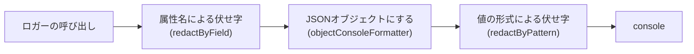
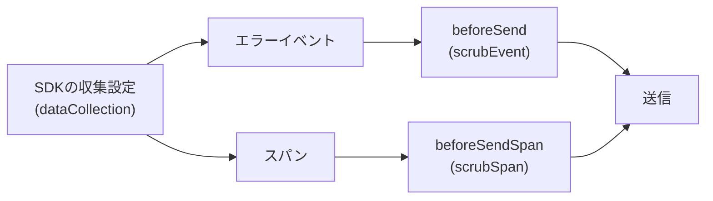

# ログ管理とエラートラッキング

Cloudflare Workersのアプリが出力する構造化ログの形式・カテゴリ・相関ID、個人情報と秘密情報の伏せ字の規則、実行基盤が自動で記録する呼び出しログの無効化と保持期間、及びエラートラッキングへの送信規則・パフォーマンストレース・送信前の個人情報の除去を定める。

## 前提と用語

ログの出力にLogTape(`@logtape/logtape`)と伏せ字の公式パッケージ`@logtape/redaction`、エラートラッキングにSentry(`@sentry/cloudflare`・`@sentry/hono`)を使い、ログの保存先をWorkers Logsとする構成を前提とする。バックエンドの共通ライブラリにある次の部品で設定する。

| 部品                                                                                                         | 置き場所(共通ライブラリ内)                 | 役割                                                                      |
| ------------------------------------------------------------------------------------------------------------ | ------------------------------------------ | ------------------------------------------------------------------------- |
| `getAppLogger`                                                                                               | `core/logging/app-logger.ts`               | カテゴリの規約を型で強制したロガーの取得                                  |
| `toLogObject`・`objectConsoleFormatter`                                                                      | `core/logging/log-record.ts`               | ログ1件をJSONオブジェクトにする                                           |
| `REDACTED_FIELD_PATTERNS`・`REDACTION_PATTERNS`・`REDACTED`                                                  | `core/logging/redaction.ts`                | 伏せ字の対象の属性名と値の形式、置き換え後の文字列`[REDACTED]`            |
| `ensureLoggingConfigured`                                                                                    | `workers/logging/configure-logging.ts`     | LogTapeの設定(コンソールへの出力・伏せ字・処理単位の文脈)                 |
| `invocationContext`                                                                                          | `workers/http/invocation-context.ts`       | HTTPの処理の相関IDとログの文脈、アクセスログ                              |
| `scrubEvent`・`scrubSpan`                                                                                    | `core/observability/scrub-event.ts`        | 送信前のエラーイベントとスパンからの個人情報の除去と、想定内の失敗の除外  |
| `readSentryRuntimeOptions`・`buildSentryOptions`・`createSentryMiddleware`・`withSentryForScheduledAndQueue` | `workers/observability/sentry.ts`          | Sentryの初期化のオプションと、HTTP・定期実行・Queueの処理の計装           |
| `createWorkerHandler`                                                                                        | `workers/handler/create-worker-handler.ts` | 呼び出しごとのログの設定、定期実行とQueueの処理の相関IDと環境の検証、計装 |

| 用語                                                         | 意味                                                                                                                                                                              |
| ------------------------------------------------------------ | --------------------------------------------------------------------------------------------------------------------------------------------------------------------------------- |
| 処理単位                                                     | 1件のHTTPリクエスト、1回の定期実行、1件のメッセージの処理                                                                                                                         |
| 相関ID                                                       | 1つの処理単位の中で出力するログとエラーレポートを結び付ける識別子                                                                                                                 |
| 想定内の失敗                                                 | 共通エラー型(`AppError`)で表した、利用者の入力や状態による失敗。共通のエラー形式で4xx・503の応答になる                                                                            |
| 呼び出しログ                                                 | Workers Logsが呼び出しごとに自動で1件記録するログ。リクエストのヘッダーとメタデータを含み、アプリの伏せ字を通らない                                                               |
| `<共通ライブラリの配置先>`                                   | 共通ライブラリを利用側のアプリへ配置したディレクトリ(「[共有ディレクトリの配置方式](../coding/003-shared-directories.md)」)。上の表の置き場所は、このディレクトリからのパスである |
| `<ログレベルの変数>`                                         | 出力するログの最低のレベルを持つ変数のキー                                                                                                                                        |
| `<エラートラッキングのDSNのシークレットのキー>`              | SentryのDSNを持つシークレットのキー                                                                                                                                               |
| `<エラートラッキングの環境名の変数>`                         | Sentryのイベントに付ける環境名を持つ変数のキー                                                                                                                                    |
| `<トレースの割合の変数>`                                     | パフォーマンストレースを送る割合(0以上1以下)を持つ変数のキー                                                                                                                      |
| `<定期実行を受け持つアプリ>`・`<メッセージを受信するアプリ>` | 定期実行を持つアプリと、メッセージを受信するアプリ(「[非同期処理の設計](003-async-processing.md#前提と用語)」)                                                                    |

## ログの出力

### ログの形式

ログ1件は、次の項目を最上位に持つJSONオブジェクトとして、文字列にせずにコンソールへ渡す。Workers Logsは`console`に渡したオブジェクトのフィールドを抽出して索引にするため、属性で絞り込んで検索できる。

| 項目       | 内容                                                                                                                                                                                                             |
| ---------- | ---------------------------------------------------------------------------------------------------------------------------------------------------------------------------------------------------------------- |
| `time`     | 記録した時刻(ISO 8601、UTC)                                                                                                                                                                                      |
| `level`    | `trace`・`debug`・`info`・`warning`・`error`・`fatal`のいずれか                                                                                                                                                  |
| `category` | カテゴリを`.`で連結した文字列(例:`<アプリ名>.http.access`)                                                                                                                                                       |
| `message`  | 差し込み値を埋め込んだメッセージ。文字列はそのまま埋め込み、`Error`・`null`・文字列以外のプリミティブ値は`String()`の結果を、オブジェクトと配列はJSONを埋め込む(JSONにできなければ`[object Object]`の形の文字列) |
| 属性と文脈 | ロガーに渡した属性と、処理単位の文脈(`correlationId`など)。同名の属性があっても上の4項目の値が優先される                                                                                                         |

```json
{
  "time": "2030-01-15T12:00:00.000Z",
  "level": "info",
  "category": "<アプリ名>.http.access",
  "message": "HTTPリクエストを処理しました",
  "method": "GET",
  "path": "/items",
  "status": 200,
  "durationMs": 12,
  "correlationId": "5f0c3c0e-2b8e-4a49-9d0b-6f9c2a7f1e3d"
}
```

- レベルとコンソールのメソッドは、`debug`・`trace`が`console.debug`、`info`が`console.info`、`warning`が`console.warn`、`error`・`fatal`が`console.error`に対応する。
- 属性の最上位に置いた例外(`Error`とその派生)は、`name`・`message`・`stack`・`cause`を持つオブジェクトに開く。原因(`cause`)は、`Error`(同じ規則で開く)と文字列・数値・真偽値だけを出力し、オブジェクトの原因と、例外の独自のプロパティは出力しない。循環する原因は、循環した先を出力しない。

### カテゴリ

カテゴリは`[<アプリ名>, <層>, <モジュール>]`の配列とする。ロガーは`getAppLogger(category)`で取得し、先頭にアプリ名の無いカテゴリは型検査で拒否される。

```typescript
import { getAppLogger } from '<共通ライブラリの配置先>/core/logging/app-logger.ts';

const logger = getAppLogger(['<アプリ名>', 'application', 'order']);

logger.info('注文を確定しました', { orderId, itemCount });
```

- ログの設定は、そのアプリの名前で始まるカテゴリ(`[<アプリ名>]`の配下)にだけ出力先を付ける。別のアプリの名前で始まるカテゴリのログは、エラーも出ずに捨てられる。
- 共通ライブラリの部品のカテゴリは、次の規則で決める。
  - 1つのアプリだけが使う部品は、そのアプリの名前に固定する。
  - 複数のアプリが使う部品は、アプリの名前を引数(`appName`)で受け取ってカテゴリを組み立てる。1つのアプリ用に固定した部品を別のアプリで使う場合は、先に引数で受け取る形に直す。
- 共通ライブラリの部品が使うカテゴリは次のとおりである。ここには他のプロジェクトへ写せる汎用の部品のカテゴリだけを載せる。サービス固有の機能の部品(共通ライブラリに置いた部品を含む)のカテゴリは、この表に載せず、プロジェクト固有の値の文書(「[本プロジェクト固有の値](../../../onboardings/project-values.md)」)の機能ごとの項に、カテゴリ・ログのレベル・添える属性を載せる。

| カテゴリ                                                                 | 部品                                                                                              | 出力するログ                                                                                                                                                                                                                                                                                                                                                                                                                            |
| ------------------------------------------------------------------------ | ------------------------------------------------------------------------------------------------- | --------------------------------------------------------------------------------------------------------------------------------------------------------------------------------------------------------------------------------------------------------------------------------------------------------------------------------------------------------------------------------------------------------------------------------------- |
| `[<アプリ名>, 'http', 'access']`                                         | `invocationContext`                                                                               | アクセスログ                                                                                                                                                                                                                                                                                                                                                                                                                            |
| `[<アプリ名>, 'http', 'env']`                                            | 環境の検証のミドルウェア                                                                          | 環境の設定の不備                                                                                                                                                                                                                                                                                                                                                                                                                        |
| `[<アプリ名>, 'http', 'error']`                                          | `onError`の処理                                                                                   | HTTPの処理の想定外の例外                                                                                                                                                                                                                                                                                                                                                                                                                |
| `[<アプリ名>, 'scheduled', 'env']`・`[<アプリ名>, 'queue', 'env']`       | `createWorkerHandler`                                                                             | 定期実行・Queueの処理を始める前の環境の設定の不備                                                                                                                                                                                                                                                                                                                                                                                       |
| `[<定期実行を受け持つアプリ>, 'scheduled', 'dispatcher']`                | `createScheduledDispatcher`                                                                       | ジョブの失敗、時間の予算の超過、起動の要約                                                                                                                                                                                                                                                                                                                                                                                              |
| `[<メッセージを受信するアプリ>, 'queue', 'consumer']`                    | `createQueueDispatcher`(本体)                                                                     | 処理の失敗、メッセージごとの結果                                                                                                                                                                                                                                                                                                                                                                                                        |
| `[<メッセージを受信するアプリ>, 'queue', 'dead-letter']`                 | `createQueueDispatcher`(デッドレター)                                                             | デッドレターへ移ったメッセージ                                                                                                                                                                                                                                                                                                                                                                                                          |
| `[<アプリ名>, 'infrastructure', <モジュール>]`                           | 外部サービスに依存する部品(bot判定の検証など)                                                     | 外部サービスの失敗・設定の誤り                                                                                                                                                                                                                                                                                                                                                                                                          |
| `[<定期実行を受け持つアプリ>, 'application', 'email-cleanup']`           | `createSuppressionMaintenance`(日次の後始末)                                                      | 利用者のアドレスの照会口が使えず、利用者に紐づかない抑止記録の削除を省いたこと                                                                                                                                                                                                                                                                                                                                                          |
| `[<アプリ名>, 'search', 'refresh']`                                      | `QueueSearchIndexRefreshRequester`(全文検索の索引の更新の要求)                                    | 要求のメッセージの送信の失敗(検索対象と元データの識別子だけを添える)                                                                                                                                                                                                                                                                                                                                                                    |
| `[<アプリ名>, 'identity', 'disposable-email']`                           | `createDisifyClient`(使い捨てメールアドレスの判定)                                                | 判定できなかったこと(理由`reason`と、応答があった時の状態コード`status`だけを添え、メールアドレスとドメインを出さない)                                                                                                                                                                                                                                                                                                                  |
| `[<アプリ名>, 'media', 'upload']`                                        | `MediaUploadReceiver`(ファイルのアップロードの受付)                                               | 受付・拒否の結果、保存先の一時的な障害と後始末の失敗、画像の判定の依頼の送信の失敗(用途・形式・バイト数・ファイルの識別子・状態コード・エラーコードだけを添え、ファイル名と内容を出さない)                                                                                                                                                                                                                                              |
| `[<アプリ名>, 'media', 'files']`                                         | `MediaFilesService`(ファイルの紐付け・削除などの操作)                                             | 即時の物理削除を完了できなかったこと(対象の件数と例外だけを添え、ファイル名と内容を出さない)                                                                                                                                                                                                                                                                                                                                            |
| `[<アプリ名>, 'media', 'quarantine']`                                    | `MediaQuarantineService`(隔離理由の追加・解除)                                                    | 理由の変更に伴う移動の依頼の送信の失敗(対象の件数・隔離理由・例外だけを添える)                                                                                                                                                                                                                                                                                                                                                          |
| `[<アプリ名>, 'media', 'moderation']`                                    | `ModerateImageHandler`(画像の判定のメッセージの処理)                                              | 判定の結果と再試行(ファイルの識別子・結果・試行回数・所要時間・判定用画像の作り方・ラベルと検出内容の件数・失敗の種類だけを添え、ファイル名・オブジェクトキー・画像の内容・資格情報を出さない)                                                                                                                                                                                                                                          |
| `[<アプリ名>, 'media', 'relocation']`                                    | `RelocateFilesHandler`(保存先の移動のメッセージの処理)                                            | 保存先をそろえた結果(対象のファイルの件数と移動した件数だけを添え、ファイル名・オブジェクトキー・内容を出さない)                                                                                                                                                                                                                                                                                                                        |
| `[<アプリ名>, 'media', 'purge']`                                         | `PurgeImageCacheHandler`(エッジキャッシュのパージのメッセージの処理)                              | パージの完了(対象のオブジェクトキーの件数`purgedCount`だけを添え、オブジェクトキーを出さない。属性名に`key`を含めると伏せ字になるため件数の名前にも含めない)。拒否は例外で再試行し、上限に達するとデッドレターの通知になる                                                                                                                                                                                                              |
| `[<アプリ名>, 'media', 'delivery']`                                      | `ImageDelivery`(画像の変換配信の名前付きエントリポイント)・`ImagesBindingTransformer`(画像の変換) | 配信の想定外の例外(例外と要求のメソッドだけを添える)、変換できない原本と変換の一時的な失敗(変換基盤のエラーコード・バリアント・出力形式だけを添え、オブジェクトキーと画像の内容を出さない)                                                                                                                                                                                                                                              |
| `[<APIサーバーのアプリ>, 'media', 'download']`                           | 非公開ファイルの内部REST(ダウンロード)                                                            | 保存先を読めなかったこと、保存済みのファイルのオブジェクトがどの保存先にも無いこと(ファイルの識別子と、読めなかったときは例外、見つからなかったときは保存先の種別だけを添え、ファイル名・オブジェクトキーを出さない)                                                                                                                                                                                                                    |
| `[<APIサーバーのアプリ>, 'media', 'expired-file-erasure']`               | 期限切れのファイルの物理削除の日次のジョブ                                                        | 対象の件数・削除した件数・繰り返しの回数・残りの有無。繰り返しの上限で止めた時はwarningで削除した件数と回数(ファイルの識別子・ファイル名を出さない)                                                                                                                                                                                                                                                                                     |
| `[<APIサーバーのアプリ>, 'media', 'moderation-requeue']`                 | 判定の再依頼の日次のジョブ                                                                        | 対象の件数・依頼した件数・送信に失敗した件数・残りの有無。送信の失敗は1件ごとにファイルの識別子と例外を添えて`error`                                                                                                                                                                                                                                                                                                                    |
| `[<APIサーバーのアプリ>, 'media', 'location-reconciliation']`            | 保存先の照合の日次のジョブ                                                                        | 食い違いの件数・移動を依頼した件数・送信に失敗した件数・残りの有無。送信の失敗はメッセージごとにファイルの識別子と例外を添えて`error`                                                                                                                                                                                                                                                                                                   |
| `[<APIサーバーのアプリ>, 'auth', 'incident']`                            | `SentryAuthIncidentReporter`(認証部品の運用者への通知)                                            | 外部サービス(漏洩パスワードの照合・使い捨てメールアドレスの判定)を使えず処理を省いたこと・送信元IPアドレスが不明でIPアドレス単位のログイン試行の記録を省いたことを`warning`、ライフサイクルイベントの送り直しが続くこと・送信の失敗・物理削除の期限超過を`error`(種類`incident`と、理由`reason`・件数`count`・イベントのIDだけを添え、メールアドレス・IPアドレス・トークンを出さない)                                                   |
| `[<APIサーバーのアプリ>, 'identity', 'login']`                           | 利用者のログイン(パスワードと第2要素)のリゾルバ                                                   | 段階を通過したことを`info`(結果`outcome`(`authenticated`・`second-factor-required`)と利用者の識別子`userId`だけを添える)、想定内の理由で拒否したことを`warning`(エラーコードの理由`reason`(`invalid_credentials`・`login_throttled`・`account_unavailable`・`invalid_second_factor`・`login_challenge_expired`・bot判定の失敗など)だけを添え、メールアドレス・IPアドレス・パスワード・トークンを出さない。入力の検証の失敗は記録しない) |
| `[<APIサーバーのアプリ>, 'identity', 'registration']`                    | 利用者の登録のユースケース                                                                        | 登録の確認メールの送信の要求に失敗したことを`error`(例外と利用者の識別子`userId`だけを添え、メールアドレス・トークンを出さない。利用者は作成済みで、確認メールの再送で回復できる)                                                                                                                                                                                                                                                       |
| `[<APIサーバーのアプリ>, 'identity', 'disposable-email-check']`          | 使い捨てメールアドレスの判定と保存のユースケース                                                  | 「未判定」の判定し直しの依頼の送信に失敗したことを`error`(例外と利用者の識別子`userId`だけを添え、メールアドレスを出さない。確認は完了済みで、日次のジョブが判定し直しを依頼する)                                                                                                                                                                                                                                                       |
| `[<APIサーバーのアプリ>, 'identity', 'email-verification']`              | メールアドレスの確認のユースケース                                                                | 確認済みにした後の使い捨て判定の保存に失敗したことを`error`(例外と利用者の識別子`userId`だけを添え、メールアドレス・トークンを出さない。確認済みにしてリンクも使用済みのため、失敗を返すと同じリンクで再試行できないので成功として返す)                                                                                                                                                                                                 |
| `[<APIサーバーのアプリ>, 'identity', 'password-reset']`                  | パスワードリセットのユースケース                                                                  | リセットのリンクのメール・完了のメールの送信の要求に失敗したことを`error`(例外と利用者の識別子`userId`だけを添え、メールアドレス・トークンを出さない。要求の応答はアカウントの有無を推測させないよう送信の失敗を伝えず、完了はパスワードの更新後のため成功として返す)                                                                                                                                                                   |
| `[<APIサーバーのアプリ>, 'identity', 'email-change']`                    | メールアドレス変更のユースケース                                                                  | 確認のリンクのメール・変更前のアドレスへの完了のメールの送信の要求と、新しいアドレスの使い捨て判定の保存に失敗したことを`error`(例外と利用者の識別子`userId`だけを添え、メールアドレス・トークンを出さない。要求の応答は新しいアドレスの重複の有無を推測させないよう送信の失敗を伝えず、確定は変更の後のため完了のメールと操作した端末へのセッションの発行を続けて成功として返す)                                                       |
| `[<APIサーバーのアプリ>, 'identity', 'password-change']`                 | パスワード変更のユースケース                                                                      | 完了のメールの送信の要求に失敗したことを`error`(例外と利用者の識別子`userId`だけを添え、メールアドレス・トークンを出さない。確定はパスワードの更新後のため、操作した端末へのセッションの発行を続けて成功として返す。確認のリンクのメールの送信の失敗は、利用者が送り直せるよう要求の失敗として返す)                                                                                                                                     |
| `[<APIサーバーのアプリ>, 'admin', 'login']`                              | 管理者のログイン(パスワードと第2要素)のリゾルバ                                                   | 段階を通過したことを`info`(結果`outcome`(`authenticated`・`second-factor-required`)と管理者の識別子`adminId`だけを添える)、想定内の理由で拒否したことを`warning`(エラーコードの理由`reason`(`invalid_credentials`・`login_throttled`・`invalid_second_factor`・`login_challenge_expired`・bot判定の失敗など)だけを添え、メールアドレス・IPアドレス・パスワード・トークンを出さない。入力の検証の失敗は記録しない)                       |
| `[<APIサーバーのアプリ>, 'admin', 'password-reset']`                     | 管理者のパスワードリセットのユースケース                                                          | リセットのリンクのメール・完了のメールの送信の要求に失敗したことを`error`(例外と管理者の識別子`adminId`だけを添え、メールアドレス・トークンを出さない。要求の応答は管理者の有無を推測させないよう送信の失敗を伝えず、完了はパスワードの更新後のため成功として返す)                                                                                                                                                                      |
| `[<APIサーバーのアプリ>, 'admin', 'email-change']`                       | 管理者のメールアドレス変更のユースケース                                                          | 確認のリンクのメール・変更前のアドレスへの完了のメールの送信の要求に失敗したことを`error`(例外と管理者の識別子`adminId`だけを添え、メールアドレス・トークンを出さない。要求の応答は新しいアドレスの重複の有無を推測させないよう送信の失敗を伝えず、確定は変更の後のため操作した端末へのセッションの発行を続けて成功として返す)                                                                                                          |
| `[<APIサーバーのアプリ>, 'admin', 'password-change']`                    | 管理者のパスワード変更のユースケース                                                              | 完了のメールの送信の要求に失敗したことを`error`(例外と管理者の識別子`adminId`だけを添え、メールアドレスを出さない。パスワードは更新済みのため、操作した端末へのセッションの発行を続けて成功として返す)                                                                                                                                                                                                                                  |
| `[<APIサーバーのアプリ>, 'admin', 'account']`                            | 管理者の一覧・削除・ロールの変更のユースケース                                                    | 削除した管理者のプロフィール画像の即時の削除に失敗したことを`warning`(例外と管理者の識別子`adminId`だけを添える)で出す。削除は確定済みのため成功を返し、削除待ちの印から日次の処理が削除を終える                                                                                                                                                                                                                                        |
| `[<APIサーバーのアプリ>, 'admin', 'profile']`                            | 管理者のプロフィールの更新のユースケース                                                          | 差し替え・取り除いた以前のプロフィール画像の即時の削除に失敗したことを`warning`(例外と管理者の識別子`adminId`だけを添える)で出す。更新は確定済みのため成功を返し、削除待ちの印から日次の処理が削除を終える                                                                                                                                                                                                                              |
| `[<APIサーバーのアプリ>, 'admin', 'authorization']`                      | 管理者のアクセス制御のリゾルバ向けの補助(`requireAdmin`・`requireSelfOrRole`)                     | 管理者側の呼び出し元からの操作をロールの不足で拒否したことを`warning`(必要なロール`requiredRole`だけを添える。操作名はGraphQLの操作のログが同じ相関IDで残す。未認証と管理者側でない呼び出し元の拒否は出さない。ユースケースが対象で判定する拒否(例: 上位のロールの管理者の削除)はこのカテゴリに出さず、GraphQLの操作のログのエラーコード`forbidden`で追う)                                                                              |
| `[<APIサーバーのアプリ>, 'admin', 'audit-log']`                          | 監査ログの記録の準備(`AuditLogRecorder.prepare`)                                                  | 記録の入力が規則に違反したことを`warning`(操作種別の名前`action`と違反の種類`violation`だけを添え、理由・対象・詳細の値を出さない。違反は`validation_error`として投げ、管理操作を行わない)                                                                                                                                                                                                                                              |
| `[<APIサーバーのアプリ>, 'admin', 'audit-log-retention']`                | 保持期間を過ぎた監査ログの削除の日次のジョブ                                                      | 削除した件数`deleted`・削除の回数`batches`・1回の起動の上限に達したか`limitReached`を`info`。削除の失敗は例外とそれまでに削除した件数`deleted`を添えて`error`で出し、例外を投げ直す                                                                                                                                                                                                                                                     |
| `[<APIサーバーのアプリ>, 'admin', 'credential-cleanup']`                 | 期限切れの管理者の認証情報の削除の日次のジョブ                                                    | 削除した件数を対象(`sessions`・`mailLinks`・`loginChallenges`・`totpPendings`)ごとに、失敗した対象の数`failed`とともに`info`。削除の失敗は対象`target`と例外を添えて`error`(1つの対象の失敗で残りの対象を止めず、最後にまとめて1件の例外を投げる)                                                                                                                                                                                       |
| `[<APIサーバーのアプリ>, 'identity', 'user-lifecycle']`                  | 退会・運営者による退会・停止・停止解除のユースケース                                              | 状態の遷移の確定後に、ユーザーライフサイクルイベントの非同期の波及処理の実行の送信を要求できなかったことを`error`(例外とイベントのID`eventId`・利用者の識別子`userId`だけを添える。状態の遷移は確定済みのため成功として返し、`SentryAuthIncidentReporter`の`lifecycle-publish-failed`でも通知する。イベントは未完了のまま残り、日次のジョブが送り直す)                                                                                  |
| `[<APIサーバーのアプリ>, 'identity', 'purge-orchestrator']`              | 退会ユーザーの物理削除の開始の日次のジョブ                                                        | 候補の件数・作成したイベントの件数・送信した件数・送信に失敗した件数・残りの有無・期限超過の件数を`info`。送信の失敗は1件ごとに例外とイベントのID`eventId`・利用者の識別子`userId`を添えて`error`(イベントは未完了のまま残り、送り直しのジョブが送る)                                                                                                                                                                                   |
| `[<APIサーバーのアプリ>, 'identity', 'credential-cleanup']`              | 期限切れの認証情報の削除の日次のジョブ                                                            | 削除した件数を対象(`sessions`・`mailLinks`・`loginChallenges`・`totpPendings`)ごとに、失敗した対象の数`failed`とともに`info`。削除の失敗は対象`target`と例外を添えて`error`                                                                                                                                                                                                                                                             |
| `[<APIサーバーのアプリ>, 'identity', 'disposable-recheck-sweep']`        | 未判定の利用者の使い捨て判定の判定し直しを依頼する日次のジョブ                                    | 対象の件数・依頼した件数・送信に失敗した件数・残りの有無を`info`。送信の失敗は1件ごとに例外と利用者の識別子`userId`を添えて`error`(メールアドレスを出さない)                                                                                                                                                                                                                                                                            |
| `[<APIサーバーのアプリ>, 'identity', 'lifecycle-redispatch']`            | 未完了のユーザーライフサイクルイベントの送り直しの日次のジョブ                                    | 対象の件数・送り直した件数・送信に失敗した件数・3回目以降の送り直しの件数`stuck`・残りの有無を`info`。送信の失敗は1件ごとに例外とイベントのID`eventId`・利用者の識別子`userId`を添えて`error`(送信の回数を増やさず、翌日の起動が再び拾う)                                                                                                                                                                                               |
| `[<メッセージを受信するアプリ>, 'identity', 'lifecycle']`                | `UserLifecycleRunner`(ユーザーライフサイクルイベントの非同期の波及処理の実行器)                   | 波及処理ごとの完了と、イベントの終わり方を`info`(イベントのID`eventId`・種類`type`・利用者の識別子`userId`、該当する場合の波及処理の名前`handler`、結果`outcome`(`handler-completed`・`continued`・`completed`・`missing`・`already-completed`・`waiting-for-earlier-event`)だけを添え、メールアドレスを出さない)。波及処理と物理削除の例外はログに残さずそのまま投げ、メッセージの処理の失敗として記録・再試行させる                   |
| `[<メッセージを受信するアプリ>, 'identity', 'disposable-email-recheck']` | 未判定の利用者の使い捨てメールアドレスの判定し直しのメッセージの処理                              | 終わり方を`info`(利用者の識別子`userId`と結果`outcome`(`rechecked`・`missing`・`withdrawn`・`unverified`・`determined`)、判定し直した場合の判定`result`だけを添え、メールアドレスを出さない)。判定できなくても未判定として保存して終え、例外にしない                                                                                                                                                                                    |

- LogTape自身の警告(伏せ字の処理の失敗など)は、カテゴリ`['logtape', 'meta']`で`warning`以上だけを、同じ伏せ字付きの出力先へ出す。

### 相関ID

1つの処理単位で出力する全てのログに、同じ相関IDを属性`correlationId`として付ける。処理単位の文脈は`node:async_hooks`の`AsyncLocalStorage`で保たれるため、`await`をまたいでも、各ロガーで相関IDを渡す必要は無い。

| 処理単位           | 相関IDの値                                             | 付ける場所                                                                                                                                                                                                                   |
| ------------------ | ------------------------------------------------------ | ---------------------------------------------------------------------------------------------------------------------------------------------------------------------------------------------------------------------------- |
| HTTPのリクエスト   | リクエストごとに採番したUUID                           | `invocationContext`がログの文脈とHonoの変数`correlationId`に入れ、Sentryのタグ`correlation_id`に付ける                                                                                                                       |
| 定期実行           | 起動ごとに採番したUUID                                 | `createWorkerHandler`がログの文脈に入れてSentryのタグ`correlation_id`に付け、ディスパッチャがジョブのコンテナへ受け継ぐ                                                                                                      |
| メッセージの処理   | 封筒のID                                               | 本体のconsumerがメッセージごとにログの文脈に入れ、Sentryの`withScope`で分けたスコープのタグ`correlation_id`に付ける。メッセージの外のバッチ全体のログの文脈とタグには、`createWorkerHandler`がバッチごとに採番したUUIDが入る |
| デッドレターの通知 | 元のメッセージのID(分からなければバッチの相関IDのまま) | デッドレターのconsumerが通知ごとにログの文脈に入れ、Sentryへの通知のタグ`correlation_id`に付ける                                                                                                                             |

- 1回の定期実行の中では、全てのジョブが同じ相関IDを使う。DIコンテナはジョブごとに作るが、どのコンテナにも同じ相関IDが渡される。
- 処理単位のDIコンテナには、相関IDを含む処理単位の情報(`InvocationScopeInfo`の`kind`・`correlationId`)が`PLATFORM_TYPES.InvocationScope`で登録されている。アプリのコードで相関IDが必要な場合(外部への要求に付けるなど)は、ここから受け取る。
- 自分で文脈を作る場合は、`withContext({ correlationId }, callback)`のキー名を`correlationId`にそろえる。

### 処理単位の終わりのログ

処理単位を終えるたびに、種別・結果・所要時間・相関IDを持つログを1件出す。

| 処理単位         | レベルとメッセージ                     | 属性                                                                                                                                     |
| ---------------- | -------------------------------------- | ---------------------------------------------------------------------------------------------------------------------------------------- |
| HTTPのリクエスト | `info`「HTTPリクエストを処理しました」 | `method`・`path`(クエリ文字列を除く)・`status`・`durationMs`                                                                             |
| 定期実行         | `info`「定期実行を終えました」         | `kind`(`scheduled`)・`cron`・`result`(`succeeded`・`failed`)・`jobs`(ジョブごとの`name`・`result`・`durationMs`)・`totalDurationMs`      |
| メッセージの処理 | `info`「メッセージを処理しました」     | `result`(`done`・`deferred`・`retried`・`dead-lettered`)・`messageType`・`attempts`・`durationMs`と、該当する場合の`reason`・`errorName` |

- アクセスログには、IPアドレス・クエリ文字列・ヘッダーを含めない。
- アクセスログは、Honoの`onError`を通った応答にも出る。`Error`以外の値を投げると、Honoは`onError`を通さずに投げ直すため、アクセスログが出ない(「[送信する例外と送信しない例外](#送信する例外と送信しない例外)」)。
- 定期実行とメッセージの処理の結果の詳細は「[非同期処理の設計](003-async-processing.md)」に従う。

### ログのレベル

- 出力する最低のレベルは、環境ごとにWrangler設定の`vars`の`<ログレベルの変数>`で`debug`・`info`・`warning`・`error`のいずれかを指定する。指定より低いレベルのログは出力しない。
- 値が不正な場合は、ログを`info`で出し続けたうえで、環境の検証で処理単位を失敗させる。
- ログの設定はisolateごとに最初の呼び出しで1回だけ行い、レベルが変わった場合だけ設定し直す。設定し直しても、処理中の処理単位の相関IDは失われない。

### 出力先と保持期間

- ログの出力先はコンソールだけとし、Workers Logsに保存する。Workers Logsの保持期間(有料プランで7日)を過ぎたログは残らない。Logpush・Tail Workerなど、ログを外部へ転送して長く保存する出力先を設けない。
- 呼び出しログは、ヘッダーなどを伏せ字を通さずに記録するため無効にする。Wrangler設定のルートに次を書き、各`env.<環境種別>`へ継承させる(`observability`は継承されるキーである)。

```jsonc
{
  "observability": {
    "enabled": true,
    "logs": { "invocation_logs": false },
  },
}
```

- `observability.logs.destinations`・`logpush`・`tail_consumers`を指定しない。
- 呼び出しログの代わりに、伏せ字を通したアクセスログをアプリが出す(「[処理単位の終わりのログ](#処理単位の終わりのログ)」)。

## 伏せ字の規則

ログは、属性名による伏せ字と値の形式による伏せ字の2段で、個人情報と秘密情報を`[REDACTED]`に置き換えてから出力する。



### 属性名による伏せ字

属性名が次のパターンに当たる属性の値を、値の型や中身に関わらず丸ごと`[REDACTED]`にする。入れ子のオブジェクトの属性名も対象で、メッセージの`{名前}`の差し込みも、名前が当たれば伏せる。大文字小文字は区別しない。

| 一致の仕方 | パターン                                                                                                                                                                                                          |
| ---------- | ----------------------------------------------------------------------------------------------------------------------------------------------------------------------------------------------------------------- |
| 部分一致   | `@logtape/redaction`の既定(`DEFAULT_REDACT_FIELDS`):`passcode`・`passphrase`・`password`、`secret`、`token`、`key`、`credential`、`auth`、`signature`、`sensitive`、`private`、`ssn`、`email`、`phone`、`address` |
| 部分一致   | `cookie`(`set-cookie`・`cookies`などを含む)                                                                                                                                                                       |
| 完全一致   | `ip`・`ipAddress`・`clientIp`・`remoteIp`・`email`・`mail`・`authorization`・`token`・`turnstileToken`・`pepper`・`secret`                                                                                        |

- 既定のパターンは部分一致のため、`apiKey`・`missingKeys`・`authorId`・`mailAddress`のように、名前の一部に`key`・`auth`・`address`などを含む属性も丸ごと伏せられる(「[ログを書くときの規約](#ログを書くときの規約)」)。

### 値の形式による伏せ字

JSONオブジェクトにした後のメッセージと全ての属性の文字列(入れ子を含む)から、次の形式の部分を`[REDACTED]`に置き換える。配列の先頭から順に置き換える。

| 順  | 形式                         | 規則                                                                                                                                       |
| --- | ---------------------------- | ------------------------------------------------------------------------------------------------------------------------------------------ |
| 1   | サービス固有のトークンの形式 | 発行するAPIキーなど、接頭辞と長さが決まった秘密の値の形式                                                                                  |
| 2   | `Bearer <トークン>`          | 大文字小文字を区別しない`Bearer`と空白に続く、RFC 6750のトークンの文字の並び                                                               |
| 3   | JWT                          | `@logtape/redaction`の`JWT_PATTERN`                                                                                                        |
| 4   | メールアドレス               | `@logtape/redaction`の`EMAIL_ADDRESS_PATTERN`                                                                                              |
| 5   | カード番号                   | `@logtape/redaction`の`CREDIT_CARD_NUMBER_PATTERN`のうち、Luhnの検査を通る数字の並びだけ。検査を通らない並びと、UUIDの中に収まる並びは残す |
| 6   | IPv4アドレス                 | 4つ組の前後に数字や`.<数字>`が続かないもの(`1.2.3.4.5`のような5つ以上の組の一部は残す)                                                     |
| 7   | IPv6アドレス                 | 8組の完全な表記か`::`による省略を含む表記で、前後に英数字・`:`が続かないもの(`12:34:56`のような時刻や`std::`は残す)                        |

- サービス固有のトークンの形式の値のパターンは、他のパターンより先に当たるよう配列の先頭に置く。トークンの文字の並びの一部がカード番号などの他のパターンに先に当たると、トークンの一部だけが置き換えられて残りの断片が出力されるためである。パターンを先頭から動かすと断片が残ることを、単体テストで確かめる。
- パターンは`g`フラグ付きの正規表現とし、置き換え後の文字列を`REDACTED`(`[REDACTED]`)に統一する。`@logtape/redaction`の既製のパターンは置き換え後の文字列が異なる(カード番号は`XXXX-XXXX-XXXX-XXXX`、メールアドレスは`REDACTED@EMAIL.ADDRESS`、JWTは`[JWT REDACTED]`)ため、正規表現(カード番号はLuhnの検査も)を保ったまま置き換えだけを`REDACTED`に包み直す。
- カード番号のパターンは、UUIDの形(`8-4-4-4-12`の16進の文字の並び、大文字小文字を問わない)の中に収まる一致を伏せない。ランダムなUUIDでも、続く区切りの中の文字が数字だけになると(例:`015e5a15-444e-4123-8456-123451c99bf9`の`4123-8456-123451`)ハイフン区切りのカード番号の形になり、Luhnの検査を通ることがある。これを伏せると、ログの相関IDや実体のIDのUUIDが時々欠ける。UUIDの外にはみ出す一致と、UUIDの形でない16進の文字の並び(`card-`など)に続くカード番号は伏せる。
- パターンを加えるときは、当たる値・当たらない値(通常の値と、形の似た短い値)を単体テストで確かめる。
- 同じ`REDACTION_PATTERNS`を、エラートラッキングの除去処理でも使う(「[個人情報と秘密情報の除去](#個人情報と秘密情報の除去)」)。

### ログを書くときの規約

伏せ字の仕組みの制約から、ログを書くときは次の規約を守る。

- 秘密情報や個人情報を含み得るオブジェクトは、名前付きの属性として渡す。タグ付きテンプレート(`` logger.info`...${value}...` ``)に差し込んだ値は、属性名による伏せ字が効かない(値の形式による伏せ字だけが効く)。

```typescript
logger.warn('外部サービスの応答が不正です', { response: body });
```

- 例外は属性の最上位に置く(`{ error }`)。オブジェクトの中に入れた例外は`{}`になり、名前もメッセージも出力されない。例外の原因(`cause`)に入れたオブジェクトと例外の独自のプロパティも出力されないため、調査に必要な値は別の属性として渡す。

```typescript
logger.error('支払いの確定に失敗しました', { error, paymentId });
```

- 属性名に`key`・`token`・`auth`・`address`・`email`・`secret`などを含めない。伏せる必要の無い値でも丸ごと伏せられる(例:欠けた設定の名前の一覧は`missingKeys`ではなく`missingEnvNames`とする)。逆に、秘密の値を持つ属性は伏せられる名前にする。
- メールアドレスは属性として渡すか、メッセージの中では空白や記号で区切る。メールアドレスのパターンは、空白を挟まずに続く日本語などの文字もローカル部として伏せる(「連絡先はuser@example.exampleです」は全体が`[REDACTED]`になる)。
- IPアドレスをログに出さない。IPアドレスを扱う処理(レート制限など)のログには、判定の結果だけを出す。
- ログの伏せ字は最後の防御である。トークン・パスワード・本文を、意図してログに渡さない。

## エラートラッキング

### 初期化と計装

Sentryの初期化のオプションは、処理単位ごとに環境から`buildSentryOptions(readSentryRuntimeOptions(env))`で組み立てる。

| オプション         | 値                                                                                                  |
| ------------------ | --------------------------------------------------------------------------------------------------- |
| `dsn`・`enabled`   | `env.<エラートラッキングのDSNのシークレットのキー>`。未設定か空文字なら`enabled: false`で送信しない |
| `environment`      | `env.<エラートラッキングの環境名の変数>`。未設定か空文字なら`unknown`                               |
| `tracesSampleRate` | `env.<トレースの割合の変数>`を数値にした値。未設定・空文字・0以上1以下でない値は0                   |
| `dataCollection`   | 個人情報を集めない設定(「[個人情報と秘密情報の除去](#個人情報と秘密情報の除去)」)                   |
| `beforeSend`       | `scrubEvent`                                                                                        |
| `beforeSendSpan`   | `scrubSpan`                                                                                         |

- ローカル環境とテストではDSNを設定せず、送信しない。送信しない設定でも処理単位を失敗させない。DSNはシークレットとして管理し、staging・prodのWrangler設定の`secrets.required`に指定する(「[シークレットの管理](../security/001-secret-management.md)」)。
- `<トレースの割合の変数>`は`0`以上`1`以下の10進表記の文字列(`0`・`0.1`・`1`など)とし、環境の検証で形式を確かめる。
- HTTPの処理は`createSentryMiddleware(app, <オプションを返す関数>)`(`@sentry/hono/cloudflare`の`sentry`)で、定期実行とQueueの処理は`withSentryForScheduledAndQueue(<オプションを返す関数>, handler)`(`@sentry/cloudflare`の`withSentry`)で計装する。後者は`fetch`を包まず、HTTPの処理を二重に計装しない。`createWorkerHandler`が後者で定期実行とQueueの処理を包む。
- `@sentry/cloudflare`はisolateごとにクライアントを使い回す。テストで送信先を差し替える場合は`cacheClient: false`を渡す。
- 送信はSDKが`ctx.waitUntil`で非同期に行う。送信の失敗は、元の処理単位の応答と結果を変えない。

### 送信する例外と送信しない例外

想定外の例外だけを送り、想定内の失敗(`AppError`)は送らない。

| 処理単位                                     | 送る場合                                                                                                                                                                                                                                                                                         | 送り方                                                                                                                                                                                                                                                                                                                                   |
| -------------------------------------------- | ------------------------------------------------------------------------------------------------------------------------------------------------------------------------------------------------------------------------------------------------------------------------------------------------ | ---------------------------------------------------------------------------------------------------------------------------------------------------------------------------------------------------------------------------------------------------------------------------------------------------------------------------------------- |
| HTTPのリクエスト                             | `AppError`以外の例外(500の定型の応答になる)                                                                                                                                                                                                                                                      | 計装が送る(`shouldHandleError`で`AppError`を除く)                                                                                                                                                                                                                                                                                        |
| 定期実行                                     | ジョブが`AppError`以外の例外を投げた                                                                                                                                                                                                                                                             | `captureException`(タグ`job`)                                                                                                                                                                                                                                                                                                            |
| 定期実行                                     | 時間の予算を超えた                                                                                                                                                                                                                                                                               | `captureEvent`(レベル`warning`)                                                                                                                                                                                                                                                                                                          |
| メッセージの処理                             | ディスパッチャの想定外の例外                                                                                                                                                                                                                                                                     | `captureException`                                                                                                                                                                                                                                                                                                                       |
| デッドレター                                 | メッセージがデッドレターへ移った                                                                                                                                                                                                                                                                 | `captureEvent`(レベル`error`)                                                                                                                                                                                                                                                                                                            |
| HTTPのリクエスト・定期実行・メッセージの処理 | 全文検索の索引の更新の要求を送れなかった(呼び出し元へ例外を伝えない)                                                                                                                                                                                                                             | `captureException`(タグ`search_target`)                                                                                                                                                                                                                                                                                                  |
| HTTPのリクエスト                             | アップロードを受け付けた画像の判定の依頼を送れなかった(アップロードは成功させる)                                                                                                                                                                                                                 | `captureException`(レベル`warning`、送信前の検証の失敗(`MessagePublishError`)は`error`。タグ`media_purpose`)                                                                                                                                                                                                                             |
| HTTPのリクエスト                             | 保存した操作の通知メールの送信要求に失敗した(操作は成功させる)・保存に失敗した操作の添付ファイルの解放に失敗した                                                                                                                                                                                 | `captureException`(通知メールの失敗はレベル`error`、添付ファイルの解放の失敗は`warning`。タグは種類と対象の識別子で、識別子の形でなければ`unknown`)                                                                                                                                                                                      |
| メッセージの処理                             | 全文検索の索引の更新で、未登録の検索対象の要求を受け取った・キーワード抽出の外部APIの設定に誤りがあった                                                                                                                                                                                          | `captureEvent`(レベル`error`、タグ`search_target`と状態コードの`status`。「[同じ文言を繰り返し送る通知](#同じ文言を繰り返し送る通知)」)                                                                                                                                                                                                  |
| メッセージの処理                             | 画像の判定で、再試行の上限まで判定できなかった・判定サービスが画像を受け付けなかった・判定サービスの設定に誤りがあった                                                                                                                                                                           | `captureEvent`(未判定と受け付けない画像はレベル`warning`、設定の誤りは`error`。指紋は種類と理由、タグは`media_file_id`・`moderation_reason`。「[同じ文言を繰り返し送る通知](#同じ文言を繰り返し送る通知)」)                                                                                                                              |
| HTTPのリクエスト・定期実行・メッセージの処理 | 認証部品が、外部サービス(漏洩パスワードの照合・使い捨てメールアドレスの判定)を使えず処理を省いた・送信元IPアドレスが不明でIPアドレス単位のログイン試行の記録を省いた・ライフサイクルイベントの送り直しが続く・ライフサイクルイベントを送信できなかった・物理削除の期限を過ぎた利用者が残っている | `captureEvent`(外部サービスの未使用とIPアドレスが不明な場合はレベル`warning`、ライフサイクルと物理削除は`error`。指紋は`['identity', <種類>]`、タグは`auth_incident`・`auth_incident_reason`・`lifecycle_event_id`、件数とイベントのIDはコンテキスト`auth_incident`。「[同じ文言を繰り返し送る通知](#同じ文言を繰り返し送る通知)」)      |
| 定期実行                                     | 決済サービスとの突合で、決済の状態の取得か反映に失敗した購入があった・未送信の返金の依頼の送り直しの処理が例外で終わった・依頼待ちの決済のメールを依頼できなかった(ジョブは失敗した対象を飛ばして続けるため、例外としては送られない)                                                             | `captureEvent`(突合と返金の失敗はレベル`error`、メールは`warning`。指紋は`['payments', <種類>, <ジョブの名前>]`、タグは`job`・`payments_incident`・`purchase_id`・`refund_request_id`・例外の名前の`error_name`、メールの件数と識別子はコンテキスト`payments_incident`。「[同じ文言を繰り返し送る通知](#同じ文言を繰り返し送る通知)」)   |
| メッセージの処理                             | 決済サービスが返金の作成か定期課金の解約を恒久的に拒否した・返金に要る支払いの識別子が無い返金の依頼があった(依頼を失敗として記録して処理を終えるため、例外としては送られない)                                                                                                                   | `captureEvent`(レベル`error`。指紋は`['payments', <種類>, <操作>, <拒否のコード>]`(支払いの識別子が無い場合は種類まで)、タグは`message_type`・`payments_incident`・`refund_request_id`・`stripe_operation`・`stripe_error_code`で、識別子とコードの形でなければ`unknown`。「[同じ文言を繰り返し送る通知](#同じ文言を繰り返し送る通知)」) |
| HTTPのリクエスト                             | 決済サービスのWebhookの通知の反映が例外で終わった(500を返して再送させる。計装の送信と重ねないよう経路が送る)                                                                                                                                                                                     | `captureException`(元の例外。タグは通知の種類`stripe_event_type`と通知のID`stripe_event_id`)                                                                                                                                                                                                                                             |
| 定期実行・Queueの処理                        | 環境の検証の失敗など、処理全体が例外で終わった                                                                                                                                                                                                                                                   | 計装が送る                                                                                                                                                                                                                                                                                                                               |

- 除去処理(`scrubEvent`)も、元の例外が`AppError`のイベントを捨てる。ジョブやメッセージの処理で`AppError`を投げると、ログにだけ残りエラートラッキングへ届かない。
- 想定内の失敗は`AppError`で表し、想定外の失敗は`AppError`以外の例外で投げる。ジョブの想定外の失敗も`AppError`以外で投げる。
- `Error`(とその派生)だけを投げる。文字列などの`Error`以外の値を投げると、Honoは`onError`を通さずに投げ直すため、共通のエラー形式の応答とアクセスログが出ない。
- Honoの`HTTPException`を使わない。`HTTPException`は`AppError`ではないため500の定型の応答になり、想定外の例外として送られる。状態コードを伴う想定内の失敗は`AppError`で表す。
- タグとコンテキストに入れる値は「[除去処理の対象外の項目](#除去処理の対象外の項目)」に従う。

### 同じ文言を繰り返し送る通知

定型の文言で繰り返し起こり得る出来事(デッドレター・時間の予算の超過・設定の誤りなど)をエラートラッキングへ知らせるときは、`captureMessage`ではなく、`captureEvent`で`logentry`に文言を、`fingerprint`に出来事の種類を表す値を入れて送る。

```typescript
import { captureEvent } from '@sentry/cloudflare';

captureEvent({
  level: 'warning',
  logentry: { message: '外部サービスの設定に誤りがあります' },
  fingerprint: ['external-service-misconfigured', serviceName],
  tags: { service: serviceName },
  contexts: { external_service: { status } },
});
```

- Sentryの既定の重複の除外(`dedupeIntegration`)は、直前のイベントと`message`・`fingerprint`が同じでスタックトレースの無いイベントを捨てる(タグとコンテキストは比べない)。クライアントはisolateごとに使い回されるため、別の呼び出しの通知でも捨てられる。`captureMessage`で定型の文言を送ると、続けて起きた2件目以降が届かない。
- `logentry`だけを持つイベントは`message`を持たないため重複の除外の対象にならず、除去処理の伏せ字の対象でもある。
- イベントのまとめ方は`fingerprint`で決める。まとめたい単位(理由と種別、cron式など)を入れる。

### トレース

- 処理単位の所要時間のパフォーマンストレースを、環境ごとに`<トレースの割合の変数>`で設定した割合で送る。ローカル環境では0とする。
- トレースは、SDKの既定(`traceLifecycle`を指定しない)のスパンの逐次送信のままにする。逐次送信ではトランザクションのイベントが作られず`beforeSendTransaction`が呼ばれないため、スパンの除去処理は`beforeSendSpan`につなぐ。非推奨の`beforeSendTransaction`と、それを使い続けるための`traceLifecycle: 'static'`は使わない。
- Wrangler設定の`vars`に`SENTRY_TRACE_LIFECYCLE`を定義しない。`@sentry/cloudflare`は`traceLifecycle`を指定しなければこの変数を読み、`static`になると、`withStaticSpan`で包んでいない`beforeSendSpan`を無視するため、スパンは除去されないまま送られる。

### 個人情報と秘密情報の除去

送信するイベントとスパンからは、SDKの収集設定と送信前の除去処理の2層で個人情報と秘密情報を除く。



1層目として、`dataCollection`で次の値を明示し、SDKの段階で集めない。SDKの既定は利用者の情報・Cookie・ヘッダー・本文・クエリ文字列を全て集め、スパンの属性にも付け得るためである。

| 項目                  | 値                                      | 集めないもの                       |
| --------------------- | --------------------------------------- | ---------------------------------- |
| `userInfo`            | `false`                                 | 利用者のIPアドレスなど             |
| `cookies`             | `false`                                 | Cookie                             |
| `httpHeaders`         | `false`                                 | リクエストとレスポンスのヘッダー   |
| `httpBodies`          | `[]`                                    | HTTPの本文                         |
| `urlQueryParams`      | `false`                                 | URLのクエリ文字列                  |
| `graphQL`             | `{ document: false, variables: false }` | GraphQLの操作の本文と変数          |
| `genAI`               | `{ inputs: false, outputs: false }`     | 生成AIの入力と出力                 |
| `databaseQueryData`   | `false`                                 | クエリのバインド値と結果           |
| `queues`              | `false`                                 | メッセージの本文                   |
| `stackFrameVariables` | `false`                                 | スタックフレームのローカル変数の値 |

2層目として、除去処理が送信前のエラーイベント(`scrubEvent`)とスパン(`scrubSpan`)を次のように書き換える。値の形式による伏せ字は、ログと同じ`REDACTION_PATTERNS`を配列の順に適用し、当たった部分を`[REDACTED]`にする。

| 対象                                       | 処理                                                                                                                                                                                                                                  |
| ------------------------------------------ | ------------------------------------------------------------------------------------------------------------------------------------------------------------------------------------------------------------------------------------- |
| 例外の値(`exception.values[].value`)       | 値の形式で伏せる                                                                                                                                                                                                                      |
| 例外の種類(`exception.values[].type`)      | 値の形式で伏せる(`Error.name`はコードから任意の文字列にできるため)                                                                                                                                                                    |
| イベントのメッセージ(`message`)            | 値の形式で伏せる                                                                                                                                                                                                                      |
| `logentry`                                 | `message`・`formatted`・`params`の中の全ての文字列を、入れ子をたどって値の形式で伏せる。循環するオブジェクトは祖先の位置を`[Circular ~]`にして打ち切る                                                                                |
| パンくず(`breadcrumbs[]`)                  | `message`と、`data`の中の全ての文字列(入れ子を含む)を値の形式で伏せる                                                                                                                                                                 |
| トランザクションの名前(`transaction`)      | 値の形式で伏せる                                                                                                                                                                                                                      |
| リクエスト(`request`)                      | `url`を値の形式で伏せ、`cookies`・`data`・`query_string`を削除する。`headers`から`cookie`・`authorization`、IPアドレスを表すヘッダー、中継ヘッダーを、大文字小文字を区別せずに削除する                                                |
| 利用者(`user`)                             | `ip_address`・`email`を削除する                                                                                                                                                                                                       |
| スパンの名前(`name`)                       | 値の形式で伏せる                                                                                                                                                                                                                      |
| スパンの属性(`attributes`)                 | 文字列の値(配列と`{ value, unit }`の形の中を含む)を値の形式で伏せる。スパンの説明(`sentry.description`)、URL・経路(`url.full`・`url.path`)もこれで伏せられる                                                                          |
| スパンの属性のうち利用者と接続元を表すもの | `user.ip_address`・`user.email`・`client.address`・`network.peer.address`・`url.query`・`http.request.body.data`・`http.response.header.set-cookie`と、`http.request.header.<削除するヘッダー名>`を、大文字小文字を区別せずに削除する |

- IPアドレスを表すヘッダーは、Sentryが利用者のIPアドレスの取得に使う12種(`x-client-ip`・`x-forwarded-for`・`fly-client-ip`・`cf-connecting-ip`・`fastly-client-ip`・`true-client-ip`・`x-real-ip`・`x-cluster-client-ip`・`x-forwarded`・`forwarded-for`・`forwarded`・`x-vercel-forwarded-for`)である。
- 中継ヘッダーは、他のWorkerが要求を中継するときに付ける、元のクライアントIPアドレス・セッション識別子・bot判定のトークン(`cf-turnstile-response`)のヘッダーである。中継ヘッダーの名前を加えたり変えたりしたら、除去処理の削除するヘッダーを合わせる。
- `scrubSpan`はスパンを書き換えずに新しいスパンを返す。`beforeSendSpan`はスパンを捨てられないため、除去だけを行う。
- `beforeSendSpan`が`null`を返しても例外を投げても、SDKは元のスパンを除去しないまま送る(`beforeSend`が例外を投げた時はイベントを捨てる)。`scrubSpan`は、想定しない形の属性でも例外を投げないように書く。
- 例外の値などを書き換えても、Sentryのグループ化はスタックトレースと例外の種類で行われるため、グループは大きく変わらない。

#### 除去処理の対象外の項目

- スタックトレースのフレーム(ファイル名・関数名・行の内容)は、アプリのソースの情報で利用者の値を含まないため、除去処理の対象にしない。
- アプリが付けるタグ(`setTag`・`tags`)とコンテキスト(`setContext`・`contexts`)、`extra`は除去処理の対象にしない。これらには秘密情報と個人情報を入れない。識別子(相関ID・メッセージのID・ジョブの名前)、種類(理由・種別)、数値(所要時間・件数)だけを入れ、コードレビューで確かめる。
- 利用者の情報は、`setUser`にメールアドレス・IPアドレス・名前を入れない。必要なら内部の識別子だけを入れる。

### SDKの版を更新するとき

Sentry SDKの版を更新するときは、次を確かめる。

- `dataCollection`の項目と既定値が変わっていないか。新しい項目が加わっていれば、個人情報を集めない値を明示する。
- 利用者のIPアドレスの取得に使うヘッダーの一覧(`@sentry/core`の`getClientIPAddress`)が変わっていないか。変わっていれば、除去処理の削除するヘッダーを合わせる。
- トレースの送り方(`traceLifecycle`の既定)と、`beforeSendSpan`・重複の除外の振る舞いが変わっていないか。
- 送信先を差し替えたWorkers統合テストで、届いたイベントとスパンに利用者のIPアドレス・IPアドレスを表すヘッダー・伏せるべき値が含まれないこと。
