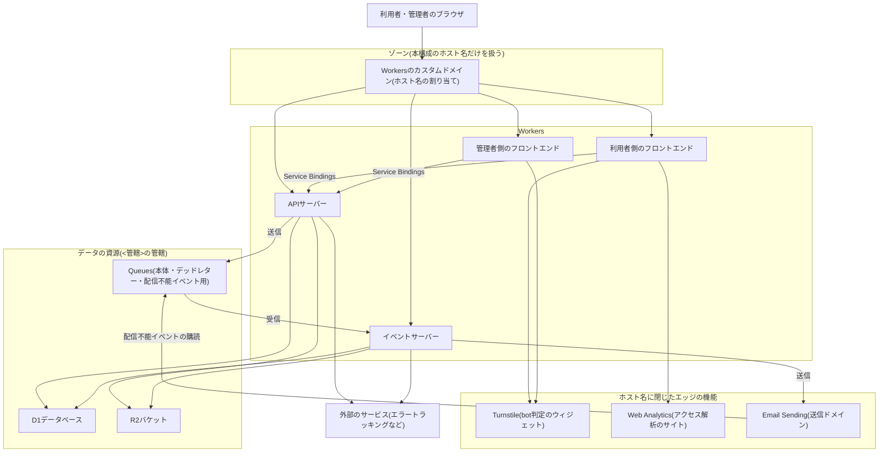
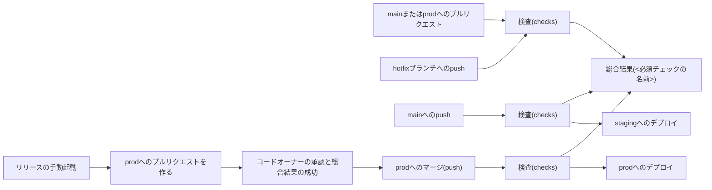
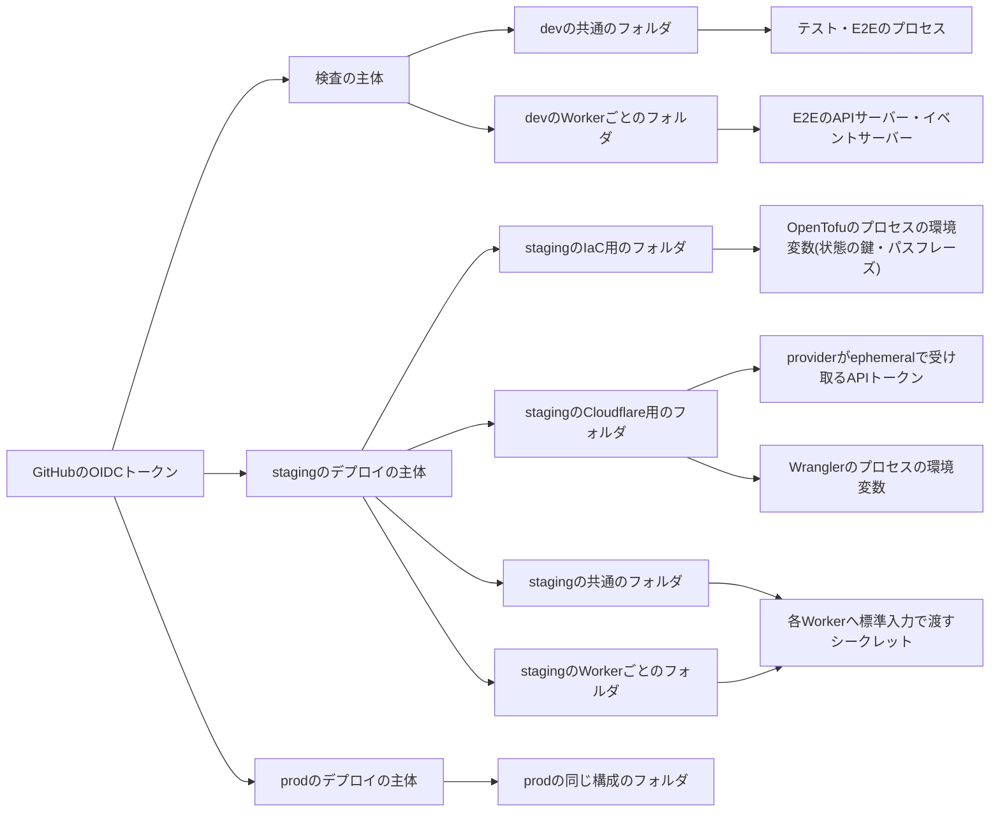

# インフラの構成

Cloudflare上で4つのWorkerとデータの資源を動かす構成の全体像と、検査・デプロイ・リリースの流れ、及びシークレットの流れを図で示す。あわせて、IaC定義で管理する範囲(ゾーン全体の設定を持たない方針)を定める。

## 前提と用語

APIサーバー・メッセージを受信するアプリ(イベントサーバー)・利用者側のフロントエンド・管理者側のフロントエンドの4つのWorkerを、1つのCloudflareのアカウントと1つのゾーンで動かす構成を前提とする。資源はOpenTofuで、WorkerはWranglerで、シークレットはInfisicalで、検査とデプロイはGitHub Actionsで扱う。

| 用語                 | 意味                                                                                                                                                                               |
| -------------------- | ---------------------------------------------------------------------------------------------------------------------------------------------------------------------------------- |
| デプロイ先の環境     | `staging`・`prod`。「[デプロイ先の環境種別](002-environments.md#デプロイ先の環境種別)」に従う。2つの環境は同じアカウントと同じゾーンを使い、資源の名前の接尾辞とホスト名で区別する |
| IaC定義              | デプロイ先の環境の資源を定義するOpenTofuの定義。`<IaCのディレクトリ>`に置く。構成は「[IaC定義の構成](006-iac-with-opentofu.md)」に従う                                             |
| 資源一覧             | デプロイ先の環境ごとの資源の名前・識別子・管轄・ホスト名をまとめたJSON。IaC定義と構成検査が共有する                                                                                |
| 状態                 | IaC定義が管理する資源と実体との対応の記録(OpenTofuのstate)。秘密値を含むため暗号化して保管する                                                                                     |
| 管轄                 | データの保存と処理の場所をCloudflareが保証する設定(`jurisdiction`)。作成後は変更できない                                                                                           |
| 検査パイプライン     | プルリクエストとpushで整形・静的解析・テスト・予行を行うワークフローの組。構成は「[検査とデプロイのパイプライン](007-ci-cd-pipelines.md)」に従う                                   |
| デプロイパイプライン | mainへのpushで`staging`へ、prodへのpushで`prod`へデプロイするワークフローの組                                                                                                      |
| 主体                 | Infisicalに認証する機械の利用者(マシンアイデンティティ)。検査・`staging`のデプロイ・`prod`のデプロイで別々の主体を使う                                                             |
| `<配布のスクリプト>` | 検査とデプロイの手順を実行するTypeScriptのコマンド群を置くディレクトリ。ワークフローは`bun <配布のスクリプト>/cli.ts <サブコマンド>`を順に呼ぶ                                     |

## 構成図

- 4つのWorkerはすべてカスタムドメインで公開し、`workers.dev`のサブドメインとプレビュー用のURLを無効にする。Wrangler設定に`routes`を書かず、ホスト名の割り当てはIaC定義が行う。
- フロントエンドからAPIサーバーへは、公開のホスト名を経由せずService Bindingsで呼ぶ。
- 1つのWorkerに複数のホスト名を割り当ててもよい。資源一覧のホスト名の項目が、ホスト名と割り当てるWorkerの対応を持つ。
- 定期実行・メッセージの受信・Durable Objectsは、Workerの設定としてWranglerがデプロイする。IaC定義は扱わない。

### 資源と管理の手段

| 資源                                                | 作る手段                           | 管轄                        | 環境ごとの数                      |
| --------------------------------------------------- | ---------------------------------- | --------------------------- | --------------------------------- |
| D1データベース                                      | IaC定義                            | `<管轄>`                    | 資源一覧の項目の数                |
| R2バケット                                          | IaC定義                            | `<管轄>`                    | 資源一覧の項目の数                |
| Queues                                              | IaC定義                            | `<管轄>`                    | 資源一覧の項目の数                |
| Turnstileのウィジェット                             | IaC定義                            | なし(指定できない)          | 1つ(利用者側と管理者側のホスト名) |
| Web Analyticsのサイト                               | IaC定義                            | なし(指定できない)          | 1つ(利用者側のホスト名)           |
| Email Sendingの送信ドメイン                         | IaC定義                            | なし(指定できない)          | 1つ                               |
| Workersのカスタムドメイン                           | IaC定義(Workerのデプロイの後)      | なし                        | 資源一覧のホスト名の数            |
| 配信不能イベントの購読                              | デプロイパイプライン(無ければ作る) | なし                        | 1つ                               |
| Worker・定期実行・メッセージの受信・Durable Objects | Wrangler(デプロイパイプライン)     | Durable Objectsは指定しない | アプリの数                        |
| 状態の保管先のR2バケット                            | 開発者の手作業                     | なし                        | 1つ                               |

- データの資源の管轄は、作成後に変えられない。管轄の注意は「[管轄の注意](006-iac-with-opentofu.md#管轄の注意)」に従う。
- 配信不能イベントの購読はOpenTofuのproviderに資源が無いため、デプロイパイプラインが毎回有無を確かめる(「[配信不能イベントの購読](007-ci-cd-pipelines.md#配信不能イベントの購読)」)。
- 状態の保管先は、IaC定義が自分の状態を置く場所であるため、IaC定義の外で作る(「[状態の保管と暗号化](006-iac-with-opentofu.md#状態の保管と暗号化)」)。

## 管理する範囲

IaC定義は、本構成のホスト名に閉じた資源だけを管理する。ゾーン全体に効く設定は定義しない。

- 管理するもの: データの資源(D1・R2・Queues)、ホスト名の割り当て、送信ドメイン(送信用のDNSレコードはEmail Serviceが作る)、bot判定のウィジェット、アクセス解析のサイト。
- 管理しないもの: ゾーン全体に効くWAFのカスタムルール・レート制限ルール・ゾーンの設定(SSL/TLSのモード、キャッシュの規則など)・ルールセット。
  - 同じゾーンを他のアプリやサイトと共有する場合、ゾーン全体のルールを1つの構成の状態で管理すると、他の利用者の変更と衝突し、適用のたびに戻し合う。
  - ゾーン全体の防御は、Cloudflareが無償で提供するマネージドルールセットに任せる。
  - IP単位のレート制限とbot判定は、アプリの中で行う(「[レート制限とbot判定の検証](../backend/003-rate-limiting-and-bot-verification.md)」)。
- 資源一覧のホスト名と送信ドメインは、すべてゾーン名で終わる。資源一覧の解析が確かめる(「[資源一覧の項目](006-iac-with-opentofu.md#資源一覧の項目)」)。

## CI/CDの流れ

- 検査はプルリクエストとpushの両方で同じ再利用ワークフローを呼び、1つの総合結果`<必須チェックの名前>`を報告する。ブランチ保護はこの1つを必須にする。
- mainへのpushは`staging`へ、prodへのpushは`prod`へ、検査が成功した後に同じ手順でデプロイする。段階と順序は「[デプロイの段階](007-ci-cd-pipelines.md#デプロイの段階)」に従う。
- prodへの変更は、リリースのワークフローが作るプルリクエストを開発者が承認してマージする。手順は「[デプロイ手順](../operations/001-deployment.md)」に従う。
- デプロイが失敗しても、自動では前の版へ戻さない。戻す手順は「[ロールバックと復旧](../operations/002-rollback-and-recovery.md)」に従う。

## シークレットの流れ

- CIはInfisicalへ、実行ごとに発行されるOIDCトークンで主体として認証する。GitHubのSecretsとVariablesにInfisicalやCloudflareの長期の認証情報を置かない。
- 図の矢印は、各コマンドが取り出す範囲を表す。Infisicalの料金プランが環境ごとの権限を持たない場合、どの主体も権限の上では全環境を読める。主体の縛りとこのリスクの緩和策は「[CIのシークレットとリポジトリ保護](../security/003-ci-secrets-and-repository-protection.md)」に従う。
- 取り出した値は、使う前にマスクし、必要な子プロセスの環境変数か標準入力にだけ渡す。ログ・成果物・リポジトリのファイル・状態の平文に残さない(「[ログの規則](007-ci-cd-pipelines.md#ログの規則)」)。
- Infisicalのフォルダの構成は次のとおりにする。

| フォルダ            | 中身                                                                                                            | 使う手順                                                  |
| ------------------- | --------------------------------------------------------------------------------------------------------------- | --------------------------------------------------------- |
| `/`(共通のフォルダ) | Workerが宣言したシークレットの値                                                                                | テスト・E2E(dev)、Workerのデプロイ(staging・prod)         |
| `/workers/<Worker>` | 同じキー名でWorkerごとに異なる値が要るシークレット。共通のフォルダの値より優先される                            | ローカルとE2Eの起動(dev)、Workerのデプロイ(staging・prod) |
| `/ci/tofu`          | 状態の保管先の鍵(`AWS_ACCESS_KEY_ID`・`AWS_SECRET_ACCESS_KEY`)と暗号化のパスフレーズ(`TF_VAR_state_passphrase`) | OpenTofu(staging・prod)                                   |
| `/ci/cloudflare`    | CloudflareのAPIトークン(`CLOUDFLARE_API_TOKEN`)                                                                 | OpenTofuのprovider・Wrangler(staging・prod)               |

- `/workers/<Worker>`を持つのは、同じキー名で権限の異なる値を渡すWorker(APIサーバーとイベントサーバー)だけである。Workerごとに分けると定めたキーは、共通のフォルダに置いても使われない。規則は「[Workerのシークレットの選別](007-ci-cd-pipelines.md#workerのシークレットの選別)」に従う。
- 各フォルダへ値を登録する時期と手順は「[デプロイ手順](../operations/001-deployment.md)」に従う。
