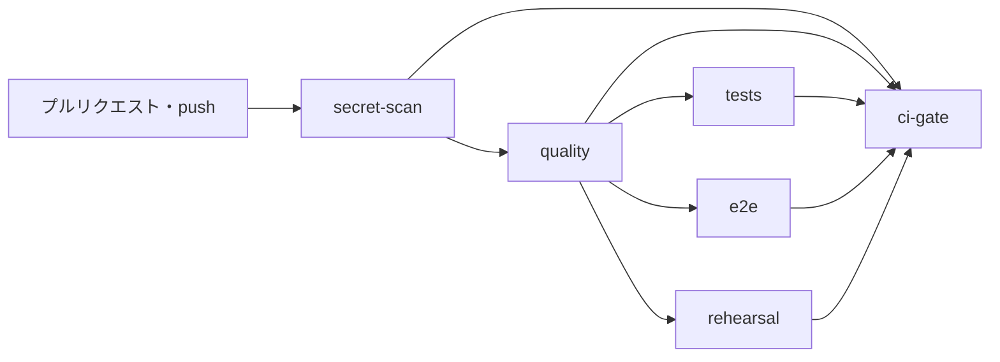
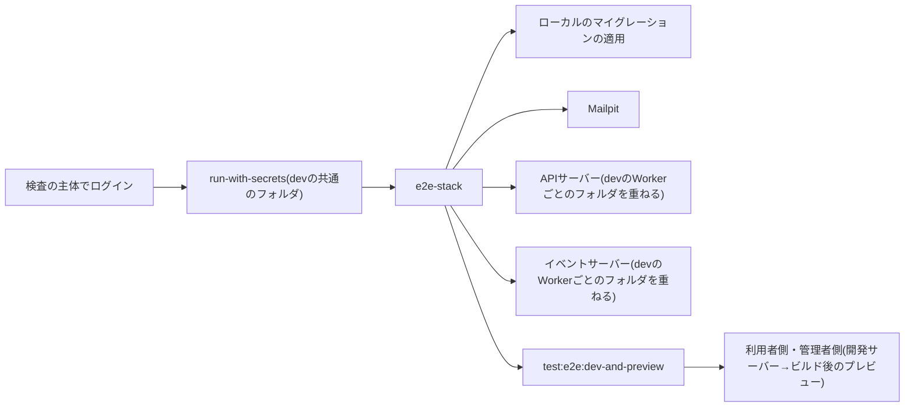

# 検査とデプロイのパイプライン

GitHub Actionsで検査・デプロイ・リリースを行うときの、ワークフローとジョブの構成、検査の順序と各段階、E2Eの実行環境、予行、デプロイの段階、直列化、ログに値を出さない規則、ツールの版の固定と同期、及びデータベースのマイグレーションとコードの変更を分ける前提(Expand/Contract)を定める。

## 前提と用語

全体の構成は「[インフラの構成](005-infrastructure-overview.md)」に、IaC定義は「[IaC定義の構成](006-iac-with-opentofu.md)」に従う。ワークフローのYAMLはコマンドを順に呼ぶだけにし、判定と手順は`<配布のスクリプト>`のTypeScriptのコマンドに置く。

| 用語                       | 意味                                                                                                                                               |
| -------------------------- | -------------------------------------------------------------------------------------------------------------------------------------------------- |
| `<配布のスクリプト>`       | 検査とデプロイの手順のコマンド群を置くディレクトリ。`bun <配布のスクリプト>/cli.ts <サブコマンド>`で実行し、`--help`でサブコマンドの一覧を表示する |
| 総合結果                   | 検査の全ジョブの成否をまとめた1つの結果`checks / ci-gate`。ブランチ保護はこの1つだけを必須にする                                                   |
| 段階                       | デプロイのジョブのうち、`id`を持つ手順。順序は`<配布のスクリプト>/core/deploy-stages.ts`の`DEPLOY_STAGES`で定める                                  |
| 予行                       | 資源を作らず秘密値を使わずに、IaC定義とWorkerのビルドの正しさを確かめること                                                                        |
| 版のタグ                   | Workerの版に付ける、デプロイしたコミットのSHA(40桁の16進)                                                                                          |
| 直前のリリース             | その環境で現在稼働している利用者側のフロントエンドの版のコミット                                                                                   |
| 検査の主体・デプロイの主体 | Infisicalの機械の主体。検査はdevの値を、デプロイはその環境の値を取り出す                                                                           |

## ワークフローの構成

| ワークフロー       | 起動                                                    | ジョブ                                                                                  |
| ------------------ | ------------------------------------------------------- | --------------------------------------------------------------------------------------- |
| `checks.yml`       | 再利用(`workflow_call`)                                 | `secret-scan`→`quality`→`tests`・`e2e`・`rehearsal`(並列)→`ci-gate`                     |
| `deploy.yml`       | 再利用(`workflow_call`、入力`environment`)              | `deploy`(段階を`DEPLOY_STAGES`の順に実行)                                               |
| `pull-request.yml` | main・prodへのプルリクエスト、`hotfix/**`へのpush       | `checks`(`checks.yml`を呼ぶ)                                                            |
| `delivery.yml`     | main・prodへのpush                                      | `checks`→`deploy`(`deploy.yml`を呼ぶ。prodへのpushは`prod`、mainへのpushは`staging`)    |
| `release-pr.yml`   | 手動の起動(`workflow_dispatch`、入力`head`。既定はmain) | `release-pr`(mainか`hotfix/<名前>`からprodへのプルリクエストを自動化の主体の名義で作る) |

- 準備の手順は複合アクション`.github/actions/setup-toolchain`にまとめる。Bunは常に、Node.js・OpenTofu・Infisical CLI・購読の操作用のWrangler・Mailpitは入力で選んで導入する。
- 全ワークフローの最上位の`permissions`は`contents: read`にし、必要なジョブにだけ権限を足す。

| 権限                   | 与えるジョブ                                                   | 理由                           |
| ---------------------- | -------------------------------------------------------------- | ------------------------------ |
| `id-token: write`      | 検査の`tests`・`e2e`、デプロイの`deploy`と、それらを呼ぶジョブ | InfisicalへのOIDCの認証        |
| `pull-requests: write` | `release-pr`だけ                                               | リリースのプルリクエストの作成 |

- 予行の`rehearsal`は、呼び出し側が`id-token: write`を与えても、ジョブの`permissions`で`contents: read`だけに絞る。
- 自動化の主体が作ったプルリクエストは、新しいワークフローを起動しない。リリースのプルリクエストの必須チェックは、同じheadのコミットへのpush(mainへのマージ、`hotfix/**`へのpush)の検査結果で満たす。
- リリース・承認・hotfixの運用は「[デプロイ手順](../operations/001-deployment.md)」に従う。

## 検査の順序



| ジョブ        | 手順                                                                                                                                                                                                                                         |
| ------------- | -------------------------------------------------------------------------------------------------------------------------------------------------------------------------------------------------------------------------------------------- |
| `secret-scan` | 変更履歴のシークレットの検出                                                                                                                                                                                                                 |
| `quality`     | 依存パッケージの導入(`install`)→既知の脆弱性の確認(`audit`)→共有ディレクトリの配置→一括検査(`check`)→アプリごとの生成物と設定の検査(`app-checks`)→構成検査(`contract-check`)→ワークフローの検査(`policy-check`)→IaC定義の検査(`infra:check`) |
| `tests`       | 導入→Chromiumの導入→配置→検査の主体でのログイン→単体・ブラウザ・Workers統合テスト(カバレッジ付き)→カバレッジの合算                                                                                                                           |
| `e2e`         | 導入→Chromiumの導入→配置→検査の主体でのログイン→E2Eの実行環境の起動とE2E                                                                                                                                                                     |
| `rehearsal`   | 導入→配置→`staging`の予行→`prod`の予行                                                                                                                                                                                                       |
| `ci-gate`     | `if: always()`で全ジョブを`needs`に持ち、すべての結果が`success`でなければ失敗する                                                                                                                                                           |

- 各ジョブは最初に失敗した手順で止まり、後続のジョブは実行されない。実行されなかったジョブ(`skipped`)も、`ci-gate`では失敗として扱う。
- 依存パッケージの導入は、ルート・各アプリ・共有ディレクトリの配置元のうち`package.json`を持つものすべてで、ロックファイルのとおりに行う(`CI=true bun install --frozen-lockfile`)。新しいcloneから、導入→共有ディレクトリの配置→一括検査→テストの順を守る(「[CIでのコピー配置](../coding/003-shared-directories.md#ciでのコピー配置)」)。
- 既知の脆弱性の確認は、導入の対象ごとに`bun audit --audit-level=high`を実行する。除外は`<配布のスクリプト>/core/audit-exceptions.ts`に、識別子(GHSAか数字)・理由・見直し期限(`YYYY-MM-DD`)の組で書く。見直し期限を過ぎた除外、理由の無い除外、重複した除外があれば失敗する。
- 一括検査が型の鮮度とGraphQLの生成物を全アプリで確かめるため、`app-checks`はそれ以外(マイグレーションの検出、依存性の注入のスモークテストなど)だけを実行する。アプリはあるが登録したスクリプトが無ければ失敗する。
- IaC定義の検査は、資源を作らずに整形・妥当性・計画のテストを確かめる(「[テスト](006-iac-with-opentofu.md#テスト)」)。
- フォークからのプルリクエストには、OIDCのトークンもシークレットも渡らない。`tests`・`e2e`のログインが失敗し、総合結果は失敗する。

### シークレットの検出

- TruffleHogの公式のアクションで、検査の対象の変更履歴を検出する。チェックアウトは`fetch-depth: 0`にする。
  - プルリクエストはbaseからheadまで、pushはbeforeからafterまでを対象にする。新しいブランチのpushでbeforeが全桁0のときと、強制pushでbeforeが履歴に無いときは、mainとの分岐点からheadまでを対象にする。範囲の両端が同じ(新しいコミットが無い)ときは検出を飛ばす。
  - コミット時の検査を経ていないコミット(フックを飛ばしたコミット、ウェブの画面での編集)も、この検出で見つかる。
- `--results=verified,unknown`で、検証済み(実際に使える)と未確定(検証できなかった)の検出だけで失敗させる。無効と確かめた値では失敗させない。
- 誤検知の除外は、`.github/trufflehog-exclude-paths.txt`に1行1つのパスの正規表現で書き、直前の行のコメントに理由を書く。コミット時の検出器の除外(「[誤検知の登録](../security/001-secret-management.md#誤検知の登録)」)とは別に管理する。

```text
# テストの偽のトークンを含むフィクスチャ
^test-fixtures/fake-tokens\.json$
```

### ワークフローの規則

ワークフローの検査(`policy-check`)は、全ワークフローと複合アクションに次の規則を掛け、違反を表で表示して失敗する。

| 規則 | 確かめること                                                                                                                                            |
| ---- | ------------------------------------------------------------------------------------------------------------------------------------------------------- |
| W1   | 外部のアクションの`uses`が40桁のコミットSHAで固定されている(ローカルの`./`は除く。`docker://`はダイジェストで固定しても違反)                            |
| W2   | ワークフローの最上位の`permissions`が`contents: read`以下である                                                                                         |
| W3   | `id-token: write`を、決めたジョブ(検査の`tests`・`e2e`、デプロイの`deploy`と、それらを呼ぶジョブ)にだけ与えている                                       |
| W4   | `pull-requests: write`をリリースのジョブにだけ与え、`contents`・`actions`の書き込みをどのジョブにも与えていない                                         |
| W5   | `pull_request_target`・`workflow_run`で起動せず、チェックアウトに`persist-credentials: false`を付けている                                               |
| W6   | `run`の中で`${{ inputs.* }}`・`${{ github.event.* }}`・`${{ github.head_ref }}`を直接展開していない(環境変数を経由する)                                 |
| W7   | デプロイのジョブが`environment: ${{ inputs.environment }}`と`concurrency`(`group: deploy-${{ inputs.environment }}`・`cancel-in-progress: false`)を持つ |
| W8   | デプロイのジョブの`id`を持つ手順の並びが`DEPLOY_STAGES`と完全に一致する                                                                                 |
| W9   | ワークフローと複合アクションのツールの版が、開発コンテナのイメージ定義と一致し、複合アクションが導入する全ツールの版を宣言している                      |
| W10  | `ci-gate`が`if: always()`で、同じワークフローの他の全ジョブを`needs`に持つ                                                                              |

- W1〜W10が見ないファイル(起動用のワークフロー・CODEOWNERS・複合アクション・TruffleHogの除外)の存在と、IaC定義の`prevent_destroy`などのHCLの記述は、リポジトリの単体テストが確かめる。

### テストとカバレッジの合算

- 単体・ブラウザ・Workers統合テストを、検査の主体で取り出したdevの値の下で、カバレッジの計測付きで実行する。`staging`・`prod`の値は使わない。閾値は「[カバレッジ](../testing/001-test-strategy.md#カバレッジ)」に従い、いずれかの未達で失敗する。
- `coverage-merge`が、ルートと各アプリの`coverage/{unit,browser,worker}/lcov.info`を読み、`SF:`の行にアプリのディレクトリを前置して`coverage/merged/lcov.info`へ合算する。無い種別は飛ばす。合算したファイルは成果物`coverage-lcov`として保存する。

## E2Eの実行環境

CIのランナーの中で、APIサーバー・イベントサーバー・開発用のメール受信箱をローカルの設定で起動し、利用者側・管理者側を開発サーバーとビルド後のプレビューの両方で起動してE2Eを実行する。



- アプリのスクリプトと設定は、ローカル状態の保存先などを開発コンテナの絶対パスで指す。E2Eのジョブでは、ランナーのワークスペースを指すシンボリックリンクを同じパスに置く。
- Node.js(Wranglerの実行に使う。「[Wranglerを動かす実行環境](001-wrangler-conventions.md#wranglerを動かす実行環境)」)と、Mailpitを導入する。Chromiumは、依存パッケージの導入の後に、ルートの`@playwright/test`で`bunx playwright install --with-deps chromium`を実行して導入する。リビジョンをルートの`@playwright/test`の版に合わせるためである。
- `e2e-stack -- <コマンド>`は、ローカルのマイグレーションを適用し、Mailpit・APIサーバー・イベントサーバーを起動して応答を待ち、`--`の後のコマンドを実行してから止める。
  - APIサーバーとイベントサーバーは`run-with-secrets --scope checks --worker <アプリ>`を通して`wrangler dev --persist-to <ローカル状態の保存先>`で起動し、devの共通のフォルダにそのWorkerのフォルダの値を重ねて渡す。値はそのWorkerの子プロセスにだけ渡り、テストのコマンドには渡らない。
  - 各サービスの応答を3分まで待つ。起動しないサービスがあれば、その名前とログの末尾50行を表示して失敗する。各サービスの出力は`$RUNNER_TEMP/e2e-logs/<名前>.log`へ書く。
  - 終了時は、各サービスのプロセスグループへ`SIGTERM`を送り、猶予の後に`SIGKILL`を送る。孫のプロセス(workerd)まで止めるためである。
- 利用者側・管理者側は、`e2e-stack`へ渡すコマンド`bun run test:e2e:dev-and-preview`が起動する(「[開発サーバーとビルド後のプレビューの両方での実行](../testing/001-test-strategy.md#開発サーバーとビルド後のプレビューの両方での実行)」)。このコマンドは`run-with-secrets`の共通のフォルダの値を引き継ぐ。
- 失敗したときは、Playwrightの報告・テストの結果・各サービスのログを成果物にする。

## 予行

- `rehearse --env <環境種別>`で、`staging`・`prod`の各Workerを、資源を作らないデプロイのdry-runで確かめる。
  - `wrangler deploy`で直接デプロイするアプリは、`wrangler deploy --dry-run --env <環境種別> --outdir <一時ディレクトリ>`を実行する。
  - `@cloudflare/vite-plugin`でビルドするアプリは、`CLOUDFLARE_ENV=<環境種別> bun run build`の後に、`--env`を付けずに`wrangler deploy --dry-run --outdir <一時ディレクトリ>`を実行する。ビルド結果のWrangler設定が環境を決めるためである(「[デプロイ先の環境のビルド時の指定](../frontend/002-tanstack-start-on-workers.md#デプロイ先の環境のビルド時の指定)」)。
- 予行はInfisicalにログインせず、秘密値を使わない。子プロセスはジョブの環境を引き継ぐため、予行のジョブには秘密値の環境変数を置かない。
- IaC定義の計画は、モックのproviderによる計画のテストで両環境を確かめる(`quality`の`infra:check`)。

## デプロイの段階

デプロイのジョブは、全履歴のチェックアウトと準備(Bun・Node.js・OpenTofu・Infisical CLI・購読用のWrangler)・依存パッケージの導入・共有ディレクトリの配置の後に、次の段階を順に実行する。Chromiumは、スモークテストを実行する`staging`でだけ導入する。

| 段階                 | 処理                                                                                                                                               | 使う値                                       |
| -------------------- | -------------------------------------------------------------------------------------------------------------------------------------------------- | -------------------------------------------- |
| `preflight`          | 実行中のブランチが資源一覧の`github.branch`と一致すること、資源一覧の解析と構成検査、Infisicalの識別子とアカウントID・ゾーンIDが仮の値でないこと   | なし                                         |
| (ログイン)           | その環境のデプロイの主体でOIDCによりInfisicalへログインし、アクセストークンを後続の手順へ渡す。段階ではないため`id`を持たない                      | OIDCのトークン                               |
| `tofu-foundation`    | ホスト名の割り当て以外の資源の計画・要約・適用(「[2段階の適用](006-iac-with-opentofu.md#2段階の適用)」)                                            | `/ci/tofu`・`/ci/cloudflare`(providerが取得) |
| `reconcile-ids`      | IaC定義の出力`resource_ids`とWrangler設定の識別子の照合                                                                                            | `/ci/tofu`                                   |
| `migrate`            | APIサーバーのアプリから、資源一覧のD1へリモートのマイグレーションを適用(`wrangler d1 migrations apply <データベース名> --env <環境種別> --remote`) | `/ci/cloudflare`                             |
| `deploy-api`         | 直前のリリースを含めた許可リストの生成と、APIサーバーのデプロイ                                                                                    | `/ci/cloudflare`・`/`・Workerごとのフォルダ  |
| `deploy-event`       | イベントサーバーのデプロイ                                                                                                                         | 同上                                         |
| `deploy-client`      | 環境を指定したビルドと、利用者側のフロントエンドのデプロイ                                                                                         | `/ci/cloudflare`・`/`                        |
| `deploy-admin`       | 環境を指定したビルドと、管理者側のフロントエンドのデプロイ                                                                                         | `/ci/cloudflare`・`/`                        |
| `tofu-routing`       | ホスト名の割り当てを含む全資源の計画・要約・適用                                                                                                   | `/ci/tofu`・`/ci/cloudflare`(providerが取得) |
| `email-subscription` | 配信不能イベントの購読の確認と作成                                                                                                                 | `/ci/cloudflare`                             |
| `verify`             | 公開のホスト名での動作の確認                                                                                                                       | なし                                         |

- いずれかの段階が失敗すると、ジョブは後続の段階を実行せずに止まる。自動では前の版へ戻さない。戻す手順は「[ロールバックと復旧](../operations/002-rollback-and-recovery.md)」に従う。
- `preflight`は秘密値を使わないため、ログインより前に実行する。主体のIDが仮の値でも、ログインの失敗より先に仮の値の記入先(資源一覧、アカウントIDは状態の保管先の部分設定の接続先も)をまとめて表示する。`prod`では、本番環境の準備が必要であることも表示する。
- `reconcile-ids`は、Wrangler設定の識別子(D1を使うWorkerの`database_id`、bot判定のサイトキーの変数、アクセス解析のトークンの変数)が仮の値のまま、または出力と食い違うと、ファイル・項目・現在の値・反映すべき値の表を表示して、Workerのデプロイより前に失敗する。最初のデプロイは資源を作った後にここで止まる。開発者が表示された値をWrangler設定へ反映してマージすると、次の実行で先へ進む。
- 各段階は、計画の要約・照合の結果・デプロイした版と起動時間・確認の結果を手順の要約(`GITHUB_STEP_SUMMARY`)に書く。
- 段階の順序を変えるときは、`DEPLOY_STAGES`と`deploy.yml`の手順を同じ変更で改める。ワークフローの検査(規則W8)が一致を確かめる。

### Workerのシークレットの選別

`deploy-worker --env <環境種別> --app <アプリ>`は、1つのWorkerを、宣言したシークレットと版のタグ付きでデプロイする。

1. アプリのWrangler設定の`env.<環境種別>.secrets.required`(必須のシークレット)と、`<配布のスクリプト>/core/worker-secrets.ts`の`OPTIONAL_WORKER_SECRETS`のそのWorkerの項目(任意のシークレット)を、渡すキーにする。
2. Infisicalのその環境の`/ci/cloudflare`・`/`と、Workerごとのフォルダを持つWorkerはそのフォルダ(`/workers/<Worker>`)を取り出し、最初の子プロセスを起動する前にすべての値をマスクする。
3. Workerごとのフォルダの値を、同じキーの共通のフォルダの値より優先する。`<配布のスクリプト>/core/secret-scope.ts`の`WORKER_SCOPED_SECRETS`のキーは、共通のフォルダの値を使わない。必須のキーが欠けていれば、キーの名前だけを表示して失敗する。任意のキーは、値がある場合だけ渡す。
4. アプリのディレクトリで、シークレットのJSONを標準入力で渡してデプロイする。

```sh
bunx wrangler deploy --env <環境種別> --tag <コミットのSHA> --message "<コミットのSHA> <ワークフローの実行のURL>" --secrets-file /dev/stdin
```

- `@cloudflare/vite-plugin`でビルドするアプリは、`CLOUDFLARE_ENV=<環境種別> bun run build`の後に`--env`を付けずにデプロイする。
- `--secrets-file`に無いシークレットは、Workerの前の版から引き継がれる。Workerから消したシークレットは、デプロイでは消えない(「[デプロイ手順](../operations/001-deployment.md)」)。
- デプロイの出力から版のIDと起動時間を読み、手順の要約に書く。読めない場合は警告を出して成功にする。
- 同じ規則(Workerごとのフォルダの優先と`WORKER_SCOPED_SECRETS`)を、E2Eの起動(`e2e-stack`)とローカルの起動(`run-with-secrets --scope local --worker <アプリ>`)にも使う。

### Durable Objectのマイグレーション

- Wrangler設定の`migrations`(Durable Objectのクラスの追加・名前の変更・削除)は、`wrangler deploy`が同じ版で適用する。Durable Objectを加える変更は、mainへのマージで`staging`へ、リリースで`prod`へ適用され、開発者の手作業は要らない。
- クラスの名前の変更・削除は、適用した後に前の版へ戻せなくなる。ロールバックの制約は「[ロールバックと復旧](../operations/002-rollback-and-recovery.md)」に従う。

### 直前のリリース

APIサーバーをデプロイする前に、その環境で稼働している利用者側のフロントエンドの版のコミットを特定し、そのコミットの操作も許可する許可リストを生成する。新しいAPIサーバーへの切り替えの間も、古いフロントエンドが送る操作を受け付けるためである。

1. 利用者側のフロントエンドのアプリのディレクトリで`bunx wrangler deployments status --name <Worker名> --json`を実行し、配信の割合が100%の版が1つだけであることを確かめる。
2. `bunx wrangler versions view <版のID> --name <Worker名> --json`の`annotations["workers/tag"]`を読み、40桁の16進であることを確かめる。
3. `git cat-file -e <コミット>^{commit}`で、チェックアウトした履歴にそのコミットがあることを確かめる。デプロイのジョブは全履歴(`fetch-depth: 0`)を取り出す。
4. 許可リストの生成のコマンドへ`--previous-ref <コミット>`を渡して生成し、デプロイする。

- いずれかで特定できない(最初のデプロイ・分割配信の途中・タグの無い版・履歴に無いコミット)ときは、警告を標準エラー出力と手順の要約に出し、現行の操作だけで許可リストを生成して続ける。
- 利用者側のフロントエンドのビルドは、そのアプリのディレクトリにビルド結果の転送先の設定(`.wrangler/deploy/config.json`)を残し、Wranglerがその案内を標準出力へ出してJSONの解析を妨げる。そのため、APIサーバーは利用者側のフロントエンドより先にデプロイする。
- 許可リストの生成の仕組みは「[GraphQL通信](../coding/004-graphql-communication.md)」に従う。

### 配信不能イベントの購読

`ensure-email-subscription --env <環境種別>`は、送信ドメインの配信不能イベント(バウンス・苦情・拒否・失敗)を資源一覧の配信不能イベント用のQueueへ届ける購読を確かめる。

- `wrangler queues subscription list <Queueの名前> --json`の結果を、資源一覧の送信ドメイン・イベントの種類・購読の名前と比べる。
  - 無ければ作る。

```sh
wrangler queues subscription create <Queueの名前> --source email.sending --events message.bounced,message.complained,message.rejected,message.failed --zone-id <ゾーンID> --domain <送信ドメイン> --name <購読の名前>
```

- 同じ内容の購読があれば何もしない。名前・イベントの種類・ドメインが違う、同じQueueへの購読が複数ある、無効の購読がある場合は、差分を表示して失敗する。作り直すかは開発者が判断する。
- 購読の操作は、アプリが固定するWranglerでなく、開発コンテナのイメージ定義と同じ版のWrangler(購読用のWrangler)で行う。アプリのWranglerはテストのプールと組み合わせられる版に固定されており、購読のオプションへの対応を保証しないためである。`PATH`の`wrangler`の版がイメージ定義と違えば、シークレットを取り出す前に失敗する。
- 購読はOpenTofuのproviderに資源が無いため、IaC定義の外で毎回確かめる。

### デプロイ後の確認

`verify --env <環境種別>`は、公開のホスト名で動作を確かめる。カスタムドメインの最初の証明書の発行を待つため、各応答を10分まで待つ。

| 環境      | 確認                                                                                                                                                                      |
| --------- | ------------------------------------------------------------------------------------------------------------------------------------------------------------------------- |
| `staging` | APIサーバーの`<ヘルスチェックの経路>`が200になるのを待ってから、E2Eの対象のURLの環境変数に`staging`のhttpsのURLを渡し、ルートで`bun run test:e2e --grep @smoke`を実行する |
| `prod`    | APIサーバーとイベントサーバーの`<ヘルスチェックの経路>`、利用者側のフロントエンドの`/`が200を返すことを並行に確かめる                                                     |

- 失敗したら、対象と最後に受け取った状態コードを表示して失敗する。自動では戻さない。
- `@smoke`タグは、`staging`のhttpsに対して実行できるE2Eだけに付ける。ローカル専用の前提(メールの受信箱、ローカルのD1への直接の投入など)を持つテストには付けない。タグの規約は「[デプロイ後のスモークテスト](../testing/001-test-strategy.md#デプロイ後のスモークテスト)」に従う。
- E2Eの実行は`--pass-with-no-tests`を伴うため、`@smoke`のテストが0件でも成功する。`@smoke`のタグを持つテストを無くさない。

## 直列化

| ワークフロー       | `concurrency`                                                                            | 効果                                                                                                                                  |
| ------------------ | ---------------------------------------------------------------------------------------- | ------------------------------------------------------------------------------------------------------------------------------------- |
| `delivery.yml`     | 最上位に`group: delivery-${{ github.ref_name }}`・`cancel-in-progress: false`            | 同じブランチの検査とデプロイを到着順に直列にする。古いコミットの検査が後に終わり、古い版とIaC定義が新しい版の後に適用されることを防ぐ |
| `deploy.yml`       | デプロイのジョブに`group: deploy-${{ inputs.environment }}`・`cancel-in-progress: false` | 同じ環境へのデプロイを直列にし、実行中のデプロイを止めない                                                                            |
| `pull-request.yml` | 最上位に`group: pr-${{ github.ref }}`・`cancel-in-progress: true`                        | 同じプルリクエストの古い検査を取り消す                                                                                                |

- GitHubの`concurrency`の待機は1件だけである。待機中の実行は、同じグループの新しい実行が来ると取り消される。そのため、mainへ続けてマージすると、最新のコミットだけが待機に残って反映される。
- 状態の更新は、OpenTofuのロック(「[保管先](006-iac-with-opentofu.md#保管先)」)でも排他される。

## ログの規則

CIのログ・成果物・手順の要約に、秘密値を出さない。

- Infisicalから取り出した値は、使う前に`::add-mask::`でマスクする。マスクは1行ずつしか効かないため、複数行の値は行ごとにマスクし、空白だけの行はマスクしない。ワークフローのコマンドへ渡す値は`%`・`\r`・`\n`をエスケープする。
- 取り出した値は、必要な子プロセスの環境変数か標準入力にだけ渡す。ファイルへ書き出さない。Workerのシークレットは`--secrets-file /dev/stdin`で渡す。
- 値を含み得る出力は、取り込むだけで表示しない。
  - `infisical export`の出力。取り出しに失敗したときは、出力を表示せず、環境・フォルダの名前・終了コードだけを示す。
  - `tofu show -json`の計画と`tofu output -json`。計画は資源のアドレスと操作の種類(作成・更新・作り直し・削除)に要約して表示する。
- `tofu apply`の出力は、資源の行と`Apply complete!`の行だけを表示する。計画・適用が失敗したときだけ、OpenTofuが標準エラー出力へ出す誤りの診断を表示する。診断は`sensitive`な値を伏せるが、`sensitive`でない属性の値は引用し得る。警告は標準出力に出るため表示しない。
- `wrangler deploy`の出力は表示する。バインディングの名前と変数の値だけで、シークレットの値を含まない。
- Infisicalのアクセストークンは、マスクしてから`GITHUB_ENV`の`INFISICAL_TOKEN`で同じジョブの後続の手順へ渡す。後続の手順は、本リポジトリのコマンドとコミットSHAで固定したアクションだけにする。
- 秘密値の解析に失敗したときの誤りの文は、入力の一部を引用し得るため、入力の中身を含めない。

## 版の固定と同期

| 対象                                                             | 固定の方法                                                                                                                                                        | 正とする場所                                                       |
| ---------------------------------------------------------------- | ----------------------------------------------------------------------------------------------------------------------------------------------------------------- | ------------------------------------------------------------------ |
| 外部のアクション                                                 | 40桁のコミットSHAで参照し、行末のコメントに版のタグを書く(`uses: <アクション>@<SHA> # v<版>`)                                                                     | アクションのリリースのタグが指すコミット                           |
| Bun・Node.js・OpenTofu・Infisical CLI・購読用のWrangler・Mailpit | 複合アクションの入力・環境変数に版を書く                                                                                                                          | 開発コンテナのイメージ定義の`ARG`                                  |
| OpenTofuとprovider                                               | `required_version`・`required_providers`の完全固定とロックファイル(「[providerの固定とロックファイル](006-iac-with-opentofu.md#providerの固定とロックファイル)」) | `versions.tf`                                                      |
| デプロイに使うWrangler                                           | 各アプリの`package.json`の版(`bunx wrangler`)                                                                                                                     | 「[依存パッケージの版管理](../coding/002-dependency-versions.md)」 |
| Chromium                                                         | 依存パッケージの導入の後に、ルートの`@playwright/test`で導入する                                                                                                  | ルートの`package.json`                                             |
| TruffleHog                                                       | アクションのSHAと、アクションの入力`version`のイメージのタグを同じ版にする                                                                                        | TruffleHogのリリース                                               |

- ワークフローの検査(規則W9)が、ワークフローと複合アクションの版(setupアクションの入力、イメージ定義と同じ名前の環境変数、`run`の中の`wrangler@<版>`・`playwright@<版>`)を、イメージ定義の値と照合する。ツールの版を変えるときは、イメージ定義と複合アクション・ワークフローを同じ変更で改める。
- Infisical CLIは、GitHubのリリースの配布物をリリースのチェックサムのファイルでSHA-256を検証して導入する。Mailpitは公式のチェックサムが無いため、開発コンテナと同じく検証せずに導入する。
- 購読用のWranglerは、ランナーの一時ディレクトリへ`bun add -g`で導入して`PATH`へ加える。アプリの`bunx wrangler`はアプリのディレクトリの版を優先するため、両者は混ざらない。購読用のWranglerを指定の版のNode.jsで動かすため、Node.jsも導入する。
- OpenTofuのセットアップのアクションはラッパーを無効にする。ラッパーは実行したコマンドの行を標準出力へ加え、`tofu output -json`などの出力の解析を妨げるためである。
- アクションの版を上げるときは、リリースのタグが指すコミットのSHAを確かめて書き換える。軽量タグはタグのSHAがコミットのSHAである。注釈付きタグは、タグのオブジェクトでなく、タグが指すコミットのSHAを使う。

## Expand/Contractの前提

デプロイは、データベースのマイグレーションをAPIサーバーのデプロイより先に適用する。そのため、マイグレーションとコードの変更は、次の前提を満たすよう分ける。

- マイグレーションの適用から全Workerのデプロイの完了までの間、及びロールバックで前の版へ戻したとき、前の版のコードが新しいスキーマの上で動く。コードのロールバックはデータベースを戻さない。
- スキーマの変更は、前の版のコードと新しい版のコードの両方が動く形(Expand)で先に出す。
  - テーブル・カラム・インデックスを追加する。追加するカラムは`NULL`を許すか既定値を持たせる。
  - カラムやテーブルの名前の変更・削除・型の変更は、1回のリリースで行わない。
- 新しいスキーマを使うコードを、Expandのマイグレーションと同じリリース、またはその後のリリースで出す。
- 古いカラム・テーブルの削除(Contract)は、それを使うコードが稼働中の版にも戻す先の版にも無くなった後の、別のリリースで出す。
- APIサーバーとフロントエンドの間も同じ考え方で、新しいAPIサーバーは直前のリリースのフロントエンドの操作を受け付ける(「[直前のリリース](#直前のリリース)」)。
- マイグレーションの生成と検出は「[マイグレーションの生成と適用](../db/001-drizzle-migrations-on-d1.md#マイグレーションの生成と適用)」に、データの復旧は「[ロールバックと復旧](../operations/002-rollback-and-recovery.md)」に従う。
