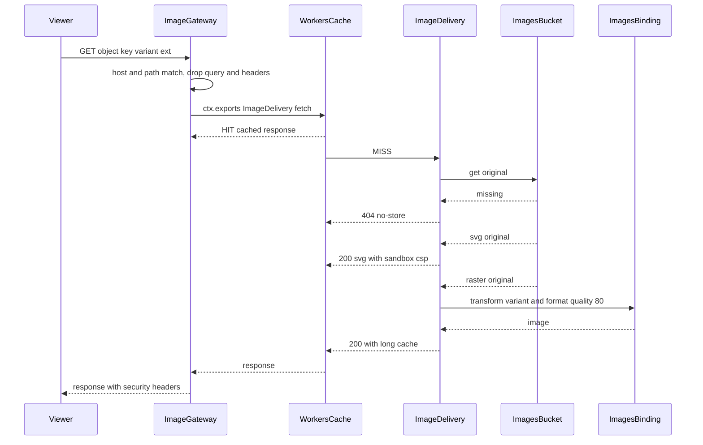
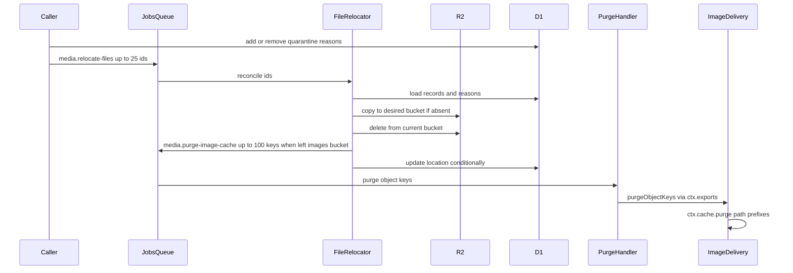

# 画像の変換配信とエッジキャッシュ

アップロードされた画像を、画像配信専用のホスト名から形式と寸法を変換して配信し、エッジキャッシュに保存する仕組みを定める。配信の構成、画像のURLとバリアント、変換と失敗の分類、エントリポイント単位のキャッシュと関門、キャッシュキーと版、隔離・削除に伴うパージ、R2の管轄とバインディング、ローカルとテストでの差、stagingでの確認と実測の手順、Workerの大きさ、費用の目安を扱う。受付の検証と配信のヘッダーの安全対策は「[アップロードの安全対策](../security/005-file-upload-security.md)」に、画像の判定は「[画像判定サービス](../external/003-image-moderation.md)」に、画面の`<picture>`の組み立ては「[画像の表示](../frontend/005-shared-components.md#画像の表示)」に従う。

## 前提と用語

画像配信は`<メッセージを受信するアプリ>`が受け持つ。既定のエクスポート(キャッシュ無効)の関門が画像配信のホスト名への要求を受け止め、キャッシュを有効にした名前付きエントリポイント`ImageDelivery`へ委ねる。キャッシュを画像の応答だけに限り、同じWorkerの他の経路(Webhookの受信など)の応答をキャッシュに乗せないためである。

| 部品                                                                          | 置き場所                                                                              | 役割                                                                                               |
| ----------------------------------------------------------------------------- | ------------------------------------------------------------------------------------- | -------------------------------------------------------------------------------------------------- |
| `IMAGE_VARIANTS`・`IMAGE_CACHE_CONTROL`・`parseImagePath`・`isDeliverable`    | 共用部品の`media/image-variants.ts`                                                   | バリアントの表・正常な応答の`Cache-Control`・画像のURLの解析・配信できる組み合わせ                 |
| `MEDIA_MESSAGE_LIMITS`・`PURGE_IMAGE_CACHE_MESSAGE`・`RELOCATE_FILES_MESSAGE` | 共通ライブラリの`core/media/media-messages.ts`                                        | パージ・移動のメッセージの契約と1件の上限                                                          |
| `matchImageRequest`・`isImageDeliveryRequest`                                 | `<メッセージを受信するアプリ>`の`src/presentation/media/`                             | 画像配信の要求かの判定(`image-request-match.ts`)                                                   |
| `createImageGatewayModule`                                                    | `<メッセージを受信するアプリ>`の`src/presentation/media/`                             | 関門の経路(`image-gateway-module.ts`)。登録箇所の先頭に置く                                        |
| `createImageDeliveryEntrypointClass`                                          | `<メッセージを受信するアプリ>`の`src/presentation/media/`                             | 名前付きエントリポイントのクラス(`image-delivery-entrypoint.ts`)。配信とパージのメソッドだけを持つ |
| `ImageDelivery`                                                               | `<メッセージを受信するアプリ>`の`src/index.ts`                                        | 名前付きエントリポイントの宣言とエクスポート(`ctx.exports`の対象)                                  |
| `deliverImage`・`SVG_CONTENT_SECURITY_POLICY`                                 | `<メッセージを受信するアプリ>`の`src/application/media/`                              | 配信の応答の決定(`image-delivery.ts`)                                                              |
| `R2ImageSource`・`ImagesBindingTransformer`                                   | `<メッセージを受信するアプリ>`の`src/infrastructure/media/`                           | 原本の読み出しと、画像の変換                                                                       |
| `WorkersCachePurger`                                                          | `<メッセージを受信するアプリ>`の`src/infrastructure/media/`                           | 処理単位の実行コンテキストから`ImageDelivery`のパージを呼ぶ                                        |
| `MediaFileRelocator`・`RelocateFilesHandler`・`PurgeImageCacheHandler`        | `<メッセージを受信するアプリ>`の`src/infrastructure/media/`・`src/application/media/` | 保存先をそろえる処理と、移動・パージのメッセージの処理                                             |
| `RATE_LIMIT_EXCLUSIONS`                                                       | `<メッセージを受信するアプリ>`の`src/composition/rate-limit-exclusions.ts`            | 画像配信の要求をIP制限から除く規則                                                                 |

| 用語                                                                                                                     | 意味                                                                                                      |
| ------------------------------------------------------------------------------------------------------------------------ | --------------------------------------------------------------------------------------------------------- |
| 画像配信のホスト名                                                                                                       | 画像を配信する専用のサブドメイン。認証のCookieが届かない、アプリと別のホスト名にする                      |
| 専用のホスト                                                                                                             | 画像配信のホスト名で画像だけを配信する環境(staging・prod)。画像のURLの形式に合わない要求は404にする       |
| バリアント                                                                                                               | 名前で指定する変換後の寸法と切り取り方の組。表は`IMAGE_VARIANTS`に置く                                    |
| 関門                                                                                                                     | 既定のエクスポートのHonoの経路で、画像配信の要求を名前付きエントリポイントへ委ねる部品                    |
| パージ                                                                                                                   | エッジキャッシュから、指定したパスで始まる応答を消すこと                                                  |
| `<画像配信のホスト名の変数>`                                                                                             | `<メッセージを受信するアプリ>`の変数で、画像配信のホスト名を持つ                                          |
| `<専用ホストの変数>`                                                                                                     | `<メッセージを受信するアプリ>`の変数で、画像配信のホスト名が専用のホストなら`true`、そうでなければ`false` |
| `<画像配信のオリジン>`                                                                                                   | 画像配信のURLのオリジン。ローカル環境は`<メッセージを受信するアプリのオリジン>`と同じである               |
| `<画像用非公開バケットのバインディング>`・`<ファイル用非公開バケットのバインディング>`・`<隔離バケットのバインディング>` | 3つのR2のバケットのバインディング名                                                                       |
| `<画像変換のバインディング>`                                                                                             | Images Bindingのバインディング名                                                                          |
| `<画像の動作確認の経路>`                                                                                                 | トークン付きの動作確認の経路の接頭辞(「[動作確認の経路](#動作確認の経路)」)                               |
| `<動作確認のトークンのシークレット>`                                                                                     | 動作確認の経路のトークンを持つシークレット                                                                |

- 変数・バインディング・シークレットの本プロジェクトでのキーの名前と各環境の値は、技術ドキュメントに写さず、プロジェクト固有の値の文書の「[バインディング・変数・シークレット](../../../onboardings/project-values.md#バインディング変数シークレット)」と「[Workerのシークレットのキーの一覧](../../../onboardings/project-values.md#workerのシークレットのキーの一覧)」に置く。

## 配信の構成



- 関門は既定のエクスポートのHonoの経路のため、IP制限の除外・アクセスログ・エラートラッキングの計装・セキュリティヘッダーは既存の仕組みに乗る。
- `ImageDelivery`は画像用非公開バケットだけを読む。隔離バケットへ移った画像は返さない。
- 関門は要求ごとに動くため(キャッシュにヒットしてもWorkerの要求として数える)、ホストと経路の判定と委譲だけを行い、データベースを参照しない。

## 画像のURLとバリアント

画像のURLは`<画像配信のオリジン>/<オブジェクトキー>/<バリアント名>.<拡張子>`である。オブジェクトキーは32文字の小文字の16進、拡張子は`avif`・`webp`・`jpg`・`png`・`svg`のいずれかとする。

- `parseImagePath`は、`/<32文字の小文字の16進>/<1区画>.<拡張子>`の形を画像のURLとし、それ以外(大文字の16進・長さ違い・余分な階層・二重の拡張子など)を画像のURLでない(`not-image-path`)とする。形は合うがバリアント名か拡張子が未定義なら`undefined-variant`とし、どちらも404にする。
- バリアントは、名前・幅・高さ・切り取り方(`cover`は指定の寸法に切り取る、`scale-down`は縦横比を保って収め拡大しない)・AVIFの提供の可否を持つ。バリアントの名前と寸法はサービスの画像の仕様で決め、`IMAGE_VARIANTS`に書く。
- AVIFは長辺1,200px以下のバリアントだけで提供する。変換基盤が長辺1,200pxを超えるAVIFを出力できないためである。
- 配信できる組み合わせ(`isDeliverable`)は次のとおりで、外れる組み合わせは404にする。

| 原本         | 配信する拡張子                                           |
| ------------ | -------------------------------------------------------- |
| SVG          | `svg`だけ                                                |
| ラスター画像 | `webp`・`jpg`・`png`と、AVIFを提供するバリアントの`avif` |

## 変換

`deliverImage`は、原本の`Content-Type`と拡張子で次のように応答する。

- SVG原本の`svg`は、変換せずに原本を返す。応答のヘッダーは「[配信のヘッダー](../security/005-file-upload-security.md#配信のヘッダー)」のSVGのCSPと`Content-Type: image/svg+xml`である。
- ラスター原本は、`ImagesBindingTransformer`が`<画像変換のバインディング>`で次のように変換する。

```typescript
const result = await images
  .input(body)
  .transform({ width: variant.width, height: variant.height, fit: variant.fit })
  .output({ format, quality: 80, anim: false });
```

- `images`は`<画像変換のバインディング>`のバインディングである。`format`は拡張子から決める(`avif`→`image/avif`・`webp`→`image/webp`・`jpg`→`image/jpeg`・`png`→`image/png`)。品質は80、`anim: false`でアニメーションの最初のフレームだけを出力する。
- 入力は20MBまで(基数の明記が無いため、受付は画像用の用途の上限を20,000,000バイトに限る)。
- メタデータの指定(`metadata`)はしない。`.output()`はメタデータの指定を受け付けず、WebP・AVIF・PNGの出力は常に全メタデータを除き、JPEGの出力は変換基盤の既定(著作権情報以外を除く`copyright`)になる(「[メタデータの扱い](../security/005-file-upload-security.md#メタデータの扱い)」)。向き情報と色のプロファイルは画像に適用される。
- HEADは、ラスター画像でも変換を最後まで行ってから本文を捨てる。

| 状況                                                                                      | 状態コード | ヘッダー                                                                        |
| ----------------------------------------------------------------------------------------- | ---------- | ------------------------------------------------------------------------------- |
| 配信できる画像                                                                            | 200        | `Content-Type`(出力の形式)・`Cache-Control: public, max-age=1209600, immutable` |
| 画像のURLでない・未定義のバリアント・原本が無い・配信できない組み合わせ・変換できない原本 | 404        | `Cache-Control: no-store`                                                       |
| `GET`・`HEAD`以外のメソッド(関門が応答)                                                   | 405        | `Allow: GET, HEAD`・`Cache-Control: no-store`                                   |
| 変換の一時的な失敗                                                                        | 503        | `Retry-After: 5`・`Cache-Control: no-store`                                     |
| 想定外の例外                                                                              | 500        | ログに出して投げ直し、関門の計装がエラートラッキングへ送る                      |

- 404・405・503は共通のエラー形式の本文で返し、`no-store`でキャッシュに残さない。隔離した画像の404もキャッシュに残らないため、復元の後はすぐに配信が戻る。
- 正常な応答の`max-age`(1,209,600秒=14日)は、パージが届かなかった場合に古い応答が残り得る最長の期間でもあるため、削除したデータを保持する期間を超えない値にする。オブジェクトキーは画像ごとに一意で、差し替えた画像は別のキーになるため`immutable`を付ける。

### 変換の失敗の分類

`ImagesBindingTransformer`は、変換基盤の例外の`code`(数値)で失敗を分ける。

| エラーコード                 | 結果                              | 応答 |
| ---------------------------- | --------------------------------- | ---- |
| 9412・9413・9520・9522・9523 | 変換できない原本(`invalid-image`) | 404  |
| 上記以外のコード             | 一時的な失敗(`unavailable`)       | 503  |
| コードの無い例外             | 想定外の例外として投げ直す        | 500  |

- 9412・9413・9520・9522・9523は、画像でない・画素数や処理量の上限を超える・形式を読めないなど、同じ原本で再試行しても変わらない失敗として扱う。画像の無料枠の超過など他のコードは503にする。
- 9522(処理量の上限)は、変換基盤の負荷により一時的に起きる場合もあり、503(`Retry-After`付き)の方が合う場面がある。404も`no-store`でキャッシュに残らず、次の要求で変換をやり直すため、一時的な9522でも次の要求で回復し、画面の表示部品はどちらの応答でもプレースホルダーを出す。この理由から現在は404に分類する。9522が多発する場合は、ログ(`errorCode`)で頻度を確かめ、503への変更を検討する。
- ログには変換基盤のエラーコード・バリアント・出力形式だけを出し、オブジェクトキーと画像の内容を出さない。

## エントリポイント単位のキャッシュと関門

### Wrangler設定

トップレベルの`cache.enabled`は`false`のままにし、`exports`でエントリポイントごとにキャッシュを指定する(Wrangler 4.107.0以上)。

```jsonc
{
  "cache": { "enabled": false },
  "exports": {
    "default": { "type": "worker", "cache": { "enabled": false } },
    "ImageDelivery": { "type": "worker", "cache": { "enabled": true } },
  },
}
```

- `exports`はトップレベルに書き、`env.<環境種別>`へ継承させる。キャッシュは`fetch()`の呼び出しにだけ効き、独自のメソッド(RPC)の呼び出しは常にキャッシュを通らない。
- `ImageDelivery`はWorkerのメインモジュール(`src/index.ts`)からエクスポートする。`ctx.exports`は`WorkerEntrypoint`を継承したトップレベルのエクスポートへのループバックのService Bindingを自動で持つ(互換性フラグ`enable_ctx_exports`。2025-11-17以降の互換性日付で既定で有効)。
- `ImageDelivery`の公開メソッドは同じWorkerからRPCとして呼べるため、配信(`fetch`)とパージ(`purgeObjectKeys`)以外のメソッドを定義しない。

### 関門

`createImageGatewayModule`は、他のモジュールの経路より先に画像配信のホスト名への要求を受け止めるため、モジュールの登録箇所の先頭に置く。`matchImageRequest`は次のように判定する。

| 要求のホスト名                   | 要求のパス                              | 判定                       | 関門の動作                               |
| -------------------------------- | --------------------------------------- | -------------------------- | ---------------------------------------- |
| 画像配信のホスト名               | 画像のURLの形(未定義のバリアントを含む) | `image`                    | `GET`・`HEAD`なら委譲、他のメソッドは405 |
| 画像配信のホスト名(専用のホスト) | 画像のURLの形でない                     | `reject-on-dedicated-host` | 404(`no-store`)                          |
| 画像配信のホスト名(専用でない)   | 画像のURLの形でない                     | `not-image-host`           | 次の経路へ進める                         |
| 画像配信のホスト名以外           | 問わない                                | `not-image-host`           | 次の経路へ進める                         |

- 委譲は`new Request(<要求のオリジン><パス>, { method })`で要求を作り直し、`ctx.exports.ImageDelivery.fetch()`へ渡す。クエリ文字列と要求ヘッダーを落とし、応答を要求のヘッダーに依存させず、キャッシュのキーをパスだけにするためである。
- ホスト名は`<画像配信のホスト名の変数>`を小文字にした値と、要求のURLのホスト名の完全一致で比べる。値が空なら、どの要求も画像配信として扱わない。末尾にドットの付いたホスト名(`<画像配信のホスト名>.`)は一致せず、`not-image-host`になる。
- 環境の検証は、`<画像配信のホスト名の変数>`をスキームやポートを含まないホスト名の形、`<専用ホストの変数>`を`true`か`false`に限る。

### IP制限の除外

画像配信のホスト名への画像のURLの要求(`matchImageRequest`が`image`)は、エッジキャッシュの後ろで配信するため、Worker単位のIP制限で数えない(「[除外規則](../backend/003-rate-limiting-and-bot-verification.md#除外規則)」)。

- 除外の判定は関門と同じ`matchImageRequest`を使う(`isImageDeliveryRequest`)。IP制限の除外は環境の検証より前に動くため、変数が欠けた環境も受け取る。
- 画像のURLへの`POST`なども数えずに405になる。専用のホストの画像のURLでない要求は数えたうえで404になる。

### 専用のホストのヘルスチェック

専用のホストでも、`<ヘルスチェックの経路>`は200を返す。ヘルスチェックはWorkerの入口の組み立てがモジュールより前に登録するため、関門より先に応答する(「[ヘルスチェック](../backend/002-layered-architecture-on-workers.md#ヘルスチェック)」)。

- 応答は`{ "status": "ok" }`と`no-store`で、画像や内部の情報を返さない。「専用のホストでは画像のURLの形式に合わない要求を404にする」規則の、既知の例外として扱う。
- 外部の死活監視は、アプリのホスト名の`<ヘルスチェックの経路>`を監視し、画像配信のホスト名を監視に使わない。

## キャッシュキーと版

- キャッシュキーは、エントリポイント・パスとクエリ・`ctx.props`・Workerの版から作られ、ホスト名を含まない。関門がクエリ文字列を落とすため、実際のキーは`ImageDelivery`とパスと版で決まる。
- `GET`と`HEAD`だけがキャッシュされ、同じURLのエントリを共有する。`Authorization`・`Set-Cookie`を伴う要求・応答は自動でキャッシュを迂回する。
- 版をまたいでキャッシュを共有する設定(`cache.cross_version_cache`)は使わない。デプロイのたびに空のキャッシュから始まり、配信の不具合を直したデプロイの後に古い応答が残らない。変換は一意な変換ごとに月1回だけ課金されるため、同じ月の再変換で費用は増えない。
- キャッシュのヒットは、応答のヘッダー`Cf-Cache-Status`(`HIT`・`MISS`など)で確かめる。

## パージ

画像が画像用非公開バケットから出たとき(隔離バケットへの移動と物理削除)に、そのオブジェクトキーで始まるパスのエッジキャッシュを、全バリアント・全拡張子についてまとめて消す。



- 保存先をそろえる処理(`MediaFileRelocator.reconcile`)は、隔離理由から目的の保存先(理由があれば隔離バケット、無ければ画像用非公開バケット)を求め、記録の保存先と違えば、目的の保存先へ書き込み(既にあれば省く)→元の保存先から削除→(画像用非公開バケットから出た場合)パージの依頼→保存先の記録の更新の順に進める。元にも目的にも無ければ、記録の保存先だけを目的の値にする。
- パージの依頼は、元の保存先からの削除の後、記録の更新の前に送る。削除の前にパージすると、パージと削除の間に元の画像が再びキャッシュされ得るためである。依頼の送信に失敗して再試行しても、元の保存先に画像が無い状態から同じ手順を最後までやり直せる。
- 物理削除(`MediaEraser`)も、全バケットからの削除→パージの依頼→記録の削除の順で、再実行に耐える。
- 復元(隔離バケットから画像用非公開バケットへ)ではパージしない。隔離中の404は`no-store`でキャッシュに残らない。
- 削除待ちと保存未完了のファイルは動かさない。保存の完了の後に、判定の処理か日次の照合が移す。
- 日次のジョブ`media-pipeline.location-reconciliation`が、隔離理由と保存先の記録が食い違う画像を探し、`media.relocate-files`を25件ずつ送り直す(1回の起動で最大1,000件)。

### パージの呼び出し

- パージの処理(`PurgeImageCacheHandler`)は`WorkersCachePurger`で、処理単位の実行コンテキストの`ctx.exports.ImageDelivery.purgeObjectKeys(objectKeys)`を呼ぶ。パージは呼び出したエントリポイントのキャッシュにだけ効くため、`ImageDelivery`自身のメソッドの中で`this.ctx.cache.purge()`を呼ぶ。Queueの処理(`queue`ハンドラー)からも同じように呼べる。
- `purgeObjectKeys`は`ctx.cache.purge({ pathPrefixes: objectKeys.map((key) => '/' + key + '/') })`を呼ぶ。`pathPrefixes`はスキームとホストを含まないパスである。
- 1回の呼び出しは1〜100件のオブジェクトキーに限り(`MEDIA_MESSAGE_LIMITS.purgeBatch`)、オブジェクトキーの形に合わない値は受け付けない(`RangeError`)。保存先をそろえる処理は、1回の呼び出しの分を100件ずつまとめて依頼する。
- `ctx.cache`が無い環境(ローカル・テスト)では、保存されたキャッシュも無いため、何もせず`skipped: true`の成功を返す。
- パージの結果が`success: false`(回数の上限など)なら、例外で再試行させる。

| 項目               | 値                                                                                                                               |
| ------------------ | -------------------------------------------------------------------------------------------------------------------------------- |
| `maxAttempts`      | 5回                                                                                                                              |
| `baseDelaySeconds` | 60秒                                                                                                                             |
| `maxDelaySeconds`  | 3,600秒                                                                                                                          |
| 再試行の間隔       | 60秒・120秒・240秒・480秒                                                                                                        |
| 上限を超えた場合   | デッドレターへ移り、デッドレターの通知(ログとエラートラッキング)になる(「[デッドレター](003-async-processing.md#デッドレター)」) |

- パージの回数は、プランによらずアカウント単位で毎分5要求・バースト25要求、1要求あたり100件のパスまでである。stagingとprodが同じアカウントなら枠を共有する。1回に最大100件のキーをまとめ、上限を超えにくくする。
- パージは受理されたかを`success`で返すが、指定したパスの下に対象が実在したかは保証しない。効果はstagingの手順で確かめる(「[キャッシュとパージ](#キャッシュとパージ)」)。
- デッドレターへ移ったパージの依頼は再送されない。古い応答は最長で`max-age`の期間残り得るため、通知を受けたら、対象の画像のURLをstagingの手順と同じく確かめ、必要なら手作業でパージを依頼し直す。

## R2の管轄とバインディング

| バケット                 | バインディング                               | 使うアプリ                                              | 用途                             |
| ------------------------ | -------------------------------------------- | ------------------------------------------------------- | -------------------------------- |
| 画像用非公開バケット     | `<画像用非公開バケットのバインディング>`     | `<APIサーバーのアプリ>`・`<メッセージを受信するアプリ>` | 画像の原本。画像配信が読む       |
| ファイル用非公開バケット | `<ファイル用非公開バケットのバインディング>` | 同上                                                    | ファイル用の用途のファイル       |
| 隔離バケット             | `<隔離バケットのバインディング>`             | 同上                                                    | 隔離した画像。画像配信は読まない |

- デプロイ先の環境では、3つのバケットを資源一覧の`jurisdiction`(`<管轄>`)で作り、Wrangler設定の`r2_buckets`の各要素に同じ`jurisdiction`を書く(「[管轄の注意](006-iac-with-opentofu.md#管轄の注意)」)。ローカル環境の設定には書かない。管轄は作成後に変えられず、管轄の無いバケットが既にある環境ではバケットの作り直しが要る。
- 保存は条件付きの`put()`(`If-None-Match: *`)で上書きしない(「[上書きの拒否](../security/005-file-upload-security.md#上書きの拒否)」)。`ReadableStream`を渡すには長さが要るため、`FixedLengthStream`で包む。
- R2のWorkers APIにはバケット間のコピーが無いため、移動は読み出して書き込み、元を消す。`delete()`は1回で1,000キーまで消せるため、それより多いキーは分けて消す。
- 画像変換のバインディングはWrangler設定の`images`(`{ "binding": "<画像変換のバインディング>" }`)で宣言する。

## ローカルとテストでの差

| 項目               | ローカル環境(`wrangler dev`)・Workers統合テスト                                                                                                                                          | staging・prod                             |
| ------------------ | ---------------------------------------------------------------------------------------------------------------------------------------------------------------------------------------- | ----------------------------------------- |
| 画像配信のホスト名 | `<メッセージを受信するアプリ>`と同じホスト(`<専用ホストの変数>`は`false`)。画像のURLの形の要求だけを画像配信として扱い、他は通常の経路へ流す。テストでは専用のホストの値も与えて確かめる | 専用のホスト(`true`)                      |
| Images Binding     | 簡易版。`width`・`height`・`rotate`・`format`だけに対応し、`fit`・`quality`は効かない。`sharp`が無い環境では変換が9523で失敗する                                                         | 本物の変換                                |
| Workers Cache      | 無い(`ctx.cache`が`undefined`)。キャッシュの有無で応答は変わらず、パージは`skipped: true`の成功になる                                                                                    | エントリポイント単位のキャッシュ          |
| 判定サービス       | 代替の判定(「[代替の判定](../external/003-image-moderation.md#代替の判定)」)                                                                                                             | 判定サービス                              |
| R2の管轄           | 無い                                                                                                                                                                                     | `<管轄>`                                  |
| 動作確認の経路     | `<動作確認のトークンのシークレット>`を登録すれば有効                                                                                                                                     | stagingは登録すれば有効、prodは登録しない |

- `fit`・`quality`・JPEGの出力のメタデータ・キャッシュのヒットとパージは、ローカルとテストでは本番と同じに動かないため、stagingで確かめる(「[stagingでの確認](#stagingでの確認)」)。
- Workers統合テストでは、名前付きエントリポイントの`purgeObjectKeys`を拒否させると、RPCの中継の副作用でworkerdの`Uncaught (in promise)`の表示が出ることがある。テストの結果には影響しない。

## 動作確認の経路

`<メッセージを受信するアプリ>`の`<画像の動作確認の経路>`は、`<動作確認のトークンのシークレット>`がある環境だけで有効になる。本番と同じ受付処理・判定・移動・パージ・配信を通る。

| メソッド | 経路                                                   | 応答                                                                                |
| -------- | ------------------------------------------------------ | ----------------------------------------------------------------------------------- |
| `POST`   | `<画像の動作確認の経路>`                               | 201、本文`{ "data": <アップロードの結果> }`(ファイルの識別子・オブジェクトキーなど) |
| `GET`    | `<画像の動作確認の経路>/<ファイルの識別子>`            | 200、本文`{ "data": { moderationStatus, location, quarantineReasons, findings } }`  |
| `POST`   | `<画像の動作確認の経路>/<ファイルの識別子>/quarantine` | 202。管理者の操作の隔離理由を加える                                                 |
| `POST`   | `<画像の動作確認の経路>/<ファイルの識別子>/release`    | 202。管理者の操作の隔離理由を外す                                                   |
| `DELETE` | `<画像の動作確認の経路>/<ファイルの識別子>`            | 202。即時に物理削除する                                                             |

- 全ての経路に`Authorization: Bearer <動作確認のトークン>`が要る。トークンが一致しなければ401、`<動作確認のトークンのシークレット>`が未設定なら全ての経路が404である。トークンはSHA-256のハッシュ値どうしを時間一定で比べ、ログに値を出さない。
- アップロードは動作確認専用の用途(画像5形式・5,242,880バイトまで)で、保有者を「システム」にして受け付ける。紐付けないため、日次のジョブが48時間以内に物理削除する。操作の対象は動作確認の用途のファイルに限り、他のファイルは404にする。
- prodでは`<動作確認のトークンのシークレット>`を登録せず、経路を無効にする。

```sh
curl -i -X POST \
  -H "Authorization: Bearer <動作確認のトークン>" \
  -H "Content-Type: image/png" \
  --data-binary @<画像のファイル> \
  "<メッセージを受信するアプリのオリジン><画像の動作確認の経路>"
```

## stagingでの確認

stagingへデプロイした後、動作確認の経路で次を確かめる(開発者の作業)。画像配信の初回のデプロイ時と、キャッシュ・変換・パージの処理を変えたときに行い、結果を記録する。

1. シークレット管理のstagingの環境に`<動作確認のトークンのシークレット>`を登録し、デプロイ先のWorkerへ反映する(「[シークレットの注入](../security/001-secret-management.md#シークレットの注入)」)。任意のシークレットのため`secrets.required`に入れず、未登録でもデプロイは失敗しない。
2. 以下の手順の`<オブジェクトキー>`は、アップロードの応答の`objectKey`である。

### キャッシュとパージ

1. 通常の画像をアップロードし、状態の取得で`moderationStatus`が`passed`になるまで待つ。
2. 任意のバリアントのURL(`https://<画像配信のホスト名>/<オブジェクトキー>/<バリアント名>.webp`)を2回取得し、2回目の応答の`Cf-Cache-Status`が`HIT`であることを確かめる。

   ```sh
   curl -sS -o /dev/null -D - "https://<画像配信のホスト名>/<オブジェクトキー>/<バリアント名>.webp"
   ```

3. 隔離の経路(`/quarantine`)を呼び、状態の取得で`location`が隔離バケットになるまで待つ。
4. 同じURLを取得し、404(`Cache-Control: no-store`)になることを確かめる。200のままなら、キャッシュが残っている(パージが効いていない)。パージの処理のログ(カテゴリ`[<アプリ名>, 'media', 'purge']`)とデッドレターの通知を確かめる。
5. 解除の経路(`/release`)を呼び、同じURLが再び200になること(初回は`MISS`)を確かめる。
6. 削除の経路を呼び、同じURLが404になることを確かめる。
7. 画像配信のホスト名の画像のURLでないパス(`/`など)が404、画像のURLへの`POST`が405、クエリ文字列を付けたURLが付けないURLと同じキャッシュの応答(`HIT`)になることを確かめる。

### `fit`と品質

1. 縦長の画像(例: 1,200×2,400px)をアップロードする。
2. `cover`のバリアントの各拡張子を取得し、寸法がバリアントの幅・高さちょうど(中央で切り取られている)であることを確かめる。`scale-down`のバリアントを取得し、縦横比を保ってバリアントの箱に収まり、原本より大きくならないことを確かめる。

   ```sh
   curl -sS -o variant.jpg "https://<画像配信のホスト名>/<オブジェクトキー>/<バリアント名>.jpg"
   identify -format '%m %wx%h quality=%Q\n' variant.jpg
   ```

3. JPEGの出力の推定品質(`identify`の`%Q`)が80前後であることを確かめる。WebP・AVIFは同じ画像の`jpg`とバイト数を比べ、極端に大きくないことを確かめる。
4. アニメーションのGIFを取得し、出力が静止画(最初のフレーム)であることを確かめる。

### JPEGの出力のメタデータ

1. 撮影位置(GPS)と著作権情報(`Copyright`)を含むJPEGを、編集ダイアログを経ずに動作確認の経路から直接アップロードする。
2. 各拡張子の出力のメタデータを確かめる。

   ```sh
   exiftool -a -G1 -s variant.jpg
   ```

3. WebP・AVIF・PNGの出力にExif・XMP・GPSが無いこと、JPEGの出力に残る項目(既定では著作権情報だけ)を記録する。GPSなどが残る場合は、プライバシーの説明と「[メタデータの扱い](../security/005-file-upload-security.md#メタデータの扱い)」の記述を見直す。

### 判定のCPU時間とメモリの実測

判定用画像の作成はwasmの処理で、1件ずつ同期的に進む。Queueのconsumerは1回の起動で最大10件の束を処理するため、1回の起動のCPU時間とメモリが上限(CPU時間の既定は30秒、メモリは128MB)に収まることを確かめる。

1. `wrangler tail <Worker名> --env staging --format json`で、`<メッセージを受信するアプリ>`の呼び出しの記録を表示しておく(「[Wranglerを動かす実行環境](001-wrangler-conventions.md#wranglerを動かす実行環境)」)。
2. 動作確認の経路で、受付の上限に近い次の画像をアップロードする。
   - 画素数の上限に近いPNG(例: 4,000×4,000px)と、各辺の上限に近い細長いPNG(例: 12,000×1,300px)
   - 大きなJPEG(向き付きを含む)、アニメーションのGIF・WebP
   - 要素の多いSVGと、`<text>`を含むSVG
3. Queueの処理の記録の`outcome`(`ok`・`exceededCpu`・`exceededMemory`)・`cpuTime`・`wallTime`と、判定のログ(カテゴリ`[<アプリ名>, 'media', 'moderation']`)の`durationMs`・`planKind`を記録する。Workers Logsの呼び出しの記録でも同じ値を確かめられる。
4. 10件を続けてアップロードし、1回の起動に10件の束が入ったときのCPU時間も確かめる。
5. 1回の起動のCPU時間が上限に近い、または`exceededMemory`が起きる場合は、画素数の上限を下げる、Wrangler設定の`limits.cpu_ms`を上げる、判定専用のQueue(`max_batch_size`を小さくする)へ分ける、のいずれかを開発者が判断する。

- Workersは呼び出しごとのメモリの使用量を記録しないため、メモリは`exceededMemory`の有無で確かめる。画素数の上限(1,600万画素)は、RGBAに展開した画素(約64MB)を128MBに収めるための値である。

## Workerの大きさ

`<メッセージを受信するアプリ>`は、判定用画像の描画のwasm(`wasm-image-optimization`のgzip後約2.3MBと`@cf-wasm/resvg`の約0.95MB)と同梱の書体(約0.2MB)を含み、gzip後の合計は約3.4MBになる。Workers Freeの上限(gzip後3MB)を超えるため、Workers Paid(gzip後10MB)を前提とする。

- 描画の部品や依存を変えたときは、開発者がデプロイの予行で大きさを確かめる。

  ```sh
  cd <メッセージを受信するアプリ>
  wrangler deploy --dry-run --outdir <出力先> --env staging
  ```

- 出力の`Total Upload`のgzip後の値を記録する。Workers Paidの上限に近づいた場合は、描画を別のWorkerへ分けるかを開発者が判断する。

## 費用の目安

| 項目             | 課金の単位                                                                                  |
| ---------------- | ------------------------------------------------------------------------------------------- |
| 画像の変換       | 一意な変換(原本と変換の引数の組)ごとに月1回。毎月5,000件まで無料、超えるとImages Paidが要る |
| エッジキャッシュ | キャッシュのヒットは変換もR2の読み出しも行わない。関門はヒットでもWorkerの要求として数える  |
| パージ           | 料金は無いが、回数の上限がある                                                              |
| R2               | 保存量と操作の回数。キャッシュのミスごとに原本を1回読む                                     |

- 1枚の画像の変換の数は、表示で使うバリアントと拡張子の組の数である。画面が`<picture>`でAVIF・WebPとフォールバックを並べても、ブラウザが取得する組だけが変換される。
- stagingとprodが同じアカウントなら、変換の無料枠を共有する。Images Paidを契約していない状態で無料枠を超えると、変換が失敗し503になるため、本番の運用の前に契約を判断する。
- 値は変わり得る。確かめるときはCloudflareの文書「[Images pricing](https://developers.cloudflare.com/images/pricing/)」「[Workers pricing](https://developers.cloudflare.com/workers/platform/pricing/)」を見る。

## 参考資料

- Cloudflare Docs「[Images binding](https://developers.cloudflare.com/images/optimization/binding/)」「[Images features](https://developers.cloudflare.com/images/optimization/features/)」「[Images limits](https://developers.cloudflare.com/images/get-started/limits/)」「[Images troubleshooting](https://developers.cloudflare.com/images/reference/troubleshooting/)」
- Cloudflare Docs「[Workers Cache](https://developers.cloudflare.com/workers/cache/)」「[Configuration](https://developers.cloudflare.com/workers/cache/configuration/)」「[Cache keys](https://developers.cloudflare.com/workers/cache/cache-keys/)」「[Purge](https://developers.cloudflare.com/workers/cache/purge/)」「[Limitations](https://developers.cloudflare.com/workers/cache/limitations/)」
- Cloudflare Docs「[Context(ctx.exports)](https://developers.cloudflare.com/workers/runtime-apis/context/)」「[Workers limits](https://developers.cloudflare.com/workers/platform/limits/)」
- Cloudflare Docs「[R2 Workers API reference](https://developers.cloudflare.com/r2/api/workers/workers-api-reference/)」「[R2 Data location](https://developers.cloudflare.com/r2/reference/data-location/)」
