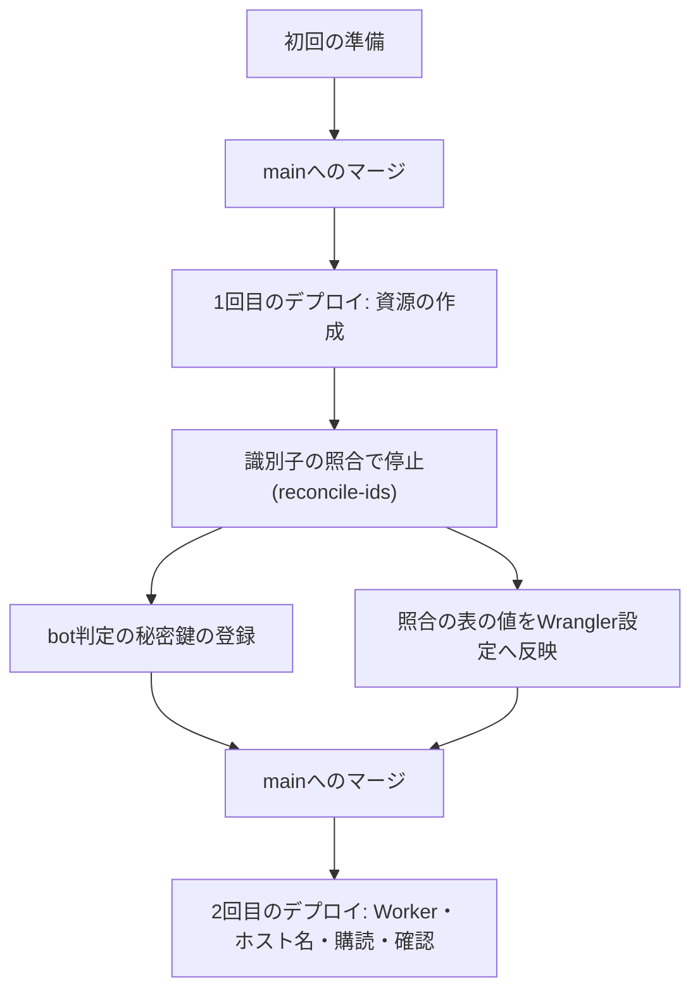
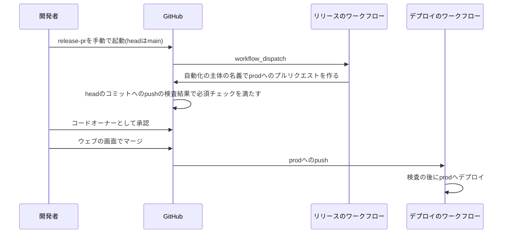

# デプロイ手順

IaC定義とGitHub Actionsのデプロイパイプラインで`staging`・`prod`へデプロイするときの、開発者の手作業(初回の準備・シークレットの登録・最初のデプロイと識別子の反映・本番環境の準備)と、mainからの自動デプロイ、prodへのリリース、hotfixの手順を定める。

## 前提と用語

構成は「[インフラの構成](../infra/005-infrastructure-overview.md)」に、IaC定義は「[IaC定義の構成](../infra/006-iac-with-opentofu.md)」に、ワークフローと段階は「[検査とデプロイのパイプライン](../infra/007-ci-cd-pipelines.md)」に従う。主体の縛りとリポジトリ保護の設定値は「[CIのシークレットとリポジトリ保護](../security/003-ci-secrets-and-repository-protection.md)」に従う。`<状態のバケット>`・`<アカウントID>`などのプレースホルダーは「[IaC定義の構成の前提と用語](../infra/006-iac-with-opentofu.md#前提と用語)」に従う。

| 用語                     | 意味                                                                                                                                                                                                                        |
| ------------------------ | --------------------------------------------------------------------------------------------------------------------------------------------------------------------------------------------------------------------------- |
| 開発者                   | リポジトリのコードオーナーで、Cloudflare・Infisical・GitHubの管理の権限を持つ人間                                                                                                                                           |
| AIエージェント           | 開発コンテナで開発者の指示を受けてコードを変更するエージェント。デプロイと承認に関わる操作を行わない(「[AIエージェントが実行しない操作](#aiエージェントが実行しない操作)」)                                                 |
| 初回の準備               | `staging`への最初のデプロイの前に、開発者が手作業で一度だけ行う準備                                                                                                                                                         |
| 本番環境の準備           | `prod`への最初のデプロイの前に、本番環境の公開を担う開発者が行う準備                                                                                                                                                        |
| リリースのプルリクエスト | mainか`hotfix/<名前>`からprodへの、自動化の主体の名義のプルリクエスト。リリースのワークフロー(`release-pr.yml`)が作る                                                                                                       |
| hotfixブランチ           | prodから分岐する`hotfix/<名前>`のブランチ。`<名前>`は英小文字・数字・ハイフンの63文字までで、先頭は英小文字か数字にする                                                                                                     |
| 共通のフォルダ           | Infisicalの各環境の`/`。Workerが宣言したシークレットの値を置く                                                                                                                                                              |
| Workerごとのフォルダ     | Infisicalの各環境の`/workers/<Worker>`。同じキー名でWorkerごとに異なる値が要るシークレットを置く。`<配布のスクリプト>/core/secret-scope.ts`の`WORKER_SECRET_FOLDERS`に挙げたWorker(APIサーバーとイベントサーバー)だけが持つ |
| 必須のシークレット       | Wrangler設定の`env.<環境種別>.secrets.required`に挙げたシークレット                                                                                                                                                         |
| 任意のシークレット       | `<配布のスクリプト>/core/worker-secrets.ts`の`OPTIONAL_WORKER_SECRETS`に挙げた、値があれば渡すシークレット                                                                                                                  |
| `<環境種別>`             | `staging`・`prod`。「[デプロイ先の環境種別](../infra/002-environments.md#デプロイ先の環境種別)」に従う                                                                                                                      |

## AIエージェントが実行しない操作

次の操作は開発者だけが行い、AIエージェントは実行しない。AIエージェントの設定の拒否の一覧(Claude Codeでは`permissions.deny`)にコマンドを載せ、技術的にも拒否する。

| 操作                                                     | 主なコマンド・画面                                                                                                          |
| -------------------------------------------------------- | --------------------------------------------------------------------------------------------------------------------------- |
| Workerのデプロイ・版の切り替え・ロールバック             | `wrangler deploy`(`--dry-run`を含む)・`wrangler versions deploy`・`wrangler rollback`・`wrangler triggers deploy`           |
| Workerのシークレットの登録・削除                         | `wrangler secret put`・`wrangler secret delete`・`wrangler secret bulk`                                                     |
| デプロイ先のD1の操作                                     | `wrangler d1 migrations apply --remote`など`--remote`を付けた`wrangler d1`のコマンド、`wrangler d1 time-travel restore`     |
| 資源の作成・変更・削除と状態の操作                       | `tofu apply`・`tofu destroy`・`tofu import`・`tofu state rm`・`tofu state push`・`tofu force-unlock`                        |
| シークレットの値とフォルダの登録・削除                   | `infisical secrets set`・`infisical secrets delete`・`infisical secrets folders create`・`infisical secrets folders delete` |
| ワークフローの手動の起動(リリースのプルリクエストの作成) | `gh workflow run`、GitHubのActionsの画面                                                                                    |
| プルリクエストの承認とマージ                             | `gh pr review`・`gh pr merge`・`gh api`、GitHubのプルリクエストの画面                                                       |
| リポジトリの設定(ルールセット・Environment・Actions)     | GitHubのSettingsの画面、`gh api`                                                                                            |
| CloudflareのAPIトークン・Infisicalの主体の作成と変更     | 各サービスのダッシュボード                                                                                                  |

- prodへのデプロイは、開発者が承認してマージしたリリースのプルリクエストからだけ起きる。AIエージェントはprodへのデプロイに至る操作を行わない。
- AIエージェントは、開発者から受け取った値を資源一覧やWrangler設定へ書く変更、識別子の照合の表の値を反映する変更、修正のプルリクエストを作ってよい。マージは開発者が行う。
- 開発コンテナの`gh`が開発者の認証情報でログインしている場合、拒否の一覧に`gh pr review`・`gh api`が無いと、AIエージェントが開発者の名義で承認やマージを行えてしまう。初回の準備で拒否の一覧へ加える。
- ワークフローにプルリクエストの作成と承認を許可する設定によって残るリスクは「[CIのシークレットとリポジトリ保護](../security/003-ci-secrets-and-repository-protection.md)」に従う。

## 初回の準備

`staging`への最初のデプロイの前に、開発者が次の順で行う。`prod`の分は「[本番環境の準備](#本番環境の準備)」で行う。

| 順  | 項目                                                                                                                                                                                                                                                                                                                                                        | 確認の方法                                                                                                                   |
| --- | ----------------------------------------------------------------------------------------------------------------------------------------------------------------------------------------------------------------------------------------------------------------------------------------------------------------------------------------------------------- | ---------------------------------------------------------------------------------------------------------------------------- |
| 1   | Infisicalの`staging`に`/ci/tofu`・`/ci/cloudflare`を作る。`dev`と`staging`に、`WORKER_SECRET_FOLDERS`に挙げたWorkerの`/workers/<Worker>`だけを空のまま作る                                                                                                                                                                                                  | ダッシュボードのフォルダの一覧                                                                                               |
| 2   | `staging`の`<状態のバケット>`を作り、そのバケットだけを読み書きできる鍵を発行して、鍵と暗号化のパスフレーズを`/ci/tofu`へ登録する(「[状態の保管先と鍵](#状態の保管先と鍵)」)                                                                                                                                                                                | R2のAPIトークンの一覧で、トークンの対象が`<状態のバケット>`の1つだけであること。`/ci/tofu`のキーの名前の一覧(値は表示しない) |
| 3   | `staging`用のCloudflareのAPIトークンを作り、`/ci/cloudflare`へ登録する(「[CloudflareのAPIトークン](#cloudflareのapiトークン)」)                                                                                                                                                                                                                             | トークンの一覧で権限と対象のアカウント・ゾーン。最初のデプロイの`tofu-foundation`の成功                                      |
| 4   | 検査の主体と`staging`のデプロイの主体を作り、OIDCで縛り、ロールを閲覧だけ(Viewer)にする                                                                                                                                                                                                                                                                     | 主体のロールが閲覧だけで、認証の方法がOIDCだけであること                                                                     |
| 5   | 資源一覧`staging.json`にデプロイの主体のID(`infisical.identityId`)・InfisicalのプロジェクトのID(`infisical.projectId`)・`cloudflare.accountId`・`cloudflare.zoneId`を、`backends/staging.s3.hcl`の`endpoints.s3`に`<アカウントID>`を、`<配布のスクリプト>/catalog/check-secrets.ts`の`CHECK_SECRETS_IDENTITY`に検査の主体のIDを記入するプルリクエストを作る | `contract-check`の成功。検査の`tests`・`e2e`のログインの成功(`checks / ci-gate`の成功)。最初のデプロイの`preflight`の成功    |
| 6   | GitHubのEnvironment`staging`(デプロイ対象のブランチをmainだけ)と`prod`(prodだけ)を作る                                                                                                                                                                                                                                                                      | Settings → Environments                                                                                                      |
| 7   | Actionsの設定で、ワークフローの既定の権限を読み取りにし、「GitHub ActionsにPRの作成と承認を許可」を有効にする。リポジトリの設定(Pull Requests)でマージコミットによるマージを許可する                                                                                                                                                                        | Settings → Actions → General、Settings → General → Pull Requests                                                             |
| 8   | main・prodのルールセットに必須チェック`checks / ci-gate`を加え、許可するマージの方式にマージコミットを含め、prodのルールセットにコードオーナーの承認などを設定する(マージコミットが要る理由は「[prodへのリリース](#prodへのリリース)」)                                                                                                                     | プルリクエストに必須チェックが表示されること                                                                                 |
| 9   | AIエージェントの設定の拒否の一覧に`Bash(gh pr review*)`・`Bash(gh api*)`を加える                                                                                                                                                                                                                                                                            | AIエージェントからのそれらのコマンドが拒否されること                                                                         |
| 10  | 最初のデプロイの時点で各Workerが宣言している必須のシークレットを、`staging`の共通のフォルダかWorkerごとのフォルダへ登録する(「[シークレットの登録の規則](#シークレットの登録の規則)」)。bot判定の秘密鍵は最初のデプロイの後に登録する                                                                                                                       | ダッシュボードのキーの名前の一覧。欠けていれば最初のデプロイの`deploy-*`がキーの名前を表示して止まる                         |

- 手順5の値は開発者が用意し、記入とプルリクエストの作成はAIエージェントが行ってよい。資源一覧の識別子は秘密でないためコミットする(「[資源一覧の項目](../infra/006-iac-with-opentofu.md#資源一覧の項目)」)。仮の値が残っているときの止まり方は次のとおりである。
  - 資源一覧のアカウントID・ゾーンID・InfisicalのプロジェクトのID・デプロイの主体のIDと、実行中のブランチは、デプロイの`preflight`が確かめ、記入先のファイルを示して止まる。
  - 検査の主体のID(`CHECK_SECRETS_IDENTITY`)は、検査の`tests`・`e2e`のジョブのInfisicalへのログイン(`infisical-login --scope checks`)が確かめ、記入先を示して失敗する。総合結果`checks / ci-gate`も失敗するため、プルリクエストをマージできず、デプロイも始まらない。
- 手順4・6・7・8の設定値(OIDCの縛り・ルールセットの項目)は「[CIのシークレットとリポジトリ保護](../security/003-ci-secrets-and-repository-protection.md)」に従う。
- IaC定義の導入より前に手作業で作った資源があれば、最初のデプロイの前に取り込むか削除するかを決める(「[既存の資源の取り込み](../infra/006-iac-with-opentofu.md#既存の資源の取り込み)」)。

### 状態の保管先と鍵

状態の保管先の鍵は、その環境の`<状態のバケット>`だけを読み書きできる範囲に限る。他の環境の状態や、データを持つバケットへ届かないようにするためである。

1. CloudflareのダッシュボードのR2で、`<状態のバケット>`を管轄を付けずに作る。
2. R2のAPIトークンの管理の画面で、新しいトークンを作る。
   - 権限は、オブジェクトの読み取りと書き込み(Object Read & Write)にする。管理者の権限(Admin Read & Write)にしない。
   - 対象を特定のバケットだけ(Apply to specific buckets only)にし、`<状態のバケット>`だけを選ぶ。
3. 表示されたアクセスキーIDとシークレットアクセスキーを、Infisicalのその環境の`/ci/tofu`の`AWS_ACCESS_KEY_ID`・`AWS_SECRET_ACCESS_KEY`へ登録する。値は作成の画面でしか表示されないため、ファイルやチャットに貼らずに直接登録する。
4. 同じ`/ci/tofu`へ、状態の暗号化のパスフレーズ`TF_VAR_state_passphrase`を16文字以上の乱数で登録する(「[暗号化](../infra/006-iac-with-opentofu.md#暗号化)」)。パスフレーズを失うと状態を読めなくなるため、変えない。
5. トークンの一覧で、作ったトークンの対象のバケットが`<状態のバケット>`の1つだけであることを確かめる。

### CloudflareのAPIトークン

- 環境ごとに1つのトークンを作り、OpenTofuのproviderとWranglerで共用する。Infisicalのその環境の`/ci/cloudflare`の`CLOUDFLARE_API_TOKEN`へ登録する。
- 権限は、アカウントのD1・R2・Queues・Workers Scripts・Turnstile・Web Analytics・Email Sendingの編集とアカウント設定の読み取り、ゾーンのDNS・Workers Routesの編集と読み取りにする。対象は使うアカウントとゾーンだけにする。権限の正確な名前は作成の画面で確かめる。
- IaC定義に新しい種類の資源を加えるときは、その資源の編集の権限が含まれるかを確かめる。含まれなければトークンを作り直して登録し直す。

## シークレットの登録の規則

Workerのシークレットは、Infisicalの各環境の次のフォルダへ、Wrangler設定と同じキー名で登録する。

| フォルダ            | 登録するもの                                                                                                                   |
| ------------------- | ------------------------------------------------------------------------------------------------------------------------------ |
| `/`(共通のフォルダ) | Workerが宣言した必須と任意のシークレット。複数のWorkerが同じ値を使うものは1つだけ登録する                                      |
| `/workers/<Worker>` | 同じキー名でWorkerごとに異なる値(権限の異なるAPIキーなど)が要るシークレット。`WORKER_SECRET_FOLDERS`に挙げたWorkerの分だけ作る |

- 登録の時期は次のとおりにする。
  - `dev`: キーを宣言する変更の中で登録する。ローカルの起動とCIのテスト・E2Eが使う。
  - `staging`: そのキーを必須にする変更をmainへマージする前に登録する。
  - `prod`: 本番環境の準備、またはそのキーを含む最初のリリースのマージの前に、本番環境の公開を担う開発者が登録する。
- 必須のシークレットが欠けていると、そのWorkerのデプロイ(`deploy-*`の段階)は欠けたキーの名前だけを表示して止まり、後続の段階を実行しない。登録しないまま必須にする変更をマージすると、登録するまで`staging`へのデプロイがすべて止まる。
- 任意のシークレットは、`<配布のスクリプト>/core/worker-secrets.ts`の`OPTIONAL_WORKER_SECRETS`のそのWorkerの項目へキーを加える変更が要る。一覧に無いキーは、Infisicalに値があってもWorkerへ渡らない。値を登録すると次のデプロイで反映され、値が無ければ渡さずにデプロイを続ける。
- Workerごとのフォルダの値は、同じキーの共通のフォルダの値より優先され、そのWorkerにだけ渡る。
- Workerごとのフォルダを読むのは、`<配布のスクリプト>/core/secret-scope.ts`の`WORKER_SECRET_FOLDERS`に挙げたWorkerだけである。挙げていないWorkerの名前でフォルダを作って値を登録しても、無視される。新しいWorkerにWorkerごとの値が要るときは、`WORKER_SECRET_FOLDERS`へそのWorkerとフォルダを加える変更を行い、各環境にフォルダを作る。
- Workerごとに分けると定めたキーは、`<配布のスクリプト>/core/secret-scope.ts`の`WORKER_SCOPED_SECRETS`へ加える。このキーは共通のフォルダに置いても使われず、Workerごとのフォルダに無ければ欠落として扱われる。誤って共通のフォルダへ登録した値が、複数のWorkerへ渡らないようにするためである。
- 同じ規則を、デプロイ・CIのE2E・ローカルの起動で使う(「[Workerのシークレットの選別](../infra/007-ci-cd-pipelines.md#workerのシークレットの選別)」)。
- 各Workerが宣言したキーとその登録先・時期の一覧は、技術ドキュメントに写さず、プロジェクト固有の値の文書の「[Workerのシークレットのキーの一覧](../../../onboardings/project-values.md#workerのシークレットのキーの一覧)」に置く。キーを宣言する変更と同じ変更で、その一覧へ行を足す。
- 値の登録はダッシュボードかInfisical CLIで開発者が行う。値をリポジトリのファイル・プルリクエスト・チャットに書かない。

## stagingの最初のデプロイと識別子の反映

最初のデプロイは資源を作った後に識別子の照合で止まり、開発者が識別子を反映してから2回目のデプロイでWorkerが動き出す。



1. 初回の準備を終えた後のmainへのマージで、`staging`へのデプロイが始まる。`preflight`が成功し、`tofu-foundation`がホスト名の割り当て以外の資源を作る。
2. `reconcile-ids`が、Wrangler設定の仮の値を見つけて止まる。ジョブのログと手順の要約に、ファイル・項目・現在の値・反映すべき値の表が出る。値は秘密でない識別子(データベースID・bot判定のサイトキー・アクセス解析のトークン)だけである。
3. 開発者が、CloudflareのダッシュボードのTurnstileで`<ウィジェットの名前>`のウィジェットの秘密鍵を表示し、Infisicalの`staging`の共通のフォルダへ`<bot判定の秘密鍵のシークレットのキー>`として登録する。秘密鍵は状態にあるが出力にしないため、ダッシュボードから写す。
4. 表の値を、各アプリのWrangler設定の`env.staging`へ反映する。同じD1を使うWorkerの`database_id`は同じ変更でそろえる(構成検査の規則C6)。設定の値を期待値として固定したテストがあれば、同じ変更で改める。この変更はAIエージェントが作ってよい。
5. 構成検査が成功することを確かめてmainへマージする。2回目のデプロイが、照合・マイグレーション・Workerのデプロイ・ホスト名の割り当て・購読の確認・スモークテストまで進む。
6. 開発者が、手順の要約(Workerの版と起動時間・確認の結果)と、送信ドメインのDNSレコード・配信不能イベントの購読がダッシュボードにあることを確かめる。

- bot判定のウィジェットを作り直したときは、秘密鍵とサイトキーが変わる。手順3・4と同じく、秘密鍵を登録し直し、`reconcile-ids`が示すサイトキーを反映する。ウィジェットは`prevent_destroy`により、意図して外さない限り作り直されない(「[削除の防止](../infra/006-iac-with-opentofu.md#削除の防止)」)。

## mainからstagingへの自動デプロイ

- mainへのpushで、検査(`checks`)が成功した後に`staging`へデプロイする。段階は「[デプロイの段階](../infra/007-ci-cd-pipelines.md#デプロイの段階)」に従う。開発者の操作は要らない。
- 同じブランチの実行は到着順に直列になり、待機中の古い実行は新しい実行で取り消される(「[直列化](../infra/007-ci-cd-pipelines.md#直列化)」)。
- 結果は実行の手順の要約で確かめる。失敗した段階のログに、原因と次の操作が出る。
- 失敗しても自動では前の版へ戻さない。戻すかどうかと手順は「[ロールバックと復旧](002-rollback-and-recovery.md)」に従う。
- 原因を直した後の再実行は、そのブランチの最新のコミットの実行だけで行う。古いコミットの実行を再実行すると、古い版とIaC定義が新しい版の後に適用される。

## prodへのリリース



1. リリースするmainのコミットで、`staging`へのデプロイが成功していることを確かめる。
2. 開発者が、GitHubのActionsの画面で`release-pr`を、起動するブランチ(「Use workflow from」)をmainのまま、入力`head`をmain(既定)にして起動する。
   - main以外のブランチから起動すると、ジョブは実行されずに飛ばされる。そのブランチの配布のスクリプトを、プルリクエストを作る権限で実行しないためである。
   - mainからprodへの開いたプルリクエストが同じリポジトリに既にあれば、作らずにその場所を示して成功する。
   - prodとの差分のコミットが無ければ、作らずに成功する。
   - 作ったプルリクエストの本文に、差分のコミットの一覧が入る。
3. 自動化の主体が作ったプルリクエストは新しいワークフローを起動しないため、必須チェック`checks / ci-gate`は、同じheadのコミットへのpush(mainへのマージ)の検査結果で満たされる。その検査が終わるまで待つ。
4. 開発者が差分を確かめ、コードオーナーとして承認する。承認の後にmainが進んでheadにコミットが加わると、承認は取り消されるため、改めて確かめて承認する。
5. 開発者が、GitHubのウェブの画面でマージする。マージの方式はマージコミットにする。スカッシュやリベースでマージすると、prodのコミットがmainに無くなり、次のリリースのプルリクエストの差分に既にリリースしたコミットが再び現れ、衝突も起きやすくなるためである。
6. prodへのpushで、検査の後に`prod`へデプロイされる。デプロイ後の確認(両サーバーの`<ヘルスチェックの経路>`と利用者側の`/`)の結果を手順の要約で確かめる。

- 自動化の主体はコードオーナーになれないため、自動化の主体の承認はマージの条件として数えられない。

## hotfixとprodからmainへの戻し

prodで見つかった障害を、mainの未リリースの変更を含めずに直すときに使う。

1. 開発者が、prodから`hotfix/<名前>`のブランチを作り、修正をコミットしてpushする。
2. `hotfix/**`へのpushで検査が走り、そのコミットに`checks / ci-gate`が報告される。
3. `release-pr`を、起動するブランチをmainのまま、入力`head`を`hotfix/<名前>`にして起動する。hotfixのブランチから起動するとジョブは飛ばされる。mainでも`hotfix/<名前>`の形でもないheadは、プルリクエストを作らずに失敗する。
4. 「[prodへのリリース](#prodへのリリース)」の手順3〜6と同じく、承認してマージコミットでマージし、`prod`へのデプロイを確かめる。
5. 開発者が、prodからmainへのプルリクエストを作り、検査の成功の後にマージコミットでマージする。mainへのマージで修正が`staging`へデプロイされ、両ブランチがそろう。
6. マージを終えたhotfixブランチを削除する。

- hotfixは`staging`を経ずに`prod`へ出る。検査のE2Eと、手順2の検査結果で確かめてから承認する。
- 手順5を省くと、次のリリースのプルリクエストに修正が含まれず、prodから修正が消える。リリースの前に、prodのコミットがmainに含まれていることを確かめる。

## 本番環境の準備

`prod`は、本番環境の公開の準備が整うまで資源を作らない。準備の前にprodへマージしても、`preflight`が本番環境の準備が必要であることを表示して止まる。本番環境の公開を担う開発者が、次の順で行う。

1. Infisicalの`prod`に、`/ci/tofu`・`/ci/cloudflare`と、`WORKER_SECRET_FOLDERS`に挙げたWorkerの`/workers/<Worker>`を作る。
2. `prod`の`<状態のバケット>`と、そのバケットだけを読み書きできる鍵を作り、`prod`の`/ci/tofu`へ鍵とパスフレーズを登録する(「[状態の保管先と鍵](#状態の保管先と鍵)」)。`prod`用のCloudflareのAPIトークンを作り、`prod`の`/ci/cloudflare`へ登録する(「[CloudflareのAPIトークン](#cloudflareのapiトークン)」)。
3. キーの一覧の`prod`の行のシークレットを、`prod`の共通のフォルダとWorkerごとのフォルダへ登録する(「[シークレットの登録の規則](#シークレットの登録の規則)」)。`staging`だけで使う疎通確認用のシークレットは登録しない。
4. `prod`のデプロイの主体を作り、Environment`prod`とprodブランチのデプロイのワークフローでOIDCを縛り、ロールを閲覧だけにする。
5. 資源一覧`prod.json`にデプロイの主体のID・InfisicalのプロジェクトのID・アカウントID・ゾーンIDを、`backends/prod.s3.hcl`の`endpoints.s3`に`<アカウントID>`を記入するプルリクエストを作り、mainへマージする。
6. リリースのプルリクエストを作ってマージする。`prod`へのデプロイが資源を作り、`reconcile-ids`で止まる。
7. 「[stagingの最初のデプロイと識別子の反映](#stagingの最初のデプロイと識別子の反映)」の手順3・4と同じく、`prod`の共通のフォルダへbot判定の秘密鍵を登録し、表の値をWrangler設定の`env.prod`へ反映する。資源の識別子でない公開の変数に仮の値を置いていれば、同じ変更で本物の値にする。mainへマージする。
8. 2回目のリリースのプルリクエストを作ってマージする。`prod`へのデプロイがWorker・ホスト名の割り当て・購読の確認・デプロイ後の確認まで進むことを確かめる。

- コードオーナーの定義はプルリクエストのベースのブランチのものが使われる。最初のリリースではprodに定義が無いため、コードオーナーの承認の規則が効くことを、定義がprodへ入った後のリリースで確かめる。

## シークレットの追加と削除

### 追加と値の変更

- キーを加える手順と時期は「[シークレットの登録の規則](#シークレットの登録の規則)」に従う。
- 値を変えるときは、Infisicalの値を書き換える。Workerへは、その環境の次のデプロイで反映される。コードの変更を待たずに反映するときは、そのブランチの最新のコミットのデプロイの実行を再実行する。
- `wrangler secret put`でWorkerへ直接登録しない。デプロイと別の版ができ、Infisicalの値・版のタグ・手順の要約と食い違うためである。

### Workerからの削除

`--secrets-file`で渡さなかったシークレットは、Workerの前の版から引き継がれ、デプロイでは消えない。使わなくなったシークレットは次の順で消す。

1. Wrangler設定のルートと`env.<環境種別>`の`secrets.required`、任意のシークレットの一覧、`WORKER_SCOPED_SECRETS`、コードからキーを除く変更をmainへマージし、`staging`へのデプロイの成功を確かめる。
2. 開発者が、そのキーを参照しない版が稼働していることを確かめてから、`staging`のWorkerからシークレットを消す。

```sh
infisical run --env <環境種別> --path /ci/cloudflare -- bunx wrangler secret delete <シークレットのキー> --name <Worker名>
```

3. リリースで`prod`へ反映した後、`prod`のWorkerからも同じく消す。
4. 両環境のWorkerから消した後に、Infisicalの値とキーの一覧の行を消す。

- 削除は新しい版を作り、すぐに稼働する。利用者側のフロントエンドのWorkerで行ったときは、次のデプロイの手順の要約に直前のリリースの警告が出ていないかを確かめる(「[直前のリリース](../infra/007-ci-cd-pipelines.md#直前のリリース)」)。
- 手順2〜4は開発者が行う(「[AIエージェントが実行しない操作](#aiエージェントが実行しない操作)」)。
