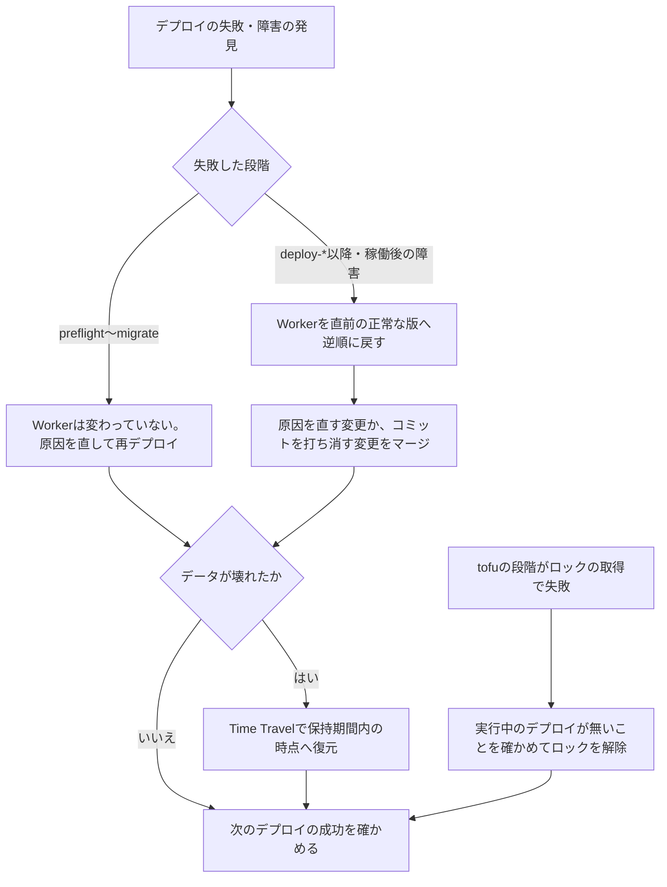

# ロールバックと復旧

デプロイの失敗や障害のときに、各Workerを直前の正常な版へ戻す手順と順序、戻す先の版の特定、ロールバックの制約、データベースの復元、状態のロックの解除、及びCIの外でIaC定義を一時的に操作する手順を定める。

## 前提と用語

デプロイの段階と版のタグは「[検査とデプロイのパイプライン](../infra/007-ci-cd-pipelines.md)」に、状態の保管は「[IaC定義の構成](../infra/006-iac-with-opentofu.md)」に従う。デプロイパイプラインは失敗しても自動では戻さないため、戻すかどうかは開発者が判断する。`<IaCのディレクトリ>`・`<状態のバケット>`などのプレースホルダーは「[IaC定義の構成の前提と用語](../infra/006-iac-with-opentofu.md#前提と用語)」に従う。

| 用語               | 意味                                                                                                                                  |
| ------------------ | ------------------------------------------------------------------------------------------------------------------------------------- |
| ロールバック       | Workerの過去の版を、すべての通信を受ける版として改めて配信すること(`wrangler rollback`)。新しいデプロイとして記録される               |
| 直前の正常な版     | 失敗したデプロイより前に、その環境で正常に稼働していた版                                                                              |
| 版のタグ           | Workerの版の`annotations["workers/tag"]`。デプロイしたコミットのSHA(40桁の16進)。版のメッセージにはSHAとワークフローの実行のURLが入る |
| `<版のID>`         | Workerの版を識別するID                                                                                                                |
| `<Worker名>`       | デプロイ先の環境のWorkerの名前。資源一覧の`workers`の値                                                                               |
| `<データベース名>` | デプロイ先の環境のD1データベースの名前                                                                                                |
| Time Travel        | D1のバックアップと復旧の機能。保持期間内の任意の時点へデータベースを復元する                                                          |
| 状態のロック       | OpenTofuが状態と同じキーに置く`.tflock`。同じ環境の状態を更新する他の実行を失敗させる                                                 |

## 実行者

- ロールバック・データベースの復元・状態のロックの解除・状態の操作は、開発者が行う。AIエージェントは実行しない。これらのコマンドはAIエージェントの設定の拒否の一覧に載せる(「[AIエージェントが実行しない操作](001-deployment.md#aiエージェントが実行しない操作)」)。
- AIエージェントは、読み取りだけの調査(版の一覧、ジョブのログ、手順の要約)と、原因を直す変更・コミットを打ち消す変更のプルリクエストの作成を行ってよい。
- Wranglerの操作は、Infisicalのその環境の`/ci/cloudflare`のトークンを注入し、デプロイと同じアカウントの資源へ向けて行う。

```sh
infisical run --env <環境種別> --path /ci/cloudflare -- bunx wrangler <コマンド>
```

## 判断の流れ



- `preflight`・`tofu-foundation`・`reconcile-ids`・`migrate`で止まったときは、Workerは前の版のままである。`migrate`までに適用した資源の変更とマイグレーションは戻らないが、前の版のコードが新しいスキーマで動く前提で分けている(「[Expand/Contractの前提](../infra/007-ci-cd-pipelines.md#expandcontractの前提)」)。
- `deploy-*`以降で止まったとき、またはデプロイの後に障害が見つかったときは、新しい版で稼働しているWorkerだけを戻す。
- 戻した後もブランチには原因のコミットが残り、次のpushで再びデプロイされる。`staging`はmainで原因を直すか打ち消す変更をマージし、`prod`はhotfixで直す(「[hotfixとprodからmainへの戻し](001-deployment.md#hotfixとprodからmainへの戻し)」)。

## Workerを戻す順序

Workerは、利用者側と管理者側のフロントエンド、APIサーバー、イベントサーバーの順に戻す。

1. 利用者側・管理者側のフロントエンド
2. APIサーバー
3. イベントサーバー

- 新しいAPIサーバーは直前のリリースのフロントエンドの操作も受け付ける(「[直前のリリース](../infra/007-ci-cd-pipelines.md#直前のリリース)」)。フロントエンドを先に戻せば、どの時点でもフロントエンドが送る操作をAPIサーバーが受け付ける。
- メッセージを受信するイベントサーバーを最後に戻し、新旧どちらのAPIサーバーが送ったメッセージも処理できる間に切り替える。
- デプロイの順(APIサーバー→イベントサーバー→フロントエンド)の逆ではない。戻す間に受け付けられない操作とメッセージを生まない順である。

## 戻す先の版の特定

各Workerの版のタグに記録されたコミットから、戻す先の版を特定する。同じデプロイの4つのWorkerは、同じコミットのタグを持つ。

1. 直前の正常なデプロイのコミットを決める。その環境のデプロイの実行のうち、障害を起こした実行より前の、最後に成功した実行のコミットか、手順の要約に書かれた版を使う。
2. Workerごとに版の一覧を取り出し、版のタグがそのコミットに一致する版のIDを探す。同じタグの版が複数あれば(再実行など)、最も新しい版を選ぶ。

```sh
infisical run --env <環境種別> --path /ci/cloudflare -- bunx wrangler versions list --name <Worker名> --json
infisical run --env <環境種別> --path /ci/cloudflare -- bunx wrangler versions view <版のID> --name <Worker名> --json
```

3. 現在の配信の状態を確かめる。配信の割合が100%の版が、失敗したデプロイの版であることを確かめる。

```sh
infisical run --env <環境種別> --path /ci/cloudflare -- bunx wrangler deployments status --name <Worker名> --json
```

4. 「[Workerを戻す順序](#workerを戻す順序)」の順に、各Workerを戻す。`--message`は戻す理由を版の配信の記録に残すために付ける。確認の入力は省けず、開発者が答える。

```sh
infisical run --env <環境種別> --path /ci/cloudflare -- bunx wrangler rollback <版のID> --name <Worker名> --message "<戻す理由>"
```

- 戻す先の版の作成の後にWorkerのシークレットが変わっていると、Cloudflareはエラーコード10220で一度拒み、Wranglerが変わったシークレットのキーの名前を示して、続けるかの確認を追加で求める。続けると、戻す先の版のシークレットの値で稼働する。漏えいなどで値を差し替えたシークレットが含まれるときは、続けずに原因を直す変更を新しい版としてデプロイする。

5. デプロイ後の確認と同じ対象(`<ヘルスチェックの経路>`・利用者側の`/`)が正常に応答することを確かめる。

- ロールバックは版のタグを持つ版を改めて配信するため、次のデプロイの直前のリリースの特定は、戻した後のフロントエンドの版のコミットで正しく行われる。
- 版のタグが無い版(CIの外で作った版)は、コミットを特定できない。CIの外でWorkerの版を作らない。

## ロールバックの制約

- 戻せるのは、直近100件の版までである。
- Durable Objectのクラスの追加・名前の変更・削除(Wrangler設定の`migrations`)をまたぐ版には戻せない。その場合は、原因を直す変更を新しい版としてデプロイする。
- 戻す先の版が参照するR2のバケット・KVの名前空間・Queueが無くなっていると戻せない。
- 戻す先の版の作成の後にシークレットが変わっていると、エラーコード10220の追加の確認が要る。続けると、シークレットも戻す先の版の値に戻る。
- Workerにつながる資源は、ロールバックで変わらない。D1のスキーマとデータ、R2のオブジェクト、Queueのメッセージは戻らない。
  - データベースは、コードのロールバックで巻き戻さない。前の版のコードが新しいスキーマで動くよう、マイグレーションとコードの変更を分ける(「[Expand/Contractの前提](../infra/007-ci-cd-pipelines.md#expandcontractの前提)」)。
  - データの復旧が要るときは、「[データベースの復元](#データベースの復元)」で行う。
- IaC定義が管理する資源(ホスト名の割り当て・ウィジェットなど)の変更も戻らない。戻すときは、IaC定義の変更を打ち消す変更をマージしてデプロイする。データを持つ資源と秘密値を持つ資源は削除の防止により消えない。
- 参照: Cloudflare Docsの「[Rollbacks](https://developers.cloudflare.com/workers/versions-and-deployments/rollbacks/)」

## データベースの復元

データの破損や誤った更新からは、Time Travelで保持期間内の時点へデータベースを復元する。保持期間はプランにより異なる(「[エクスポートとバックアップ](../db/002-d1-constraints.md#エクスポートとバックアップ)」)。

1. 障害の原因(誤ったデータを書くWorkerの版など)を先に止める。原因が残ったまま復元すると、復元の後に再び壊れる。
2. 復元する時点を決め、その時点のブックマークを確かめる。D1を使うアプリのディレクトリで実行する。

```sh
infisical run --env <環境種別> --path /ci/cloudflare -- bunx wrangler d1 time-travel info <データベース名> --env <環境種別> --timestamp=<UNIXタイムスタンプ>
```

3. 復元する。復元はその時点より後の書き込みをすべて失う。出力に表示される復元前のブックマークを記録しておくと、復元をやり直せる。

```sh
infisical run --env <環境種別> --path /ci/cloudflare -- bunx wrangler d1 time-travel restore <データベース名> --env <環境種別> --timestamp=<UNIXタイムスタンプ>
```

4. 復元の後に、`<ヘルスチェックの経路>`と主要な画面の動作を確かめる。

- マイグレーションの適用の記録はデータベースの中にある。適用より前の時点へ復元すると、記録とスキーマの両方が戻り、次のデプロイの`migrate`がそのマイグレーションを再び適用する。稼働している版のコードが、復元した時点のスキーマで動くことを確かめてから復元する。
- R2のオブジェクトとQueueのメッセージは復元されない。D1の行が参照するオブジェクトとの食い違いは、個別に確かめる。
- 復元は、そのデータベースを使う全Workerに即時に効く。

## 状態のロックの解除

デプロイの`tofu-foundation`・`tofu-routing`は、状態のロックを5分待っても取れないと失敗する。ジョブが途中で取り消された場合などに、ロックが残ることがある。

1. 誤りの診断に表示されるロックの情報(`ID`・`Who`・`Created`)を記録する。
2. GitHubのActionsで、同じ環境のデプロイが実行中でないことを確かめる。実行中のデプロイのロックを解除すると、2つの実行が同時に状態を書き換えて状態が壊れる。
3. 開発者自身のInfisicalのログインで`/ci/tofu`の値を注入し、「[CIの外での一時的な操作](#ciの外での一時的な操作)」の手順3の`init`のコマンドで初期化してから、ロックを解除する。解除はproviderを使わないため、Universal Authの資格情報は要らない。

```sh
infisical run --env <環境種別> --path /ci/tofu -- tofu -chdir=<IaCのディレクトリ>/live force-unlock -force <ロックのID>
```

4. そのブランチの最新のコミットのデプロイの実行を再実行する。

- 適用の途中で止まった場合も、状態には適用を終えた資源が記録されている。次の実行の計画が残りの変更を求めるため、状態を手で書き換えない。
- `<状態のバケット>`のオブジェクト(状態と`.tflock`)を、ダッシュボードから直接消したり書き換えたりしない。

## CIの外での一時的な操作

障害の調査・ロックの解除・状態の操作(`tofu import`・`tofu state rm`など)で、開発者がCIの外からIaC定義を操作するときは、有効期限の短い資格情報を発行し、操作の後に失効させる。CIのOIDCの認証は、GitHub Actionsの外では使えないためである。

1. Infisicalで、その環境のデプロイの主体にUniversal Authの認証の方法を加える。アクセストークンの有効期限を1時間以内にし、クライアントシークレットを、有効期限を短くし使用回数を限って発行する。
2. 操作するシェルで、クライアントIDとクライアントシークレットを環境変数に入れる。値はシェルの履歴に残らない方法(`read -rs`で読み込んで`export`するなど)で入れる。

```sh
export INFISICAL_AUTH_METHOD=universal
export INFISICAL_UNIVERSAL_AUTH_CLIENT_ID=<クライアントID>
read -rs INFISICAL_UNIVERSAL_AUTH_CLIENT_SECRET && export INFISICAL_UNIVERSAL_AUTH_CLIENT_SECRET
```

3. `/ci/tofu`の状態の保管先の鍵とパスフレーズを注入して、初期化と操作を行う。`infisical`のproviderは手順2の環境変数で認証し、`/ci/cloudflare`のトークンを`ephemeral`で受け取る(「[一時的な資格情報](../infra/006-iac-with-opentofu.md#一時的な資格情報)」)。

```sh
infisical run --env <環境種別> --path /ci/tofu -- tofu -chdir=<IaCのディレクトリ>/live init -input=false -reconfigure -backend-config=../backends/<環境種別>.s3.hcl
infisical run --env <環境種別> --path /ci/tofu -- tofu -chdir=<IaCのディレクトリ>/live plan -input=false -lock-timeout=5m -var environment=<環境種別>
```

4. 操作の後に、発行したクライアントシークレットを失効させ、主体からUniversal Authを外して、OIDCだけで認証する状態へ戻す。シェルの環境変数を消し、ルートモジュールのディレクトリに書き出した計画ファイル(`<環境種別>.tfplan`)を消す。
5. 状態を変えた操作は、IaC定義の変更としてプルリクエストにし、次のデプロイの計画が意図しない変更を示さないことを確かめる。IaC定義と状態が食い違ったままだと、次のデプロイがIaC定義のとおりに戻す。

- `tofu apply`をCIの外で実行するのは、デプロイパイプラインが動かない障害の場合に限る。通常の変更は、mainへのマージとリリースでデプロイパイプラインに適用させる。
