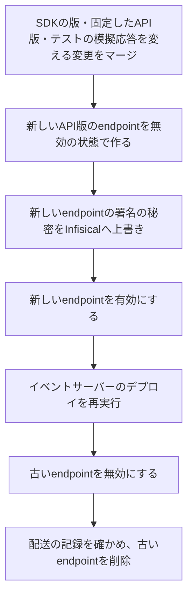

# 決済の環境とデータの運用

Stripeで決済を受け付けるアプリの、環境ごとのStripeの設定(制限付きキー・価格・税・現地通貨・決済手段・Customer Portal・定期課金の再試行と顧客向けメール・不審請求の申し立て・Webhook endpoint・ローカルの転送)と、決済手段の設定を確かめる検証の手順、定期課金の検証と運用(test clockによる検証・加入状態の突き合わせ・退会・停止に伴う解約の失敗の対処)、手動の返金、チャージバックへの対応、突合と返金の失敗の対処、鍵と署名の秘密の更新、Webhook endpointのAPI版の更新を定める。Stripeとの通信の規約は「[決済サービス(Stripe)](../external/007-stripe-payments.md)」に、通知の冪等な反映の規約は「[外部の通知の冪等な反映](../backend/009-idempotent-event-reflection.md)」に従う。

## 前提と用語

決済の受け付けにStripeのCheckout Sessions(`ui_mode: 'elements'`の決済画面)とWebhookを使い、シークレットをInfisicalのWorkerごとのフォルダで管理する構成を前提とする。シークレットの注入は「[シークレットの管理](../security/001-secret-management.md)」に、フォルダごとの登録の規則は「[シークレットの登録の規則](001-deployment.md#シークレットの登録の規則)」に、環境種別は「[環境種別](../infra/002-environments.md)」に従う。

| 用語                                        | 意味                                                                                                                              |
| ------------------------------------------- | --------------------------------------------------------------------------------------------------------------------------------- |
| sandbox                                     | Stripeのアカウントの中の、ライブモードから切り離されたテスト用の環境。設定・価格・税の登録・鍵はsandboxごとに分かれる             |
| 制限付きキー                                | `rk_test_`・`rk_live_`で始まる、資源ごとに読み取り・書き込み・なしの権限を割り当てたサーバー用の鍵                                |
| APIサーバー                                 | 決済の開始・決済画面の表示・決済後の戻りの反映・突合・価格の照会を行うWorker                                                      |
| イベントサーバー                            | Webhookの受信と反映・返金の実行・利用者の退会・停止に伴う定期課金の解約・Customerの削除・未完了の決済セッションの失効を行うWorker |
| `<Stripeのキーのシークレットのキー>`        | 制限付きキーを渡すシークレットの名前。APIサーバーとイベントサーバーで同じ名前を使い、値はWorkerごとに別にする                     |
| `<Webhookの署名の秘密のシークレットのキー>` | イベントサーバーがWebhookの署名を検証する秘密(`whsec_`で始まる)を渡すシークレットの名前                                           |
| `<公開キーの変数>`                          | 決済画面がStripe.jsへ渡す公開キー(`pk_test_`・`pk_live_`で始まる)の変数の名前。公開の値のため、Wrangler設定の`vars`に書く         |
| `<固定したAPI版>`                           | サーバーのSDKに固定したStripeのAPI版。Webhook endpointのAPI版も同じ値にする                                                       |
| `<Webhookの経路>`                           | イベントサーバーがWebhookを受ける経路                                                                                             |
| `<イベントサーバーのローカルのオリジン>`    | ローカル環境で起動したイベントサーバーのオリジン                                                                                  |
| `<イベントサーバーのホスト名>`              | デプロイ先のイベントサーバーのホスト名                                                                                            |
| `<利用者側のホスト名>`                      | 決済画面を表示するフロントエンドのデプロイ先のホスト名                                                                            |
| `<疎通確認用の価格のlookup_key>`            | デプロイ先検証環境までで決済の疎通を確かめるための1USDの価格の`lookup_key`                                                        |
| `<定期課金の価格のlookup_key>`              | 月ごとの定期課金の価格の`lookup_key`。本番環境を含む全ての環境に同じ値で作る                                                      |
| `<配布のスクリプト>`・`<Worker>`            | 「[デプロイ手順の前提と用語](001-deployment.md#前提と用語)」と同じ                                                                |

- 上のプレースホルダーの本プロジェクトの値は、技術ドキュメントに写さず、プロジェクト固有の値の文書(「[本プロジェクト固有の値](../../../onboardings/project-values.md)」)に置く。
- この文書のダッシュボードの操作は開発者が行う。AIエージェントは鍵の作成・Infisicalへの登録・ダッシュボードの設定の変更を行わない(「[AIエージェントが実行しない操作](001-deployment.md#aiエージェントが実行しない操作)」)。

## 環境ごとのStripeの設定

### 環境の分離

| 環境               | Infisicalの環境種別 | Stripeの環境                          | Webhookの届け方                |
| ------------------ | ------------------- | ------------------------------------- | ------------------------------ |
| ローカル環境       | `dev`               | 開発用のsandbox                       | `stripe listen`の転送          |
| デプロイ先検証環境 | `staging`           | 開発用と別のデプロイ先検証用のsandbox | sandboxのWebhook endpoint      |
| 本番環境           | `prod`              | ライブモード                          | ライブモードのWebhook endpoint |

- 環境ごとに別のsandboxを使い、テストの決済のデータを環境の間で混ぜない。sandboxの設定・価格・税の登録はライブモードへ引き継がれないため、以降の設定は環境ごとに行う。
- 本番環境の設定は、本番環境の準備でライブモードに同じ形で行う。`<疎通確認用の価格のlookup_key>`の価格は本番環境に作らない。

### 制限付きキーの権限

APIサーバーとイベントサーバーに、それぞれ必要な権限だけを持つ別々の制限付きキーを作る。秘密鍵(`sk_`で始まる、全ての権限を持つ鍵)は使わない。権限はダッシュボードの資源の名前で、次の表のとおりにする。表に無い資源は「なし」にする。

| 資源(ダッシュボードの分類) | APIサーバー | イベントサーバー | 使う操作                                                                                                                            |
| -------------------------- | ----------- | ---------------- | ----------------------------------------------------------------------------------------------------------------------------------- |
| Checkout Sessions          | 書き込み    | 書き込み         | APIサーバーは決済セッションの作成・取得・失効、イベントサーバーは取得と、利用者の退会などに伴う未完了の失効                         |
| Customers(Core)            | 書き込み    | 書き込み         | APIサーバーはCustomerの作成・更新、イベントサーバーは物理削除に伴うCustomerの削除                                                   |
| Prices(Billing)            | 読み取り    | なし             | `lookup_key`による価格の照会                                                                                                        |
| Payment Intents(Core)      | 読み取り    | 読み取り         | 決済セッションの支払いの特定と、返金・チャージバックの持ち主の特定                                                                  |
| Invoices(Billing)          | 読み取り    | 読み取り         | 定期課金の初回の請求の支払いの特定、請求の反映と、PaymentIntentからの請求の支払いの照会(持ち主の特定)                               |
| Charges and Refunds(Core)  | 読み取り    | 書き込み         | APIサーバーは決済の支払いの明細(Linkの資金源のグループ)の取得、イベントサーバーは返金の作成・取得・一覧(作成の前の既存の返金の照会) |
| Subscriptions(Billing)     | なし        | 書き込み         | Webhookの通知の対象の定期課金の取得と、拒否した購入の定期課金の解約、利用者の退会・停止に伴う解約                                   |
| Payment Disputes(Core)     | なし        | 読み取り         | チャージバックの取得                                                                                                                |
| Customer Portal(Billing)   | 書き込み    | なし             | 定期課金の利用者のCustomer Portalのセッションの作成                                                                                 |

- 書き込みの権限は同じ資源の読み取りを含む。
- 権限が足りない要求は、Stripeが権限の不足を示すエラーで拒否する。sandboxで決済・返金・Webhookの反映を一通り試し、ダッシュボードのAPIキーの一覧から鍵の要求の記録(View request logs)を開いて、失敗した要求が無いこと、使っていない権限が無いことを確かめる。過不足があれば表と鍵を合わせて直す。
- 機能を加えてStripeの操作が増えるときは、その変更と同じ変更でこの表を更新し、全ての環境の鍵の権限を直す。

### 制限付きキーの作成と登録

1. その環境のsandbox(本番環境はライブモード)のダッシュボードで、APIキーの一覧の「Create secret key」を押し、カスタムの権限を選ぶ。全ての権限(フルアクセス)は選ばない。
2. 鍵の名前をWorkerと環境が分かる名前にし、上の表の権限を割り当てて作る。作成時に表示される値は後から取り出せないため、そのままInfisicalへ登録する。
3. Infisicalのその環境のWorkerごとのフォルダ(`/workers/<Worker>`)に、`<Stripeのキーのシークレットのキー>`の名前で、APIサーバー用の鍵とイベントサーバー用の鍵を別々に登録する。
4. 共通のフォルダ(`/`)には置かない。このキーは`<配布のスクリプト>/core/secret-scope.ts`の`WORKER_SCOPED_SECRETS`に挙げるキーで、共通のフォルダに置いても使われず、Workerごとのフォルダに無ければ欠落として扱われる(「[シークレットの登録の規則](001-deployment.md#シークレットの登録の規則)」)。
5. 値をファイル・プルリクエスト・チャットに残さない。

- デプロイ先の値は、その環境の次のデプロイでWorkerへ反映される(「[シークレットの追加と削除](001-deployment.md#シークレットの追加と削除)」)。
- ローカル環境の起動は、`<配布のスクリプト>`の`run-with-secrets --scope local --worker <Worker>`で`dev`の共通のフォルダにWorkerごとのフォルダを重ねて注入する。ただしWranglerは、Wrangler設定のルートの`secrets.required`に挙げたキーだけをWorkerへ渡す(「[Workersのコードから参照するシークレット](../security/001-secret-management.md#workersのコードから参照するシークレット)」)。ローカル環境のWorkerへ渡すため、ルートの`secrets.required`にも`<Stripeのキーのシークレットのキー>`を挙げる。未登録の開発者の起動はWranglerが足りないキーの名前を警告するだけで止まらず、環境の検証がキーを任意として扱うため、決済の機能だけが「決済を利用できない」に縮退する。
- `<公開キーの変数>`は秘密でないため、その環境のsandbox(本番環境はライブモード)の公開キーをWrangler設定の`vars`に書く。制限付きキーと同じsandboxの公開キーにする。

### 価格

- 販売する価格は、ダッシュボードの商品(Product)に付けて作り、通貨をUSDにし、コードから参照する`lookup_key`を付ける。コードは価格のIDでなく`lookup_key`で価格を解決するため、環境ごとに同じ`lookup_key`の価格を作る。
- 税の扱い(tax behavior)は「Inclusive」(税込)にする。USDの価格は、税の扱いを指定しないと既定(Automatic)で税抜として扱われるためである。税込でない価格は、コードが決済に使えない価格として除くため、その価格の決済を利用できなくなる。
- 定期課金の価格は、月ごとの繰り返し(Recurring・Monthly)にし、`<定期課金の価格のlookup_key>`を付けて本番環境を含む全ての環境に作る。税の扱いは1回限りの価格と同じ「Inclusive」にする。税込でない定期課金の価格も、決済に使えない価格として除かれる。請求の再試行・顧客向けメールの設定と検証は「[定期課金](#定期課金)」に従う。
- 価格の金額は後から変えられないため、金額を変えるときは新しい価格を作り、同じ`lookup_key`を新しい価格へ移す(APIの`transfer_lookup_key`)。
- ローカル環境とデプロイ先検証環境には、決済の疎通を確かめるための1USDの1回限りの価格を`<疎通確認用の価格のlookup_key>`で作る。

### 税

1. ダッシュボードのTaxの設定でStripe Taxを有効にし、本社の所在地(head office)を確かめる。
2. 既定の商品の税コード(preset product tax code)を、販売する役務に合うものにする。商品ごとに異なる役務であれば、商品ごとに税コードを選ぶ。
3. 既定の税の扱いを「Inclusive」にする。
4. Taxの「Locations」で、税を徴収する地域の登録(registration)を加える。登録の無い地域の購入者には税額が0で計算される。

- どの地域を登録し、どの税コードを選ぶかは、事業者の税務の判断で決める。技術ドキュメントでは定めない。
- 税の登録はsandboxごとに分かれ、ライブモードへ引き継がれない。決済画面の税額の検証のため、sandboxにも本番環境と同じ地域を登録する。
- 決済セッションの自動の税計算(`automatic_tax`)は、購入者の請求先住所を使う。決済画面に請求先住所の入力欄を置く。

### 現地通貨での支払いの無効化

決済の通貨を自動で換算する機能(Adaptive Pricing)を使わず、USDだけで請求する。

1. ダッシュボードの設定の「Adaptive Pricing」(Payments settings)を開き、無効にする。
2. 決済セッションの作成でも`adaptive_pricing.enabled: false`を送り、ダッシュボードの設定が変わっても換算されないようにする。

- 無効にしても、無効にする前に換算された決済セッションと、現地通貨で支払い中の定期課金には影響しない。sandboxを作った直後に、決済を作る前に無効にする。

### 決済手段の設定

決済手段は、カード・Apple Pay・Google Pay・Linkだけにする。

1. ダッシュボードの設定の「Payment methods」を開き、決済セッションが使う決済手段の設定(Payment method configuration。指定しなければ既定の設定)を選ぶ。
2. Cards・Apple Pay・Google Pay・Linkを有効にし、Klarna・Affirm・Cash App Pay・Amazon Pay・銀行の口座振替など他の手段を全て無効にする。
3. ダッシュボードの設定の「Payment method domains」に、決済画面を表示するドメイン(`<利用者側のホスト名>`)を登録する。Apple Payは登録の無いドメインでは表示されない。Google Pay・Linkも登録の対象である。ドメインの登録はsandboxごとに行う(ライブモードで登録したドメインはsandboxにも登録される)。

- 決済セッションの作成でも、決済手段の種類を`allowed_payment_method_types: ['card', 'link']`で絞る。Apple Pay・Google Payは決済手段の種類としてはカード(ウォレット)であり、この指定で残る。ダッシュボードの設定は、この指定の中からさらに表示する手段を選ぶ2段目の制限になる。
- Linkを有効にすると、Linkの資金源(カードに加え、即時に確定する銀行決済・ステーブルコインなど)も有効になり、Linkを有効にしたまま個別には切れない。完了の通知で支払いが未完了の決済は権利を付与せず、確定の通知で反映する。
- ローカル環境(`localhost`)はドメインを登録できず、ウォレットが表示されないことがある。Apple Pay・Google Payの表示はデプロイ先検証環境で確かめる。

### Customer Portal

定期課金の利用者に、Stripeのホストする画面(Customer Portal)で支払方法の更新・解約・解約の取り消しをさせる場合の前提を定める。

その環境のsandbox(本番環境はライブモード)のダッシュボードの設定の「Customer portal」(Billing)を開き、次の設定にして保存する。

| 設定                                                                                           | 値                                                       |
| ---------------------------------------------------------------------------------------------- | -------------------------------------------------------- |
| Payment methods(支払方法の更新)                                                                | 有効                                                     |
| Cancel subscription(解約)                                                                      | 有効。解約の時期は請求期間の末(at end of billing period) |
| Switch plan・Update quantities・Pause subscription(プランと数量の変更・一時停止)               | 無効                                                     |
| Promotion codes・Retention coupons(割引の入力と解約の引き留めの割引)                           | 無効                                                     |
| 顧客の情報の更新(Name・Email address・Billing address・Phone number・Shipping address・Tax ID) | 無効                                                     |
| Invoice history(請求の履歴)                                                                    | 無効                                                     |

- ポータルのセッションは、構成を指定しなければ、その環境の既定の構成(default configuration)を使う。既定の構成はダッシュボードで設定を保存して作られるため、sandboxとライブモードのそれぞれで保存するまでは、ポータルのセッションの作成が失敗する。
- 支払方法の更新で表示する決済手段は、ポータルの構成で決済手段の設定を指定しなければ、既定の決済手段の設定に従う。決済画面と同じく、カード・Apple Pay・Google Pay・Linkだけになるよう「[決済手段の設定](#決済手段の設定)」を整えておく。
- 解約を請求期間の末にすると、利用者は期間の末までは解約を取り消せる。解約と取り消しは`customer.subscription.updated`で届き、期間の末の終了は`customer.subscription.deleted`で届く。柔軟な請求モード(`billing_mode: flexible`。`<固定したAPI版>`で作る定期課金の既定)では、期間の末の解約の予約は`cancel_at`の時刻で届き、`cancel_at_period_end`は偽のままになる。受信の処理は`cancel_at`と`cancel_at_period_end`の両方を見て予約の有無を判定する。
- 設定の検証(解約の予約・取り消し・期間の末の終了)は「[test clockによる検証の手順](#test-clockによる検証の手順)」で行う。
- 上の表で無効にするのは、提供すると定めていない機能である。プランの変更などを提供するときは、要件と受信の処理を先に変えてから有効にする。
- ポータルのセッションを作るWorker(APIサーバー)の制限付きキーには、Customer Portal(Billing)の書き込みの権限が要る(「[制限付きキーの権限](#制限付きキーの権限)」)。ポータルのセッションを作るWorkerを変えるときは、同じ変更で表と全ての環境の鍵の権限を直す。
- ポータルのセッションのURLは短い時間で失効するため、利用者が開くたびに作り直す。ポータルは埋め込みの枠の中には表示できず、画面の遷移で開く。

### 不審請求の申し立ての不服申し立て

不審請求の申し立て(チャージバック)の判定に対する不服申し立て(appeal)は、既定の無効のままにする。ダッシュボードの設定の「Disputes」の「Appealing dispute decisions」の「Appeal responses」を有効にしない。

有効にする場合は、次を確かめて事業者が判断する。

- 利用資格: 不服申し立ては、利用資格のある事業者だけが有効にできる。
- 手数料: 不服申し立てを送るたびに、結果に関わらず返金されない申し立ての手数料がかかる。仲裁ではカードネットワークの手数料(申し立てと裁定の手数料は1件600USDを超え得る。手続きの違反の手数料は1件250USDを超え得る)が、裁定の約1か月後に請求される。
- 対応の方法: 不服申し立ての反証資料の提出と期限の管理は、管理者がダッシュボードで行う。アプリは不服申し立ての状態(`appeal_needs_response`・`appeal_under_review`)を知らせる通知(`charge.dispute.updated`)を購読せず、最終の勝敗だけを`charge.dispute.closed`などで反映する。チャージバックの取得の処理は、未知の状態の値でも失敗しない作りにする。
- 記録: 申し立ての手数料と仲裁の手数料は、決済の記録と純収益の集計に含めない。

### Webhook endpoint

デプロイ先の環境(デプロイ先検証環境・本番環境)ごとに、そのsandbox(本番環境はライブモード)にWebhook endpointを1つ作る。

1. ダッシュボードのWorkbenchの「Webhooks」で「Create an event destination」を押し、「Your account」を選ぶ。
2. 通知の形式(payload format)は「Snapshot」を選び、API版を`<固定したAPI版>`にする。受信の処理は、通知の本文の種類(`type`)・発生時刻(`created`)・対象のID(`data.object.id`)を使い、対象の最新の状態を固定したAPI版で取得し直す。
3. 購読する通知の種類を、次の15種だけにする。

| 対象           | 通知の種類                                                                                                                                    |
| -------------- | --------------------------------------------------------------------------------------------------------------------------------------------- |
| 決済セッション | `checkout.session.completed`・`checkout.session.async_payment_succeeded`・`checkout.session.async_payment_failed`・`checkout.session.expired` |
| 請求           | `invoice.paid`・`invoice.payment_failed`                                                                                                      |
| 定期課金       | `customer.subscription.created`・`customer.subscription.updated`・`customer.subscription.deleted`                                             |
| 返金           | `refund.created`・`refund.updated`・`refund.failed`                                                                                           |
| チャージバック | `charge.dispute.funds_withdrawn`・`charge.dispute.funds_reinstated`・`charge.dispute.closed`                                                  |

4. 送り先を「Webhook endpoint」にし、URLを`https://<イベントサーバーのホスト名><Webhookの経路>`にする。
5. 作成後の設定の画面に表示される署名の秘密(`whsec_`で始まる)を、Infisicalのその環境の共通のフォルダ(`/`)に`<Webhookの署名の秘密のシークレットのキー>`の名前で登録する。

- 購読の一覧は、受信の処理が扱う通知の種類の一覧と一致させる。種類を足す・減らすときは、コードの一覧とこの表と全てのWebhook endpointを同じ変更で合わせる。
- サーバーのSDKとAPI版を上げるときは、Webhook endpointのAPI版も同じ版に変える。
- Webhookの経路は、IPアドレス単位の回数制限の対象から外し、署名の検証で送り手を確かめる。2xx以外の応答に対して、Stripeはライブモードでは最長3日間、sandboxでは数時間のうちに3回送り直す。

### ローカルの転送

ローカル環境はWebhook endpointを作らず、Stripe CLIの`stripe listen`で開発用のsandboxの通知をローカルのイベントサーバーへ転送する。

```sh
stripe login # 開発用のsandboxのアカウントに対して認可する
stripe listen --print-secret # 転送の署名の秘密を表示する
stripe listen \
  --events checkout.session.completed,checkout.session.async_payment_succeeded,checkout.session.async_payment_failed,checkout.session.expired,invoice.paid,invoice.payment_failed,customer.subscription.created,customer.subscription.updated,customer.subscription.deleted,refund.created,refund.updated,refund.failed,charge.dispute.funds_withdrawn,charge.dispute.funds_reinstated,charge.dispute.closed \
  --forward-to <イベントサーバーのローカルのオリジン><Webhookの経路>
```

- `--print-secret`が表示する署名の秘密を、Infisicalの`dev`の共通のフォルダ(`/`)に`<Webhookの署名の秘密のシークレットのキー>`の名前で登録する。値が変わった場合は登録し直す。
- `stripe listen`の通知は、アカウントの既定のAPI版の形で届く(`--latest`を付けると最新のAPI版)。受信の処理が本文の種類・発生時刻・対象のIDだけを使い、対象を固定したAPI版で取得し直す作りであれば、版の違いは反映に影響しない。
- 署名の秘密も、Wrangler設定のルートの`secrets.required`に挙げておき、`dev`へ登録した値をローカル環境のWorkerへ渡す。未登録なら警告だけで起動し、Webhookの経路が「決済を利用できない」を返す(「[制限付きキーの作成と登録](#制限付きキーの作成と登録)」)。
- 転送を止めた状態では通知が届かない。決済後の戻りの画面の反映と定期の突合だけで決済の完了まで辿れるかは、転送を止めて確かめる。

### 環境ごとの確認の一覧

| 項目                                              | ローカル環境(`dev`)        | デプロイ先検証環境(`staging`) | 本番環境(`prod`)       |
| ------------------------------------------------- | -------------------------- | ----------------------------- | ---------------------- |
| Stripeの環境                                      | 開発用のsandbox            | デプロイ先検証用のsandbox     | ライブモード           |
| 制限付きキー(`/workers/<Worker>`に2つ)            | 決済を試す開発者だけが登録 | 必須                          | 必須                   |
| 署名の秘密(`/`)                                   | `stripe listen`の秘密      | Webhook endpointの秘密        | Webhook endpointの秘密 |
| `<公開キーの変数>`                                | 開発用のsandboxの公開キー  | 検証用のsandboxの公開キー     | ライブモードの公開キー |
| 販売する価格(`lookup_key`・USD・税込)             | 作る                       | 作る                          | 作る                   |
| `<疎通確認用の価格のlookup_key>`(1USD)            | 作る                       | 作る                          | 作らない               |
| `<定期課金の価格のlookup_key>`(月ごと・USD・税込) | 作る                       | 作る                          | 作る                   |
| Stripe Taxの有効化と税の登録                      | 行う                       | 行う                          | 行う                   |
| Adaptive Pricingの無効化                          | 行う                       | 行う                          | 行う                   |
| 決済手段(カード・Apple Pay・Google Pay・Link)     | 行う                       | 行う                          | 行う                   |
| 決済手段のドメインの登録                          | 登録できない               | 行う                          | 行う                   |
| Customer Portalの設定                             | 保存する                   | 保存する                      | 保存する               |
| 再試行の後に定期課金を解約する設定                | 行う                       | 行う                          | 行う                   |
| 顧客向けメールの停止                              | 行う                       | 行う                          | 行う                   |
| 不服申し立てを無効のままにする                    | 確かめる                   | 確かめる                      | 確かめる               |
| Webhook endpoint(API版・15種)                     | 作らない(転送)             | 作る                          | 作る                   |

## 決済手段の検証の手順

決済手段の設定がカード・Apple Pay・Google Pay・Linkだけになっていることを、環境ごとの設定を終えた後と、決済手段の設定を変えた後に確かめる。

前提: その環境の制限付きキーと署名の秘密がWorkerへ渡り、Webhookが届く(ローカル環境は`stripe listen`の転送を起動している)こと。

1. 疎通確認用の価格の購入などで決済セッションを作り、決済画面を開く。
2. 決済セッションの決済手段の種類を確かめる。ダッシュボードの決済セッションの詳細か、次のコマンドで、`payment_method_types`が`card`と`link`だけであることを確かめる。

   ```sh
   stripe get /v1/checkout/sessions/<決済セッションのID>
   ```

3. 決済画面に表示される手段が、カード・Apple Pay・Google Pay・Linkだけであることを確かめる。Klarnaなど他の手段が出れば、決済手段の設定を直す。Apple PayはApple Payを設定した対応の端末のSafari、Google PayはGoogle Payを設定したChromeで、登録したドメインの決済画面を開いて確かめる(デプロイ先検証環境)。
4. テストカード`4242 4242 4242 4242`(有効期限は未来の任意の日付、CVCは任意の3桁)で支払い、決済後の戻りの画面で完了が表示され、`checkout.session.completed`の通知の決済セッションが`payment_status = 'paid'`であり、決済の記録が残ることを確かめる。
5. 3Dセキュアの認証を常に求めるテストカード`4000 0027 6000 3184`で支払い、認証の画面が表示されて完了でき、ブラウザの開発者ツールにCSPの違反が出ないことを確かめる。
6. Linkで、テスト用の銀行(Success)を使う即時の銀行決済で支払い、完了の通知の決済セッションが`payment_status = 'paid'`で届き、権利の付与まで反映されることと、決済の記録にLinkの資金源のグループが残ることを確かめる。
7. 結果(確かめた日・環境・決済セッションのID・表示された手段・資金源のグループ)を作業の記録に残す。想定外の手段や資金源が見つかれば、決済手段の設定と決済の受け付けの規則を見直す。

- 検証の決済は全てsandboxで行う。本番環境では、ライブモードの設定の画面で決済手段の設定と不服申し立ての設定を確かめるだけにし、テストの決済を行わない。

## 定期課金

月ごとの定期課金を売るアプリの、請求の再試行と顧客向けメールの設定、test clockによる検証、ダッシュボードとアプリの加入状態の突き合わせ、退会・停止に伴う解約の失敗の対処を定める。価格は「[価格](#価格)」、Customer Portalの設定は「[Customer Portal](#customer-portal)」、鍵の権限(Subscriptions・Customer Portalの行)は「[制限付きキーの権限](#制限付きキーの権限)」に従う。定期課金の状態の変化は、Webhookの通知(`customer.subscription.*`・`invoice.*`)としてだけアプリの加入状態に反映される。

### 再試行の後の解約の設定

その環境のsandbox(本番環境はライブモード)のダッシュボードの設定の「Subscriptions and emails」(Billing)の「Manage failed payments」を開き、次の設定にして保存する。

| 設定                                                      | 値                                                           |
| --------------------------------------------------------- | ------------------------------------------------------------ |
| 再試行(Smart Retries)                                     | 有効。回数と期間は既定のままにし、変えるときは事業者が決める |
| 再試行を使い切った後の定期課金の状態(Subscription status) | 解約する(Cancel subscription)                                |

- 再試行の間、定期課金は`past_due`のままで、アプリは特典を続ける。再試行を使い切ると定期課金は`canceled`になり、終了が`customer.subscription.deleted`で届く。
- 「未払いにする(Mark subscription as unpaid)」と「`past_due`のまま残す(Leave subscription past-due)」は選ばない。アプリは`unpaid`と`paused`を設定上は起きない状態として終了に扱い、エラートラッキングへ知らせる。これらの通知が届いたときは、この設定とCustomer Portalの一時停止(Pause subscription)の設定を確かめる。
- 支払いの失敗(`invoice.payment_failed`)・再試行の成功(`invoice.paid`)・状態の変化(`customer.subscription.updated`)は、Webhook endpointの購読の15種に含まれる。再試行の予定と結果は、ダッシュボードの請求(Invoice)の詳細で確かめる。

### 顧客向けメールの停止

アプリが支払いの失敗と解約の受付のメールを自分で送るため、Stripeの顧客向けの定期課金のメールを使わない。その環境のsandbox(本番環境はライブモード)のダッシュボードの設定で、次を全て無効にして保存する。

| 画面                                      | 設定                                                                                                                           | 値   |
| ----------------------------------------- | ------------------------------------------------------------------------------------------------------------------------------ | ---- |
| 「Subscriptions and emails」(Billing)     | 支払いの失敗のメール(Send emails about failed payments)と、支払い方法を更新するStripeのホストする画面へのリンクの送付          | 無効 |
| 同上                                      | カードの期限切れのメール(Send emails about expiring cards)                                                                     | 無効 |
| 同上                                      | 更新前の通知のメール(Send a reminder email for upcoming renewals)                                                              | 無効 |
| 「Emails」(Business)の「Customer emails」 | 支払いの成功の領収書(Successful payments)・返金のメール(Refunds)。アプリが購入確認と返金の通知のメールを送る構成では無効にする | 無効 |

- sandboxでは、Stripeは顧客向けメールを送らない。設定は設定の画面で確かめ、ライブモードにも同じ設定を行う。
- アプリが依頼したメールは、ローカル環境ではローカルのメールボックスで、デプロイ先ではメールの送信の記録で確かめる。

### test clockによる検証の手順

加入・支払いの失敗・再試行の後の終了・解約の予約と取り消し・課金期間の末の終了を、sandboxの時刻を進める機能(test clock)で確かめる。環境ごとの設定を終えた後と、定期課金の設定や受信の処理を変えた後に行う。test clockはsandboxだけの機能で、ライブモードでは検証の決済を行わない。

前提: その環境の制限付きキーと署名の秘密がWorkerへ渡り、Webhookが届く(ローカル環境は`stripe listen`の転送を起動している。「[ローカルの転送](#ローカルの転送)」)こと。test clockの作成と時刻を進める操作は開発者がダッシュボード(「Subscriptions」(Billing)の「Test clocks」)かStripe CLIで行い、Workerの制限付きキーにTest Helpersの権限は足さない。

1. シナリオごとにアプリの利用者を1人ずつ用意する(確認済みでログインできる利用者)。同じ利用者で2つ目の加入を始めるとアプリが拒否するため、シナリオの間で利用者を使い回さない。
2. 利用者ごとにtest clockを作る。時刻はアプリの実時刻に合わせる。

   ```sh
   stripe post /v1/test_helpers/test_clocks -d frozen_time=$(date +%s) -d name="<シナリオの名前>"
   ```

3. そのtest clockに属するCustomerを作る。メールアドレスは利用者のものにする。メタデータの仮名化IDは、アプリが決済の開始でCustomerを更新するときに付く(「[送る情報の範囲](../external/007-stripe-payments.md#送る情報の範囲)」)。

   ```sh
   stripe post /v1/customers -d test_clock=<test clockのID> -d email=<利用者のメールアドレス>
   ```

4. アプリのデータベースの利用者とCustomerの対応に、その利用者とCustomerのIDの対応を書き込む。対応があればアプリはCustomerを作らずに更新して使うため、以後の決済と定期課金がtest clockの上で進む。対応のテーブル名・列名は、その機能の仕様(サービス固有の文書)に従う。
5. その利用者でログインし、定期課金の価格の決済画面をテストカード`4242 4242 4242 4242`で支払う。`checkout.session.completed`・`customer.subscription.created`・`invoice.paid`が届き、アプリの加入が有効になることを確かめる。
6. シナリオごとに次の操作をする。test clockは1回で進められる幅に上限があり、進めている間(`status`が`advancing`)は次の操作ができないため、`ready`になるのを待って段階を分けて進める。

   ```sh
   stripe post /v1/test_helpers/test_clocks/<test clockのID>/advance -d frozen_time=<進める先のUNIX秒>
   stripe get /v1/test_helpers/test_clocks/<test clockのID> # statusがreadyになるまで待つ
   ```

   - 支払いの失敗と再試行の後の終了: Customer Portalで支払い方法を、Customerへの紐付けは成功し請求で失敗するテストカード`4000 0000 0000 0341`に差し替える。test clockを次の更新日(定期課金の詳細の次の請求の日時)の後へ進め、`invoice.payment_failed`と`past_due`への変化(`customer.subscription.updated`)が届き、アプリが支払いの失敗のメールを1通だけ依頼することを確かめる。続けて、請求の詳細に表示される再試行の予定を全て過ぎるまで進め、再試行の間に同じメールが再び依頼されないこと、定期課金が`canceled`になって`customer.subscription.deleted`が届き、終了が記録されることを確かめる。
   - 解約の予約・取り消し・期間の末の終了: Customer Portalで解約(期間の末)を予約し、`customer.subscription.updated`で`cancel_at`が届いて予約と終了の予定が記録され、解約の受付のメールが依頼されることを確かめる。Portalで解約を取り消し、予約が消えることを確かめる。再び予約してから、test clockを課金期間の終了の後へ進め、`customer.subscription.deleted`が届いて終了が記録されることを確かめる。
   - 退会・停止に伴う解約: 加入した利用者を退会させる(別の加入した利用者を管理者が停止する)と、波及処理が定期課金を退会は即時に、停止は期間の末に解約し、Webhookでアプリに反映されることを確かめる。停止の解除で解約の予約が取り消されないことも確かめる。

7. 終了は画面でなく記録で確かめる。test clockの時刻はアプリの実時刻より先に進むため、Stripeから届く終了の時刻と課金期間の終了は実時刻より未来になり、アプリは実時刻で状態を導くため、終了の後も画面は終了前の状態(解約の予約がある状態など)に見える。アプリのデータベースの定期課金の記録の、特典の終了時刻・外部の状態・確定済みの印が期待どおりであることで終了を確かめる。記録のテーブル名・列名・期待する値は、その機能の仕様(サービス固有の文書)に従う。
8. 結果(確かめた日・環境・シナリオ・test clockのID・定期課金のID)を作業の記録に残す。
9. 後始末として、test clockを削除する。そのCustomerと定期課金・請求も削除される。アプリの対応と記録は残るため、検証に使った利用者は他の検証に使い回さない。

   ```sh
   stripe delete /v1/test_helpers/test_clocks/<test clockのID>
   ```

### ダッシュボードと加入状態の突き合わせ

利用者からの問い合わせや検証で、Stripe側の定期課金とアプリの加入状態が合っているかを確かめる。

1. ダッシュボードの「Customers」で、Customerのメタデータの`pseudonymous_id`(利用者の仮名化ID)か、アプリの利用者とCustomerの対応にあるCustomerのIDで、利用者のCustomerを開く。
2. Customerの定期課金の、状態(`active`・`past_due`・`canceled`など)、解約の予約(`cancel_at`。ダッシュボードでは解約の予定日)、課金期間の終了(current period end)、終了の時刻(`ended_at`)を読む。コマンドで取得するときは次のとおりにする。

   ```sh
   stripe get /v1/subscriptions/<定期課金のID>
   ```

3. アプリの定期課金の記録(外部の状態・解約の予定時刻・課金期間の終了・特典の終了時刻・確定済みの印)と、利用者側の画面の表示を比べる。`active`で予約が無ければ特典を受けられる状態、`past_due`なら再試行の間も特典を受けられる状態、`active`で`cancel_at`があれば予約があり期間の末まで特典を受けられる状態、`canceled`なら終了(特典の終了時刻が確定済み)に当たる。画面は実時刻と特典の終了時刻の比較で状態を導くため、終了時刻が未来の間は終了前の状態に見える。状態の名前と期待する値は、その機能の仕様(サービス固有の文書)に従う。
4. 食い違いがあれば、Webhookの配送の記録(Event deliveries)で、その定期課金の通知が2xxで受け付けられたかを確かめ、失敗した通知は送り直す(Resend)。ローカル環境は`stripe listen`の転送を起動しているかを確かめる。受信の処理は通知の発生時刻で新しい状態だけを反映するため、古い通知を送り直しても状態は戻らず、同じ通知を2回反映しても記録は1回だけである。
5. 送り直しでも合わないときは、イベントサーバーの`warning`ログ(操作の名前・分類・Stripeのエラーコード)とエラートラッキングの知らせから原因を調べる。アプリの記録はダッシュボードの操作では直さず、Webhookの反映で直す。

- ダッシュボードで直接作った定期課金など、アプリの購入に結び付かない定期課金の通知は反映されず、対象のIDがログに残るだけである。検証の定期課金もアプリの決済画面から作る。

### 退会・停止に伴う解約の失敗の対処

利用者の退会・停止の非同期の波及処理が、その利用者の終了していない定期課金を解約する(退会は即時、停止は期間の末。「[利用者ライフサイクルイベント](../backend/007-user-lifecycle-events.md)」)。解約の失敗は、Stripeの一時的な障害・拒否・対象なしのいずれでも例外のまま投げ、メッセージの再試行に任せる。再試行の上限に達すると、デッドレターの通知(種別が利用者のライフサイクルのメッセージ、理由`handler-failed`、`errorName`は例外のクラス名)がエラートラッキングへ届き、イベントは未完了のまま日次の送り直しの対象に残る(「[再試行と運用者への通知](../backend/007-user-lifecycle-events.md#再試行と運用者への通知)」「[送り直し](../backend/007-user-lifecycle-events.md#送り直し)」)。

| 原因(`errorName`とイベントサーバーの`warning`ログの分類)          | 対処                                                                                                                                                      |
| ----------------------------------------------------------------- | --------------------------------------------------------------------------------------------------------------------------------------------------------- |
| 一時的な失敗(`StripeUnavailableError`)                            | Stripeの障害が解ければ、日次の送り直しで解約される。送り直しの通知(3回目以降)が続くときは、Stripeの状態と鍵を確かめる                                     |
| 恒久的な失敗(`StripeRejectedError`。Stripeのエラーコードを添える) | 下の手順でダッシュボードから解約する                                                                                                                      |
| 対象なし(`StripeNotFoundError`)                                   | アプリの記録の定期課金のIDがStripeに無い(別のsandboxの定期課金など)。ダッシュボードで仮名化IDからCustomerの定期課金を探し、残っていれば下の手順で解約する |

1. 未完了のまま残ったイベントの記録から利用者を特定し、ダッシュボードでその利用者のCustomer(メタデータの`pseudonymous_id`)の定期課金を開く。既に終了していれば何もしない。
2. 定期課金の「Cancel subscription」で解約する。退会なら即時(Cancel immediately)、停止なら期間の末(Cancel at end of current period)にし、返金と日割りは行わない。コマンドで行うときは次のとおりにする。

   ```sh
   stripe delete /v1/subscriptions/<定期課金のID> # 即時の解約
   stripe post /v1/subscriptions/<定期課金のID> -d cancel_at_period_end=true # 期間の末の解約
   ```

3. 解約は`customer.subscription.updated`・`customer.subscription.deleted`でアプリに反映される。未完了のイベントは次の日次の送り直しで波及処理が呼び直され、Stripe上で解約済み・終了済みなら成功として完了する。
4. 作業の記録に、日・環境・イベントのID・定期課金のID・解約の時期・原因を残す。

- 解約で返金はしない(「[手動の返金](#手動の返金)」)。
- 退会した利用者のCustomerは物理削除で削除され、Stripeは削除したCustomerの定期課金を即時に解約する。物理削除までの請求を止めるため、物理削除を待たずに解約する。

## 手動の返金

利用者からの依頼で返金するときや、自動の返金が失敗したときは、管理者がダッシュボードで返金する。アプリに返金の管理画面は無い。

1. ダッシュボードの「Transactions」(Payments)で、返金する支払いを探す。決済セッションの`client_reference_id`とメタデータの`purchase_id`が購入ID、Customerのメタデータの`pseudonymous_id`が利用者の仮名化IDである。
2. 支払いの詳細の「Refund」で、金額(全額か一部)と理由を指定して返金する。
3. 作業の記録に、日・環境・購入ID・返金のID・金額・理由を残す。

- 返金は`refund.created`・`refund.updated`の通知で決済の記録に負の金額で反映され、利用者の決済履歴に表示される。Webhookが届かない環境(転送を止めたローカル環境)では反映されない。
- 手動の返金はアプリの返金の依頼に結び付かない。アプリの返金の依頼の行は作られず、自動の返金の通知のメールも送られない。利用者への連絡は管理者が行う。
- 返金は権利の剥奪を伴わない。購入で得た権利を取り消すかは、その購入の種類を受け持つ機能の運用に従う。
- アプリが後から同じ支払いへ返金を依頼するとき、返金できる残りの計算に手動の返金は含まれない。Stripeの返金できる残りを超えた依頼はStripeが拒否し、返金の失敗として知らせる(「[返金の失敗の対処](#返金の失敗の対処)」)。
- 定期課金の支払いを返金しても、定期課金は解約されない。次の請求を止めるときは、ダッシュボードで定期課金を解約する。解約は`customer.subscription.updated`・`customer.subscription.deleted`の通知で反映される。
- 不審請求の申し立てを受けた支払いは返金しない(「[チャージバックへの対応](#チャージバックへの対応)」)。

## チャージバックへの対応

不審請求の申し立て(チャージバック)は、管理者がダッシュボードの「Disputes」で対応する。反証資料の提出と期限の管理はダッシュボードで行い、アプリは資金の移動と最終の結果だけを決済の記録に残す。

| 段階                       | 通知                                     | 決済の記録                                    |
| -------------------------- | ---------------------------------------- | --------------------------------------------- |
| 照会・審査中・不服申し立て | 購読しない(`charge.dispute.updated`など) | 記録しない(資金が動かない)                    |
| 引き落とし                 | `charge.dispute.funds_withdrawn`         | 申し立て(引き落とされた額を負の金額で)        |
| 資金の戻り(勝訴)           | `charge.dispute.funds_reinstated`        | 勝訴(戻った額を正の金額で)                    |
| 終了(敗訴)                 | `charge.dispute.closed`                  | 敗訴(金額0。損失は引き落としの記録で記録済み) |
| 終了(勝訴など)             | `charge.dispute.closed`                  | 記録しない(資金の戻りで記録済み)              |

- 段階ごとに1行を記録し、同じ段階の通知が重ねて届いても2行目を作らない。
- 申し立ての手数料(dispute fee)は、決済の記録と純収益の集計に含めない。
- 申し立てを受けた支払いには返金しない。資金は既に引き落とされており、返金すると二重に払い戻すことになる。Stripeも申し立て中の支払いの返金を拒否する(`charge_disputed`)。申し立てに応じる場合は、ダッシュボードで申し立てを受け入れる(Accept dispute)。
- チャージバックは権利の剥奪を伴わない。権利を取り消すかは、その購入の種類を受け持つ機能の運用に従う。
- 不服申し立ては既定の無効のままにする(「[不審請求の申し立ての不服申し立て](#不審請求の申し立ての不服申し立て)」)。
- 自分の購入・利用者に結び付かない申し立ては反映せず、対象のIDだけを`warning`のログに残す。

## 突合と返金の失敗の対処

### 突合と日次の確認の失敗

突合と日次の確認のジョブは、1件の失敗で残りを止めず、失敗した対象をエラートラッキングへ知らせる。仕組みは「[突合と日次の確認](../backend/009-idempotent-event-reflection.md#突合と日次の確認)」に従う。

| 知らせ(`kind`)                      | 意味                                                                                                         | 対処                                                                                                                                                                                                                                                                        |
| ----------------------------------- | ------------------------------------------------------------------------------------------------------------ | --------------------------------------------------------------------------------------------------------------------------------------------------------------------------------------------------------------------------------------------------------------------------- |
| `reconciliation-failed`             | 購入の決済セッションの取得か反映が失敗した(購入IDを添える)                                                   | Stripeの一時的な障害なら、次の回の実行で再び対象になる。Stripeに決済セッションが無い購入は失敗とせず、ログに残して失効にする。同じ購入が続けて失敗するときは、ダッシュボードで決済セッションの状態を確かめ、ログの例外のクラス名から原因を調べる                            |
| `reconciliation-time-limit-reached` | 時間の上限に達し、残りの購入を突合せずに止めた(残った件数を添える)                                           | Stripeの応答が遅い日に起きる。残りは次の回の突合と日次の確認が拾う。決済期限の直後の突合で起きたときは、反映の期限までに支払い済みの購入を反映できなかった可能性があるため、ダッシュボードで決済期限の直前の支払いを確かめる。続くときはStripeの状態と対象の件数を確かめる  |
| `refund-dispatch-failed`            | 送信していない返金の依頼、または送信の後に依頼中のまま残った返金の依頼を送れなかった(返金の依頼のIDを添える) | Queuesの障害なら、翌日の日次の確認が送り直す。続くときはQueuesの状態を確かめる                                                                                                                                                                                              |
| `refund-redispatched`               | 送信から24時間以上経っても依頼中のまま残った返金の依頼を送り直した(返金の依頼のIDを添える)                   | 再試行の上限でデッドレターになった依頼が含まれ得る。冪等キーの有効期間(24時間)を過ぎた送り直しでも、返金の処理が依頼のIDを持つ返金を照会してから作るため、Stripe上で二重の返金にならない。同じ依頼が続けて送り直されるときは「[返金の失敗の対処](#返金の失敗の対処)」に従う |
| `notice-request-failed`             | 依頼待ちのメールを依頼できなかった(購入IDと返金の依頼のIDを添える)                                           | メールの送信の依頼の一時的な失敗で、翌日の日次の確認が依頼し直す。続くときはメールの送信の状態を確かめる。記録の欠けで入力を組み立てられないメールはこの知らせに現れず、対象外として理由がログに残る                                                                        |

- 突合の対象が上限を超えたときは、ログに上限に達したことを残し、超えた分を翌日の日次の確認に残す。続けて上限に達するときは、上限と起動時刻を見直す。
- 突合は時間の上限(決済期限の直後の突合は起動の予定時刻から、日次の確認はジョブの開始から数える)を過ぎると、残りの購入を処理せずに止める。時刻は購入ごとの取得の前に確かめ、上限ちょうどまでは続ける。
- Webhookの反映の一時的な失敗は500で返り、エラートラッキングへ通知の種類とIDが送られる。Stripeが送り直すため、障害が解ければ反映される。送り直しの状況はダッシュボードのWorkbenchの「Webhooks」のendpointの配送の記録(Event deliveries)で確かめ、送り直しの期限を過ぎた通知はそこから送り直す(Resend)。反映は冪等のため、送り直しても記録と権利の付与は1回だけである。

### 返金の失敗の対処

返金の依頼は、イベントサーバーのメッセージの処理でStripeの返金になる。再試行で解消しない失敗は、返金の依頼を失敗として記録してエラートラッキングへ知らせる。

| 知らせ                                                                                                     | 意味                                                               | 対処                                                                                                                                                                                                                                                                                                                                                                                                                                                                                                                                                                                                          |
| ---------------------------------------------------------------------------------------------------------- | ------------------------------------------------------------------ | ------------------------------------------------------------------------------------------------------------------------------------------------------------------------------------------------------------------------------------------------------------------------------------------------------------------------------------------------------------------------------------------------------------------------------------------------------------------------------------------------------------------------------------------------------------------------------------------------------------- |
| `stripe-rejected`(操作`find_refund`・`create_refund`・`cancel_subscription`とStripeのエラーコードを添える) | Stripeが返金か、拒否した定期課金の購入の解約を拒否した             | エラーコードで分ける。既に返金済み(`charge_already_refunded`)なら対処は要らない。申し立て中(`charge_disputed`)ならチャージバックとして対応する。それ以外は、ダッシュボードで支払いと定期課金を確かめ、原因を取り除いてから手動で返金・解約する                                                                                                                                                                                                                                                                                                                                                                |
| `stripe-refund-failed`(Stripeの返金IDと失敗のコードを添える)                                               | 送り直しの前に作られていた依頼の返金が、Stripe上で既に失敗していた | 依頼を失敗として記録している。ダッシュボードで失敗の理由を確かめ、利用者へ連絡して別の方法で払い戻す                                                                                                                                                                                                                                                                                                                                                                                                                                                                                                          |
| `missing-payment-intent`                                                                                   | 返金の依頼の購入に支払い(PaymentIntent)のIDが無い                  | ダッシュボードで購入IDのメタデータから支払いを探し、手動で返金する                                                                                                                                                                                                                                                                                                                                                                                                                                                                                                                                            |
| デッドレターの通知(種別が返金のメッセージ、理由`handler-failed`)                                           | Stripeの一時的な失敗が再試行の上限(5回)まで続いた                  | 返金の依頼は依頼のまま残り、日次の確認が送信から24時間後に自動で送り直す(`refund-redispatched`で知らせる)。送り直しは冪等キーの有効期間の外になるが、返金の処理が依頼のIDを持つ返金を照会し、あればその返金を記録して作らない。Stripeの障害が解けていれば、送り直しで返金が作られるか記録される。障害の間は送り直しも失敗するため、Stripeの状態を確かめる。送り直しの後も同じ依頼のデッドレターと送り直しが続くときは、ログの例外から原因を調べて取り除く。手動で返金するときは、先に返金の依頼の状態をデータベースで取り消し(`canceled`)にしてから返金する(依頼のままだと翌日の送り直しが別の返金を作り得る) |

- 手動で返金した支払いの返金の依頼は、失敗・依頼のままの状態で残る(「[手動の返金](#手動の返金)」)。作業の記録に、返金の依頼のIDと手動の返金のIDを並べて残す。
- 作成した返金が後からStripeで失敗する(カードの解約などで`refund.failed`が届く)と、決済の記録と返金の依頼が失敗になり、反映が返金の依頼のIDとStripeの返金IDを添えてエラートラッキングへ知らせる(`refund-failed`。同じ失敗の通知の再送では重ねて知らせない)。ダッシュボードで返金の失敗の理由を確かめ、利用者へ連絡して別の方法で払い戻す。ダッシュボードの手動の返金の失敗は返金の依頼に結び付かないため知らせない。ダッシュボードの返金の一覧の失敗(Failed)を定期的に確かめる。
- 知らせには利用者の情報を含めない。利用者を特定するときは、購入IDと仮名化IDからデータベースを引く。

## 鍵と署名の秘密の更新

鍵の漏えいが疑われるとき、鍵を扱う人が替わったとき、定期の更新のときに行う。値の登録とデプロイの規則は「[シークレットの追加と削除](001-deployment.md#シークレットの追加と削除)」に従う。

### 制限付きキー

1. その環境のsandbox(本番環境はライブモード)のダッシュボードのAPIキーの一覧で、更新する鍵の「Rotate key」を選ぶ。漏えいが疑われるときは失効の時期を「Now」にし、それ以外はデプロイを終えるまでの時間(最長7日)を選ぶ。選んだ時期までは古い鍵と新しい鍵の両方が使え、新しい鍵は同じ名前と権限を持つ。
2. 表示された新しい鍵を、Infisicalのその環境のWorkerごとのフォルダ(`/workers/<Worker>`)の`<Stripeのキーのシークレットのキー>`に上書きする(「[制限付きキーの作成と登録](#制限付きキーの作成と登録)」)。APIサーバー用とイベントサーバー用の鍵は別々に更新する。
3. その環境のデプロイを再実行して、新しい鍵をWorkerへ反映する。
4. 古い鍵の要求の記録(View request logs)で、要求が途絶えたことを確かめてから失効させる。

- 失効の時期を「Now」にすると、デプロイを終えるまで決済は「決済を利用できない」になり、返金のメッセージは再試行に回る。

### Webhookの署名の秘密

1. ダッシュボードのWorkbenchの「Webhooks」で、その環境のendpointの「Roll secret」を選ぶ。漏えいが疑われるときはすぐに失効させ、それ以外は古い秘密の失効を遅らせる(最長24時間)。遅らせた間、Stripeは古い秘密と新しい秘密のそれぞれで署名を付ける。
2. 新しい秘密を、Infisicalのその環境の共通のフォルダ(`/`)の`<Webhookの署名の秘密のシークレットのキー>`に上書きする。
3. 古い秘密の失効の前に、その環境のデプロイを再実行して、新しい秘密をイベントサーバーへ反映する。
4. endpointの配送の記録で、更新の後の通知が2xxで受け付けられていることを確かめる。

- 古い秘密の失効がデプロイより先になると、その間の通知は署名の不正(400)になる。Stripeが送り直すため、デプロイの後に反映される。
- ローカル環境の`stripe listen`の秘密が変わったときは、`dev`の値を登録し直す(「[ローカルの転送](#ローカルの転送)」)。

### 公開キー

公開キーは秘密でなく、失効させられない。sandbox(本番環境はライブモード)で公開キーを作り直したときは、Wrangler設定の`<公開キーの変数>`の値を変える変更をマージしてデプロイする。

## Webhook endpointのAPI版の更新

サーバーのSDKを上げて`<固定したAPI版>`を変えるときに、Webhook endpointのAPI版も同じ版にする。endpointのAPI版は作成の後に変えられないため、新しいendpointを作って切り替える。



1. SDKの版・コードの固定したAPI版・テストの模擬応答を同時に変える変更をマージし、デプロイする(「[API版とSDKの固定](../external/007-stripe-payments.md#api版とsdkの固定)」)。メジャーリリースをまたぐ更新は、変更履歴の破壊的な変更を先に確かめてコードを直す。
2. その環境のsandbox(本番環境はライブモード)で、古いendpointと同じURL・同じ15種の購読で、新しいAPI版のendpointを作り、無効にしておく。最新のAPI版はダッシュボードで選べる。それ以外の版は、APIの`api_version`で指定して作る。

   ```sh
   stripe post /v1/webhook_endpoints \
     -d url="https://<イベントサーバーのホスト名><Webhookの経路>" \
     -d api_version="<固定したAPI版>" \
     -d "enabled_events[]=checkout.session.completed" # 15種を同じ形で並べる
   ```

3. 新しいendpointの署名の秘密を、Infisicalのその環境の共通のフォルダ(`/`)の`<Webhookの署名の秘密のシークレットのキー>`に上書きする。
4. 新しいendpointを有効にする。この時点から、同じ通知が2つのendpointへ届く。
5. その環境のデプロイを再実行して、新しい秘密をイベントサーバーへ反映する。反映までは新しいendpointの通知が、反映の後は古いendpointの通知が、署名の不正(400)になる。
6. 古いendpointを無効にする。新しいendpointの通知が2xxで受け付けられていることを配送の記録で確かめてから、古いendpointを削除する。

- 受信の処理は通知の本文の種類・発生時刻・対象のIDだけを使い、対象を固定したAPI版で取得し直すため、2つのendpointのAPI版の違いは反映に影響しない。同じ通知が2回届いても、反映は冪等のため記録と権利の付与は1回だけである。
- 手順5の前の新しいendpointの通知は、Stripeが送り直すため、デプロイの後に反映される。決済セッションは突合と日次の確認でも拾われる。
- デプロイ先検証環境で手順を終えて決済とWebhookの反映を確かめてから、リリースで本番環境に同じ手順を行う。ローカル環境の`stripe listen`はアカウントの既定のAPI版で届くため、手順は要らない。
