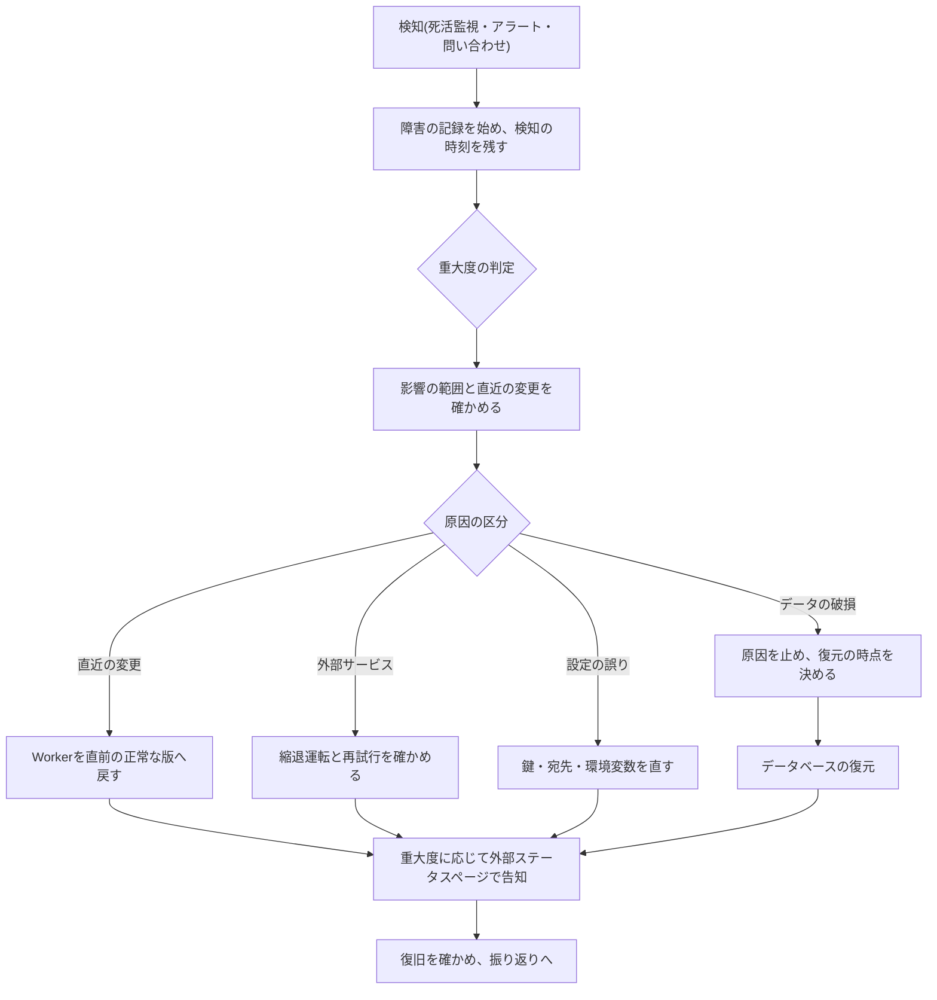

# 障害対応

本番で障害を検知してから復旧・振り返りまでの手順を定める。検知の経路・重大度の判定・初動・外部ステータスページでの告知・外部サービスの障害時の対応・データベースの復元の判断・復元の後の外部サービスとの突き合わせ・事後の振り返りを扱う。Workerを戻す操作は「[ロールバックと復旧](002-rollback-and-recovery.md)」、通知の規則は「[監視とアラート](../security/009-monitoring-and-alerting.md)」に従う。

## 前提と用語

障害の検知に使う監視とアラートの規則は「[監視とアラート](../security/009-monitoring-and-alerting.md)」に、Workerの戻しとデータベースの復元の操作は「[ロールバックと復旧](002-rollback-and-recovery.md)」に従う。外部サービスの障害時の振る舞いは、「[外部サービスの文書](../external/README.md)」の各文書に従う。

本文中の`<S1の初動の目標時間>`などのプレースホルダーの本プロジェクトの値は、技術ドキュメントに写さず、プロジェクト固有の値の文書「[本プロジェクト固有の値](../../../onboardings/project-values.md)」に置く。

| 用語                 | 意味                                                                                                                                   |
| -------------------- | -------------------------------------------------------------------------------------------------------------------------------------- |
| 障害                 | 利用者が機能を使えない、または誤ったデータが見える状態。利用者への影響が限られていても、監視の通知または問い合わせで知ったものは含める |
| 検知                 | 障害を知った時刻。復旧の所要時間(RTO)を測る起点                                                                                        |
| 重大度               | 影響の大きさで定める区分(S1〜S4)。「[重大度](#重大度)」で扱う                                                                          |
| 初動                 | 障害の記録を始めてから、影響の範囲と原因の区分を確かめ、止血を判断するまでの作業                                                       |
| 縮退運転             | 外部サービスが止まったときに、関係しない機能を続け、関係する操作は利用者への案内か後での再試行で扱う状態                               |
| 外部ステータスページ | 利用者へ稼働状況を公開するページ。公開する対象と範囲は監視の文書で定める                                                               |
| 復元の時点           | Time Travelで戻す時刻。最初の誤った書き込みより前で、保持期間の内にある時刻                                                            |
| 振り返り             | 復旧の後に、時系列・原因・対応を記録し、再発を防ぐ項目と手順書の直す箇所を決める作業                                                   |
| `<RTO>`・`<RPO>`     | 復旧の目標時間と、失われてもよいデータの時間の幅。値は本プロジェクトの値の文書に置く                                                   |

実行者は次のとおり分ける。

- Workerのロールバック・データベースの復元・状態のロックの解除は開発者が行う。AIエージェントは実行しない(「[ロールバックと復旧の実行者](002-rollback-and-recovery.md#実行者)」)。
- AIエージェントは、障害の調査(ログ・版の一覧・手順の要約)と、原因を直す変更のプルリクエストの作成を行ってよい。
- 外部サービスの管理画面の操作(決済の突合・再送・告知)は、開発者が行う。

## 検知の経路

障害は次の経路のいずれかで知る。経路ごとに、最初に確かめる場所を決めておく。

| 経路               | 内容                                                                                                                                 | 最初に確かめる場所                                                                         |
| ------------------ | ------------------------------------------------------------------------------------------------------------------------------------ | ------------------------------------------------------------------------------------------ |
| 死活監視           | 外部の複数の地域から、利用者が使う入口とヘルスチェックの経路を確かめる。応答しない、または期待する内容を含まないと通知される         | 通知された対象と地域。対象の応答の内容とステータスコード                                   |
| アラート           | エラートラッキングの誤りの件数・定期実行の失敗・外部サービスの設定の誤り・利用量の上限など、アラートの規則で定めた条件に当たった通知 | アラートの規則の初動の欄(「[監視とアラート](../security/009-monitoring-and-alerting.md)」) |
| 利用者の問い合わせ | 問い合わせの窓口に届く障害の報告                                                                                                     | 報告の内容から影響の範囲を推定し、同じ操作を再現して監視の状態を確かめる                   |
| デプロイの後の確認 | デプロイの直後に応答や表示の変化に気づいた場合                                                                                       | 直近のデプロイの版と時刻(「[ロールバックと復旧](002-rollback-and-recovery.md)」)           |

- 通知を受けたら、検知の時刻と経路を記録し、通知の内容(対象・時刻・通知の種類)を残す。
- 通知が届かなかった障害は、通知の設定の不備として振り返りの項目に挙げる。

## 重大度

重大度は影響の大きさで決める。区分と目標の初動の時間は次の表のとおり。

| 重大度 | 状態           | 例                                                                                 | 初動の目標時間         | 外部ステータスページ                 |
| ------ | -------------- | ---------------------------------------------------------------------------------- | ---------------------- | ------------------------------------ |
| S1     | 全停止         | 利用者側または管理者側の入口が応答しない。データが壊れている恐れがある             | `<S1の初動の目標時間>` | 告知する                             |
| S2     | 主要機能の停止 | ログイン・閲覧・決済など主要な操作が失敗する。アラートの規則でS2とした条件に当たる | `<S2の初動の目標時間>` | 告知する                             |
| S3     | 一部の縮退     | 一部の機能だけが失敗する。外部サービスの障害で縮退運転に入っている                 | `<S3の初動の目標時間>` | 利用者への影響が見えるときに告知する |
| S4     | 軽微           | 表示の崩れなど、利用者への影響が限られる不具合                                     | `<S4の初動の目標時間>` | 告知しない                           |

- 判定に迷ったら重い区分で始め、影響の範囲が分かった後に下げる。下げた理由は障害の記録に残す。
- 外部サービスの障害は、利用者への影響の大きさで区分を定める。原因が外部にあることは、区分を軽くする理由にしない。
- 重大度は初動の間に見直してよい。

## 初動

検知してから止血を判断するまでの手順は次の順とする。

1. 障害の記録を始める。検知の時刻・経路・重大度・対応する開発者を、障害の記録に書く。記録には利用者の個人情報と秘密情報を書かない(「[伏せ字の規則](../infra/004-logging-and-error-tracking.md#伏せ字の規則)」)。
2. 影響の範囲を確かめる。環境(利用者側・管理者側・APIサーバー・イベントサーバー・画像配信)、機能、利用者の範囲(全員・一部・管理者だけ)、データへの影響(読み取りだけか、書き込みで壊れたか)を確かめる。
3. 直近の変更を確かめる。直近のデプロイの版のタグと時刻、直前に変えた設定やシークレットを確かめ、障害の開始時刻と比べる。
4. 原因の区分を決める。直近の変更、外部サービスの障害、設定の誤り(鍵・宛先・環境変数)、基盤の障害、利用量の上限のいずれかに分ける。
5. 止血を判断する。直近の変更が原因なら、「[ロールバックと復旧](002-rollback-and-recovery.md)」の判断の流れに従ってWorkerを戻す。外部サービスの障害なら、「[外部サービスの障害](#外部サービスの障害)」の縮退運転を確かめる。データが壊れたなら、原因を止めてから「[データベースの復元の判断](#データベースの復元の判断)」に進む。
6. 重大度に応じて、外部ステータスページで告知する(「[外部ステータスページでの告知](#外部ステータスページでの告知)」)。

## 外部ステータスページでの告知

- 告知は重大度の表に従う。最初の告知は、その重大度の初動の目標時間の内に出す。原因が分からない段階でも「調査中」として出す。
- 更新は、状態が変わったときと、`<告知の更新の間隔>`ごとに行う。
- 解決したら、解決の告知を出し、振り返りの後に再発防止の予定を追記するかを判断する。
- 外部ステータスページに載せる対象は、監視の文書で定めた対象だけとする。載せない対象だけの障害は、重大度にかかわらず外部ステータスページに告知せず、問い合わせへの返信と影響を受けた利用者への個別の連絡で案内する。
- 告知に書かないもの: 利用者の個人情報、攻撃の手口や脆弱性の詳細、内部の構成(ホスト名・Workerの名前・資源の名前)、確かめていない原因の断定。

| 段階   | 含める内容                                                                                       |
| ------ | ------------------------------------------------------------------------------------------------ |
| 調査中 | 利用者の言葉で何が起きているか、影響を受ける機能、調査を始めた時刻、次の更新の予定時刻           |
| 対応中 | 原因の区分(断定しない)、取っている対応(Workerの戻し・縮退運転・再試行の待機など)、影響が続く範囲 |
| 監視中 | 対応を終えたこと、影響が無くなったことを確かめた方法、経過を見る期間                             |
| 解決   | 解決した時刻、影響があった期間、利用者がすべきことの有無、振り返りの予定                         |

- 利用者への案内は、告知と同じ事実を使う。問い合わせへの返信では、外部ステータスページのURLを案内する。

## 外部サービスの障害

外部サービスの障害は、障害の種類ごとに期待する振る舞いが決まっている。対応表は、各外部サービスの文書の「失敗の分類」「再試行と縮退」「障害時の扱い」の節と、本プロジェクトの対応表(「[本プロジェクト固有の値](../../../onboardings/project-values.md)」の所在)で示す。

| 障害の種類 | 例                         | 期待する振る舞い                                                   |
| ---------- | -------------------------- | ------------------------------------------------------------------ |
| 時間切れ   | 応答が返らない             | 再試行の後に縮退運転へ移る。利用者には縮退の案内を示す             |
| 認証の失敗 | 鍵が無効・権限が足りない   | 外部の障害ではなく設定の誤りの可能性が高い。鍵と設定を先に確かめる |
| 上限       | 利用量の上限・レートの上限 | 待機の後に再試行する。継続する場合は上限の引き上げを申請する       |
| 応答の誤り | 想定しない形式の応答       | 失敗として扱い、縮退運転へ移るか、判定を未完了のまま残す           |

1. 障害のサービスを特定し、そのサービスの稼働状況を確かめる。
2. 対応表で、その障害の種類の期待する振る舞いを確かめる。
3. 振る舞いが期待どおりか確かめる。縮退の案内が出ているか、再試行の対象の操作が待機の列に入っているか、運用者への通知が届いているかを確かめる。期待どおりでなければ振り返りの項目に挙げる。
4. 再試行の待機: 障害が回復すると再試行で処理される操作は、同じ内容を手作業で重ねて送らない。二重の決済や二重の送信を避けるため、再送の判断は各外部サービスの文書の手順に従う。
5. 回復の確認: 外部サービスの回復後に、関係する操作が成功すること、待機していた操作の残りが無いことを確かめる。

- 外部サービスの障害では、自社のWorkerを戻さない。戻しても外部の障害は直らず、戻す先の版が古い仕様で動く恐れがある。直近の変更が外部の呼び出しを変えていた場合だけ、戻すかを判断する。
- 外部サービスの障害では、データベースを復元しない。障害中に書き込まれたデータは、回復の後の再試行で扱う。
- 障害が運用者へ通知されなかった場合は、振り返りに挙げる。

## データベースの復元の判断

データの破損・誤った更新・誤った操作で、Workerを戻すだけでは元に戻らないときに、Time Travelで復元の時点へ戻す。Workerを戻しても、データベースは戻らない(「[ロールバックの制約](002-rollback-and-recovery.md#ロールバックの制約)」)。

1. 原因を止める。誤ったデータを書いているWorkerの版を戻すか、書き込みを止める。原因が残ったまま復元すると、復元の後に再び壊れる。
2. 復元の時点を決める。最初の誤った書き込みの直前の時刻を、ログの相関ID・監査ログ・データの件数の推移から特定する。時刻は誤った書き込みより少し前を選ぶ。
3. 保持期間を確かめる。復元できるのは保持期間の内の時点だけである(「[エクスポートとバックアップ](../db/002-d1-constraints.md#エクスポートとバックアップ)」)。
4. 復元の判断を始めた時刻を障害の記録に残し、復元の操作を「[データベースの復元](002-rollback-and-recovery.md#データベースの復元)」の手順で行う。復元の出力に表示される復元前のブックマークを記録する。
5. 復元の後に、ヘルスチェックと主要な画面を確かめ、件数の確認とスモークテストを行う。稼働中の版が、復元した時点のスキーマで動くことを確かめる。

- 復元は、その時点より後の書き込みをすべて失う。失われた書き込みに対応する外部サービスの事象は残るため、次の節で突き合わせる。
- R2のオブジェクトとQueueのメッセージは復元されない。データベースの行が参照するものとの食い違いは、個別に確かめる。

## 復元の後の外部サービスとの突き合わせ

復元の時点より後に外部サービスで起きた事象は、復元したデータベースに反映されていない。次の手順で、外部サービスの記録とデータベースの状態を突き合わせる。

1. 復元の時点を境に、外部サービスの記録から、その時点より後の事象を取り出す。対象は、決済・返金・定期課金の状態の変化、送信したメール、判定の結果、外部からの通知(Webhook)の受信などである。
2. 取り出した事象を、復元後のデータベースの状態と照らし、データベースに無い事象と、状態が食い違う事象の一覧を作る。
3. 食い違いを直す。直す方向(外部サービスの状態を正とするか、データベースを正とするか)を決め、直す手段は各外部サービスの文書の手順に従う。決済の突合と再送は「[突合と返金の失敗の対処](004-payment-data-operations.md#突合と返金の失敗の対処)」に従う。
4. 直した件数と未対応の件数を振り返りの記録に残す。利用者への連絡が要る食い違い(二重の決済など)は、利用者への案内を別に行う。

- 再送は、冪等に処理されることを確かめてから行う。確かめられない再送は、手作業で重ねない。

## 復旧の確認と所要時間の記録

障害の記録には、次の時刻を残す。

| 記録する時刻                     | 意味                                                            |
| -------------------------------- | --------------------------------------------------------------- |
| 検知                             | 障害を知った時刻(RTOの起点)                                     |
| 復元の判断の開始                 | データベースの復元の判断を始めた時刻(復元を伴う障害の場合)      |
| 復元の完了と確認の完了           | 復元を終え、件数の確認とスモークテストが成功した時刻(RTOの終点) |
| 復元の時点と最初の誤った書き込み | 失われた書き込みの時間の幅(RPOの判定に使う)                     |

- RTOは、検知から復元の完了と確認の完了までの時間で判定する。`<RTO>`を超えたら、振り返りで超えた原因を挙げる。
- RPOは、復元の時点と最初の誤った書き込みの時刻の差で判定する。`<RPO>`を超える場合は、復元できる時点の細かさと保持期間を見直す項目を挙げる。
- 復旧の後に、影響が続いていないことを利用者側の主要な画面と管理者側の操作で確かめてから、障害を解決として告知する。

## 振り返り

- 振り返りは、復旧の確認の後、`<振り返りの期限>`の内に行う。
- 個人の責任を問わず、仕組みと手順の改善に焦点を当てる。
- 振り返りの記録には、次の項目を含める。
  - 時系列(検知・初動・告知・止血・復元・解決の時刻)
  - 影響(範囲・期間・件数・利用者への影響)
  - 検知の経路と検知の遅れ、通知が届かなかったかどうか
  - 重大度の判定と初動の目標時間の達成
  - 告知の内容と時刻の適否
  - 原因の区分と、直接の原因・それを許した要因
  - 再発防止の項目(担当・期限・確認方法)
  - 手順書の食い違い(この文書と関連文書の直す箇所)
  - 監視とアラートの規則、外部サービスの対応表の見直し
- 再発防止の項目は、担当と期限を付けて作業として登録する。手順書の食い違いは、同じ変更で文書を直す。
- 振り返りの記録に、利用者の個人情報と秘密情報を書かない。

## 関連文書

- [ロールバックと復旧](002-rollback-and-recovery.md) - Workerの戻しとデータベースの復元の操作
- [デプロイ手順](001-deployment.md) - デプロイの段階と版のタグ
- [本番準備と演習](006-release-readiness-and-drills.md) - 本番準備のチェックリストと、ロールバック・復旧の演習
- [決済の環境とデータの運用](004-payment-data-operations.md) - 決済の突合と再送
- [監視とアラート](../security/009-monitoring-and-alerting.md) - 監視の層、アラートの規則、初動の対応付け
- [外部サービスの文書](../external/README.md) - 各外部サービスの失敗の分類と再試行・縮退
- [ログの出力と伏せ字](../infra/004-logging-and-error-tracking.md) - 障害の記録とログに含めない情報
- [D1の制約と対処](../db/002-d1-constraints.md) - バックアップと保持期間
- [本プロジェクト固有の値](../../../onboardings/project-values.md) - プレースホルダーの本プロジェクトの値
