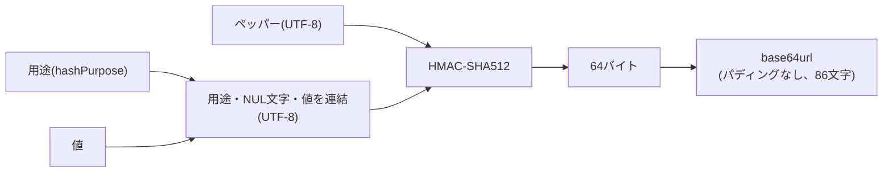

# 秘密情報のハッシュ化

高エントロピーの秘密情報とレート制限のキーを、環境シークレットとして管理する固定のペッパーを鍵としたHMAC-SHA512でハッシュ化する方法、用途の分離、保存済みのハッシュ値との照合の方法、及びペッパーの管理を定める。

## 前提と用語

実行環境にCloudflare Workers、DIコンテナにInversify、シークレット管理サービスにInfisicalを使い、バックエンドの共通ライブラリにある次の部品でハッシュ化する構成を前提とする。部品はWeb Crypto API(`crypto.subtle`)だけを使うため、Bunの単体テストでもworkerdでも同じ結果になる。

| 部品                                                           | 置き場所(共通ライブラリ内)                        | 役割                                                                   |
| -------------------------------------------------------------- | ------------------------------------------------- | ---------------------------------------------------------------------- |
| `createKeyedHasher`・`KeyedHasher`・`HasherConfigurationError` | `core/crypto/keyed-hasher.ts`                     | ペッパーを鍵としたハッシュ化(`hash`)と照合(`verify`)                   |
| `hashPurpose`・`HashPurpose`                                   | `core/crypto/keyed-hasher.ts`                     | 用途の名前を検査し、ハッシュ化に渡せる用途の型にする                   |
| `hashRateLimitKey`・`HashedRateLimitKey`                       | `core/rate-limit/rate-limit-key.ts`               | レート制限のキーとなる値をハッシュ化し、ハッシュ化済みのキーの型にする |
| `createRateLimitCounterClient`・`RateLimitCounterClient`       | `workers/rate-limit/rate-limit-counter-client.ts` | ハッシュ化済みのキーごとに回数を数えるDurable Objectを呼び出す         |

| 用語                             | 意味                                                                                                                                                                              |
| -------------------------------- | --------------------------------------------------------------------------------------------------------------------------------------------------------------------------------- |
| 高エントロピーの秘密情報         | 暗号論的な乱数から生成したトークンなど、総当たりで推測できないだけの長さを持つ秘密の値                                                                                            |
| ペッパー                         | 全てのハッシュ化で共通に使う秘密の鍵。データベースには保存せず、環境シークレットとして管理する                                                                                    |
| 用途                             | ハッシュ化する値の種類を表す名前(例:`session-token`)。用途ごとにハッシュ値の空間を分ける                                                                                          |
| `<ペッパーのシークレットのキー>` | ペッパーを保持するシークレットの名前。Infisicalでの名前と、コードで参照する`env.<ペッパーのシークレットのキー>`の名前を一致させる                                                 |
| `<共通ライブラリの配置先>`       | 共通ライブラリを利用側のアプリへ配置したディレクトリ(「[共有ディレクトリの配置方式](../coding/003-shared-directories.md)」)。上の表の置き場所は、このディレクトリからのパスである |

## ハッシュ化の対象

- 次の値をハッシュ化して保存し、元の値を保存しない。
  - 高エントロピーの秘密情報(認証用のトークン・確認用のトークンなど)
  - レート制限のキーとなるIPアドレス・メールアドレスなど(「[レート制限のキー](#レート制限のキー)」)
- パスワードのように人が選ぶ推測しやすい値は対象外とする。この方式は1回のHMACで計算が速く、ソルトも使わないため、意図的に低速なパスワード用のハッシュ関数を使う。
- IPアドレス・メールアドレスのように取り得る値の少ない値のハッシュ値は、ペッパーが秘密である限り元の値を推測できない。ペッパーが漏えいすると総当たりで元の値を復元できるため、ペッパーの漏えいはハッシュ値の漏えいと同じ重さで扱う(「[ペッパーの変更と漏えい](#ペッパーの変更と漏えい)」)。

## ハッシュ化の方法

`KeyedHasher.hash(purpose, value)`は、用途と値を次のように変換したハッシュ値を返す。



- 鍵は、ペッパーの文字列をUTF-8でエンコードしたバイト列である。
- HMACの入力は、`<用途>\u0000<値>`をUTF-8でエンコードしたバイト列である。用途はNUL文字を含められないため、値がNUL文字を含んでも、最初のNUL文字が用途と値の境界になり、別の(用途, 値)の組と同じ入力にならない。
- 出力は、HMAC-SHA512の64バイトをパディングなしのbase64url(`A-Z`・`a-z`・`0-9`・`-`・`_`)で表した86文字の文字列である。
- 同じペッパー・用途・値からは、常に同じハッシュ値を返す(ソルトを使わない)。そのため、ハッシュ値を一意な列に保存し、入力をハッシュ化した値で検索できる。
- 空の値もハッシュ化できる。空の値を拒否する必要があれば、呼び出し側で検証する。

```typescript
import {
  hashPurpose,
  type KeyedHasher,
} from '<共通ライブラリの配置先>/core/crypto/keyed-hasher.ts';

const SESSION_TOKEN_PURPOSE = hashPurpose('session-token');

export async function toStoredTokenHash(
  hasher: KeyedHasher,
  token: string,
): Promise<string> {
  return hasher.hash(SESSION_TOKEN_PURPOSE, token);
}
```

## 用途の分離

- ハッシュ化する値の種類ごとに用途を1つ定め、`hashPurpose('<用途の名前>')`の結果をモジュールの定数として持つ。同じ値でも用途が違えば別のハッシュ値になるため、ある用途のハッシュ値を別の用途の照合に流用されない。
- `hashPurpose`は、空の名前とNUL文字(`\u0000`)を含む名前を`RangeError`で拒否する。`HashPurpose`型は`hashPurpose`を通さずに作れないため、`hash`・`verify`に生の文字列を渡すと型検査で失敗する。
- 用途の名前は小文字とハイフンで値の種類を表す(例:`session-token`・`email-verification-token`)。`rate-limit-key`は`hashRateLimitKey`が使う用途であり、他の値に使わない。
- 用途の名前を変えると、それまでに保存したハッシュ値と一致しなくなる。保存を始めた用途の名前は変えない。用途の名前の重複は部品では検査しないため、新しい用途を加えるときは既存の用途の名前と重ならないことをコードレビューで確かめる。

## 照合の方法

保存済みのハッシュ値と入力を照合するときは、`KeyedHasher.verify(purpose, value, expectedHash)`を使う。`hash`の結果を`===`などの文字列の比較で照合しない。

```typescript
const matched = await hasher.verify(
  SESSION_TOKEN_PURPOSE,
  presentedToken,
  storedTokenHash,
);
```

- `verify`は、保存済みのハッシュ値をバイト列へデコードし、入力から計算したHMACとの比較を`crypto.subtle.verify('HMAC', ...)`に任せる。比較にかかる時間は、一致した位置などの入力の内容に依存しない。
- 保存済みのハッシュ値が`hash`の返す表記と完全に同じでなければ、照合せずに`false`を返す。デコードできない値、64バイトでない値、及びデコードはできるが再エンコードすると表記が変わる値(前後や途中の空白・改行、`=`のパディング、標準のbase64の`+`・`/`、末尾の文字の余りのビットだけが違う表記)が該当する。ハッシュ値は`hash`が返した文字列のまま保存し、パディングを付けたり別の表記へ変換したりしない。
- 用途・ペッパー・値のいずれかが違えば`false`を返す。例外は投げない。
- ハッシュ値で検索して記録を取り出す場合(「[ハッシュ化の方法](#ハッシュ化の方法)」)、検索の一致がそのまま照合の結果になる。記録を別の識別子で取り出し、その記録に保存したハッシュ値と入力を比べる場合に`verify`を使う。

## レート制限のキー

レート制限のキーとなる値は、`hashRateLimitKey(hasher, ...parts)`でハッシュ化し、元の値をカウンタの保存先へ渡さない。

```typescript
import { hashRateLimitKey } from '<共通ライブラリの配置先>/core/rate-limit/rate-limit-key.ts';

const key = await hashRateLimitKey(hasher, normalizedEmail);
const decision = await counterClient.hit(rule, key);
counterClient.assertWithinLimit(decision, Date.now());
```

- 用途は`hashPurpose('rate-limit-key')`に固定されている。
- 複数の部品を渡すと、`JSON.stringify(parts)`で配列のJSONとして連結してからハッシュ化する。部品の境界がJSONに残るため、`('ab', 'c')`と`('a', 'bc')`、`('a', 'b')`と`('a:b')`のように、単純に連結すると同じ文字列になる組み合わせも別のキーになる。
- 部品を1つも渡さないと`RangeError`で拒否する。
- 部品はそのままハッシュ化され、大文字小文字や前後の空白を揃えない。同じ利用者を同じキーで数えるため、メールアドレスの大文字小文字の統一などの正規化は、呼び出し側で行ってから渡す。
- 結果の`HashedRateLimitKey`型は`hashRateLimitKey`を通さずに作れず、`RateLimitCounterClient`の`hit`・`reset`はこの型のキーだけを受け取る。生のIPアドレスやメールアドレスを渡すと型検査で失敗する。
- カウンタのDurable Objectは、`<ルールの名前>:<ハッシュ化済みのキー>`を名前として選ばれる。ルールの名前で数える対象が分かれるため、部品にルールの名前を含める必要はない。

## ハッシュ化の部品の取得

- 処理単位ごとのDIコンテナに、`KeyedHasher`が識別子`PLATFORM_TYPES.KeyedHasher`で登録されている。`createKeyedHasher(env.<ペッパーのシークレットのキー>)`の結果を処理単位の中で1つだけ作って使い回す。注入するクラスでは「[コンストラクタ引数の注入](../backend/001-dependency-injection-on-workers.md#コンストラクタ引数の注入)」に従い、`@inject(PLATFORM_TYPES.KeyedHasher)`を明示する。
- `createKeyedHasher`は、ペッパーが未定義か空文字なら`HasherConfigurationError`(`name`が`'HasherConfigurationError'`)を投げ、ハッシュ値を返さない。環境の検証スキーマ(`platformEnvShape`)も、ペッパーを空でない文字列として必須にしている。
- ペッパーの鍵(`CryptoKey`)は、最初の`hash`・`verify`の呼び出しで作り、同じ`KeyedHasher`の中で使い回す。
- 単体テストでは、`createKeyedHasher('<テスト用の固定の文字列>')`で作った`KeyedHasher`を渡す。期待するハッシュ値は、Node.js互換の`createHmac('sha512', <ペッパー>).update('<用途>\u0000<値>').digest('base64url')`で求められる。

## ペッパーの管理

- ペッパーはシークレットとしてInfisicalで管理し、「[シークレットの注入](001-secret-management.md#シークレットの注入)」に従って実行時に注入する。Wrangler設定のルートと`env.<環境種別>`の両方の`secrets.required`に`<ペッパーのシークレットのキー>`を指定する(「[Workersのコードから参照するシークレット](001-secret-management.md#workersのコードから参照するシークレット)」)。`vars`やコード、テストのフィクスチャに本物のペッパーを書かない。
- ペッパーは「[シークレット管理の環境種別](../infra/002-environments.md#シークレット管理の環境種別)」ごとに別の値にする。ある環境のハッシュ値が他の環境で一致しないため、環境の間でデータを複製しても、ハッシュ値は複製先で照合に使えない。
- 値は暗号論的な乱数から生成し、HMAC-SHA512の出力と同じ64バイト以上のエントロピーを持たせる。例えば次のコマンドは、64バイトの乱数を128文字の16進数で出力する。

```sh
openssl rand -hex 64
```

### ペッパーの変更と漏えい

- 部品は1つのペッパーだけを受け取り、古いペッパーで作ったハッシュ値を照合する手段を持たない。ペッパーを変更すると、保存済みの全てのハッシュ値が一致しなくなる。
  - ハッシュ値で保存した秘密情報(トークンなど)は全て無効になり、利用者に発行し直す必要がある。
  - レート制限のキーが全て変わるため、各カウンタは0から数え直しになる。古いキーのカウンタは、期間の終わりに自動で消える。
- 計画的な変更は、上記の影響を受け入れられる時期に行う。
- ペッパーが漏えいした場合は、取り得る値の少ないハッシュ値(IPアドレス・メールアドレス)から元の値を復元され得るものとして、ペッパーを直ちに変更し、ハッシュ値で保存した秘密情報を無効にする。
