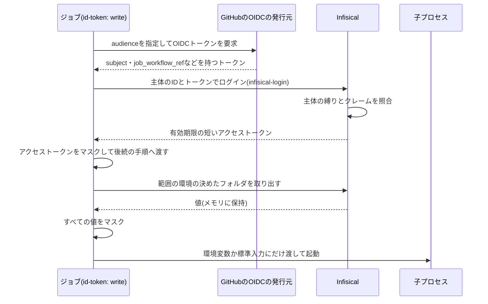

# CIのシークレットとリポジトリ保護

GitHub ActionsからInfisicalのシークレットを取り出す経路(主体の分離とOIDCの縛り・読み取りだけのロール・環境ごとの権限が無い料金プランで残るリスクと緩和策・フォルダの構成・マスクとログ・フォークのプルリクエスト)と、prodへの反映を人間の承認に限るリポジトリ保護(ルールセット・Environment・Actionsの設定・コードオーナー・AIエージェントの承認とマージの対策)の設定の項目と値を定める。

## 前提と用語

構成は「[インフラの構成](../infra/005-infrastructure-overview.md)」に、ワークフローとジョブは「[検査とデプロイのパイプライン](../infra/007-ci-cd-pipelines.md)」に、開発者の手作業の順序は「[デプロイ手順](../operations/001-deployment.md)」に従う。シークレットの保管と注入の一般的な規則は「[シークレットの管理](001-secret-management.md)」に従う。リポジトリ保護の設定はコード化せず、開発者が本文書の項目と値のとおりにGitHubとInfisicalの画面で設定する。

| 用語                      | 意味                                                                                                                                           |
| ------------------------- | ---------------------------------------------------------------------------------------------------------------------------------------------- |
| 主体                      | Infisicalに認証する機械の利用者(マシンアイデンティティ)                                                                                        |
| 検査の主体                | 検査のワークフローがdevの値を取り出すための主体                                                                                                |
| デプロイの主体            | `staging`・`prod`のそれぞれのデプロイのジョブが、その環境の値を取り出すための主体。環境ごとに1つ作る                                           |
| OIDCトークン              | GitHub Actionsがジョブごとに発行する短期の署名付きトークン。リポジトリ・イベント・ブランチ・Environment・ワークフローなどのクレームを持つ      |
| subject                   | OIDCトークンの`sub`クレーム。Environmentを使うジョブでは`repo:<所有者>/<リポジトリ名>:environment:<Environment名>`になる                       |
| `job_workflow_ref`        | OIDCトークンのクレームの1つ。ジョブを定義したワークフローのパスとref(`<所有者>/<リポジトリ名>/.github/workflows/<ファイル名>@<ref>`)           |
| `<所有者>/<リポジトリ名>` | GitHubのリポジトリの所有者(ユーザーか組織)と名前                                                                                               |
| `<OIDCのaudience>`        | OIDCトークンの`aud`クレーム。ワークフローがトークンを要求するときに指定し、Infisicalの主体の設定と一致させる                                   |
| 自動化の主体              | ワークフローの`GITHUB_TOKEN`で操作するGitHubの利用者(`github-actions[bot]`)                                                                    |
| ルールセット              | GitHubのブランチの保護の規則の組(Rulesets)                                                                                                     |
| Environment               | GitHubのデプロイ先の環境の定義。デプロイ対象のブランチを制限でき、OIDCトークンのsubjectに名前が入る                                            |
| `<コードオーナー>`        | 全ファイルのコードオーナーとして登録する人間のGitHubのユーザー(またはチーム)                                                                   |
| 総合結果                  | 検査の全ジョブの成否をまとめた1つの結果`checks / ci-gate`                                                                                      |
| `<配布のスクリプト>`      | 検査とデプロイの手順のコマンド群を置くディレクトリ(「[検査とデプロイのパイプラインの前提と用語](../infra/007-ci-cd-pipelines.md#前提と用語)」) |

## CIのシークレットの供給経路

CIは、ジョブごとに発行されるOIDCトークンでInfisicalの主体として認証し、自分の範囲の環境とフォルダの値だけを取り出す。GitHubのSecrets・Variables(Environmentのものを含む)に、InfisicalやCloudflareの長期の認証情報とシークレットの値を置かない。



- ログインは`bun <配布のスクリプト>/cli.ts infisical-login --scope <範囲>`で行う。範囲は`checks`・`staging`・`prod`で、範囲ごとに主体と取り出す環境が決まる。
- 取り出しは、検査では`run-with-secrets --scope checks`が、デプロイでは各段階のコマンドが、必要なフォルダだけについて行う。どのフォルダをどの段階が使うかは「[デプロイの段階](../infra/007-ci-cd-pipelines.md#デプロイの段階)」に従う。
- OpenTofuの`infisical`のproviderは、計画と適用の直前に取り直したOIDCトークンで同じデプロイの主体として認証し、`ephemeral`リソースでAPIトークンを受け取る(「[IaCで使うシークレット](001-secret-management.md#iacで使うシークレット)」)。

### 主体の分離

検査・`staging`のデプロイ・`prod`のデプロイで別々の主体を使い、それぞれが取り出す環境を1つに限る。

| 主体                      | 認証するジョブ                                         | 取り出す環境とフォルダ                                                                              | 主体のIDの記入先                                                        |
| ------------------------- | ------------------------------------------------------ | --------------------------------------------------------------------------------------------------- | ----------------------------------------------------------------------- |
| 検査の主体                | 検査のワークフローの`tests`・`e2e`                     | `dev`の`/`(共通のフォルダ)と、E2EでAPIサーバー・イベントサーバーを起動するときの`/workers/<Worker>` | `<配布のスクリプト>/catalog/check-secrets.ts`の`CHECK_SECRETS_IDENTITY` |
| `staging`のデプロイの主体 | mainへのpushで呼ばれるデプロイのワークフローの`deploy` | `staging`の`/ci/tofu`・`/ci/cloudflare`・`/`・`/workers/<Worker>`                                   | 資源一覧`staging.json`の`infisical.identityId`                          |
| `prod`のデプロイの主体    | prodへのpushで呼ばれるデプロイのワークフローの`deploy` | `prod`の同じ構成のフォルダ                                                                          | 資源一覧`prod.json`の`infisical.identityId`                             |

- 主体のIDは秘密でない識別子としてコミットする。OIDCトークンのクレームが縛りに合わなければ、IDを知っていても認証できない。
- 主体を範囲ごとに分けておくのは、環境ごとの権限が使える料金プランへ上げたときに、ロールの割り当てを変えるだけで環境を分離できるようにするためである(「[料金プランを上げた場合の分離の手順](#料金プランを上げた場合の分離の手順)」)。
- 主体の数は、開発者などの人間の利用者と合わせて料金プランの上限に収める。

### OIDCの縛り

各主体の認証の方法をOIDCだけにし、次の値で縛る。GitHubのOIDCトークンの発行元は、Discovery URL・Issuerとも`https://token.actions.githubusercontent.com`である。

| 主体                      | subject                                            | クレーム`job_workflow_ref`                                             | audience           |
| ------------------------- | -------------------------------------------------- | ---------------------------------------------------------------------- | ------------------ |
| 検査の主体                | `repo:<所有者>/<リポジトリ名>:*`                   | `<所有者>/<リポジトリ名>/.github/workflows/checks.yml@*`               | `<OIDCのaudience>` |
| `staging`のデプロイの主体 | `repo:<所有者>/<リポジトリ名>:environment:staging` | `<所有者>/<リポジトリ名>/.github/workflows/deploy.yml@refs/heads/main` | `<OIDCのaudience>` |
| `prod`のデプロイの主体    | `repo:<所有者>/<リポジトリ名>:environment:prod`    | `<所有者>/<リポジトリ名>/.github/workflows/deploy.yml@refs/heads/prod` | `<OIDCのaudience>` |

- subjectとクレームはglob(`*`)で照合される。デプロイの主体には`*`を使わない。
- 検査のワークフローとデプロイのワークフローは再利用ワークフロー(`workflow_call`)である。同じリポジトリの再利用ワークフローを`./`で呼ぶため、その中のジョブのトークンの`job_workflow_ref`は、呼び出し元でなく呼ばれたワークフロー(`checks.yml`・`deploy.yml`)のパスと、呼び出し元のrefになる。`<所有者>/<リポジトリ名>/…@<ref>`の形で呼ぶと、指定したrefになる。
- デプロイの主体は、次の3つを組み合わせて、その環境へのデプロイを担うワークフローとブランチからだけ認証できるようにする。
  - subjectのEnvironment名: Environmentを指定したジョブだけがそのsubjectのトークンを得る。
  - Environmentのデプロイ対象のブランチ(「[Environment](#environment)」): `staging`はmain、`prod`はprodのブランチの実行だけがそのEnvironmentを使える。プルリクエストや他のブランチの実行は、Environmentを指定しても実行前に拒否される。
  - `job_workflow_ref`: 同じブランチの他のワークフローがEnvironmentを指定しても、デプロイのワークフローでなければ認証できない。
- 検査の主体は、プルリクエストとpushの両方で使うため、subjectのイベントとrefを縛らない。縛れるのは、同じリポジトリであることと、ジョブを定義したワークフローのファイル名だけである。プルリクエストの変更でそのファイルを書き換えれば、検査の主体として認証できる(「[環境ごとの権限が無い料金プランのリスク](#環境ごとの権限が無い料金プランのリスク)」)。
- `<OIDCのaudience>`は、資源一覧と`CHECK_SECRETS_IDENTITY`の`oidcAudience`と同じ値にする。
- リポジトリのOIDCのsubjectの書式を既定から変えない。変えると、表のsubjectの書式も変わる。
- アクセストークンの有効期限(Access Token TTL)は、検査の主体で30分、デプロイの主体で60分(デプロイのジョブの上限時間)を目安に短くする。
- フォークのリポジトリ・他のリポジトリのワークフローは、subjectのリポジトリが一致しないため、どの主体でも認証できない。

### 読み取りだけのロール

- 機械の主体には、プロジェクトの閲覧だけのロール(Viewer)を与え、書き込み・削除・フォルダの作成・主体の管理の権限を与えない。CIがシークレットの値とフォルダを変えられないようにするためである。
- 主体を作ったときに、ロールが閲覧だけであること、認証の方法がOIDCだけであることを、主体の詳細の画面で確かめる。料金プランの制約で閲覧だけのロールを機械の主体に割り当てられない場合は、CIで使わずに設定を見直す。
- シークレットの値とフォルダの登録・削除は、開発者が自身のログインで行う(「[シークレットの登録の規則](../operations/001-deployment.md#シークレットの登録の規則)」)。

### 環境ごとの権限が無い料金プランのリスク

Infisicalの料金プランが独自のロール(環境やフォルダごとの権限)を持たない場合(Freeプランなど)、組み込みのロールはプロジェクト全体に効く。dev・staging・prodを1つのプロジェクトの環境として使うと、どの機械の主体も、権限の上では全環境のシークレットを読める。表の「取り出す環境」は各コマンドが取り出す範囲であり、権限の境界ではない。

このリスクで読み出しが起こり得る経路は次のとおりである。

| 経路                                                                                                                     | 使われる主体              | 読み出せる値            |
| ------------------------------------------------------------------------------------------------------------------------ | ------------------------- | ----------------------- |
| 同じリポジトリのブランチから、検査のワークフローを書き換えたプルリクエスト                                               | 検査の主体                | 全環境(devに限られない) |
| 承認が要らないmainへマージされたコード(ワークフロー・配布のスクリプト・依存パッケージ)                                   | `staging`のデプロイの主体 | 全環境(`prod`を含む)    |
| ジョブの中で起動される子プロセス(ビルド・テスト・依存パッケージのスクリプト)が、後続の手順へ渡したアクセストークンを使う | そのジョブの主体          | 全環境                  |

同じリポジトリへpushできる者(開発者と、開発者の認証情報を使うAIエージェント)がこの経路を使える。フォークのプルリクエストと他のリポジトリは、どの主体でも認証できない。料金プランの範囲で、次のとおり緩和する。

- `prod`の環境には、本番環境の準備まで値を置かない。それまで`prod`の値は読み出せない(「[本番環境の準備](../operations/001-deployment.md#本番環境の準備)」)。
- `prod`のデプロイの主体の縛り(Environment`prod`・prodのブランチのデプロイのワークフロー・Environmentのデプロイ対象のブランチ)を保ち、prodのブランチへの反映をコードオーナーの承認に限る(「[ルールセット](#ルールセット)」)。
- 各コマンドは自分の範囲の環境とフォルダだけを取り出し、取り出した値を使う前にマスクする(「[マスクとログの規則](#マスクとログの規則)」)。
- 機械の主体は閲覧だけで書き込めず、アクセストークンの有効期限を短くし、長期の認証情報(Universal Authのクライアントシークレットなど)を常設しない。
- ワークフロー・`<配布のスクリプト>`・依存パッケージの変更は、プルリクエストの差分で開発者が確かめてからマージする。ワークフローの検査(「[ワークフローの規則](../infra/007-ci-cd-pipelines.md#ワークフローの規則)」)が権限と起動の条件を確かめる。
- 主体を範囲ごとに分けておき、料金プランを上げたときにロールの変更だけで分離できるようにする。
- 料金プランによっては監査ログが残らず、読み出しを後から確かめられない。漏えいを疑うときは、その環境の値をすべて作り直して登録し直す。

### 料金プランを上げた場合の分離の手順

独自のロールを使える料金プランへ上げたときは、次の順で環境を分離する。

1. プロジェクトに、環境ごとの読み取りだけのロールを作る。権限はシークレットとフォルダの読み取りだけにし、対象をその環境に限る。デプロイ用のロールは、必要なら対象のフォルダ(`/`・`/workers/*`・`/ci/*`)も限る。

| ロール                | 読み取りを許す環境 |
| --------------------- | ------------------ |
| 検査用                | `dev`              |
| `staging`のデプロイ用 | `staging`          |
| `prod`のデプロイ用    | `prod`             |

2. 各主体のプロジェクトのロールを、閲覧だけのロールから上のロールへ置き換える。OIDCの縛りと主体のIDは変えない。
3. 各主体で、範囲の環境が取り出せることと、他の環境の取り出しが権限の不足で拒否されることを確かめる。範囲の環境は、検査・`staging`へのデプロイの次の実行の成功で確かめる。他の環境は、CIの外で同じ主体の有効期限の短い資格情報を使って確かめ、確かめた後に失効させる(「[CIの外での一時的な操作](../operations/002-rollback-and-recovery.md#ciの外での一時的な操作)」)。
4. 分離の前に読み出し得た値のうち、漏えいを疑う理由があるものを作り直して登録し直す。

- 料金プランを変えずに分離する方法として、環境ごとにプロジェクトを分け、主体をそれぞれのプロジェクトにだけ加える方法もある。その場合は、資源一覧と検査の主体の設定のプロジェクトのIDが環境ごとに変わり、主体と環境の数が料金プランの上限に収まるかを確かめる。

### フォルダの構成

Infisicalの各環境のフォルダを、使うコマンドごとに分け、各コマンドに必要なフォルダだけを渡す。フォルダ名とキー名は、配布のスクリプトが前提とする規約である。

| フォルダ            | 中身                                                                                                            | 取り出すコマンド                                                          |
| ------------------- | --------------------------------------------------------------------------------------------------------------- | ------------------------------------------------------------------------- |
| `/`(共通のフォルダ) | Workerが宣言したシークレットの値                                                                                | 検査のテスト・E2E(`dev`)、Workerのデプロイ(`staging`・`prod`)             |
| `/workers/<Worker>` | 同じキー名でWorkerごとに異なる値が要るシークレット                                                              | 検査のE2Eとローカルの起動(`dev`)、そのWorkerのデプロイ(`staging`・`prod`) |
| `/ci/tofu`          | 状態の保管先の鍵(`AWS_ACCESS_KEY_ID`・`AWS_SECRET_ACCESS_KEY`)と暗号化のパスフレーズ(`TF_VAR_state_passphrase`) | OpenTofuの初期化・計画・適用と出力の読み取り(`staging`・`prod`)           |
| `/ci/cloudflare`    | CloudflareのAPIトークン(`CLOUDFLARE_API_TOKEN`)                                                                 | OpenTofuのprovider・Wrangler(`staging`・`prod`)                           |

- `/ci/*`の値はWorkerへ渡さない。Workerのシークレットは`/`と`/workers/<Worker>`からだけ選ぶ。
- Workerごとのフォルダの値は、同じキーの共通のフォルダの値より優先し、そのWorkerにだけ渡す。
- Workerごとのフォルダを持つのは、`<配布のスクリプト>/core/secret-scope.ts`の`WORKER_SECRET_FOLDERS`に挙げたWorkerだけである。挙げていないWorkerの名前のフォルダは読まない。
- Workerごとに分けると定めたキーは、`<配布のスクリプト>/core/secret-scope.ts`の`WORKER_SCOPED_SECRETS`に挙げる。挙げたキーは共通のフォルダに置いても使わず、Workerごとのフォルダに無ければ欠落として扱う。権限の異なる値を誤って共通のフォルダへ登録しても、複数のWorkerへ渡らないようにするためである。
- この規則は、デプロイ(`deploy-worker`)・検査のE2E(`e2e-stack`)・ローカルの起動(`run-with-secrets --scope local --worker <Worker>`)で同じである(「[Workerのシークレットの選別](../infra/007-ci-cd-pipelines.md#workerのシークレットの選別)」)。
- 存在しないフォルダの取り出しは失敗し、空のフォルダは0件として扱う。`WORKER_SECRET_FOLDERS`に挙げたWorkerのフォルダは、値が無くても各環境に作る。
- フォルダの作成・値の登録の時期と手順は「[シークレットの登録の規則](../operations/001-deployment.md#シークレットの登録の規則)」に従う。

### マスクとログの規則

GitHub Actionsのログは、公開リポジトリでは誰でも読める。ログ・成果物・手順の要約・リポジトリのファイル・状態の平文に、シークレットの値を出さない。出力の扱いの詳細は「[ログの規則](../infra/007-ci-cd-pipelines.md#ログの規則)」に従う。

- OIDCトークン・Infisicalのアクセストークン・取り出した値は、最初の子プロセスを起動する前に`::add-mask::`でマスクする。マスクは1行ずつしか効かないため、複数行の値は行ごとにマスクする。
- 取り出した値は、必要な子プロセスの環境変数か標準入力にだけ渡し、ファイルへ書き出さない。Workerのシークレットは`wrangler deploy --secrets-file /dev/stdin`の標準入力で渡す。
- 値を含み得る出力(`infisical export`の出力・計画のJSON・`tofu output`)は、取り込むだけで表示しない。取り出しや解析に失敗したときも、環境・フォルダの名前・終了コードだけを示し、出力の一部を引用しない。
- アクセストークンは、マスクしてから`GITHUB_ENV`の`INFISICAL_TOKEN`で同じジョブの後続の手順へ渡す。後続の手順は、本リポジトリのコマンドと、コミットSHAで固定したアクションだけにする。
- マスクはログの表示にだけ効き、成果物(アップロードしたファイル)には効かない。成果物に入るテストのレポートとサービスのログには、アプリのログの伏せ字の規則(「[伏せ字の規則](../infra/004-logging-and-error-tracking.md#伏せ字の規則)」)で値を出さない。
- `run-with-secrets`・`deploy-worker`などが起動する子プロセスは、親のジョブの環境の`INFISICAL_TOKEN`を引き継ぐ。入れ子の起動(E2Eの実行環境の中でのシークレットの注入)に要るためである。子プロセスの中のコード(依存パッケージのスクリプトを含む)もアクセストークンを使えるため、アクセストークンの有効期限を短くし、依存パッケージの変更をプルリクエストで確かめる。アクセストークンを要らない子プロセスへ渡さない強化(子プロセスの環境で`INFISICAL_TOKEN`を空にするなど)は、入れ子の起動に影響しないことを確かめてから行う。

### フォークのプルリクエスト

- フォークからのプルリクエストの実行には、GitHubがOIDCトークンもシークレットも渡さない。検査の`tests`・`e2e`のログイン(`infisical-login`)が失敗し、総合結果`checks / ci-gate`が失敗するため、そのままではマージできない。シークレットを要さない`secret-scan`・`quality`・`rehearsal`は実行される。
- `pull_request_target`・`workflow_run`で起動しない。これらは基準のリポジトリの権限とシークレットで動くため、フォークの変更を実行すると取り出した値を読み出され得る。ワークフローの検査(規則W5)が確かめる。
- フォークの変更を受け入れるときは、開発者が差分(特にワークフロー・`<配布のスクリプト>`・依存パッケージ)を確かめてから、同じリポジトリのブランチへコミットを取り込み、そのブランチからプルリクエストを作り直して検査を通す。
- リリースのプルリクエストを作るコマンドは、同じリポジトリのブランチからのプルリクエストだけを既存とみなす。フォークの同名のブランチからのプルリクエストへ誘導されないようにするためである。
- ワークフローの入力・イベントの値(ブランチ名など)は`run`に直接展開せず、環境変数で渡す(規則W6)。フォークのブランチ名などによるコマンドの注入を防ぐ。
- 外部の協力者のプルリクエストでワークフローを実行する前に承認を求める設定(Actionsの設定のフォークのプルリクエストのワークフロー)を、既定より緩めない。

## リポジトリ保護

prodへの反映を、コードオーナーとして登録した人間の承認と総合結果の成功を経たマージだけに限る。AIエージェントや自動化の主体だけでは、prodへのマージとデプロイに至らないようにする。

### ルールセット

| 項目                                                                                             | main                   | prod               |
| ------------------------------------------------------------------------------------------------ | ---------------------- | ------------------ |
| 削除の禁止(Restrict deletions)                                                                   | 有効                   | 有効               |
| 強制pushの禁止(Block force pushes)                                                               | 有効                   | 有効               |
| 例外の主体(Bypass list)                                                                          | なし                   | なし               |
| プルリクエストを必須にする(Require a pull request before merging)                                | 有効                   | 有効               |
| 必要な承認の数(Required approvals)                                                               | 0                      | 1                  |
| コードオーナーの承認を求める(Require review from Code Owners)                                    | 無効                   | 有効               |
| 新しいpushで古い承認を取り消す(Dismiss stale pull request approvals when new commits are pushed) | 無効                   | 有効               |
| 最後のpushを他人が承認する(Require approval of the most recent reviewable push)                  | 無効                   | 無効               |
| 許可するマージの方式(Allowed merge methods)                                                      | マージコミットを含める | マージコミットだけ |
| 必須のチェック(Require status checks to pass)                                                    | `checks / ci-gate`     | `checks / ci-gate` |

- 削除と強制pushの禁止は、例外の主体を置かずに両ブランチへ掛ける。管理者も例外にしない。
- 必須のチェックは総合結果`checks / ci-gate`の1つだけにする。個々のジョブを必須にすると、ジョブを増やすたびにルールセットを改める必要がある。チェックの提供元を指定できる場合は、GitHub Actionsに限る。
- 自動化の主体が作ったプルリクエストは新しいワークフローを起動しない。リリースのプルリクエストの必須のチェックは、同じheadのコミットへのpush(mainへのマージ、`hotfix/**`へのpush)の検査結果で満たされる。
- 「最後のpushを他人が承認する」はprodでも無効にする。mainへのマージ(開発者の操作)もpushとして数えられ、リリースのプルリクエストのheadの最後のpushが開発者になるため、有効にすると開発者自身の承認が数えられなくなる。
- 新しいpushで古い承認を取り消すことで、承認の後にheadへ加わったコミットは、改めて承認するまでマージできない。
- 自動化の主体による承認は、コードオーナーの承認として数えられない(「[コードオーナー](#コードオーナー)」)。
- mainの承認の数は0のままにする。mainへの変更は、検査の成功と開発者のマージで反映する。

### マージの方式

- prodへのリリースとhotfix、prodからmainへの戻しは、マージコミットでマージする。リリースのプルリクエストの本文と差分はprodとheadのコミットの差(`git log origin/prod..origin/<head>`)で求めるため、スカッシュやリベースでマージすると、prodのコミットがmainに無くなり、次のリリースのプルリクエストに既にリリースしたコミットが再び並ぶ。
- prodのルールセットはマージコミットだけを許す。mainのルールセットは、prodからの戻しのためにマージコミットを含める。featureブランチのマージに他の方式を併せて許してよい。
- リポジトリの設定(Pull Requests)でも、マージコミットによるマージを許可する。ルールセットで許した方式でも、リポジトリの設定で許可していなければ使えない。

### Environment

| Environment | デプロイ対象のブランチ(Deployment branches) | 使うジョブ                                             |
| ----------- | ------------------------------------------- | ------------------------------------------------------ |
| `staging`   | mainだけ                                    | mainへのpushで呼ばれるデプロイのワークフローの`deploy` |
| `prod`      | prodだけ                                    | prodへのpushで呼ばれるデプロイのワークフローの`deploy` |

- デプロイ対象のブランチは「選んだブランチだけ(Selected branches)」にし、名前を完全に一致させる。プルリクエストや他のブランチの実行がEnvironmentを使えないようにし、デプロイの主体のOIDCの縛りと組み合わせる。
- EnvironmentのSecrets・Variablesに値を置かない。値はInfisicalにだけ置く。
- Environmentの承認者(Required reviewers)は設定しない。prodへの反映の承認は、リリースのプルリクエストの承認で行う。

### Actionsの設定

| 項目                                                                                           | 値                                                              | 理由                                                                     |
| ---------------------------------------------------------------------------------------------- | --------------------------------------------------------------- | ------------------------------------------------------------------------ |
| ワークフローの既定の権限(Workflow permissions)                                                 | 読み取りだけ(Read repository contents and packages permissions) | 権限を書かないワークフローに書き込みを与えない                           |
| GitHub ActionsにPRの作成と承認を許可(Allow GitHub Actions to create and approve pull requests) | 有効                                                            | リリースのワークフローが`GITHUB_TOKEN`でprodへのプルリクエストを作るため |

- 全ワークフローの最上位の`permissions`を`contents: read`にし、必要なジョブにだけ権限を足す。`id-token: write`はOIDCで認証するジョブとそれを呼ぶジョブだけに、`pull-requests: write`はリリースのジョブだけに与える。ワークフローの検査(規則W2〜W4)が確かめる。
- 外部のアクションはコミットSHAで固定し、チェックアウトの資格情報を残さない(`persist-credentials: false`)。ワークフローの検査(規則W1・W5)が確かめる。
- GitHubのSecrets・Variablesに長期の認証情報を登録しない。

### コードオーナー

- `.github/CODEOWNERS`で、全ファイル(`*`)のコードオーナーを`<コードオーナー>`にする。

```text
* @<コードオーナー>
```

- コードオーナーは、リポジトリへの書き込みの権限を持つ人間のユーザーかチームにする。GitHub AppとBotはコードオーナーになれないため、自動化の主体の承認はprodのマージの条件を満たさない。
- コードオーナーの定義は、プルリクエストのベースのブランチのものが使われる。prodに定義が入るまではprodのコードオーナーの規則が効かないため、定義がprodへ入った後のリリースで、コードオーナーの承認が求められることを確かめる。
- `CODEOWNERS`の変更も全ファイルの規則の対象であり、prodへの反映にはコードオーナーの承認が要る。

### ワークフローの承認を許す設定で残るリスク

「GitHub ActionsにPRの作成と承認を許可」を有効にすると、`pull-requests: write`を持つワークフローのジョブは、自動化の主体として他のプルリクエストを承認できる。

- prodでは、自動化の主体はコードオーナーでないため、その承認はマージの条件を満たさない。
- mainでは、承認の数が0のため、この設定で保護は弱まらない。
- ワークフローの既定の権限を読み取りにし、`pull-requests: write`をリリースのジョブだけに与えることで、承認できるジョブを限る。
- リリースのジョブは`if: github.ref == 'refs/heads/main'`で、mainから起動した時だけ動く。手動の起動(`workflow_dispatch`)は任意のブランチを選べ、チェックアウトしたそのブランチの配布のスクリプトを`pull-requests: write`の権限で実行するため、未レビューのブランチのコードにその権限を渡さない。ワークフローの定義そのものを書き換えたブランチからの起動はこの条件では防げないため、pushの権限を持つ者を限り、ワークフローの変更をプルリクエストの差分で確かめる。ワークフローを書き換えて権限を足す変更は、ワークフローの検査が検出し、プルリクエストの差分で開発者が確かめる。
- 自動化の主体が作るリリースのプルリクエストのheadは、mainか`hotfix/<名前>`に限られる。他のブランチからprodへのプルリクエストを作られても、コードオーナーの承認と総合結果の成功が無ければマージできない。

### AIエージェントの承認とマージの対策

ルールセットは、開発者本人と、開発者の認証情報を使うAIエージェントを区別できない。開発コンテナの`gh`が開発者の認証情報でログインしていると、AIエージェントは自動化の主体が作ったリリースのプルリクエストを開発者の名義で承認し、マージできてしまう。次のとおり防ぐ。

- 承認とマージは、開発者がGitHubのウェブの画面で行う。AIエージェントは行わない(「[AIエージェントが実行しない操作](../operations/001-deployment.md#aiエージェントが実行しない操作)」)。
- AIエージェントの設定の拒否の一覧(Claude Codeでは`permissions.deny`)に、承認・マージ・リポジトリの設定・ワークフローの手動の起動に至るコマンドを載せる。

| 拒否するコマンド                       | 防ぐ操作                                                              |
| -------------------------------------- | --------------------------------------------------------------------- |
| `gh pr review`                         | プルリクエストの承認                                                  |
| `gh pr merge`                          | プルリクエストのマージ                                                |
| `gh api`                               | APIによる承認・マージ・ルールセットとEnvironmentとActionsの設定の変更 |
| `gh workflow run`                      | リリースのワークフローの手動の起動                                    |
| `gh secret set`・`gh variable set`など | GitHubのSecrets・Variablesの登録                                      |

- 拒否の一覧はAIエージェントが編集できない場所で管理し、初回の準備で開発者が加える(「[初回の準備](../operations/001-deployment.md#初回の準備)」)。加えるまでは、AIエージェントが開発者の名義で承認とマージを行えるリスクが残る。
- 拒否の一覧はコマンドの文字列で照合するため、別の経路(`gh auth token`などでトークンを表示してAPIを直接呼ぶ、認証情報のファイルを読むなど)は防げない。トークンを表示するコマンドと認証情報のファイルの読み取りも拒否の一覧に載せることを推奨する。
- AIエージェントは、資源一覧やWrangler設定へ値を書く変更と、修正のプルリクエストの作成を行ってよい。マージは開発者が行う。
