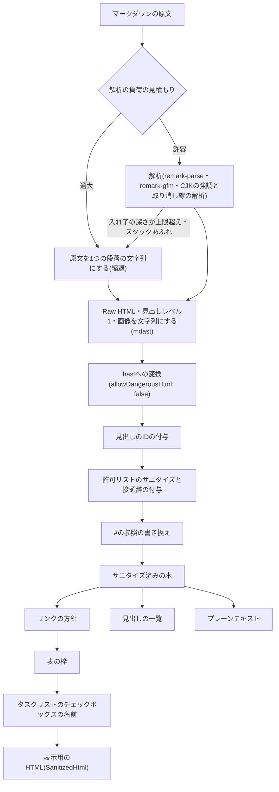

# マークダウンのサニタイズ

利用者が入力したマークダウンを、許可リスト方式でサニタイズしたHTMLとして表示するための規約を定める。処理の順序とサニタイズの後の変換の限定、要素・属性・class・参照先の許可リスト、リンクの参照先の制限、IDの接頭辞とDOM clobberingの防止、解析の負荷のガード、生のHTMLを挿入する例外の1箇所とその検査、攻撃パターン集の追加の手順を扱う。表示部品と入力欄の使い方は「[マークダウンの入力欄と表示部品](../frontend/008-markdown-editor-and-content.md)」に、生のHTMLを挿入する処理の禁止は「[生のHTMLの禁止と例外](../frontend/003-frontend-server-security.md#生のhtmlの禁止と例外)」に従う。

## 前提と用語

マークダウンの解析とHTMLへの変換にunified(remark・rehype)を使い、フロントエンドとバックエンドの両方が使う共有ディレクトリ(共用部品)の次の部品で描画する構成を前提とする。部品の置き場所は共用部品のディレクトリからのパスで示す。共用部品はDOMに依存せず、BunでもWorkersでもブラウザでも同じ結果を返す。

| 部品                                                                                | 置き場所                                 | 役割                                                              |
| ----------------------------------------------------------------------------------- | ---------------------------------------- | ----------------------------------------------------------------- |
| `processMarkdown`・`SanitizedTree`                                                  | `markdown/markdown-processor.ts`         | 解析からサニタイズと`#`の参照の書き換えまでの共通の処理           |
| `sanitizeSchemaFor`                                                                 | `markdown/sanitize-schema.ts`            | rehype-sanitizeの許可リスト                                       |
| `isPathologicalMarkdown`・`parseWithGuard`                                          | `markdown/parse-guard.ts`                | 解析の負荷の見積もりと、過大な入力・スタックあふれの縮退          |
| `renderMarkdown`・`SanitizedHtml`・`RenderedMarkdown`                               | `markdown/render-markdown.ts`            | 表示用のHTML・見出しの一覧・プレーンテキストの描画                |
| `extractSearchText`                                                                 | `markdown/extract-search-text.ts`        | 表示と同じ解釈のプレーンテキスト(全文検索の索引用)                |
| `validateRenderOptions`・`idPrefixFor`・`MarkdownOptionsError`・`DEFAULT_ID_PREFIX` | `markdown/markdown-options.ts`           | 描画の指定の検証とIDの接頭辞                                      |
| `slugifyHeading`・`normalizeAnchorFragment`                                         | `markdown/heading-slug.ts`               | 見出しのスラッグと`#`の参照のフラグメントの正規化                 |
| `remarkLiteralSyntax`・`rehypeHeadingIds`・`rehypeAnchorPrefix`                     | `markdown/plugins/`                      | 文字列化・見出しのID・`#`の参照の書き換え(サニタイズの前後の処理) |
| `applyLinkPolicy`・`wrapTables`・`labelTaskCheckboxes`                              | `markdown/plugins/`                      | サニタイズの後の変換                                              |
| `XSS_PAYLOADS`・`PATHOLOGICAL_MARKDOWN`                                             | `markdown/fixtures/`                     | 攻撃パターン集と、解析の負荷が過大な入力の集まり                  |
| `findRawHtmlExceptions`                                                             | 共通部品の`config/raw-html-exception.ts` | 生のHTMLの規則の無効化とサニタイズ済みの型への型の主張の走査      |

| 用語                 | 意味                                                                                                                                                |
| -------------------- | --------------------------------------------------------------------------------------------------------------------------------------------------- |
| 共用部品             | フロントエンドとバックエンドの両方が使う共有ディレクトリ(「[共有ディレクトリの配置方式](../coding/003-shared-directories.md)」)                     |
| 共通部品             | 画面を持つ複数のアプリが使う共有ディレクトリ(「[共通化する部品](../frontend/005-shared-components.md#前提と用語)」)                                 |
| `<共用部品の配置先>` | 共用部品を利用側アプリへ配置したディレクトリ(「[マークダウンの入力欄と表示部品](../frontend/008-markdown-editor-and-content.md#前提と用語)」と同じ) |
| mdast・hast          | unifiedのマークダウンの構文木とHTMLの構文木                                                                                                         |
| 許可リスト           | rehype-sanitizeのスキーマ。挙げた要素・属性・値だけを残し、それ以外を除く                                                                           |
| サニタイズ済みの木   | `processMarkdown`が返すhast。型`SanitizedTree`で表す                                                                                                |
| 表示用のHTML         | `renderMarkdown`が返すHTMLの文字列。型`SanitizedHtml`で表し、`render-markdown.ts`だけが作れる                                                       |
| 本文の識別子         | 描画の指定の`idScope`。1つのページに置く本文ごとに異なる値を渡し、IDの接頭辞に使う(英小文字と数字の1〜32文字)                                       |
| 接頭辞               | 本文の中のIDと`#`の参照に付ける文字列`user-content-`または`user-content-<本文の識別子>-`                                                            |
| DOM clobbering       | 利用者の入力のIDや`name`がページのグローバル変数やページの要素のIDを上書きし、ページのスクリプトの動作を変える攻撃                                  |
| 攻撃パターン集       | サニタイズを確かめる入力の一覧。分類ごとに並べ、単体テストが全件を描画して検査する                                                                  |
| 縮退                 | 解析せずに、原文を1つの段落の文字列として扱うこと                                                                                                   |

## 処理の順序

処理の順序は`markdown-processor.ts`と`render-markdown.ts`だけが定義する。表示・見出しの一覧・プレーンテキストは、同じサニタイズ済みの木から作る。

- 解析の前の段階で、表示しない構文を文字列にする(「[文字列にする構文](#文字列にする構文)」)。サニタイズは、この段階を抜けた要素も除く2段目の防御である。
- remark-rehypeは`allowDangerousHtml: false`で使い、Raw HTMLの節点をhastへ渡さない。接頭辞はサニタイズの段階で脚注と見出しのIDに同じ値を付けるため、remark-rehypeの`clobberPrefix`は空にする。
- 見出しのIDはサニタイズの前に付け、サニタイズの`clobberPrefix`で接頭辞を付ける(「[接頭辞とDOM clobbering](#接頭辞とdom-clobbering)」)。
- `extractSearchText`は既定の接頭辞でサニタイズ済みの木まで作り、サニタイズの後の変換を通らずにテキストだけを返す。脚注の見出しの文字列と脚注の戻りリンクの文字列は含めない。
- サニタイズ済みの型の値は、型の主張でしか作れない。`processMarkdown`の`idPrefix`には必ず`idPrefixFor`の戻り値を渡す(空文字列を渡すと接頭辞が付かない)。

### 文字列にする構文

表示部品が描画しない構文は、mdastの段階で元の記法の文字列に置き換える。HTMLとして解釈されないため、表示用のHTMLでは文字参照にエスケープされる。

| 構文                                                  | 置き換える文字列                                             |
| ----------------------------------------------------- | ------------------------------------------------------------ |
| Raw HTML(ブロックと行内)                              | 元のHTMLの文字列。ブロックを子に持つ節点の直下では段落で包む |
| 見出しレベル1                                         | 先頭に`# `を付けた段落                                       |
| 画像(``)                                   | ``の文字列                                        |
| 参照形式の画像(`![alt][label]`・`![alt][]`・`![alt]`) | 入力の形の文字列(`![alt][label]`・`![alt][]`・`![alt]`)      |

- 入力欄の編集領域も同じ文字列に置き換えるため、入力欄と表示で見え方がそろう(「[編集領域](../frontend/008-markdown-editor-and-content.md#編集領域)」)。
- 文字列にした画像のURLは、GFMのURLの自動リンクでリンクになる。自動リンクは解析の後の文字列に掛かり、エスケープで止められないためである。リンクは「[参照先の制限](#参照先の制限)」の対象になる。

## 許可リスト

`sanitizeSchemaFor(idPrefix)`は、remark-gfmとremark-rehypeが出力する要素と属性だけを許可する。rehype-sanitizeの既定のスキーマ(GitHubのスキーマ)を継承せず、全ての項目を書く。全ての要素に共通の属性(`*`)は許可しない。

### 要素

| 区分         | 許可する要素                                                                                                            |
| ------------ | ----------------------------------------------------------------------------------------------------------------------- |
| 段落と見出し | `p`・`h2`・`h3`・`h4`・`h5`・`h6`・`hr`・`br`                                                                           |
| 行内         | `strong`・`em`・`del`・`a`・`code`・`sup`                                                                               |
| ブロック     | `pre`・`blockquote`・`ul`・`ol`・`li`・`section`                                                                        |
| 表           | `table`・`thead`・`tbody`・`tr`・`th`・`td`(`thead`・`tbody`・`tr`・`th`・`td`は`table`の子孫にだけ置ける。`ancestors`) |
| タスクリスト | `input`                                                                                                                 |

- 許可しない要素は外して子だけを残す。`h1`・`img`・`picture`・`source`・`div`・`span`・`iframe`・`details`・`kbd`などを許可しない。
- `script`は子ごと除く(`strip`)。HTMLのコメントと文書型宣言も除く。

### 属性

| 要素                   | 許可する属性                                                                                                               |
| ---------------------- | -------------------------------------------------------------------------------------------------------------------------- |
| `a`                    | `href`・`id`・`aria-describedby`・`aria-label`・`data-footnote-ref`・`data-footnote-backref`・`class`(固定値)              |
| `code`                 | `class`(固定値)                                                                                                            |
| `h2`                   | `id`・`class`(固定値)                                                                                                      |
| `h3`・`h4`・`h5`・`h6` | `id`                                                                                                                       |
| `input`                | `checked`・`disabled`(`true`だけ)・`type`(`checkbox`だけ)。`disabled`と`type="checkbox"`は必須で、無ければ補う(`required`) |
| `li`                   | `id`・`class`(固定値)                                                                                                      |
| `ol`                   | `start`(番号付きリストの開始番号)・`class`(固定値)                                                                         |
| `ul`                   | `class`(固定値)                                                                                                            |
| `section`              | `data-footnotes`・`class`(固定値)                                                                                          |
| `th`・`td`             | `align`                                                                                                                    |

- `on*`のイベント属性・`style`・`src`・`srcset`・`name`・`target`・`rel`・`tabindex`・`role`は許可しない。`target`・`rel`・`tabindex`・`role`は、サニタイズの後の変換だけが付ける(「[サニタイズの後の変換の限定](#サニタイズの後の変換の限定)」)。
- `id`・`aria-describedby`の値には接頭辞を付ける(「[接頭辞とDOM clobbering](#接頭辞とdom-clobbering)」)。

### classの固定値

`class`は、要素ごとに次の値だけを許可する。Raw HTMLを文字列にするため、利用者の入力から任意の`class`は作れず、remark-gfmとremark-rehypeが付ける値だけが残る。`code`の`language-`の後だけはコードブロックの言語の指定(利用者の入力)から作られるため、`language-*`のクラスを、要素の位置を変える規則(`position`など)・他の要素に重ねる規則(`z-index`・負の余白など)・内容を隠す規則(`display: none`・`visibility`・`content`など)の選択子に使わない。コードの文字色や背景色だけを変える規則には使ってよい。

| 要素       | 許可する値                               | 付く場所                   |
| ---------- | ---------------------------------------- | -------------------------- |
| `code`     | `language-`で始まり後に1文字以上が続く値 | コードブロックの言語の指定 |
| `h2`       | `sr-only`                                | 脚注の見出し(視覚的に隠す) |
| `a`        | `data-footnote-backref`                  | 脚注の戻りリンク           |
| `li`       | `task-list-item`                         | タスクリストの項目         |
| `ul`・`ol` | `contains-task-list`                     | タスクリストを含むリスト   |
| `section`  | `footnotes`                              | 脚注の一覧                 |

サニタイズの後の変換が付ける`div`の`markdown-table-scroll`(表の枠)を加えたものが、表示用のHTMLに現れる`class`の全てである。

### 参照先のスキーム

`href`のスキームは`http`・`https`・`mailto`だけを許可する(`protocols`)。スキームの無い参照(`#`で始まる参照・相対URL)はサニタイズで残り、次の「[参照先の制限](#参照先の制限)」でリンクの方針が判定する。

## 参照先の制限

`applyLinkPolicy`はサニタイズ済みの木の`a`を次の順に判定し、リンクにしないものは`a`を外して子だけを残す。

| 参照先                                                                         | 扱い                                                |
| ------------------------------------------------------------------------------ | --------------------------------------------------- |
| `href`が無い                                                                   | リンクを外す                                        |
| `#`で始まる                                                                    | ページ内のリンク。同じタブで開き、属性を加えない    |
| 基準のURL無しの`new URL(href)`で解釈できない(相対URL・プロトコル相対URLを含む) | リンクを外す                                        |
| スキームが`http:`・`https:`・`mailto:`以外                                     | リンクを外す                                        |
| `mailto:`                                                                      | 同じタブで開き、属性を加えない                      |
| `http:`・`https:`でスキームの直後に`//`が無い(`https:a.example`など)           | リンクを外す                                        |
| オリジンが描画の指定の`siteOrigin`と一致する                                   | 同じタブで開き、`sameOriginLinkRel`を`rel`に付ける  |
| それ以外の`http:`・`https:`                                                    | `target="_blank"`と`externalLinkRel`の`rel`を付ける |

- `//`の無い参照は、ブラウザが同じスキームのページで相対URLとして解釈し、同一オリジンの任意のパスへの同じタブのリンクになる。`new URL`は`//`が無くても絶対URLとして解釈するため、スキームの直後の`//`を別に確かめる。
- `rel`が空の配列なら`rel`属性を付けない。`rel`に使える値は`noopener`・`noreferrer`・`nofollow`・`ugc`・`sponsored`だけである。
- `validateRenderOptions`は、`siteOrigin`が`http`・`https`のURLで`new URL(siteOrigin).origin`と一致すること、`rel`の値が許可した値で重複しないこと、本文の識別子が形式に合うことを確かめ、違えば`MarkdownOptionsError`(不正な項目の名前を`field`に持つ)を投げる。
- 管理者向けの画面など別のオリジンで表示する場合も、同じタブで開く判定は利用者向けのページのオリジンで行う。

## 接頭辞とDOM clobbering

本文の中のIDと`#`の参照には接頭辞を付け、ページの要素のIDやグローバル変数と衝突させない。

- rehype-sanitizeの`clobber`に`id`・`name`・`aria-describedby`・`aria-labelledby`を指定し、`clobberPrefix`に`idPrefixFor(idScope)`の戻り値を渡す。本文の識別子が無ければ`user-content-`、あれば`user-content-<本文の識別子>-`になる。
- 1つのページに複数の本文(本文とプレビュー、複数のコメントなど)を置く時は、本文ごとに異なる本文の識別子を渡す。同じ接頭辞の本文が並ぶと、見出しや脚注のIDが重複する。
- 見出し(`h2`〜`h6`)のIDは`slugifyHeading`で作る。前後の空白を除いた文字列を、ASCIIの英字は小文字へ、数字・`-`・`_`はそのまま、空白(U+0020)は`-`へ、それ以外は文字のUTF-8のバイト列を大文字の`%XX`へ変換する。空になれば`heading`にする。同じIDが既にあれば`-1`・`-2`…を付けて一意にする。
- 脚注のIDも`normalizeAnchorFragment`で正規化し、見出しのIDより先に使用済みとして確保する。見出しのIDは脚注のIDと重ならない。
- `rehypeAnchorPrefix`は、サニタイズの後に`#`で始まる`a`の参照を`#` + 接頭辞 + `normalizeAnchorFragment(フラグメント)`へ書き換える。`normalizeAnchorFragment`はフラグメントを`decodeURIComponent`で戻し(失敗したら元のまま)、`slugifyHeading`と同じ変換を掛けるため、`[x](#見出し)`も`[x](#%E8%A6%8B%E5%87%BA%E3%81%97)`も同じ見出しを指す。
- フラグメントの無い`#`だけの参照は、ページの先頭を指す意味として書き換えない。
- 既知の制限: 正規化すると同じになる脚注のラベル(`[^a!b]`と`[^a%21b]`)は、脚注のIDが重複する。

## サニタイズの後の変換の限定

サニタイズの後の変換は、許可済みの要素への属性の追加と、要素の除去(リンクの解除)・包み(表の枠)に限る。新しい要素は表の枠の`div`だけを作り、利用者の入力から属性の名前を作らない。

| 変換               | 部品                  | 内容                                                                                                                                  |
| ------------------ | --------------------- | ------------------------------------------------------------------------------------------------------------------------------------- |
| リンクの方針       | `applyLinkPolicy`     | `a`への`target`・`rel`の追加と、`a`の除去(「[参照先の制限](#参照先の制限)」)                                                          |
| 表の枠             | `wrapTables`          | `table`を`
`で包む               |
| タスクリストの名前 | `labelTaskCheckboxes` | タスクリストの項目のチェックボックスに、項目の文字列(入れ子のリストを除き、空白を1つにまとめる。空なら`タスク`)を`aria-label`で付ける |

- 変換はサニタイズ済みの木を受け取り、新しい木を返す純粋な関数にする。変換の中でHTMLの文字列を組み立てない。
- 変換と描画の補助の処理では、後読みや末尾に固定した量指定子を持つ正規表現(`/^\p{White_Space}+|\p{White_Space}+$/`など)と、`reduce`で配列を作り直す処理を使わない。利用者の入力の長さの2乗の時間になるためである。前後の空白の除去は共用部品の`text/white-space.ts`の`trimWhiteSpace`を使い、長い入力(入力の上限の長さの空白の連続など)で処理時間が伸びないことを確かめる回帰テストを置く。
- `aria-label`の値は項目の文字列で、HTMLの文字列化で属性の値としてエスケープされる。
- 変換を加える時は、付ける属性を固定の名前に限り、攻撃パターン集の単体テストが表示用のHTMLに許す要素・属性・`class`の一覧(`xss-payloads.unit.test.ts`の`ALLOWED_HTML_ATTRIBUTES`・`ALLOWED_CLASS_NAMES`)へ加える。一覧に無い属性が現れると全件の検査が失敗する。

## 解析の負荷のガード

remark-parse(micromark)は、入れ子の深さや記号の数の2乗の時間を要する入力がある。描画は表示のたびにサーバーでも実行されるため、負荷が過大な入力は解析せずに縮退させる。

- `isPathologicalMarkdown`は、解析の前に入力を線形の時間で走査して次の9種の負荷を見積もり、各負荷を上限で割った値の合計が1を超える入力を過大と判定する。上限は、上限の直前の入力の描画がBunとNode.js(V8)の両方で1秒を十分に下回る値である。

| 負荷                                 | 見積もり                                                                       |
| ------------------------------------ | ------------------------------------------------------------------------------ |
| 行頭のコンテナの記号(引用・リスト)   | 行ごとの記号の数の2乗の合計                                                    |
| 引用・リストの段落の遅延継続行       | 段落ごとの遅延継続行の数と段落の行の数の積                                     |
| 強調の記号の連続(`*`・`_`・`~`)      | 行内の範囲(段落・見出し・表のセル・リストの項目)ごとの、連続の数と記号の数の積 |
| 強調の記号の連続の長さ               | 連続ごとの長さの2乗の合計                                                      |
| 角括弧の入れ子                       | 入れ子ごとの深さの2乗の合計                                                    |
| 対応の無い`]`                        | `]`ごとの、行内の範囲の先頭からの記号の数の合計                                |
| `www.`の自動リンクの試行             | ドメインになり得る連続ごとの`www.`の数と長さの積                               |
| setext見出しの下線                   | 下線の行ごとの、文書の先頭からの行の数                                         |
| 項目の中でコンテナを開くリストの項目 | 該当する行ごとの、文書の先頭からの行の数                                       |

- 処理時間で打ち切ると実行環境ごとに結果が変わるため、入力から決まる見積もりだけで判定する。
- コードブロックの中も段落と同じく数える。フェンスの判定はHTMLブロックや字下げしたフェンスでmicromarkと食い違い、見誤ると負荷を見逃すためである。
- 解析の結果の入れ子の深さが100(`MAX_NESTING_DEPTH`)を超える文書と、解析でスタックあふれ(`RangeError`)した文書も縮退させる。木を辿る処理がスタックあふれを起こす深さは実行環境ごとに異なるため、全ての環境で辿れる固定の深さで判定する。
- 縮退した文書は原文を1つの段落の文字列として表示し、プレーンテキストも原文になる。
- 既知の制限: 対応の無い`]`を1行に2個含むコード(配列の添字など)が空行無しで約830行以上続く文書は縮退する。
- 残存するリスク: 空の箇条書きの項目(`+`だけの行)が約10,000行続く文書は、プレーンテキストの抽出(hast-util-to-text)で2乗の時間を要し、BunとNode.jsで約330ms〜750msかかる。上限の直前の`*_`と改行の繰り返しも約340ms〜640msかかる。どちらも1秒未満のため許容している。
- 代表的な文書(`fixtures/representative-markdown.ts`)の描画時間と、負荷が過大な入力(`fixtures/pathological-markdown.ts`)の判定と描画の時間を単体テストで計測し、劣化を検出する(代表的な文書は300ms以内、過大な入力は1件1秒以内、判定は1件50ms以内)。

## 生のHTMLの例外の1箇所と検査

生のHTMLの挿入は禁止し(「[生のHTMLの禁止と例外](../frontend/003-frontend-server-security.md#生のhtmlの禁止と例外)」)、表示用のHTMLを挿入する共通部品の`MarkdownContent`(`components/markdown/markdown-content.tsx`)の1行だけを例外にする。

- 例外の行は`@eslint-react/dom-no-dangerously-set-innerhtml`を`eslint-disable-next-line`で無効化し、無効化のコメントにサニタイズの方法(許可リスト方式で絞ったHTMLを、描画部品だけが作れるサニタイズ済みの型で受け取ること)を書く。
- `MarkdownContent`は`RenderedMarkdown`(`html`が`SanitizedHtml`)だけを受け取る。サニタイズ済みの型は`render-markdown.ts`の型の主張でしか作れないため、`MarkdownContent`へ渡せる文字列は描画部品の出力に限られる。

例外が増えていないことを、ソースの走査で確かめる。

| 走査                                                  | 対象                    | 期待する結果                                                      |
| ----------------------------------------------------- | ----------------------- | ----------------------------------------------------------------- |
| 共用部品の`config/import-boundary.unit.test.ts`       | 共用部品の全ソース      | `as SanitizedHtml`などの型の主張が`render-markdown.ts`の1箇所だけ |
| 共通部品の`config/raw-html-exception.unit.test.ts`    | 共通部品の全ソース      | `MarkdownContent`の規則の無効化の1箇所だけ                        |
| アプリの`test/config/raw-html-exception.unit.test.ts` | 画面を持つアプリの`src` | 0箇所                                                             |

`findRawHtmlExceptions(rootDir)`は、TypeScriptの構文木で次を見つけて位置を返す。依存パッケージ・ビルドの出力・自動生成のコードは走査しない。

- 生のHTMLの規則(`@eslint-react/dom-no-dangerously-set-innerhtml`・`no-restricted-syntax`)を無効化するコメント。規則を指定しない`eslint-disable`と、規則の設定を変えるコメント(`/* eslint <規則>: "off" */`)を含む。文字列やJSXの文字列の中の`//`は数えない。
- `SanitizedHtml`・`RenderedMarkdown`への型の主張(`as`・`<型>値`)と、主張の検出を逃れる別名(`type Html = SanitizedHtml`・`RenderedMarkdown['html']`・名前を変えたimportとexport)。型の注釈(`const html: SanitizedHtml = …`)と`satisfies`は数えない。

走査の限界:

- `interface`や型のリテラルで同じ形の型を宣言して偽造する書き方と、汎用の変換関数(引数の型をそのまま主張して返す関数など)を経由した偽造は検出しない。
- 計算したキーでの`innerHTML`への代入と`Object.assign`による設定は、静的解析でも検出しない。
- 上の書き方はコードレビューで確かめる。

## 攻撃パターン集の追加の手順

攻撃パターン集(`markdown/fixtures/xss-payloads.ts`の`XSS_PAYLOADS`)は、分類(`XSS_CATEGORIES`)ごとの配列で並べる。分類は、スクリプト・イベント属性・危険なスキーム・HTMLの入れ子・属性の注入・参照形式のリンク・自動リンク・IDによる上書きである。単体テスト(`xss-payloads.unit.test.ts`)が全件を描画し、次を確かめる。

- サニタイズ済みの木に、許可リストに無い要素・属性、`on*`・`style`・`src`・`srcset`、接頭辞の無いID、許可しない`class`が無いこと。
- 表示用のHTMLに、表示用に許す要素・属性(`ALLOWED_HTML_ATTRIBUTES`)・`class`(`ALLOWED_CLASS_NAMES`)の外のもの、許可しない参照先(`#`は`#`だけか接頭辞付き、`mailto:`、または解釈できる`http(s)://`)、`_blank`以外の`target`が無いこと。
- 全ての分類が1件以上の攻撃パターンを持つこと。

新しい攻撃の型を見つけた時の手順:

1. 該当する分類の配列に、攻撃のマークダウンを加える。どの分類にも当てはまらなければ、`XSS_CATEGORIES`に分類を加え、その分類の配列を作る。
2. 共用部品の単体テストを実行し、失敗すれば許可リストかサニタイズの後の変換を直す。検査の側を緩めて通さない。
3. 検査の仕組みそのものを変えた時は、同じテストファイルの「検査の仕組み」の標本(違反として検出すべきHTMLと、違反としない許可済みのHTML)も加える。

許可する`class`の値や属性を加える時の手順:

1. 加える値を出力する処理(remark-gfm・remark-rehypeの出力か、サニタイズの後の変換)と、利用者の入力からその値を作れないことを確かめる。
2. `sanitize-schema.ts`の要素の属性に固定値か正規表現で加え、`sanitize-schema.unit.test.ts`に、許可した値が残り、それ以外の値が除かれる例を加える。
3. `xss-payloads.unit.test.ts`の`ALLOWED_CLASS_NAMES`(属性なら`ALLOWED_HTML_ATTRIBUTES`)に加え、本文書の許可リストの表を更新する。
4. 加えた値を悪用する攻撃パターン(属性の注入など)を攻撃パターン集に加える。

解析の負荷が過大な入力を見つけた時は、`fixtures/pathological-markdown.ts`の`PATHOLOGICAL_MARKDOWN`に入力の上限の長さ(`PATHOLOGICAL_MARKDOWN_MAX_LENGTH`)以内の入力を加える。判定されなければ`parse-guard.ts`の見積もりを直し、普通の文書を過大と判定しないことを`parse-guard.unit.test.ts`の普通の文書の例で確かめる。

攻撃パターン集と負荷が過大な入力の集まりは`markdown/fixtures/`に置き、共用部品の単体テストとテスト専用のファイルだけが読み込める(共用部品の`config/import-boundary.unit.test.ts`が検査する)。利用側アプリの型検査の対象から`<共用部品の配置先>/markdown/fixtures/**`を除く。
