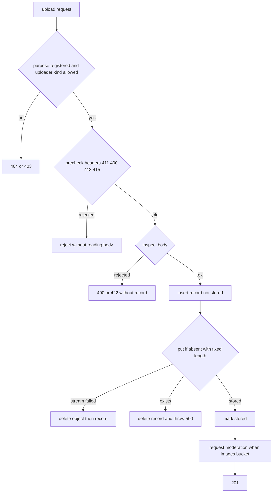

# アップロードの安全対策

利用者と管理者がアップロードするファイル(画像・PDF・テキスト)を、安全に受け付けて保存し配信するための規約を定める。受付の順序、ヘッダーの事前検証、内容の実体検証、SVGの構文と許可リスト、ファイル名とオブジェクトキー、上書きの拒否、配信のヘッダー、メタデータの扱いの方針を扱う。画像の判定サービスの呼び出しは「[画像判定サービス](../external/003-image-moderation.md)」に、画像の変換配信とエッジキャッシュは「[画像の変換配信とエッジキャッシュ](../infra/008-image-delivery.md)」に、アップロードの入力欄と画像の表示部品は「[ファイルの選択](../frontend/005-shared-components.md#ファイルの選択)」と「[画像の表示](../frontend/005-shared-components.md#画像の表示)」に従う。

## 前提と用語

アップロードは、フロントエンドサーバーの中継の経路(「[中継の経路の追加規約](../frontend/003-frontend-server-security.md#中継の経路の追加規約)」)から`<APIサーバーのアプリ>`の内部RESTへ届き、共通ライブラリの受付処理が検証して保存する。検証の規則は実行環境に依存しない純粋な関数にし、Bunの単体テストで確かめる。部品の置き場所は、共用部品・共通ライブラリのディレクトリからのパスで示す。

| 部品                                                                                                           | 置き場所                                                 | 役割                                                                            |
| -------------------------------------------------------------------------------------------------------------- | -------------------------------------------------------- | ------------------------------------------------------------------------------- |
| `IMAGE_MEDIA_TYPES`・`ATTACHMENT_MEDIA_TYPES`・`MAX_UPLOAD_BYTES`・`IMAGE_STORAGE_MAX_BYTES`・`parseMediaType` | 共用部品の`media/media-types.ts`                         | 受け付ける形式の範囲・上限の最大値・`Content-Type`の解析                        |
| `UPLOAD_FILE_NAME_HEADER`・`encodeFileNameHeader`・`decodeFileNameHeader`                                      | 共用部品の`media/upload-protocol.ts`                     | 元のファイル名を運ぶヘッダーと、その百分率符号化                                |
| `defineUploadPurpose`・`createUploadPurposeRegistry`                                                           | 共通ライブラリの`core/media/upload-purpose.ts`           | 用途の定義の検証と登録表                                                        |
| `precheckUpload`                                                                                               | 共通ライブラリの`core/media/upload-precheck.ts`          | ヘッダーの事前検証(411→400→413→415)                                             |
| `detectSignature`・`SIGNATURE_PREFIX_BYTES`                                                                    | 共通ライブラリの`core/media/file-signature.ts`           | マジックバイトによる形式の判定                                                  |
| `readImageDimensions`・`exceedsPixelLimits`・`DEFAULT_PIXEL_LIMITS`・`DIMENSION_PREFIX_BYTES`                  | 共通ライブラリの`core/media/image-dimensions.ts`         | 寸法の読み取りと画素数の上限                                                    |
| `readSvgRoot`・`intrinsicSizeOfSvg`・`parseSvgViewBox`                                                         | 共通ライブラリの`core/media/svg-root.ts`                 | SVGのルートの開始タグと寸法・`viewBox`の解釈                                    |
| `checkSvgSyntax`・`SVG_MAX_NESTED_TAGS`                                                                        | 共通ライブラリの`core/media/svg-syntax.ts`               | SVGの構文の検査                                                                 |
| `scanSvgProlog`・`blankStandardSvgDoctype`・`STANDARD_SVG_EXTERNAL_IDS`                                        | 共通ライブラリの`core/media/svg-prolog.ts`               | SVGのルートの前の読み飛ばしと、標準の文書型宣言の判定                           |
| `createTextContentCheck`・`TextContentError`                                                                   | 共通ライブラリの`core/media/text-content-check.ts`       | テキストを流しながらの検査                                                      |
| `sanitizeFileName`・`attachmentDisposition`・`MAX_FILE_NAME_BYTES`                                             | 共通ライブラリの`core/media/file-name.ts`                | ファイル名の整形と`Content-Disposition`の組み立て                               |
| `generateObjectKey`                                                                                            | 共通ライブラリの`core/media/object-key.ts`               | オブジェクトキーの採番                                                          |
| `MediaUploadReceiver`                                                                                          | 共通ライブラリの`workers/media/upload-receiver.ts`       | 受付処理(検証・記録・保存・判定の依頼)                                          |
| `R2MediaObjectStore`                                                                                           | 共通ライブラリの`workers/media/r2-media-object-store.ts` | 上書きしない条件付きの書き込みと、バケット間のコピー・削除                      |
| `inspectSvg`・`SVG_MAX_RECORDED_VIOLATIONS`                                                                    | `<メッセージを受信するアプリ>`の`src/application/media/` | SVGの許可リストの検査(`svg-allowlist.ts`)                                       |
| `SVG_ALLOWLIST`                                                                                                | `<メッセージを受信するアプリ>`の`src/application/media/` | SVGの許可リストの表(`svg-allowlist-table.ts`)。本書の表と単体テストで一致を保つ |
| `hasUnsupportedCss`                                                                                            | `<メッセージを受信するアプリ>`の`src/application/media/` | 判定用画像の描画器が解釈しないCSSの検出(`svg-unsupported-css.ts`)               |
| ファイルの内容の経路                                                                                           | `<APIサーバーのアプリ>`の`src/presentation/media/`       | 非公開ファイルのダウンロード(`file-content-route.ts`)                           |

| 用語                     | 意味                                                                                                                   |
| ------------------------ | ---------------------------------------------------------------------------------------------------------------------- |
| 用途                     | ファイルを使う機能ごとに登録する定義。名前・保存先・アップロードできる主体の種類・許可する形式・上限のバイト数を持つ   |
| 画像用の用途             | 保存先が画像用非公開バケットの用途。画像5形式(JPEG・PNG・GIF・WebP・SVG)だけを許し、自動判定と画像配信の対象になる     |
| ファイル用の用途         | 保存先がファイル用非公開バケットの用途。画像5形式・PDF・テキストを許し、同一オリジンのダウンロードの経路だけで配信する |
| 画像用非公開バケット     | 画像の原本を置くR2のバケット。画像配信だけが読み、URLで直接公開しない                                                  |
| ファイル用非公開バケット | ファイル用の用途のファイルを置くR2のバケット                                                                           |
| 隔離バケット             | 不適切と判定した画像・隔離理由が付いた画像を移すR2のバケット。画像配信は読まない                                       |
| 申告の形式               | 要求の`Content-Type`が示す形式。内容を保証しないため、実体検証で内容と照らし合わせる                                   |
| 事前検証                 | 本文を読む前に、ヘッダーだけで行う検証                                                                                 |
| 実体検証                 | 本文の内容(先頭のバイト列・構文・文字符号化)で行う検証                                                                 |
| オブジェクトキー         | R2のオブジェクトの名前で、画像配信のURLの一部にもなる。32文字の小文字の16進                                            |

## 受付の順序

受付処理は次の順で進める。事前検証と実体検証で拒否した要求は、記録もオブジェクトも作らない。



1. 用途を名前で引き、無ければ404、主体の種類が用途の対象外なら403にする。利用者側の呼び出しでは、本文を読む前に、アップロードできる利用者かの判定(停止中の利用者などの拒否)を呼ぶ。
2. ヘッダーで事前検証する(「[事前検証](#事前検証)」)。
3. 本文の先頭(SVGは全体)を読んで実体検証する(「[実体検証](#実体検証)」)。テキストは保存しながら流して検査する。
4. オブジェクトキーを採番し、ファイル名を整形して、保存未完了の記録を作る。
5. 本文を上書きしない条件付きの書き込みで保存し(「[上書きの拒否](#上書きの拒否)」)、保存の完了を記録する。
6. 画像用の用途なら、判定の依頼(メッセージ`media.moderate-image`)を送る。依頼の送信に失敗してもアップロードは成功として返し、判定待ちのまま残った記録は日次のジョブが依頼し直す。
7. 201で、ファイルの識別子・整形したファイル名・形式・バイト数・幅・高さを返す。

- 記録の作成の後に失敗した場合は、先にオブジェクトを消し、消せたときだけ記録を消す。残った記録は、紐付けられないまま24時間を過ぎたファイルとして日次のジョブが物理削除する。
- 保存先(D1・R2)の一時的な障害は、503(`storage_unavailable`)と`Retry-After: 5`で応答する。
- 拒否はすべて共通エラー(`AppError`)の種類で表し、状態コードは共通の例外の変換が決める(「[共通エラーと共通のエラー形式](../backend/002-layered-architecture-on-workers.md#共通エラーと共通のエラー形式)」)。経路で応答の本文を組み立てない。
- ログには、用途・形式・バイト数・ファイルの識別子・状態コード・エラーコードだけを出し、ファイル名と内容を出さない(カテゴリは「[カテゴリ](../infra/004-logging-and-error-tracking.md#カテゴリ)」の`[<アプリ名>, 'media', 'upload']`)。

## 事前検証

`precheckUpload(<用途>, <ヘッダー>)`は、本文を読まずに次の順で判定し、最初に当たった拒否を返す。

| 順  | 条件                                                                 | 状態コード | `AppError`の種類         | エラーコード              |
| --- | -------------------------------------------------------------------- | ---------- | ------------------------ | ------------------------- |
| 1   | `Content-Length`が無い                                               | 411        | `length_required`        | `content_length_required` |
| 2   | `Content-Length`が数字だけの並びでない、または0                      | 400        | `bad_request`            | `invalid_content_length`  |
| 3   | `Content-Length`が用途の上限のバイト数を超える                       | 413        | `payload_too_large`      | `file_too_large`          |
| 4   | `Content-Type`が受け付ける形式でない、または用途の許可する形式に無い | 415        | `unsupported_media_type` | `unsupported_file_type`   |

- `Content-Length`は`1*DIGIT`の文法どおり数字だけを受け、符号・小数・空白・複数の値の結合を数値として扱わない。安全な整数を超える桁は上限の超過(413)になる。上限ちょうどは受け付け、1バイトの超過を拒否する。
- `Content-Type`は`parseMediaType`で、引数を除いた本体を小文字にして形式の一覧と照らす。テキスト(`text/plain`)は`charset`の引数がUTF-8の場合と引数が無い場合だけを受け、別の文字符号化の申告を拒否する(内容をUTF-8として検査するため)。他の引数は無視する。
- 拡張子は形式の判定に使わない。拡張子は利用者が付けた名前の一部で、内容を保証しないためである。
- 用途の上限のバイト数は、`defineUploadPurpose`が保存先ごとの最大値の範囲で検証する。

| 保存先                   | 許可できる形式                           | 上限の最大値                                                                                       |
| ------------------------ | ---------------------------------------- | -------------------------------------------------------------------------------------------------- |
| 画像用非公開バケット     | JPEG・PNG・GIF・WebP・SVG                | 20,000,000バイト(`IMAGE_STORAGE_MAX_BYTES`。画像の変換基盤の入力上限「20MB」を1,000を基数とみなす) |
| ファイル用非公開バケット | JPEG・PNG・GIF・WebP・SVG・PDF・テキスト | 20,971,520バイト(`MAX_UPLOAD_BYTES`。画面の表記の20MBを1,024を基数とみなす)                        |

- 用途の名前はハイフンで区切った小文字の英数字(`^[a-z][a-z0-9]*(?:-[a-z0-9]+)+$`)、主体の種類と許可する形式は1つ以上とする。登録表は名前の重複を拒否する。

## 実体検証

申告の形式ごとに、本文の次の範囲を読んで検査する。

| 申告の形式           | 読む範囲                        | 検査                                                     |
| -------------------- | ------------------------------- | -------------------------------------------------------- |
| JPEG・PNG・GIF・WebP | 先頭の最大1MiB(1,048,576バイト) | マジックバイト、寸法の読み取り、画素数と各辺の長さの上限 |
| PDF                  | 先頭の最大1MiB                  | マジックバイト                                           |
| SVG                  | 全体                            | UTF-8の復号、宣言の拒否、XMLの構文、最上位の要素、寸法   |
| テキスト             | 全体を保存しながら流す          | UTF-8の復号とNUL文字                                     |

- 先頭は`Content-Length`より1バイト多く読もうとし、宣言より長い本文と、先頭の範囲で終わる宣言より短い本文を、記録の作成の前に400(`content_length_mismatch`)にする。残りの本文は、受け取ったバイト数を数える変換を通して書き込み、宣言との食い違いを400にする。書き込みは`FixedLengthStream`を通し、長さが合わなければオブジェクトが残らない。
- 検査に使った先頭部分と残りの本文をつないで保存し、本文を2回読まない。

### マジックバイト

`detectSignature`は先頭12バイト(`SIGNATURE_PREFIX_BYTES`)で次の形式を判定する。判定した形式が申告の形式と違えば、422(`file_type_mismatch`)にする。SVGとテキストはこの表で判定しない。

| 形式 | 先頭のバイト列                |
| ---- | ----------------------------- |
| JPEG | `FF D8 FF`                    |
| PNG  | `89 50 4E 47 0D 0A 1A 0A`     |
| GIF  | `GIF87a`または`GIF89a`        |
| WebP | `RIFF`、任意の4バイト、`WEBP` |
| PDF  | `%PDF-`                       |

### 寸法と画素数

- ラスター画像の寸法は`image-size`で先頭1MiBから読む。判定する形式を受け付ける5形式に絞り(`disableTypes`。isolate全体に効く設定を読み込み時に1度だけ行う)、`image-size`が判定した形式が申告と違う場合と、寸法を読めない場合は422(`image_unreadable`)にする。
- EXIFの向きが5〜8の画像は、表示される幅と高さとして入れ替える。
- 幅か高さが12,000pxを超える、または幅×高さが16,000,000画素を超える画像は422(`image_dimensions_exceeded`)にする(`DEFAULT_PIXEL_LIMITS`)。判定用画像の作成でRGBAに展開する画素(1,600万画素で約64MB)をWorkerのメモリ(128MB)に収めるための値である。
- ファイル用の用途の画像にも、同じ寸法の検査をかける。
- `image-size`はJPEGの印を探す時に1バイトずつ`slice()`で複製し、壊れた本文で先頭の長さの2乗の時間がかかる。先頭部分を1度だけ複製し、`slice()`が複製しない部分配列を返す派生クラスで渡して線形に抑える。
- SVGの寸法は`image-size`を使わず、`readSvgRoot`でXML宣言・処理命令・コメントと標準の文書型宣言(「[SVGの文書型宣言](#svgの文書型宣言)」)を飛ばしたルートの開始タグを読み、可能な限りブラウザと同じ文法で解釈する。
  - 属性値はXML 1.0の3.3.3どおり空白の文字を空白にしてから文字参照・定義済み実体を戻す。数値は`[+-]?(\d+(\.\d+)?|\.\d+)([eE][+-]?\d+)?`とする。
  - `viewBox`の区切りは空白・カンマ(前後の空白可)・区切りの無い連結(`-0-0 100 100`)で、4つでない・末尾の`.`・余分なカンマなどブラウザが無効とする値と、幅か高さが0以下の値は無効とする。
  - 長さの単位は大文字小文字を区別せず、CSSの換算(`px`・`in`・`cm`・`mm`・`q`・`pt`・`pc`)とし、`em`・`rem`は16pxで換算する。`ex`・`ch`(書体で長さが変わる)と`vw`・`lh`などの換算しない単位、百分率、無効な値、0以下の値は指定が無いものとして扱う。
  - `width`・`height`の両方があればその値、片方なら`viewBox`の縦横比から、どちらも無ければ`viewBox`の幅・高さを寸法とする。求められなければ寸法を未設定にし、拒否しない。

### SVGの構文

`checkSvgSyntax`は本文の全体を次の順で検査する。

1. `TextDecoder('utf-8', { fatal: true })`で復号し、先頭のBOMを除く。UTF-8でなければ422(`invalid_svg`)にする。
2. ルートの前の1つ目の標準の文書型宣言(「[SVGの文書型宣言](#svgの文書型宣言)」)を、`blankStandardSvgDoctype`で同じ長さの空白に置き換える。3以降はこの置き換えた文書を検査し、保存する本文は置き換えない。
3. 大文字小文字を問わず`<!DOCTYPE`・`<!ENTITY`を含めば422(`svg_declaration_not_allowed`)にする。本文の部分一致のため、コメントとCDATAの中の宣言も拒否する。構文の検査器(`fast-xml-validator`)は宣言を受け入れ、実体の件数と大きさにも既定の上限が無いため、検査の前に標準の文書型宣言以外の宣言そのものを拒否する。
4. `SyntaxValidator.validate`(`allowBooleanAttributes: false`・`multipleRoots: false`)が例外を投げれば422(`invalid_svg`)にする。`multipleRoots`の実際の既定値は`true`のため明示する。
5. `XMLParser`(`processEntities: false`・`maxNestedTags: 256`)で最上位の要素を求め、1つの`svg`でなければ422(`invalid_svg`)にする。入れ子の上限は、解析器の既定(100段)で整形式の文書を拒否しないよう、許可リストの検査と同じ`SVG_MAX_NESTED_TAGS`を明示する。

- 標準の文書型宣言の他に宣言を含むSVG(内部サブセットで実体を宣言する編集ソフトの書き出しなど)は3で拒否される。利用者には、編集ソフトでSVGとして書き出し直すよう案内する文言を返す。
- XML宣言の前の文書型宣言は、置き換えた空白の後にXML宣言が来るため4で拒否される(XML宣言は文書の先頭だけに置ける)。
- `xml-stylesheet`などの処理命令は受付では拒否せず、許可リストの検査で違反にする。
- 受付を通ったSVGも、要素・属性・参照の安全性は非同期の許可リストの検査で確かめ、違反があれば隔離する(「[SVGの許可リスト](#svgの許可リスト)」)。

### SVGの文書型宣言

SVG 1.0・1.1で書き出す編集ソフトは、W3Cが定める外部識別子を持つ文書型宣言を付ける。外部のDTDを読まず内部サブセットも無い宣言は、要素・属性の既定値も実体も加えないため、次の条件を全て満たす宣言だけを標準の文書型宣言として許す(`svg-prolog.ts`)。

- ルートの前(XML宣言・処理命令・コメント・空白の後)にある、1つ目の文書型宣言である。2つ目以降とルートの中・後の宣言は許さない。
- XML 1.0の`doctypedecl`の形で、ルート名が`svg`、外部識別子が`PUBLIC`の公開識別子とシステム識別子の組で、内部サブセット(`[`〜`]`)を持たない。`<!DOCTYPE`・`PUBLIC`・`svg`は大文字小文字を区別する。
- 公開識別子とシステム識別子の組が、次の表のいずれかと完全に一致する。区切りの空白(空白・タブ・改行の並び)と引用符の種類(`"`・`'`)は問わない。

| 版            | 公開識別子                      | システム識別子                                             |
| ------------- | ------------------------------- | ---------------------------------------------------------- |
| SVG 1.0       | `-//W3C//DTD SVG 1.0//EN`       | `http://www.w3.org/TR/2001/REC-SVG-20010904/DTD/svg10.dtd` |
| SVG 1.1       | `-//W3C//DTD SVG 1.1//EN`       | `http://www.w3.org/Graphics/SVG/1.1/DTD/svg11.dtd`         |
| SVG 1.1 Basic | `-//W3C//DTD SVG 1.1 Basic//EN` | `http://www.w3.org/Graphics/SVG/1.1/DTD/svg11-basic.dtd`   |
| SVG 1.1 Tiny  | `-//W3C//DTD SVG 1.1 Tiny//EN`  | `http://www.w3.org/Graphics/SVG/1.1/DTD/svg11-tiny.dtd`    |

- 受付の構文の検査・ルートの読み取り・許可リストの検査は、許した宣言を同じ長さの空白とみなして、宣言を拒否する検査と解析器へ渡す。位置を変えないため、他の内容の位置と行・列は元の本文と同じである。
- 外部のDTDはどの段階でも読まない。判定用画像の描画器(resvg)は、宣言を含む本文をそのまま描ける。
- 外部のDTDを持つ文書では、ブラウザが未宣言の実体参照(`&nbsp;`など)を致命的な誤りにせず、残りを表示し得る。この文書はresvgが読み込めないため、判定用画像を作れず隔離される。

### テキスト

`createTextContentCheck`は、本文を保存しながら各断片を`stream: true`で復号し、NUL(`\u0000`)を含めば流れを失敗させる。最後に`flush`で不完全なUTF-8を検出する。違反は記録の作成の後に分かるため、オブジェクトと記録を消して422(`invalid_text_file`)にする。テキストは`text/plain; charset=utf-8`として記録・保存する。

- 例外(`TextContentError`)の文言は違反の種類(`invalid_utf8`・`nul_character`)だけから決め、本文を含めない。

## SVGの構文と許可リスト

受付を通ったSVGは、画像用の用途なら判定の処理(「[画像判定サービス](../external/003-image-moderation.md)」)で`inspectSvg`により許可リストを検査し、違反があれば不適切として隔離する。原本は書き換えない(配信するSVGは受け付けた原本のままである)。

- 解析は`XMLParser`を`preserveOrder: true`・`ignoreAttributes: false`・`processEntities: false`・`htmlEntities: false`・`ignoreDeclaration: false`・`ignorePiTags: false`・`maxNestedTags: 256`で行い、全要素を走査する。解析できなければ`unparseable`の違反にする。
- 実体を展開しない解析の結果は文字参照を残すため、属性値と文字の内容は、ブラウザが解釈する値へ文字参照を戻してから検査する。CDATAの中の文字参照はブラウザが戻さないため戻さない。
- 名前空間は、接頭辞から宣言先をたどって判定する。名前空間の無い要素は、描画する実装もあり得るためSVGの要素と同じ許可リストで検査する。
- 参照: `href`・`xlink:href`は`#`で始まる断片だけを許す。`image`要素の参照だけは`data:image/(png|jpeg|gif);base64,`を許す。参照は、URLの解析と同じく前後のC0制御文字と空白を除き、途中のタブと改行を無視してから先頭を確かめる。
- CSS: 属性値・`style`属性・`style`要素の中の`url(...)`は`#`で始まる断片だけを許す。`@import`・`expression(`・`javascript:`・`image-set(`・`src(`を外部の参照の違反にする。CSSのエスケープを戻して小文字にし、コメントは除かずに検索する(除くと文字列やエスケープの中の`/*`から先が消え、実在の参照を見逃すため。コメントの中の`url(`も保守側に違反になる)。
- 判定用画像の描画器(resvg)とブラウザの``で描画が分かれるCSSの書き方は、覆いの要素をブラウザでだけ消して判定用画像に写らない内容を見せられるため、`unsupported-css`の違反にする(外部の参照の違反がある値には重ねない)。
  - `style`要素と`style`属性: `@import`以外のat規則(`@media`・`@supports`・`@layer`など)、`!important`、描画器がブラウザと同じに解釈する関数(`url`・カンマ区切りの`rgb`・`rgba`・`hsl`・`hsla`・`matrix`・`scale`・フィルターの関数)以外の関数(`var()`・`calc()`・`translate()`などの変形・`inset()`などの図形・グラデーション・`oklch()`・`color-mix()`・`light-dark()`・関数の擬似クラス)、空白区切りや`/`の透明度の色、幾何のプロパティ(`x`・`y`・`width`・`height`・`cx`・`cy`・`r`・`rx`・`ry`・`d`)、`-webkit-`の接頭辞のプロパティ、`display:contents`。
  - 表示属性の値: 関数と色の書き方だけ(`transform`などの変形の属性はSVGの文法のため対象外)。
  - 関数を許可の一覧で絞るため、文字列の中の関数のような書き方も保守側に違反になる。
- ルート以外の要素の`viewBox`で、ブラウザが無効とする値(寸法の読み取りと同じ文法で判定)は、描画器がブラウザより狭い範囲を描くため`invalid-view-box`(対象は要素名)の違反にする。ルートの`viewBox`は描画の前にブラウザの解釈で書き直すため対象外である。
- `xml-stylesheet`などの処理命令(XML宣言を除く)は`processing-instruction`、DOCTYPEなどの宣言は`declaration`の違反にする。ルートの前の1つ目の標準の文書型宣言(「[SVGの文書型宣言](#svgの文書型宣言)」)だけは、受付と同じく空白とみなして違反にしない。宣言の違反がある文書は、実体の展開の危険を避けるため解析しない。
- 違反は要素名・属性名だけを記録し、値を含めない(検出内容はデータベースに残り管理画面に出るため)。記録は先頭50件(`SVG_MAX_RECORDED_VIOLATIONS`)までで、切り詰めの印は無い。名前が`Object`のプロトタイプのメンバーと同じ要素・属性は、解析器の結果の形により`__toString`のような名前で記録されることがある。

| 違反の種類               | 対象                                                                |
| ------------------------ | ------------------------------------------------------------------- |
| `disallowed-element`     | 許可リストに無い要素、編集ソフト以外の名前空間の要素                |
| `disallowed-attribute`   | 許可リストに無い属性                                                |
| `event-attribute`        | `on`で始まる属性(編集ソフトの名前空間の属性を含む)                  |
| `external-reference`     | 断片以外の参照、`url()`の外部参照、`@import`・`javascript:`など     |
| `disallowed-data-uri`    | 許可しないdata URI(`image`以外の要素のdata URI、許可外の画像の形式) |
| `unsupported-css`        | 判定用画像の描画器が解釈しないCSSの書き方                           |
| `invalid-view-box`       | ルート以外の要素の、ブラウザが無効とする`viewBox`                   |
| `processing-instruction` | XML宣言以外の処理命令                                               |
| `declaration`            | 標準の文書型宣言以外のDOCTYPE・ENTITYなどの宣言                     |
| `unparseable`            | XMLとして解析できない文書                                           |

### SVGの許可リスト

| 区分                 | 許可するもの                                                                                                                                                                                                                                                                                                                                                                                                                                                                                                                     |
| -------------------- | -------------------------------------------------------------------------------------------------------------------------------------------------------------------------------------------------------------------------------------------------------------------------------------------------------------------------------------------------------------------------------------------------------------------------------------------------------------------------------------------------------------------------------- |
| 構造の要素           | `svg`・`g`・`defs`・`symbol`・`use`・`title`・`desc`・`metadata`・`switch`・`style`(中身を検査)                                                                                                                                                                                                                                                                                                                                                                                                                                  |
| 図形・文字の要素     | `path`・`rect`・`circle`・`ellipse`・`line`・`polyline`・`polygon`・`text`・`tspan`・`textPath`・`image`(JPEG・PNG・GIFのdata URIだけ)・`marker`                                                                                                                                                                                                                                                                                                                                                                                 |
| 塗り・効果の要素     | `linearGradient`・`radialGradient`・`stop`・`pattern`・`clipPath`・`mask`・`filter`と`fe`で始まるフィルタの要素(`feImage`を除く)                                                                                                                                                                                                                                                                                                                                                                                                 |
| 属性                 | SVG 1.1・SVG 2の表示属性と幾何の属性(`d`・`x`・`y`・`width`・`height`・`viewBox`・`fill`・`stroke`・`transform`・`opacity`・`class`・`id`など)、`xmlns`と`xmlns:*`、`xml:space`・`xml:lang`、`xlink:href`・`href`(断片だけ)、`style`(中身を検査)                                                                                                                                                                                                                                                                                 |
| 編集ソフトの名前空間 | Inkscape・Sodipodi・Adobe Illustrator(`i:`・`x:`・`graph:`)・RDF・Dublin Core(`dc:`)・Creative Commons(`cc:`)・Sketch・Serif(Affinity)の要素と属性(`on`で始まる属性を除く)                                                                                                                                                                                                                                                                                                                                                       |
| 違反にするもの(例)   | `script`・`foreignObject`・`iframe`・`object`・`embed`・`a`・`animate`・`animateTransform`・`animateMotion`・`set`・`feImage`・`handler`・`listener`、`on`で始まる属性、断片以外の参照、`url()`の外部参照、`@import`・`image-set()`・`src()`、`javascript:`、`xml-stylesheet`などの処理命令、許可外のdata URI、描画器が解釈しないCSS(`@media`などのat規則・`!important`・`var()`・`calc()`・単位付きの変形の関数・`inset()`・CSS Color 4の色など)、ルート以外の要素の無効な`viewBox`、言語で表示を切り替える`systemLanguage`属性 |

- 表は`SVG_ALLOWLIST`と単体テスト(`svg-allowlist-document.unit.test.ts`)で照合する。本書の表を変えるときは実装の表も同じ変更で直す。
- 編集ソフトの名前空間の要素の属性は、`on`で始まるものを除いて名前を問わず許す。表示に影響しない編集ソフトとRDFのメタデータを、書き出しの標本(Inkscape・Illustrator・Figma・Affinity)が通るように許すためである。
- 許可するdata URIの画像の形式は、判定用画像の描画器が描く形式(JPEG・PNG・GIF)に限る。WebPは描画器が描かず、ブラウザにだけ見える画像で判定をすり抜けられるため許さない。
- `systemLanguage`は`switch`の子を閲覧者の言語で選ぶ属性で、描画器(英語で選ぶ)と閲覧者のブラウザで選ぶ子が食い違うため許さない。

### 許可リストの全項目

| 区分                         | 項目                                                                                                                                                                                                                                                                                                                                                                                                                                                                                                                                                                                                                                                                                                                                                                                                                                                                                                                                                                                                                                                                                                           |
| ---------------------------- | -------------------------------------------------------------------------------------------------------------------------------------------------------------------------------------------------------------------------------------------------------------------------------------------------------------------------------------------------------------------------------------------------------------------------------------------------------------------------------------------------------------------------------------------------------------------------------------------------------------------------------------------------------------------------------------------------------------------------------------------------------------------------------------------------------------------------------------------------------------------------------------------------------------------------------------------------------------------------------------------------------------------------------------------------------------------------------------------------------------- |
| フィルタの要素               | `feBlend`・`feColorMatrix`・`feComponentTransfer`・`feComposite`・`feConvolveMatrix`・`feDiffuseLighting`・`feDisplacementMap`・`feDistantLight`・`feDropShadow`・`feFlood`・`feFuncA`・`feFuncB`・`feFuncG`・`feFuncR`・`feGaussianBlur`・`feMerge`・`feMergeNode`・`feMorphology`・`feOffset`・`fePointLight`・`feSpecularLighting`・`feSpotLight`・`feTile`・`feTurbulence`                                                                                                                                                                                                                                                                                                                                                                                                                                                                                                                                                                                                                                                                                                                                 |
| 共通の属性                   | `id`・`class`・`style`・`lang`・`version`・`baseProfile`・`viewBox`・`preserveAspectRatio`・`zoomAndPan`・`transform`・`type`・`media`・`href`・`requiredFeatures`・`requiredExtensions`・`externalResourcesRequired`・`enable-background`                                                                                                                                                                                                                                                                                                                                                                                                                                                                                                                                                                                                                                                                                                                                                                                                                                                                     |
| 幾何の属性                   | `x`・`y`・`width`・`height`・`d`・`pathLength`・`cx`・`cy`・`r`・`rx`・`ry`・`x1`・`y1`・`x2`・`y2`・`points`・`dx`・`dy`・`rotate`・`textLength`・`lengthAdjust`・`startOffset`・`method`・`spacing`・`side`・`path`・`refX`・`refY`・`markerUnits`・`markerWidth`・`markerHeight`・`orient`                                                                                                                                                                                                                                                                                                                                                                                                                                                                                                                                                                                                                                                                                                                                                                                                                  |
| 塗り・切り抜き・マスクの属性 | `gradientUnits`・`gradientTransform`・`spreadMethod`・`fx`・`fy`・`fr`・`offset`・`patternUnits`・`patternContentUnits`・`patternTransform`・`clipPathUnits`・`maskUnits`・`maskContentUnits`                                                                                                                                                                                                                                                                                                                                                                                                                                                                                                                                                                                                                                                                                                                                                                                                                                                                                                                  |
| フィルタの属性               | `filterUnits`・`primitiveUnits`・`filterRes`・`result`・`in`・`in2`・`mode`・`values`・`operator`・`k1`・`k2`・`k3`・`k4`・`stdDeviation`・`edgeMode`・`order`・`kernelMatrix`・`kernelUnitLength`・`divisor`・`bias`・`targetX`・`targetY`・`preserveAlpha`・`surfaceScale`・`diffuseConstant`・`specularConstant`・`specularExponent`・`azimuth`・`elevation`・`z`・`pointsAtX`・`pointsAtY`・`pointsAtZ`・`limitingConeAngle`・`scale`・`xChannelSelector`・`yChannelSelector`・`baseFrequency`・`numOctaves`・`seed`・`stitchTiles`・`radius`・`tableValues`・`slope`・`intercept`・`amplitude`・`exponent`                                                                                                                                                                                                                                                                                                                                                                                                                                                                                                |
| 表示属性                     | `alignment-baseline`・`baseline-shift`・`clip`・`clip-path`・`clip-rule`・`color`・`color-interpolation`・`color-interpolation-filters`・`color-rendering`・`cursor`・`direction`・`display`・`dominant-baseline`・`fill`・`fill-opacity`・`fill-rule`・`filter`・`flood-color`・`flood-opacity`・`font`・`font-family`・`font-size`・`font-size-adjust`・`font-stretch`・`font-style`・`font-variant`・`font-weight`・`glyph-orientation-horizontal`・`glyph-orientation-vertical`・`image-rendering`・`isolation`・`kerning`・`letter-spacing`・`lighting-color`・`marker`・`marker-end`・`marker-mid`・`marker-start`・`mask`・`mask-type`・`mix-blend-mode`・`opacity`・`overflow`・`paint-order`・`pointer-events`・`shape-rendering`・`stop-color`・`stop-opacity`・`stroke`・`stroke-dasharray`・`stroke-dashoffset`・`stroke-linecap`・`stroke-linejoin`・`stroke-miterlimit`・`stroke-opacity`・`stroke-width`・`text-anchor`・`text-decoration`・`text-overflow`・`text-rendering`・`transform-origin`・`unicode-bidi`・`vector-effect`・`visibility`・`white-space`・`word-spacing`・`writing-mode` |
| XML・XLinkの属性             | `xml:space`・`xml:lang`・`xlink:href`                                                                                                                                                                                                                                                                                                                                                                                                                                                                                                                                                                                                                                                                                                                                                                                                                                                                                                                                                                                                                                                                          |
| 接頭辞で許可する属性         | `data-*`                                                                                                                                                                                                                                                                                                                                                                                                                                                                                                                                                                                                                                                                                                                                                                                                                                                                                                                                                                                                                                                                                                       |

- `data-*`の属性は、書き出しの標本が持ち表示に影響しないため、名前の接頭辞で許す。
- `xlink:href`・`href`の値は、上の参照の規則でさらに断片(と`image`のdata URI)に限る。

### 編集ソフトの名前空間

| 編集ソフト        | 接頭辞     | 名前空間のURI                                        |
| ----------------- | ---------- | ---------------------------------------------------- |
| Inkscape          | `inkscape` | `http://www.inkscape.org/namespaces/inkscape`        |
| Sodipodi          | `sodipodi` | `http://sodipodi.sourceforge.net/DTD/sodipodi-0.dtd` |
| Sodipodi          | `sodipodi` | `http://inkscape.sourceforge.net/DTD/sodipodi-0.dtd` |
| Adobe Illustrator | `i`        | `http://ns.adobe.com/AdobeIllustrator/10.0/`         |
| Adobe Illustrator | `x`        | `http://ns.adobe.com/Extensibility/1.0/`             |
| Adobe Illustrator | `graph`    | `http://ns.adobe.com/Graphs/1.0/`                    |
| RDF               | `rdf`      | `http://www.w3.org/1999/02/22-rdf-syntax-ns#`        |
| Dublin Core       | `dc`       | `http://purl.org/dc/elements/1.1/`                   |
| Creative Commons  | `cc`       | `http://creativecommons.org/ns#`                     |
| Creative Commons  | `cc`       | `http://web.resource.org/cc/`                        |
| Sketch            | `sketch`   | `http://www.bohemiancoding.com/sketch/ns`            |
| Serif(Affinity)   | `serif`    | `http://www.serif.com/`                              |

- 判定は接頭辞ではなく宣言された名前空間のURIで行う。接頭辞は代表的な書き方である。Sodipodi・Creative Commonsの2つ目のURIは古い書き出しが使う。

### 許可リストの既知の制限

許可リストは、判定用画像の描画器とブラウザの描画の差分の比較で分かった既知の書き方を違反にするが、網羅は保証しない。独立のレビューで作った標本73件のうち28件が許可リストを通り、判定用画像に写らずブラウザで見えた。許可リストはこれ以上強めず、既知の制限とする。

| 分類                                   | 書き方                                                                                                                                                                   |
| -------------------------------------- | ------------------------------------------------------------------------------------------------------------------------------------------------------------------------ |
| 描画器が適用しブラウザが適用しないもの | `media="print"`・`media="not all"`の`style`要素、存在しない要素を指す`filter="url(#nope)"`、`clipPath`以外の要素を指す`clip-path`、`font:`の一括指定                     |
| 描画器が対応しないCSSのセレクター      | `~`・`:last-child`・`:root`・`:empty`・`:only-of-type`、無効なセレクターを含むセレクターの一覧、CSSのエスケープ、属性セレクターの`i`、CDATAの中のCDO・CDC(`<!--`・`-->`) |
| 値の大文字小文字と参照の優先順位       | 値の大文字小文字の扱い(`display="None"`など)、`href`と`xlink:href`を併用した場合の優先順位                                                                               |
| data URIの申告の形式と中身の不一致     | `data:image/png`と申告したWebPなど。許可リストは申告の形式だけを見るため、WebPを許さない規則は実質的に効かない                                                           |
| 描画器が対応しないプロパティ           | `transform-origin`・`transform-box`・`vector-effect`                                                                                                                     |

- 影響は不適切な画像の判定のすり抜けに限る。SVGは``で表示し、配信のCSP(「[配信のヘッダー](#配信のヘッダー)」)でスクリプトも外部の読み込みも動かないため、スクリプトの実行や閲覧者の情報の外部送信には及ばない。
- 根本的な対策の候補は、判定に使った形へ正規化したSVGを配信する(判定とブラウザの表示を同じ文書にする)、要素・属性・CSSのプロパティと値を厳密な許可リストで限る、判定用画像をブラウザで描く、のいずれかである。

## ファイル名とキー

### ファイル名の整形

元のファイル名は、`UPLOAD_FILE_NAME_HEADER`のヘッダーで百分率符号化して送る(ヘッダーの値に書けるのはASCIIだけのため)。復号できない値は名前が無いものとして扱う。`sanitizeFileName`は次の順で整形した名前を記録する。

1. 孤立したサロゲートを置換文字(U+FFFD)にする(`toWellFormed`)。
2. パス区切り文字(`/`・`\`)・C0制御文字(U+0000〜U+001F)・DEL(U+007F)・C1制御文字(U+0080〜U+009F)・双方向の制御文字(U+061C・U+200E・U+200F・U+202A〜U+202E・U+2066〜U+2069)を除く。双方向の制御文字は、名前の表示の向きを変えて拡張子を偽装できる(`invoice<U+202E>fdp.exe`が`invoiceexe.pdf`のように見える)ため除く。
3. 先頭のドットと空白の並びをまとめて除く。空白を除いた後に現れるドットも隠しファイルの名前になるため、「先頭の`.`を除いてから前後の空白を除く」順ではなく、両方の並びを一度に除く(`" .profile"`が`.profile`にならない)。
4. 前後の空白を除く。
5. UTF-8で255バイト(`MAX_FILE_NAME_BYTES`)を超える場合は、書記素の境界(`Intl.Segmenter`)で切り詰める。絵文字や結合文字の途中で切らない。
6. 切り詰めの後に、もう一度前後の空白を除く。
7. 空になれば形式の既定の名前(`image.<拡張子>`・`document.pdf`・`text.txt`)にする。

- どの入力でも、255バイトを超える名前と改行を含む名前は作られない。
- 拡張子は内容の形式に合わせて書き換えない。記録する形式は内容から判定した値で、ダウンロードの`Content-Type`もこの形式である。
- 双方向の制御文字以外の書式文字(U+200DのZWJ・U+FE0Fの異体字セレクタ・U+200Cなどのゼロ幅の文字)は、絵文字の結合と利用者が付けた名前を保つため除かない。似た形の文字や長い名前の省略でも拡張子は紛らわしくなり得るため、ファイル名を画面に表示する箇所では、名前を信頼できる情報として扱わず、形式(MIMEタイプ)とバイト数を並べて示す。ダウンロードは`attachment`と`nosniff`で返し、ブラウザでの実行を防ぐ(「[配信のヘッダー](#配信のヘッダー)」)。保存した端末での扱いはブラウザと端末の判断に委ねられる、残るリスクである。

### `Content-Disposition`

`attachmentDisposition(<ファイル名>)`は次の値を作る(RFC 6266・RFC 5987)。

```text
attachment; filename="<ASCIIの代替>"; filename*=UTF-8''<百分率符号化>
```

- ASCIIの代替は、表示可能なASCII(U+0020〜U+007E)以外と`"`・`\`を`_`に置き換えた名前である。
- `filename*`は`encodeURIComponent`の結果に、RFC 5987の`attr-char`に無い`'`・`(`・`)`・`*`の符号化を加えた値である。
- `filename*`を解するブラウザは`filename*`を使い、ASCIIの代替は使わない。
- ASCIIの代替は`%`を置き換えずに残す。RFC 6266の4.3は、`filename`の百分率符号化を復号する実装があるため、代替に百分率符号化のような並びを含めないよう勧めている。`filename*`を解さない実装が`%2F`などを復号すると、利用者が付けた名前と違う名前(パス区切りを含む名前など)で保存を提案し得る。保存の名前の扱いはブラウザが整形するため、現在は既知の制限とする。気になる場合は、代替の`%`も`_`に置き換える。

### オブジェクトキー

- `generateObjectKey`は、暗号論的乱数(`crypto.getRandomValues`)の16バイト(128ビット)を32文字の小文字の16進にする。乱数源が16バイト以外を返した場合は、推測できる空間が狭まるため採番せずに例外にする。
- オブジェクトキーはサーバーだけが採番し、クライアントの指定を受け付けない。元のファイル名・用途・主体の情報を含めない。
- オブジェクトキーは画像配信のURLに現れるため、隔離中・削除待ち・保存未完了の画像では画面へ返す値を空にする。

## 上書きの拒否

- 保存は`put()`の`onlyIf: new Headers({ 'If-None-Match': '*' })`で行い、同じキーのオブジェクトが既にあれば書き込まない(`null`が返る)。条件は書き込みの確定と同時に評価され、同じキーへの同時の書き込みは1つだけが成功する。
- 同じキーが既にあった場合(128ビットの乱数の衝突)は、乱数源の故障を意味するため、キーを採り直さない。条件付きの書き込みの失敗で本文は読み切られて書き直せないためでもある。既にあるオブジェクトは他の記録のものであるため、作った記録だけを消し、想定外の例外(`ObjectKeyCollisionError`)を投げて500で応答し、エラートラッキングへ送る。
- 長さの不一致・テキストの違反・保存先の障害で書き込みが失敗した場合は、オブジェクトを消してから記録を消す。
- バケット間の移動(隔離・復元)も、移動先への書き込みは同じ条件付きの書き込みで行い、移動先に既にあれば書き込みを省く(「[パージ](../infra/008-image-delivery.md#パージ)」)。

## 配信のヘッダー

### 画像

- 画像用の用途の画像は、認証のCookieが届かない画像配信専用のホスト名(アプリのホスト名と別のサブドメイン)から、変換した画像として配信する(「[画像の変換配信とエッジキャッシュ](../infra/008-image-delivery.md)」)。原本をURLで直接公開しない。
- SVGは原本をそのまま、次のヘッダーで配信する。画面からは``でだけ参照し、`<object>`・`<iframe>`・インラインのSVGで埋め込まない。

| ヘッダー                  | 値                                                                                                              |
| ------------------------- | --------------------------------------------------------------------------------------------------------------- |
| `Content-Type`            | `image/svg+xml; charset=utf-8`                                                                                  |
| `Content-Security-Policy` | `sandbox; default-src 'none'; style-src 'unsafe-inline'; frame-ancestors 'none'`(`SVG_CONTENT_SECURITY_POLICY`) |
| `Cache-Control`           | `public, max-age=1209600, immutable`                                                                            |

- CSPの`sandbox`と`default-src 'none'`で、SVGを直接開いた場合もスクリプトの実行と外部の読み込みを止める。`style-src 'unsafe-inline'`は、SVGの`style`要素・属性による表示を保つためである。
- `charset=utf-8`は、XML宣言の`encoding`より優先される。受付の構文の検査と判定は本文をUTF-8として読む(受付はUTF-8として正しくない本文を拒否する)ため、宣言で別の符号化を指定した文書もブラウザに同じ解釈をさせ、判定と表示の食い違いを防ぐ。
- セキュリティヘッダーの付与は、応答が自らCSPを持てば既定のCSPで置き換えない(「[CSPの置き換え方](../backend/006-internal-gateway.md#cspの置き換え方)」)。SVGのCSPはそのまま届く。`X-Content-Type-Options: nosniff`などの他のセキュリティヘッダーは付く。

### 非公開ファイル

ファイル用の用途のファイルと、管理者が確認する画像は、フロントエンドサーバーの同一オリジンのダウンロードの経路から、`<APIサーバーのアプリ>`が認可を判定して、本文を読み込まずに流して返す。

| ヘッダー                 | 値                                                    |
| ------------------------ | ----------------------------------------------------- |
| `Content-Type`           | 記録の形式(テキストは`text/plain; charset=utf-8`)     |
| `Content-Disposition`    | 記録のファイル名から`attachmentDisposition`で作った値 |
| `Content-Length`         | オブジェクトのバイト数                                |
| `X-Content-Type-Options` | `nosniff`                                             |
| `Cache-Control`          | `no-store`                                            |

- `attachment`と`nosniff`で、ブラウザでのインライン表示と、申告と違う形式としての解釈を防ぐ。
- ファイル用非公開バケットのオブジェクトのメタデータにも、`Content-Disposition: attachment`の値と`Cache-Control: private, no-store`を保存する。オブジェクトを別の経路で読んだ場合も同じ扱いになるようにするためである。
- 未ログインは401にし、閲覧が許されない・存在しない・論理削除済み・削除待ち・保存未完了は、存在の有無が分からないよう同じ404にする。
- 利用者側の呼び出しからの画像用の用途のファイルの要求は常に404にする(利用者は画像配信を使う)。管理者側の画像の要求は、管理者の権限の判定を登録するまで全て拒否する。
- 中継はこれらのヘッダーを保ったままブラウザへ返す(「[応答の扱い](../frontend/003-frontend-server-security.md#応答の扱い)」)。

## メタデータの扱い

サーバーは受け付けた原本を書き換えず、Exifなどのメタデータを除かない。メタデータは次の経路で除かれる。

| 経路                                                  | メタデータ                                                                                                                                               |
| ----------------------------------------------------- | -------------------------------------------------------------------------------------------------------------------------------------------------------- |
| 画面の編集ダイアログを経た画像(SVG以外)               | ブラウザが切り取り・縮小した結果をCanvasで作り直して送る(JPEG原本はJPEG、他はPNG)ため、撮影位置などのメタデータはアップロードの時点で含まれない          |
| 画像配信のWebP・AVIF・PNGの出力                       | 変換基盤が常に全メタデータを除く                                                                                                                         |
| 画像配信のJPEGの出力                                  | 変換基盤の既定に任せる(指定しない)。既定は著作権情報以外を除く(stagingで確かめる。「[stagingでの確認](../infra/008-image-delivery.md#stagingでの確認)」) |
| 編集ダイアログを経ずに直接送られた画像の原本          | 残る。画像配信のJPEGの出力にも、変換基盤の既定で残る項目は残り得る                                                                                       |
| SVG                                                   | 原本のまま配信する。RDF・編集ソフトのメタデータの要素は許可リストで許す                                                                                  |
| ファイル用の用途のファイル(画像形式の添付・PDFを含む) | 原本のままダウンロードさせる                                                                                                                             |

- 向き情報と色のプロファイルは、変換基盤がメタデータを除いても画像に適用する。
- 画面の`<picture>`は対応するブラウザでAVIF・WebPを選ぶため、JPEGの出力を受け取るのは非対応のブラウザに限られる。
- 編集ダイアログを経ない画像(開発者ツールや独自のクライアントからの直接の送信)にメタデータが残り得ることは、利用者向けのプライバシーの説明に記す。
- サイズの上限は、編集ダイアログで作り直した後の送るファイルで判定する。サーバーは直接送られた画像への防御として、画素数と各辺の長さの上限を検査する(「[寸法と画素数](#寸法と画素数)」)。

## 参考資料

- RFC 6266「[Use of the Content-Disposition Header Field in HTTP](https://www.rfc-editor.org/rfc/rfc6266)」・RFC 5987「[Character Set and Language Encoding for HTTP Header Field Parameters](https://www.rfc-editor.org/rfc/rfc5987)」
- RFC 9110「[HTTP Semantics](https://www.rfc-editor.org/rfc/rfc9110)」(`Content-Length`の文法と411・413・415)
- Cloudflare Docs「[R2 Workers API reference](https://developers.cloudflare.com/r2/api/workers/workers-api-reference/)」(条件付きの`put()`)・「[Images binding](https://developers.cloudflare.com/images/optimization/binding/)」「[Images features](https://developers.cloudflare.com/images/optimization/features/)」(メタデータの扱い)
- OWASP「[File Upload Cheat Sheet](https://cheatsheetseries.owasp.org/cheatsheets/File_Upload_Cheat_Sheet.html)」
- W3C「[Extensible Markup Language (XML) 1.0](https://www.w3.org/TR/xml/)」(属性値の正規化)・「[SVG 2](https://www.w3.org/TR/SVG2/)」
