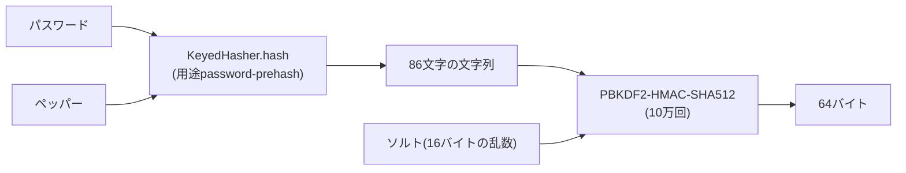
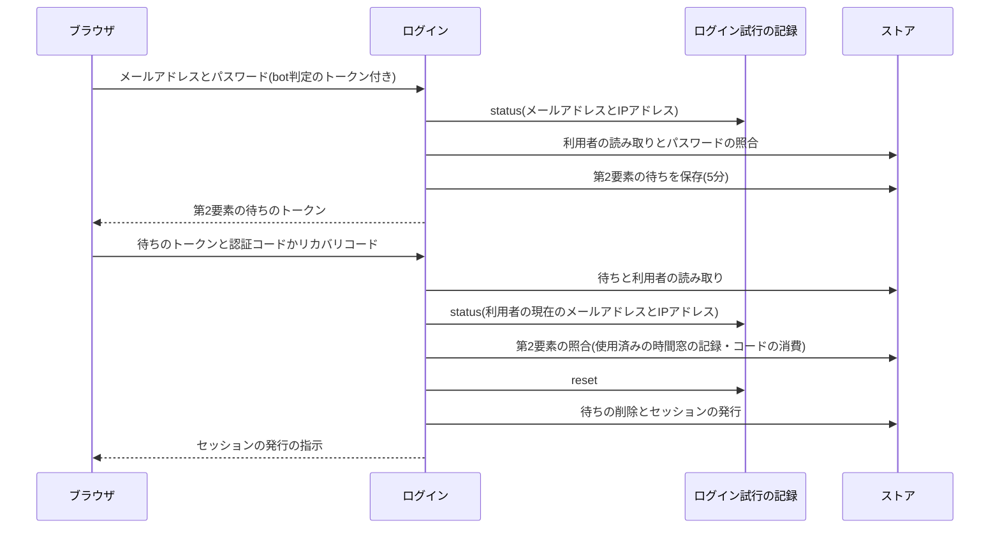

# 認証と認可の設計

メールアドレスとパスワードによる利用者の認証の仕組みを定める。パスワードの規則と保存、セッション、メールのリンクで使う認証系トークン、ログイン試行の制限、TOTPによる多要素認証とリカバリコード、重要な操作の本人確認とセッションの入れ替え、主体の種類と利用者の状態による認可、利用者の列挙の防止、及びペッパーを入れ替えられないことを扱う。

## 前提と用語

実行環境にCloudflare Workers、データベースにD1、ログイン試行の記録にDurable Objects、DIコンテナにInversifyを使う構成を前提とする。層構成は「[Cloudflare Workersでの層構成と依存性の組み立て](../backend/002-layered-architecture-on-workers.md)」に、秘密情報のハッシュ化は「[秘密情報のハッシュ化](002-keyed-hashing.md)」に、回数の制限とbot判定は「[レート制限とbot判定の検証](../backend/003-rate-limiting-and-bot-verification.md)」に、セッション識別子の受け渡しは「[内部経路とセキュリティヘッダー](../backend/006-internal-gateway.md#セッションの受け渡しと指示)」と「[フロントエンドサーバーのセキュリティ](../frontend/003-frontend-server-security.md#セッションのcookie)」に従う。

認証の部品は、利用者・管理者などの主体の種類に依存しない部品(以下「認証部品」)と、主体ごとの機能(利用者のアカウントの機能など)に分ける。認証部品は主体ごとの機能のファイルを読み込まず、この禁止は静的解析で強制する(「[依存方向と静的解析](../backend/002-layered-architecture-on-workers.md#依存方向と静的解析)」)。部品の置き場所は`<APIサーバーのアプリ>`の`src/`からのパスで示す。

| 部品                                                                                              | 置き場所                                               | 役割                                                                                                     |
| ------------------------------------------------------------------------------------------------- | ------------------------------------------------------ | -------------------------------------------------------------------------------------------------------- |
| `checkPasswordRules`                                                                              | `domain/auth/password-rules.ts`                        | パスワードの長さと識別子との一致の規則                                                                   |
| `USER_SESSION_POLICY`・`evaluateSession`・`cookieMaxAgeSeconds`                                   | `domain/auth/session-policy.ts`                        | セッションの期限と延長の判定                                                                             |
| `applyFailure`・`currentStatus`・`alarmOutcome`・`cooldownMs`                                     | `domain/auth/login-throttle-state.ts`                  | ログイン試行の記録の状態遷移                                                                             |
| `formatRecoveryCode`・`normalizeRecoveryCodeInput`                                                | `domain/auth/recovery-code-format.ts`                  | リカバリコードの表示の形と入力の正規化                                                                   |
| `normalizeTotpCode`                                                                               | `domain/auth/second-factor.ts`                         | 認証コードの入力の正規化                                                                                 |
| `CheckingPasswordPolicy`                                                                          | `application/auth/password-policy.ts`                  | 新しいパスワードの規則の確認と漏洩パスワードの照合                                                       |
| `HashingSecretIssuer`                                                                             | `application/auth/secret-issuer.ts`                    | セッション識別子・認証系トークンの発行とハッシュ化                                                       |
| `HashingRecoveryCodeIssuer`                                                                       | `application/auth/recovery-code-issuer.ts`             | リカバリコードの発行と入力のハッシュ化                                                                   |
| `SubjectSessionVerifier`                                                                          | `application/auth/subject-session-verifier.ts`         | 主体の種類ごとのセッションの検証の振り分け                                                               |
| `AUTH_ERRORS`・`authError`・`loginThrottledError`・本人確認とパスワードの拒否の文言               | `application/auth/auth-errors.ts`                      | 主体に依存しないエラーコード・種類・文言(主体ごとのエラーの定義はこれを展開して固有のコードだけを足す)   |
| `createPasswordRejectedError`                                                                     | `application/auth/password-rejection.ts`               | 新しいパスワードの拒否のエラーの組み立て(識別子との一致の文言だけを主体ごとに受け取る)                   |
| `MAIL_SEND_POLICY`                                                                                | `application/auth/mail-send-policy.ts`                 | 認証系のメールの送信回数の時間窓と上限                                                                   |
| `checkLoginThrottle`                                                                              | `application/auth/login-throttle-check.ts`             | 照合の前のログイン試行のロックの確認(主体の種類を受け取る。ログイン・第2要素の段階・本人確認で共有)      |
| `checkSubjectSecondFactor`・`isTotpEnabled`                                                       | `application/auth/second-factor-check.ts`              | 認証コード・リカバリコードの照合(リカバリコードのハッシュの用途と秘密鍵の文脈を主体の種類ごとに受け取る) |
| `Pbkdf2PasswordHasher`                                                                            | `infrastructure/auth/pbkdf2-password-hasher.ts`        | パスワードのハッシュ化と照合                                                                             |
| `CryptoSecretGenerator`                                                                           | `infrastructure/auth/crypto-secret-generator.ts`       | 暗号論的な乱数によるトークンと文字列の生成                                                               |
| `HkdfAesGcmSecretBox`                                                                             | `infrastructure/auth/hkdf-aes-gcm-secret-box.ts`       | TOTPの秘密鍵の暗号化と復元                                                                               |
| `OtpauthTotpAuthenticator`                                                                        | `infrastructure/auth/otpauth-totp-authenticator.ts`    | TOTPの秘密鍵の生成・登録用のURI・認証コードの照合                                                        |
| `HibpPwnedPasswordChecker`                                                                        | `infrastructure/auth/hibp-pwned-password-checker.ts`   | 漏洩パスワードの照合(「[漏洩パスワードの照合サービス](../external/004-pwned-passwords.md)」)             |
| `<ログイン試行の記録のクラス名>`・`createDurableLoginThrottle`                                    | `infrastructure/auth/`                                 | ログイン試行の記録のDurable Objectと、2つの単位の記録の操作                                              |
| `SentryAuthIncidentReporter`                                                                      | `infrastructure/auth/sentry-auth-incident-reporter.ts` | 運用者への通知                                                                                           |
| `AUTH_TOKEN_TTL_SECONDS`・`AUTH_TOKEN_HASH_PURPOSES`・`AUTH_TOKEN_PURPOSES_REVOKED_ON_COMPLETION` | `domain/identity/auth-token-purpose.ts`                | 認証系トークンの用途ごとの期限・ハッシュの用途・確定時に失効させる用途                                   |
| `StoreSessionIssuer`・`UserSessionVerifier`                                                       | `application/identity/`                                | 利用者のセッションの発行と検証                                                                           |
| `StoreReAuthenticator`                                                                            | `application/identity/re-authenticator.ts`             | 重要な操作の本人確認                                                                                     |
| `checkSecondFactor`                                                                               | `application/identity/second-factor-check.ts`          | 利用者のリカバリコードのハッシュの用途と秘密鍵の文脈で`checkSubjectSecondFactor`を呼ぶ                   |
| `StoreAccountGuard`                                                                               | `application/identity/account-guard.ts`                | ログイン中の利用者の取得と、利用者の状態による拒否                                                       |
| `CounterMailSendLimits`                                                                           | `infrastructure/identity/counter-mail-send-limits.ts`  | 利用者の認証系のメールの送信回数の制限(時間窓と上限は`MAIL_SEND_POLICY`を読む)                           |

| 用語                                     | 意味                                                                                                                                                          |
| ---------------------------------------- | ------------------------------------------------------------------------------------------------------------------------------------------------------------- |
| 主体の種類                               | セッションが表す者の種類(`user`・`admin`)。セッション・ログイン試行のメールアドレス単位の記録・ハッシュの用途を主体の種類ごとに分ける                         |
| 認証系トークン                           | メールのリンクで本人に渡す、メールアドレスの確認・メールアドレス変更・パスワードリセット・パスワード変更の1回限りの秘密の値                                   |
| 第2要素の待ち                            | 多要素認証を有効にした利用者がパスワードの照合を通った後、認証コードかリカバリコードの入力を待つ間の記録                                                      |
| 本人確認                                 | 重要な操作の前に、現在のパスワードと(多要素認証が有効なら)認証コードかリカバリコードを入力させて照合すること                                                  |
| 重要な操作                               | メールアドレス変更の要求・パスワード変更の要求・多要素認証の設定の開始と無効化・リカバリコードの再発行・退会                                                  |
| `<ペッパーのシークレットのキー>`         | 「[秘密情報のハッシュ化](002-keyed-hashing.md#前提と用語)」と同じ                                                                                             |
| `<ログイン試行の制限のバインディング名>` | ログイン試行の記録のDurable Objectのバインディングの名前                                                                                                      |
| `<ログイン試行の記録のクラス名>`         | ログイン試行の記録のDurable Objectのクラスの名前。APIサーバーのWorkerの入口から名前付きでエクスポートし、Wrangler設定のバインディングとマイグレーションに書く |
| `<TOTPの発行者名>`                       | 認証アプリに表示する発行者の名前。環境ごとに変え、どの環境のアカウントかを認証アプリで見分けられるようにする                                                  |

- `<ペッパーのシークレットのキー>`・`<ログイン試行の制限のバインディング名>`・`<ログイン試行の記録のクラス名>`の本プロジェクトでの名前と、`<TOTPの発行者名>`の各環境の値は、技術ドキュメントに写さず、プロジェクト固有の値の文書の「[バインディング・変数・シークレット](../../../onboardings/project-values.md#バインディング変数シークレット)」と「[Workerのシークレットのキーの一覧](../../../onboardings/project-values.md#workerのシークレットのキーの一覧)」に置く。

## パスワード

### 規則

新しいパスワードは、登録・パスワードリセット・パスワード変更で`CheckingPasswordPolicy.validateNewPassword`を通す。

1. 長さは8〜128コードポイント(共用部品の`PASSWORD_MIN_CODE_POINTS`・`PASSWORD_MAX_CODE_POINTS`)とする。大文字・数字・記号などの文字種の組み合わせは求めない。
2. ハンドル・ニックネーム・メールアドレス・メールアドレスのローカル部のいずれかと、大文字小文字を区別せずに一致するパスワードを拒否する。ニックネームは保存するときと同じく、前後の空白(`\p{White_Space}`)を除いてから比べる。
3. 1と2を通ったパスワードだけを漏洩パスワードの照合サービスへ送る。漏洩済みなら拒否し、照合サービスを使えなければ照合を省いて受け付け、運用者へ通知する(「[漏洩パスワードの照合サービス](../external/004-pwned-passwords.md)」)。

- 規則の違反は失敗の種類`unprocessable`のエラー`password_rejected`で返し、詳細の欄に入力の欄の名前を入れる。
- パスワード変更は、確定までの間、新しいパスワードを平文で保持せず、ハッシュ化した値だけを認証系トークンの行に保存する。

### 保存の形式

`Pbkdf2PasswordHasher`は、パスワードを次の形式で保存する。各部分はパディングの無いbase64urlである。

```text
pbkdf2-sha512$100000$<ソルト(16バイト)>$<導出した値(64バイト)>
```



- 前処理として、ペッパーを鍵にしたHMAC-SHA512(`KeyedHasher`の用途`password-prehash`)を掛け、その86文字の結果をPBKDF2の入力にする。データベースの内容だけでは総当たりができず、PBKDF2の計算量がパスワードの長さによらず一定になる。
- ソルトはハッシュ化のたびに16バイトの暗号論的な乱数で作る。
- 反復回数は10万回で、workerdがPBKDF2に許す上限である。上限を超えるとworkerdは例外を投げる。照合1回の計算時間は、Workers統合テストの計測で約16ミリ秒である。
- 照合は、保存した値を厳密に解析し(形式名・反復回数・各部分のバイト数と、再エンコードして同じ表記になること)、導出した値を`crypto.subtle.timingSafeEqual`で比べる。形式に合わない値は照合せずに`false`を返す。反復回数を変えると保存済みの値は照合できなくなるため、変える場合は旧形式の照合と再ハッシュ化を加える。
- 利用者が見つからないログインでは、`verifyAgainstDummy`で同じ計算量のダミーの照合を行い、常に`false`を返す。応答時間から登録の有無を推測させない。
- パスワードの平文をデータベース・ログ・エラートラッキングに残さない。

## セッション

### 識別子と保存

- セッション識別子は32バイトの暗号論的な乱数をパディングの無いbase64urlで表した43文字の文字列で、`CryptoSecretGenerator.token`で作る。認証系トークンと第2要素の待ちも同じ形である。
- データベースには識別子を`KeyedHasher`でハッシュ化した値だけを保存し、要求の識別子をハッシュ化した値で検索する。用途の名前は主体の種類ごとに分ける(利用者は`user-session`、管理者は`admin-`で始める)。
- 端末情報として、ブラウザのUser-Agentを先頭から512文字(`SESSION_USER_AGENT_MAX_LENGTH`)までに切って保存する。送信元のIPアドレスは保存しない。
- 発行日時・最終利用日時・絶対期限を保存する。

### 期限と延長

| 項目           | 値(`USER_SESSION_POLICY`)                                      |
| -------------- | -------------------------------------------------------------- |
| アイドル期限   | 最終利用から14日(`idleSeconds`)                                |
| 絶対期限       | 発行から90日(`absoluteSeconds`)                                |
| 最終利用の更新 | 前回の更新から15分以上経った利用のとき(`touchIntervalSeconds`) |

- `evaluateSession`は、現在時刻がアイドル期限か絶対期限に達したら(期限ちょうどを含む)期限切れとする。日次の削除も同じ境界で消す。
- 最終利用の更新は15分に1回までに間引き、要求ごとの書き込みを避ける。更新したときは、Cookieの有効期間を延ばす指示を応答に含める。
- Cookieの有効期間(`cookieMaxAgeSeconds`)は、アイドル期限と絶対期限の早い方までの残りを秒の端数を切り捨てて求め、1秒未満なら1秒にする。Cookieをサーバー側のセッションより長く残さない。
- Cookieの属性と名前は「[セッションのCookie](../frontend/003-frontend-server-security.md#セッションのcookie)」に従う。

### 検証

- 要求の識別子は、受付経路から`SessionVerifier`で検証する(「[検証の呼び出し](../backend/006-internal-gateway.md#検証の呼び出し)」)。`SubjectSessionVerifier`は、主体の種類ごとに差し込んだ検証器へ振り分け、検証器が別の主体の種類を返したら無効にする。主体の種類のセッションを持たないアプリでは、その主体の検証器に常に無効を返す`InvalidSubjectSessionVerifier`を束縛する。
- 利用者のセッションは、期限切れか利用者が退会済みなら、その行を削除して無効にする。停止中の利用者のセッションは削除せずに有効のまま残し、操作の拒否は認可で行う(「[認可](#認可)」)。
- ログアウトは、その端末のセッションの行を直ちに削除し、Cookieを失効させる指示を返す。利用者は自分のセッションを個別に、または操作している端末以外をまとめて失効させられる。
- 期限切れのセッションは、日次のジョブが条件付きの1文で削除する(「[日次の削除](#日次の削除)」)。

## 認証系トークン

| 用途                 | 有効期限(`AUTH_TOKEN_TTL_SECONDS`) | ハッシュの用途                       | 確定時に失効させる用途(`AUTH_TOKEN_PURPOSES_REVOKED_ON_COMPLETION`) |
| -------------------- | ---------------------------------- | ------------------------------------ | ------------------------------------------------------------------- |
| メールアドレスの確認 | 24時間                             | `user-auth-token-email-verification` | なし(確認の確定で同じ利用者の確認のトークンを消す)                  |
| メールアドレス変更   | 24時間                             | `user-auth-token-email-change`       | メールアドレスの確認・メールアドレス変更                            |
| パスワードリセット   | 30分                               | `user-auth-token-password-reset`     | パスワードリセット・パスワード変更                                  |
| パスワード変更       | 30分                               | `user-auth-token-password-change`    | パスワード変更                                                      |

- トークンはセッション識別子と同じ形の乱数で、ハッシュ化した値だけを保存する。平文は送るメールのリンクの中だけに置き、ログ・エラートラッキングに出さない。
- 同じ利用者・同じ用途のトークンを発行し直すと、未使用の古いトークンを削除する。最後に送ったリンクだけが使える。
- 確定は、ハッシュ化した値・用途・有効期限内を条件にした`DELETE ... RETURNING`の1文で消費する。同じトークンの2回目の確定は必ず失敗する。失効・期限切れ・存在しないトークンは、区別せずに同じエラー(失敗の種類`unprocessable`の`invalid_link`)にする。
- パスワードリセットは、新しいパスワードの規則の確認の前にトークンを消費せずに読み、規則を通った後に消費する。規則に反したパスワードの入力でリンクを使い切らせない。
- 確定と同じ一括の書き込みで、利用者の全セッションと上の表の用途の未使用のトークンを削除する(「[本人確認とセッションの入れ替え](#本人確認とセッションの入れ替え)」)。
- 期限付きのリンクを含むメールは、トークンの有効期限を送信期限にして送る。期限を過ぎたリンクを送らない(「[送信上限による待機と送信期限](../infra/003-async-processing.md#送信上限による待機と送信期限)」)。
- 有効期限を過ぎた未使用のトークンは、日次のジョブが削除する。

### リンクでの受け渡し

- リンクはトークンをURLのフラグメントに置く(`<確定の画面のパス>#token=<トークン>`)。フラグメントは要求に含まれないため、サーバーのアクセスログと`Referer`にトークンが残らない。画面のセキュリティヘッダーの`Referrer-Policy`も同じオリジンの外へ送らない値にする(「[セキュリティヘッダー](../frontend/003-frontend-server-security.md#セキュリティヘッダー)」)。
- 画面はフラグメントを読んだ直後に履歴を置き換えてURLから消す。
- 確定は画面のボタンの操作でだけ送り、画面を開いただけでは確定しない。メールのリンクを先に開く仕組み(メールの安全確認など)にトークンを使い切らせない。

### 送信回数の制限

メールアドレスの確認(登録と再送)・メールアドレス変更の要求・パスワードリセットの要求は、メールの種別ごとに、宛先のメールアドレスと送信元IPアドレスの2つの単位で回数を数える(`CounterMailSendLimits`)。

| 単位                 | 上限       | ルールの名前の例                   |
| -------------------- | ---------- | ---------------------------------- |
| 宛先のメールアドレス | 1時間に3回 | `auth-mail:password_reset:address` |
| 送信元IPアドレス     | 1時間に5回 | `auth-mail:password_reset:ip`      |

- 数え方は「[厳密カウンタ](../backend/003-rate-limiting-and-bot-verification.md#厳密カウンタ)」に従い、キーは前後の空白を除いて小文字にしたメールアドレスとIPアドレスをハッシュ化した値である。上限を超えたら状態コード429と`Retry-After`(遅い方のリセットまでの秒数)で拒否する。
- 片方の単位が上限を超えても両方を数え、どちらの記録も要求の回数と食い違わないようにする。
- 送信元IPアドレスが不明な要求は、IPアドレスの単位で数えない。1つのキーにまとめると、無関係な利用者の送信までまとめて止まる。
- アカウントの有無やメールアドレスの重複を調べる前に数える。上限に達するかどうかの違いから登録の有無を推測させない。
- 時間窓と上限は認証部品の`MAIL_SEND_POLICY`に置く。主体ごとの制限はルールの名前だけを分け、同じ値を読む。

## ログイン試行の制限

### 単位と記録

ログインの失敗を、入力されたメールアドレス(前後の空白を除いて小文字にした値)の単位と、送信元IPアドレスの単位で、それぞれ数える。

- 記録は単位ごとに1つのDurable Object(`<ログイン試行の記録のクラス名>`)に持つ。オブジェクトの名前は、メールアドレス単位が`login-email:<主体の種類>:<キー>`、IPアドレス単位が`login-ip:<キー>`である。メールアドレス単位の記録は主体の種類ごとに分け、IPアドレス単位の記録は全ての主体の種類で共有する。
- キーは`hashRateLimitKey`でハッシュ化した値で、元のメールアドレスとIPアドレスを保存しない(「[レート制限のキー](002-keyed-hashing.md#レート制限のキー)」)。
- 保存するのは、失敗の回数・ロックの終了時刻・最後の失敗の時刻だけである。
- 固定期間の厳密カウンタ(`RateLimitCounter`)と数え方が異なる(回数に応じて待ち時間が延びる)ため、別のDurable Objectのクラスにする。Wrangler設定には、`<ログイン試行の制限のバインディング名>`のバインディングと、SQLiteのストレージを使うクラスの新しいマイグレーションのタグを書く(「[Wranglerの設定](../backend/003-rate-limiting-and-bot-verification.md#wranglerの設定)」と同じ形)。

### 待ち時間

| 定数                         | 値                                 |
| ---------------------------- | ---------------------------------- |
| `LOGIN_FREE_ATTEMPTS`        | 5回(この回数までは待ち時間が無い)  |
| `LOGIN_BASE_COOLDOWN_MS`     | 1秒(6回目の失敗の後の待ち時間)     |
| `LOGIN_MAX_COOLDOWN_MS`      | 5分(待ち時間の上限)                |
| `LOGIN_FAILURE_RETENTION_MS` | 24時間(最後の失敗からの記録の保持) |

- 6回目以降の失敗で、その単位をロックする。待ち時間は6回目の後が1秒で、失敗ごとに2倍にし(7回目2秒、8回目4秒…14回目256秒)、15回目以降は5分である。
- ロック中の試行は、パスワードを照合せずに状態コード429・コード`login_throttled`・`Retry-After: <ロックの終了までの秒数>`で拒否し、失敗として数えない。2つの単位がロック中なら、長い方の秒数を返す。
- ロックの終了時刻にはロックだけを解き、失敗の回数を残す。次の失敗は続きの回数で数える。
- 最後の失敗から24時間失敗が無ければ、記録を消す。ロックの終了と記録の削除はDurable ObjectのAlarmで行い、Alarmの処理は重複して実行されても同じ結果になる。
- ログインに成功したら、メールアドレスの単位と送信元IPアドレスの単位の記録を両方消す。本人確認の成功はログインの成功ではないため記録を消さない。

### 数える失敗

- 未登録・退会済みのメールアドレスと、パスワードの不一致
- 第2要素の段階での認証コード・リカバリコードの誤り(第2要素の待ちの利用者の現在のメールアドレスの単位で数える)
- 本人確認でのパスワード・認証コード・リカバリコードの誤りと、第2要素の入力の欠落

停止中の利用者が正しいパスワードを入力した場合は、ログインを拒否するが失敗として数えない。

### 確認の順序

ログイン・第2要素の段階・本人確認は、照合の前に必ず`status`で両方の単位のロックを確かめ、ロック中なら照合しない。照合に失敗したら`recordFailure`で両方の単位に記録する。

- `status`から`recordFailure`までは原子的でないため、同時の要求はロックの前に`status`を通り得る。各単位の記録の読み出しから保存までは、Durable Objectが1つずつ処理し、同期のストレージAPIで`await`を挟まずに行うため、回数の取りこぼしは無い。照合中に他の要求がロックした後の失敗は、ロック中の試行として数えない。
- 送信元IPアドレスが不明な要求は、IPアドレスの単位を数えず、メールアドレスの単位だけで制限する。全ての不明な要求を1つのキーで数えると、無関係な利用者までロックされる。不明なことは`status`のときにだけ運用者へ通知し(レベル`warning`)、同じ試行の記録と削除で通知を重ねない。

## 多要素認証

### TOTP

| 項目           | 値                                                     |
| -------------- | ------------------------------------------------------ |
| 方式           | RFC 6238のTOTP(HMAC-SHA1・6桁・30秒)                   |
| 秘密鍵         | 20バイトの暗号論的な乱数(Base32で表示)                 |
| 照合の時間窓   | 現在の時間窓と前後1つ                                  |
| 設定の有効期限 | 設定の開始から10分(`TOTP_SETUP_TTL_SECONDS`)           |
| 第2要素の待ち  | パスワードの照合から5分(`LOGIN_CHALLENGE_TTL_SECONDS`) |

- 設定の開始は、メールアドレスを確認済みの利用者に限り、本人確認を通った後に秘密鍵を作って暗号化し、有効期限付きの保留として保存する。保留中に開始し直すと、保留を新しい秘密鍵で上書きする。
- 認証アプリに読み取らせる`otpauth://`のURIには、発行者に`<TOTPの発行者名>`、アカウントのラベルにハンドル(`@<ハンドル>`)を使う。メールアドレスは認証アプリに表示されるため使わず、ラベルに先頭以外の`@`があれば`RangeError`で拒否する。
- 有効化は、保留の有効期限内に正しい認証コードを入力したときに、照合した保留の秘密鍵が保存済みの値と同じであることを条件に行う。照合と有効化の間に設定が始め直されても、利用者の認証アプリに無い秘密鍵を有効にしない。
- 照合した時間窓の通し番号を使用済みとして記録し、記録より大きい時間窓のコードだけを受け付ける。同じ認証コードの再使用を拒否する。
- 認証コードの入力は、32文字以下のものだけをNFKCで正規化し、空白(`\p{White_Space}`)を除いてから、6桁の数字であることを確かめる。全角の数字や区切りの空白を含む入力も照合できる。
- 有効化を終えると、リカバリコードを発行し、セッションを入れ替える。無効化は本人確認を通った後にTOTPの設定と未使用のリカバリコードを削除し、セッションを入れ替える。

### 秘密鍵の暗号化

TOTPの秘密鍵は、データベースの内容だけでは復元できない形で保存する(`HkdfAesGcmSecretBox`)。

```text
v1.<IV(12バイト)>.<暗号文と認証タグ(16バイト)>
```

- 鍵は、ペッパーを入力の鍵素材として、HKDF-SHA-256(空のソルト、情報の文字列`totp-secret-v1`)で導出したAES-256-GCMの鍵である。情報の文字列で用途を分けるため、ペッパーを使う他の用途のハッシュ値と鍵が一致しない。情報の文字列を変えると保存済みの値を復元できなくなる。
- IVは暗号化のたびに12バイトの乱数で作る。追加認証データ(AAD)に利用者のIDを使い、別の利用者の行へ写した値を復元できないようにする。
- 各部分はパディングの無いbase64urlで、形式に合わない値・改ざんされた値・別の利用者の値の復元は`SecretBoxOpenError`で失敗する。
- 導出した鍵はインスタンスの中で使い回し、導出に失敗したら次の呼び出しで導出し直す。

### リカバリコード

| 項目           | 値                                                                        |
| -------------- | ------------------------------------------------------------------------- |
| 個数           | 10個(`RECOVERY_CODE_COUNT`)                                               |
| 文字の集合     | 紛らわしい`i`・`l`・`o`・`0`・`1`を除いた31文字(`RECOVERY_CODE_ALPHABET`) |
| 長さ           | 16文字(`RECOVERY_CODE_LENGTH`。約79ビット)                                |
| 表示の形       | 4文字ごとにハイフンで区切る(`abcd-efgh-jkmn-pqrs`の形)                    |
| ハッシュの用途 | `user-recovery-code`                                                      |

- 文字は偏りの無い方法で暗号論的な乱数から選ぶ。区切りの無い形をハッシュ化して保存し、平文は発行の応答でだけ返す。
- 入力は、64文字以下のものだけをNFKCで正規化し、空白(`\p{White_Space}`)とダッシュ類(`\p{Dash_Punctuation}`。ハイフン・全角のハイフンマイナス・ダッシュなど)を全て除いて小文字にしてから、文字の集合と長さを確かめる。日本語の入力方式で全角の英数字やハイフンが入っても照合できる。
- 照合したコードは削除して使用済みにする(1回限り)。
- 再発行は本人確認を通った後に未使用のコードを全て新しい10個に置き換え、セッションを入れ替える。
- 画面は平文を表示した後、取得のキャッシュに残さない。

### 多要素認証のログイン



- 第2要素の待ちのトークンは、セッション識別子と同じ形の乱数で、ハッシュ化した値(用途`user-login-challenge`)だけを保存する。待ちの期限が切れた・利用者が退会済みなら、待ちを消してログインからやり直させる。待ちの発行の後に停止された利用者は、第2要素を照合せず、失敗としても数えずに拒否する。
- 第2要素の段階にはbot判定を求めない。パスワードの段階でbot判定を通っており、待ちのトークンを持つ者だけが呼べるためである。

## 本人確認とセッションの入れ替え

重要な操作は、本人確認(`StoreReAuthenticator.verify`)を通ってから行う。

1. ログイン試行の記録のロックを確かめる(「[確認の順序](#確認の順序)」)。
2. 現在のパスワードを照合する。誤りなら失敗を記録して拒否し、第2要素は照合しない。本人でない者の入力でリカバリコードや時間窓を使い切らせない。
3. 多要素認証が有効なら、認証コードかリカバリコードを照合する。入力が無い・誤りなら失敗を記録して拒否する。リカバリコードを使ったら使用済みにする。

- 失敗は失敗の種類`unprocessable`のエラー`reauthentication_failed`で返し、詳細の欄に誤りのある入力の相対の経路(`currentPassword`・`secondFactor`・`secondFactor.totpCode`・`secondFactor.recoveryCode`)を入れる。リゾルバが操作の入力の形に合わせて前に経路を足す。
- 本人確認は利用者の状態(停止・退会)を見ない。呼び出し側が先に認可で拒否する。

| 操作                                               | 全セッションの削除 | 新しいセッション                                             |
| -------------------------------------------------- | ------------------ | ------------------------------------------------------------ |
| パスワードリセットの完了                           | する               | 発行しない(ログイン画面へ案内する)                           |
| メールアドレス変更・パスワード変更の確定           | する               | 確定の操作をした端末が同じ利用者としてログイン中なら発行する |
| 多要素認証の有効化・無効化・リカバリコードの再発行 | する               | 操作した端末に発行する                                       |
| 退会                                               | する               | 発行せず、Cookieを失効させる                                 |

- メールアドレス変更・パスワード変更は、要求の段階で本人確認を行い、メールのリンクの確定の段階でセッションを入れ替える。確定の画面はリンクを開いた別の端末でも使われるため、操作した端末が同じ利用者としてログイン中である場合だけ新しいセッションを渡す。
- パスワードリセット・メールアドレス変更・パスワード変更の確定では、変更とセッション・トークンの削除を1つの一括の書き込みで行う。多要素認証の有効化・無効化・リカバリコードの再発行も、設定の変更とセッションの削除を1つの一括の書き込みで行い、新しいセッションはその後に発行する。どちらかだけが反映されて、設定だけが変わり他の端末のセッションが残ることを防ぐ。
- 一括の書き込みの中では前の文の結果で後の文を分けられないため、多要素認証のセッションとリカバリコードの書き込みの各文は、同じ一括の書き込みの中の設定の状態(有効化では照合した秘密鍵の有効な保留、無効化と再発行では有効化済み)を条件にし、設定を書き換える文より前に置く。並行した無効化の後に届いた再発行などで条件を満たさなければ、どの文も何も変えず、操作は「有効になっていない」の失敗にする。保存していないリカバリコードの平文を返さず、他の操作が発行したセッションも消さない。
- パスワードリセットの完了は、未確認の利用者を確認済みにする。他人のメールアドレスで先に登録されたアカウントも、メールアドレスの持ち主がリセットで取り戻せ、その時に全てのセッションが消える。

## 認可

### 主体と呼び出し元

- 利用者の操作は、利用者側のフロントエンドサーバーからの呼び出しだけで受け付け、入力の検証とbot判定より前に拒否する(「[呼び出し元の判定](../backend/006-internal-gateway.md#呼び出し元の判定)」)。
- 利用者の操作は、セッションの主体の種類が`user`であることを確かめる。管理者のセッションで利用者の操作を行えない。
- bot判定を求める操作の検証の方法は「[bot判定の検証](../backend/003-rate-limiting-and-bot-verification.md#bot判定の検証)」と「[bot判定](../backend/004-graphql-server.md#bot判定)」に従う。

### 利用者の状態

`StoreAccountGuard`は、処理単位のコンテナで単一に束縛し、同じ要求の中では利用者を1回だけ読む。

| メソッド              | 通す利用者                   | 拒否                                                          |
| --------------------- | ---------------------------- | ------------------------------------------------------------- |
| `currentUser`         | ログイン中の未退会の利用者   | 拒否せず、未ログイン・利用者以外の主体・退会済みは`undefined` |
| `requireUser`         | 停止中を含む未退会の利用者   | `unauthenticated`                                             |
| `requireWritableUser` | 停止中でない未退会の利用者   | 上に加え、停止中は`account_unavailable`                       |
| `requireVerifiedUser` | 確認済みで停止中でない利用者 | 上に加え、未確認は`email_not_verified`                        |

- 停止中の利用者は、閲覧・ログアウト・セッションの失効・退会のために`requireUser`で通す。他の書き込みの操作は`requireWritableUser`か`requireVerifiedUser`で拒否する。
- 停止ではセッションを削除しない。停止中の利用者は既存のセッションで退会できる。

## 利用者の列挙の防止

- ログインの失敗は、未登録・退会済み・パスワードの不一致を同じエラー(`invalid_credentials`)と同じ計算量(ダミーの照合)で返す。停止中であることは、正しいパスワードを入力した者にだけ伝える。
- パスワードリセットの要求は、アカウントの有無と状態を問わず同じ応答にする。メールを送るのは、停止中でない未退会の利用者だけである。
- メールアドレス変更の要求は、新しいメールアドレスの重複の有無を問わず同じ応答にし、重複していればメールを送らない。
- 応答を同じにする操作では、メールの送信の要求の失敗を応答に出さずにログに残す。失敗を返すと送信の対象があったと分かる。
- 送信回数は、アカウントの有無や重複を調べる前に数える(「[送信回数の制限](#送信回数の制限)」)。
- 登録でのメールアドレスの重複は拒否するため、登録の有無が分かる。送信元IPアドレス単位の送信回数の制限とbot判定で、大量の確かめを抑える。

## 運用者への通知

認証部品は、次の出来事を`SentryAuthIncidentReporter`でログとエラートラッキングへ送る。カテゴリ・レベル・指紋は「[カテゴリ](../infra/004-logging-and-error-tracking.md#カテゴリ)」と「[送信する例外と送信しない例外](../infra/004-logging-and-error-tracking.md#送信する例外と送信しない例外)」に記載する。

- 漏洩パスワードの照合サービス・使い捨てメールアドレスの判定サービスを使えず、処理を省いた
- 送信元IPアドレスが不明で、IPアドレス単位のログイン試行の記録を省いた
- ユーザーライフサイクルイベントの送信の失敗・送り直しの継続・物理削除の期限超過(「[ユーザーライフサイクルイベント](../backend/007-user-lifecycle-events.md)」)

メールアドレス・IPアドレス・トークン・パスワードは通知に含めない。

## 日次の削除

日次のジョブが、次の行を期限ちょうどを期限切れとする境界で、テーブルごとに条件付きの1文で件数の上限なく削除し、対象ごとの件数をログに残す。ジョブの名前と時刻は「[ジョブの登録](../infra/003-async-processing.md#ジョブの登録)」に従って登録する。

- アイドル期限か絶対期限に達したセッション
- 有効期限を過ぎた未使用の認証系トークン
- 有効期限を過ぎた第2要素の待ち
- 有効期限を過ぎたTOTPの設定の保留

ログイン試行の記録は日次のジョブでは消さず、Durable ObjectのAlarmが最後の失敗から24時間で消す。

## ペッパーを入れ替えられないこと

1つのペッパーを、用途を分けて次の全てに使う。部品は1つのペッパーだけを受け取り、古いペッパーで作った値を照合・復元する手段を持たない。

| 使い道                                              | 入れ替えた後の影響                                                 |
| --------------------------------------------------- | ------------------------------------------------------------------ |
| パスワードの前処理                                  | 全ての利用者のパスワードが一致しなくなり、パスワードリセットが要る |
| セッション・認証系トークン・第2要素の待ちのハッシュ | 全てのセッションとメールのリンクが無効になる                       |
| リカバリコードのハッシュ                            | 全てのリカバリコードが一致しなくなる                               |
| TOTPの秘密鍵の暗号化の鍵                            | 全ての秘密鍵を復元できなくなり、認証コードを照合できない           |
| ログイン試行の記録・送信回数の制限のキー            | 記録が0から数え直しになる                                          |

- そのため、ペッパーの入れ替えは想定しない。パスワードリセットは多要素認証の設定を変えないため、入れ替えると、多要素認証を有効にしていた利用者は認証コードもリカバリコードも照合できず、パスワードを再設定してもログインできない。TOTPの設定とリカバリコードを削除して無効にする作業が別に要る。
- ペッパーが漏えいした場合は、上の影響を受け入れて入れ替える(「[ペッパーの変更と漏えい](002-keyed-hashing.md#ペッパーの変更と漏えい)」)。
- パスワード専用など別のシークレットを設けても、そのシークレットの入れ替えには同じ影響がある。

## テスト

- 単体テストは、時刻を引数で渡す純粋な判定(期限・待ち時間・正規化)を直接確かめる。乱数に依る処理は`crypto.getRandomValues`を差し替えて入力を固定し、確率で失敗するテストを作らない。
- PBKDF2・HKDF・AES-GCM・Durable Objectは、Workers統合テストでworkerdの実装を使って確かめる。Durable ObjectのAlarmは`runDurableObjectAlarm`で実行する。
- 外部サービスへは通信しない。差し替えの方法は各サービスの文書(「[漏洩パスワードの照合サービス](../external/004-pwned-passwords.md#テストでの差し替え)」「[使い捨てメールアドレスの判定サービス](../external/005-disposable-email-check.md#テストでの差し替え)」「[bot判定のサービス](../external/006-turnstile.md#テストでの差し替え)」)に記載する。
- テストのコードには、固定のパスワード・トークン・Base32の秘密鍵を文字列のリテラルで書かず、実行時に組み立てる。シークレットの検出の誤検知でコミットが止まる(「[シークレットの検出](001-secret-management.md#シークレットの検出)」)。
