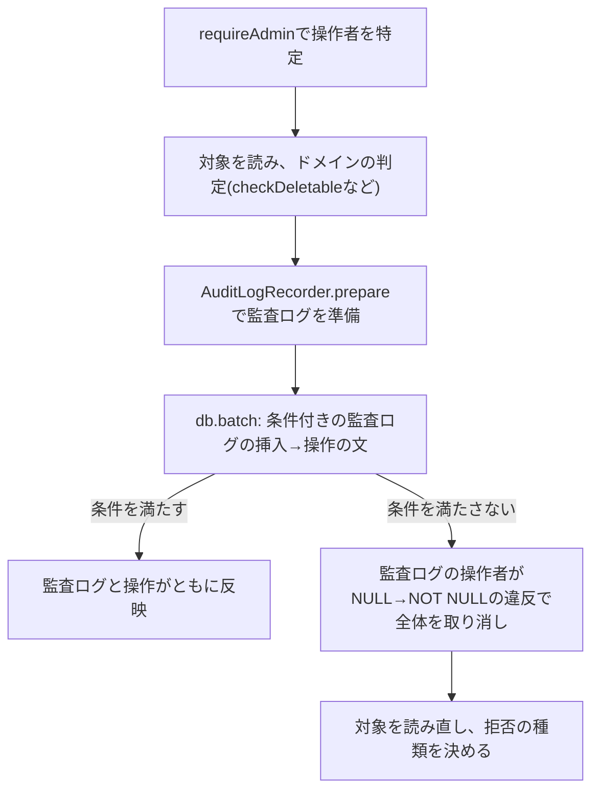

# 管理者の認可の設計

管理画面を操作する管理者の認可の仕組みを定める。管理者と利用者の主体の分離、ロールの順序と操作ごとの最低限のロールの宣言、所有権の判定、要求ごとのロールの読み込み、最後の最上位管理者の保護の書き込みの方式、管理者のセッションの期限、本人確認、及びbot判定の適用範囲を扱う。

## 前提と用語

パスワード・セッション・認証系トークン・ログイン試行の制限・多要素認証・本人確認の仕組みは「[認証と認可の設計](006-authentication.md)」に従い、本書は管理者に固有の値と規則だけを書く。層構成は「[Cloudflare Workersでの層構成と依存性の組み立て](../backend/002-layered-architecture-on-workers.md)」に、呼び出し元の判定は「[内部経路とセキュリティヘッダー](../backend/006-internal-gateway.md#呼び出し元の判定)」に、エラーの状態コードは「[GraphQLサーバーの基盤](../backend/004-graphql-server.md#エラーの分類と状態コード)」に、管理操作の監査ログは「[監査ログの記録](../backend/008-audit-logging.md)」に従う。部品の置き場所は、共用部品の配置先(`<共用部品の配置先>`)、共通ライブラリの配置先(`<共通ライブラリの配置先>`)、`<APIサーバーのアプリ>`・`<管理者側のフロントエンドのアプリ>`の`src/`からのパスで示す。

| 部品                                                                              | 置き場所                                                                          | 役割                                                                                               |
| --------------------------------------------------------------------------------- | --------------------------------------------------------------------------------- | -------------------------------------------------------------------------------------------------- |
| `AdminRole`・`ADMIN_ROLES`・`hasRole`・`ADMIN_ROLE_LABELS`                        | `<共用部品の配置先>`の`admin/admin-roles.ts`                                      | ロールの値・順序・比較・表示名(APIサーバーと画面で共有)                                            |
| `checkDeletable`・`checkRoleChangeable`・`checkProfileEditable`・`checkInvitable` | `<APIサーバーのアプリ>`の`domain/admin/admin-account.ts`                          | 操作者と対象の管理者による可否の判定。許可なら`undefined`、拒否なら理由を返す                      |
| `ADMIN_SESSION_POLICY`                                                            | `<APIサーバーのアプリ>`の`domain/admin/admin-session-policy.ts`                   | 管理者のセッションの期限と延長                                                                     |
| `ADMIN_AUTH_TOKEN_TTL_SECONDS`・`ADMIN_HASH_PURPOSES`                             | `<APIサーバーのアプリ>`の`domain/admin/admin-auth-token-purpose.ts`               | 管理者の認証系トークンの期限と、管理者の秘密情報のハッシュの用途                                   |
| `StoreAdminAuthorizer`・`CurrentAdmin`・`operatorSnapshotOf`                      | `<APIサーバーのアプリ>`の`application/admin/admin-authorizer.ts`                  | 要求の管理者の特定と最低限のロール・所有権の判定                                                   |
| `requireAdmin`・`requireSelfOrRole`                                               | `<APIサーバーのアプリ>`の`presentation/graphql/admin-guard.ts`                    | リゾルバから呼ぶ認可の入口と、ロール不足の拒否のログ                                               |
| `adminOnly`                                                                       | `<APIサーバーのアプリ>`の`presentation/graphql/modules/admin/resolver-support.ts` | 管理者側のフロントエンドサーバーからの要求だけを受け付けるリゾルバの包み                           |
| `AdminSessionVerifier`                                                            | `<APIサーバーのアプリ>`の`application/admin/admin-session-verifier.ts`            | 管理者のセッションの検証                                                                           |
| `StoreAdminReAuthenticator`                                                       | `<APIサーバーのアプリ>`の`application/admin/admin-re-authenticator.ts`            | 管理者の重要な操作の本人確認                                                                       |
| `buildAuditLogStatements`・`isAuditGuardRejection`                                | `<APIサーバーのアプリ>`の`infrastructure/admin/audit-log-statements.ts`           | 条件付きの監査ログの記録による、削除・ロール変更の書き込みの取り消し                               |
| `ADMIN_PLATFORM_TYPES`・`ADMIN_PLATFORM_MODULE`・`AdminDirectory`                 | `<共通ライブラリの配置先>`の`core/admin/`・`workers/admin/`                       | 他の機能が管理者のIDから表示用のプロフィールを読む照会口                                           |
| `RoleGate`・`useAdminRole`・`useCurrentAdmin`                                     | `<管理者側のフロントエンドのアプリ>`の`components/layout/`                        | 画面でのロールによる出し分け(「[管理画面のシェルと区画](../frontend/009-admin-console-shell.md)」) |

| 用語               | 意味                                                                                                                                             |
| ------------------ | ------------------------------------------------------------------------------------------------------------------------------------------------ |
| 管理者             | 管理画面を操作する者。利用者とは別のテーブル・セッション・認証系トークンを持ち、主体の種類は`admin`                                              |
| 招待中・有効       | 管理者の状態。招待中はログインできず、招待の完了(パスワード・ニックネーム・TOTPの設定)で有効になる                                               |
| ロール             | 有効な管理者が持つ権限の段階。低い順に`viewer`(閲覧のみ)・`moderator`(モデレーター)・`super_admin`(最上位管理者)                                 |
| 最低限のロール     | 操作ごとに宣言する、その操作に要るロールの下限。宣言したロール以上の管理者に許す                                                                 |
| 所有権             | 操作の対象がログイン中の管理者自身であること。本人なら最低限のロールを求めない                                                                   |
| 最後の最上位管理者 | 有効な最上位管理者が1人だけのときの、その管理者。降格と削除を拒否する                                                                            |
| `<TOTPの発行者名>` | 「[認証と認可の設計](006-authentication.md#前提と用語)」と同じ。管理者は利用者と別の値を環境ごとに持ち、利用者のアカウントと認証アプリで見分ける |

- `<TOTPの発行者名>`の管理者の各環境の値は、技術ドキュメントに写さず、プロジェクト固有の値の文書の「[バインディング・変数・シークレット](../../../onboardings/project-values.md#バインディング変数シークレット)」に置く。

## 主体の分離

管理者と利用者は、同じ認証部品を使い、データと判定を共有しない。

- 管理者のテーブル(管理者・セッション・認証系トークン・第2要素の待ち・TOTP・リカバリコード)は、利用者のテーブルと外部キーを持たない。同じメールアドレスで管理者と利用者の両方を持てる。
- セッションのハッシュの用途・認証系トークンのハッシュの用途・リカバリコードのハッシュの用途は`admin-`で始め(`ADMIN_HASH_PURPOSES`)、利用者のハッシュ値と一致させない。TOTPの秘密鍵の暗号化の文脈は`admin:<管理者のID>`とする。
- ログイン試行の記録のスコープは`admin`、認証系のメールの送信回数のルールの名前の接頭辞は`admin-auth-mail`とし、利用者の記録と数え合わせない。
- セッションのCookieの名前は呼び出し元の種類ごとに分ける(「[名前の分け方](../frontend/003-frontend-server-security.md#名前の分け方)」)。`SubjectSessionVerifier`が主体の種類`admin`の検証を`AdminSessionVerifier`へ振り分ける(「[検証](006-authentication.md#検証)」)。
- 管理者の機能のファイル(`domain/admin/`・`application/admin/`・`infrastructure/admin/`・`presentation/graphql/modules/admin/`・`composition/admin-module.ts`)は、利用者のアカウントの機能のファイル(`identity`という名前のフォルダの下)を読み込まない。主体に依存しない処理は認証部品(`auth`)へ移して両方から使う。この禁止は静的解析(`no-restricted-imports`)で強制する(「[依存方向と静的解析](../backend/002-layered-architecture-on-workers.md#依存方向と静的解析)」)。
- 他の機能は、管理者のテーブルを直接読まず、照会口`AdminDirectory.findProfiles`で管理者のIDから表示用のニックネーム・肩書き・画像を読む。照会口は有効な管理者だけを返し、削除済み・招待中・存在しないIDは結果に含めない。照会口の束縛`ADMIN_PLATFORM_MODULE`は経路を持たないため、APIサーバーとメッセージを受信するアプリの両方のモジュールの一覧に加えられる。

## ロール

`ADMIN_ROLES`は低い順に`viewer`・`moderator`・`super_admin`を並べ、`hasRole(actual, minimum)`は`actual`の位置が`minimum`以上なら真を返す。

- ロールは各機能が自分の操作ごとに最低限のロールを宣言し、比較は`hasRole`だけで行う。ロールの値を`===`で比べて許可しない。上位のロールを足したときに判定が漏れる。
- `hasRole`は型の外の値を最も低いロールより下に並べ、`minimum`が型の外なら許可側に倒れる。実行時に組み立てた値を`minimum`に渡すときは、先に`ADMIN_ROLES`に含まれることを確かめる。`StoreAdminAuthorizer`は型の外の最低限のロールを、保存済みのロールを読む前に`Error`で拒否する。
- 管理画面の全てのメニューは全てのロールが参照でき、メニューの項目をロールで隠さない。ロールで分けるのは、参照の後の操作である。
- 操作ごとの最低限のロールの一覧(各機能のメニューと操作)はサービスの仕様に置き、各機能はそれに従って宣言する。

## 操作の認可

### 宣言の入口

リゾルバは、`adminOnly`で包んだ上で、処理の最初に`requireAdmin`か`requireSelfOrRole`を呼ぶ。

```typescript
export const exampleResolvers = {
  Mutation: {
    archiveExample: adminOnly(
      withValidatedArgs(
        ARCHIVE_EXAMPLE_ARGS,
        async (_parent, input, context) => {
          const current = await requireAdmin(context, 'moderator');
          return exampleUseCase(context).archive(
            current,
            input,
            adminRequestMetaOf(context),
          );
        },
      ),
    ),
    updateExampleOwnedByAdmin: adminOnly(
      withValidatedArgs(UPDATE_ARGS, async (_parent, input, context) => {
        const current = await requireSelfOrRole(
          context,
          input.adminId,
          'super_admin',
        );
        return exampleUseCase(context).update(current, input);
      }),
    ),
  },
} satisfies Resolvers;
```

| 入口                                                | 通す管理者                                                                            |
| --------------------------------------------------- | ------------------------------------------------------------------------------------- |
| `requireAdmin(context, minimum)`                    | ロールが`minimum`以上の有効な管理者                                                   |
| `requireSelfOrRole(context, ownerAdminId, minimum)` | 対象の所有者(`ownerAdminId`)本人の有効な管理者か、ロールが`minimum`以上の有効な管理者 |

- 自分のアカウントだけを対象にする操作(自分のメールアドレス・パスワード・TOTPの変更)は、全ロールに許すため`requireAdmin(context, 'viewer')`で通し、対象をログイン中の管理者に限る。
- 入口が返す`CurrentAdmin`(ID・ロール・ニックネーム・セッションのID)をユースケースへ渡し、ユースケースは管理者を読み直さずに操作者として使う。ユースケースの書き込みの条件には`operatorSnapshotOf(current)`を使う。
- 操作者と対象の組み合わせで決まる規則(自分自身の削除・最上位管理者を対象にした操作など)は、入口ではなくユースケースがドメインの判定(`checkDeletable`など)で拒否する。

### 拒否の順序と種類

| 順  | 確かめること                                                          | 拒否              |
| --- | --------------------------------------------------------------------- | ----------------- |
| 1   | 呼び出し元が管理者側のフロントエンドサーバーである(`adminOnly`)       | `forbidden`       |
| 2   | セッションが認証済みで、主体の種類が`admin`である                     | `unauthenticated` |
| 3   | 管理者が存在し、状態が有効である                                      | `unauthenticated` |
| 4   | ロールが最低限のロール以上か、`requireSelfOrRole`では対象の所有者本人 | `forbidden`       |

- 1は入力の検証とbot判定より前に行う。利用者側からの要求を管理者の操作として扱わない。
- リゾルバは`adminOnly`の内側を引数の検証(`withValidatedArgs`)で包み、`requireAdmin`・`requireSelfOrRole`をその内側で呼ぶ。そのため実際の順は「1→引数の検証→2〜4」で、引数が規則に反する要求には、未認証・ロール不足であっても`validation_error`が先に返る場合がある。引数の検証は入力の形だけを見て保存済みのデータを読まないため、認可の前に行っても管理者の有無や権限を推測させない。
- 匿名・利用者のセッション・削除済み・招待中は、区別せずに`unauthenticated`にする。
- GraphQLでは、拒否はHTTPの状態コード200とエラーコードで返す(「[エラーの分類と状態コード](../backend/004-graphql-server.md#エラーの分類と状態コード)」)。`forbidden`は失敗の種類としては権限の不足(403に当たる)である。
- 画面の表示の可否と関係なく、APIサーバーで必ず判定する。画面の出し分け(「[ロールによる操作の出し分け](../frontend/009-admin-console-shell.md#ロールによる操作の出し分け)」)は操作の誤りを減らすためだけのものである。
- 管理者側のフロントエンドサーバーからの要求のロール不足だけを、カテゴリ`[<APIサーバーのアプリ>, 'admin', 'authorization']`のレベル`warning`のログに、属性`requiredRole`で残す。操作名はGraphQLの操作のログが同じ相関IDで残すため、重ねて書かない。呼び出し元の拒否はロールの不足ではないため残さない。操作者と対象で決まる拒否は、各操作のログの`forbidden`で追う。

### 要求ごとのロールの読み込み

- `StoreAdminAuthorizer`は処理単位のコンテナで単一に束縛し、同じ要求の中では保存済みの管理者を1回だけ読む。1つの要求の中で複数のリゾルバが認可を求めても、読み取りは1回である。
- ロールをセッションやCookieに保存しない。次の要求では読み直すため、ロールの変更と削除は、対象の管理者の次の要求から反映される。
- 有効な管理者のニックネームが無いのはデータの不整合のため、例外にする。

## 最後の最上位管理者の保護

有効な最上位管理者が1人だけのとき、その管理者の降格と削除を拒否する。並行した2つの操作がどちらも「他にも最上位管理者がいる」と読んで両方とも通ることを防ぐため、読み取りでは判定を確定させず、書き込みの一括の書き込みの中で判定する。



- 削除とロール変更は、監査ログの挿入を一括の書き込みの先頭に置き、操作者のIDを`CASE WHEN <条件> THEN <操作者のID> ELSE NULL END`にする。条件を満たさないとNOT NULLの違反で一括の書き込み全体が取り消され、監査ログも操作も残らない(「[版の検査で一括の書き込み全体を取り消す](../db/002-d1-constraints.md#版の検査で一括の書き込み全体を取り消す)」)。
- 条件は次の全てを満たすことである。

| 条件                       | 内容                                                                                                 |
| -------------------------- | ---------------------------------------------------------------------------------------------------- |
| 操作者の状態が要求時のまま | 操作者のID・ロールが認可で読んだ値と一致し、状態が有効である                                         |
| 対象の状態が読んだ時のまま | ロール変更では、対象の現在のロールが読んだ変更前のロールと一致する                                   |
| 対象が許される             | 削除では、操作者が最上位管理者でなければ対象が最上位管理者でない                                     |
| 最上位管理者が残る         | 対象が有効な最上位管理者なら、対象の他にも有効な最上位管理者がいる(最上位管理者への変更では求めない) |

- ストアは`isAuditGuardRejection`で取り消しを見分けて`'rejected'`を返し、他の失敗はそのまま投げる。ユースケースは対象を読み直し、存在しなければ`not_found`、最後の最上位管理者なら`last_super_admin`、それ以外(並行した変更)なら`admin_state_conflict`にする。
- 2人の最上位管理者が互いを同時に降格しても、後の一括の書き込みの条件が満たされず、1人が残る。
- 自分自身の削除は、最後の最上位管理者でなくても`self_deletion_forbidden`で拒否する。誤操作による締め出しと、保護の迂回を避ける。削除が要るときは、削除の権限を持つ他の管理者が行う。
- 最後の最上位管理者が認証の手段を失った場合の手順は「[最初の最上位管理者の用意](../operations/003-first-administrator-bootstrap.md#最上位管理者が締め出された場合)」に従う。

## 管理者のセッション

| 項目           | 値(`ADMIN_SESSION_POLICY`)        |
| -------------- | --------------------------------- |
| アイドル期限   | 最終利用から1時間(`idleSeconds`)  |
| 絶対期限       | 発行から12時間(`absoluteSeconds`) |
| 最終利用の更新 | 前回の更新から5分以上経った利用   |

- 期限の判定・Cookieの有効期間・識別子の保存の形式は利用者と同じ部品(`evaluateSession`・`cookieMaxAgeSeconds`)に、管理者の値を渡して求める(「[セッション](006-authentication.md#セッション)」)。利用者より短くし、離席した端末に残ったセッションの悪用を抑える。
- `AdminSessionVerifier`は、期限切れか管理者が有効でなければ、その行を削除して無効にする。管理者の削除は、セッションの行を同じ一括の書き込みで消す。
- 管理者はTOTPを必ず設定し、無効にできない。ログインはパスワードの照合の後に必ず第2要素を求め、パスワードの段階ではセッションを発行しない(「[多要素認証のログイン](006-authentication.md#多要素認証のログイン)」)。
- 招待中の管理者のログインは、未登録と同じエラー(`invalid_credentials`)と同じ計算量で拒否し、招待の有無を推測させない。
- 期限切れのセッション・認証系トークン・第2要素の待ち・TOTPの設定の保留は、日次のジョブが1回の起動につき対象ごとに500件まで削除し、残りは翌日の起動に任せる。

## 認証系トークン

| 用途               | 有効期限(`ADMIN_AUTH_TOKEN_TTL_SECONDS`) | ハッシュの用途                    |
| ------------------ | ---------------------------------------- | --------------------------------- |
| 招待               | 24時間                                   | `admin-auth-token-invitation`     |
| メールアドレス変更 | 24時間                                   | `admin-auth-token-email-change`   |
| パスワードリセット | 30分                                     | `admin-auth-token-password-reset` |

- 発行・消費・リンクでの受け渡しは利用者と同じ規則に従う(「[認証系トークン](006-authentication.md#認証系トークン)」)。保存を始めたハッシュの用途の名前は変えない。
- 招待のトークンの期限を、招待中の管理者の招待の期限にも使う。招待の再送は未使用の招待のトークンを置き換え、期限を延ばす。
- パスワード変更は管理者ではメールの確定を挟まず、本人確認の後に即時に変える。

## 本人確認

重要な操作は、`StoreAdminReAuthenticator.verify`を通ってから行う。手順・失敗の記録・エラーの詳細の欄は利用者と同じである(「[本人確認とセッションの入れ替え](006-authentication.md#本人確認とセッションの入れ替え)」)。

- 管理者はTOTPを無効にできないため、現在のパスワードに加えて認証コードかリカバリコードを常に求める。
- ログイン試行の記録はスコープ`admin`で数え、本人確認の失敗もログインの失敗と同じく数える。

| 操作                                 | 本人確認 | 全セッションの削除 | 新しいセッション                                             |
| ------------------------------------ | -------- | ------------------ | ------------------------------------------------------------ |
| メールアドレス変更の要求             | 求める   | しない             | 発行しない                                                   |
| メールアドレス変更の確定(リンク)     | 求めない | する               | 確定の操作をした端末が同じ管理者としてログイン中なら発行する |
| パスワード変更                       | 求める   | する               | 操作した端末に発行する                                       |
| パスワードリセットの完了(リンク)     | 求めない | する               | 発行しない                                                   |
| TOTPの再設定の開始                   | 求める   | しない             | 発行しない                                                   |
| TOTPの再設定の完了(開始から10分以内) | 求めない | する               | 操作した端末に発行する                                       |
| リカバリコードの再発行               | 求める   | する               | 操作した端末に発行する                                       |

- TOTPの再設定の完了は、本人確認を経た開始から10分の保留の間だけ受け付け、新しい秘密鍵の認証コードを照合する。
- 他の管理者の操作(削除・ロール変更・他人のプロフィールの編集)は、操作者の本人確認を求めず、最低限のロールと監査ログで管理する。

## bot判定の適用範囲

- bot判定は、ログインのパスワードの段階とパスワードリセットの要求だけに掛ける。どちらも未ログインで誰でも送れる操作だからである。
- 期待する操作名は、利用者側と別の名前(`admin_`で始める)にする。利用者側の操作のために得た判定の結果を、管理者の操作に流用させない。
- ログイン中の操作と、メールのリンクで開く操作(招待の完了・メールアドレス変更の確定・パスワードリセットの完了)には掛けない。前者は認可と本人確認で、後者は推測できないトークンで守る。
- 判定の方法は「[bot判定](../backend/004-graphql-server.md#bot判定)」に従う。

## テスト

- ロールの順序・`hasRole`・ドメインの可否の判定は単体テストで全ての組み合わせを確かめる。
- `StoreAdminAuthorizer`は、拒否の順序と種類(呼び出し元・未認証・招待中・削除済み・ロール不足・所有者本人)、同じ要求の中での読み取りが1回であること、型の外の最低限のロールの拒否を単体テストで確かめる。
- 最後の最上位管理者の保護は、Workers統合テストで実際のD1に対し、一括の書き込みが全体を取り消して監査ログも残らないこと、2人の最上位管理者が互いを降格する並行の書き込みで1人が残ることを確かめる。
- ロールの変更が次の要求から反映されることは、E2Eテストでローカルのデータベースのロールを書き換えて確かめる。
