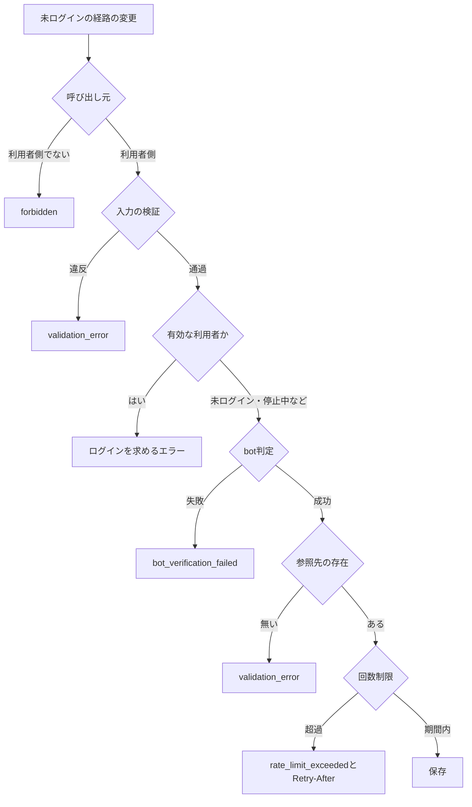

# 未ログインの投稿の保護

ログインせずに送れる投稿(連絡のフォームなど)を、自動の大量送信と保存の溜まり続けから守る仕組みを定める。確認の順序、ログイン中の利用者を未ログインの経路から除く判定、bot判定と送信元IPアドレス単位の厳密な回数制限の組み合わせ、回数制限のキーのハッシュ化、送信元IPアドレスが不明な場合の扱い、状態の変更日時による保持期間の削除、及びテストの書き方を扱う。

## 前提と用語

実行環境にCloudflare Workers、APIにGraphQL、データベースにD1、ORMにDrizzle、DIコンテナにInversifyを使う構成を前提とする。厳密カウンタとbot判定の検証は「[レート制限とbot判定の検証](../backend/003-rate-limiting-and-bot-verification.md)」に、回数制限のキーのハッシュ化は「[レート制限のキー](002-keyed-hashing.md#レート制限のキー)」に、層構成と共通エラーは「[Cloudflare Workersでの層構成と依存性の組み立て](../backend/002-layered-architecture-on-workers.md)」に、日次のジョブの登録と冪等性は「[非同期処理の設計](../infra/003-async-processing.md)」に、ログの伏せ字は「[ログ管理とエラートラッキング](../infra/004-logging-and-error-tracking.md#伏せ字の規則)」に従う。部品の置き場所は、共通ライブラリの配置先(`<共通ライブラリの配置先>`)と`<APIサーバーのアプリ>`の`src/`からのパスで示す。

| 用語                       | 意味                                                                                                         |
| -------------------------- | ------------------------------------------------------------------------------------------------------------ |
| 未ログインの投稿           | アカウントに紐付けずに保存する投稿。連絡先などの入力を投稿の行に持ち、投稿した本人は後から参照・削除できない |
| 未ログインの経路           | 未ログインの投稿を受け付けるGraphQLの変更                                                                    |
| ログインの経路             | 同じ用途の投稿を、ログイン中の利用者のアカウントに紐付けて受け付けるGraphQLの変更                            |
| 有効な利用者               | ログイン中で、ログインの経路を使える状態(停止中などでない)の利用者                                           |
| 閉じた状態                 | 対応を終えた投稿の状態(対応済・却下など)。保持期間の削除の対象になる                                         |
| 状態の変更日時             | 投稿の状態が実際に変わった日時。投稿の作成時に作成日時と同じ値を入れ、状態が変わった時だけ更新する           |
| `<投稿の用途>`             | 回数制限のルールの名前の接頭辞とキーの先頭の部品に使う、未ログインの投稿の用途の名前(英小文字とハイフン)     |
| `<回数制限のログの名前>`   | 回数制限の実装のロガーのカテゴリの3つ目の要素(英小文字とハイフン)                                            |
| `<不明なIPのログの理由>`   | 送信元IPアドレスが不明で数えなかったことを示す、ログの属性`reason`の値(英小文字とハイフン)                   |
| `<上限回数>`               | 1つの送信元IPアドレスが期間の中で送れる未ログインの投稿の数                                                  |
| `<期間の秒数>`             | 回数を数える固定の期間の秒数                                                                                 |
| `<bot判定の操作名>`        | 未ログインの経路のbot判定で照合する操作名(画面のウィジェットに設定する`action`と同じ値)                      |
| `<保持期間>`               | 閉じた状態になってから未ログインの投稿を物理削除するまでの期間。サービスのデータ保持期間の一覧と一致させる   |
| `<ログインを求めるエラー>` | 有効な利用者が未ログインの経路で送った時に返す、想定内の失敗(種類`forbidden`)のエラーコード                  |

## 保護の構成

未ログインの投稿は、次の4つを重ねて守る。どれか1つだけでは足りない。

| 仕組み                               | 防ぐもの                                                 | 単独では足りない理由                                                               |
| ------------------------------------ | -------------------------------------------------------- | ---------------------------------------------------------------------------------- |
| Worker単位のIP制限                   | 1つの送信元からの大量の要求による過負荷                  | 上限が全HTTPリクエストの過負荷の防止に合わせた値で、投稿の数を抑えるには大きすぎる |
| bot判定(`assertHuman`)               | 画面を経ない自動の送信                                   | 人が解いたトークンや解答を代行するサービスで通り、1つの送信元から続けて送れる      |
| 送信元IPアドレス単位の厳密な回数制限 | 1つの送信元からの続けての投稿                            | 多数の送信元に分けた送信は防げない。送信元IPアドレスが不明な要求も数えられない     |
| 保持期間による物理削除               | 投稿と連絡先の個人情報が、対応を終えた後も残り続けること | 送信そのものは防がない                                                             |

- Worker単位のIP制限は全てのWorkerが既に掛けている(「[Worker単位のIP制限](../backend/003-rate-limiting-and-bot-verification.md#worker単位のip制限)」)。未ログインの経路は、これに加えてbot判定と厳密な回数制限を掛ける。
- ログインの経路の回数制限は、利用者の単位で停止・追跡できるかなどに応じて用途ごとに決める。この文書は未ログインの経路だけを扱う。

## 確認の順序

未ログインの経路は、次の順に確かめ、全てを通った送信だけを数えて保存する。



- 費用の小さい確認と、bot判定のトークンを消費せずに拒否できる確認を先に行う。bot判定のトークンは1回しか使えず(使用済みは`expired-or-duplicate`)、判定サービスへの通信も伴う。bot判定の後で拒否すると、利用者は送り直しに新しいトークンを待つことになる。
- 回数は、入力の検証・ログイン中の利用者の判定・bot判定・参照先(選んだ分類など)の存在の確認を通った送信だけを数える。入力の誤りを直すたびに数えると、正当な利用者が回数を使い切る。bot判定の失敗を数えると、トークンを持たない攻撃者が、同じ送信元IPアドレスを共有する利用者(同じネットワークの利用者など)の回数を使い切れる。
- 回数制限は保存の直前に置く。数えた後の保存が失敗しても、回数は戻さない。
- 呼び出し元・入力の検証・ログイン中の利用者の判定・bot判定は、GraphQLのリゾルバで行う。application層は`BotVerifier`を受け取らない(「[依存方向と静的解析](../backend/002-layered-architecture-on-workers.md#依存方向と静的解析)」)。参照先の存在・回数制限・保存はユースケースで行い、ユースケースも保存の前にログイン中の利用者の判定を確かめ直す(「[ログイン中の利用者を除く判定](#ログイン中の利用者を除く判定)」)。

```typescript
submitAnonymousPost: clientOnly(
  withValidatedArgs(ARGS, async (_parent: unknown, { input }, context) => {
    const current = await accountGuardOf(context).currentUser(context.session);
    if (current?.user.status === 'active') {
      throw postError('<ログインを求めるエラー>');
    }
    await assertHuman(context, '<bot判定の操作名>');
    await withInputPath('input', () =>
      anonymousPostSubmissionOf(context).submit(context.session, input, {
        clientIp: context.clientIp,
        now: context.resolve<Clock>(PLATFORM_TYPES.Clock).now(),
      }),
    );
    return true;
  }),
),
```

- 例の関数名・エラーの組み立ては、置き換えて読む。`clientOnly`・`withValidatedArgs`・`withInputPath`は「[GraphQLのサーバー](../backend/004-graphql-server.md)」の補助である。
- 送信元IPアドレスと現在時刻は、リゾルバが要求の情報としてユースケースへ渡す。ユースケースはGraphQLの文脈を読まない。

## ログイン中の利用者を除く判定

有効な利用者の投稿は、アカウントに紐付けてログインの経路で受け付ける。未ログインの経路は有効な利用者の送信を`<ログインを求めるエラー>`(種類`forbidden`)で拒否する。

- 拒否する理由は2つある。未ログインの経路で受け付けると、本人の一覧や通知に出ない、アカウントと紐付かない投稿ができる。また、ログインの経路に掛けた制限(停止中の利用者の拒否など)を未ログインの経路で迂回できる。
- 判定はbot判定より前に行う。拒否する要求でbot判定のトークンを消費させず、判定サービスへの通信も省く。
- 画面は有効な利用者に未ログインのフォームを表示しない。それでもサーバーで判定するのは、フォームを表示した後に別のタブでログインした利用者や、画面を経ない要求が未ログインの経路へ届くためである。エラーの文言は、ページの再読み込みでログインの経路のフォームへ切り替わることを案内する。
- 停止中など、ログインの経路を使えない状態の利用者に連絡の手段を残す場合は、その利用者を未ログインと同じに受け付ける。この場合、利用者のIDなどの情報をユースケースの後続へ渡さず、投稿をアカウントに紐付けない。拒否する対象は「有効な利用者」だけにし、「ログイン中の利用者」全体にしない。
- ユースケースも保存の前に同じ判定を行う。ユースケースは別のリゾルバや後続の機能からも呼ばれ得るため、リゾルバの判定だけに頼らない。リゾルバの判定はトークンを守るための前倒しである。

## 送信元IPアドレス単位の回数制限

### ルールと置き場所

回数制限は、Rate Limitingバインディングではなく厳密カウンタで数える(「[制限の方式の選び方](../backend/003-rate-limiting-and-bot-verification.md#制限の方式の選び方)」)。投稿の上限は小さく、期間も1時間などの60秒を超える長さになり、ロケーションごとの近似では守れないためである。

```typescript
import { inject, injectable } from 'inversify';

import type { KeyedHasher } from '<共通ライブラリの配置先>/core/crypto/keyed-hasher.ts';
import { PLATFORM_TYPES } from '<共通ライブラリの配置先>/core/di/identifiers.ts';
import { getAppLogger } from '<共通ライブラリの配置先>/core/logging/app-logger.ts';
import type { CounterRule } from '<共通ライブラリの配置先>/core/rate-limit/fixed-window.ts';
import { hashRateLimitKey } from '<共通ライブラリの配置先>/core/rate-limit/rate-limit-key.ts';
import type { RateLimitCounterClient } from '<共通ライブラリの配置先>/workers/rate-limit/rate-limit-counter-client.ts';
import type { AnonymousPostRateLimit } from '../../application/<機能>/ports.ts';

export const ANONYMOUS_POST_RATE_RULE = Object.freeze({
  name: '<投稿の用途>:ip',
  limit: ANONYMOUS_POST_LIMIT,
  windowSeconds: ANONYMOUS_POST_WINDOW_SECONDS,
} as const satisfies CounterRule);

const KEY_PURPOSE = '<投稿の用途>';

const logger = getAppLogger([
  '<APIサーバーのアプリ>',
  '<機能>',
  '<回数制限のログの名前>',
]);

@injectable()
export class CounterAnonymousPostRateLimit implements AnonymousPostRateLimit {
  constructor(
    @inject(PLATFORM_TYPES.RateLimitCounterClient)
    private readonly counters: RateLimitCounterClient,
    @inject(PLATFORM_TYPES.KeyedHasher)
    private readonly hasher: KeyedHasher,
  ) {}

  async consume(clientIp: string | undefined, now: Date): Promise<void> {
    if (clientIp === undefined || clientIp === '') {
      logger.warn('送信元IPアドレスが不明なため、送信回数を数えませんでした', {
        reason: '<不明なIPのログの理由>',
      });
      return;
    }
    const key = await hashRateLimitKey(this.hasher, KEY_PURPOSE, clientIp);
    const decision = await this.counters.hit(ANONYMOUS_POST_RATE_RULE, key);
    this.counters.assertWithinLimit(decision, now.getTime());
  }
}
```

- `ANONYMOUS_POST_LIMIT`は`<上限回数>`、`ANONYMOUS_POST_WINDOW_SECONDS`は`<期間の秒数>`である。ルールの名前は「[ルールとキー](../backend/003-rate-limiting-and-bot-verification.md#ルールとキー)」に従い、用途と単位を`:`で区切る。`<機能>`は投稿を扱う機能のディレクトリの名前で、ロガーのカテゴリの付け方は「[カテゴリ](../infra/004-logging-and-error-tracking.md#カテゴリ)」に従う。
- ポート(`consume(clientIp, now)`)はapplication層に、実装とルールはインフラ層に置く。厳密カウンタのクライアントが共通ライブラリの`workers`にあり、application層から読めないためである(「[数え方](../backend/003-rate-limiting-and-bot-verification.md#数え方)」)。ユースケースはポートだけを受け取る。
- 現在時刻は引数で受け取る。リゾルバが要求ごとに1回読んだ時刻を、回数制限と保存の日時で共有する。
- カウンタの記録は期間の終わりにAlarmで消える(「[記録の削除](../backend/003-rate-limiting-and-bot-verification.md#記録の削除)」)。回数制限の記録の保持期間は`<期間の秒数>`で、サービスのデータ保持期間の一覧にもその値を書く。

### 超過時の応答

- `assertWithinLimit`が、状態コード429・コード`rate_limit_exceeded`・`Retry-After: <期間の終わりまでの秒数>`の共通エラーを投げる。文言は共通の文言を使い、用途ごとの文言を作らない。
- 画面は`GraphQLClientError`の`retryAfterSeconds`から再び送れる時刻を求め、時刻をフォームのエラーとして示す。入力した値は消さない。
- 429は再試行しない(「[既定値と再試行](../frontend/006-data-fetching.md#既定値と再試行)」)。

### キーのハッシュ化

- キーは`hashRateLimitKey(hasher, '<投稿の用途>', <送信元IPアドレス>)`の値で、元のIPアドレスはカウンタに保存されない(「[レート制限のキー](002-keyed-hashing.md#レート制限のキー)」)。
- 部品の先頭に用途の名前を入れる。同じ送信元IPアドレスから作る他のキー(Worker単位のIP制限の`ip:<送信元IPアドレス>`、IPアドレスだけを部品にするログイン試行・メールの送信回数のキーなど)とハッシュ値そのものを分け、記録の名前から用途をまたいで同じ送信元を突き合わせられないようにする。カウンタはルールの名前でも分かれるため、用途の名前は数え方を変えない。
- 送信元IPアドレスは正規化せずにそのまま渡す。`CF-Connecting-IP`の値は基盤が前後の空白を除いて求めている(「[クライアントIPの解決の差し替え](../backend/003-rate-limiting-and-bot-verification.md#クライアントipの解決の差し替え)」)。
- ログには、送信元IPアドレスもハッシュ化したキーも出さない。

### 送信元IPアドレスが不明な場合

送信元IPアドレスが分からない要求は、数えずに通し、レベル`warning`のログに理由`<不明なIPのログの理由>`だけを残す。この要求はbot判定で守る。

- 不明な要求を1つのキーでまとめて数えると、無関係な利用者の送信までまとめて止まる。認証系の制限と同じ扱いである(「[送信回数の制限](006-authentication.md#送信回数の制限)」)。
- Worker単位のIP制限は不明な要求を`ip:unknown`の1つのキーで数える。こちらは過負荷の防止のための大きな上限で、正当な利用者が使い切ることは無いため、扱いが異なる。
- Cloudflareを経た本番の要求は必ず送信元IPアドレスを持つ。警告が出るのは、中継の設定の誤りなどで元の送信元が渡っていない場合のため、運用者が原因を調べる。

## 保持期間による削除

未ログインの投稿は本人が後から参照・削除できないため、閉じた状態になってから`<保持期間>`を過ぎた投稿を、日次の定期実行のジョブで物理削除する(「[定期実行](../infra/003-async-processing.md#定期実行)」)。

### 状態の変更日時による判定

削除の対象は、閉じた状態で、状態の変更日時が閾値以前(含む)の投稿である。作成日時・更新日時では判定しない。

| 判定に使う日時 | 起きること                                                                         |
| -------------- | ---------------------------------------------------------------------------------- |
| 作成日時       | 長く対応中だった投稿が、閉じた直後に消える                                         |
| 更新日時       | 分類の付け替えなど状態と関係の無い更新で期間が延び、閉じた投稿が消えずに残り続ける |
| 状態の変更日時 | 閉じた時点から数える。開き直して再び閉じた投稿は、再び閉じた時点から数え直す       |

- 状態の変更日時の列は、状態の列と同じ書き込みで、状態が実際に変わる時だけ更新する。同じ状態への変更と、他の列だけの更新では変えない。
- `(<状態の列>, <状態の変更日時の列>)`の索引を置き、削除の対象を索引で絞る。
- 対応中の投稿は期間を過ぎても消さない。対応を終えていない投稿を消すと、運営が連絡を返せなくなる。

### ジョブ

```typescript
async deleteClosedBefore(threshold: Date, limit: number): Promise<number> {
  const expiredIds = this.db
    .select({ id: anonymousPosts.id })
    .from(anonymousPosts)
    .where(
      and(
        inArray(anonymousPosts.status, CLOSED_STATUSES),
        lte(anonymousPosts.statusChangedAt, threshold),
      ),
    )
    .orderBy(asc(anonymousPosts.statusChangedAt), asc(anonymousPosts.id))
    .limit(limit);
  const result = await this.db
    .delete(anonymousPosts)
    .where(inArray(anonymousPosts.id, expiredIds));
  return result.meta.changes;
}
```

- 閾値は、起動の予定時刻(`scheduledTime`)から`<保持期間>`のミリ秒を引いた時刻にする。実際に動いた時刻ではなく予定時刻を使うため、起動の遅れや同じ日の再実行でも対象が変わらない。
- 1回の削除は状態の変更日時の古い順に件数を区切り、削除した件数が区切りに満たないか、1回の起動の繰り返しの上限に達するまで繰り返す。残りは翌日の起動に任せる。Workerの処理時間の上限に収めるためである。
- 削除は条件付きの1文で、同じ日に再び実行されても消えるのは条件に合う残りだけになり、冪等である(「[重複配信と冪等性](../infra/003-async-processing.md#重複配信と冪等性)」)。
- 削除した件数・繰り返しの回数・上限に達したかをレベル`info`のログに残す。投稿の内容・連絡先・IDは出さない。例外は捕まえず、定期実行の記録に任せる。
- 投稿に添付などの別のテーブルの行が紐付く場合は、外部キーの`ON DELETE CASCADE`か、同じ一括の書き込みの中での削除で、投稿と同時に消す。

## 個人情報の扱い

- 未ログインの投稿の連絡先(メールアドレスなど)は、管理画面にだけ表示し、ログ・監査ログ・メールに出さない。監査ログには投稿の識別子だけを記録する。
- 投稿の本文はプレーンテキストとして保存・描画し、HTMLとして解釈しない。
- 停止中の利用者などをアカウントに紐付けずに受け付けた投稿も、未ログインの投稿と同じ保持期間で消す。

## テスト

| 確かめること                                                                                                             | 種別                                      |
| ------------------------------------------------------------------------------------------------------------------------ | ----------------------------------------- |
| リゾルバの確認の順序(有効な利用者はbot判定の前に拒否する・期待する操作名でbot判定を求める・上限を超えた送信を保存しない) | Workers統合テスト                         |
| ユースケースの呼び出しの順序(参照先が無い・有効な利用者なら回数制限を呼ばない)                                           | 単体テスト(偽のポート)                    |
| 回数制限の実装(キーの部品・超過時の429と`Retry-After`・不明なIPアドレスを数えない)                                       | Workers統合テスト(偽の厳密カウンタ)       |
| 保持期間の削除(閾値の境界・閉じた状態だけ・状態の変更日時で判定・区切りの繰り返し)                                       | Workers統合テストと単体テスト(偽のポート) |
| 未ログインの送信の流れ                                                                                                   | E2Eテスト                                 |

- bot判定は判定サービスへ通信せずに確かめる(「[テスト用の鍵](../backend/003-rate-limiting-and-bot-verification.md#テスト用の鍵)」)。
- 保持期間の削除の境界は、状態の変更日時が閾値と同じ投稿が消え、閾値より後の投稿が残ることで確かめる。閉じた後に開き直した投稿が、閉じた日時が閾値より前でも残ることも確かめる。
- E2Eテストは、ブラウザの文脈ごとに文書用のアドレスの範囲から別の送信元IPアドレスを名乗り、テストの間で回数を共有させない(「[E2Eテストの設定](../testing/001-test-strategy.md#e2eテストの設定)」)。回数制限そのものはE2Eで確かめない。
