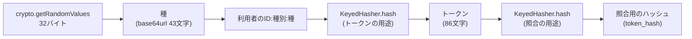

# メールのワンクリックの配信停止

通知メールの受信者が、ログインせずに1つの種別の受信を止められるようにする配信停止の仕組みを定める。RFC 8058のヘッダーと受け口(POSTで止めGETで止めない・認証を求めない・IP制限の除外とトークンでの真正性)、利用者と種別の組ごとのトークンを種とペッパーから導出して照合用のハッシュだけで引く方式、フラグメントとクエリによる受け渡しとアクセスログ・Refererの扱い、退会での無効化、ペッパーを変えた後の扱い、DKIMの署名の対象の確認、及びテストを扱う。

ハッシュ化の部品とペッパーの管理は「[秘密情報のハッシュ化](002-keyed-hashing.md)」に、IP制限の除外規則は「[レート制限とbot判定の検証](../backend/003-rate-limiting-and-bot-verification.md#除外規則)」に、セキュリティヘッダーは「[内部経路とセキュリティヘッダー](../backend/006-internal-gateway.md#セキュリティヘッダー)」に、メールの追加ヘッダーは「[メール送信サービス](../external/001-email-sending.md#送信要求)」に、通知メールの送り出しは「[まとめて送る通知メール](../backend/016-batched-notification-delivery.md)」に従う。認証系トークンとの違いは「[トークンの性質](#トークンの性質)」に示す。

## 前提と用語

ワンクリックの経路はメッセージを受信するアプリ(メールの送信基盤を持つWorker)に、配信停止ページは利用者側の画面に、確認の照会と確定はAPIサーバーのGraphQLに置く。部品の置き場所は、共通ライブラリの配置先、`<メッセージを受信するアプリ>`・`<APIサーバーのアプリ>`の`src/`からのパスで示す。

| 部品                                                                                                        | 置き場所                                                                              | 役割                                                                                                                 |
| ----------------------------------------------------------------------------------------------------------- | ------------------------------------------------------------------------------------- | -------------------------------------------------------------------------------------------------------------------- |
| ハッシュの用途・種の長さ・`unsubscribeTokenSource`・`isWellFormedUnsubscribeToken`・URLとヘッダーの組み立て | 共通ライブラリの`core/<ドメイン>/unsubscribe-token.ts`                                | トークンの導出の入力と形式、配信停止ページとワンクリックのURL、追加ヘッダー                                          |
| `UnsubscribeTokenService`(`tokensFor`・`resolve`・`deleteAllOf`)                                            | 共通ライブラリの`core/<ドメイン>/ports.ts`(実装は`workers/<ドメイン>/`)               | 種の作成・トークンの導出・照合用のハッシュの更新・照合                                                               |
| ワンクリックのユースケースと経路                                                                            | `<メッセージを受信するアプリ>`の`application/<ドメイン>/`・`presentation/<ドメイン>/` | `POST`での停止と`GET`での配信停止ページへの移動                                                                      |
| IP制限の除外規則                                                                                            | `<メッセージを受信するアプリ>`の`composition/rate-limit-exclusions.ts`                | ワンクリックの`POST`をWorker単位のIP制限から外す                                                                     |
| 確認の照会と確定のユースケース                                                                              | `<APIサーバーのアプリ>`の`application/<ドメイン>/`                                    | 配信停止ページが使う、書き込まない照会とボタンの操作での停止                                                         |
| `useFragmentToken`                                                                                          | 画面の共通部品の`components/auth/`                                                    | フラグメントのトークンを読み、URLから消す(「[認証の画面部品](../frontend/005-shared-components.md#認証の画面部品)」) |

| 用語                    | 意味                                                                                                                       |
| ----------------------- | -------------------------------------------------------------------------------------------------------------------------- |
| 組                      | 利用者と通知の種別の組。配信停止のトークンは組ごとに1つで、止められるのはその組の受信だけである                            |
| 種                      | 組ごとに1回だけ作る32バイトの暗号論的な乱数(パディングなしのbase64urlで43文字)。トークンを導出する入力で、組の行に保存する |
| トークン                | 種とペッパーから導出する86文字の値。メールのリンクとヘッダーにだけ置き、保存しない                                         |
| 照合用のハッシュ        | トークンを別の用途でハッシュ化した値(`token_hash`)。一意索引を持ち、届いたトークンから組の行を引く                         |
| ワンクリックの経路      | メールソフトがRFC 8058に従って送る`POST <ワンクリックのURL>`を受ける経路                                                   |
| 配信停止ページ          | 本文のリンクから開き、確認のボタンで停止する利用者側の画面                                                                 |
| `<ワンクリックのURL>`   | `<メッセージを受信するアプリのオリジン>/unsubscribe?token=<トークン>`                                                      |
| `<配信停止ページのURL>` | `<利用者側の画面のオリジン>/unsubscribe#token=<トークン>`                                                                  |

本文中の`<ドメイン>`・`<トークンの用途>`などのプレースホルダーの本プロジェクトの値は、技術ドキュメントに写さず、プロジェクト固有の値の文書「[本プロジェクト固有の値](../../../onboardings/project-values.md)」に置く。

## 配信停止の手段

| 手段             | 操作                                                  | ログイン | 止めるもの         |
| ---------------- | ----------------------------------------------------- | -------- | ------------------ |
| 通知設定のページ | 種別ごとのスイッチ                                    | 要る     | 選んだ種別         |
| ワンクリック     | メールソフトの配信停止の操作(`List-Unsubscribe-Post`) | 要らない | トークンの組の種別 |
| 本文のリンク     | 配信停止ページを開き、確認のボタンを押す              | 要らない | トークンの組の種別 |

- 受信設定の初期値は受信しない(オプトイン)で、3つの手段のどれでも同じ容易さで撤回できる。
- トークンでできることは、その組の種別の受信の停止だけにする。受信の再開・他の種別の変更・個人情報の表示はログインした通知設定のページで行う。
- 既に停止した組の停止も成功として扱う。何度押しても同じ結果になる。

## トークン

### トークンの性質

配信停止のトークンは、認証系トークン(「[認証系トークン](006-authentication.md#認証系トークン)」)と次の点で違う。

| 項目       | 認証系トークン                   | 配信停止のトークン                               |
| ---------- | -------------------------------- | ------------------------------------------------ |
| 生成       | 発行ごとの乱数                   | 組ごとの種とペッパーから導出し、同じ組は同じ値   |
| 保存       | ハッシュ化した値                 | 種と照合用のハッシュ(トークンの平文は保存しない) |
| 期限・回数 | 有効期限と単回の消費             | 期限なし・何度でも使える。退会で無効になる       |
| できること | 本人の確認・パスワードの変更など | 1つの組の種別の受信の停止だけ                    |

- 期限を設けないのは、受信者が古いメールからいつでも止められるようにするためである。できることを停止だけに限るため、漏れたトークンで起こせる害は、その組の受信が止まることだけになる。
- 同じ組のトークンは毎回同じ値になるため、送るメールごとに新しい行を作らない。

### 導出

- トークンは`KeyedHasher.hash(<トークンの用途>, '<利用者のID>:<種別>:<種>')`、照合用のハッシュは`KeyedHasher.hash(<照合の用途>, <トークン>)`にする(「[ハッシュ化の方法](002-keyed-hashing.md#ハッシュ化の方法)」)。2つの用途を分けるため、照合用のハッシュをトークンとして使われない(「[用途の分離](002-keyed-hashing.md#用途の分離)」)。
- 導出の入力は形式を確かめる。利用者のIDはULID、種別は既知の値、種は32バイトのパディングなしのbase64url(最後の文字は下位2ビットが0の表記)に限り、違えば`RangeError`にする。
- トークンの形式は86文字のbase64url(最後の文字は下位4ビットが0の表記)に限る。経路と照合は、形式に合わない値をデータベースへ問い合わせずに拒否する。
- この方式は、保存した種からペッパーで秘密の値を導出する点で「[ハッシュ化の対象](002-keyed-hashing.md#ハッシュ化の対象)」の使い方と違う。種だけが漏れてもペッパーが無ければトークンを作れず、照合用のハッシュだけが漏れてもトークンに戻せない。

### 種の作成と照合用のハッシュの保存

`tokensFor(targets, at)`は、送る直前に、メールに載せる組のトークンを1回の呼び出しで返す。

1. 組の重複を除き、既存の種をバインド変数の上限に収まる件数ずつ読む。
2. 種の無い組だけ、種と照合用のハッシュを作って`onConflictDoNothing()`で挿入し、読み直す。読み直しで足りなければ例外にする。同時に作った場合は先に挿入した種だけが残るため、読み直した種から導出する。
3. 全ての組で種からトークンを導出し直し、照合用のハッシュが保存した値と違う行だけ、行のIDと読んだ`token_hash`を条件に更新する。

- 組の行は`(user_id, topic)`の一意索引で1行にし、`token_hash`にも一意索引を付ける。トークンの平文を保存しない。
- 組の行は利用者のテーブルへの外部キーを持つ。存在しない利用者を渡すと挿入が失敗するため、送信の段は確かめ直しを通った宛先だけを渡す。
- 種を作るのはメールを送る時だけにする。受信の設定をしただけの利用者の行は作らない。

### 照合

`resolve(token)`は、形式を確かめ、照合用のハッシュの一意索引で1行を引き、`KeyedHasher.verify(<照合の用途>, token, row.token_hash)`で照合する(「[照合の方法](002-keyed-hashing.md#照合の方法)」)。

- 形式に合わない・行が無い・照合できないは、区別せずにundefinedを返す。
- 利用者の状態(停止中など)を見ない。停止中の利用者も受信を止められる。退会済みの利用者は種が消えているため照合できない。
- 照合の結果は組(利用者のIDと種別)だけにし、メールアドレスなどを読まない。

### 退会での無効化

- 退会の同期の波及処理が、退会と同じ一括の書き込みで利用者の全ての種を削除する(「[ユーザーライフサイクルイベント](../backend/007-user-lifecycle-events.md#文の規約)」)。退会の確定の直後から、送ったメールのリンクとヘッダーは照合できない。
- 送る直前の確かめ直しの後に退会が確定すると、種が作り直されて残り得る。物理削除の開始の波及処理で残りを消す。

### ペッパーを変えた後

ペッパーは、漏えいした場合を除いて変えない(「[ペッパーの変更と漏えい](002-keyed-hashing.md#ペッパーの変更と漏えい)」)。変えると、同じ種から導出するトークンと照合用のハッシュが変わる。

- 変更の前に送ったメールのリンクとヘッダーは照合できなくなる。受信者は通知設定のページから止められる。
- 変更の後に初めてその組のメールを送る時、`tokensFor`が照合用のハッシュを新しいトークンのものへ更新するため、以後のメールのリンクは手作業なしで照合できる。種の作り直しや一括の更新は要らない。
- 変更の反映の間(古いペッパーと新しいペッパーのWorkerが同時に動く間)は、両方が同じ組の照合用のハッシュを自分の値へ更新し合う。条件付きの更新に負けた側が送ったメールのトークンは、次にその組へメールを送るまで照合できないことがある。

## URLとヘッダー

### 受け渡しの形

| 渡し方                         | トークンの位置                        | トークンが残らない理由                                                                                                                                                                                                                                                 |
| ------------------------------ | ------------------------------------- | ---------------------------------------------------------------------------------------------------------------------------------------------------------------------------------------------------------------------------------------------------------------------- |
| `List-Unsubscribe`の値         | `<ワンクリックのURL>`のクエリ         | アクセスログは`path`だけでクエリ文字列を含めず、エラートラッキングはクエリ文字列を集めない(「[ログの出力](../infra/004-logging-and-error-tracking.md#ログの出力)」「[個人情報と秘密情報の除去](../infra/004-logging-and-error-tracking.md#個人情報と秘密情報の除去)」) |
| 本文のリンク                   | `<配信停止ページのURL>`のフラグメント | フラグメントは要求に含まれず、サーバー・アクセス解析・`Referer`に届かない                                                                                                                                                                                              |
| 配信停止ページからの照会と確定 | GraphQLの変数(要求の本文)             | URLに載せない                                                                                                                                                                                                                                                          |

- 本文のリンクをクエリにしない。メールソフトや安全確認の仕組みが開いたURLがサーバーのログ・解析に残る。
- ヘッダーのURIはクエリにする。RFC 8058の`POST`はメールソフトがURIへそのまま送り、フラグメントは送られない。
- 配信停止ページは、フラグメントを読んだ直後に履歴を置き換えてURLから消す(`useFragmentToken`)。
- URLは固定の形で組み立て、入力から作らない。組み立ての関数は形式に合わないトークンを`RangeError`で拒否する。

### 追加ヘッダー

| ヘッダー                | 値                           |
| ----------------------- | ---------------------------- |
| `List-Unsubscribe`      | `<<ワンクリックのURL>>`      |
| `List-Unsubscribe-Post` | `List-Unsubscribe=One-Click` |

- メッセージを受信するアプリのオリジンが`https:`のときだけ付ける。メールの送信基盤の追加ヘッダーはHTTPSのURIを求めるため、`http:`のローカル環境では付けない(本文のリンクは付ける)。
- 複数の種別を1通にまとめたメールのヘッダーは、主たる種別の組のトークンにする。本文には種別ごとのラベル付きのリンクを置く。
- ヘッダーはメールの送信基盤の許可リストと値の検証を通る(「[送信要求](../external/001-email-sending.md#送信要求)」)。

## ワンクリックの経路

### 応答

| 要求                        | 条件                                     | 応答                                                                                |
| --------------------------- | ---------------------------------------- | ----------------------------------------------------------------------------------- |
| `POST /unsubscribe?token=…` | トークンが無い・空・形式に合わない       | 400、`text/plain`の固定の文(無効のリンク)                                           |
| `POST /unsubscribe?token=…` | 照合できない(退会で種が消えた場合を含む) | 404、`text/plain`の固定の文(無効のリンク)                                           |
| `POST /unsubscribe?token=…` | 照合できた(既に停止済みを含む)           | 200、`text/plain`の固定の文(停止の完了)                                             |
| `GET /unsubscribe?token=…`  | トークンが形式に合う                     | 303、`Location: <配信停止ページのURL>`、本文なし                                    |
| `GET /unsubscribe?token=…`  | トークンが無い・形式に合わない           | 303、`Location: <利用者側の画面のオリジン>/unsubscribe`(フラグメントなし)、本文なし |

- 全ての応答に`Cache-Control: no-store`を付ける。
- 本文は経路から直接返し、`AppError`を投げない。`AppError`は共通のエラー形式のJSONになり、メールソフトはそれを解釈しない。
- 形式の判定は経路で行い、形式違反はユースケースもデータベースも通さない。認証を求めずIP制限の対象外の経路のため、無効な要求の負荷を照会の前に止める。
- 停止の処理は、照合→その組の今の受信設定の読み取り→受信する設定なら停止、の順にし、ログインの経路のユースケースを使わない。

### 本文を読まない

- 要求の本文(`List-Unsubscribe=One-Click`)は読まず、検証もしない。要求の真正性はトークンが示し、本文の値はメールソフトの実装によって揺れる。本文を読まないため、大きな本文や形式の誤りでも応答が変わらない。

### GETで止めない

- メールソフト・安全確認の仕組み・リンクの事前取得は`GET`を送る。`GET`では状態を変えず、配信停止ページへ移すだけにする。
- 形式に合うトークンだけを`Location`のフラグメントへ載せる。形式に合わない値はフラグメントの無い配信停止ページへ移し、検証していない入力を`Location`に載せない。
- `GET`の応答は本文を持たない。移動先の配信停止ページは、開いただけでは照会だけを行い、確認のボタンで停止する。

### 認証とIP制限

- `POST`はCookie・セッションを求めない。メールソフトはそれらを持たずに送る。
- `POST`をWorker単位のIP制限から除外する(`excludePath('/unsubscribe', 'POST')`)。メールソフトの事業者のサーバーが多くの受信者の要求を同じIPアドレスから送ることがあり、IPアドレス単位の上限で正当な停止を拒否しないためである。真正性はトークンで確かめる。
- `excludePath`はパスの区切りで前方一致を判定するため、`POST /unsubscribe/…`も除外される(「[除外規則](../backend/003-rate-limiting-and-bot-verification.md#除外規則)」)。経路に登録していないパスは404になり、他の除外済みの経路と同じ扱いになる。`GET`は除外しない。
- 経路ごとのレート制限とbot判定は掛けない。書き込みは既存の組の1つの種別の停止だけで行を増やさず、メールソフトはbot判定を解けない。

### Referrer-PolicyとCache-Control

- `Referrer-Policy`は経路で付けず、Worker全体のセキュリティヘッダーの`same-origin`のままにする(全体の処理が経路の値を上書きする)。`GET`の応答は303の移動だけで本文を持たず、`Referer`はフラグメントを含まないため、トークンは外部のオリジンへ送られない。
- 応答をキャッシュに残さないため`Cache-Control: no-store`を付ける。`GET`の`Location`はトークンを含む。

## 配信停止ページ

- 配信停止ページはログインの外の経路に置き、`useFragmentToken`でトークンを読む。読めるまで照会を送らない。トークンは最初の描画で1回だけ読み、同じ文書のフラグメントの変更では読み直さない。
- 開いた時の照会は書き込まず、組の種別と今の受信の状態だけを返す。既に停止の組は、確認のボタンを出さずにその旨だけを示す。
- 確認のボタンで確定を送る。照会の失敗の再試行は照会だけを送り直し、確定を送らない。
- 照会でトークンが無効・確定で無効のリンクの誤り・トークンの長さの検証の誤りは、同じ無効の文言にまとめる。トークンの長さの範囲内の形式違反は、照会で結果なし・確定で無効のリンクの誤りにする。APIの誤りの文言をそのまま出さない。
- 個人情報(メールアドレス・ニックネーム)を表示しない。種別の名称だけを示す。
- 照会と確定はログインを求めず、トークンをログやエラーの詳細に出さない。経路ごとのレート制限とbot判定は、ワンクリックの経路と同じ理由で掛けず、Worker全体のIP制限に任せる。

## DKIMの署名の対象の確認

RFC 8058は、`List-Unsubscribe`と`List-Unsubscribe-Post`がDKIMの署名の対象に含まれることを求める。署名の対象のヘッダーはメールの送信サービスが決めるため、コードのテストでは確かめられない。

- 環境を作った時と送信サービスを変えた時に、その環境から受信した通知メールの`DKIM-Signature`の`h=`に2つのヘッダーが含まれ、署名が`pass`であることを確かめる。
- 含まれなければ、メールソフトがワンクリックの配信停止を示さない。本文のリンクと通知設定のページで止められるが、送信サービスの設定か送信の方式を見直す。

## テスト

- トークンの規則は単体テストで、導出の入力の形式違反の`RangeError`、トークンの形式(86文字・最後の文字の表記)、URLの組み立てとフラグメント・クエリの位置、ヘッダーが`https:`のときだけ付くことを確かめる。
- トークンの部品はWorkers統合テストで、同じ組で同じトークン・照合・別の用途の値で照合できないこと・種の削除で無効・形式違反でデータベースへ問い合わせないこと・同時の作成で1行になること・ペッパーを変えた後の`tokensFor`が照合用のハッシュを直し、`resolve`が新しいトークンを受け付けて変更の前のトークンを拒否することを確かめる。
- ワンクリックの経路はWorker全体を通すWorkers統合テストで、200・400・404・繰り返しの200・`GET`の303と`Location`(形式違反でフラグメントなし)・IP制限の除外・`Cache-Control: no-store`・応答の`Referrer-Policy`が`same-origin`であることを確かめる。
- 退会はWorkers統合テストで、退会の確定の一括の書き込みで種が消え、そのトークンが404になることを確かめる。
- 配信停止ページはブラウザテストで、確認・成功・既に停止・無効・照会と確定の失敗の再試行・個人情報を出さないことを確かめる。
- E2Eテストは、テストの補助で作ったトークンで配信停止ページの確認と`POST <ワンクリックのURL>`を行い、通知設定のページに反映されることを確かめる。補助はペッパーをシークレットの注入で受け取り、Web Cryptoで同じ方式で導出する。`http:`のローカル環境ではヘッダーが付かないため、経路を直接呼ぶ。
