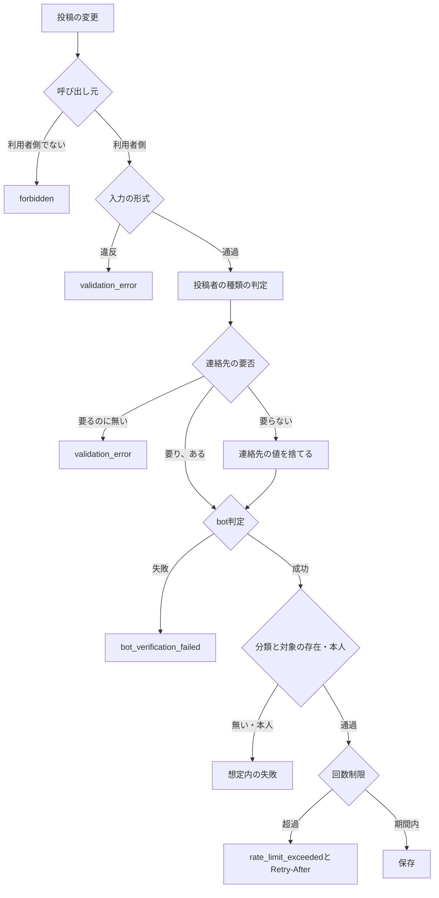

# 会員と未ログインが同じ操作を使う投稿の制限

ログイン中の利用者と未ログインの閲覧者が同じGraphQLの変更で送る投稿(通報など)を、自動の大量送信と個人情報の溜まり続けから守る規約を定める。投稿者の種類の判定、確認の順序、利用者単位と送信元IPアドレス単位の2つの回数制限の順序とキー、連絡先の要否と捨て方、連絡先の保存と保持、及びテストを扱う。

未ログインの投稿を会員の投稿と別の経路で受け付ける場合の保護は「[未ログインの投稿の保護](008-anonymous-submission-protection.md)」に従い、この文書はその文書との差分だけを書く。厳密カウンタとbot判定の検証は「[レート制限とbot判定の検証](../backend/003-rate-limiting-and-bot-verification.md)」に、キーのハッシュ化は「[レート制限のキー](002-keyed-hashing.md#レート制限のキー)」に、投稿を案件へ集約して保持期間で消す処理は「[投稿の集約と案件の完了・再開](../backend/022-submission-aggregation-and-case-resolution.md)」に従う。

## 前提と用語

実行環境にCloudflare Workers、APIにGraphQL、データベースにD1、ORMにDrizzle、DIコンテナにInversifyを使う構成を前提とする。部品の置き場所は、共用部品・共通ライブラリの配置先(`<共通ライブラリの配置先>`)と`<APIサーバーのアプリ>`の`src/`からのパスで示す。

| 用語                     | 意味                                                                                                                                          |
| ------------------------ | --------------------------------------------------------------------------------------------------------------------------------------------- |
| 投稿者の種類             | `member`(有効な利用者。投稿に利用者のIDを残す)と`guest`(未ログインと、ログインの経路を使えない停止中などの利用者。投稿に利用者のIDを残さない) |
| 有効な利用者             | ログイン中で、停止中などでない利用者(「[未ログインの投稿の保護の前提と用語](008-anonymous-submission-protection.md#前提と用語)」と同じ)       |
| 連絡先                   | `guest`の投稿者が結果の知らせを受け取るために入力するメールアドレス                                                                           |
| `<投稿の用途>`           | 回数制限のルールの名前の接頭辞とキーの先頭の部品に使う、投稿の用途の名前(英小文字とハイフン)                                                  |
| `<利用者の上限回数>`     | 1人の`member`が期間の中で送れる投稿の数                                                                                                       |
| `<IPの上限回数>`         | 1つの送信元IPアドレスが期間の中で送れる投稿の数(`member`と`guest`の合計)                                                                      |
| `<期間の秒数>`           | 回数を数える固定の期間の秒数                                                                                                                  |
| `<不明なIPのログの理由>` | 送信元IPアドレスが不明で数えなかったことを示す、ログの属性`reason`の値                                                                        |
| `<連絡先を求める分類>`   | `guest`の投稿者に連絡先を必須にする投稿の分類(結果を本人へ必ず知らせる申告など)                                                               |
| `<bot判定の操作名>`      | この変更のbot判定で照合する操作名                                                                                                             |
| `<連絡先の保持期間>`     | 投稿の対応を終えてから、`guest`の投稿(連絡先を含む)を物理削除するまでの期間                                                                   |

本文中のプレースホルダーの本プロジェクトの値は、技術ドキュメントに写さず、プロジェクト固有の値の文書「[本プロジェクト固有の値](../../../onboardings/project-values.md)」に置く。

## 未ログインの投稿の保護との違い

| 項目         | 未ログインの投稿の保護(別の経路)                         | この文書(同じ経路)                                                                |
| ------------ | -------------------------------------------------------- | --------------------------------------------------------------------------------- |
| 経路         | 未ログインの経路とログインの経路を分ける                 | 1つの変更で両方を受け付ける                                                       |
| 有効な利用者 | 未ログインの経路では`<ログインを求めるエラー>`で拒否する | 拒否せず`member`として受け付ける                                                  |
| 回数制限     | 送信元IPアドレス単位の1つ                                | `member`は利用者単位→送信元IPアドレス単位の2つ、`guest`は送信元IPアドレス単位だけ |
| 連絡先       | 未ログインの投稿は常に連絡先を持つ                       | `guest`かつ`<連絡先を求める分類>`だけ必須。他は受け取っても捨てる                 |
| bot判定      | 未ログインの経路だけ                                     | 投稿者の種類によらず全ての送信                                                    |

同じ経路にするのは、投稿の画面と結果がログイン状態で変わらず(通報の操作をどの閲覧者にも示すなど)、ログイン中の利用者を未ログインの経路から除く理由(アカウントと紐付かない投稿・制限の迂回)が、投稿者の種類をサーバーで決めることで無くなるためである。

## 投稿者の種類の判定

```typescript
// 停止中の利用者は投稿者として記録しないため、未ログインと同じguestにする
const submitterOf = (current: CurrentUser | undefined): Submitter =>
  current?.user.status === 'active'
    ? { kind: 'member', userId: current.user.id }
    : { kind: 'guest' };
```

- 投稿者の種類は要求のセッションからサーバーで決め、入力で受け取らない。
- 停止中の利用者を`guest`にするのは、停止中の利用者にも投稿の手段を残しつつ、停止で使えない機能(本人の一覧・通知など)を投稿の記録で迂回させないためである。投稿に利用者のIDを残さず、利用者単位の回数制限も数えない。bot判定と送信元IPアドレス単位の制限で守る。
- 自分のコンテンツへの投稿の拒否のように、本人であることを判定に使う確認は、投稿者の種類でなくログイン中の利用者(停止中を含む)で行う。
- リゾルバが種類を決めて連絡先の要否を確かめ、ユースケースも保存の前に種類を決め直す。リゾルバの判定の後に停止・ログアウトで種類が変わり得るためである。ユースケースの判定で連絡先が要ると分かれば、リゾルバと同じ形の入力の誤りを返す。

## 確認の順序



- 「[未ログインの投稿の保護の確認の順序](008-anonymous-submission-protection.md#確認の順序)」と同じく、bot判定のトークンを消費せずに拒否できる確認を先に置き、全ての確認を通った送信だけを数える。連絡先の要否は入力の誤りのためbot判定の前に置く。
- 呼び出し元の種類の拒否は、入力の検証より前に行う。利用者側でない要求に入力の誤りの詳細を返さない。
- 対象の存在の確認は、表示中の対象だけを通し、非公開・未掲載・削除の対象を区別せずに同じ不在のエラーにする。非公開の対象の存在を投稿の応答で探らせない。

## 2つの回数制限

`member`は利用者単位の制限と送信元IPアドレス単位の制限の両方を、`guest`は送信元IPアドレス単位の制限だけを受ける。どちらも厳密カウンタで数える(「[制限の方式の選び方](../backend/003-rate-limiting-and-bot-verification.md#制限の方式の選び方)」)。

```typescript
export const SUBMISSION_IP_RATE_RULE = Object.freeze({
  name: '<投稿の用途>:ip',
  limit: SUBMISSION_IP_LIMIT,
  windowSeconds: SUBMISSION_WINDOW_SECONDS,
} as const satisfies CounterRule);

export const SUBMISSION_USER_RATE_RULE = Object.freeze({
  name: '<投稿の用途>:user',
  limit: SUBMISSION_USER_LIMIT,
  windowSeconds: SUBMISSION_WINDOW_SECONDS,
} as const satisfies CounterRule);

const IP_KEY_PURPOSE = '<投稿の用途>';

const USER_KEY_PURPOSE = '<投稿の用途>-user';

async consume(submitter: Submitter, clientIp: string | undefined, now: Date): Promise<void> {
  // 利用者の規則で拒否した投稿を送信元IPアドレスの規則で数えないよう、利用者の規則を先に確かめる
  if (submitter.kind === 'member') {
    await this.hit(SUBMISSION_USER_RATE_RULE, USER_KEY_PURPOSE, submitter.userId, now);
  }
  if (clientIp === undefined || clientIp === '') {
    logger.warn('送信元IPアドレスが不明なため、投稿の送信回数を数えませんでした', {
      reason: '<不明なIPのログの理由>',
    });
    return;
  }
  await this.hit(SUBMISSION_IP_RATE_RULE, IP_KEY_PURPOSE, clientIp, now);
}

private async hit(rule: CounterRule, purpose: string, value: string, now: Date): Promise<void> {
  const key = await hashRateLimitKey(this.hasher, purpose, value);
  const decision = await this.counters.hit(rule, key);
  this.counters.assertWithinLimit(decision, now.getTime());
}
```

- 利用者単位の制限は、1人が多数の送信元IPアドレスに分けて送る投稿を止める。送信元IPアドレス単位の制限は、1つの送信元から複数のアカウントや未ログインで送る投稿を止めるため、`member`も数える。
- 利用者の規則を先に確かめる。後にすると、自分の上限を使い切った利用者の拒否される送信が、同じ送信元IPアドレスを共有する他の閲覧者(同じネットワークの利用者)の回数を使う。
- 利用者の規則で数えた後に送信元IPアドレスの規則で拒否されても、利用者の回数は戻さない。拒否された送信も1回の試みとして扱う。
- キーは2つとも`hashRateLimitKey`でハッシュ化し、元の利用者のIDと送信元IPアドレスをカウンタに保存しない。用途の名前を`<投稿の用途>`と`<投稿の用途>-user`に分け、利用者のIDと送信元IPアドレスのハッシュ値を同じ用途の名前から作らない(「[用途の分離](002-keyed-hashing.md#用途の分離)」)。ルールの名前も`:ip`・`:user`で分ける(「[ルールとキー](../backend/003-rate-limiting-and-bot-verification.md#ルールとキー)」)。
- 送信元IPアドレスが不明な要求は、送信元IPアドレス単位で数えずにレベル`warning`のログに理由だけを残す(「[送信元IPアドレスが不明な場合](008-anonymous-submission-protection.md#送信元ipアドレスが不明な場合)」)。`member`は利用者単位の制限を受け続ける。
- ポートはapplication層に、実装と2つのルールはinfrastructure層に置く(「[ルールと置き場所](008-anonymous-submission-protection.md#ルールと置き場所)」と同じ理由)。超過の応答と画面の扱いは「[超過時の応答](008-anonymous-submission-protection.md#超過時の応答)」に従う。

## 連絡先の要否

連絡先は`guest`の投稿者が`<連絡先を求める分類>`を選んだときだけ必須にする。`member`は登録済みのメールアドレスへ知らせるため連絡先を求めない。

```typescript
// 共用部品の<ドメイン>/<ドメイン>-rules.ts。画面・リゾルバ・ユースケースが同じ関数を使う
export const requiresContactEmail = ({
  submitterKind,
  categoryId,
}: {
  readonly submitterKind: 'member' | 'guest';
  readonly categoryId: string;
}): boolean =>
  submitterKind === 'guest' && categoryId === CONTACT_REQUIRED_CATEGORY_ID;
```

- 要否の判定を共用部品の1つの関数にし、画面の欄の出し分け、リゾルバの検証、ユースケースの確かめ直しが同じ条件を使う。
- 要るのに無ければ、bot判定の前に入力の誤り(`validation_error`、欄`input.<連絡先の欄>`・詳細のコード`required`)を返す。リゾルバとユースケースの誤りの詳細の形をそろえ、画面が同じ欄に示せるようにする。
- 要らなければ、入力に連絡先があっても捨てて保存しない。誤りにしないのは、分類を選び直した画面や、ログイン状態が変わった後の送信で、残った値を理由に投稿を拒否しないためである。形式の検証(長さ・形)は要るときだけ行う。
- 画面は、閲覧者がログインしていないか停止中で、`<連絡先を求める分類>`を選んだ間だけ連絡先の欄を描く。描く間は連絡先を含むスキーマ、描かない間は含まないスキーマを渡し、描いていない欄の値を送信に入れない。描いていない欄へのサーバーの詳細はフォーム全体の失敗として示し、送信のボタンを押せないまま残さない。

## 保存と保持

- 投稿の行は、`member`なら利用者のIDだけ、`guest`なら連絡先(無ければNULL)だけを持ち、両方を同時に持たない制約を置く。送信元IPアドレスは保存しない。
- 連絡先は結果の知らせの宛先にだけ使う。管理画面には連絡先の有無だけを示し、ログ・監査ログ・エラートラッキングに出さない。
- `guest`の投稿は本人が後から参照・削除できないため、投稿の対応を終えてから`<連絡先の保持期間>`を過ぎたものを日次のジョブで物理削除する。案件へ集約する投稿では、案件の完了の日時から数え、再開した案件の投稿は消さない(「[保持期間と物理削除](../backend/022-submission-aggregation-and-case-resolution.md#保持期間と物理削除)」)。
- `member`の投稿は退会と同じ一括の書き込みで論理削除し、利用者の物理削除の時期に物理削除する。停止中に`guest`として送った投稿は利用者に紐付かないため、`guest`の投稿と同じ保持期間で消える。

## ログ

- 受け付けの結果は、投稿者の種類・対象の種類・分類のID・結果と、解決した後の対象と投稿のIDだけをログに出す。連絡先・理由・送信元IPアドレス・ハッシュ化したキー・ハンドルを出さない。回数制限で拒否した送信は、共通の回数制限のエラーとして返す。

## テスト

| 確かめること                                                                                                                                                                                                                     | 種別                                |
| -------------------------------------------------------------------------------------------------------------------------------------------------------------------------------------------------------------------------------- | ----------------------------------- |
| 連絡先の要否の関数(`member`・`guest`と分類の組み合わせ)                                                                                                                                                                          | 単体テスト                          |
| ユースケースの順序(停止中を`guest`にする・本人の拒否は停止中も含む・連絡先を捨てる・確かめ直しで要る連絡先が無ければ入力の誤り・回数制限を対象の確認の後に呼び超過で保存しない)                                                  | 単体テスト(偽のポート)              |
| 2つの回数制限(両方の上限の次の送信の429・期間の後の0・キーのハッシュ化と用途の分離・`guest`と停止中は利用者の規則を使わない・利用者の規則で拒否したら送信元IPアドレスの規則を数えない・不明な送信元IPアドレスを数えず警告を残す) | Workers統合テスト(偽の厳密カウンタ) |
| リゾルバの順序(呼び出し元の拒否・連絡先の入れ忘れがbot判定の前に入力の誤りになりbot判定を呼ばない・期待する操作名でbot判定を求める)                                                                                              | Workers統合テスト                   |
| 画面の連絡先の欄の出し分けとスキーマの切り替え(描かない間は送信の値に連絡先を入れない・描いていない欄へのサーバーの詳細)                                                                                                         | ブラウザテスト                      |
| 未ログインで`<連絡先を求める分類>`を選ぶと連絡先が必須になり受け付けられること、ログイン中の利用者の投稿                                                                                                                         | E2Eテスト                           |

- bot判定と送信元IPアドレスのE2Eテストでの扱いは「[未ログインの投稿の保護のテスト](008-anonymous-submission-protection.md#テスト)」に従う。
- テストの種別と命名は「[テストの種別と命名](../testing/001-test-strategy.md#テストの種別と命名)」に従う。
