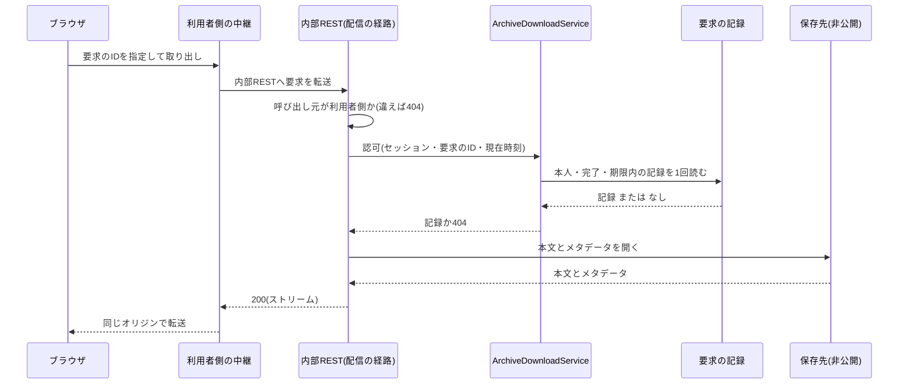

# 本人だけの生成物の同一オリジン配信

利用者ごとに生成したファイル(利用者のデータのアーカイブなど)を、本人だけが期限の間に取り出せるようにする規約を定める。保存先は公開のURLを持たない非公開のオブジェクトストレージとし、取り出しは利用者側のフロントエンドサーバーの同一オリジンの中継を通す。認可の判定と存在を明かさない404、応答のヘッダー、中継の経路の定義、期限と記録の削除、利用者ごとの回数の制限、キーとログに利用者を表す値を含めない規則を扱う。

生成の非同期の処理と保存の分割は[利用者のデータのアーカイブの非同期の生成](../backend/023-streaming-archive-exports.md)に、中継の経路の追加の手順は[フロントエンドサーバーのセキュリティ](../frontend/003-frontend-server-security.md#中継の経路の追加規約)に、回数の制限の方式は[レート制限とbot判定の検証](../backend/003-rate-limiting-and-bot-verification.md#制限の方式の選び方)に、キーのハッシュ化は[秘密情報のハッシュ化](002-keyed-hashing.md#ハッシュ化の対象)に定める。

## 前提と用語

ORMにDrizzle、データベースにCloudflare D1、オブジェクトストレージにCloudflare R2、DIコンテナにInversifyを使う構成を前提とする。配信の内部RESTは`<APIサーバーのアプリ>`に置き、利用者側の中継は`<利用者側のフロントエンドのアプリ>`に置く。部品の名前は例であり、`<ドメイン>`は生成物を扱う機能のディレクトリの名前に置き換える。

| 部品                     | 置き場所                                                                                                | 役割                                                                          |
| ------------------------ | ------------------------------------------------------------------------------------------------------- | ----------------------------------------------------------------------------- |
| `ArchiveDownloadService` | `<APIサーバーのアプリ>`の`src/application/<ドメイン>/`                                                  | 本人・完了・期限内の条件で記録を1回の読み取りで求め、無ければ理由を伏せて返す |
| `ArchiveDownloadRoute`   | `<APIサーバーのアプリ>`の`src/presentation/internal/<ドメイン>/`                                        | 内部RESTの経路。呼び出し元が利用者側でなければ404、認可の結果を応答にする     |
| 保存先の読み出し         | 共通ライブラリの`core/<ドメイン>/ports.ts`(実装はR2)                                                    | オブジェクトの本文と、保存のメタデータ(型・大きさ・添付のファイル名)を返す    |
| 中継の経路の定義         | `<利用者側のフロントエンドのアプリ>`の`src/composition/relay-routes.ts`(定義は共通の`defineRelayRoute`) | 同一オリジンの中継の経路・上流のパス・時間切れ                                |
| 回数の制限の部品         | `<APIサーバーのアプリ>`の`src/infrastructure/<ドメイン>/`                                               | 利用者ごとの厳密カウンタを使う回数の制限                                      |

| 用語                | 意味                                                                                                                               |
| ------------------- | ---------------------------------------------------------------------------------------------------------------------------------- |
| 生成物              | 利用者ごとに非同期で作り、保存先の非公開のオブジェクトとして持つファイル                                                           |
| 本人                | 生成物の要求をした利用者。他の利用者と管理者は、生成物の存在を含めて何も見られない                                                 |
| 存在を明かさない404 | 理由が「他人」「存在しない」「形の不正」「未完了」「期限切れ」「実体が無い」のどれであっても、同じ本文と同じヘッダーで返す404      |
| 同一オリジンの中継  | 利用者側のフロントエンドサーバーが、同じオリジンのパスで内部RESTへ要求を渡し、本文を返す仕組み。ブラウザは保存先のホストを知らない |
| 時間切れ            | 中継が上流の応答を待つ上限の時間。大きいファイルの転送を途中で切る場合がある                                                       |

## 配信の流れ

## 認可の規則

- 未ログインは401にする。401は存在を明かさない。
- 本人以外・存在しない・形の不正なID・作成中・失敗・期限切れ・保存先の実体が無いは、すべて404にし、本文とヘッダーを同じにする。理由は応答に出さず、必要な場合だけログに残す。
- 本人かどうか・完了しているか・期限内かを、1回の読み取りの条件に入れる。読み取りを分けると、判定の途中で状態が変わる競合が生じ、理由による応答の違いも生まれやすい。
- 呼び出し元が利用者側でない要求は、認可の処理に入る前に404にする。管理者側の中継の経路にこの配信の経路を含めない。
- 保存先の読み出しが失敗したら、JSONの共通のエラー形式で503を返す。ダウンロードの中継は、JSONでない5xxを503の定型の応答に置き換えるため、応答の形を揃える必要がある。
- 実体が無い完了の記録へ要求が来た場合は、404を返し、ID・出来事の種類だけを付けた警告をエラートラッキングへ送る(「[同じ文言を繰り返し送る通知](../infra/004-logging-and-error-tracking.md#同じ文言を繰り返し送る通知)」)。

## 応答のヘッダー

| ヘッダー                 | 値                                                                        | 理由                                                     |
| ------------------------ | ------------------------------------------------------------------------- | -------------------------------------------------------- |
| `Content-Type`           | 保存のメタデータの型(ZIPなら`application/zip`)                            | ブラウザに型を推測させない                               |
| `Content-Disposition`    | `attachment`と、非ASCIIを含む名前の表記(添付の組み立ての共通の関数を使う) | ブラウザで開かずに保存させる                             |
| `Content-Length`         | 保存のメタデータの大きさ                                                  | 転送の途中の切断を検知できる                             |
| `Cache-Control`          | `private, no-store`                                                       | 共有のキャッシュと利用者のブラウザのキャッシュに残さない |
| `X-Content-Type-Options` | `nosniff`                                                                 | 型の推測を止める                                         |

`Cache-Control`と`X-Content-Type-Options`は、内部RESTの共通の後処理が付ける値と揃える(「[内部経路とセキュリティヘッダー](../backend/006-internal-gateway.md#内部restの追加規約)」)。中継も、上流の応答のヘッダーをそのまま転送し、キャッシュの指定を書き換えない。

## 中継の経路

- 中継の経路は共通の`defineRelayRoute`で定義し、素のオブジェクトで書かない。定義は凍結され、完全一致の経路の後に登録する。
- 経路は`<中継の接頭辞>`の下に要求のIDを付けたパスとし、上流のパスは内部RESTの接頭辞の下に同じIDを付ける。IDは百分率符号化してから上流へ渡す。
- 経路は利用者側だけに登録する。管理者側の中継に加えると、管理者の呼び出し元から利用者の生成物への経路が開く。
- 時間切れは、ファイルの大きさと想定する回線の速度から決める。大きいファイルの転送は既定の時間切れを超えやすい。時間切れで途中で切れた場合でも、期限の間は利用者が同じ経路を何度でも取り直せるため、長めの時間切れを選べる。
- 中継の経路の追加は、[フロントエンドサーバーのセキュリティ](../frontend/003-frontend-server-security.md#中継の経路の追加規約)の手順に従い、経路の定義の単体テストで、パス・メソッド・上流のパス・時間切れ・凍結を確かめる。

## 保存先と鍵

- 生成物は非公開のオブジェクトストレージに置き、公開のURLを持たせない。配信の経路以外から取り出せない状態にする。
- オブジェクトのキーは、生成の要求のIDだけを使う固定の接頭辞の形にする。利用者のID・ハンドル・メールアドレス・ファイル名を含めない。キーが漏れても、どの利用者の生成物かを推測できないようにするためである。
- 保存のメタデータに、添付のファイル名として表示名を持たせる場合も、利用者を識別する値を入れない。

## 期限と記録の削除

- 生成物は、完了から保持日数(`<保持期間の日数>`日)を過ぎたら、日次の定期実行で削除する。削除は1件ずつ行い、オブジェクトが無ければ成功とみなす(再実行しても結果が変わらないため)。
- 削除の後も、要求の記録は残す。記録は期限切れの状態になり、履歴として一覧に表示できる。期限切れの記録のダウンロードは、前述の404になる。
- 利用者の退会・物理削除の時期には、その利用者の記録と残っている生成物を、保持期間に関係なく削除する。物理削除の時期の処理は、退会の時点で消し残した記録の受け皿になる。
- 削除の失敗は、件数とともにエラートラッキングへ送り、次の実行でやり直す。

## 利用者ごとの回数の制限

- 生成の要求の回数は、利用者ごとの厳密カウンタで`<回数の上限>`回・`<期間の秒数>`秒の枠で数える。キーは用途の接頭辞と利用者のIDを、ペッパーを鍵にしたハッシュで作る(「[秘密情報のハッシュ化](002-keyed-hashing.md#ハッシュ化の対象)」)。カウンタの記録に利用者のIDを平文で残さない。
- 数える順は、本人の判定と確認の判定の後、回数の制限の後に生成の依頼を送る。未ログインと未確認の拒否は数えない。
- 回数の制限の後の失敗(生成の依頼の送信の失敗など)は回数を戻さない。利用者が受け付けられたと誤解しないよう、要求の記録は消して利用できない旨を返す。
- 超過時は429と、再び要求できる時刻を計算する秒数を返す。残りの回数は、カウンタが読み取りの口を持たないため表示しない。
- 期間の全体を消すリセットは、同じ期間の他の要求まで消すため使わない。

## キーとログに利用者を表す値を含めない

- メッセージには要求のIDだけを入れる。再試行や保管の間もメッセージの本文に利用者のIDや連絡先を残さないためである。
- ログとエラートラッキングに送る属性・タグ・コンテキストは、要求のIDと件数・バイト数・所要時間・結果・出来事の種類に限る。要求のIDは形を確かめ、形が違えば`unknown`にする。
- エラートラッキングの除去処理の対象外の項目には、利用者の値を入れない(「[エラートラッキング](../infra/004-logging-and-error-tracking.md#エラートラッキング)」)。

## テスト

テストの種別と命名は[テスト方針](../testing/001-test-strategy.md#テストの種別と命名)に従う。

- 単体テスト: 中継の経路の定義(パス・メソッド・上流のパス・時間切れ・凍結・利用者側だけに登録されること)、認可の判定の結果と応答の対応(401・404・200)、404の本文とヘッダーが理由によらず同じであること、回数の制限のキーがハッシュ化されていること。
- Workers統合テスト: 本人の取り出しが200で、本文・`Content-Disposition`・`Content-Length`・`Cache-Control`・`nosniff`を返すこと。未ログインの401。他人・管理者側の呼び出し元・存在しない・形の不正なID・作成中・失敗・期限切れ(削除の前と後)・実体が無い記録の404が、同じ形の応答になること。保存先の読み出しの失敗で503がJSONの形で返ること。回数の上限の超過で429になり、キーにIDの平文が無いこと。
- 期限と削除: 期限切れの削除の後に記録が残り、同じ要求が404になること。同じ削除を2回実行しても結果が変わらないこと。
