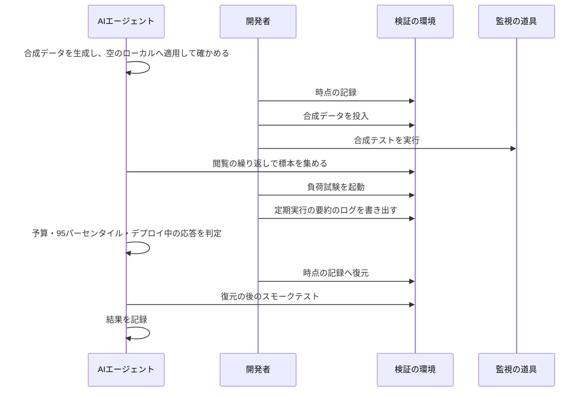

# 性能の検証

想定規模のデータを置いた検証の環境で、FCP・GraphQLの応答時間・同時接続の負荷・日次の定期実行の所要時間・デプロイ中の応答を計測し、判定する方法を定める。計測の道具は、合成テストの結果・ブラウザの計測・エラートラッキングからの書き出し・負荷試験の要約を、同じ基準で判定する。閾値・件数・時間・予算の具体の値は[本プロジェクト固有の値](../../../onboardings/project-values.md)に置き、この文書には書かない。

## 前提と用語

| 用語                   | 意味                                                                                                                                                                                                           |
| ---------------------- | -------------------------------------------------------------------------------------------------------------------------------------------------------------------------------------------------------------- |
| 検証の環境             | 本番と同じ構成で、計測の対象にする検証用の環境。本番では合成データの投入・負荷の発生・計測のための設定の変更を行わない                                                                                         |
| 想定規模               | 運用の見込みの件数まで各テーブルの行を増やした状態。プロファイル(規模の定義)の件数の値は[本プロジェクト固有の値](../../../onboardings/project-values.md)に置く                                                 |
| 合成データ             | 想定規模を再現するために生成する、実在の個人を含まないデータ。メールアドレスとURLのドメインは`.example`に限る                                                                                                  |
| 見本のハンドル         | 合成データのうち、計測の対象にする1件の識別子(URLに使う値)。生成の一覧(マニフェスト)に記す                                                                                                                     |
| 時点の記録             | 合成データを投入する前に取る、データベースの復元の基準時点(Time Travelのブックマーク)。計測の後に合成データを取り除くときの戻り先                                                                              |
| 検証の道具の入口       | 判定の道具の実行ファイル。サブコマンドの形で呼び出し、`bun <検証の道具の入口> <サブコマンド> --help`で使い方を表示する。実際の入口の値は[本プロジェクト固有の値](../../../onboardings/project-values.md)に置く |
| FCP                    | First Contentful Paint。ページで最初のコンテンツが描画された時刻。ブラウザの`Performance`のエントリ`first-contentful-paint`の値で読む                                                                          |
| 合成テスト             | 外部の監視サービスがページを定期的に読み込んで測る計測。ここではObservatoryを指す                                                                                                                              |
| 実利用者の計測値       | 本番の利用者のブラウザが集めた計測の値。判定には75パーセンタイルを使う                                                                                                                                         |
| 標本                   | 操作の応答時間の1件ずつの計測。判定には操作ごとに下限以上の標本数が要る                                                                                                                                        |
| 95パーセンタイル       | 標本を所要時間の小さい順に並べ、最近接順位法で選んだ値。「[GraphQLの応答時間](#graphqlの応答時間)」で式を示す                                                                                                  |
| 予算・上限・目安       | 日次の定期実行の1回の起動の全体の所要時間について、目標(予算)と超えてはならない限界(上限)を置き、ジョブ1件ごとに目安を置く。値は[本プロジェクト固有の値](../../../onboardings/project-values.md)に置く         |
| デプロイ中の応答の監視 | デプロイの前から後まで、各アプリの健康確認の経路へ一定間隔で要求し、応答の種類ごとに件数を数える計測                                                                                                           |

## 検証の流れ

検証は、合成データの準備・計測・判定・除去の順に進める。この流れを「想定規模での計測と復旧の演習」と呼ぶ。合成データの投入から除去までを1つの流れとして行い、途中で検証の環境の状態を変えない。

- 投入から復元までの間は、その検証の環境へ他の変更を反映しない。復元は時点の記録より後の変更も戻すため、途中で反映した変更は失われる。
- 基準を満たさない箇所を直した場合は、直した変更を反映した後に、時点の記録・投入・計測・復元の流れを最初から行い直す。
- 無停止のデプロイとロールバックの演習は、検証の環境への変更を伴うため、この流れより前に行う([運用の演習](../operations/006-release-readiness-and-drills.md))。
- 投入は、計測の対象の定期実行の起動より十分前に終える。

## 想定規模の合成データ

### 生成

- 生成の道具は、データベースのテーブル定義(ORMのスキーマ)を読んで列の一覧を得て、行を作る。同じ種(seed)から同じ出力を得られるよう、乱数を種から決める。
- 出力は、列の値をリテラルで書いたINSERT文のSQLファイルである。1ファイルの行数と1文の大きさに上限を置く。上限は、データベースの1文の上限([D1の制約と対処](../db/002-d1-constraints.md#d1の制約と対処))より十分小さい値にする。
- 上限に近い長い文字列は、1文に入れず、断片のUPDATE文を連ねて組み立てる。組み立ての結果が元の値に戻ることを単体テストで確かめる。
- 想定規模の全行の生成のように時間のかかる生成を使う単体テストは、1ファイルの中で同じ生成を繰り返さず、`beforeAll`で1回だけ生成した結果を使い回す。生成するテストと`beforeAll`には時間切れを明示する。CIの実行環境は開発機より数倍遅く、テストツールの既定の時間切れ(5秒)を超えるためである。
- ファイルは外部キーの依存の順に並べる。生成の一覧(マニフェスト)に、プロファイルの名前・種・生成の日時・ファイルの順序と文の数・件数・見本のハンドルを書く。
- 合成データは、実在の個人を含まない値だけで作る。メールアドレスとURLのドメインは`.example`に限る。

### 検査

- 空のローカルのデータベースにマイグレーションを適用した後、生成したファイルを順に適用する。適用の後に、件数と外部キーの整合を照会で確かめる。
- 検査の後は、ローカルの状態を初期化し、マイグレーションを適用し直す。ローカルの回帰テストを同じ初期状態から始めるためである。
- 検証用のプロファイルを使い、ローカルでアプリを通常どおり起動して、画面と照会で件数が見えることを確かめる。

### 投入と除去

- 投入の前に時点の記録を取る。その後、生成したファイルを順に検証の環境のデータベースへ適用する。リモートのデータベースへの適用は、権限を持つ担当者が行う。AIエージェントは、生成物と手順を用意する。
- 計測が終わったら、時点の記録へ復元して合成データを取り除く([運用の演習](../operations/006-release-readiness-and-drills.md))。復元の所要時間は、検知(復元の判断を始めた時刻)から、復元の完了とスモークテストの成功までを測る。
- 復元の後は、主要なテーブルの件数が投入の前と同じであることを照会で確かめる。

## FCPの計測

### 計測の対象と条件

- 計測の対象は、利用者側の公開ページと、管理者側のログイン後の画面とする。対象のページの一覧は[本プロジェクト固有の値](../../../onboardings/project-values.md)に置く。
- 利用者側の公開ページはモバイルとデスクトップの両方の条件で、管理者側の画面はデスクトップの条件で計測する。
- 計測は、想定規模の合成データを置いた状態で、「想定規模での計測と復旧の演習」の流れの中で行う。合成データを置いていない計測は、参考の値として記録し、判定には使わない。
- 合成テストは、Observatoryのモバイルの条件に合わせて行う。計測の結果の画面に表示される条件(端末の種類・CPUの減速・通信の条件)を、そのまま検証の記録に残す。

### ブラウザの計測

- ブラウザの自動操作の道具で、合成テストと同じ条件を設定する。CPUの減速の倍率と通信の条件(往復の遅延・下りと上りの速度)は、Observatoryの結果に表示された値と同じにする。
- 計測の対象のページを読み込み、`Performance`のエントリ`first-contentful-paint`の開始時刻をFCPとして読む。
- 条件を変えた計測の値は比べない。条件を変えたら、同じ条件で測り直す。
- 本文が長いページは、本文の上限に近い合成データを置いた状態で計測する。

### 判定と記録

- FCPが閾値を超えるページは、原因を記録する。原因の例は、描画を妨げる読み込み・応答の遅いデータの取得である。担当の機能の範囲で改善し、計測し直す。
- 本番リリースの後、一定の期間が経ったら、実利用者の計測値の75パーセンタイルのFCPを確かめる。閾値を超えるページは指摘として記録する。
- 計測の記録には、ページ・計測の値・計測の日時・条件・判定を書く。

## GraphQLの応答時間

### 計測の集め方

- 未ログインの閲覧の流れをブラウザのE2Eテストで繰り返し、操作の標本を集める([閲覧の繰り返し](004-cross-app-regression-and-audits.md#閲覧の繰り返し))。
- 標本の源は、エラートラッキングのトレースに含まれるスパンである。ブラウザ側の要求のスパン(所要時間)に操作名を結び付けて標本にする。
- 結び付けは、同じトレースの中で、操作名を持つAPIサーバー側のスパンから親をたどり、最初に出会ったブラウザ側のスパンに操作名を結ぶ。親をたどる途中にフロントエンドサーバー側のスパンがあっても、その先のブラウザ側のスパンに結ぶ。
- どのAPIサーバー側のスパンからも結べなかったブラウザ側のスパンは標本に入れず、判定の表に件数を出す。
- 書き出しは次の列を持つ表(CSV)にして、判定の道具へ渡す。

| 列               | 内容                                                                                 |
| ---------------- | ------------------------------------------------------------------------------------ |
| `trace_id`       | トレースのID                                                                         |
| `span_id`        | スパンのID                                                                           |
| `parent_span_id` | 親のスパンのID。無い場合は空                                                         |
| `side`           | `browser`・`frontend`・`api`のいずれか                                               |
| `operation`      | GraphQLの操作名(APIサーバー側のスパンの属性)。ブラウザ側とフロントエンド側は空でよい |
| `duration_ms`    | 所要時間(ミリ秒)                                                                     |

- 列名は道具のオプションで変えられる。

### 95パーセンタイルの求め方

- 操作ごとに、標本を所要時間の小さい順に並べ、最近接順位法で95パーセンタイルを求める。標本数を`n`とすると、順位は`⌈0.95 × n⌉`であり、その順位の値を取る。
- 例えば標本が20件なら、順位は⌈0.95 × 20⌉ = 19で、19番目の値である。21件なら、順位は⌈0.95 × 21⌉ = 20で、20番目の値である。
- 標本数が下限に満たない操作は判定しない。不足として表示し、閲覧を繰り返して標本を取り直す。
- 閾値を超えた操作は、データベースへの問い合わせの回数と所要時間を調べて記録し、担当の機能の範囲で改善してから計測し直す。
- 一覧を取得する操作では、項目の数に比例して問い合わせが増えないことを、項目の数を変えて問い合わせの回数を数えて確かめる。
- 結果の表には、操作名・画面・標本数・95パーセンタイル・判定を並べる。

### 判定の道具

- 呼び出し: `bun <検証の道具の入口> graphql-latency --input <CSVの絶対パス>`
- オプション: `--threshold-ms`(閾値)・`--min-samples`(下限の標本数)・`--operation`(判定する操作名。繰り返して指定でき、指定した操作だけを判定する。標本が無い操作は不足になる)・列名の指定
- 閾値と下限の標本数の既定値は、[本プロジェクト固有の値](../../../onboardings/project-values.md)に合わせる。
- 終了コード: 0は判定した全ての操作が合格、1は不合格か標本不足の操作が1つでもある、または判定できる操作が1つも無い(標本が1件も無い)、2は入力の誤り(列の欠落・数でない所要時間など)。

## 同時接続の負荷試験

### 台本

- 仮想の利用者を並行に動かし、一定の間隔で、主要な公開ページの閲覧と公開の照会を続ける。仮想の利用者の人数・継続の時間・間隔は、[本プロジェクト固有の値](../../../onboardings/project-values.md)に置く。
- 台本は負荷試験の道具(k6)で書く。k6の版は開発コンテナとCIで同じ版に固定し、実行ファイルのチェックサムを検証して導入する。
- 台本は対象の環境の基底のURL(利用者向けのアプリとAPIサーバー)と、合成データの見本のハンドル(プロダクトと利用者)を環境変数で受け取り、本番の値を既定にしない。見本のハンドルは生成の一覧(マニフェスト)がGit管理外のため、CIでは手動の起動の入力で渡す。
- 仮想の利用者1人は、主要な公開ページを決めた順に1回ずつ開いて公開の照会を1回行い、各要求の後に待ち時間を置く。これを継続の時間が終わるまで繰り返す。見本のハンドルは利用者ごとに巡回して選ぶ。
- 公開の照会は、APIキーを要さない公開の経路(OpenAPIの仕様書)を使う。負荷の試験にシークレットを使わないためである。

### 閾値と結果の記録

- 閾値は次の4つとする。サーバーの誤り(5xx・接続の失敗)の割合は0、回数の制限による拒否(429)の件数は0、想定外の応答(200以外)の件数は0、応答時間の95パーセンタイルは閾値以内。想定外の応答の閾値は、見本のハンドルの誤りなどで、負荷に関係ない応答が成功の判定を隠すことを防ぐ。
- 応答時間は、ページの要求と公開の照会の全ての要求で測る。ページの描画はサーバーの中でGraphQLを呼ぶため、ページの応答時間にGraphQLの応答時間が含まれる。デプロイ先の環境ではGraphQLの経路を外部へ公開しないため、GraphQLだけの応答時間は負荷試験の道具では測れない。負荷の下のGraphQLの応答時間は、負荷をかけた時間帯(開始から終了まで)のエラートラッキングのスパンを書き出し、「[GraphQLの応答時間](#graphqlの応答時間)」と同じ集計で操作ごとの95パーセンタイルを求めて、同じ閾値で判定する。全要求の95パーセンタイルとGraphQLの操作ごとの95パーセンタイルの両方が閾値以内であることを、負荷の下の応答時間の合格とする。
- 閾値を1つでも外れると、k6は失敗で終わる。結果の要約(JSON)を保存し、操作ごとの95パーセンタイルと全体の判定を、判定の道具の表と同じ形で出力する。表の操作ごとの判定は目安で、負荷試験の合否は全体の閾値が決める。
- 基準を満たさない場合は、原因を記録し、担当の機能の範囲で改善した後に検証し直す。

### 送信元と制限

- 送信元ごとの要求の数を、Workerごとの回数の制限(IP制限)の上限より少なく抑える。発生元を複数に分けて、1つの送信元に要求が集中しないようにする。
- 検証のためにIP制限とbot判定の設定を変えない。設定を変えた計測は、本番と同じ条件の値として扱えない。

### 起動と対象

- 負荷試験は、手動の起動だけにする。対象の環境は検証の環境に限り、本番を選べない形にする。
- 負荷試験の実行にシークレットを使わない。

### 書き込みの同時性

- bot判定が要る書き込みは、検証の環境では負荷をかけず、ローカルで確かめる。bot判定を外した環境では、同時の書き込みの条件が本番と異なるためである。
- ローカルでは、同じ対象へ多数の利用者が同時に書き込んでも誤りが無く、数え上げが書き込みの件数と一致することをE2Eテストで確かめる([同時の書き込み](004-cross-app-regression-and-audits.md#通しのe2e))。

## 日次の定期実行の時間の予算

### 計測の方法

- 定期実行は、1回の起動ごとに要約のログ(`info`)を出す。要約には、起動の種類・cron式・結果・ジョブごとの名前と結果と所要時間・全体の所要時間(`totalDurationMs`)が入る([定期実行](../infra/003-async-processing.md#定期実行))。
- 合成データを置いた検証の環境で、判定の対象の起動を実行し、その要約のログを書き出す。起動の時刻は定期実行の時刻に合わせる。
- 判定の対象の起動と判定の値(予算・上限・目安)は、判定の道具に固定されている。本プロジェクトの値は[本プロジェクト固有の値](../../../onboardings/project-values.md)に置き、道具の値と一致させる。

### 判定の基準

- 予算: 判定の対象の起動で、ジョブの所要時間の和が予算以内であること。予算を超えたときの警告は、ディスパッチャが要約の`totalDurationMs`で送る([同じ時刻のジョブ群の時間の予算](../infra/003-async-processing.md#同じ時刻のジョブ群の時間の予算))。
- 上限: 判定の対象の起動で、ジョブの所要時間の和が上限を超えないこと。上限と各ジョブの目安は警告の対象にせず、判定の道具が不合格として確かめる。
- 目安: ジョブ1件の所要時間が目安以内であること。目安を超えたジョブは、処理の上限の件数と所要時間を記録し、メッセージ処理へ移すことを担当の機能へ依頼する。
- 順序: 実行されたジョブの名前と順序が、日次のタイムラインの表と一致すること。
- 余裕: 上限までの残り(上限からジョブの所要時間の和を引いた値)を、ジョブ1件の平均の所要時間で割り、増やせるジョブの数の目安(切り捨て)として記録する。
- 警告: 予算の値と、予算を超えたときのエラートラッキングへの警告の仕組みが、仕様の値と一致することを確かめ、検証の記録に示す。

### 判定の道具

- 呼び出し: `bun <検証の道具の入口> cron-budget --expected-order <順序の絶対パス> <要約のログの絶対パス>...`
- 順序のファイルは、ジョブの名前を順序の小さい順に1行ずつ書いたものである。
- 要約のログは、JSON Linesの形式かJSON配列の形式を受け付ける。複数のファイルを渡すと、合わせて判定する。
- 道具は、道具に固定された`cron式`の起動の要約だけを予算・上限・目安・順序で判定する。他の起動は、所要時間を参考の値として表に並べ、判定に使わない。ジョブの失敗の行と予算超過の警告の行は要約ではないため、読まない。
- 判定の所要時間は、ジョブの所要時間の和で数える。要約の`totalDurationMs`との差は表に併記するが、判定には使わない。実行時間の上限までの余裕も、表に並べるだけで判定には使わない。
- 不合格になるのは、判定の対象の起動で次のいずれかが起きたときである。予算の超過・上限の超過・目安を超えたジョブ・結果が失敗のジョブ・順序の食い違い。判定の対象の起動の要約が1件も無い場合も不合格になる。
- 終了コード: 0は合格、1は不合格(上の条件のいずれか)、2は入力の誤り(要約のログや順序のファイルを読めない、形式が違う、順序のファイルが空など)。

## デプロイ中の応答の監視

### 目的と方法

- 目的は、デプロイの前後で、利用者が使うアプリとAPIサーバー・イベントサーバーが応答し続けたことを確かめることである。
- 監視の対象は4つ(利用者側・管理者側・APIサーバー・イベントサーバー)である。利用者側は公開のトップページ、管理者側は未ログインで応答するログインの画面、APIサーバーとイベントサーバーはヘルスチェックの経路(`/health`)へ、1秒ごとに要求を送る。
- 応答の判定: 2xx・3xxを成功とする(3xxは追わない)。4xx以上・時間切れ・通信の失敗は失敗とする。1回の要求の時間切れは道具の既定の値で、引数では変えられない。
- 数えるのは、対象ごとの要求の総数と失敗の件数、最大の応答時間である。失敗は種類(応答のステータス・時間切れ・通信の失敗)と時刻を内訳として表示する。
- 監視は、デプロイの開始より前に起動し、デプロイの完了の後の一定の時間まで続ける。

### 判定の道具

- 呼び出し: `bun <検証の道具の入口> availability-probe [--duration <秒数>] [--client-url <基底のURL>] [--admin-url <基底のURL>] [--api-url <基底のURL>] [--event-url <基底のURL>]`。オプションの順序は問わない。
- `--duration`は監視の秒数で、既定は20分である。`--client-url`・`--admin-url`・`--api-url`・`--event-url`は、それぞれのアプリの基底のURLを指定する。省略した場合の既定の基底のURLは、ローカルでアプリが待ち受ける先である。検証の環境の基底のURLを指定して使う。
- 判定: 全ての対象で失敗の件数が0件であれば合格とする。観測が1件も無い場合は、何も確かめていないため不合格とする。失敗があれば、対象・時刻・応答の種類を記録し、ロールバックの判断を担当者が行う([ロールバックと復旧](../operations/002-rollback-and-recovery.md))。
- 終了コード: 0は全ての応答が成功、1は失敗した応答が1つでもある、または観測が無い、2は入力の誤り(秒数やURLの形式の誤りなど)。

## 記録

- 各計測は、計測の種類・対象・条件(環境・規模・端末と通信の条件)・値・基準・判定・日時を記録する。
- 記録に、秘密の値・個人情報・IPアドレスを書かない。判定の道具は、秘密の値や個人情報を出力しない形で作る。
- 基準を満たさない計測は、原因と担当の機能への依頼の結果を記録に残し、解消の後に計測し直した結果を別の行に書く。

## 関連

- [テスト戦略](001-test-strategy.md) — テストの種別と実行方法
- [回帰テストと監査](004-cross-app-regression-and-audits.md) — 通しのE2E・全経路のアクセシビリティ・セキュリティの基線・縮退の検証
- [D1の制約と対処](../db/002-d1-constraints.md#d1の制約と対処) — 1文の上限と復元の基準
- [定期実行](../infra/003-async-processing.md#定期実行) — 要約のログと業務日付の決め方
- [ログ管理とエラートラッキング](../infra/004-logging-and-error-tracking.md) — トレースと書き出しの元
- [本プロジェクト固有の値](../../../onboardings/project-values.md) — 件数・閾値・予算・入口の値
