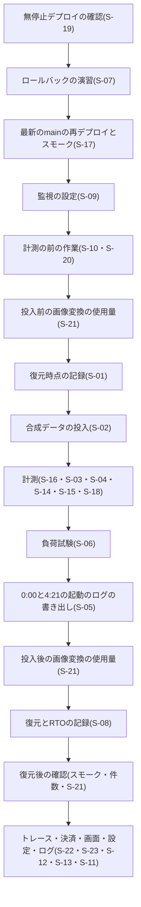

# 検証の記録

**最終更新:** 2026-11-23
**対象spec:** launch-readiness
**関連:** [本番準備のチェックリスト](release-checklist.md)・[プロジェクト固有の値](project-values.md)・[ロールバックと復旧](../GUIDES/tech/operations/002-rollback-and-recovery.md)・[アクセシビリティ規則](../GUIDES/tech/frontend/004-accessibility-rules.md)

この文書は、launch-readinessの検証の結果・演習・指摘・開発者の作業を記録する。値は計測の実行後に、道具の出力から転記して記入する。秘密の値(キー・トークン・パスフレーズ)と個人情報(メールアドレス・IPアドレス・Cookie)は記録しない。

## 記録の規則

- 計測の記録は、計測の種類・対象・条件(環境・プロファイル・合成データの規模)・値・基準・判定・日時(UTC)を書く。
- 判定の結果が保留の検証は、理由と依存する開発者の作業の番号を書く(18.6)。
- 指摘は[指摘の一覧](#指摘の一覧)の様式で記録する。個別機能の不具合は本specで直さず、担当specへの依頼として記録する(18.2)。
- 「リリースを止める指摘」は、重大度が重大・高で、要件に反する指摘を指す(仮11)。状態が解消済みでない間は、本specのリリースのタスクを完了にしない。
- 開発者が受け入れた危険は[受け入れた危険](#受け入れた危険)に記録し、リリースを止める指摘に数えない。
- 業務時刻はUTCとの差が-480分で固定である(`BUSINESS_UTC_OFFSET_MINUTES`)。業務時刻の4:21はUTCの12:21、0:00はUTCの8:00、16:21はUTCの0:21にあたる。

## 計測

### FCP(要件1.1〜1.5)

| 種類                         | 対象                          | 条件                                                  | 値  | 基準      | 判定 | 日時(UTC) |
| ---------------------------- | ----------------------------- | ----------------------------------------------------- | --- | --------- | ---- | --------- |
| FCPの合成テスト(Observatory) | 利用者側の6ページ             | 2条件(条件は`testing/003`に従う)                      |     | 1.6秒以内 |      |           |
| FCPの合成テスト(Observatory) | 管理者側の2ページ             | 2条件                                                 |     | 1.6秒以内 |      |           |
| FCPの実利用者の値            | 利用者側のページ              | ブラウザの計測の集計                                  |     | 1.6秒以内 |      |           |
| ヘルプ記事の詳細のFCP        | 本文が上限(100,000文字)の記事 | ブラウザの計測(Observatoryのモバイルの条件にそろえる) |     | 1.6秒以内 |      |           |

### GraphQLの応答時間(要件2.1〜2.6)

| 種類                            | 対象                                           | 条件                            | 値  | 基準      | 判定 | 日時(UTC) |
| ------------------------------- | ---------------------------------------------- | ------------------------------- | --- | --------- | ---- | --------- |
| GraphQLの操作の95パーセンタイル | 主要な公開の操作(ブラウザの中継の要求のスパン) | `@traffic`の閲覧・標本200件以上 |     | 300ms以内 |      |           |
| N+1の確認                       | 主要な画面の1回の読み込み                      | 問い合わせの回数を記録する      |     | 記録      |      |           |
| ログイン中の操作                | 利用者側・管理者側のログイン中の操作(S-18)     | stagingで操作し参考値を書き出す |     | 記録      |      |           |

- 判定の標本が足りない場合は、閲覧を繰り返して取り直す。超過した操作は指摘として記録する。
- 95パーセンタイルは、ブラウザの中継の要求のスパンの所要時間に、同じトレースのAPIサーバーのスパンの属性`graphql.operation.name`の操作名を付けて判定する(D-4)。

### 同時接続の負荷(要件3.1〜3.6)

| 種類     | 対象    | 条件                              | 値  | 基準          | 判定 | 日時(UTC) |
| -------- | ------- | --------------------------------- | --- | ------------- | ---- | --------- |
| 負荷試験 | staging | 5並列×20人・15分・待ち時間3〜15秒 |     | 5xxと429が0件 |      |           |

### 想定規模のデータ量(要件4.1〜4.5)

| 種類                         | 対象                                                                                                               | 条件                                  | 値  | 基準                                       | 判定 | 日時(UTC) |
| ---------------------------- | ------------------------------------------------------------------------------------------------------------------ | ------------------------------------- | --- | ------------------------------------------ | ---- | --------- |
| 合成データの投入             | stagingのD1                                                                                                        | 想定規模のプロファイル(件数は2.1の値) |     | 投入の成否と件数                           |      |           |
| 検索・通報の一覧             | 管理画面(S-15)                                                                                                     | 部分一致の検索と通報の案件の一覧      |     | p95 300ms以内                              |      |           |
| データベースの分析           | 上の画面の問い合わせ                                                                                               | 所要時間と読み取りの行数              |     | 記録                                       |      |           |
| データエクスポート           | 利用者の要求とダウンロード(S-14)                                                                                   | 上限までのデータ                      |     | メモリの上限の超過による打ち切りが無いこと |      |           |
| 本文が上限のヘルプ記事の詳細 | 利用者側の記事の詳細                                                                                               | `@traffic`の標本                      |     | p95 300ms以内・FCP 1.6秒以内               |      |           |
| 改善の要否                   | 写しのテーブル・返信のページ分け・短時間の保持・全文検索への切り替え・処理の上限の引き上げ・メッセージ処理への移動 | 計測の結果から判断                    |     | 担当specへの依頼の要否                     |      |           |

### 日次バッチの時間の予算(要件5.1〜5.6)

| 種類                         | 対象                             | 条件                                        | 値  | 基準                                                 | 判定 | 日時(UTC) |
| ---------------------------- | -------------------------------- | ------------------------------------------- | --- | ---------------------------------------------------- | ---- | --------- |
| 4:21の要約のログ             | 投入の後の最初の4:21(UTCの12:21) | 合計の予算                                  |     | 予算300,000ms・上限600,000ms・各ジョブの目安30,000ms |      |           |
| 4:21の1回の起動の実時間      | 同上                             | イベントサーバーのログ                      |     | 5分以内(上限10分)                                    |      |           |
| 参考の要約のログ             | 23:40・23:45・0:00の起動(D-2)    | 投入の後の最初の起動                        |     | 参考の値として記録                                   |      |           |
| 0:00の朝の枠の開催通知の収集 | フォロワー1万人の作り手(S-05)    | 処理ごとのCPU時間とメモリの上限の超過の有無 |     | 記録                                                 |      |           |

- 予算の判定は4:21だけにし、他の3つの起動は参考の値として記録する(D-2)。
- 「cron」タグの`warning`がエラートラッキングにあるかを、4:21の起動について確かめる(S-05)。

## 演習

### 無停止デプロイ(要件7.1・7.5)

| 項目                   | 内容                                                       | 値                     | 判定                         | 日時(UTC) |
| ---------------------- | ---------------------------------------------------------- | ---------------------- | ---------------------------- | --------- |
| 応答の監視             | デプロイの最中に、合意した時刻にPRをmainへマージする(S-19) | 監視の対象の失敗の件数 | 失敗が0件                    |           |
| デプロイ中の失敗の応答 | 失敗が起きた場合の時刻と状態                               | 時刻と状態             | 失敗の時は指摘として記録する |           |

### マイグレーションの型(要件7.2)

| 項目            | 内容                                                                     | 判定                                                                    |
| --------------- | ------------------------------------------------------------------------ | ----------------------------------------------------------------------- |
| Expand/Contract | マイグレーションの一覧を、前の版のコードが新しいスキーマで動く順に並べる | 一覧に、削除・名前の変更を伴う変更が1つのマイグレーションに入っていない |

### ロールバック(要件7.3〜7.5)

| 項目               | 内容                                                                                   | 所要時間 | 結果 | 日時(UTC) |
| ------------------ | -------------------------------------------------------------------------------------- | -------- | ---- | --------- |
| ロールバックの演習 | `operations/002`の手順で、stagingのWorkerを戻す(S-07)                                  |          |      |           |
| 再デプロイ         | 最新のmainをstagingへ再びデプロイし、スモークテストを成功させる(S-17)                  |          |      |           |
| 失敗の場合         | 手順が完了しない・所要時間が超過する場合は指摘として記録し、手順を直した後に演習し直す |          |      |           |

### D1の復旧(要件8.1〜8.6)

| 項目                                 | 基準                                                                                       | 値                 | 判定       | 日時(UTC) |
| ------------------------------------ | ------------------------------------------------------------------------------------------ | ------------------ | ---------- | --------- |
| 記録した時点(投入の前)のブックマーク | 復元の時点として記録する(S-01)                                                             | ブックマークの記録 | 記録済み   |           |
| 復元後の件数                         | 投入した合成データが0件、投入の前のデータが残る                                            | 件数               | 一致       |           |
| スモークテスト                       | 復元の後に成功する                                                                         | 成否               | 成功       |           |
| RTO                                  | 障害の検知(演習では復元の判断を始めた時刻)から、復元の完了とスモークの確認の成功までを測る | 所要時間           | 4時間以内  |           |
| RPO                                  | 復元できる時点の細かさと保持期間(過去30日)から判断し、根拠を書く                           | 根拠               | 24時間以内 |           |
| 外部サービスとの突き合わせ           | 復元の時点より後の外部サービスの事象を`operations/005`の手順で突き合わせる                 | 件数               | 記録       |           |
| 失敗の場合                           | 手順どおりに完了しない・4時間を超える場合は指摘として記録し、演習し直す                    |                    |            |           |

## 対応表

### 縮退運転(要件6.1・6.2・6.4・6.5)

| 外部サービス                | 失敗の分類と振る舞い                                                                                 | 運用者への通知                                     | 自動テストの証跡                                                                                     | 差し替えの手段(ローカル)                          | 確認の結果 | 指摘 |
| --------------------------- | ---------------------------------------------------------------------------------------------------- | -------------------------------------------------- | ---------------------------------------------------------------------------------------------------- | ------------------------------------------------- | ---------- | ---- |
| Rekognition                 | 10秒の時間切れ・上限と5xxは再試行し、最後は`undetermined`。認証の失敗は`misconfigured`               | `warning`(判定できない)、`error`(設定の誤り)       | `rekognition-moderation-provider.worker.test.ts`・`moderate-image-handler.unit.test.ts`              | ローカルでは`MODERATION_PROVIDER`により呼ばれない |            |      |
| 自然言語APIのキーワード抽出 | 10秒の時間切れ・上限と5xxは再試行し、使い切ると縮退の索引(`fallback`)。設定の誤りは直ちに縮退        | `error`(設定の誤り)                                | `google-natural-language-extractor.worker.test.ts`・`sentry-search-incident-reporter.worker.test.ts` | ローカルでは`KEYWORD_EXTRACTOR`により呼ばれない   |            |      |
| Stripe                      | 10秒の時間切れ・接続・上限・5xxは`StripeUnavailableError`。認証の失敗を含む他は`StripeRejectedError` | ゲートウェイは`warn`のログだけで、Sentryへ送らない | `stripe-client.worker.test.ts`・`stripe-gateway*.worker.test.ts`                                     | 鍵を無効な固定の値にする                          |            |      |
| メール送信                  | 30秒の時間切れ・一時的な失敗は再試行。上限と日次上限は延期、使い切ると配信不能                       | `warning`(日次上限)、`error`(配信不能)             | `cloudflare-email-provider.worker.test.ts`・`send-email-handler*.unit.test.ts`                       | 宛先を検証済みの宛先に限る(Mailpit)               |            |      |
| HIBP                        | 3秒の時間切れ・失敗は`unavailable`でパスワードを受け付ける(fail-open、再試行なし)                    | `warning`                                          | `hibp-pwned-password-checker.worker.test.ts`                                                         | 差し替えの手段は無い(対応表のみ)                  |            |      |
| DISIFY                      | 3秒の時間切れ・失敗は`undetermined`として保存し、遅延の再確認で後から確かめる                        | `warning`                                          | `disify-client.worker.test.ts`・`disposable-email-check.unit.test.ts`                                | 鍵を無効な固定の値にする                          |            |      |

- 縮退の差し替えの値は無効な固定の値で、本物の鍵を含めない。
- 証跡のテストが無い行は、証跡なしとして指摘の候補に出し、担当specへの追加を依頼する(6.2)。

### セキュリティ(要件13.1〜13.8)

| 要件 | 確認の内容                                                                                                                                              | 根拠(自動テスト・設定・staging)                        | 確認の結果 | 指摘 |
| ---- | ------------------------------------------------------------------------------------------------------------------------------------------------------- | ------------------------------------------------------ | ---------- | ---- |
| 13.1 | NFR-SECUR-001〜046の対応表                                                                                                                              | 対応表の各行に根拠を示す。根拠が無い要件は指摘         |            |      |
| 13.2 | セキュリティヘッダー(HSTS・`X-Content-Type-Options`・`Referrer-Policy`・Permissions-Policy・nonce付きのCSP・`frame-ancestors 'none'`)                   | ローカルとstagingの全経路の応答                        |            |      |
| 13.3 | 認証Cookieの属性・`Cache-Control: no-store`・GraphQLの制限・公開APIのCORS・`Content-Length`の無いアップロードの拒否・画像配信ドメインへのCookieの非送信 | 自動テストとstagingでの確認                            |            |      |
| 13.4 | Cloudflareの無償マネージドルールセットの有効化                                                                                                          | ゾーンのセキュリティの設定画面(S-13)                   |            |      |
| 13.5 | 依存パッケージの既知の脆弱性の検査とシークレットの検出                                                                                                  | 全体の実行の結果を記録                                 |            |      |
| 13.6 | コード全体のセキュリティレビュー(入力の境界検証・生SQLの禁止・生HTMLの挿入の禁止・所有権の判定)                                                         | 指摘を重大度とともに記録                               |            |      |
| 13.7 | 重大・高の指摘、または要件に反する指摘の解消                                                                                                            | 解消を確かめ直す。受け入れた危険を除く                 |            |      |
| 13.8 | サーバーでの描画の失敗の状態コードとハイドレーションの後の表示                                                                                          | 本番と同じビルドのローカルのプレビュー(下の確認の手順) |            |      |

#### サーバーでの描画の失敗の確認(要件13.8)

1. 部品の描画中の例外: `origin/main`から`/workspace`の外に一時的なworktreeを作り、例外を投げる部品の経路をコミットせずに置いて起こし、応答の状態コードと表示を記録する。確認の後にworktreeを削除する。
2. データの取得の失敗: `e2e/support/api-rate-limit.ts`でAPIサーバーのIPアドレス単位の制限を使い切り、同じIPアドレスを名乗って開く。状態コード500と、ハイドレーションの前後の誤りの文言の変化を記録する。
3. 500にならない、または文言が変わる場合は指摘として、frontend-platformへ依頼する(仮11により、要件に反しなければリリースを止めない)。

## 監視とログ

### 死活監視とステータスページ(要件9.1〜9.6)

| ID         | 環境    | 対象                         | 設定の確認 | 試験の結果 | 日時(UTC) |
| ---------- | ------- | ---------------------------- | ---------- | ---------- | --------- |
| M-01       | prod    | 利用者側のトップ             | 設定済み   |            |           |
| M-02       | prod    | 管理者側のログインページ     | 設定済み   |            |           |
| M-03       | prod    | APIサーバーの`/health`       | 設定済み   |            |           |
| M-04       | prod    | イベントサーバーの`/health`  | 設定済み   |            |           |
| M-05       | prod    | 画像配信ドメインの見本の画像 | 設定済み   |            |           |
| M-06〜M-10 | staging | M-01〜M-05と同じ対象         | 設定済み   |            |           |

- 監視の設定と試験の記入欄は[本番準備のチェックリスト](release-checklist.md#監視の対象仮9)にもあり、そこへ記入する。
- 要件9.5: 設定の後に、stagingの監視の対象の1つを意図的に失敗させて通知が届くかを確かめる。結果を試験の結果の欄に書く。
- 要件9.6: 外部ステータスページのURLは利用者側のフッターへ加えず、`operations/005`の告知の手順と問い合わせへの返信で案内する。フッターへの追加は改善の提案として記録する。判断: 記録(未記入)

### メトリクス・エラートラッキングのアラート(要件10.1〜10.9)

| 要件 | 確認の内容                                                                            | 結果 | 日時(UTC) |
| ---- | ------------------------------------------------------------------------------------- | ---- | --------- |
| 10.1 | prodの利用者側でWeb Analyticsの計測が記録される(E-10)                                 |      |           |
| 10.2 | アラートAL-01〜AL-09の設定と試験の通知の受信(E-09)                                    |      |           |
| 10.3 | デプロイのたびにソースマップをエラートラッキングへアップロードし、配信物に含めない    |      |           |
| 10.4 | ソースマップのアップロードの道具が承認されていない場合は保留と記載する                |      |           |
| 10.5 | トレースの割合: stagingは`1`、prodは`0.1`を4つのWorkerとブラウザの設定で確かめる(D-3) |      |           |
| 10.6 | 各アラートの初動を`operations/005`に対応付ける                                        |      |           |
| 10.7 | 画像変換の使用量の通知(AL-10)、または通知を設定できない場合の確認の手段(S-09・E-15)   |      |           |
| 10.8 | stagingの検証の前後の画像変換の使用量を記録する(S-21)                                 |      |           |
| 10.9 | 1本のトレースが、ブラウザ・フロントエンドサーバー・APIサーバーの順に並ぶ(S-22)        |      |           |

- 画像変換の使用量の通知は、通知の閾値を設定できた場合はその手段、設定できなかった場合は週1回(検証の期間と本番リリースの後の最初の4週間は毎日)の確認の記録で代える。どちらを使うかは、S-09で記録する。

### ログと個人情報(要件11.1〜11.6)

| 要件 | 確認の内容                                                                                                                  | 結果 | 日時(UTC) |
| ---- | --------------------------------------------------------------------------------------------------------------------------- | ---- | --------- |
| 11.1 | prodとstagingの4つのWorkerで、ログの保存が有効・呼び出しごとのログが無効・保持7日(E-11)                                     |      |           |
| 11.2 | stagingのE2Eの後のログに、IPアドレス・メールアドレス・Cookie・認証のヘッダー・トークン・公開APIのキーの値が無い(ログの検索) |      |           |
| 11.3 | ログがJSONの構造化形式で、相関IDでエラートラッキングのイベントと結び付く                                                    |      |           |
| 11.4 | エラートラッキングのイベントにIPアドレスが含まれず、IPアドレスの保存が無効(A-02)                                            |      |           |
| 11.5 | 個人情報が見つかった場合は、出力した箇所を特定して指摘として記録する                                                        |      |           |
| 11.6 | Cloudflare系のMCPサーバーを認証しない場合は、ログの検索を開発者が行う(S-11)                                                 |      |           |

## アクセシビリティ

### 自動検査(要件12.1・12.2)

| 項目                 | 内容                                                                                                                              | 結果            | 日時(UTC) |
| -------------------- | --------------------------------------------------------------------------------------------------------------------------------- | --------------- | --------- |
| 経路の一覧           | 利用者側・管理者側の全ての画面の経路を、データあり・空・誤りの状態で自動検査する(WCAG 2.2のAとAA)                                 | 違反の件数(0件) |           |
| キーボードだけの操作 | 主要な利用者フロー(登録・プロダクト登録・Upvote・コメント・通報・決済の開始・設定)と管理者の措置を、キーボードだけでE2Eで確かめる | 成否            |           |

### 自動で検出できない達成基準(要件12.3)

確認の方法は[手動で確かめる項目](../GUIDES/tech/frontend/004-accessibility-rules.md#手動で確かめる項目)に従う。

| 達成基準           | 確認すること                                               | WCAG         | 確認の結果(成功・失敗・保留) | 確認日(UTC) | 指摘 |
| ------------------ | ---------------------------------------------------------- | ------------ | ---------------------------- | ----------- | ---- |
| フォーカスの順序   | Tabの順序が見た目の順序と合い、閉じ込められない            | 2.4.3        |                              |             |      |
| 見出しの構造       | 見出しが階層どおりで、画面ごとに1つの見出し(h1)がある      | 1.3.1・2.4.6 |                              |             |      |
| 代替テキスト       | 画像の代替テキストが内容を伝え、装飾の画像は読まれない     | 1.1.1        |                              |             |      |
| ターゲットの大きさ | 操作が24×24 CSSピクセル以上か、隣の操作と十分に離れている  | 2.5.8        |                              |             |      |
| 動きの停止         | 視差効果を減らす設定で動きが止まり、演出に停止の手段がある | 2.2.2・2.3.3 |                              |             |      |
| 320px幅での再配置  | 横スクロールが出ず、内容と操作が欠けない                   | 1.4.10       |                              |             |      |
| 文字の間隔の変更   | 行・段落・単語・文字の間隔を変えても内容と操作が欠けない   | 1.4.12       |                              |             |      |

### 主要な5つの流れのスクリーンリーダーでの確認(要件12.4)

#### 手順

1. 準備: VoiceOver(macOSのSafari)と、NVDA(Windowsのブラウザ)の組み合わせで、stagingの利用者側で行う。使った組み合わせを記録する。
2. 起動: VoiceOverは`Command+F5`で起動し、NVDAは`Ctrl+Alt+N`で起動する。
3. 操作: 流れごとに、マウスを使わずに、Tab・Shift+Tab・矢印キーで操作し、Enterで実行する。
4. 確認する点: 要素の名前・役割・状態(展開・選択・無効)・エラーの読み上げ・状態の通知(件数の変化など)・画面遷移の通知(見出しとページのタイトル)が読まれるか。
5. 記録: 流れごとに、通過・不通過、読まれなかった要素、日時(UTC)、指摘のIDを書く。

#### 流れ

| 流れ           | 開始の画面                             | 操作の要点                                                           | 確認の要点                                                                       | 結果 | 指摘 |
| -------------- | -------------------------------------- | -------------------------------------------------------------------- | -------------------------------------------------------------------------------- | ---- | ---- |
| 登録           | 利用者側の登録の画面                   | 検証用のアカウントで入力し、誤りを含めて送信してから修正して送信する | 入力欄の名前、エラーの読み上げと関連付け、完了の通知                             |      |      |
| プロダクト登録 | 利用者側のプロダクトの登録の画面       | 必須項目を空のまま送信し、修正して送信する                           | 項目の名前、必須の状態、エラーの読み上げ、完了の通知                             |      |      |
| Upvote         | 利用者側のプロダクトの詳細             | 投票の操作を実行する                                                 | 操作の状態(押下済み)と件数の変化の通知                                           |      |      |
| 通報           | 利用者側の通報の画面                   | 理由を選んで送信する                                                 | 理由の選択肢の名前、送信の完了の通知                                             |      |      |
| 決済の開始     | 利用者側の決済の画面(stagingのsandbox) | 決済手段の選択と決済の開始までの画面で止める(支払いは行わない)       | 画面遷移の通知、決済手段の名前、Stripeの部品の読み上げ(対象外の場合は理由を書く) |      |      |

## 指摘の一覧

### 様式

| ID  | 見つけた検証 | 重大度 | 要件 | 担当spec | 状態 | リリースを止めるか | 解消の参照 | 確かめ直した日時(UTC) |
| --- | ------------ | ------ | ---- | -------- | ---- | ------------------ | ---------- | --------------------- |

- IDは`F-<連番>`とする。
- 重大度は重大・高・中・低のいずれか。
- 状態は未着手・依頼済み・解消済み・申し送りのいずれか。
- 「リリースを止めるか」は、重大度が重大・高で、要件に反する指摘の場合に「はい」とする。
- 解消の参照は、担当specのタスクの番号またはコミットを書く。

### 集計

- リリースを止める指摘(解消済み以外): 0件(検証の実施の前の値。検証の後に数え直す)。
- 指摘はまだ記録していない。検証の実施の後に、様式の行を追記する。

## 受け入れた危険

重大度が重大・高でも、開発者がリリースを止めないと決めた危険を記録する。この節の危険は、リリースを止める指摘に数えない(仮11・18.3)。

| 項目                                     | 内容                                                                                                                                                                                                                                                                                                                                                                                                                             | 重大度                                     | 決定の日   | 決定者 | 理由                                                                                                       | 見直しの条件                                                           | 関連                                                                                                                                                                                          |
| ---------------------------------------- | -------------------------------------------------------------------------------------------------------------------------------------------------------------------------------------------------------------------------------------------------------------------------------------------------------------------------------------------------------------------------------------------------------------------------------- | ------------------------------------------ | ---------- | ------ | ---------------------------------------------------------------------------------------------------------- | ---------------------------------------------------------------------- | --------------------------------------------------------------------------------------------------------------------------------------------------------------------------------------------- |
| Infisicalの主体の共有(ギャップ分析のD-1) | 検査(`CHECK_SECRETS_IDENTITY`)・staging・prodで1つの主体を共有する。閲覧のロールはプロジェクト全体に効き、検査のワークフローはどのブランチのプルリクエストからでも同じ主体でログインできる。prodのシークレットを登録(B-06)した後は、任意のブランチのプルリクエストの検査のジョブ(ワークフローを書き換えたものを含む)からprodのシークレットを読める。prodへのマージに人間の承認を求める保護は、シークレットの読み取りには効かない | 高(AIエージェントの分類。開発者が確認する) | 2026-11-23 | 開発者 | 推奨の案(主体を分ける)ではなく、共有のまま運用する案を開発者が選んだ。選んだ理由は開発者が追記する(未記入) | 環境ごとの権限が使える料金プランへの変更、またはprodの主体を分ける決定 | [チェックリスト](release-checklist.md)のB-04・B-05・B-06、[プロジェクト固有の値](project-values.md)のInfisicalの主体の注記、launch-readinessのresearch.mdの「ギャップ分析の論点の決定と反映」 |

## 開発者の作業

### stagingの検証の手順

この節は、AIエージェントが想定規模の計測と復旧の演習を始める前に、開発者が行う手順を示す。手順の順は次の図のとおりである。



#### 守る規則

- 投入から復元までの間は、他の変更をstagingへマージしない。
- 投入(S-02)は、投入の日の4:21(UTCの12:21)より十分前に終える。
- 無停止デプロイとロールバックの演習はmainへのマージを伴うため、この流れの前に行う。ロールバックの後は、最新のmainを再びstagingへデプロイし、スモークテストの成功を確かめてから投入へ進む。
- 基準を満たさない箇所の修正は、復元の後にmainへマージし、同じ流れ(時点の記録・投入・計測・復元)をもう一度行う。
- 作業の結果は[開発者の作業の記録](#開発者の作業の記録)に書き、秘密の値と個人情報は書かない(18.5)。

#### 手順

1. 無停止デプロイの確認(S-19): 応答の監視の道具を動かしている間に、合意した時刻にPRをmainへマージする。
2. ロールバックの演習(S-07): `operations/002`の「戻す先の版の特定」と「Workerを戻す順序」に従い、stagingのWorkerを戻す。版の一覧は次のコマンドで取り出す。`<Worker名>`は[プロジェクト固有の値](project-values.md)の名前に読み替える。

   ```sh
   cd /workspace/apps/api && infisical run --env staging --path /ci/cloudflare -- bunx wrangler versions list --name <Worker名> --json
   ```

   戻した後のヘルスチェックの時間を所要時間として記録する。

3. 最新のmainの再デプロイ(S-17): GitHub Actionsのデプロイのワークフローを、mainのコミットで再実行する。デプロイ後のスモークテストを、[デプロイ後のスモークテスト](../GUIDES/tech/testing/001-test-strategy.md#デプロイ後のスモークテスト)の手順で実行して成功を確かめる。
4. 監視の設定(S-09): stagingのM-06〜M-10とアラートの設定、画像変換の使用量の手段の選択と試験、監視用の見本の画像の用意を行う。
5. 計測の前の作業(S-10・S-20): stagingの`/ci/sentry`の登録(S-10)を行い、Sentryの伏せ字の確認(S-20)を計測の前に終える。S-20の手順は[本番準備のチェックリスト](release-checklist.md)の記載に従う。
6. 投入前の画像変換の使用量(S-21): ダッシュボードの月の一意な変換の件数を記録する。
7. 復元時点の記録(S-01): 投入の前に、stagingのD1のTime Travelのブックマークを記録する。ブックマークと記録の時刻(UTC)を検証の記録に書く。

   ```sh
   cd /workspace/apps/api && infisical run --env staging --path /ci/cloudflare -- bunx wrangler d1 time-travel info genai-example-2-staging --env staging
   ```

8. 合成データの投入(S-02): 合成データの生成は`apps/api`の`readiness:synthetic-data`で行う(2.1で作る予定の名前)。出力先は`/workspace/tmp/readiness/synthetic/`で、`manifest.json`の`files`を`order`の順に並べ、1ファイルずつ投入する。投入は4:21の起動の前(UTCの12:21より前)に終える。

   ```sh
   cd /workspace/apps/api && infisical run --env staging --path /ci/cloudflare -- bunx wrangler d1 execute genai-example-2-staging --env staging --remote --file=/workspace/tmp/readiness/synthetic/<ファイル名>
   ```

   投入の後に、投入した件数を数えて検証の記録に書く(件数の確認の手段は2.1の成果物に従う)。

9. 計測の準備(S-16): 検証用のアカウントでstagingのAPIキーを発行し、AIエージェントの計測の環境変数に渡す。計測の後に削除する。キーの値は記録に書かない。
10. 合成テストと画面の計測: Observatoryの合成テスト(S-03: 利用者側の6ページ×2条件、管理者側の2ページ)、エラートラッキングのGraphQLのスパンの書き出し(S-04)、データエクスポートの要求とダウンロード(S-14)、管理画面の検索と通報の案件の一覧の計測(S-15)、ログイン中の操作の参考値(S-18)を行い、結果を書き出す。
11. 負荷試験(S-06): GitHub Actionsの画面で、負荷試験のワークフロー(`readiness-load`)を手動で起動する。staging以外は選べない。
12. 0:00と4:21の起動のログ(S-05): 投入の後の最初の0:00(UTCの8:00)と4:21(UTCの12:21)の起動が終わった後に、要約のログ、イベントサーバーのログ(処理ごとのCPU時間と、メモリの上限の超過による打ち切りの有無)を書き出す。4:21の起動について、エラートラッキングにタグ`cron`の`warning`があるかを確かめる。
13. 投入後の画像変換の使用量(S-21): 負荷試験の後に、ダッシュボードの値を記録する。
14. 復元(S-08): 障害の判断を始めた時刻(UTC)を記録し、S-01のブックマークで復元する。復元の完了の時刻を記録する。RTOは判断の開始から、復元の完了とスモークの確認の成功までの時間とする。

    ```sh
    cd /workspace/apps/api && infisical run --env staging --path /ci/cloudflare -- bunx wrangler d1 time-travel restore genai-example-2-staging --env staging --bookmark=<S-01で記録したブックマーク>
    ```

15. 復元後の確認: 投入した合成データが0件であり、投入の前のデータが残ることを件数で確かめる。スモークテストを実行して成功を確かめる。復元の後に画像変換の使用量を記録する(S-21)。
16. 復元後の画面と設定の確認(S-22・S-23・S-12・S-13・S-11): 1本のトレースの確認、決済手段の表示の確認、主要な5つの流れのスクリーンリーダーでの確認、ゾーンの無償マネージドルールセットの確認、ログの検索を行う。

## 開発者の作業の記録

本番の項目(A-01〜E-15)の結果は[本番準備のチェックリスト](release-checklist.md)の記入欄に書く。この表には、stagingの検証の作業(S-01〜S-23)を記録する。

| 作業 | 作業の内容                                                  | 実施の日時(UTC) | 結果(成功・失敗・保留) | 所要時間 | 備考 |
| ---- | ----------------------------------------------------------- | --------------- | ---------------------- | -------- | ---- |
| S-01 | 復元時点の記録(投入の前)                                    |                 |                        |          |      |
| S-02 | 合成データのSQLのstagingへの投入                            |                 |                        |          |      |
| S-03 | Observatoryの合成テスト                                     |                 |                        |          |      |
| S-04 | エラートラッキングの計測(GraphQLのスパン)の書き出し         |                 |                        |          |      |
| S-05 | 0:00と4:21の起動のログと要約のログの書き出し                |                 |                        |          |      |
| S-06 | 負荷試験のワークフローの手動の起動                          |                 |                        |          |      |
| S-07 | ロールバックの演習と所要時間の記録                          |                 |                        |          |      |
| S-08 | 記録した時点への復元と開始の時刻の記録                      |                 |                        |          |      |
| S-09 | stagingの監視・アラートの設定、画像変換の使用量の手段の試験 |                 |                        |          |      |
| S-10 | stagingの`/ci/sentry`の登録                                 |                 |                        |          |      |
| S-11 | ログの設定の確認とログの検索                                |                 |                        |          |      |
| S-12 | 主要な5つの流れのスクリーンリーダーでの確認                 |                 |                        |          |      |
| S-13 | ゾーンの無償マネージドルールセットの確認                    |                 |                        |          |      |
| S-14 | データエクスポートの要求・ダウンロードとCPU時間の書き出し   |                 |                        |          |      |
| S-15 | 管理画面の検索と通報の案件の一覧の操作とデータベースの分析  |                 |                        |          |      |
| S-16 | 検証用のAPIキーの発行と削除                                 |                 |                        |          |      |
| S-17 | 最新のmainの再デプロイ                                      |                 |                        |          |      |
| S-18 | ログイン中の操作の参考値の書き出し                          |                 |                        |          |      |
| S-19 | 無停止デプロイの確認のためのmainへのマージ                  |                 |                        |          |      |
| S-20 | Sentryの伏せ字の確認(A-09)                                  |                 |                        |          |      |
| S-21 | 画像変換の使用量の記録                                      |                 |                        |          |      |
| S-22 | 1本のトレースの確認                                         |                 |                        |          |      |
| S-23 | 決済手段の表示の確認                                        |                 |                        |          |      |

- 作業が終わっていない検証は保留とし、理由と依存する作業の番号を備考に書く(18.6)。
- 記録に、APIキー・トークン・パスフレーズ・メールアドレス・IPアドレス・Cookieの値を書かない(18.5)。
